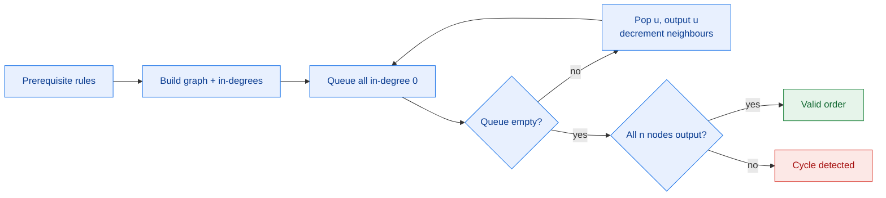

# 🧩 Topological Sort — Pattern Guide

**Navigation**: [< Previous](27_Union_Find_Pattern.md) | [Back to Index](00_INDEX.md) | [Next >](29_Trie_Pattern.md)

**Pattern 28** | [Prev](27_Union_Find_Pattern.md) | [Index](00_INDEX.md)

---

## 🔗 Bridge — Where This Chapter Fits

| Dimension | This chapter |
| --- | --- |
| **Builds on** | [Graph + Traversal](14_Graph_Plus_Traversal.md), [Queues](../02_Data_Structures/01d_Stack_Queue.md) |
| **You will learn** | Kahn's algorithm (in-degree queue), DFS-based ordering, cycle detection, and DAG DP such as longest paths and course scheduling |
| **Leads to** | [Shortest Paths](30_Shortest_Path_Pattern.md) (DAG shortest paths), [DP Pattern Recognition](16_DP_Pattern_Recognition.md), [Graph Algorithms](../03_Algorithms/05d_Graphs_Advanced_Algos.md) |
| **Abstraction level** | A tangle of "A must come before B" rules → **a linear order** or proof that none exists |

> [!NOTE]
> The full gap-free reading order and dependency graph are in the [Learning Path](00_LEARNING_PATH.md).

---

## 💬 Explain It Like a Study Partner — Topological Sort

### 1. The bottom line

If tasks have prerequisites, repeatedly do any task with no unmet prerequisites; if you get stuck, there is a cycle.

### 2. The textbook core

- A **topological order** of a directed graph lists every node before the nodes it points to; it exists iff the graph is acyclic (a DAG).
- **Kahn's algorithm:** compute in-degrees, queue the zeros, pop a node, decrement its neighbours' in-degrees, queue new zeros. If fewer than `n` nodes are output, there is a cycle.
- **DFS version:** output nodes in reverse finishing order; a back edge signals a cycle.
- Runs in `O(V + E)`.
- Orders are usually not unique; use a priority queue for the lexicographically smallest order.

### 3. The real-world analogy

**Getting dressed**: socks before shoes, shirt before jacket. You can pick any item whose requirements are done; if two items each wait for the other, you are stuck.

### 4. Walkthrough

1. Edges `0→1, 0→2, 1→3, 2→3`; in-degrees `[0,1,1,2]`.
2. Queue `[0]`; pop 0 → in-degrees of 1 and 2 become 0 → queue `[1, 2]`.
3. Pop 1 → 3 drops to 1; pop 2 → 3 drops to 0 → queue `[3]`.
4. Output `[0, 1, 2, 3]` (all 4 nodes → acyclic).

> [!NOTE]
> **Quick check:** How do you detect a cycle with Kahn's algorithm? *The output has fewer than `n` nodes.*

---

## ⚡ At a Glance



**How to read this diagram.** The loop pops nodes whose prerequisites are finished; the green exit means everything was scheduled, the red exit means some nodes were never freed, which proves a cycle.

| Signal in the problem | Think |
| --- | --- |
| "order the tasks / courses given prerequisites" | Topological sort |
| "can all courses be finished?" | Cycle detection via Kahn |
| "longest path / critical path" in a DAG | Topological order + DP |
| "build order", "install order" | Topological sort |
| "lexicographically smallest valid order" | Kahn with a min-heap |

---

## Historical Evolution

**Inventor / Originator:** Arthur Kahn published the queue-based algorithm in 1962 (*Topological sorting of large networks*); Tarjan (1976) gave the depth-first version. Project-scheduling methods of the late 1950s (CPM at DuPont, PERT for the US Navy Polaris programme) already needed dependency ordering, and Knuth presented the problem in *TAOCP* Vol. 1 (1968).

**Predecessor context:** Dependencies were resolved by repeated scanning or manual ordering.

**Evolution narrative:** Kahn's in-degree method made the process linear; the DFS formulation tied it to finishing times. Stuart Feldman's `make` (1976) popularised dependency ordering for build systems.

**Modern practice:** Every build tool, workflow engine and package resolver uses it.

- **CPM / PERT — 1957–58**: Project scheduling with precedence constraints
- **Kahn — 1962**: In-degree queue algorithm
- **Knuth — 1968**: Topological sorting in TAOCP Vol. 1
- **Tarjan — 1976**: DFS-based topological sort

---

## Template — Kahn's algorithm

```java
// Returns a topological order, or null if the graph has a cycle.
static List<Integer> topoKahn(int n, int[][] edges) {
    List<List<Integer>> g = new ArrayList<>();
    int[] indeg = new int[n];
    for (int i = 0; i < n; i++) g.add(new ArrayList<>());
    for (int[] e : edges) { g.get(e[0]).add(e[1]); indeg[e[1]]++; }

    ArrayDeque<Integer> q = new ArrayDeque<>();
    for (int i = 0; i < n; i++) if (indeg[i] == 0) q.add(i);

    List<Integer> order = new ArrayList<>();
    while (!q.isEmpty()) {
        int u = q.poll();
        order.add(u);
        for (int v : g.get(u)) if (--indeg[v] == 0) q.add(v);
    }
    return order.size() == n ? order : null;       // null = cycle
}
```

`topoKahn(4, {{0,1},{0,2},{1,3},{2,3}}) = [0, 1, 2, 3]`.

## DFS version (reverse post-order)

Run DFS with three colours (unvisited, in progress, done). Reaching an *in-progress* node means a cycle. Append a node to a list when it finishes, then reverse the list. Use the iterative form for graphs with long chains.

## DAG DP on top of the order

Once nodes are in topological order, many DAG problems become a single left-to-right pass: longest path `dist[v] = max(dist[u] + w)`, number of paths, earliest start times (critical path), and DAG shortest paths in `O(V + E)` even with negative weights.

## Variants

| Variant | Change |
| --- | --- |
| Lexicographically smallest order | Replace the queue with a min-heap |
| Parallel scheduling (levels) | Process the queue in layers; the layer count is the minimum number of rounds |
| Alien dictionary | Build edges from the first differing characters of adjacent words |
| Detect + report the cycle | Use the DFS colouring and keep a parent stack |

## Common mistakes

- Returning a partial order without checking for cycles.
- Building edges in the wrong direction (prerequisite → dependent).
- Counting duplicate edges twice in in-degree but once in adjacency (or the reverse).
- Assuming a unique answer.

## Complexity

| Version | Time | Space |
| --- | --- | --- |
| Kahn | `O(V + E)` | `O(V + E)` |
| DFS | `O(V + E)` | `O(V + E)` (plus recursion) |
| Kahn with min-heap | `O((V + E) log V)` | `O(V + E)` |

---

## 🏢 Enterprise Lens — Topological Sort

| Area | What top-tier engineering looks like |
| ---- | ------------------------------------ |
| **Where it runs in production** | Build systems (`make`, Gradle, Bazel), package managers, spreadsheet recalculation, task schedulers (Airflow DAGs), database migration ordering, course prerequisites |
| **Failure modes** | Not handling cycles (infinite or partial order returned silently); duplicate edges inflating in-degree incorrectly; assuming uniqueness of the order |
| **Testing and verification** | Compare with a transitive-closure cycle check on 1 000 random graphs and verify every edge goes forward in the produced order |

---

## 🧪 Practice Ladder

| Level | Problem | Idea |
| ----- | ------- | ---- |
| 1 | Course Schedule (LC 207) | Cycle detection |
| 2 | Course Schedule II (LC 210) | Produce the order |
| 3 | Alien Dictionary (LC 269) | Build edges from word order |
| 4 | Parallel Courses (LC 1136) | Layered Kahn |
| 5 | Sequence Reconstruction (LC 444) | Unique topological order |
| 6 | Longest Path in a DAG | Order + DP |

## Reality Check

> [!CAUTION]
> "Topological sort works on any graph." It requires a **directed acyclic** graph. For graphs with cycles, condense strongly connected components first (see [Graph Algorithms](../03_Algorithms/05d_Graphs_Advanced_Algos.md)).

---

[← 27_Union_Find_Pattern.md](27_Union_Find_Pattern.md) | [Index](00_INDEX.md) | [29_Trie_Pattern.md →](29_Trie_Pattern.md)
