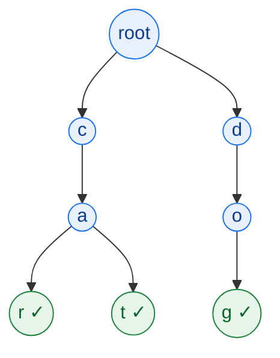

# 🧩 Trie (Prefix Tree) — Pattern Guide

> **Navigation**: [← Topological Sort](28_Topological_Sort_Pattern.md) | [Chapter index](00_INDEX.md) | [Shortest Paths (BFS, 0-1 BFS… →](30_Shortest_Path_Pattern.md)

**Pattern 29** | [Prev](28_Topological_Sort_Pattern.md) | [Index](00_INDEX.md)

---

## 🔗 Bridge — Where This Chapter Fits

| Dimension | This chapter |
| --- | --- |
| **Builds on** | [Trees](13_Tree_Plus_DFS_BFS.md), [Strings](18_String_Plus_Advanced.md), [HashMap + Counting](10_HashMap_Plus_Counting.md) |
| **You will learn** | Insert/search/prefix operations, prefix counts, word search with pruning, and when a hash set or sorted array is simpler |
| **Leads to** | [Bitwise Trie](../03_Algorithms/18_Bitwise_Trie_Java_Complete.md), [Aho–Corasick](../03_Algorithms/13_String_Algorithms_Complete.md), [Advanced DS](../03_Algorithms/07a_Advanced_DS_Core.md) |
| **Abstraction level** | Set of strings → **share prefixes in a tree** → prefix queries in `O(length)` independent of the number of words |

> [!NOTE]
> The full gap-free reading order and dependency graph are in the [Learning Path](00_LEARNING_PATH.md).

---

## 💬 Explain It Like a Study Partner — Trie

### 1. The bottom line

Store words letter by letter along tree paths so that all words with the same beginning share the same branch.

### 2. The textbook core

- Each node represents a prefix; children are indexed by the next character.
- A flag `end` marks complete words; an optional `pass` counter stores how many words go through the node.
- `insert`, `contains`, `startsWith` and `countWithPrefix` all cost `O(L)` for a word of length `L`.
- Space is `O(total characters × alphabet)` for array children; use a map for large alphabets.
- Wins when many queries share prefixes (autocomplete, prefix matching); a hash set is better for plain membership.

### 3. The real-world analogy

A **dictionary's thumb index**: first letter, then second letter, narrowing down without scanning all pages.

### 4. Walkthrough

1. Insert `car`, `cat`, `dog`.
2. Path `c → a → r*` and `c → a → t*` share `c → a`.
3. `startsWith("ca")` follows two links and succeeds.
4. `countWithPrefix("ca") = 2`, `contains("ca") = false` (no end flag).

> [!NOTE]
> **Quick check:** Why can a trie answer prefix queries faster than a hash set? *It follows only `L` links; a hash set stores whole words and cannot enumerate by prefix.*


### 5. Check yourself

**Q1.** Insert `car` and `cat`. How many trie nodes exist (excluding the root)?

<details><summary>Answer</summary>

**4**: `c`, `a`, `r`, `t`.

</details>

**Q2.** What is the difference between `contains` and `startsWith`?

<details><summary>Answer</summary>

`contains` also requires the end-of-word flag; `startsWith` only requires that the path exists.

</details>

**Q3.** What dominates memory in a trie with 26-slot children?

<details><summary>Answer</summary>

The child arrays: each node holds 26 references even when most are empty.

</details>

---

## ⚡ At a Glance



**How to read this diagram.** Each path from the root spells a prefix; green nodes (✓) mark complete words (`car`, `cat`, `dog`). `car` and `cat` share the `c → a` branch.

| Signal in the problem | Think |
| --- | --- |
| "words that start with …", autocomplete | Trie |
| "longest common prefix" of many strings | Trie or sorted compare |
| "word search" on a grid with a dictionary | Trie + DFS pruning |
| "maximum XOR of two numbers" | Bitwise trie |
| "replace words by their roots" | Trie of roots |

---

## Historical Evolution

**Inventor / Originator:** René de la Briandais described the structure in 1959 and Edward Fredkin coined the name *trie* (from re*trie*val) in 1960. Donald Morrison's PATRICIA tree (1968) compressed single-child chains; radix trees later became the basis of IP routing tables. Aho and Corasick (1975) added failure links for multi-pattern matching.

**Predecessor context:** Dictionaries were stored as sorted arrays (binary search) or hash tables, neither of which supports prefix enumeration efficiently.

**Evolution narrative:** Sharing prefixes makes lookup cost depend on the word length only and enables ordered traversal and prefix counting.

**Modern practice:** Autocomplete, routing tables (longest-prefix match), spell-checkers, and text-search automata.

- **de la Briandais — 1959**: Original description
- **Fredkin — 1960**: Named *trie* in *Trie Memory*
- **Morrison — 1968**: PATRICIA compressed trie
- **Aho & Corasick — 1975**: Multi-pattern matching automaton

---

## Template

```java
static class Trie {
    private final Trie[] next = new Trie[26];
    private boolean end;
    private int pass;                         // words passing through this node

    void insert(String w) {
        Trie t = this;
        for (char ch : w.toCharArray()) {
            int i = ch - 'a';
            if (t.next[i] == null) t.next[i] = new Trie();
            t = t.next[i];
            t.pass++;
        }
        t.end = true;
    }

    private Trie walk(String s) {
        Trie t = this;
        for (char ch : s.toCharArray()) {
            t = t.next[ch - 'a'];
            if (t == null) return null;
        }
        return t;
    }

    boolean contains(String w)        { Trie t = walk(w); return t != null && t.end; }
    boolean startsWith(String p)      { return walk(p) != null; }
    int countWithPrefix(String p)     { Trie t = walk(p); return t == null ? 0 : t.pass; }
}
```

Duplicate words are counted twice in `pass`; decide whether your problem wants that.

## Design choices

| Choice | Option A | Option B |
| --- | --- | --- |
| Children | `Trie[26]` — fast, memory-heavy | `HashMap<Character, Trie>` — compact for sparse/Unicode data |
| Compression | Plain trie | Radix/PATRICIA tree (merge single-child chains) |
| Deletion | Decrement `pass`, prune empty branches | Mark `end = false` only (lazy) |
| Multi-pattern search | Add failure links (Aho–Corasick) | Run one search per word |

## Pattern: grid word search with a trie

Build a trie of the dictionary, then DFS from each cell while walking the trie. Abandon a path as soon as the current prefix is not in the trie: that is the pruning that beats searching each word separately.

## Common mistakes

- Treating a prefix as a word (missing end flag).
- Assuming lowercase ASCII for all input.
- Recursion depth on very long words (use loops).
- Forgetting that memory, not time, is the limiting factor.

## Complexity

| Operation | Time | Space |
| --- | --- | --- |
| `insert`, `contains`, `startsWith` | `O(L)` | — |
| Build for `N` words of average length `L` | `O(N·L)` | `O(N·L·Σ)` worst case |

---

## 🏢 Enterprise Lens — Trie

| Area | What top-tier engineering looks like |
| ---- | ------------------------------------ |
| **Where it runs in production** | Autocomplete and spell-check, IP routing (longest-prefix match with radix tries), dictionary word games, URL routers, T9 predictors |
| **Failure modes** | Memory blow-up with 26-slot arrays for sparse data; forgetting the end flag so prefixes are mistaken for words; case/Unicode assumptions |
| **Testing and verification** | Compare `contains`, `startsWith` and `countWithPrefix` with brute-force string operations on 500 random word sets over a small alphabet |

---

## 🧪 Practice Ladder

| Level | Problem | Idea |
| ----- | ------- | ---- |
| 1 | Implement Trie (LC 208) | Core operations |
| 2 | Design Add and Search Words (LC 211) | Wildcard DFS |
| 3 | Replace Words (LC 648) | Shortest root prefix |
| 4 | Word Search II (LC 212) | Trie + grid DFS |
| 5 | Map Sum Pairs (LC 677) | Per-node sums |
| 6 | Maximum XOR of Two Numbers (LC 421) | Bitwise trie |

## Reality Check

> [!CAUTION]
> "Always use a trie for string sets." For membership alone a hash set is simpler and often faster; a trie pays off when you need **prefix** operations.

---

[← 28_Topological_Sort_Pattern.md](28_Topological_Sort_Pattern.md) | [Index](00_INDEX.md) | [30_Shortest_Path_Pattern.md →](30_Shortest_Path_Pattern.md)
