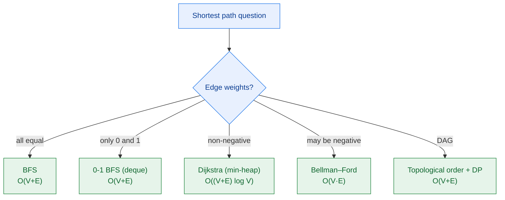
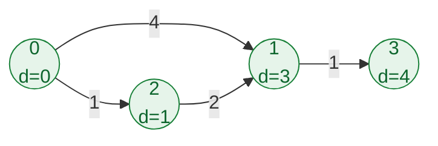

# 🧩 Shortest Paths (BFS, 0-1 BFS, Dijkstra, Bellman–Ford) — Pattern Guide

**Navigation**: [< Previous](29_Trie_Pattern.md) | [Back to Index](00_INDEX.md) | [Next >](31_Top_K_And_Two_Heaps_Pattern.md)

**Pattern 30** | [Prev](29_Trie_Pattern.md) | [Index](00_INDEX.md)

---

## 🔗 Bridge — Where This Chapter Fits

| Dimension | This chapter |
| --- | --- |
| **Builds on** | [Graph + Traversal](14_Graph_Plus_Traversal.md), [Heap + Greedy](15_Heap_Plus_GreedySelection.md), [Matrix + Grid](19_Matrix_Plus_Grid_Traversal.md) |
| **You will learn** | Choosing between BFS, 0-1 BFS, Dijkstra and Bellman–Ford by edge-weight properties; relaxation; stale queue entries |
| **Leads to** | [Topological Sort](28_Topological_Sort_Pattern.md) (DAG shortest paths), [Union-Find](27_Union_Find_Pattern.md) (MST), [Graph Algorithms](../03_Algorithms/05d_Graphs_Advanced_Algos.md) |
| **Abstraction level** | Exploring everything → **relax edges in the right order** → shortest distances; the order depends on the weights |

> [!NOTE]
> The full gap-free reading order and dependency graph are in the [Learning Path](00_LEARNING_PATH.md).

---

## 💬 Explain It Like a Study Partner — Shortest Paths

### 1. The bottom line

Pick the traversal by edge weights: all equal → BFS; only 0 and 1 → deque BFS; non-negative → Dijkstra; possibly negative → Bellman–Ford.

### 2. The textbook core

- **Relaxation:** if `dist[u] + w < dist[v]`, update `dist[v]`.
- **BFS** finds shortest paths in unweighted graphs in `O(V + E)`.
- **0-1 BFS:** push 0-weight edges to the front of a deque and 1-weight edges to the back.
- **Dijkstra:** min-heap of `(distance, node)`; skip stale entries; correct only for non-negative weights; `O((V + E) log V)`.
- **Bellman–Ford:** relax all edges `V − 1` times; handles negative edges; one more round detects negative cycles; `O(V·E)`.

### 3. The real-world analogy

**Choosing the fastest route on a map**: if every road takes the same time, count turns (BFS); if travel times differ, always extend the currently cheapest frontier (Dijkstra); if some roads give refunds (negative), you must re-check repeatedly (Bellman–Ford).

### 4. Walkthrough

1. Graph edges `0→1 (4)`, `0→2 (1)`, `2→1 (2)`, `1→3 (1)`.
2. Dijkstra from 0: pop `(0, node 0)` → `dist[1] = 4`, `dist[2] = 1`.
3. Pop `(1, node 2)` → `dist[1] = min(4, 1 + 2) = 3`.
4. Pop `(3, node 1)` → `dist[3] = 4`. The stale entry `(4, node 1)` is skipped later.

> [!NOTE]
> **Quick check:** Why does Dijkstra fail with negative edges? *A node finalised early can later be improved through a negative edge, which the algorithm never revisits.*

---

## ⚡ At a Glance



**How to read this diagram.** Follow the branch that matches your edge weights; each green box names the algorithm and its running time.

| Signal in the problem | Think |
| --- | --- |
| "minimum number of steps/moves" (unit cost) | BFS |
| "minimum cost" with 0/1 costs (flip, break wall) | 0-1 BFS |
| "cheapest route / minimum time" with positive weights | Dijkstra |
| negative edges or "at most k stops" | Bellman–Ford (k rounds) |
| "all pairs", `n ≤ 500` | Floyd–Warshall |

---

## Historical Evolution

**Inventor / Originator:** Edward Moore (1959) published BFS for mazes; Edsger Dijkstra published his algorithm in 1959 (*A note on two problems in connexion with graphs*); Bellman–Ford has several roots (Shimbel 1955, Ford 1956, Bellman 1958, Moore 1959); Floyd and Warshall gave all-pairs methods in 1962; Hart, Nilsson and Raphael introduced A* in 1968; Fredman and Tarjan's Fibonacci heaps (1984) improved Dijkstra's bound to `O(E + V log V)`.

**Predecessor context:** Shortest routes were found by enumerating paths.

**Evolution narrative:** Relaxation plus the right visiting order gives polynomial algorithms: the order is a queue (unit weights), a priority queue (non-negative weights), or repeated passes (negative weights).

**Modern practice:** Link-state routing (OSPF, IS-IS) runs Dijkstra; distance-vector routing (RIP) is Bellman–Ford; maps and games use A* with heuristics.

- **Moore — 1959**: BFS shortest path in a maze
- **Dijkstra — 1959**: Shortest paths with non-negative weights
- **Bellman / Ford / Moore — 1956–59**: Edge relaxation with negative weights
- **Floyd / Warshall — 1962**: All-pairs shortest paths
- **Hart, Nilsson, Raphael — 1968**: A* search

---

## Template

```java
static final long INF = Long.MAX_VALUE / 4;       // leaves room to add weights

// BFS: unweighted graph, returns hop counts (-1 = unreachable)
static int[] bfs(List<List<Integer>> g, int s) {
    int[] d = new int[g.size()];
    Arrays.fill(d, -1); d[s] = 0;
    ArrayDeque<Integer> q = new ArrayDeque<>(); q.add(s);
    while (!q.isEmpty()) {
        int u = q.poll();
        for (int v : g.get(u)) if (d[v] < 0) { d[v] = d[u] + 1; q.add(v); }
    }
    return d;
}

// Dijkstra: g.get(u) holds {v, weight}, weights >= 0
static long[] dijkstra(List<List<int[]>> g, int s) {
    long[] d = new long[g.size()];
    Arrays.fill(d, INF); d[s] = 0;
    PriorityQueue<long[]> pq = new PriorityQueue<>((a, b) -> Long.compare(a[1], b[1]));
    pq.add(new long[]{s, 0});
    while (!pq.isEmpty()) {
        long[] cur = pq.poll();
        int u = (int) cur[0];
        if (cur[1] > d[u]) continue;                 // stale entry
        for (int[] e : g.get(u)) {
            long nd = d[u] + e[1];
            if (nd < d[e[0]]) { d[e[0]] = nd; pq.add(new long[]{e[0], nd}); }
        }
    }
    return d;
}

// 0-1 BFS: weights are 0 or 1
static long[] zeroOneBfs(List<List<int[]>> g, int s) {
    long[] d = new long[g.size()];
    Arrays.fill(d, INF); d[s] = 0;
    ArrayDeque<Integer> dq = new ArrayDeque<>(); dq.add(s);
    while (!dq.isEmpty()) {
        int u = dq.pollFirst();
        for (int[] e : g.get(u)) {
            long nd = d[u] + e[1];
            if (nd < d[e[0]]) {
                d[e[0]] = nd;
                if (e[1] == 0) dq.addFirst(e[0]); else dq.addLast(e[0]);
            }
        }
    }
    return d;
}

// Bellman-Ford: edges {from, to, weight}; negative weights allowed (no negative cycle reachable)
static long[] bellmanFord(int n, int[][] edges, int s) {
    long[] d = new long[n];
    Arrays.fill(d, INF); d[s] = 0;
    for (int i = 0; i < n - 1; i++)
        for (int[] e : edges)
            if (d[e[0]] < INF && d[e[0]] + e[2] < d[e[1]]) d[e[1]] = d[e[0]] + e[2];
    return d;
}
```

## Dijkstra, step by step



**How to read this diagram.** Final distances are written inside the nodes. Node 1 is reached more cheaply through node 2 (`1 + 2 = 3`) than directly (`4`), which is exactly what relaxation discovers.

## Variants

| Need | Technique |
| --- | --- |
| Reconstruct the path | Store `parent[v]` whenever you relax `v` |
| Shortest path with at most `k` edges | Bellman–Ford for `k` rounds on a copy of the distances |
| Multi-source shortest distance | Push all sources at distance 0 |
| Heuristic-guided search | A* with an admissible heuristic |
| Grid with costs | Dijkstra over cells; BFS if unit cost |
| Paths in a DAG | Relax edges in topological order (handles negative weights) |

## Common mistakes

- Running Dijkstra with negative edges.
- Marking nodes visited when pushed instead of when popped (for weighted graphs).
- `Integer.MAX_VALUE + weight` overflow; use `long` with a safe infinity.
- Using BFS on a weighted graph.

## Complexity

| Algorithm | Time | Space |
| --- | --- | --- |
| BFS | `O(V + E)` | `O(V)` |
| 0-1 BFS | `O(V + E)` | `O(V)` |
| Dijkstra (binary heap) | `O((V + E) log V)` | `O(V + E)` |
| Bellman–Ford | `O(V·E)` | `O(V)` |

---

## 🏢 Enterprise Lens — Shortest Paths

| Area | What top-tier engineering looks like |
| ---- | ------------------------------------ |
| **Where it runs in production** | Navigation and routing (OSPF uses Dijkstra, RIP uses Bellman–Ford), network latency maps, game pathfinding (A* extends Dijkstra), logistics and supply-chain planning |
| **Failure modes** | Using Dijkstra with negative weights; forgetting to skip stale heap entries (performance, not correctness); `int` overflow with infinity sentinels |
| **Testing and verification** | Dijkstra compared with Bellman–Ford, 0-1 BFS with Bellman–Ford, and BFS with unit-weight Bellman–Ford on 1 000 random graphs |

---

## 🧪 Practice Ladder

| Level | Problem | Idea |
| ----- | ------- | ---- |
| 1 | Shortest Path in Binary Matrix (LC 1091) | BFS on a grid |
| 2 | Network Delay Time (LC 743) | Dijkstra |
| 3 | Cheapest Flights Within K Stops (LC 787) | Bellman–Ford with `k` rounds |
| 4 | Minimum Obstacle Removal to Reach Corner (LC 2290) | 0-1 BFS |
| 5 | Path with Minimum Effort (LC 1631) | Dijkstra with max-edge cost |
| 6 | Word Ladder (LC 127) | BFS over implicit graph |

## Reality Check

> [!CAUTION]
> "Dijkstra is always the answer." It is the answer only for non-negative weights; unit weights need only BFS, and some problems (DAGs, small `k`) have simpler solutions.

---

[← 29_Trie_Pattern.md](29_Trie_Pattern.md) | [Index](00_INDEX.md) | [31_Top_K_And_Two_Heaps_Pattern.md →](31_Top_K_And_Two_Heaps_Pattern.md)
