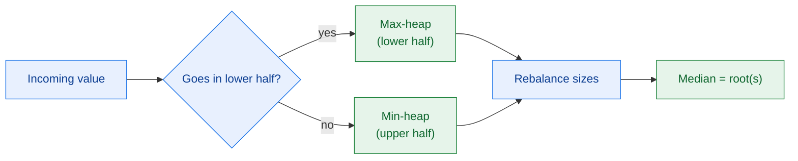

# 🧩 Top-K & Two Heaps — Pattern Guide

**Navigation**: [< Previous](30_Shortest_Path_Pattern.md) | [Back to Index](00_INDEX.md) | [Next >](00_PATTERN_MASTER_GUIDE.md)

**Pattern 31** | [Prev](30_Shortest_Path_Pattern.md) | [Index](00_INDEX.md)

---

## 🔗 Bridge — Where This Chapter Fits

| Dimension | This chapter |
| --- | --- |
| **Builds on** | [Heap + Greedy Selection](15_Heap_Plus_GreedySelection.md), [HashMap + Counting](10_HashMap_Plus_Counting.md), [Heaps](../02_Data_Structures/01f_Trees_Heaps.md) |
| **You will learn** | Bounded heaps for K largest/most frequent, running median with two heaps, comparator design, and when quickselect or bucket sort is better |
| **Leads to** | [Intervals](21_Intervals_Pattern.md) (min-heap of end times), [Probabilistic structures](../03_Algorithms/07d_Probabilistic_DS_Deep.md) (heavy hitters in streams) |
| **Abstraction level** | Full sort `O(n log n)` → **bounded heap `O(n log K)`** → streaming/approximate versions |

> [!NOTE]
> The full gap-free reading order and dependency graph are in the [Learning Path](00_LEARNING_PATH.md).

---

## 💬 Explain It Like a Study Partner — Top-K & Two Heaps

### 1. The bottom line

To keep the K best items of a stream, hold a heap of size K whose root is the worst of the K — anything better evicts it.

### 2. The textbook core

- K largest → **min-heap** of size K; K smallest → max-heap of size K.
- Top-K frequent: count with a hash map, then a bounded heap on counts (`O(n log K)`); bucket sort by frequency gives `O(n)`.
- **Two heaps:** a max-heap for the lower half and a min-heap for the upper half, kept within one element in size; the median is the root(s).
- Rebalance after every insertion; the invariant is `maxHeap.size() ∈ {minHeap.size(), minHeap.size() + 1}`.
- Quickselect (Hoare, 1961) finds the K-th element in expected `O(n)` but is not streaming.

### 3. The real-world analogy

A **leaderboard that only shows the top 10**: when a new score arrives, compare it with the 10th place and either push someone off or ignore it.

### 4. Walkthrough

1. Running median of `5, 15, 1, 3`.
2. Add 5 → lower `{5}`; add 15 → lower `{5}`, upper `{15}`; median `10`.
3. Add 1 → lower `{5, 1}`, upper `{15}`; median `5`.
4. Add 3 → lower `{3, 1}`, upper `{5, 15}`; median `(3 + 5) / 2 = 4`.

> [!NOTE]
> **Quick check:** Why a min-heap for the K largest? *Its root is the smallest of the K kept, so it is the element to evict.*

---

## ⚡ At a Glance



**How to read this diagram.** The two heaps split the data around the median; after each insertion their sizes are rebalanced so the median is always at the top of one or both heaps.

| Signal in the problem | Think |
| --- | --- |
| "K-th largest / smallest" | Bounded heap or quickselect |
| "K most frequent" | Count map + bounded heap or buckets |
| "median of a stream" | Two heaps |
| "merge K sorted lists/streams" | Min-heap of heads |
| "sliding window median" | Two heaps with lazy deletion (or balanced tree) |

---

### Historical Evolution

**Inventor / Originator:** The binary heap is due to J. W. J. Williams (1964). C. A. R. Hoare's FIND (quickselect, 1961) selects the K-th element in expected linear time; Blum, Floyd, Pratt, Rivest and Tarjan (1973) proved worst-case linear selection (*median of medians*). For streams, Misra and Gries (1982) and Metwally et al. (Space-Saving, 2005) track frequent items with bounded memory; Cormode and Muthukrishnan's Count-Min Sketch appeared in 2005.

**Predecessor context:** Sorting everything, `O(n log n)`, or repeated linear scans for the maximum.

**Evolution narrative:** A bounded heap keeps only the K candidates that matter; two heaps maintain a partition around the median in `O(log n)` per element.

**Modern practice:** Dashboards, monitoring (rolling percentiles), search ranking, and streaming analytics.

- **Hoare — 1961**: FIND / quickselect
- **Williams — 1964**: Binary heap
- **Blum et al. — 1973**: Worst-case linear-time selection
- **Misra & Gries — 1982**: Frequent items in a stream
- **Metwally et al. — 2005**: Space-Saving heavy hitters

---

## Template

```java
// K-th largest: min-heap of size k
static int kthLargest(int[] a, int k) {
    PriorityQueue<Integer> h = new PriorityQueue<>();
    for (int x : a) { h.add(x); if (h.size() > k) h.poll(); }
    return h.peek();
}

// Running median with two heaps
static class MedianFinder {
    private final PriorityQueue<Integer> lo = new PriorityQueue<>(Collections.reverseOrder()); // max-heap
    private final PriorityQueue<Integer> hi = new PriorityQueue<>();                           // min-heap

    void add(int x) {
        lo.add(x);
        hi.add(lo.poll());                       // move the largest of lo to hi
        if (hi.size() > lo.size()) lo.add(hi.poll());
    }
    double median() {
        return lo.size() > hi.size() ? lo.peek() : (lo.peek() + hi.peek()) / 2.0;
    }
}

// Top-K frequent values (ties broken by smaller value first)
static int[] topKFrequent(int[] a, int k) {
    Map<Integer, Integer> f = new HashMap<>();
    for (int x : a) f.merge(x, 1, Integer::sum);
    PriorityQueue<int[]> h = new PriorityQueue<>(
        (x, y) -> x[1] != y[1] ? Integer.compare(x[1], y[1]) : Integer.compare(y[0], x[0]));
    for (Map.Entry<Integer, Integer> e : f.entrySet()) {
        h.add(new int[]{e.getKey(), e.getValue()});
        if (h.size() > k) h.poll();
    }
    int[] out = new int[h.size()];
    for (int i = out.length - 1; i >= 0; i--) out[i] = h.poll()[0];
    return out;
}
```

`kthLargest({3,2,1,5,6,4}, 2) = 5`; the running median of `5, 15, 1, 3` ends at `4.0`.

## Choosing the right tool

| Situation | Best choice | Why |
| --- | --- | --- |
| K small, data streaming | Bounded heap | `O(log K)` per item, `O(K)` memory |
| K large (≈ n/2) in memory | Quickselect | Expected `O(n)` |
| Counts bounded by `n` | Bucket by frequency | `O(n)` |
| Data too large for memory | External merge / sketches | Heap per chunk, then merge |
| Median with deletions | Two heaps + lazy deletion, or balanced tree | Heaps cannot delete arbitrary items |

## Common mistakes

- Heap of size `n` instead of size `K` (wastes memory and time).
- Comparator with `a - b` (overflow); use `Integer.compare`.
- Not rebalancing after each insertion.
- Average of two `int`s overflowing: add as `long` or use `a + (b − a) / 2.0`.

## Complexity

| Task | Time | Space |
| --- | --- | --- |
| K-th largest (heap) | `O(n log K)` | `O(K)` |
| Running median | `O(log n)` per insert, `O(1)` query | `O(n)` |
| Top-K frequent | `O(n + m log K)` for `m` distinct values | `O(m)` |

---

## 🏢 Enterprise Lens — Top-K & Two Heaps

| Area | What top-tier engineering looks like |
| ---- | ------------------------------------ |
| **Where it runs in production** | Trending topics, leaderboards, anomaly detection (median/percentile tracking), scheduling by priority, k-way merges in databases |
| **Failure modes** | Using a max-heap of size n; comparator that is inconsistent with ties; not rebalancing both heaps; integer overflow when averaging two ints |
| **Testing and verification** | K-th largest vs full sort (2 000 cases), running median vs sorted-list median after every insert, top-K frequent vs sort-by-count with deterministic tie-breaks |
| **Review checklist** | Complexity stated for time **and** space · invariant stated · edge cases listed (empty, one element, duplicates, extremes) · behaviour at 10× data understood |

---

## 🧪 Practice Ladder

| Level | Problem | Idea |
| ----- | ------- | ---- |
| 1 | Kth Largest Element in an Array (LC 215) | Bounded min-heap |
| 2 | Top K Frequent Elements (LC 347) | Count + heap or buckets |
| 3 | Find Median from Data Stream (LC 295) | Two heaps |
| 4 | Merge k Sorted Lists (LC 23) | Min-heap of heads |
| 5 | K Closest Points to Origin (LC 973) | Max-heap of size K |
| 6 | Sliding Window Median (LC 480) | Two heaps with lazy deletion |

## Reality Check

> [!CAUTION]
> "A heap always beats sorting." For a one-off query on a small array, sorting is simpler; the heap wins on streams, large `n` with small `K`, and when you need an answer after every insertion.

---

[← 30_Shortest_Path_Pattern.md](30_Shortest_Path_Pattern.md) | [Index](00_INDEX.md) | [00_PATTERN_MASTER_GUIDE.md →](00_PATTERN_MASTER_GUIDE.md)
