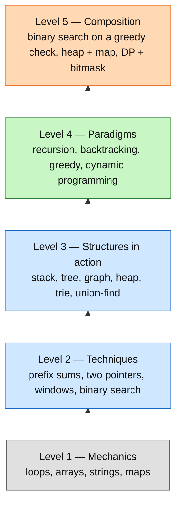
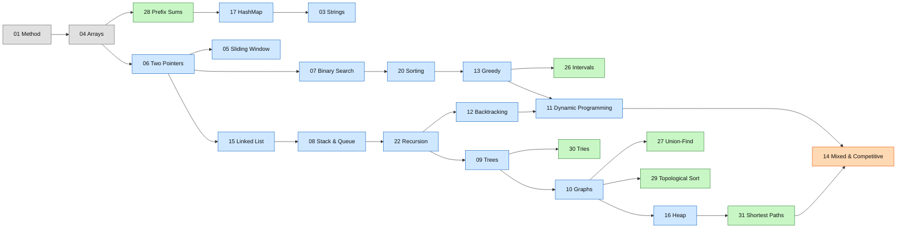

# Learning Path — Problem Solving

> **Navigation**: [Chapter index](00_INDEX.md) | [Patterns & Templates](../04_Patterns_Templates/00_INDEX.md) | [Algorithms](../03_Algorithms/00_INDEX.md)

This page explains how the practice pages fit together, what each assumes, and where the gaps between topics are bridged.

---

## 1. The Abstraction Ladder

**How to read this diagram.** Read bottom to top. Skipping levels is what makes problems feel "random": each level reuses the one below it.

## 2. Dependency Graph

**How to read this diagram.** Arrows mean "read before". Green pages were added after the audit to cover topics that had patterns but no practice problems.

## 3. Recommended Reading Order with Bridges

| # | Page | Carry in | New problem it solves | Hands off to |
| - | ---- | -------- | --------------------- | ------------ |
| 1 | [Method](01_Intro_Checklist.md) | Basic programming | A repeatable approach | Every page |
| 2 | [Arrays](04_Arrays.md) | Loops | One pass with a running summary | Prefix sums, pointers |
| 3 | [Prefix Sums](28_Prefix_Sum_Problems.md) 🆕 | Arrays | Range queries and updates | Hashing, windows |
| 4 | [HashMap](17_HashMap_Hashing.md) | Prefix sums | `O(1)` lookup of what you have seen | Strings, graphs |
| 5 | [Strings](03_Strings.md) | Hashing, arrays | Canonical forms and counts | Tries |
| 6 | [Math](02_Math_Numbers.md) | Loops | Arithmetic with overflow and modulus | Bits, DP |
| 7 | [Two Pointers](06_Two_Pointers.md) | Sorted arrays | Pair search without nesting | Windows, lists |
| 8 | [Sliding Window](05_Sliding_Window.md) | Two pointers | Overlapping ranges | Prefix sums when negatives appear |
| 9 | [Binary Search](07_Binary_Search.md) | Sorted data | Halving search spaces | Greedy checks |
| 10 | [Sorting](20_Sorting.md) | Comparators | Order as a first step | Greedy, intervals |
| 11 | [Linked List](15_LinkedList.md) | Pointers | Rewiring | Stacks, LRU design |
| 12 | [Stack & Queue](08_Stack_Queue.md) | Lists | Nested/ordered state | Recursion, BFS |
| 13 | [Recursion & Subsets](22_Recursion_Subsets.md) | Stacks | Self-similarity | Backtracking, trees |
| 14 | [Backtracking](12_Backtracking.md) | Recursion | Enumeration with pruning | DP |
| 15 | [Trees](09_Trees.md) | Recursion | Hierarchical data | Graphs, tries |
| 16 | [Tries](30_Trie_Problems.md) 🆕 | Trees, strings | Prefix queries | Bitwise tricks |
| 17 | [Graphs](10_Graphs.md) | Trees | Cycles and components | Union-find, DAGs |
| 18 | [Union-Find](27_Union_Find_Problems.md) 🆕 | Graphs | Merging groups | MST |
| 19 | [Topological Sort](29_Topological_Sort_Problems.md) 🆕 | Graphs | Dependency ordering | DAG DP |
| 20 | [Heap](16_Heap.md) | Trees | Best remaining item | Shortest paths |
| 21 | [Shortest Paths](31_Shortest_Path_Problems.md) 🆕 | Heaps, BFS | Weighted routes | Mixed problems |
| 22 | [Greedy](13_Greedy.md) | Sorting | Safe local choices | Intervals, DP |
| 23 | [Intervals](26_Interval_Problems.md) 🆕 | Sorting, greedy | Range scheduling | DP |
| 24 | [Dynamic Programming](11_Dynamic_Programming.md) | Backtracking, greedy | Overlapping subproblems | Mixed |
| 25 | [Bit Manipulation](18_BitManipulation.md) | Math | Bits as flags | Bitmask DP |
| 26 | [Matrix](19_Matrix.md) | Graphs, DP | Grid problems | Mixed |
| 27 | [Design](21_Design.md) | Hash maps, lists, heaps | Composing structures | Mixed |
| 28 | [Mixed & Competitive](14_Mixed_Competitive.md) | Everything | Pattern composition | — |

## 4. Coverage Matrix — Question Shape → Page

| If the question asks… | Page |
| --- | --- |
| range sums or many range updates | [Prefix Sums](28_Prefix_Sum_Problems.md) |
| pair or triple with a property | [Two Pointers](06_Two_Pointers.md), [HashMap](17_HashMap_Hashing.md) |
| best contiguous window | [Sliding Window](05_Sliding_Window.md), [Arrays](04_Arrays.md) |
| smallest value such that something holds | [Binary Search](07_Binary_Search.md) |
| connected? merged? | [Graphs](10_Graphs.md), [Union-Find](27_Union_Find_Problems.md) |
| order with prerequisites | [Topological Sort](29_Topological_Sort_Problems.md) |
| cheapest route | [Shortest Paths](31_Shortest_Path_Problems.md) |
| overlapping ranges | [Intervals](26_Interval_Problems.md) |
| prefix of many strings | [Tries](30_Trie_Problems.md) |
| all combinations | [Backtracking](12_Backtracking.md), [Recursion](22_Recursion_Subsets.md) |
| optimal count with repeated subproblems | [Dynamic Programming](11_Dynamic_Programming.md) |
| top K / median | [Heap](16_Heap.md) |

## 5. Gaps Found by the Audit and How They Were Closed

| Gap | Resolution |
| --- | --- |
| Patterns without a practice page: intervals, union-find, prefix sums, topological sort, tries, shortest paths | New pages [26](26_Interval_Problems.md)–[31](31_Shortest_Path_Problems.md), each with tested Java |
| Reading order in the index did not match the file numbers | [Index](00_INDEX.md) rewritten with the true order |
| "Historical Evolution" and "Real-world anchor" claims in most pages were invented or misattributed (for example a Dijkstra/ARPANET link, several company incidents) | Rewritten from verifiable history; incident anchors replaced with documented cases (Ariane 5, Therac-25, Heartbleed, Cloudflare 2019 regex outage, Bloch 2006 binary search) |
| Duplicated challenge blocks, stray navigation lines, multiple top-level headings | Removed or normalised |
| Origin stories mixed documented history with dramatised scenes | [Problem Origins](25_Problem_Origins.md) now marks documented versus illustrative |
| Company tags presented as fact | Marked community-reported and unverified |
| Pages over 1,000 lines | Split into chapter hubs and topic pages |

## 6. Quality Standard Every Page Is Held To

| Dimension | Standard |
| --- | --- |
| Structure | Bridge → explainer → check yourself → problems with brute force and optimised solution → Enterprise Lens → reality check |
| Correctness | Code compiled and compared with a brute force |
| History | Only attributable claims; illustrations are labelled |
| Navigation | Previous/next follow the reading order |

---

[Index](00_INDEX.md)
