> **Navigation**: [Back to Index](../00_MASTER_INDEX.md) | [Next >](23_Edge_Cases.md)

> **Problems 01/14** |  | [Index](../00_MASTER_INDEX.md) | [Next](02_Math_Numbers.md)

---

# 🧪 PRACTICE PROBLEMS WITH SOLUTIONS

## Solve these problems to test your understanding!

---

## 📚 TABLE OF CONTENTS

1. [Two Pointers Problems](#two-pointers-problems)
2. [Sliding Window Problems](#sliding-window-problems)
3. [Binary Search Problems](#binary-search-problems)
4. [Array Problems](#array-problems)
5. [String Problems](#string-problems)
6. [Math Problems](#math-problems)

---

## 🧩 Two Pointers Problems

### Problem 1: Container With Most Water


> PROBLEM: Container With Most Water
>
> Given array of heights, find two lines that form container with
> maximum water.
>
> Visual:
> |
> |     |     |
> |  |  |  |  |  |
> |  |  |  |  |  |  |  |
> ─────────────────────
> 1  8  6  2  5  4  8  3  7
> ↑                       ↑
> These two lines form max area
> Area = min(8, 7) × distance = 7 × 7 = 49
>


**Try it yourself first!**

<details>
<summary>Click to see solution</summary>

```java
/**
 * Two pointers from both ends
 * Area = min(height[left], height[right]) × (right - left)
 * Move the shorter line inward (to potentially find taller one)
 */
public int maxArea(int[] height) {
    int left = 0;
    int right = height.length - 1;
    int maxWater = 0;

    while (left < right) {
        // Calculate current area
        int width = right - left;
        int h = Math.min(height[left], height[right]);
        int area = width * h;
        maxWater = Math.max(maxWater, area);

        // Move shorter line inward
        if (height[left] < height[right]) {
            left++;
        } else {
            right--;
        }
    }
    return maxWater;
}
// Time: O(N), Space: O(1)
```

</details>

---

### Problem 2: 3Sum (Find triplets that sum to zero)

```
╔═══════════════════════════════════════════════════════════════════════════╗
║  PROBLEM: 3Sum                                                            ║
╠═══════════════════════════════════════════════════════════════════════════╣
║                                                                           ║
║  Find all unique triplets that sum to zero.                               ║
║                                                                           ║
║  Input: [-1, 0, 1, 2, -1, -4]                                             ║
║  Output: [[-1, -1, 2], [-1, 0, 1]]                                        ║
║                                                                           ║
║  Approach:                                                                ║
║  1. Sort array                                                            ║
║  2. For each element, use two pointers to find pairs                      ║
║                                                                           ║
║  Sorted: [-4, -1, -1, 0, 1, 2]                                            ║
║            ↑                                                              ║
║           fix one, find pair that sums to -nums[i]                        ║
║                                                                           ║
╚═══════════════════════════════════════════════════════════════════════════╝
```

**Flow:**
- PROBLEM: 3Sum
- ↓
- Find all unique triplets that sum to zero.
- ↓
- Input: [-1, 0, 1, 2, -1, -4]
- ↓
- Output: [[-1, -1, 2], [-1, 0, 1]]
- ↓
- Approach:
- ↓
- 1. Sort array
- ↓
- 2. For each element, use two pointers to find pairs

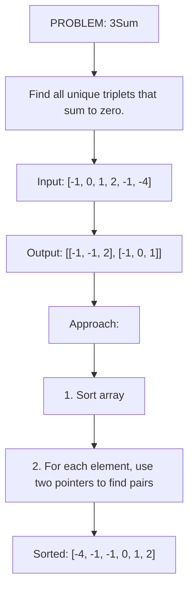

**Try it yourself first!**

<details>
<summary>Click to see solution</summary>

```java
public List<List<Integer>> threeSum(int[] nums) {
    List<List<Integer>> result = new ArrayList<>();
    Arrays.sort(nums);  // Sort first!

    for (int i = 0; i < nums.length - 2; i++) {
        // Skip duplicates for first number
        if (i > 0 && nums[i] == nums[i - 1]) continue;

        // Two pointers for remaining two numbers
        int left = i + 1;
        int right = nums.length - 1;
        int target = -nums[i];  // Need two numbers that sum to this

        while (left < right) {
            int sum = nums[left] + nums[right];

            if (sum == target) {
                result.add(Arrays.asList(nums[i], nums[left], nums[right]));

                // Skip duplicates
                while (left < right && nums[left] == nums[left + 1]) left++;
                while (left < right && nums[right] == nums[right - 1]) right--;

                left++;
                right--;
            } else if (sum < target) {
                left++;
            } else {
                right--;
            }
        }
    }
    return result;
}
// Time: O(N²), Space: O(1) excluding output
```

</details>

---

## 🧩 Sliding Window Problems

### Problem 3: Longest Substring Without Repeating Characters

```
PROBLEM: Longest Substring Without Repeating Characters
──────────────────────────────────────────────────

Input: "abcabcbb"
Output: 3 ("abc")

Visual:
a b c a b c b b
↑─────↑
└─────┘ "abc" length 3

  ↑───────↑
  └───────┘ "bca" length 3

When we see repeat, shrink window from left

```

**Flow:**
- Root
- ↓
- 'abc' length 3
- ↓
- Root
- ↓
- 'bca' length 3

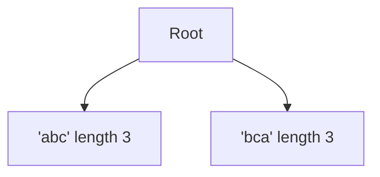

**Try it yourself first!**

<details>
<summary>Click to see solution</summary>

```java
public int lengthOfLongestSubstring(String s) {
    Set<Character> seen = new HashSet<>();
    int maxLength = 0;
    int left = 0;

    for (int right = 0; right < s.length(); right++) {
        char c = s.charAt(right);

        // Shrink window while we have duplicate
        while (seen.contains(c)) {
            seen.remove(s.charAt(left));
            left++;
        }

        // Add current character
        seen.add(c);

        // Update max length
        maxLength = Math.max(maxLength, right - left + 1);
    }
    return maxLength;
}
// Time: O(N), Space: O(min(N, 26))
```

</details>

---

### Problem 4: Maximum Sum of Subarray of Size K

```
PROBLEM: Maximum Sum Subarray of Size K
──────────────────────────────────────────────────

Input: arr = [2, 1, 5, 1, 3, 2], k = 3
Output: 9 (subarray [5, 1, 3])

Visual:
┌─────────┐
2  1  5  1  3  2     sum = 8
└─────────┘

   ┌─────────┐
2  1  5  1  3  2     sum = 7
   └─────────┘

      ┌─────────┐
2  1  5  1  3  2     sum = 9 ⭐ MAX
      └─────────┘

```

**Flow:**
- 2 1 5 1
- ↓
- 1 5 1 3
- ↓
- 5 1 3 2

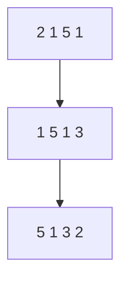

**Try it yourself first!**

<details>
<summary>Click to see solution</summary>

```java
public int maxSumSubarrayK(int[] arr, int k) {
    // Build first window
    int windowSum = 0;
    for (int i = 0; i < k; i++) {
        windowSum += arr[i];
    }

    int maxSum = windowSum;

    // Slide window
    for (int i = k; i < arr.length; i++) {
        windowSum = windowSum + arr[i] - arr[i - k];  // Add new, remove old
        maxSum = Math.max(maxSum, windowSum);
    }
    return maxSum;
}
// Time: O(N), Space: O(1)
```

</details>

---

## 🔍 Binary Search Problems

### Problem 5: Search in Rotated Sorted Array

```
╔═══════════════════════════════════════════════════════════════════════════╗
║  PROBLEM: Search in Rotated Sorted Array                                  ║
╠═══════════════════════════════════════════════════════════════════════════╣
║                                                                           ║
║  Array was sorted, then rotated at some pivot.                            ║
║  Find target in O(log N).                                                 ║
║                                                                           ║
║  Original: [0, 1, 2, 4, 5, 6, 7]                                          ║
║  Rotated:  [4, 5, 6, 7, 0, 1, 2]  (rotated at pivot 4)                    ║
║  Target: 0                                                                ║
║  Output: 4 (index of 0)                                                   ║
║                                                                           ║
║  Key insight: One half is ALWAYS sorted!                                  ║
║                                                                           ║
║  [4, 5, 6, 7, 0, 1, 2]                                                    ║
║   ↑        ↑        ↑                                                     ║
║  low      mid     high                                                    ║
║                                                                           ║
║  Left half [4,5,6,7] is sorted (arr[low] <= arr[mid])                     ║
║  Check if target is in sorted half, else search other half                ║
║                                                                           ║
╚═══════════════════════════════════════════════════════════════════════════╝
```

**Flow:**
- PROBLEM: Search in Rotated Sorted Array
- ↓
- Array was sorted, then rotated at some pivot.
- ↓
- Find target in O(log N).
- ↓
- Original: [0, 1, 2, 4, 5, 6, 7]
- ↓
- Rotated: [4, 5, 6, 7, 0, 1, 2] (rotated at pivot 4)
- ↓
- Target: 0
- ↓
- Output: 4 (index of 0)

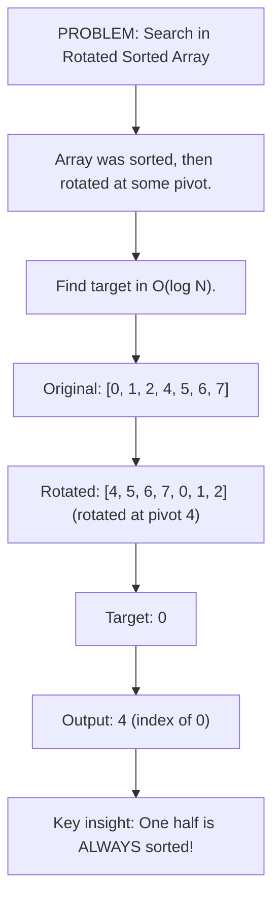

**Try it yourself first!**

<details>
<summary>Click to see solution</summary>

```java
public int search(int[] nums, int target) {
    int low = 0, high = nums.length - 1;

    while (low <= high) {
        int mid = low + (high - low) / 2;

        if (nums[mid] == target) return mid;

        // Check which half is sorted
        if (nums[low] <= nums[mid]) {
            // Left half is sorted
            if (target >= nums[low] && target < nums[mid]) {
                high = mid - 1;  // Target in left half
            } else {
                low = mid + 1;   // Target in right half
            }
        } else {
            // Right half is sorted
            if (target > nums[mid] && target <= nums[high]) {
                low = mid + 1;   // Target in right half
            } else {
                high = mid - 1;  // Target in left half
            }
        }
    }
    return -1;
}
// Time: O(log N), Space: O(1)
```

</details>

---

### Problem 6: Find Peak Element

```
╔═══════════════════════════════════════════════════════════════════════════╗
║  PROBLEM: Find Peak Element                                               ║
╠═══════════════════════════════════════════════════════════════════════════╣
║                                                                           ║
║  Peak = element greater than its neighbors.                               ║
║  nums[-1] and nums[n] are considered -∞.                                  ║
║                                                                           ║
║  Input: [1, 2, 3, 1]                                                      ║
║  Output: 2 (index of element 3)                                           ║
║                                                                           ║
║  Visual:                                                                  ║
║         3 ← peak                                                          ║
║        /\                                                                 ║
║       2  \                                                                ║
║      /    1                                                               ║
║     1                                                                     ║
║                                                                           ║
║  Binary Search approach:                                                  ║
║  - If arr[mid] < arr[mid+1], peak is on RIGHT                             ║
║  - If arr[mid] > arr[mid+1], peak is on LEFT (including mid)              ║
║                                                                           ║
╚═══════════════════════════════════════════════════════════════════════════╝
```

**Flow:**
- PROBLEM: Find Peak Element
- ↓
- Peak = element greater than its neighbors.
- ↓
- nums[-1] and nums[n] are considered -∞.
- ↓
- Input: [1, 2, 3, 1]
- ↓
- Output: 2 (index of element 3)
- ↓
- Visual:
- ↓
- 3 ← peak

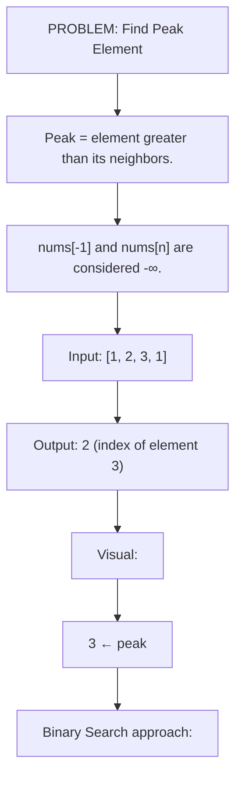

**Try it yourself first!**

<details>
<summary>Click to see solution</summary>

```java
public int findPeakElement(int[] nums) {
    int low = 0, high = nums.length - 1;

    while (low < high) {  // Note: < not <=
        int mid = low + (high - low) / 2;

        if (nums[mid] < nums[mid + 1]) {
            // Going uphill, peak is on right
            low = mid + 1;
        } else {
            // Going downhill, peak is on left (or at mid)
            high = mid;  // Note: mid, not mid - 1
        }
    }
    return low;  // low == high at this point
}
// Time: O(log N), Space: O(1)
```

</details>

---

## 📊 Array Problems

### Problem 7: Rotate Array

```
╔═══════════════════════════════════════════════════════════════════════════╗
║  PROBLEM: Rotate Array                                                    ║
╠═══════════════════════════════════════════════════════════════════════════╣
║                                                                           ║
║  Rotate array to the right by k steps.                                    ║
║                                                                           ║
║  Input: [1, 2, 3, 4, 5, 6, 7], k = 3                                      ║
║  Output: [5, 6, 7, 1, 2, 3, 4]                                            ║
║                                                                           ║
║  Approach: Three reverses                                                 ║
║                                                                           ║
║  Original:    [1, 2, 3, 4, 5, 6, 7]                                       ║
║  Reverse all: [7, 6, 5, 4, 3, 2, 1]                                       ║
║  Reverse [0, k-1]: [5, 6, 7, 4, 3, 2, 1]                                  ║
║  Reverse [k, n-1]: [5, 6, 7, 1, 2, 3, 4] ✓                                ║
║                                                                           ║
╚═══════════════════════════════════════════════════════════════════════════╝
```

**Flow:**
- PROBLEM: Rotate Array
- ↓
- Rotate array to the right by k steps.
- ↓
- Input: [1, 2, 3, 4, 5, 6, 7], k = 3
- ↓
- Output: [5, 6, 7, 1, 2, 3, 4]
- ↓
- Approach: Three reverses
- ↓
- Original: [1, 2, 3, 4, 5, 6, 7]
- ↓
- Reverse all: [7, 6, 5, 4, 3, 2, 1]

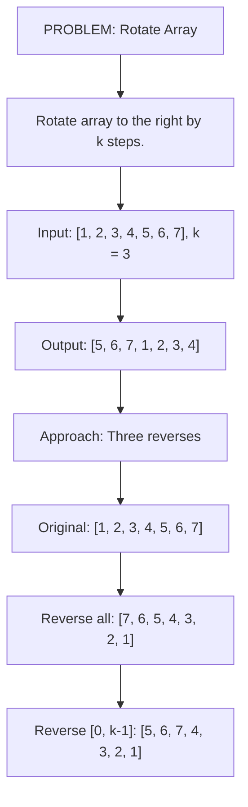

**Try it yourself first!**

<details>
<summary>Click to see solution</summary>

```java
public void rotate(int[] nums, int k) {
    k = k % nums.length;  // Handle k > length

    reverse(nums, 0, nums.length - 1);  // Reverse all
    reverse(nums, 0, k - 1);            // Reverse first k
    reverse(nums, k, nums.length - 1);  // Reverse rest
}

private void reverse(int[] nums, int start, int end) {
    while (start < end) {
        int temp = nums[start];
        nums[start] = nums[end];
        nums[end] = temp;
        start++;
        end--;
    }
}
// Time: O(N), Space: O(1)
```

</details>

---

### Problem 8: Product of Array Except Self

```
╔═══════════════════════════════════════════════════════════════════════════╗
║  PROBLEM: Product of Array Except Self                                    ║
╠═══════════════════════════════════════════════════════════════════════════╣
║                                                                           ║
║  Return array where each element is product of all OTHER elements.        ║
║  Cannot use division.                                                     ║
║                                                                           ║
║  Input: [1, 2, 3, 4]                                                      ║
║  Output: [24, 12, 8, 6]                                                   ║
║                                                                           ║
║  output[0] = 2 * 3 * 4 = 24                                               ║
║  output[1] = 1 * 3 * 4 = 12                                               ║
║  output[2] = 1 * 2 * 4 = 8                                                ║
║  output[3] = 1 * 2 * 3 = 6                                                ║
║                                                                           ║
║  Approach: Left products × Right products                                 ║
║                                                                           ║
║  Left products:  [1, 1, 2, 6]    (product of all to the left)             ║
║  Right products: [24, 12, 4, 1]  (product of all to the right)            ║
║  Result:         [24, 12, 8, 6]  (multiply left × right)                  ║
║                                                                           ║
╚═══════════════════════════════════════════════════════════════════════════╝
```

**Flow:**
- PROBLEM: Product of Array Except Self
- ↓
- Cannot use division.
- ↓
- Input: [1, 2, 3, 4]
- ↓
- Output: [24, 12, 8, 6]
- ↓
- output[0] = 2 * 3 * 4 = 24
- ↓
- output[1] = 1 * 3 * 4 = 12
- ↓
- output[2] = 1 * 2 * 4 = 8

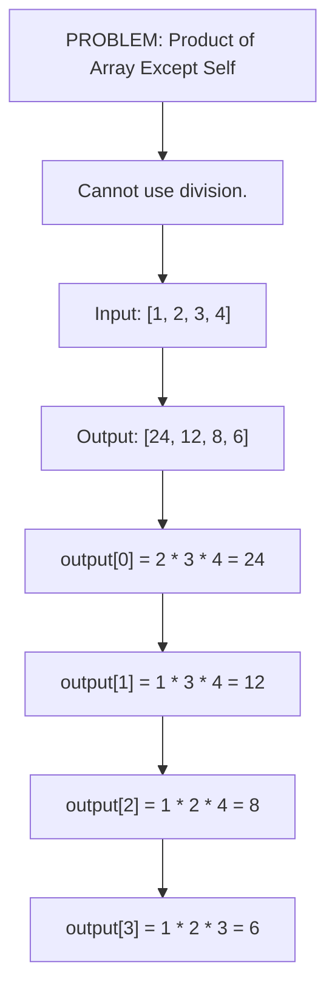

**Try it yourself first!**

<details>
<summary>Click to see solution</summary>

```java
public int[] productExceptSelf(int[] nums) {
    int n = nums.length;
    int[] result = new int[n];

    // First pass: left products
    result[0] = 1;
    for (int i = 1; i < n; i++) {
        result[i] = result[i - 1] * nums[i - 1];
    }

    // Second pass: multiply by right products
    int rightProduct = 1;
    for (int i = n - 1; i >= 0; i--) {
        result[i] = result[i] * rightProduct;
        rightProduct *= nums[i];
    }

    return result;
}
// Time: O(N), Space: O(1) excluding output
```

</details>

---

## 📝 String Problems

### Problem 9: Valid Palindrome

```
╔═══════════════════════════════════════════════════════════════════════════╗
║  PROBLEM: Valid Palindrome                                                ║
╠═══════════════════════════════════════════════════════════════════════════╣
║                                                                           ║
║  Check if string is palindrome (considering only alphanumeric, ignore     ║
║  case).                                                                   ║
║                                                                           ║
║  Input: "A man, a plan, a canal: Panama"                                  ║
║  Output: true                                                             ║
║                                                                           ║
║  After cleaning: "amanaplanacanalpanama"                                  ║
║                   ↑                   ↑                                   ║
║                  left              right                                  ║
║                                                                           ║
║  Two pointers from both ends, skip non-alphanumeric                       ║
║                                                                           ║
╚═══════════════════════════════════════════════════════════════════════════╝
```

**Flow:**
- PROBLEM: Valid Palindrome
- ↓
- case).
- ↓
- Input: 'A man, a plan, a canal: Panama'
- ↓
- Output: true
- ↓
- After cleaning: 'amanaplanacanalpanama'
- ↓
- left right
- ↓
- Two pointers from both ends, skip non-alphanumeric

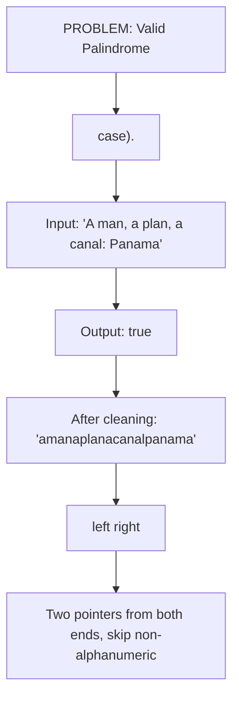

**Try it yourself first!**

<details>
<summary>Click to see solution</summary>

```java
public boolean isPalindrome(String s) {
    int left = 0, right = s.length() - 1;

    while (left < right) {
        // Skip non-alphanumeric from left
        while (left < right && !Character.isLetterOrDigit(s.charAt(left))) {
            left++;
        }
        // Skip non-alphanumeric from right
        while (left < right && !Character.isLetterOrDigit(s.charAt(right))) {
            right--;
        }

        // Compare (case insensitive)
        if (Character.toLowerCase(s.charAt(left)) !=
            Character.toLowerCase(s.charAt(right))) {
            return false;
        }

        left++;
        right--;
    }
    return true;
}
// Time: O(N), Space: O(1)
```

</details>

---

### Problem 10: Group Anagrams

```
╔═══════════════════════════════════════════════════════════════════════════╗
║  PROBLEM: Group Anagrams                                                  ║
╠═══════════════════════════════════════════════════════════════════════════╣
║                                                                           ║
║  Group words that are anagrams of each other.                             ║
║                                                                           ║
║  Input: ["eat", "tea", "tan", "ate", "nat", "bat"]                        ║
║  Output: [["eat","tea","ate"], ["tan","nat"], ["bat"]]                    ║
║                                                                           ║
║  Key insight: Anagrams have same SORTED form                              ║
║  eat → aet                                                                ║
║  tea → aet  (same!)                                                       ║
║  ate → aet  (same!)                                                       ║
║                                                                           ║
║  Use sorted form as HashMap key                                           ║
║                                                                           ║
╚═══════════════════════════════════════════════════════════════════════════╝
```

**Flow:**
- PROBLEM: Group Anagrams
- ↓
- Group words that are anagrams of each other.
- ↓
- Input: ['eat', 'tea', 'tan', 'ate', 'nat', 'bat']
- ↓
- Output: [['eat','tea','ate'], ['tan','nat'], ['bat']]
- ↓
- Key insight: Anagrams have same SORTED form
- ↓
- eat
- ↓
- aet
- ↓
- eat
- ↓
- aet
- ↓
- tea
- ↓
- aet (same!)

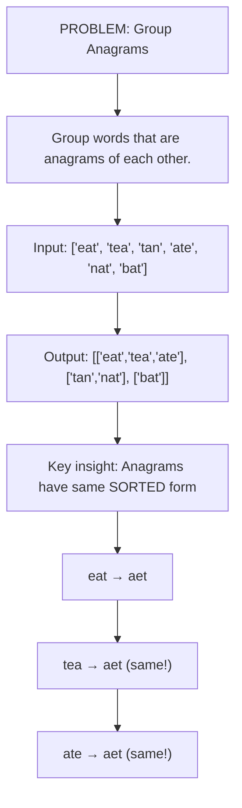

**Try it yourself first!**

<details>
<summary>Click to see solution</summary>

```java
public List<List<String>> groupAnagrams(String[] strs) {
    Map<String, List<String>> map = new HashMap<>();

    for (String s : strs) {
        // Create sorted key
        char[] chars = s.toCharArray();
        Arrays.sort(chars);
        String key = new String(chars);

        // Add to group
        if (!map.containsKey(key)) {
            map.put(key, new ArrayList<>());
        }
        map.get(key).add(s);
    }

    return new ArrayList<>(map.values());
}
// Time: O(N * K log K) where K = max string length
// Space: O(N * K)

// Alternative: Use character count as key (O(N * K) time)
public List<List<String>> groupAnagramsV2(String[] strs) {
    Map<String, List<String>> map = new HashMap<>();

    for (String s : strs) {
        // Create frequency key
        int[] count = new int[26];
        for (char c : s.toCharArray()) {
            count[c - 'a']++;
        }
        String key = Arrays.toString(count);  // "[1, 0, 0, ..., 0]"

        map.computeIfAbsent(key, k -> new ArrayList<>()).add(s);
    }

    return new ArrayList<>(map.values());
}
```

</details>

---

## 🧩 Math Problems

### Problem 11: Missing Number

```
╔═══════════════════════════════════════════════════════════════════════════╗
║  PROBLEM: Missing Number                                                  ║
╠═══════════════════════════════════════════════════════════════════════════╣
║                                                                           ║
║  Array contains n distinct numbers from [0, n]. Find missing one.         ║
║                                                                           ║
║  Input: [3, 0, 1]                                                         ║
║  Output: 2                                                                ║
║                                                                           ║
║  Method 1: Math (Sum formula)                                             ║
║  Expected sum = n * (n + 1) / 2                                           ║
║  Missing = Expected sum - Actual sum                                      ║
║                                                                           ║
║  Method 2: XOR                                                            ║
║  XOR all indices 0 to n, XOR all array elements                           ║
║  Missing number will remain (duplicates cancel)                           ║
║                                                                           ║
╚═══════════════════════════════════════════════════════════════════════════╝
```

**Flow:**
- PROBLEM: Missing Number
- ↓
- Input: [3, 0, 1]
- ↓
- Output: 2
- ↓
- Method 1: Math (Sum formula)
- ↓
- Expected sum = n * (n + 1) / 2
- ↓
- Missing = Expected sum - Actual sum
- ↓
- Method 2: XOR

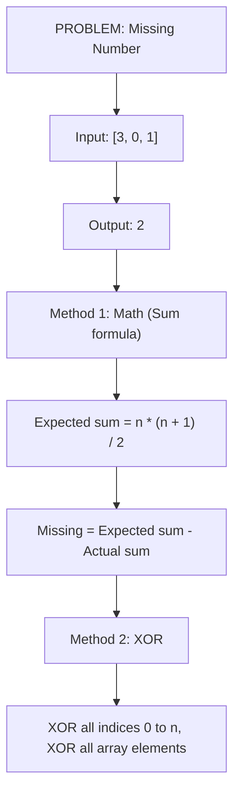

**Try it yourself first!**

<details>
<summary>Click to see solution</summary>

```java
// Method 1: Math
public int missingNumber(int[] nums) {
    int n = nums.length;
    int expectedSum = n * (n + 1) / 2;
    int actualSum = 0;
    for (int num : nums) {
        actualSum += num;
    }
    return expectedSum - actualSum;
}

// Method 2: XOR
public int missingNumberXOR(int[] nums) {
    int xor = nums.length;  // Start with n
    for (int i = 0; i < nums.length; i++) {
        xor ^= i;        // XOR with index
        xor ^= nums[i];  // XOR with element
    }
    return xor;
}
// Time: O(N), Space: O(1)
```

</details>

---

### Problem 12: Single Number

```
╔═══════════════════════════════════════════════════════════════════════════╗
║  PROBLEM: Single Number                                                   ║
╠═══════════════════════════════════════════════════════════════════════════╣
║                                                                           ║
║  Every element appears twice except one. Find that one.                   ║
║                                                                           ║
║  Input: [4, 1, 2, 1, 2]                                                   ║
║  Output: 4                                                                ║
║                                                                           ║
║  XOR property:                                                            ║
║  a ^ a = 0  (same numbers cancel)                                         ║
║  a ^ 0 = a  (XOR with 0 gives same number)                                ║
║                                                                           ║
║  4 ^ 1 ^ 2 ^ 1 ^ 2                                                        ║
║  = 4 ^ (1 ^ 1) ^ (2 ^ 2)                                                  ║
║  = 4 ^ 0 ^ 0                                                              ║
║  = 4                                                                      ║
║                                                                           ║
╚═══════════════════════════════════════════════════════════════════════════╝
```

**Flow:**
- PROBLEM: Single Number
- ↓
- Every element appears twice except one. Find that one.
- ↓
- Input: [4, 1, 2, 1, 2]
- ↓
- Output: 4
- ↓
- XOR property:
- ↓
- a ^ a = 0 (same numbers cancel)
- ↓
- a ^ 0 = a (XOR with 0 gives same number)

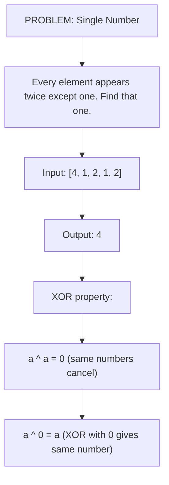

**Try it yourself first!**

<details>
<summary>Click to see solution</summary>

```java
public int singleNumber(int[] nums) {
    int result = 0;
    for (int num : nums) {
        result ^= num;  // XOR all elements
    }
    return result;
}
// Time: O(N), Space: O(1)
```

</details>

---

## 🎯 PRACTICE CHECKLIST

After solving each problem, ask yourself:

- [ ] Did I identify the correct pattern?
- [ ] Did I handle edge cases?
- [ ] Is my solution optimal (time & space)?
- [ ] Can I explain the approach clearly?
- [ ] Can I code it without looking at the solution?

---

## 📝 MORE PROBLEMS TO PRACTICE

Here are problem names to search on LeetCode/HackerRank:

**Two Pointers:**

- Move Zeroes
- Sort Colors (Dutch National Flag)
- Trapping Rain Water
- Merge Sorted Array

**Sliding Window:**

- Minimum Size Subarray Sum
- Permutation in String
- Find All Anagrams in String
- Sliding Window Maximum

**Binary Search:**

- Find Minimum in Rotated Sorted Array
- Search a 2D Matrix
- Sqrt(x)
- Find First and Last Position

**Arrays:**

- Merge Intervals
- Insert Interval
- Meeting Rooms II
- Next Permutation

**Strings:**

- Longest Palindromic Substring
- String to Integer (atoi)
- Implement strStr()
- Reverse Words in a String

---

# 🔥 COMPREHENSIVE PROBLEM BANK

## From Basics to Advanced - With LeetCode Links & Premium Problems

---

> **Navigation**: [Back to Index](../00_MASTER_INDEX.md) | [Next >](23_Edge_Cases.md)