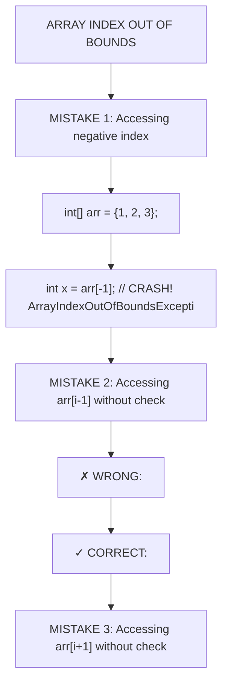
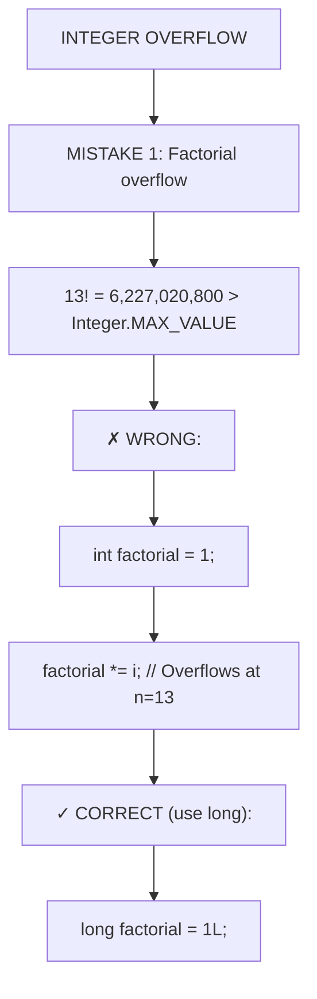
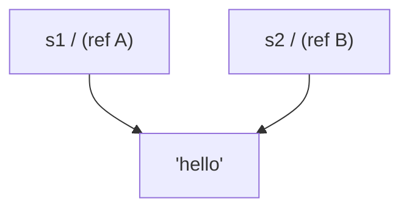
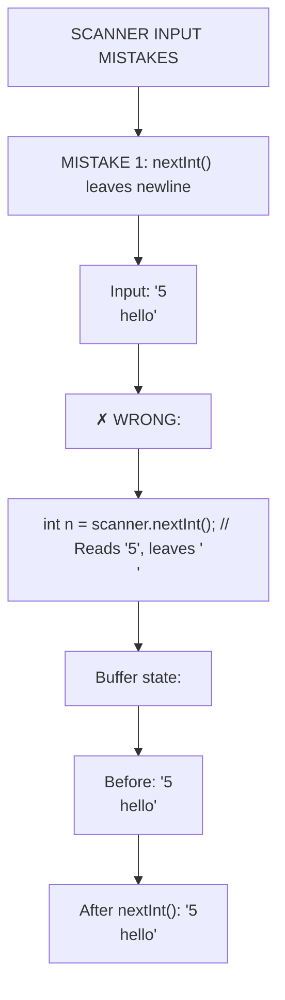
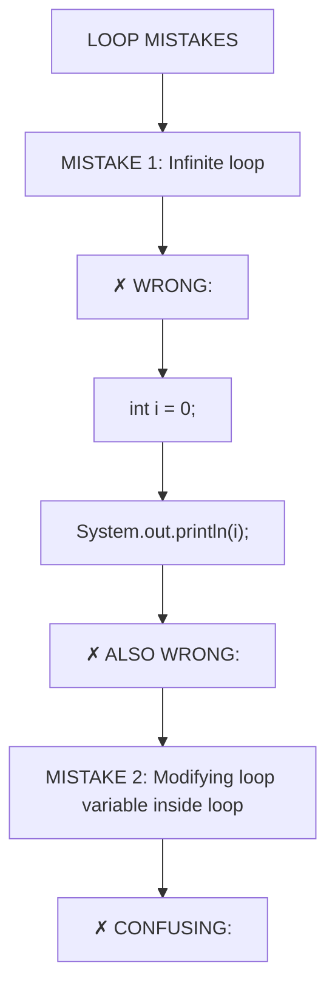
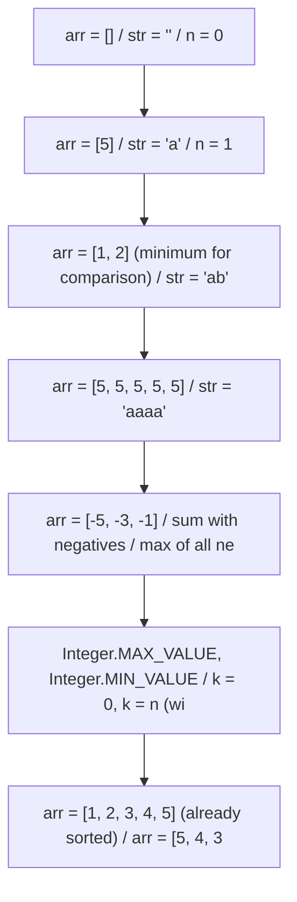
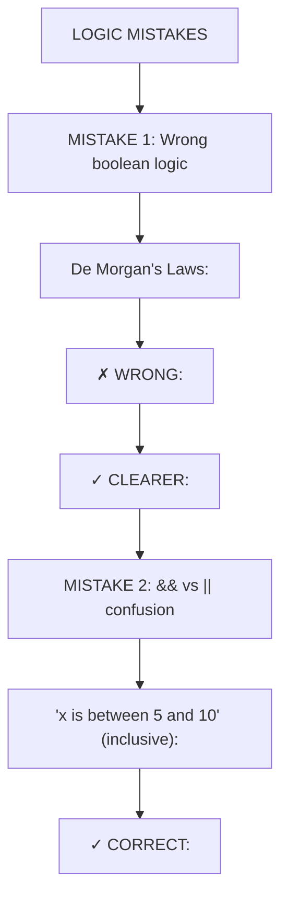
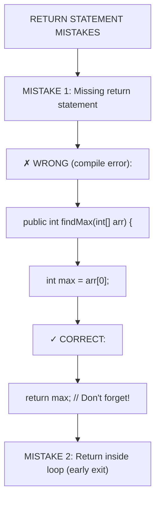
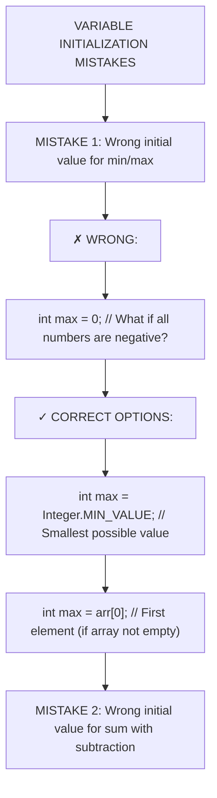
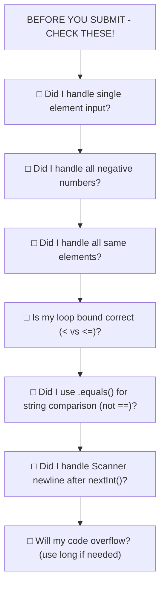

> **Navigation**: [< Previous](02_Problems_Math_Numbers.md) | [Back to Index](../00_MASTER_INDEX.md) | [Next >](03_Problems_Strings.md)

# 🚨 COMMON MISTAKES & HOW TO AVOID THEM

## Every mistake you might make, with visual explanations!

---

## 📚 TABLE OF CONTENTS

1. [Off-By-One Errors](#1-off-by-one-errors)
2. [Array Index Out of Bounds](#2-array-index-out-of-bounds)
3. [Integer Overflow](#3-integer-overflow)
4. [String Comparison Mistakes](#4-string-comparison-mistakes)
5. [Scanner Input Mistakes](#5-scanner-input-mistakes)
6. [Loop Mistakes](#6-loop-mistakes)
7. [Edge Case Mistakes](#7-edge-case-mistakes)
8. [Logic Mistakes](#8-logic-mistakes)
9. [Return Statement Mistakes](#9-return-statement-mistakes)
10. [Variable Initialization Mistakes](#10-variable-initialization-mistakes)

---

## 📌 1. Off — By — One Errors


> OFF-BY-ONE ERRORS
>
> MISTAKE 1: Wrong loop bound
> ─────────────────────────────
>
> ✗ WRONG:
> for (int i = 0; i <= arr.length; i++)  // Goes ONE past end!
> System.out.println(arr[i]);         // CRASH at last iteration
>
> Array: [1, 2, 3, 4, 5]
> Index:  0  1  2  3  4  5 ← Does not exist!
> ↑
> Crash here
>
> ✓ CORRECT:
> for (int i = 0; i < arr.length; i++)   // Stops at last valid index
> System.out.println(arr[i]);
>
> ═══════════════════════════════════════════════════════════════════════
>
> MISTAKE 2: Substring wrong end index
> ────────────────────────────────────
>
> String s = "hello";  // indices 0-4, length 5
>
> ✗ WRONG (to get "ell"):
> s.substring(1, 3)  // Returns "el" (end is exclusive!)
>
> ✓ CORRECT:
> s.substring(1, 4)  // Returns "ell" (end is exclusive, so 1,2,3)
>
> Visual:
> String: h e l l o
> Index:  0 1 2 3 4
> [start, end)  ← end is EXCLUSIVE
>
> ═══════════════════════════════════════════════════════════════════════
>
> MISTAKE 3: Wrong mid calculation
> ─────────────────────────────────
>
> ✗ WRONG (can overflow for large arrays):
> int mid = (low + high) / 2;  // If low + high > Integer.MAX_VALUE
>
> ✓ CORRECT:
> int mid = low + (high - low) / 2;  // Never overflows
>


### Quick Reference: < vs <=

```java
// Iterating through array (0 to n-1)
for (int i = 0; i < n; i++)       // CORRECT: < n

// Iterating through pairs
for (int i = 0; i < n - 1; i++)   // Compare arr[i] with arr[i+1]

// Binary search
while (low <= high)               // CORRECT: <= for standard binary search

// Two pointers from ends
while (left < right)              // CORRECT: < (stop when they meet)
```

---

## 📊 2. Array Index Out of Bounds

```
╔═══════════════════════════════════════════════════════════════════════════╗
║                    ARRAY INDEX OUT OF BOUNDS                              ║
╠═══════════════════════════════════════════════════════════════════════════╣
║                                                                           ║
║  MISTAKE 1: Accessing negative index                                      ║
║  ────────────────────────────────────                                     ║
║                                                                           ║
║  int[] arr = {1, 2, 3};                                                   ║
║  int x = arr[-1];  // CRASH! ArrayIndexOutOfBoundsException               ║
║                                                                           ║
║  ═══════════════════════════════════════════════════════════════════════  ║
║                                                                           ║
║  MISTAKE 2: Accessing arr[i-1] without check                              ║
║  ────────────────────────────────────────────                             ║
║                                                                           ║
║  ✗ WRONG:                                                                 ║
║  for (int i = 0; i < arr.length; i++) {                                   ║
║      if (arr[i] != arr[i-1]) ...  // When i=0, arr[i-1] = arr[-1]!        ║
║  }                                                                        ║
║                                                                           ║
║  ✓ CORRECT:                                                               ║
║  for (int i = 1; i < arr.length; i++) {  // Start from 1                  ║
║      if (arr[i] != arr[i-1]) ...                                          ║
║  }                                                                        ║
║                                                                           ║
║  ═══════════════════════════════════════════════════════════════════════  ║
║                                                                           ║
║  MISTAKE 3: Accessing arr[i+1] without check                              ║
║  ────────────────────────────────────────────                             ║
║                                                                           ║
║  ✗ WRONG:                                                                 ║
║  for (int i = 0; i < arr.length; i++) {                                   ║
║      if (arr[i] < arr[i+1]) ...  // When i=last, arr[i+1] crashes!        ║
║  }                                                                        ║
║                                                                           ║
║  ✓ CORRECT:                                                               ║
║  for (int i = 0; i < arr.length - 1; i++) {  // Stop one early            ║
║      if (arr[i] < arr[i+1]) ...                                           ║
║  }                                                                        ║
║                                                                           ║
║  ═══════════════════════════════════════════════════════════════════════  ║
║                                                                           ║
║  MISTAKE 4: Empty array access                                            ║
║  ─────────────────────────────                                            ║
║                                                                           ║
║  ✗ WRONG:                                                                 ║
║  int first = arr[0];  // CRASH if arr is empty!                           ║
║                                                                           ║
║  ✓ CORRECT:                                                               ║
║  if (arr.length > 0) {                                                    ║
║      int first = arr[0];                                                  ║
║  }                                                                        ║
║                                                                           ║
╚═══════════════════════════════════════════════════════════════════════════╝
```

> **Flow**: ARRAY INDEX OUT OF BOUNDS → MISTAKE 1: Accessing negative index | MISTAKE 1: Accessing negative index → int[] arr = {1, 2, 3}; | int[] arr = {1, 2, 3}; → int x = arr[-1]; // CRASH! ArrayIndexOutOfBoundsExcepti | int x = arr[-1]; // CRASH! ArrayIndexOutOfBoundsExcepti → MISTAKE 2: Accessing arr[i-1] without check | MISTAKE 2: Accessing arr[i-1] without check → ✗ WRONG: | ✗ WRONG: → ✓ CORRECT: | ...+1 more



---

## 💥 3. Integer Overflow

```
╔═══════════════════════════════════════════════════════════════════════════╗
║                    INTEGER OVERFLOW                                       ║
╠═══════════════════════════════════════════════════════════════════════════╣
║                                                                           ║
║  Java int range: -2,147,483,648 to 2,147,483,647 (about ±2 billion)       ║
║                                                                           ║
║  MISTAKE 1: Factorial overflow                                            ║
║  ─────────────────────────────                                            ║
║                                                                           ║
║  13! = 6,227,020,800 > Integer.MAX_VALUE                                  ║
║                                                                           ║
║  ✗ WRONG:                                                                 ║
║  int factorial = 1;                                                       ║
║  for (int i = 1; i <= n; i++) {                                           ║
║      factorial *= i;  // Overflows at n=13                                ║
║  }                                                                        ║
║                                                                           ║
║  ✓ CORRECT (use long):                                                    ║
║  long factorial = 1L;                                                     ║
║  for (int i = 1; i <= n; i++) {                                           ║
║      factorial *= i;  // Works up to n=20                                 ║
║  }                                                                        ║
║                                                                           ║
║  ═══════════════════════════════════════════════════════════════════════  ║
║                                                                           ║
║  MISTAKE 2: Sum overflow                                                  ║
║  ───────────────────────                                                  ║
║                                                                           ║
║  Array: [1,000,000,000, 1,000,000,000, 1,000,000,000]                     ║
║  Sum: 3,000,000,000 > Integer.MAX_VALUE                                   ║
║                                                                           ║
║  ✗ WRONG:                                                                 ║
║  int sum = 0;                                                             ║
║  for (int num : arr) sum += num;  // Overflow!                            ║
║                                                                           ║
║  ✓ CORRECT:                                                               ║
║  long sum = 0L;                                                           ║
║  for (int num : arr) sum += num;  // Safe                                 ║
║                                                                           ║
║  ═══════════════════════════════════════════════════════════════════════  ║
║                                                                           ║
║  MISTAKE 3: Multiplication overflow                                       ║
║  ──────────────────────────────────                                       ║
║                                                                           ║
║  ✗ WRONG:                                                                 ║
║  int area = width * height;  // Can overflow for large rectangles         ║
║                                                                           ║
║  ✓ CORRECT:                                                               ║
║  long area = (long) width * height;  // Cast BEFORE multiplication        ║
║                                                                           ║
║  ⚠️ Note: long area = (long)(width * height) is WRONG!                    ║
║     The overflow happens in (width * height) BEFORE the cast.             ║
║                                                                           ║
╚═══════════════════════════════════════════════════════════════════════════╝
```

> **Flow**: INTEGER OVERFLOW → MISTAKE 1: Factorial overflow | MISTAKE 1: Factorial overflow → 13! = 6,227,020,800 &gt; Integer.MAX_VALUE | 13! = 6,227,020,800 &gt; Integer.MAX_VALUE → ✗ WRONG: | ✗ WRONG: → int factorial = 1; | int factorial = 1; → factorial *= i; // Overflows at n=13 | factorial *= i; // Overflows at n=13 → ✓ CORRECT (use long): | ...+1 more



---

## 📝 4. String Comparison Mistakes

```
                  STRING COMPARISON MISTAKES
──────────────────────────────────────────────────

MISTAKE: Using == instead of .equals()
────────────────────────────────────────

✗ WRONG:
String s1 = "hello";
String s2 = new String("hello");
if (s1 == s2) { ... }  // FALSE! Compares references, not content

Visual:
┌─────────┐         ┌─────────┐
│   s1    │         │   s2    │
│ (ref A) │         │ (ref B) │
└────┬────┘         └────┬────┘
     │                   │
     ↓                   ↓
┌─────────┐         ┌─────────┐
│ "hello" │         │ "hello" │  ← Same CONTENT, different OBJECTS
└─────────┘         └─────────┘

s1 == s2 checks: Are they the SAME object? → NO (different refs)
s1.equals(s2): Are the CONTENTS equal? → YES

✓ CORRECT:
if (s1.equals(s2)) { ... }  // TRUE! Compares content

✓ Also correct (null-safe):
if ("hello".equals(s1)) { ... }  // Won't crash if s1 is null

═══════════════════════════════════════════════════════════════════════

EXCEPTION: String literals from pool
────────────────────────────────────

String s1 = "hello";
String s2 = "hello";
s1 == s2;  // TRUE! (Both point to same string in pool)

But DON'T rely on this! Always use .equals() to be safe.

```

> **Flow**: s1 / (ref A) → 'hello' | s2 / (ref B) → 'hello'



---

## 📌 5. Scanner Input Mistakes

```
╔═══════════════════════════════════════════════════════════════════════════╗
║                    SCANNER INPUT MISTAKES                                 ║
╠═══════════════════════════════════════════════════════════════════════════╣
║                                                                           ║
║  MISTAKE 1: nextInt() leaves newline                                      ║
║  ────────────────────────────────────                                     ║
║                                                                           ║
║  Input: "5\nhello"                                                        ║
║                                                                           ║
║  ✗ WRONG:                                                                 ║
║  int n = scanner.nextInt();     // Reads "5", leaves "\n"                 ║
║  String s = scanner.nextLine(); // Reads empty "\n", NOT "hello"!         ║
║                                                                           ║
║  Buffer state:                                                            ║
║  Before: "5\nhello"                                                       ║
║           ↑                                                               ║
║  After nextInt(): "5\nhello"                                              ║
║                     ↑ (still at newline!)                                 ║
║  After nextLine(): "5\nhello"                                             ║
║                       ↑ (consumed just the newline)                       ║
║                                                                           ║
║  ✓ CORRECT:                                                               ║
║  int n = scanner.nextInt();                                               ║
║  scanner.nextLine();  // Consume leftover newline                         ║
║  String s = scanner.nextLine();  // Now reads "hello"                     ║
║                                                                           ║
║  ═══════════════════════════════════════════════════════════════════════  ║
║                                                                           ║
║  MISTAKE 2: Not closing Scanner                                           ║
║  ──────────────────────────────                                           ║
║                                                                           ║
║  ✗ WARNING: Resource leak                                                 ║
║  Scanner sc = new Scanner(System.in);                                     ║
║  // ... use scanner ...                                                   ║
║  // Forgot to close!                                                      ║
║                                                                           ║
║  ✓ BETTER (try-with-resources):                                           ║
║  try (Scanner sc = new Scanner(System.in)) {                              ║
║      // ... use scanner ...                                               ║
║  }  // Automatically closed                                               ║
║                                                                           ║
║  ═══════════════════════════════════════════════════════════════════════  ║
║                                                                           ║
║  MISTAKE 3: hasNext() confusion                                           ║
║  ──────────────────────────────                                           ║
║                                                                           ║
║  // Reading until no more input:                                          ║
║  while (scanner.hasNext()) {      // hasNext() for any token              ║
║      String word = scanner.next();                                        ║
║  }                                                                        ║
║                                                                           ║
║  while (scanner.hasNextInt()) {   // hasNextInt() for integers            ║
║      int num = scanner.nextInt();                                         ║
║  }                                                                        ║
║                                                                           ║
║  while (scanner.hasNextLine()) {  // hasNextLine() for lines              ║
║      String line = scanner.nextLine();                                    ║
║  }                                                                        ║
║                                                                           ║
╚═══════════════════════════════════════════════════════════════════════════╝
```

> **Flow**: SCANNER INPUT MISTAKES → MISTAKE 1: nextInt() leaves newline | MISTAKE 1: nextInt() leaves newline → Input: '5\nhello' | Input: '5\nhello' → ✗ WRONG: | ✗ WRONG: → int n = scanner.nextInt(); // Reads '5', leaves '\n' | int n = scanner.nextInt(); // Reads '5', leaves '\n' → Buffer state: | Buffer state: → Before: '5\nhello' | ...+1 more



---

## 🏛️ 6. Loop Mistakes

```
                  LOOP MISTAKES
──────────────────────────────────────────────────

MISTAKE 1: Infinite loop
────────────────────────

✗ WRONG:
int i = 0;
while (i < 10) {
    System.out.println(i);
    // Forgot i++! Loop runs forever
}

✗ ALSO WRONG:
for (int i = 0; i < 10; ) {  // Missing increment!
    System.out.println(i);
}

═══════════════════════════════════════════════════════════════════════

MISTAKE 2: Modifying loop variable inside loop
──────────────────────────────────────────────

✗ CONFUSING:
for (int i = 0; i < 10; i++) {
    if (someCondition) i++;  // Now iteration is skipped!
}

═══════════════════════════════════════════════════════════════════════

MISTAKE 3: Wrong loop type
──────────────────────────

✗ WRONG (modifying while iterating):
for (int num : list) {
    if (num < 0) list.remove(num);  // ConcurrentModificationException!
}

✓ CORRECT (use iterator or index-based):
Iterator<Integer> it = list.iterator();
while (it.hasNext()) {
    if (it.next() < 0) it.remove();  // Safe removal
}

═══════════════════════════════════════════════════════════════════════

MISTAKE 4: Off-by-one in nested loops
─────────────────────────────────────

For upper triangle of matrix (excluding diagonal):
┌───┬───┬───┬───┐
│ X │ ✓ │ ✓ │ ✓ │   i=0: j from 1 to 3
├───┼───┼───┼───┤
│   │ X │ ✓ │ ✓ │   i=1: j from 2 to 3
├───┼───┼───┼───┤
│   │   │ X │ ✓ │   i=2: j from 3 to 3
├───┼───┼───┼───┤
│   │   │   │ X │   i=3: j from 4 to 3 (no iterations)
└───┴───┴───┴───┘

for (int i = 0; i < n; i++) {
    for (int j = i + 1; j < n; j++) {  // j starts at i+1
        // Process upper triangle
    }
}

```

> **Flow**: LOOP MISTAKES → MISTAKE 1: Infinite loop | MISTAKE 1: Infinite loop → ✗ WRONG: | ✗ WRONG: → int i = 0; | int i = 0; → System.out.println(i); | System.out.println(i); → ✗ ALSO WRONG: | ✗ ALSO WRONG: → MISTAKE 2: Modifying loop variable inside loop | ...+1 more



---

## 📌 7. Edge Case Mistakes

```
                  EDGE CASE MISTAKES
──────────────────────────────────────────────────

ALWAYS CHECK THESE BEFORE SUBMITTING:

1. EMPTY INPUT
┌────────────────────────────────────────────────────────────────────┐
│ arr = []                                                           │
│ str = ""                                                           │
│ n = 0                                                              │
└────────────────────────────────────────────────────────────────────┘

2. SINGLE ELEMENT
┌────────────────────────────────────────────────────────────────────┐
│ arr = [5]                                                          │
│ str = "a"                                                          │
│ n = 1                                                              │
└────────────────────────────────────────────────────────────────────┘

3. TWO ELEMENTS
┌────────────────────────────────────────────────────────────────────┐
│ arr = [1, 2]  (minimum for comparison)                             │
│ str = "ab"                                                         │
└────────────────────────────────────────────────────────────────────┘

4. ALL SAME ELEMENTS
┌────────────────────────────────────────────────────────────────────┐
│ arr = [5, 5, 5, 5, 5]                                              │
│ str = "aaaa"                                                       │
└────────────────────────────────────────────────────────────────────┘

5. NEGATIVE NUMBERS
┌────────────────────────────────────────────────────────────────────┐
│ arr = [-5, -3, -1]                                                 │
│ sum with negatives                                                 │
│ max of all negatives                                               │
└────────────────────────────────────────────────────────────────────┘

6. BOUNDARY VALUES
┌────────────────────────────────────────────────────────────────────┐
│ Integer.MAX_VALUE, Integer.MIN_VALUE                               │
│ k = 0, k = n (window size edge cases)                              │
│ First/last element special handling                                │
└────────────────────────────────────────────────────────────────────┘

7. SORTED/REVERSE SORTED
┌────────────────────────────────────────────────────────────────────┐
│ arr = [1, 2, 3, 4, 5]  (already sorted)                            │
│ arr = [5, 4, 3, 2, 1]  (reverse sorted)                            │
└────────────────────────────────────────────────────────────────────┘

```

> **Flow**: arr = [] / str = '' / n = 0 → arr = [5] / str = 'a' / n = 1 | arr = [5] / str = 'a' / n = 1 → arr = [1, 2] (minimum for comparison) / str = 'ab' | arr = [1, 2] (minimum for comparison) / str = 'ab' → arr = [5, 5, 5, 5, 5] / str = 'aaaa' | arr = [5, 5, 5, 5, 5] / str = 'aaaa' → arr = [-5, -3, -1] / sum with negatives / max of all ne | arr = [-5, -3, -1] / sum with negatives / max of all ne → Integer.MAX_VALUE, Integer.MIN_VALUE / k = 0, k = n (wi | Integer.MAX_VALUE, Integer.MIN_VALUE / k = 0, k = n (wi → arr = [1, 2, 3, 4, 5] (already sorted) / arr = [5, 4, 3



---

## 📌 8. Logic Mistakes

```
╔═══════════════════════════════════════════════════════════════════════════╗
║                    LOGIC MISTAKES                                         ║
╠═══════════════════════════════════════════════════════════════════════════╣
║                                                                           ║
║  MISTAKE 1: Wrong boolean logic                                           ║
║  ──────────────────────────────                                           ║
║                                                                           ║
║  De Morgan's Laws:                                                        ║
║  !(A && B) = !A || !B                                                     ║
║  !(A || B) = !A && !B                                                     ║
║                                                                           ║
║  ✗ WRONG:                                                                 ║
║  if (!(x > 5 && x < 10))  // Confusing                                    ║
║                                                                           ║
║  ✓ CLEARER:                                                               ║
║  if (x <= 5 || x >= 10)  // Same logic, easier to read                    ║
║                                                                           ║
║  ═══════════════════════════════════════════════════════════════════════  ║
║                                                                           ║
║  MISTAKE 2: && vs || confusion                                            ║
║  ─────────────────────────────                                            ║
║                                                                           ║
║  "x is between 5 and 10" (inclusive):                                     ║
║                                                                           ║
║  ✗ WRONG:                                                                 ║
║  if (x >= 5 || x <= 10)  // Always true for any x!                        ║
║                                                                           ║
║  ✓ CORRECT:                                                               ║
║  if (x >= 5 && x <= 10)  // Both conditions must be true                  ║
║                                                                           ║
║  ═══════════════════════════════════════════════════════════════════════  ║
║                                                                           ║
║  MISTAKE 3: Assignment vs comparison                                      ║
║  ────────────────────────────────────                                     ║
║                                                                           ║
║  ✗ WRONG:                                                                 ║
║  if (x = 5) { ... }  // Assignment! Always "true" in some languages       ║
║                      // Java: Compile error (thankfully!)                 ║
║                                                                           ║
║  ✓ CORRECT:                                                               ║
║  if (x == 5) { ... }  // Comparison                                       ║
║                                                                           ║
║  ═══════════════════════════════════════════════════════════════════════  ║
║                                                                           ║
║  MISTAKE 4: Short-circuit evaluation                                      ║
║  ────────────────────────────────────                                     ║
║                                                                           ║
║  ✗ DANGEROUS:                                                             ║
║  if (arr[i] != null && arr.length > i) { ... }                            ║
║  // If arr[i] throws exception, arr.length is never checked!              ║
║                                                                           ║
║  ✓ CORRECT ORDER:                                                         ║
║  if (i < arr.length && arr[i] != null) { ... }                            ║
║  // Check bounds FIRST, then access                                       ║
║                                                                           ║
╚═══════════════════════════════════════════════════════════════════════════╝
```

> **Flow**: LOGIC MISTAKES → MISTAKE 1: Wrong boolean logic | MISTAKE 1: Wrong boolean logic → De Morgan's Laws: | De Morgan's Laws: → ✗ WRONG: | ✗ WRONG: → ✓ CLEARER: | ✓ CLEARER: → MISTAKE 2: && vs || confusion | MISTAKE 2: && vs || confusion → 'x is between 5 and 10' (inclusive): | ...+1 more



---

## 📦 9. Return Statement Mistakes

```
╔═══════════════════════════════════════════════════════════════════════════╗
║                    RETURN STATEMENT MISTAKES                              ║
╠═══════════════════════════════════════════════════════════════════════════╣
║                                                                           ║
║  MISTAKE 1: Missing return statement                                      ║
║  ────────────────────────────────────                                     ║
║                                                                           ║
║  ✗ WRONG (compile error):                                                 ║
║  public int findMax(int[] arr) {                                          ║
║      int max = arr[0];                                                    ║
║      for (int num : arr) {                                                ║
║          if (num > max) max = num;                                        ║
║      }                                                                    ║
║      // Forgot return! Compile error: "missing return statement"          ║
║  }                                                                        ║
║                                                                           ║
║  ✓ CORRECT:                                                               ║
║  public int findMax(int[] arr) {                                          ║
║      int max = arr[0];                                                    ║
║      for (int num : arr) {                                                ║
║          if (num > max) max = num;                                        ║
║      }                                                                    ║
║      return max;  // Don't forget!                                        ║
║  }                                                                        ║
║                                                                           ║
║  ═══════════════════════════════════════════════════════════════════════  ║
║                                                                           ║
║  MISTAKE 2: Return inside loop (early exit)                               ║
║  ───────────────────────────────────────────                              ║
║                                                                           ║
║  ✗ WRONG (returns on first iteration):                                    ║
║  public int sum(int[] arr) {                                              ║
║      int sum = 0;                                                         ║
║      for (int num : arr) {                                                ║
║          sum += num;                                                      ║
║          return sum;  // Returns immediately after first element!         ║
║      }                                                                    ║
║      return sum;                                                          ║
║  }                                                                        ║
║                                                                           ║
║  ✓ CORRECT:                                                               ║
║  public int sum(int[] arr) {                                              ║
║      int sum = 0;                                                         ║
║      for (int num : arr) {                                                ║
║          sum += num;                                                      ║
║      }                                                                    ║
║      return sum;  // Return AFTER loop                                    ║
║  }                                                                        ║
║                                                                           ║
║  ═══════════════════════════════════════════════════════════════════════  ║
║                                                                           ║
║  MISTAKE 3: Wrong return type                                             ║
║  ────────────────────────────                                             ║
║                                                                           ║
║  ✗ WRONG:                                                                 ║
║  public int divide(int a, int b) {                                        ║
║      return a / b;  // Integer division! 5/2 = 2, not 2.5                 ║
║  }                                                                        ║
║                                                                           ║
║  ✓ CORRECT (if you need decimal):                                         ║
║  public double divide(int a, int b) {                                     ║
║      return (double) a / b;  // Cast to double first                      ║
║  }                                                                        ║
║                                                                           ║
╚═══════════════════════════════════════════════════════════════════════════╝
```

> **Flow**: RETURN STATEMENT MISTAKES → MISTAKE 1: Missing return statement | MISTAKE 1: Missing return statement → ✗ WRONG (compile error): | ✗ WRONG (compile error): → public int findMax(int[] arr) { | public int findMax(int[] arr) { → int max = arr[0]; | int max = arr[0]; → ✓ CORRECT: | ✓ CORRECT: → return max; // Don't forget! | ...+1 more



---

## 📌 10. Variable Initialization Mistakes

```
                  VARIABLE INITIALIZATION MISTAKES
──────────────────────────────────────────────────

MISTAKE 1: Wrong initial value for min/max
───────────────────────────────────────────

✗ WRONG:
int max = 0;  // What if all numbers are negative?
for (int num : arr) {
    if (num > max) max = num;
}
// arr = [-5, -3, -1] → max = 0 (wrong! should be -1)

✓ CORRECT OPTIONS:
int max = Integer.MIN_VALUE;  // Smallest possible value
int max = arr[0];             // First element (if array not empty)

═══════════════════════════════════════════════════════════════════════

MISTAKE 2: Wrong initial value for sum with subtraction
──────────────────────────────────────────────────────────

For finding minimum sum:
✗ WRONG:
int minSum = 0;  // What if all sums are positive?

✓ CORRECT:
int minSum = Integer.MAX_VALUE;  // Largest possible value

═══════════════════════════════════════════════════════════════════════

MISTAKE 3: Not resetting variables in nested loops
──────────────────────────────────────────────────

✗ WRONG:
int count = 0;
for (int i = 0; i < n; i++) {
    // Forgot to reset count!
    for (int j = 0; j < m; j++) {
        if (condition) count++;
    }
    System.out.println(count);  // Keeps accumulating!
}

✓ CORRECT:
for (int i = 0; i < n; i++) {
    int count = 0;  // Reset for each outer iteration
    for (int j = 0; j < m; j++) {
        if (condition) count++;
    }
    System.out.println(count);
}

═══════════════════════════════════════════════════════════════════════

REFERENCE TABLE:
┌────────────────────────────────────────────────────────────────────┐
│ Finding Maximum  → Initialize with Integer.MIN_VALUE or arr[0]     │
│ Finding Minimum  → Initialize with Integer.MAX_VALUE or arr[0]     │
│ Counting         → Initialize with 0                               │
│ Sum              → Initialize with 0                               │
│ Product          → Initialize with 1                               │
│ Boolean flag     → Initialize with true or false (think carefully!)│
└────────────────────────────────────────────────────────────────────┘

```

> **Flow**: VARIABLE INITIALIZATION MISTAKES → MISTAKE 1: Wrong initial value for min/max | MISTAKE 1: Wrong initial value for min/max → ✗ WRONG: | ✗ WRONG: → int max = 0; // What if all numbers are negative? | int max = 0; // What if all numbers are negative? → ✓ CORRECT OPTIONS: | ✓ CORRECT OPTIONS: → int max = Integer.MIN_VALUE; // Smallest possible value | int max = Integer.MIN_VALUE; // Smallest possible value → int max = arr[0]; // First element (if array not empty) | ...+1 more



---

## 📋 PRE-SUBMISSION CHECKLIST

```
╔═══════════════════════════════════════════════════════════════════════════╗
║                    BEFORE YOU SUBMIT - CHECK THESE!                       ║
╠═══════════════════════════════════════════════════════════════════════════╣
║                                                                           ║
║  □ Did I handle empty input (n=0, empty array, empty string)?             ║
║  □ Did I handle single element input?                                     ║
║  □ Did I handle all negative numbers?                                     ║
║  □ Did I handle all same elements?                                        ║
║  □ Is my loop bound correct (< vs <=)?                                    ║
║  □ Did I use .equals() for string comparison (not ==)?                    ║
║  □ Did I handle Scanner newline after nextInt()?                          ║
║  □ Will my code overflow? (use long if needed)                            ║
║  □ Did I initialize min/max correctly?                                    ║
║  □ Does my function have a return statement on all paths?                 ║
║  □ Did I test with the given examples?                                    ║
║                                                                           ║
╚═══════════════════════════════════════════════════════════════════════════╝
```

> **Flow**: BEFORE YOU SUBMIT - CHECK THESE! → □ Did I handle single element input? | □ Did I handle single element input? → □ Did I handle all negative numbers? | □ Did I handle all negative numbers? → □ Did I handle all same elements? | □ Did I handle all same elements? → □ Is my loop bound correct (&lt; vs &lt;=)? | □ Is my loop bound correct (&lt; vs &lt;=)? → □ Did I use .equals() for string comparison (not ==)? | □ Did I use .equals() for string comparison (not ==)? → □ Did I handle Scanner newline after nextInt()? | ...+1 more



---

## 🎯 GOOD LUCK!

Remember: **Most bugs are in boundaries, not logic!**

Check edges, check bounds, and you'll catch 80% of bugs before they happen.


---

> **Navigation**: [< Previous](02_Problems_Math_Numbers.md) | [Back to Index](../00_MASTER_INDEX.md) | [Next >](03_Problems_Strings.md)