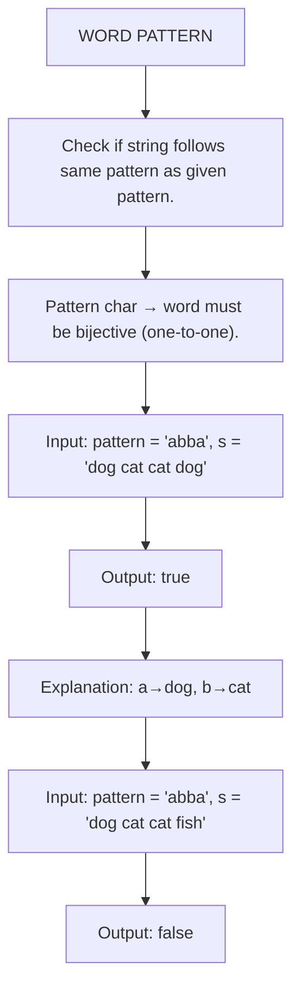
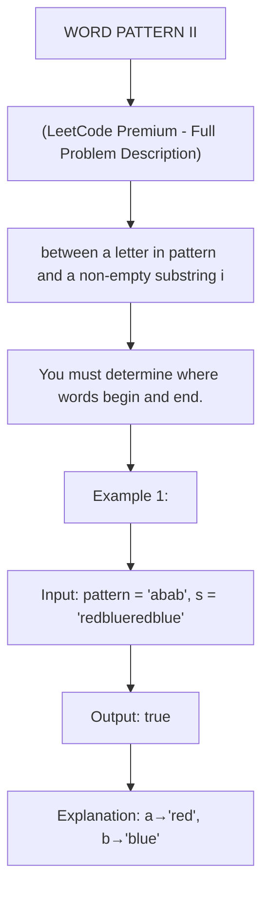
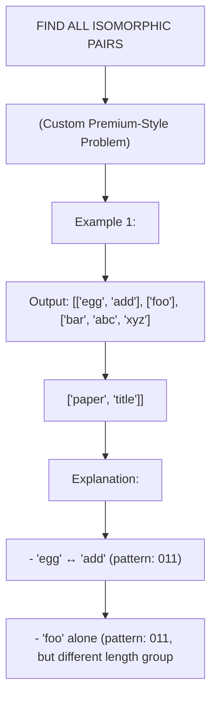
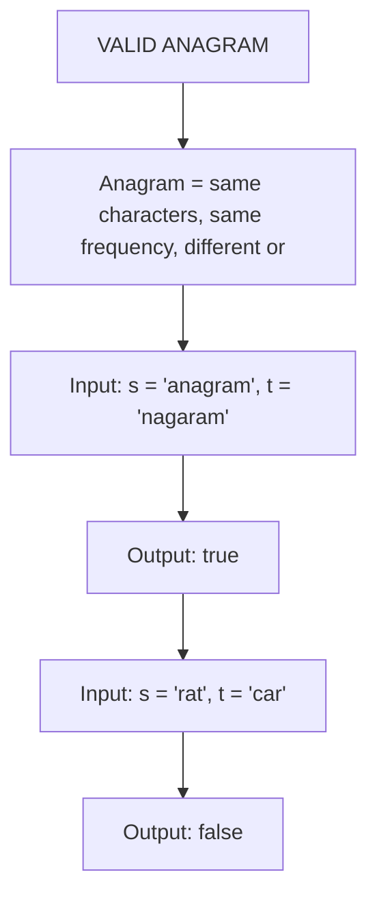
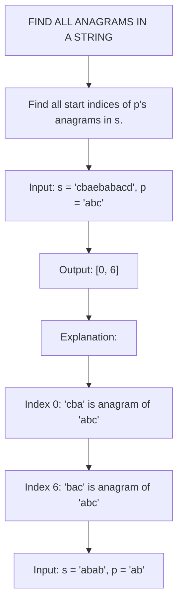
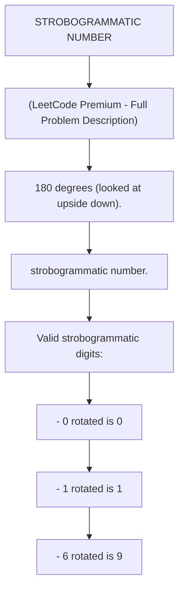
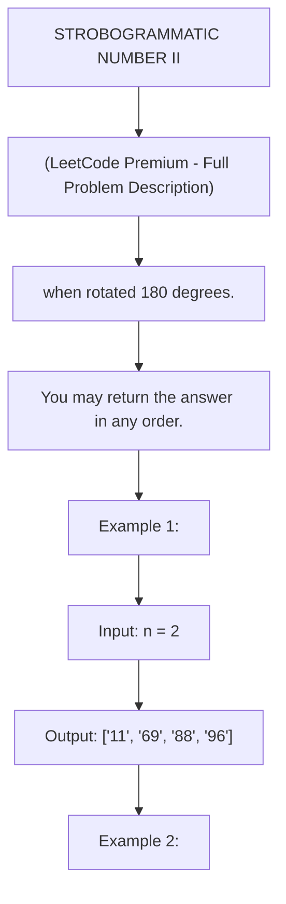
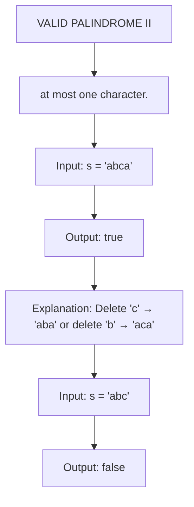
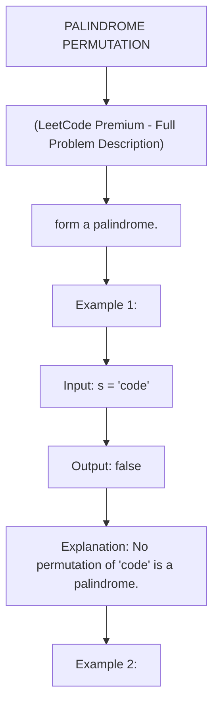

> **Navigation**: [< Previous](24_Common_Mistakes.md) | [Back to Index](../00_MASTER_INDEX.md) | [Next >](25_Problem_Origins.md)

> **Problems 03/14** | [Prev](02_Math_Numbers.md) | [Index](../00_MASTER_INDEX.md) | [Next](04_Arrays.md)

---

# 📝 Section 2: String Problems

---

## 🎨 2.1 Isomorphic & Pattern Matching

### Problem: Isomorphic Strings

**LeetCode 205** | **Difficulty:** Easy
🔗 [https://leetcode.com/problems/isomorphic-strings/](https://leetcode.com/problems/isomorphic-strings/)


> ISOMORPHIC STRINGS
>
> Two strings are isomorphic if characters in s can be replaced to get t.
> Mapping must be one-to-one (each char maps to exactly one char).
> Order of characters must be preserved.
>
> Input: s = "egg", t = "add"
> Output: true
> Explanation: e → a, g → d
> egg → add ✓
>
> Input: s = "foo", t = "bar"
> Output: false
> Explanation: o maps to both 'a' and 'r' - not allowed
>
> Input: s = "paper", t = "title"
> Output: true
> Explanation: p→t, a→i, e→l, r→e
>
> Input: s = "badc", t = "baba"
> Output: false
> Explanation: d and c both map to 'a' - not allowed
>


```java
public boolean isIsomorphic(String s, String t) {
    if (s.length() != t.length()) return false;

    int[] mapST = new int[256];  // s -> t mapping
    int[] mapTS = new int[256];  // t -> s mapping
    Arrays.fill(mapST, -1);
    Arrays.fill(mapTS, -1);

    for (int i = 0; i < s.length(); i++) {
        char cs = s.charAt(i);
        char ct = t.charAt(i);

        // Check if mapping exists and is consistent
        if (mapST[cs] == -1 && mapTS[ct] == -1) {
            mapST[cs] = ct;
            mapTS[ct] = cs;
        } else if (mapST[cs] != ct || mapTS[ct] != cs) {
            return false;
        }
    }
    return true;
}

// Alternative using HashMap
public boolean isIsomorphicMap(String s, String t) {
    Map<Character, Character> mapST = new HashMap<>();
    Map<Character, Character> mapTS = new HashMap<>();

    for (int i = 0; i < s.length(); i++) {
        char cs = s.charAt(i), ct = t.charAt(i);

        if (mapST.containsKey(cs) && mapST.get(cs) != ct) return false;
        if (mapTS.containsKey(ct) && mapTS.get(ct) != cs) return false;

        mapST.put(cs, ct);
        mapTS.put(ct, cs);
    }
    return true;
}
```

---

### Problem: Word Pattern

**LeetCode 290** | **Difficulty:** Easy
🔗 [https://leetcode.com/problems/word-pattern/](https://leetcode.com/problems/word-pattern/)

```
╔═══════════════════════════════════════════════════════════════════════════╗
║  WORD PATTERN                                                             ║
╠═══════════════════════════════════════════════════════════════════════════╣
║                                                                           ║
║  Check if string follows same pattern as given pattern.                   ║
║  Pattern char → word must be bijective (one-to-one).                      ║
║                                                                           ║
║  Input: pattern = "abba", s = "dog cat cat dog"                           ║
║  Output: true                                                             ║
║  Explanation: a→dog, b→cat                                                ║
║                                                                           ║
║  Input: pattern = "abba", s = "dog cat cat fish"                          ║
║  Output: false                                                            ║
║  Explanation: a→dog but also a→fish (inconsistent)                        ║
║                                                                           ║
║  Input: pattern = "aaaa", s = "dog cat cat dog"                           ║
║  Output: false                                                            ║
║  Explanation: a→dog, a→cat (inconsistent)                                 ║
║                                                                           ║
║  Input: pattern = "abba", s = "dog dog dog dog"                           ║
║  Output: false                                                            ║
║  Explanation: b must map to different word than a                         ║
║                                                                           ║
╚═══════════════════════════════════════════════════════════════════════════╝
```

**Flow:**
- WORD PATTERN
- ↓
- Check if string follows same pattern as given pattern.
- ↓
- Pattern char
- ↓
- word must be bijective (one-to-one).
- ↓
- Pattern char
- ↓
- word must be bijective (one-to-one).
- ↓
- Input: pattern = 'abba', s = 'dog cat cat dog'
- ↓
- Output: true
- ↓
- Explanation: a
- ↓
- dog, b
- ↓
- cat
- ↓
- Explanation: a
- ↓
- dog, b
- ↓
- cat
- ↓
- Input: pattern = 'abba', s = 'dog cat cat fish'



```java
public boolean wordPattern(String pattern, String s) {
    String[] words = s.split(" ");
    if (pattern.length() != words.length) return false;

    Map<Character, String> charToWord = new HashMap<>();
    Map<String, Character> wordToChar = new HashMap<>();

    for (int i = 0; i < pattern.length(); i++) {
        char c = pattern.charAt(i);
        String word = words[i];

        if (charToWord.containsKey(c)) {
            if (!charToWord.get(c).equals(word)) return false;
        } else {
            charToWord.put(c, word);
        }

        if (wordToChar.containsKey(word)) {
            if (wordToChar.get(word) != c) return false;
        } else {
            wordToChar.put(word, c);
        }
    }
    return true;
}
```

---

### 🔒 PREMIUM: Word Pattern II

**LeetCode 291** | **Difficulty:** Medium | **Premium Problem**

```
╔═══════════════════════════════════════════════════════════════════════════╗
║  WORD PATTERN II                                                          ║
║  (LeetCode Premium - Full Problem Description)                            ║
╠═══════════════════════════════════════════════════════════════════════════╣
║                                                                           ║
║  Given a pattern and a string s, find if s follows the same pattern.      ║
║                                                                           ║
║  Here, "follow" means a full match, such that there is a bijection        ║
║  between a letter in pattern and a non-empty substring in s.              ║
║                                                                           ║
║  NOTE: Unlike Word Pattern I, words are NOT separated by spaces!          ║
║  You must determine where words begin and end.                            ║
║                                                                           ║
║  ─────────────────────────────────────────────────────────────────────    ║
║                                                                           ║
║  Example 1:                                                               ║
║  Input: pattern = "abab", s = "redblueredblue"                            ║
║  Output: true                                                             ║
║  Explanation: a→"red", b→"blue"                                           ║
║  "redblueredblue" matches "abab"                                          ║
║                                                                           ║
║  Example 2:                                                               ║
║  Input: pattern = "aaaa", s = "asdasdasdasd"                              ║
║  Output: true                                                             ║
║  Explanation: a→"asd"                                                     ║
║                                                                           ║
║  Example 3:                                                               ║
║  Input: pattern = "aabb", s = "xyzabcxzyabc"                              ║
║  Output: false                                                            ║
║  Explanation: No valid mapping exists                                     ║
║                                                                           ║
║  Example 4:                                                               ║
║  Input: pattern = "ab", s = "aa"                                          ║
║  Output: false                                                            ║
║  Explanation: a→"a", b→"a" violates bijection (two chars map to same)     ║
║                                                                           ║
║  ─────────────────────────────────────────────────────────────────────    ║
║                                                                           ║
║  Constraints:                                                             ║
║  - 1 <= pattern.length, s.length <= 20                                    ║
║  - pattern and s consist of only lowercase English letters                ║
║                                                                           ║
╚═══════════════════════════════════════════════════════════════════════════╝
```

**Flow:**
- WORD PATTERN II
- ↓
- (LeetCode Premium - Full Problem Description)
- ↓
- between a letter in pattern and a non-empty substring i
- ↓
- You must determine where words begin and end.
- ↓
- Example 1:
- ↓
- Input: pattern = 'abab', s = 'redblueredblue'
- ↓
- Output: true



```java
public boolean wordPatternMatch(String pattern, String s) {
    Map<Character, String> charToWord = new HashMap<>();
    Set<String> usedWords = new HashSet<>();
    return backtrack(pattern, 0, s, 0, charToWord, usedWords);
}

private boolean backtrack(String pattern, int pIdx, String s, int sIdx,
                          Map<Character, String> map, Set<String> used) {
    // Both exhausted - success
    if (pIdx == pattern.length() && sIdx == s.length()) return true;
    // One exhausted but not other - failure
    if (pIdx == pattern.length() || sIdx == s.length()) return false;

    char c = pattern.charAt(pIdx);

    // If pattern char already mapped
    if (map.containsKey(c)) {
        String word = map.get(c);
        if (!s.startsWith(word, sIdx)) return false;
        return backtrack(pattern, pIdx + 1, s, sIdx + word.length(), map, used);
    }

    // Try all possible substrings for this pattern char
    for (int end = sIdx + 1; end <= s.length(); end++) {
        String word = s.substring(sIdx, end);

        // Word already used by another char - skip
        if (used.contains(word)) continue;

        // Try this mapping
        map.put(c, word);
        used.add(word);

        if (backtrack(pattern, pIdx + 1, s, end, map, used)) {
            return true;
        }

        // Backtrack
        map.remove(c);
        used.remove(word);
    }

    return false;
}
```

---

### 🔒 PREMIUM: Isomorphic Strings - Find All Pairs

**Custom Problem** | **Difficulty:** Medium

```
╔═══════════════════════════════════════════════════════════════════════════╗
║  FIND ALL ISOMORPHIC PAIRS                                                ║
║  (Custom Premium-Style Problem)                                           ║
╠═══════════════════════════════════════════════════════════════════════════╣
║                                                                           ║
║  Given an array of strings, group all isomorphic strings together.        ║
║                                                                           ║
║  Two strings are isomorphic if the characters in one string can be        ║
║  replaced to get the other string while preserving the order.             ║
║                                                                           ║
║  ─────────────────────────────────────────────────────────────────────    ║
║                                                                           ║
║  Example 1:                                                               ║
║  Input: ["egg", "add", "foo", "bar", "paper", "title", "abc", "xyz"]      ║
║  Output: [["egg", "add"], ["foo"], ["bar", "abc", "xyz"],                 ║
║           ["paper", "title"]]                                             ║
║                                                                           ║
║  Explanation:                                                             ║
║  - "egg" ↔ "add" (pattern: 011)                                           ║
║  - "foo" alone (pattern: 011, but different length group)                 ║
║  - "bar", "abc", "xyz" (pattern: 012)                                     ║
║  - "paper" ↔ "title" (pattern: 01023)                                     ║
║                                                                           ║
║  Example 2:                                                               ║
║  Input: ["aab", "xxy", "xyz", "abc", "def", "aba"]                        ║
║  Output: [["aab", "xxy"], ["xyz", "abc", "def"], ["aba"]]                 ║
║                                                                           ║
║  ─────────────────────────────────────────────────────────────────────    ║
║                                                                           ║
║  Constraints:                                                             ║
║  - 1 <= words.length <= 1000                                              ║
║  - 1 <= words[i].length <= 20                                             ║
║                                                                           ║
╚═══════════════════════════════════════════════════════════════════════════╝
```

**Flow:**
- FIND ALL ISOMORPHIC PAIRS
- ↓
- (Custom Premium-Style Problem)
- ↓
- Example 1:
- ↓
- Output: [['egg', 'add'], ['foo'], ['bar', 'abc', 'xyz']
- ↓
- ['paper', 'title']]
- ↓
- Explanation:
- ↓
- - 'egg' ↔ 'add' (pattern: 011)



```java
public List<List<String>> groupIsomorphic(String[] words) {
    Map<String, List<String>> groups = new HashMap<>();

    for (String word : words) {
        String pattern = getPattern(word);
        groups.computeIfAbsent(pattern, k -> new ArrayList<>()).add(word);
    }

    return new ArrayList<>(groups.values());
}

// Convert string to pattern like "01123" for "abbc"
private String getPattern(String s) {
    Map<Character, Integer> map = new HashMap<>();
    StringBuilder pattern = new StringBuilder();
    int id = 0;

    for (char c : s.toCharArray()) {
        if (!map.containsKey(c)) {
            map.put(c, id++);
        }
        pattern.append(map.get(c));
    }

    return pattern.toString();
}
```

---


> 🔬 **Section Challenge — 🎨 2.1 Isomorphic & Pattern Matching**

## 🧩 2.2 Anagram Problems

### Problem: Valid Anagram

**LeetCode 242** | **Difficulty:** Easy
🔗 [https://leetcode.com/problems/valid-anagram/](https://leetcode.com/problems/valid-anagram/)

```
╔═══════════════════════════════════════════════════════════════════════════╗
║  VALID ANAGRAM                                                            ║
╠═══════════════════════════════════════════════════════════════════════════╣
║                                                                           ║
║  Given two strings s and t, return true if t is an anagram of s.          ║
║  Anagram = same characters, same frequency, different order.              ║
║                                                                           ║
║  Input: s = "anagram", t = "nagaram"                                      ║
║  Output: true                                                             ║
║                                                                           ║
║  Input: s = "rat", t = "car"                                              ║
║  Output: false                                                            ║
║                                                                           ║
╚═══════════════════════════════════════════════════════════════════════════╝
```

**Flow:**
- VALID ANAGRAM
- ↓
- Anagram = same characters, same frequency, different or
- ↓
- Input: s = 'anagram', t = 'nagaram'
- ↓
- Output: true
- ↓
- Input: s = 'rat', t = 'car'
- ↓
- Output: false



```java
public boolean isAnagram(String s, String t) {
    if (s.length() != t.length()) return false;

    int[] count = new int[26];

    for (int i = 0; i < s.length(); i++) {
        count[s.charAt(i) - 'a']++;
        count[t.charAt(i) - 'a']--;
    }

    for (int c : count) {
        if (c != 0) return false;
    }
    return true;
}
```

---

### Problem: Find All Anagrams in String

**LeetCode 438** | **Difficulty:** Medium
🔗 [https://leetcode.com/problems/find-all-anagrams-in-a-string/](https://leetcode.com/problems/find-all-anagrams-in-a-string/)

```
╔═══════════════════════════════════════════════════════════════════════════╗
║  FIND ALL ANAGRAMS IN A STRING                                            ║
╠═══════════════════════════════════════════════════════════════════════════╣
║                                                                           ║
║  Find all start indices of p's anagrams in s.                             ║
║                                                                           ║
║  Input: s = "cbaebabacd", p = "abc"                                       ║
║  Output: [0, 6]                                                           ║
║  Explanation:                                                             ║
║  Index 0: "cba" is anagram of "abc"                                       ║
║  Index 6: "bac" is anagram of "abc"                                       ║
║                                                                           ║
║  Input: s = "abab", p = "ab"                                              ║
║  Output: [0, 1, 2]                                                        ║
║                                                                           ║
╚═══════════════════════════════════════════════════════════════════════════╝
```

**Flow:**
- FIND ALL ANAGRAMS IN A STRING
- ↓
- Find all start indices of p's anagrams in s.
- ↓
- Input: s = 'cbaebabacd', p = 'abc'
- ↓
- Output: [0, 6]
- ↓
- Explanation:
- ↓
- Index 0: 'cba' is anagram of 'abc'
- ↓
- Index 6: 'bac' is anagram of 'abc'



```java
public List<Integer> findAnagrams(String s, String p) {
    List<Integer> result = new ArrayList<>();
    if (s.length() < p.length()) return result;

    int[] pCount = new int[26];
    int[] sCount = new int[26];

    // Initialize with first window
    for (int i = 0; i < p.length(); i++) {
        pCount[p.charAt(i) - 'a']++;
        sCount[s.charAt(i) - 'a']++;
    }

    if (Arrays.equals(pCount, sCount)) result.add(0);

    // Slide window
    for (int i = p.length(); i < s.length(); i++) {
        sCount[s.charAt(i) - 'a']++;                      // Add new char
        sCount[s.charAt(i - p.length()) - 'a']--;         // Remove old char

        if (Arrays.equals(pCount, sCount)) {
            result.add(i - p.length() + 1);
        }
    }

    return result;
}
```

---

### 🔒 PREMIUM: Strobogrammatic Number

**LeetCode 246** | **Difficulty:** Easy | **Premium Problem**

```
╔═══════════════════════════════════════════════════════════════════════════╗
║  STROBOGRAMMATIC NUMBER                                                   ║
║  (LeetCode Premium - Full Problem Description)                            ║
╠═══════════════════════════════════════════════════════════════════════════╣
║                                                                           ║
║  A strobogrammatic number is a number that looks the same when rotated    ║
║  180 degrees (looked at upside down).                                     ║
║                                                                           ║
║  Given a string num representing an integer, return true if num is a      ║
║  strobogrammatic number.                                                  ║
║                                                                           ║
║  Valid strobogrammatic digits:                                            ║
║  - 0 rotated is 0                                                         ║
║  - 1 rotated is 1                                                         ║
║  - 6 rotated is 9                                                         ║
║  - 8 rotated is 8                                                         ║
║  - 9 rotated is 6                                                         ║
║                                                                           ║
║  ─────────────────────────────────────────────────────────────────────    ║
║                                                                           ║
║  Example 1:                                                               ║
║  Input: num = "69"                                                        ║
║  Output: true                                                             ║
║  Explanation: 69 rotated 180° is 69                                       ║
║                                                                           ║
║  Example 2:                                                               ║
║  Input: num = "88"                                                        ║
║  Output: true                                                             ║
║                                                                           ║
║  Example 3:                                                               ║
║  Input: num = "962"                                                       ║
║  Output: false                                                            ║
║  Explanation: 962 rotated is 296 ≠ 962                                    ║
║                                                                           ║
║  Example 4:                                                               ║
║  Input: num = "1"                                                         ║
║  Output: true                                                             ║
║                                                                           ║
║  ─────────────────────────────────────────────────────────────────────    ║
║                                                                           ║
║  Constraints:                                                             ║
║  - 1 <= num.length <= 50                                                  ║
║  - num consists of only digits                                            ║
║  - num does not have leading zeros except for zero itself                 ║
║                                                                           ║
╚═══════════════════════════════════════════════════════════════════════════╝
```

**Flow:**
- STROBOGRAMMATIC NUMBER
- ↓
- (LeetCode Premium - Full Problem Description)
- ↓
- 180 degrees (looked at upside down).
- ↓
- strobogrammatic number.
- ↓
- Valid strobogrammatic digits:
- ↓
- - 0 rotated is 0
- ↓
- - 1 rotated is 1



```java
public boolean isStrobogrammatic(String num) {
    Map<Character, Character> map = new HashMap<>();
    map.put('0', '0');
    map.put('1', '1');
    map.put('6', '9');
    map.put('8', '8');
    map.put('9', '6');

    int left = 0, right = num.length() - 1;

    while (left <= right) {
        char l = num.charAt(left);
        char r = num.charAt(right);

        if (!map.containsKey(l) || map.get(l) != r) {
            return false;
        }

        left++;
        right--;
    }

    return true;
}
```

---

### 🔒 PREMIUM: Strobogrammatic Number II

**LeetCode 247** | **Difficulty:** Medium | **Premium Problem**

```
╔═══════════════════════════════════════════════════════════════════════════╗
║  STROBOGRAMMATIC NUMBER II                                                ║
║  (LeetCode Premium - Full Problem Description)                            ║
╠═══════════════════════════════════════════════════════════════════════════╣
║                                                                           ║
║  Given an integer n, return all the strobogrammatic numbers that are of   ║
║  length n. A strobogrammatic number is a number that looks the same       ║
║  when rotated 180 degrees.                                                ║
║                                                                           ║
║  You may return the answer in any order.                                  ║
║                                                                           ║
║  ─────────────────────────────────────────────────────────────────────    ║
║                                                                           ║
║  Example 1:                                                               ║
║  Input: n = 2                                                             ║
║  Output: ["11", "69", "88", "96"]                                         ║
║                                                                           ║
║  Example 2:                                                               ║
║  Input: n = 1                                                             ║
║  Output: ["0", "1", "8"]                                                  ║
║                                                                           ║
║  Example 3:                                                               ║
║  Input: n = 3                                                             ║
║  Output: ["101", "111", "181", "609", "619", "689",                       ║
║           "808", "818", "888", "906", "916", "986"]                       ║
║                                                                           ║
║  ─────────────────────────────────────────────────────────────────────    ║
║                                                                           ║
║  Constraints:                                                             ║
║  - 1 <= n <= 14                                                           ║
║                                                                           ║
╚═══════════════════════════════════════════════════════════════════════════╝
```

**Flow:**
- STROBOGRAMMATIC NUMBER II
- ↓
- (LeetCode Premium - Full Problem Description)
- ↓
- when rotated 180 degrees.
- ↓
- You may return the answer in any order.
- ↓
- Example 1:
- ↓
- Input: n = 2
- ↓
- Output: ['11', '69', '88', '96']



```java
public List<String> findStrobogrammatic(int n) {
    return helper(n, n);
}

private List<String> helper(int n, int finalLength) {
    if (n == 0) return Arrays.asList("");
    if (n == 1) return Arrays.asList("0", "1", "8");

    List<String> middles = helper(n - 2, finalLength);
    List<String> result = new ArrayList<>();

    for (String middle : middles) {
        // Don't add "0" at the start if this is the outermost level
        if (n != finalLength) {
            result.add("0" + middle + "0");
        }
        result.add("1" + middle + "1");
        result.add("6" + middle + "9");
        result.add("8" + middle + "8");
        result.add("9" + middle + "6");
    }

    return result;
}
```

---

## 🧩 2.3 Palindrome Problems

### Problem: Valid Palindrome II

**LeetCode 680** | **Difficulty:** Easy
🔗 [https://leetcode.com/problems/valid-palindrome-ii/](https://leetcode.com/problems/valid-palindrome-ii/)

```
╔═══════════════════════════════════════════════════════════════════════════╗
║  VALID PALINDROME II                                                      ║
╠═══════════════════════════════════════════════════════════════════════════╣
║                                                                           ║
║  Given string s, return true if it can become palindrome after deleting   ║
║  at most one character.                                                   ║
║                                                                           ║
║  Input: s = "abca"                                                        ║
║  Output: true                                                             ║
║  Explanation: Delete 'c' → "aba" or delete 'b' → "aca"                    ║
║                                                                           ║
║  Input: s = "abc"                                                         ║
║  Output: false                                                            ║
║                                                                           ║
╚═══════════════════════════════════════════════════════════════════════════╝
```

**Flow:**
- VALID PALINDROME II
- ↓
- at most one character.
- ↓
- Input: s = 'abca'
- ↓
- Output: true
- ↓
- Explanation: Delete 'c'
- ↓
- 'aba' or delete 'b'
- ↓
- 'aca'
- ↓
- Explanation: Delete 'c'
- ↓
- 'aba' or delete 'b'
- ↓
- 'aca'
- ↓
- Input: s = 'abc'
- ↓
- Output: false



```java
public boolean validPalindrome(String s) {
    int left = 0, right = s.length() - 1;

    while (left < right) {
        if (s.charAt(left) != s.charAt(right)) {
            // Try skipping left or right character
            return isPalindrome(s, left + 1, right) ||
                   isPalindrome(s, left, right - 1);
        }
        left++;
        right--;
    }
    return true;
}

private boolean isPalindrome(String s, int left, int right) {
    while (left < right) {
        if (s.charAt(left++) != s.charAt(right--)) {
            return false;
        }
    }
    return true;
}
```

---

### 🔒 PREMIUM: Palindrome Permutation

**LeetCode 266** | **Difficulty:** Easy | **Premium Problem**

```
╔═══════════════════════════════════════════════════════════════════════════╗
║  PALINDROME PERMUTATION                                                   ║
║  (LeetCode Premium - Full Problem Description)                            ║
╠═══════════════════════════════════════════════════════════════════════════╣
║                                                                           ║
║  Given a string s, return true if a permutation of the string could       ║
║  form a palindrome.                                                       ║
║                                                                           ║
║  ─────────────────────────────────────────────────────────────────────    ║
║                                                                           ║
║  Example 1:                                                               ║
║  Input: s = "code"                                                        ║
║  Output: false                                                            ║
║  Explanation: No permutation of "code" is a palindrome.                   ║
║                                                                           ║
║  Example 2:                                                               ║
║  Input: s = "aab"                                                         ║
║  Output: true                                                             ║
║  Explanation: "aba" is a palindrome permutation.                          ║
║                                                                           ║
║  Example 3:                                                               ║
║  Input: s = "carerac"                                                     ║
║  Output: true                                                             ║
║  Explanation: "carerac" → "racecar" is a palindrome.                      ║
║                                                                           ║
║  ─────────────────────────────────────────────────────────────────────    ║
║                                                                           ║
║  KEY INSIGHT:                                                             ║
║  A string can form a palindrome if at most ONE character has odd count.   ║
║  - Even length: all chars must have even count                            ║
║  - Odd length: exactly one char has odd count (middle char)               ║
║                                                                           ║
║  ─────────────────────────────────────────────────────────────────────    ║
║                                                                           ║
║  Constraints:                                                             ║
║  - 1 <= s.length <= 5000                                                  ║
║  - s consists of only lowercase English letters                           ║
║                                                                           ║
╚═══════════════════════════════════════════════════════════════════════════╝
```

**Flow:**
- PALINDROME PERMUTATION
- ↓
- (LeetCode Premium - Full Problem Description)
- ↓
- form a palindrome.
- ↓
- Example 1:
- ↓
- Input: s = 'code'
- ↓
- Output: false
- ↓
- Explanation: No permutation of 'code' is a palindrome.



```java
public boolean canPermutePalindrome(String s) {
    int[] count = new int[26];

    for (char c : s.toCharArray()) {
        count[c - 'a']++;
    }

    int oddCount = 0;
    for (int c : count) {
        if (c % 2 == 1) oddCount++;
    }

    return oddCount <= 1;
}

// Alternative: Using Set (toggle)
public boolean canPermutePalindromeSet(String s) {
    Set<Character> set = new HashSet<>();

    for (char c : s.toCharArray()) {
        if (set.contains(c)) {
            set.remove(c);  // Seen twice, remove
        } else {
            set.add(c);     // First time, add
        }
    }

    // Set contains chars with odd count
    return set.size() <= 1;
}
```

---

> **Navigation**: [< Previous](24_Common_Mistakes.md) | [Back to Index](../00_MASTER_INDEX.md) | [Next >](25_Problem_Origins.md)


> 🔬 **Section Challenge — 🧩 2.3 Palindrome Problems**

