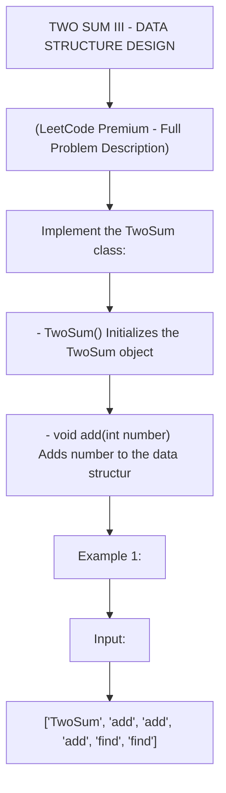
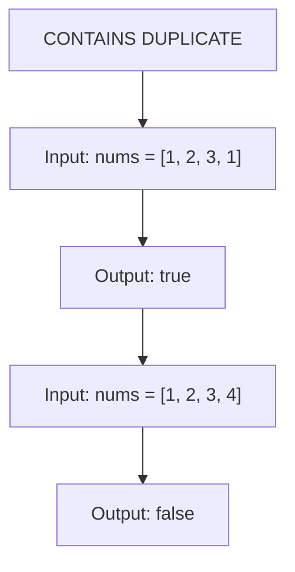
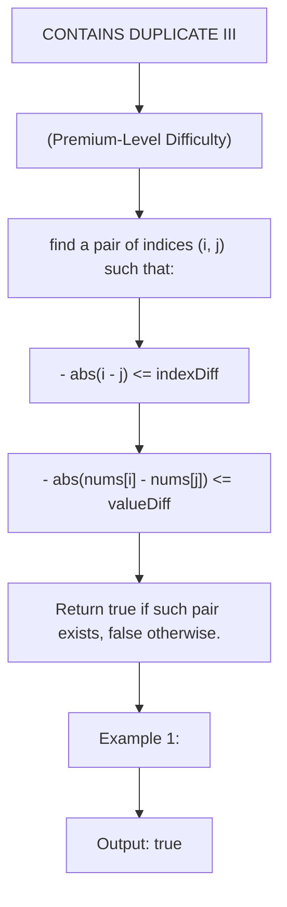
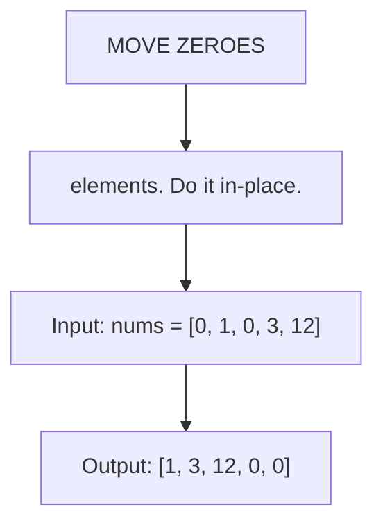
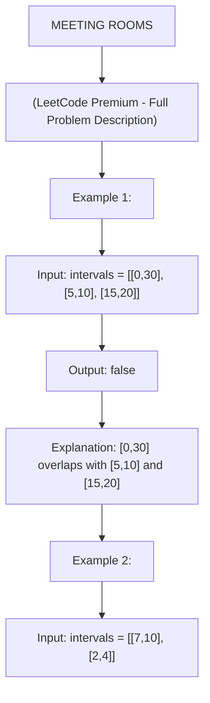
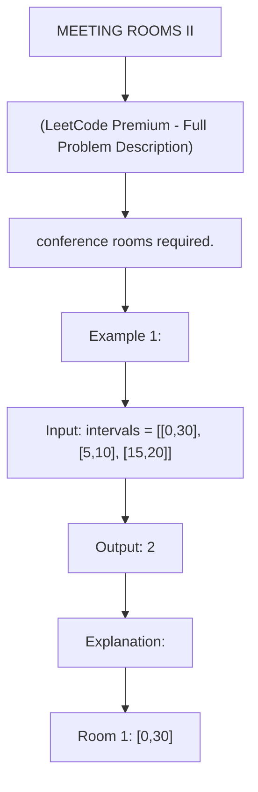
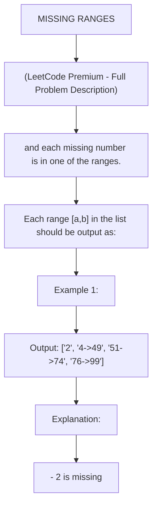

> **Navigation**: [< Previous](25_Problem_Origins.md) | [Back to Index](../00_MASTER_INDEX.md) | [Next >](05_Sliding_Window.md)

> **Problems 04/14** | [Prev](03_Strings.md) | [Index](../00_MASTER_INDEX.md) | [Next](05_Sliding_Window.md)

---

## 🗺️ Pattern Recognition Header

> **Before solving, identify the pattern.** This file covers multiple array techniques. Use this guide:
>

| Problem Type | Pattern | Learn It First |
|---|---|---|
| `two numbers sum to target` | HashMap complement | 📖 [01e_HashTable.md](../02_Data_Structures/01e_HashTable.md) |
| `find duplicate / unique` | HashSet or Sort | 📖 [01e_HashTable.md](../02_Data_Structures/01e_HashTable.md) |
| `move elements in-place` | Two Pointers | 📖 [07_Two_Pointers_Complete.md](../04_Patterns_Templates/07_Two_Pointers_Complete.md) |
| `intervals / overlapping ranges` | Sort by start + Heap | 📖 [01f_Trees_Heaps.md](../02_Data_Structures/01f_Trees_Heaps.md) |
| `missing numbers in range` | Linear scan | 📖 [01b_Arrays.md](../02_Data_Structures/01b_Arrays.md) |

>
> **Constraint Quick Check:**
> ```
> n ≤ 10^5 → need O(n) or O(n log n)  → HashMap / Sort
> Answer is an index pair → HashMap complement O(n)
> In-place modification → Two Pointers O(n)
> ```
>
> 📖 **Full Pattern Guide:** [00_PATTERN_MASTER_GUIDE.md](../04_Patterns_Templates/00_PATTERN_MASTER_GUIDE.md)

---


# 📊 Section 3: Array Problems

---

## 📊 3.1 Basic Array Operations

### Problem: Two Sum

**LeetCode 1** | **Difficulty:** Easy
🔗 [https://leetcode.com/problems/two-sum/](https://leetcode.com/problems/two-sum/)


> TWO SUM
>
> Given array of integers and target, return indices of two numbers that
> add up to target. Each input has exactly one solution.
>
> Input: nums = [2, 7, 11, 15], target = 9
> Output: [0, 1]
> Explanation: nums[0] + nums[1] = 2 + 7 = 9
>


```java
public int[] twoSum(int[] nums, int target) {
    Map<Integer, Integer> map = new HashMap<>();

    for (int i = 0; i < nums.length; i++) {
        int complement = target - nums[i];
        if (map.containsKey(complement)) {
            return new int[]{map.get(complement), i};
        }
        map.put(nums[i], i);
    }

    return new int[]{-1, -1};
}
```

---

### 🔒 PREMIUM: Two Sum III - Data Structure Design

**LeetCode 170** | **Difficulty:** Easy | **Premium Problem**

```
╔═══════════════════════════════════════════════════════════════════════════╗
║  TWO SUM III - DATA STRUCTURE DESIGN                                      ║
║  (LeetCode Premium - Full Problem Description)                            ║
╠═══════════════════════════════════════════════════════════════════════════╣
║                                                                           ║
║  Design a data structure that accepts a stream of integers and checks     ║
║  if it has a pair of integers that sum up to a particular value.          ║
║                                                                           ║
║  Implement the TwoSum class:                                              ║
║  - TwoSum() Initializes the TwoSum object                                 ║
║  - void add(int number) Adds number to the data structure                 ║
║  - boolean find(int value) Returns true if there exists any pair of       ║
║    numbers whose sum is equal to value, otherwise returns false.          ║
║                                                                           ║
║  ─────────────────────────────────────────────────────────────────────    ║
║                                                                           ║
║  Example 1:                                                               ║
║  Input:                                                                   ║
║  ["TwoSum", "add", "add", "add", "find", "find"]                          ║
║  [[], [1], [3], [5], [4], [7]]                                            ║
║  Output: [null, null, null, null, true, false]                            ║
║                                                                           ║
║  Explanation:                                                             ║
║  TwoSum twoSum = new TwoSum();                                            ║
║  twoSum.add(1);   // [1]                                                  ║
║  twoSum.add(3);   // [1, 3]                                               ║
║  twoSum.add(5);   // [1, 3, 5]                                            ║
║  twoSum.find(4);  // 1 + 3 = 4, return true                               ║
║  twoSum.find(7);  // No pairs sum to 7, return false                      ║
║                                                                           ║
║  ─────────────────────────────────────────────────────────────────────    ║
║                                                                           ║
║  Constraints:                                                             ║
║  - -10^5 <= number <= 10^5                                                ║
║  - -2^31 <= value <= 2^31 - 1                                             ║
║  - At most 10^4 calls will be made to add and find                        ║
║                                                                           ║
╚═══════════════════════════════════════════════════════════════════════════╝
```

**Flow:**
1. TWO SUM III - DATA STRUCTURE DESIGN
2. (LeetCode Premium - Full Problem Description)
3. Implement the TwoSum class:
4. - TwoSum() Initializes the TwoSum object
5. - void add(int number) Adds number to the data structur
6. Example 1:
7. Input:



```java
class TwoSum {
    private Map<Integer, Integer> numCount;

    public TwoSum() {
        numCount = new HashMap<>();
    }

    public void add(int number) {
        numCount.put(number, numCount.getOrDefault(number, 0) + 1);
    }

    public boolean find(int value) {
        for (int num : numCount.keySet()) {
            int complement = value - num;

            if (complement == num) {
                // Need two of the same number
                if (numCount.get(num) > 1) return true;
            } else {
                if (numCount.containsKey(complement)) return true;
            }
        }
        return false;
    }
}
```

---

### Problem: Contains Duplicate

**LeetCode 217** | **Difficulty:** Easy
🔗 [https://leetcode.com/problems/contains-duplicate/](https://leetcode.com/problems/contains-duplicate/)

```
╔═══════════════════════════════════════════════════════════════════════════╗
║  CONTAINS DUPLICATE                                                       ║
╠═══════════════════════════════════════════════════════════════════════════╣
║                                                                           ║
║  Return true if any value appears at least twice in the array.            ║
║                                                                           ║
║  Input: nums = [1, 2, 3, 1]                                               ║
║  Output: true                                                             ║
║                                                                           ║
║  Input: nums = [1, 2, 3, 4]                                               ║
║  Output: false                                                            ║
║                                                                           ║
╚═══════════════════════════════════════════════════════════════════════════╝
```

**Flow:**
1. CONTAINS DUPLICATE
2. Input: nums = [1, 2, 3, 1]
3. Output: true
4. Input: nums = [1, 2, 3, 4]
5. Output: false



```java
public boolean containsDuplicate(int[] nums) {
    Set<Integer> seen = new HashSet<>();
    for (int num : nums) {
        if (!seen.add(num)) return true;  // add returns false if already exists
    }
    return false;
}
```

---

### 🔒 PREMIUM: Contains Duplicate III

**LeetCode 220** | **Difficulty:** Hard | **Premium-Level Problem**

```
╔═══════════════════════════════════════════════════════════════════════════╗
║  CONTAINS DUPLICATE III                                                   ║
║  (Premium-Level Difficulty)                                               ║
╠═══════════════════════════════════════════════════════════════════════════╣
║                                                                           ║
║  Given an integer array nums and two integers indexDiff and valueDiff,    ║
║  find a pair of indices (i, j) such that:                                 ║
║  - i != j                                                                 ║
║  - abs(i - j) <= indexDiff                                                ║
║  - abs(nums[i] - nums[j]) <= valueDiff                                    ║
║                                                                           ║
║  Return true if such pair exists, false otherwise.                        ║
║                                                                           ║
║  ─────────────────────────────────────────────────────────────────────    ║
║                                                                           ║
║  Example 1:                                                               ║
║  Input: nums = [1,2,3,1], indexDiff = 3, valueDiff = 0                    ║
║  Output: true                                                             ║
║  Explanation: i=0, j=3, |0-3|<=3, |1-1|<=0                                ║
║                                                                           ║
║  Example 2:                                                               ║
║  Input: nums = [1,5,9,1,5,9], indexDiff = 2, valueDiff = 3                ║
║  Output: false                                                            ║
║                                                                           ║
║  ─────────────────────────────────────────────────────────────────────    ║
║                                                                           ║
║  Constraints:                                                             ║
║  - 2 <= nums.length <= 10^5                                               ║
║  - -10^9 <= nums[i] <= 10^9                                               ║
║  - 1 <= indexDiff <= nums.length                                          ║
║  - 0 <= valueDiff <= 10^9                                                 ║
║                                                                           ║
╚═══════════════════════════════════════════════════════════════════════════╝
```

**Flow:**
1. CONTAINS DUPLICATE III
2. (Premium-Level Difficulty)
3. find a pair of indices (i, j) such that:
4. - abs(i - j) <= indexDiff
5. - abs(nums[i] - nums[j]) <= valueDiff
6. Return true if such pair exists, false otherwise.
7. Example 1:



```java
// Bucket Sort Approach - O(n) time, O(k) space
public boolean containsNearbyAlmostDuplicate(int[] nums, int indexDiff, int valueDiff) {
    if (valueDiff < 0) return false;

    Map<Long, Long> buckets = new HashMap<>();
    long bucketSize = (long) valueDiff + 1;

    for (int i = 0; i < nums.length; i++) {
        long bucket = getBucket(nums[i], bucketSize);

        // Check same bucket
        if (buckets.containsKey(bucket)) return true;

        // Check adjacent buckets
        if (buckets.containsKey(bucket - 1) &&
            nums[i] - buckets.get(bucket - 1) <= valueDiff) return true;
        if (buckets.containsKey(bucket + 1) &&
            buckets.get(bucket + 1) - nums[i] <= valueDiff) return true;

        buckets.put(bucket, (long) nums[i]);

        // Remove old bucket outside window
        if (i >= indexDiff) {
            buckets.remove(getBucket(nums[i - indexDiff], bucketSize));
        }
    }
    return false;
}

private long getBucket(int num, long bucketSize) {
    return num >= 0 ? num / bucketSize : (num + 1) / bucketSize - 1;
}
```

---

### Problem: Move Zeroes

**LeetCode 283** | **Difficulty:** Easy
🔗 [https://leetcode.com/problems/move-zeroes/](https://leetcode.com/problems/move-zeroes/)

```
╔═══════════════════════════════════════════════════════════════════════════╗
║  MOVE ZEROES                                                              ║
╠═══════════════════════════════════════════════════════════════════════════╣
║                                                                           ║
║  Move all 0's to end while maintaining relative order of non-zero         ║
║  elements. Do it in-place.                                                ║
║                                                                           ║
║  Input: nums = [0, 1, 0, 3, 12]                                           ║
║  Output: [1, 3, 12, 0, 0]                                                 ║
║                                                                           ║
╚═══════════════════════════════════════════════════════════════════════════╝
```

**Flow:**
1. MOVE ZEROES
2. elements. Do it in-place.
3. Input: nums = [0, 1, 0, 3, 12]
4. Output: [1, 3, 12, 0, 0]



```java
public void moveZeroes(int[] nums) {
    int insertPos = 0;

    // Move all non-zero elements to front
    for (int num : nums) {
        if (num != 0) {
            nums[insertPos++] = num;
        }
    }

    // Fill rest with zeros
    while (insertPos < nums.length) {
        nums[insertPos++] = 0;
    }
}
```

---

### 🔒 PREMIUM: Meeting Rooms

**LeetCode 252** | **Difficulty:** Easy | **Premium Problem**

```
╔═══════════════════════════════════════════════════════════════════════════╗
║  MEETING ROOMS                                                            ║
║  (LeetCode Premium - Full Problem Description)                            ║
╠═══════════════════════════════════════════════════════════════════════════╣
║                                                                           ║
║  Given an array of meeting time intervals where intervals[i] =            ║
║  [start_i, end_i], determine if a person could attend all meetings.       ║
║                                                                           ║
║  ─────────────────────────────────────────────────────────────────────    ║
║                                                                           ║
║  Example 1:                                                               ║
║  Input: intervals = [[0,30], [5,10], [15,20]]                             ║
║  Output: false                                                            ║
║  Explanation: [0,30] overlaps with [5,10] and [15,20]                     ║
║                                                                           ║
║  Example 2:                                                               ║
║  Input: intervals = [[7,10], [2,4]]                                       ║
║  Output: true                                                             ║
║  Explanation: No overlap between meetings                                 ║
║                                                                           ║
║  ─────────────────────────────────────────────────────────────────────    ║
║                                                                           ║
║  Visual:                                                                  ║
║  Example 1:                                                               ║
║  |=============================| [0,30]                                   ║
║       |===| [5,10]                                                        ║
║                 |====| [15,20]                                            ║
║  Overlapping! Can't attend all.                                           ║
║                                                                           ║
║  Example 2:                                                               ║
║    |==| [2,4]                                                             ║
║             |===| [7,10]                                                  ║
║  No overlap! Can attend all.                                              ║
║                                                                           ║
║  ─────────────────────────────────────────────────────────────────────    ║
║                                                                           ║
║  Constraints:                                                             ║
║  - 0 <= intervals.length <= 10^4                                          ║
║  - intervals[i].length == 2                                               ║
║  - 0 <= start_i < end_i <= 10^6                                           ║
║                                                                           ║
╚═══════════════════════════════════════════════════════════════════════════╝
```

**Flow:**
1. MEETING ROOMS
2. (LeetCode Premium - Full Problem Description)
3. Example 1:
4. Input: intervals = [[0,30], [5,10], [15,20]]
5. Output: false
6. Explanation: [0,30] overlaps with [5,10] and [15,20]
7. Example 2:



```java
public boolean canAttendMeetings(int[][] intervals) {
    // Sort by start time
    Arrays.sort(intervals, (a, b) -> a[0] - b[0]);

    // Check for overlaps
    for (int i = 1; i < intervals.length; i++) {
        if (intervals[i][0] < intervals[i-1][1]) {
            return false;  // Overlap: current starts before previous ends
        }
    }

    return true;
}
```

---

### 🔒 PREMIUM: Meeting Rooms II

**LeetCode 253** | **Difficulty:** Medium | **Premium Problem**

```
╔═══════════════════════════════════════════════════════════════════════════╗
║  MEETING ROOMS II                                                         ║
║  (LeetCode Premium - Full Problem Description)                            ║
╠═══════════════════════════════════════════════════════════════════════════╣
║                                                                           ║
║  Given an array of meeting time intervals, find the minimum number of     ║
║  conference rooms required.                                               ║
║                                                                           ║
║  ─────────────────────────────────────────────────────────────────────    ║
║                                                                           ║
║  Example 1:                                                               ║
║  Input: intervals = [[0,30], [5,10], [15,20]]                             ║
║  Output: 2                                                                ║
║  Explanation:                                                             ║
║  Room 1: [0,30]                                                           ║
║  Room 2: [5,10], then [15,20]                                             ║
║                                                                           ║
║  Example 2:                                                               ║
║  Input: intervals = [[7,10], [2,4]]                                       ║
║  Output: 1                                                                ║
║  Explanation: No overlap, one room is enough                              ║
║                                                                           ║
║  Example 3:                                                               ║
║  Input: intervals = [[1,5], [2,6], [3,7], [4,8]]                          ║
║  Output: 4                                                                ║
║  Explanation: All meetings overlap at time 4, need 4 rooms                ║
║                                                                           ║
║  ─────────────────────────────────────────────────────────────────────    ║
║                                                                           ║
║  Visual for Example 1:                                                    ║
║  Time: 0  5  10  15  20  25  30                                           ║
║  Room1: |=========================|                                       ║
║  Room2:    |==|     |====|                                                ║
║                                                                           ║
║  ─────────────────────────────────────────────────────────────────────    ║
║                                                                           ║
║  Constraints:                                                             ║
║  - 1 <= intervals.length <= 10^4                                          ║
║  - 0 <= start_i < end_i <= 10^6                                           ║
║                                                                           ║
╚═══════════════════════════════════════════════════════════════════════════╝
```

**Flow:**
1. MEETING ROOMS II
2. (LeetCode Premium - Full Problem Description)
3. conference rooms required.
4. Example 1:
5. Input: intervals = [[0,30], [5,10], [15,20]]
6. Output: 2
7. Explanation:



```java
// Method 1: Min Heap - O(n log n)
public int minMeetingRooms(int[][] intervals) {
    if (intervals.length == 0) return 0;

    // Sort by start time
    Arrays.sort(intervals, (a, b) -> a[0] - b[0]);

    // Min heap to track end times
    PriorityQueue<Integer> heap = new PriorityQueue<>();
    heap.add(intervals[0][1]);

    for (int i = 1; i < intervals.length; i++) {
        // If current meeting starts after earliest ending, reuse room
        if (intervals[i][0] >= heap.peek()) {
            heap.poll();
        }
        // Add current meeting's end time
        heap.add(intervals[i][1]);
    }

    return heap.size();
}

// Method 2: Chronological Ordering - O(n log n)
public int minMeetingRoomsV2(int[][] intervals) {
    int[] starts = new int[intervals.length];
    int[] ends = new int[intervals.length];

    for (int i = 0; i < intervals.length; i++) {
        starts[i] = intervals[i][0];
        ends[i] = intervals[i][1];
    }

    Arrays.sort(starts);
    Arrays.sort(ends);

    int rooms = 0, endIdx = 0;

    for (int start : starts) {
        if (start < ends[endIdx]) {
            rooms++;  // Need new room
        } else {
            endIdx++; // Reuse room that freed up
        }
    }

    return rooms;
}
```

---

### 🔒 PREMIUM: Missing Ranges

**LeetCode 163** | **Difficulty:** Easy | **Premium Problem**

```
╔═══════════════════════════════════════════════════════════════════════════╗
║  MISSING RANGES                                                           ║
║  (LeetCode Premium - Full Problem Description)                            ║
╠═══════════════════════════════════════════════════════════════════════════╣
║                                                                           ║
║  Given a sorted unique integer array nums and two integers lower and      ║
║  upper, return the smallest sorted list of ranges that cover every        ║
║  missing number exactly. That is, no element of nums is in any range,     ║
║  and each missing number is in one of the ranges.                         ║
║                                                                           ║
║  Each range [a,b] in the list should be output as:                        ║
║  - "a->b" if a != b                                                       ║
║  - "a" if a == b                                                          ║
║                                                                           ║
║  ─────────────────────────────────────────────────────────────────────    ║
║                                                                           ║
║  Example 1:                                                               ║
║  Input: nums = [0, 1, 3, 50, 75], lower = 0, upper = 99                   ║
║  Output: ["2", "4->49", "51->74", "76->99"]                               ║
║  Explanation:                                                             ║
║  - 2 is missing                                                           ║
║  - 4 to 49 are missing                                                    ║
║  - 51 to 74 are missing                                                   ║
║  - 76 to 99 are missing                                                   ║
║                                                                           ║
║  Example 2:                                                               ║
║  Input: nums = [-1], lower = -1, upper = -1                               ║
║  Output: []                                                               ║
║  Explanation: No missing numbers in range [-1, -1]                        ║
║                                                                           ║
║  Example 3:                                                               ║
║  Input: nums = [], lower = 1, upper = 1                                   ║
║  Output: ["1"]                                                            ║
║                                                                           ║
║  Example 4:                                                               ║
║  Input: nums = [], lower = -3, upper = -1                                 ║
║  Output: ["-3->-1"]                                                       ║
║                                                                           ║
║  ─────────────────────────────────────────────────────────────────────    ║
║                                                                           ║
║  Constraints:                                                             ║
║  - -10^9 <= lower <= upper <= 10^9                                        ║
║  - 0 <= nums.length <= 100                                                ║
║  - lower <= nums[i] <= upper                                              ║
║  - All values of nums are unique                                          ║
║                                                                           ║
╚═══════════════════════════════════════════════════════════════════════════╝
```

**Flow:**
1. MISSING RANGES
2. (LeetCode Premium - Full Problem Description)
3. and each missing number is in one of the ranges.
4. Each range [a,b] in the list should be output as:
5. Example 1:
6. Output: ['2', '4->49', '51->74', '76->99']
7. Explanation:



```java
public List<String> findMissingRanges(int[] nums, int lower, int upper) {
    List<String> result = new ArrayList<>();
    int prev = lower - 1;

    for (int i = 0; i <= nums.length; i++) {
        int curr = (i == nums.length) ? upper + 1 : nums[i];

        if (curr - prev > 1) {
            result.add(formatRange(prev + 1, curr - 1));
        }

        prev = curr;
    }

    return result;
}

private String formatRange(int lower, int upper) {
    if (lower == upper) {
        return String.valueOf(lower);
    }
    return lower + "->" + upper;
}
```

---

## 📋 PROBLEM TRACKING CHECKLIST

### Basic Math

- [ ] Check if Prime
- [ ] Count Primes (LeetCode 204)
- [ ] Nth Prime Number
- [ ] Previous/Next Prime
- [ ] Prime Factors
- [ ] 🔒 Closest Prime Numbers in Range

### Fibonacci

- [ ] Nth Fibonacci (LeetCode 509)
- [ ] Sum of First N Fibonacci
- [ ] Check if Fibonacci
- [ ] Tribonacci (LeetCode 1137)
- [ ] Climbing Stairs (LeetCode 70)

### Digit Manipulation

- [ ] Sum of Digits
- [ ] Add Digits (LeetCode 258)
- [ ] Reverse Integer (LeetCode 7)
- [ ] Palindrome Number (LeetCode 9)
- [ ] Happy Number (LeetCode 202)

### 📌 Gcd/lcm

- [ ] GCD (Euclidean Algorithm)
- [ ] 🔒 GCD of Array (LeetCode 1979)

### Strings - Isomorphic/Pattern

- [ ] Isomorphic Strings (LeetCode 205)
- [ ] Word Pattern (LeetCode 290)
- [ ] 🔒 Word Pattern II (LeetCode 291)
- [ ] 🔒 Group Isomorphic Strings

### Strings - Anagram

- [ ] Valid Anagram (LeetCode 242)
- [ ] Find All Anagrams (LeetCode 438)
- [ ] 🔒 Strobogrammatic Number (LeetCode 246)
- [ ] 🔒 Strobogrammatic Number II (LeetCode 247)

### Strings - Palindrome

- [ ] Valid Palindrome II (LeetCode 680)
- [ ] 🔒 Palindrome Permutation (LeetCode 266)

### Arrays

- [ ] Two Sum (LeetCode 1)
- [ ] 🔒 Two Sum III (LeetCode 170)
- [ ] Contains Duplicate (LeetCode 217)
- [ ] 🔒 Contains Duplicate III (LeetCode 220)
- [ ] Move Zeroes (LeetCode 283)
- [ ] 🔒 Meeting Rooms (LeetCode 252)
- [ ] 🔒 Meeting Rooms II (LeetCode 253)
- [ ] 🔒 Missing Ranges (LeetCode 163)

---

---


## 🏆 Competitive Programming — Codeforces Problems

> Master arrays at the competitive level. These problems require combining multiple techniques.

| Problem | Link | Techniques | Difficulty |
|---|---|---|---|
| Theatre Square | [CF 1A](https://codeforces.com/problemset/problem/1/A) | Math + arrays (ceiling division) | ⭐ Easy |
| Taxi | [CF 158B](https://codeforces.com/problemset/problem/158/B) | Array grouping + greedy | ⭐ Easy |
| Ilya and Array | [CF 313B](https://codeforces.com/problemset/problem/313/B) | Array manipulation | ⭐ Easy |
| Pairs | [CF 1462C](https://codeforces.com/problemset/problem/1462/C) | Prefix sum on array | ⭐⭐ Medium |
| Boats Competition | [CF 1399C](https://codeforces.com/problemset/problem/1399/C) | Sort + Two pointers | ⭐⭐ Medium |
| Phoenix and Towers | [CF 1515C](https://codeforces.com/problemset/problem/1515/C) | Array construction greedy | ⭐⭐ Medium |
| BogoSort | [CF 1417E](https://codeforces.com/problemset/problem/1417/E) | Array inversion counting | ⭐⭐⭐ Hard |

---


## 🌍 Real-World Applications of Arrays

> Every single line of code you've written above runs in production somewhere. Here's where:

| Technique | Real-World System | How It's Used |
|---|---|---|
| **Two Sum** | Banking/Fraud detection | Find transaction pairs that sum to a suspicious amount |
| **Max Subarray (Kadane's)** | Stock trading systems | Find the best buy-sell window in price history |
| **Sliding Window** | Netflix/YouTube | "Trending in last 7 days" = fixed window on view-count array |
| **Prefix Sum** | Game servers | "Total damage dealt in rounds 5-20" without re-scanning |
| **Interval merging** | Google Calendar | Find free slots, merge overlapping meeting times |
| **Dutch Flag partition** | Database query planners | 3-way partition in QuickSort for strings |
| **Circular array (ring buffer)** | IoT sensors / OS kernel | Store recent N readings without memory reallocation |

```
🔥 INTERVIEW GOLD: "Netflix stores viewing history as arrays.
   The 'Trending Now' row = sliding window max of past 7 days views."
   Drop this and you stand out from 90% of candidates.
```

---


---

## 🏋️ Practice & Interview Questions — Arrays

> Attempt each before looking at the answer. Time yourself.

### Predict / Trace
**Q1.** What is the output? `int[] a = {1,2,3}; int[] b = a; b[0] = 99; System.out.println(a[0]);`
<details><summary>Answer</summary>

`99` — arrays are objects; `b = a` copies the **reference**, not the data. Both point to the same array.
</details>

**Q2.** What is the time complexity of inserting at index 0 of an array of size N?
<details><summary>Answer</summary>

O(N) — every element must shift right by one position.
</details>

**Q3.** Given sorted array `[1,3,5,7,9]`, binary search for 6 — trace the mid values.
<details><summary>Answer</summary>

lo=0,hi=4 → mid=2 (value=5) → lo=3,hi=4 → mid=3 (value=7) → lo=3,hi=2 → NOT FOUND
</details>

### LeetCode / Coding
**Q4.** ⭐ Two Sum — find indices of two numbers that add to target. O(N) solution.
<details><summary>Solution</summary>

```java
Map<Integer,Integer> map = new HashMap<>();
for(int i=0;i<nums.length;i++){
    int comp = target - nums[i];
    if(map.containsKey(comp)) return new int[]{map.get(comp), i};
    map.put(nums[i], i);
}
```
</details>

**Q5.** ⭐ Maximum Subarray (Kadane's Algorithm). Write the O(N) solution.
<details><summary>Solution</summary>

```java
int maxSum = nums[0], curr = nums[0];
for(int i=1;i<nums.length;i++){
    curr = Math.max(nums[i], curr + nums[i]);
    maxSum = Math.max(maxSum, curr);
}
return maxSum;
```
</details>

**Q6.** ⭐ Best Time to Buy and Sell Stock — single pass O(N).
<details><summary>Solution</summary>

```java
int minPrice = Integer.MAX_VALUE, maxProfit = 0;
for(int p : prices){
    minPrice = Math.min(minPrice, p);
    maxProfit = Math.max(maxProfit, p - minPrice);
}
return maxProfit;
```
</details>

**Q7.** ⭐ Product of Array Except Self — without division, O(N).
<details><summary>Solution</summary>

```java
int[] res = new int[n];
res[0] = 1;
for(int i=1;i<n;i++) res[i] = res[i-1] * nums[i-1];
int right = 1;
for(int i=n-1;i>=0;i--){ res[i] *= right; right *= nums[i]; }
return res;
```
</details>

**Q8.** ⭐⭐ Container With Most Water (Two Pointers).
<details><summary>Solution</summary>

```java
int l=0, r=nums.length-1, max=0;
while(l<r){
    max = Math.max(max, Math.min(height[l],height[r])*(r-l));
    if(height[l]<height[r]) l++; else r--;
}
```
</details>

**Q9.** ⭐⭐ 3Sum — find all unique triplets summing to 0. O(N²).
<details><summary>Solution</summary>

```java
Arrays.sort(nums);
for(int i=0;i<n-2;i++){
    if(i>0 && nums[i]==nums[i-1]) continue;
    int l=i+1, r=n-1;
    while(l<r){
        int s=nums[i]+nums[l]+nums[r];
        if(s==0){ result.add(List.of(nums[i],nums[l++],nums[r--])); 
            while(l<r&&nums[l]==nums[l-1])l++; while(l<r&&nums[r]==nums[r+1])r--; }
        else if(s<0) l++; else r--;
    }
}
```
</details>

**Q10.** ⭐⭐ Rotate Array by k positions in-place O(1) space.
<details><summary>Solution</summary>

```java
// Reverse full array, then reverse first k, then reverse rest
k %= n;
reverse(nums, 0, n-1);
reverse(nums, 0, k-1);
reverse(nums, k, n-1);
```
</details>

**Q11.** ⭐⭐ Find the duplicate number in array [1..n] — O(N) time, O(1) space (Floyd's cycle).
<details><summary>Solution</summary>

```java
int slow=nums[0], fast=nums[0];
do{ slow=nums[slow]; fast=nums[nums[fast]]; } while(slow!=fast);
slow=nums[0];
while(slow!=fast){ slow=nums[slow]; fast=nums[fast]; }
return slow;
```
</details>

**Q12.** ⭐⭐⭐ Trapping Rain Water — O(N) two-pointer solution.
<details><summary>Solution</summary>

```java
int l=0,r=n-1,lMax=0,rMax=0,water=0;
while(l<r){
    if(height[l]<=height[r]){
        if(height[l]>=lMax) lMax=height[l]; else water+=lMax-height[l];
        l++;
    } else {
        if(height[r]>=rMax) rMax=height[r]; else water+=rMax-height[r];
        r--;
    }
}
```
</details>

### Interview Questions
**Q13.** What's the difference between `ArrayList` and `LinkedList` for index access?
<details><summary>Answer</summary>

ArrayList: O(1) random access (array backing). LinkedList: O(N) — must traverse from head. Use ArrayList for most cases; LinkedList only when frequent insertions/deletions at head/tail.
</details>

**Q14.** When would you use `int[]` over `ArrayList<Integer>`?
<details><summary>Answer</summary>

`int[]`: primitive, no boxing overhead, fixed-size, cache-friendly. `ArrayList<Integer>`: dynamic resizing, collection API, but 4-16x memory overhead per element due to Integer boxing.
</details>

**Q15.** What is cache locality and why do arrays benefit from it?
<details><summary>Answer</summary>

CPU loads data in cache lines (~64 bytes). Arrays store elements contiguously → sequential access loads entire cache line at once → very fast. LinkedList nodes are scattered in heap → each node access = potential cache miss.
</details>

### MCQ Rapid Fire
| # | Question | Answer |
|---|---|---|
| 1 | Array access a[i] time complexity | O(1) |
| 2 | Array insertion at middle time complexity | O(N) |
| 3 | Default value of int[] in Java | 0 |
| 4 | Arrays.sort() algorithm for primitives | Dual-pivot QuickSort |
| 5 | Arrays.sort() algorithm for objects | TimSort (stable) |
| 6 | Arrays.copyOfRange(a,2,5) — how many elements? | 3 (indices 2,3,4) |
| 7 | Can arrays store null? | Yes (reference arrays only) |
| 8 | Arrays.fill(a, 7) — what does it do? | Sets every element to 7 |
| 9 | Multi-dim array a[3][4] — total elements? | 12 |
| 10 | Arrays.binarySearch requires? | Sorted array |


---

## 🧠 Deep Conceptual Questions — Arrays & Memory

> These questions test your REASONING, not just recall. Think before expanding.

**C1. Why is array access O(1)?**
<details><summary>Deep Answer</summary>

Arrays store elements at **contiguous memory addresses**. Given base address B and element size S:
`address(i) = B + (i × S)` — this is a single multiplication and addition (constant time regardless of N).
The CPU can compute this directly without any traversal. This is why arrays are the fastest data structure for indexed access.
</details>

**C2. Why does cache performance matter for algorithms, and why do arrays win?**
<details><summary>Deep Answer</summary>

Modern CPUs fetch memory in **cache lines** (~64 bytes). When you access `array[i]`, the CPU also loads `array[i+1]` through `array[i+7]` into L1 cache automatically (spatial locality). Sequential array access hits cache nearly 100% of the time (~1ns). LinkedList traversal: each node is at a random heap address → each step is a potential **cache miss** (~100ns). For 1M elements: array traversal ≈ 1ms; linked list ≈ 100ms. Same O(N), 100x different in practice.
</details>

**C3. Why does `Arrays.sort()` use different algorithms for primitives vs objects?**
<details><summary>Deep Answer</summary>

**Primitives (`int[]`)**: Uses Dual-Pivot QuickSort. No stability needed (equal ints are indistinguishable). QuickSort is in-place (O(1) extra space), cache-friendly (sequential access), fastest in practice. **Objects (`Integer[]`)**: Uses TimSort (hybrid MergeSort + InsertionSort). MUST be stable — equal objects may have different fields that should preserve original order (think: sort by name, then by age — equal names must stay age-ordered). TimSort guarantees O(N log N) worst case; QuickSort can degrade to O(N²) if not careful.
</details>

**C4. Why is inserting at the beginning of an array O(N) but appending at end is O(1) amortized?**
<details><summary>Deep Answer</summary>

**Insert at index 0**: must shift every element right → N operations always.
**Append**: if capacity exists, write at `arr[size]` → O(1). If full, resize (double capacity) → copy all N elements. But resizing happens only after 1, 2, 4, 8... N elements. Total copies over N appends = N/2 + N/4 + ... = N. Average per operation = N/N = O(1) — this is **amortized analysis**. ArrayList uses this strategy.
</details>

**C5. What is the REAL cost of `ArrayList.remove(0)` in a 1M element list? Why?**
<details><summary>Deep Answer</summary>

~1 million array element shifts. Java calls `System.arraycopy()` — a native bulk memory move. Even though it's one instruction, it copies 1M references = 4MB-8MB of memory movement. At memory bandwidth ~20GB/s: ~200-400 microseconds actual cost. Not "slow" but definitely O(N) — avoid repeatedly removing from the front of a large ArrayList. Use `ArrayDeque` for front-removal O(1).
</details>

**C6. Two Sum: why does the HashMap approach work, and what's its actual space tradeoff?**
<details><summary>Deep Answer</summary>

HashMap approach: as you iterate, store `{value → index}`. For each element, check if `target - current` already seen. This is the **complement pattern**: instead of "find two that sum to target", reframe as "have I seen what I need?". Space: O(N) worst case (all elements unique, no match until last pair). But we trade space for a reduction from O(N²) to O(N) time — classic space-time tradeoff. The 1-pass variant finds the answer in one scan without a second loop.
</details>

**C7. Sliding Window: what is the INVARIANT being maintained?**
<details><summary>Deep Answer</summary>

A sliding window maintains a **window [left, right]** where some property (max sum, no duplicates, valid substring) holds. The invariant: the window always satisfies the constraint. When violated: shrink from left until valid again. This avoids re-examining elements already processed — each element enters and leaves the window exactly once → O(N). Mental model: two pointers chasing each other, never crossing, each moving forward-only.
</details>

**C8. Prefix Sum: why does it reduce range-sum queries from O(N) to O(1)?**
<details><summary>Deep Answer</summary>

`prefix[i] = arr[0] + arr[1] + ... + arr[i]`. Sum of range [l,r] = `prefix[r] - prefix[l-1]`. Precomputation: O(N). Each query: O(1) subtraction. Without prefix sum: each query scans the range = O(N) per query → O(N×Q) total for Q queries. With prefix sum: O(N) build + O(Q) queries = O(N+Q). Break-even at Q=1; better for Q>1. Classic **precomputation tradeoff**: pay once, query forever.
</details>

**C9. Why does Kadane's Algorithm work for Maximum Subarray?**
<details><summary>Deep Answer</summary>

The key insight: at each position i, the maximum subarray ending at i is either:
1. `arr[i]` alone (start fresh — previous subarray was negative, drags us down)
2. `arr[i] + best_ending_at[i-1]` (extend the previous best)

`curr = max(arr[i], curr + arr[i])` captures this exactly. If curr becomes negative, it's better to start fresh at next element. We track global max throughout. This is a 1D DP where the "state" is "maximum subarray sum ending here". The recurrence is the key reasoning step.
</details>

**C10. Binary Search: why does `mid = lo + (hi - lo) / 2` instead of `(lo + hi) / 2`?**
<details><summary>Deep Answer</summary>

**Integer overflow!** If `lo + hi` exceeds `Integer.MAX_VALUE` (2,147,483,647), the sum wraps to a negative number. For huge arrays (lo=1B, hi=2B), `lo + hi = 3B > 2.1B`. This bug brought down a famous JDK implementation of binary search in 2006 (Joshua Bloch's blog post). `lo + (hi - lo) / 2` can never overflow since `hi - lo` is always positive and smaller than either value alone.
</details>


> **Navigation**: [< Previous](25_Problem_Origins.md) | [Back to Index](../00_MASTER_INDEX.md) | [Next >](05_Sliding_Window.md)