> **Navigation**: [< Previous](04_Arrays.md) | [Back to Index](../00_MASTER_INDEX.md) | [Next >](06_Two_Pointers.md)

> **Problems 05/14** | [Prev](04_Arrays.md) | [Index](../00_MASTER_INDEX.md) | [Next](06_Two_Pointers.md)

---

# 🎨 Section 4: Sliding Window Pattern Variants

---

## 📌 4.1 Fixed Size Window

### Problem: Maximum Sum Subarray of Size K

**Difficulty:** Easy | **Category:** Sliding Window

```
MAXIMUM SUM SUBARRAY OF SIZE K
──────────────────────────────────────────────────

Given array and integer k, find maximum sum of any contiguous subarray
of size k.

Input: arr = [2, 1, 5, 1, 3, 2], k = 3
Output: 9
Explanation: Subarray [5, 1, 3] has maximum sum = 9

Visual:
[2, 1, 5, 1, 3, 2]
 └──┘  sum=8
    └──┘  sum=7
       └──┘  sum=9 ← MAX
          └──┘  sum=6

```

**Flow:**
- Root
- ↓
- sum=8
- ↓
- Root
- ↓
- sum=7
- ↓
- Root
- ↓
- sum=9 ← MAX
- ↓
- Root
- ↓
- sum=6

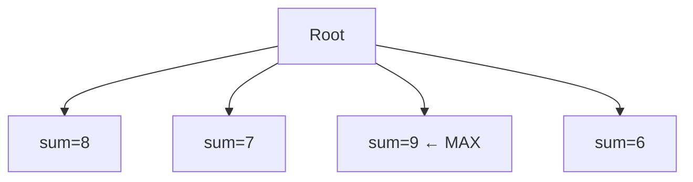

```java
public int maxSumSubarray(int[] arr, int k) {
    int windowSum = 0, maxSum = 0;

    for (int i = 0; i < arr.length; i++) {
        windowSum += arr[i];

        if (i >= k - 1) {
            maxSum = Math.max(maxSum, windowSum);
            windowSum -= arr[i - k + 1];
        }
    }
    return maxSum;
}
```

---

### Problem: Maximum Average Subarray I

**LeetCode 643** | **Difficulty:** Easy
🔗 [https://leetcode.com/problems/maximum-average-subarray-i/](https://leetcode.com/problems/maximum-average-subarray-i/)

```
╔═══════════════════════════════════════════════════════════════════════════╗
║  MAXIMUM AVERAGE SUBARRAY I                                               ║
╠═══════════════════════════════════════════════════════════════════════════╣
║                                                                           ║
║  Find contiguous subarray of length k with maximum average value.         ║
║                                                                           ║
║  Input: nums = [1,12,-5,-6,50,3], k = 4                                   ║
║  Output: 12.75                                                            ║
║  Explanation: Max avg is (12-5-6+50)/4 = 51/4 = 12.75                     ║
║                                                                           ║
╚═══════════════════════════════════════════════════════════════════════════╝
```

**Flow:**
- MAXIMUM AVERAGE SUBARRAY I
- ↓
- Input: nums = [1,12,-5,-6,50,3], k = 4
- ↓
- Output: 12.75
- ↓
- Explanation: Max avg is (12-5-6+50)/4 = 51/4 = 12.75

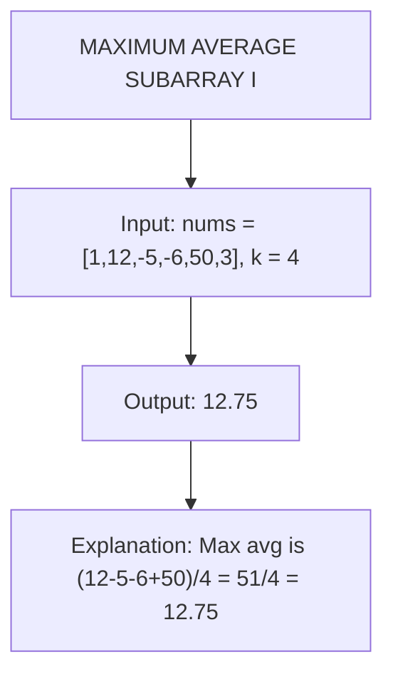

```java
public double findMaxAverage(int[] nums, int k) {
    double sum = 0;
    for (int i = 0; i < k; i++) sum += nums[i];

    double maxSum = sum;
    for (int i = k; i < nums.length; i++) {
        sum += nums[i] - nums[i - k];
        maxSum = Math.max(maxSum, sum);
    }
    return maxSum / k;
}
```

---

### Problem: Number of Sub-arrays of Size K with Average >= Threshold

**LeetCode 1343** | **Difficulty:** Medium
🔗 [https://leetcode.com/problems/number-of-sub-arrays-of-size-k-and-average-greater-than-or-equal-to-threshold/](https://leetcode.com/problems/number-of-sub-arrays-of-size-k-and-average-greater-than-or-equal-to-threshold/)

```
╔═══════════════════════════════════════════════════════════════════════════╗
║  SUBARRAYS WITH AVG >= THRESHOLD                                          ║
╠═══════════════════════════════════════════════════════════════════════════╣
║                                                                           ║
║  Count subarrays of size k where average >= threshold.                    ║
║                                                                           ║
║  Input: arr = [2,2,2,2,5,5,5,8], k = 3, threshold = 4                     ║
║  Output: 3                                                                ║
║  Explanation: [2,5,5], [5,5,5], [5,5,8] have avg >= 4                     ║
║                                                                           ║
╚═══════════════════════════════════════════════════════════════════════════╝
```

**Flow:**
- SUBARRAYS WITH AVG >= THRESHOLD
- ↓
- Count subarrays of size k where average >= threshold
- ↓
- Output: 3
- ↓
- Explanation: [2,5,5], [5,5,5], [5,5,8] have avg >= 4

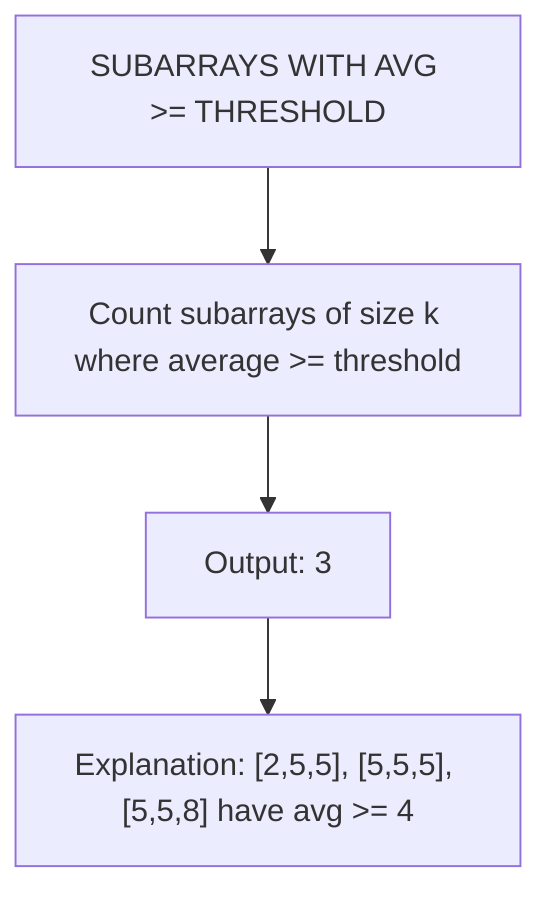

```java
public int numOfSubarrays(int[] arr, int k, int threshold) {
    int sum = 0, count = 0;
    int target = k * threshold;  // Avoid division

    for (int i = 0; i < arr.length; i++) {
        sum += arr[i];
        if (i >= k - 1) {
            if (sum >= target) count++;
            sum -= arr[i - k + 1];
        }
    }
    return count;
}
```

---

### 🔒 PREMIUM: Maximum Sum of Distinct Subarrays With Length K

**LeetCode 2461** | **Difficulty:** Medium | **Premium Problem**

```
╔═══════════════════════════════════════════════════════════════════════════╗
║  MAX SUM OF DISTINCT SUBARRAYS WITH LENGTH K                              ║
║  (LeetCode Premium - Full Problem Description)                            ║
╠═══════════════════════════════════════════════════════════════════════════╣
║                                                                           ║
║  Find maximum sum among all subarrays of length k where ALL elements      ║
║  are DISTINCT (no duplicates in window).                                  ║
║                                                                           ║
║  ─────────────────────────────────────────────────────────────────────    ║
║                                                                           ║
║  Example 1:                                                               ║
║  Input: nums = [1,5,4,2,9,9,9], k = 3                                     ║
║  Output: 15                                                               ║
║  Explanation:                                                             ║
║  [1,5,4] sum=10, all distinct ✓                                           ║
║  [5,4,2] sum=11, all distinct ✓                                           ║
║  [4,2,9] sum=15, all distinct ✓ ← MAX                                     ║
║  [2,9,9] has duplicate 9, skip                                            ║
║  [9,9,9] has duplicates, skip                                             ║
║                                                                           ║
║  Example 2:                                                               ║
║  Input: nums = [4,4,4], k = 3                                             ║
║  Output: 0                                                                ║
║  Explanation: No subarray of length 3 has all distinct elements           ║
║                                                                           ║
║  ─────────────────────────────────────────────────────────────────────    ║
║                                                                           ║
║  Constraints:                                                             ║
║  - 1 <= k <= nums.length <= 10^5                                          ║
║  - 1 <= nums[i] <= 10^5                                                   ║
║                                                                           ║
╚═══════════════════════════════════════════════════════════════════════════╝
```

**Flow:**
- MAX SUM OF DISTINCT SUBARRAYS WITH LENGTH K
- ↓
- (LeetCode Premium - Full Problem Description)
- ↓
- are DISTINCT (no duplicates in window).
- ↓
- Example 1:
- ↓
- Input: nums = [1,5,4,2,9,9,9], k = 3
- ↓
- Output: 15
- ↓
- Explanation:

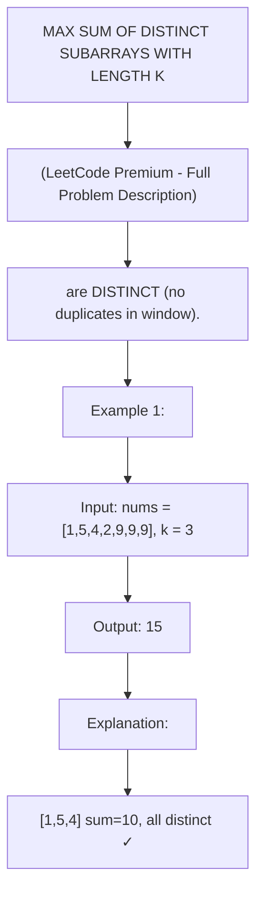

```java
public long maximumSubarraySum(int[] nums, int k) {
    Map<Integer, Integer> count = new HashMap<>();
    long sum = 0, maxSum = 0;
    int duplicates = 0;

    for (int i = 0; i < nums.length; i++) {
        // Add new element
        sum += nums[i];
        int freq = count.getOrDefault(nums[i], 0);
        if (freq == 1) duplicates++;
        count.put(nums[i], freq + 1);

        // Remove old element when window exceeds k
        if (i >= k) {
            int old = nums[i - k];
            sum -= old;
            int oldFreq = count.get(old);
            if (oldFreq == 2) duplicates--;
            count.put(old, oldFreq - 1);
        }

        // Check if valid window
        if (i >= k - 1 && duplicates == 0) {
            maxSum = Math.max(maxSum, sum);
        }
    }
    return maxSum;
}
```

---

## 📌 4.2 Variable Size Window

### Problem: Minimum Size Subarray Sum

**LeetCode 209** | **Difficulty:** Medium
🔗 [https://leetcode.com/problems/minimum-size-subarray-sum/](https://leetcode.com/problems/minimum-size-subarray-sum/)

```
MINIMUM SIZE SUBARRAY SUM
──────────────────────────────────────────────────

Find minimal length of contiguous subarray with sum >= target.

Input: target = 7, nums = [2,3,1,2,4,3]
Output: 2
Explanation: [4,3] has sum=7 with length 2

Visual:
[2,3,1,2,4,3]
 └────────┘ sum=12, len=5
   └──────┘ sum=10, len=4
     └────┘ sum=7, len=3
         └─┘ sum=7, len=2 ← MIN

```

**Flow:**
- Root
- ↓
- sum=12, len=5
- ↓
- Root
- ↓
- sum=10, len=4
- ↓
- Root
- ↓
- sum=7, len=3

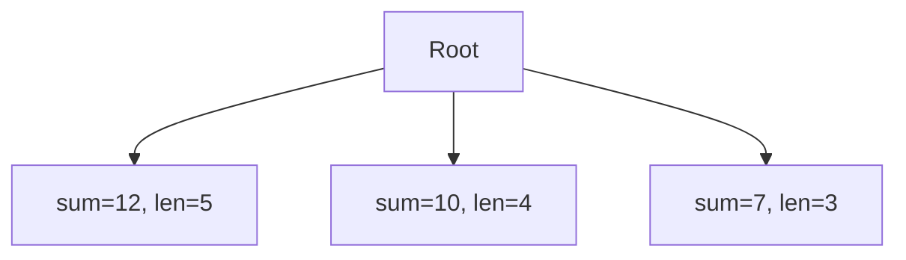

```java
public int minSubArrayLen(int target, int[] nums) {
    int left = 0, sum = 0, minLen = Integer.MAX_VALUE;

    for (int right = 0; right < nums.length; right++) {
        sum += nums[right];

        while (sum >= target) {
            minLen = Math.min(minLen, right - left + 1);
            sum -= nums[left++];
        }
    }
    return minLen == Integer.MAX_VALUE ? 0 : minLen;
}
```

---

### Problem: Longest Substring with At Most K Distinct Characters

**LeetCode 340** | **Difficulty:** Medium | 🔒 Premium
🔗 Premium Problem

```
╔═══════════════════════════════════════════════════════════════════════════╗
║  LONGEST SUBSTRING WITH AT MOST K DISTINCT CHARS                          ║
║  (LeetCode 340 - Premium)                                                 ║
╠═══════════════════════════════════════════════════════════════════════════╣
║                                                                           ║
║  Find length of longest substring with at most k distinct characters.     ║
║                                                                           ║
║  ─────────────────────────────────────────────────────────────────────    ║
║                                                                           ║
║  Example 1:                                                               ║
║  Input: s = "eceba", k = 2                                                ║
║  Output: 3                                                                ║
║  Explanation: "ece" has 2 distinct chars (e, c)                           ║
║                                                                           ║
║  Example 2:                                                               ║
║  Input: s = "aa", k = 1                                                   ║
║  Output: 2                                                                ║
║                                                                           ║
║  Example 3:                                                               ║
║  Input: s = "aabacbebebe", k = 3                                          ║
║  Output: 7                                                                ║
║  Explanation: "cbebebe" has 3 distinct (c, b, e)                          ║
║                                                                           ║
║  ─────────────────────────────────────────────────────────────────────    ║
║                                                                           ║
║  Constraints:                                                             ║
║  - 1 <= s.length <= 5 * 10^4                                              ║
║  - 0 <= k <= 50                                                           ║
║                                                                           ║
╚═══════════════════════════════════════════════════════════════════════════╝
```

**Flow:**
- LONGEST SUBSTRING WITH AT MOST K DISTINCT CHARS
- ↓
- (LeetCode 340 - Premium)
- ↓
- Example 1:
- ↓
- Input: s = 'eceba', k = 2
- ↓
- Output: 3
- ↓
- Explanation: 'ece' has 2 distinct chars (e, c)
- ↓
- Example 2:

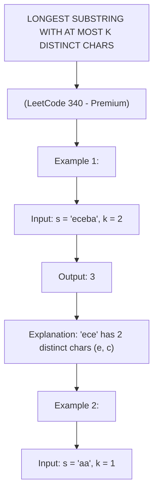

```java
public int lengthOfLongestSubstringKDistinct(String s, int k) {
    if (k == 0) return 0;

    Map<Character, Integer> map = new HashMap<>();
    int left = 0, maxLen = 0;

    for (int right = 0; right < s.length(); right++) {
        char c = s.charAt(right);
        map.put(c, map.getOrDefault(c, 0) + 1);

        while (map.size() > k) {
            char leftChar = s.charAt(left);
            map.put(leftChar, map.get(leftChar) - 1);
            if (map.get(leftChar) == 0) map.remove(leftChar);
            left++;
        }

        maxLen = Math.max(maxLen, right - left + 1);
    }
    return maxLen;
}
```

---

### Problem: Fruit Into Baskets (Longest with 2 Distinct)

**LeetCode 904** | **Difficulty:** Medium
🔗 [https://leetcode.com/problems/fruit-into-baskets/](https://leetcode.com/problems/fruit-into-baskets/)

```
╔═══════════════════════════════════════════════════════════════════════════╗
║  FRUIT INTO BASKETS                                                       ║
╠═══════════════════════════════════════════════════════════════════════════╣
║                                                                           ║
║  You have 2 baskets. Each basket can hold only ONE type of fruit.         ║
║  Find maximum fruits you can collect (longest subarray with 2 types).     ║
║                                                                           ║
║  Input: fruits = [1,2,1]                                                  ║
║  Output: 3 (collect all)                                                  ║
║                                                                           ║
║  Input: fruits = [0,1,2,2]                                                ║
║  Output: 3 ([1,2,2])                                                      ║
║                                                                           ║
║  Input: fruits = [1,2,3,2,2]                                              ║
║  Output: 4 ([2,3,2,2])                                                    ║
║                                                                           ║
╚═══════════════════════════════════════════════════════════════════════════╝
```

**Flow:**
- FRUIT INTO BASKETS
- ↓
- Input: fruits = [1,2,1]
- ↓
- Output: 3 (collect all)
- ↓
- Input: fruits = [0,1,2,2]
- ↓
- Output: 3 ([1,2,2])
- ↓
- Input: fruits = [1,2,3,2,2]
- ↓
- Output: 4 ([2,3,2,2])

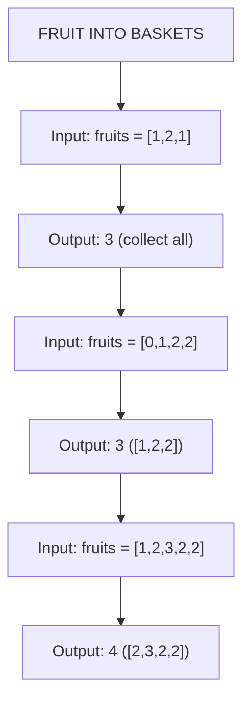

```java
public int totalFruit(int[] fruits) {
    Map<Integer, Integer> basket = new HashMap<>();
    int left = 0, maxFruits = 0;

    for (int right = 0; right < fruits.length; right++) {
        basket.merge(fruits[right], 1, Integer::sum);

        while (basket.size() > 2) {
            int leftFruit = fruits[left];
            basket.merge(leftFruit, -1, Integer::sum);
            if (basket.get(leftFruit) == 0) basket.remove(leftFruit);
            left++;
        }

        maxFruits = Math.max(maxFruits, right - left + 1);
    }
    return maxFruits;
}
```

---

### Problem: Longest Repeating Character Replacement

**LeetCode 424** | **Difficulty:** Medium
🔗 [https://leetcode.com/problems/longest-repeating-character-replacement/](https://leetcode.com/problems/longest-repeating-character-replacement/)

```
╔═══════════════════════════════════════════════════════════════════════════╗
║  LONGEST REPEATING CHARACTER REPLACEMENT                                  ║
╠═══════════════════════════════════════════════════════════════════════════╣
║                                                                           ║
║  You can replace at most k characters. Find longest substring with all    ║
║  same characters after at most k replacements.                            ║
║                                                                           ║
║  Input: s = "ABAB", k = 2                                                 ║
║  Output: 4                                                                ║
║  Explanation: Replace 2 A's with B's → "BBBB" (or vice versa)             ║
║                                                                           ║
║  Input: s = "AABABBA", k = 1                                              ║
║  Output: 4                                                                ║
║  Explanation: Replace middle B → "AAAAABA" gives "AAAA"                   ║
║                                                                           ║
║  KEY INSIGHT:                                                             ║
║  Window is valid if: (windowLength - maxFreq) <= k                        ║
║  We need to replace (windowLength - maxFreq) characters                   ║
║                                                                           ║
╚═══════════════════════════════════════════════════════════════════════════╝
```

**Flow:**
- LONGEST REPEATING CHARACTER REPLACEMENT
- ↓
- same characters after at most k replacements.
- ↓
- Input: s = 'ABAB', k = 2
- ↓
- Output: 4
- ↓
- Input: s = 'AABABBA', k = 1
- ↓
- Explanation: Replace middle B
- ↓
- 'AAAAABA' gives 'AAAA'
- ↓
- Explanation: Replace middle B
- ↓
- 'AAAAABA' gives 'AAAA'
- ↓
- KEY INSIGHT:

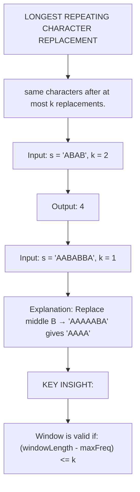

```java
public int characterReplacement(String s, int k) {
    int[] count = new int[26];
    int left = 0, maxFreq = 0, maxLen = 0;

    for (int right = 0; right < s.length(); right++) {
        count[s.charAt(right) - 'A']++;
        maxFreq = Math.max(maxFreq, count[s.charAt(right) - 'A']);

        // If replacements needed > k, shrink window
        while ((right - left + 1) - maxFreq > k) {
            count[s.charAt(left) - 'A']--;
            left++;
        }

        maxLen = Math.max(maxLen, right - left + 1);
    }
    return maxLen;
}
```

---

### Problem: Max Consecutive Ones III

**LeetCode 1004** | **Difficulty:** Medium
🔗 [https://leetcode.com/problems/max-consecutive-ones-iii/](https://leetcode.com/problems/max-consecutive-ones-iii/)

```
╔═══════════════════════════════════════════════════════════════════════════╗
║  MAX CONSECUTIVE ONES III                                                 ║
╠═══════════════════════════════════════════════════════════════════════════╣
║                                                                           ║
║  Binary array. Flip at most k 0's. Return max consecutive 1's.            ║
║                                                                           ║
║  Input: nums = [1,1,1,0,0,0,1,1,1,1,0], k = 2                             ║
║  Output: 6                                                                ║
║  Explanation: [1,1,1,0,0,1,1,1,1,1,1]                                     ║
║                        ↑ ↑ flipped                                        ║
║                                                                           ║
║  Visual:                                                                  ║
║  [1,1,1,0,0,0,1,1,1,1,0]                                                  ║
║           └─────────────┘ window with 2 zeros                             ║
║           flip 2 zeros = 6 ones                                           ║
║                                                                           ║
╚═══════════════════════════════════════════════════════════════════════════╝
```

**Flow:**
- MAX CONSECUTIVE ONES III
- ↓
- Input: nums = [1,1,1,0,0,0,1,1,1,1,0], k = 2
- ↓
- Output: 6
- ↓
- Explanation: [1,1,1,0,0,1,1,1,1,1,1]
- ↓
- ↑ ↑ flipped
- ↓
- Visual:
- ↓
- window with 2 zeros

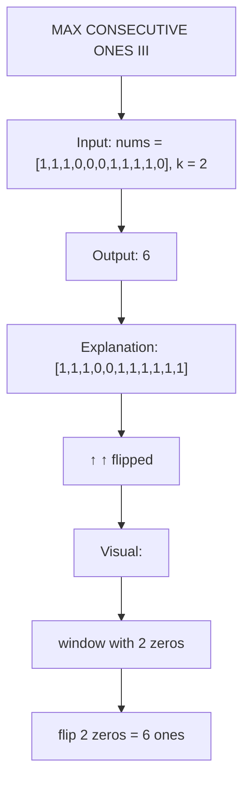

```java
public int longestOnes(int[] nums, int k) {
    int left = 0, zeros = 0, maxLen = 0;

    for (int right = 0; right < nums.length; right++) {
        if (nums[right] == 0) zeros++;

        while (zeros > k) {
            if (nums[left] == 0) zeros--;
            left++;
        }

        maxLen = Math.max(maxLen, right - left + 1);
    }
    return maxLen;
}
```

---

## 📝 4.3 Sliding Window — String Matching

### Problem: Permutation in String

**LeetCode 567** | **Difficulty:** Medium
🔗 [https://leetcode.com/problems/permutation-in-string/](https://leetcode.com/problems/permutation-in-string/)

```
╔═══════════════════════════════════════════════════════════════════════════╗
║  PERMUTATION IN STRING                                                    ║
╠═══════════════════════════════════════════════════════════════════════════╣
║                                                                           ║
║  Check if s2 contains any permutation of s1.                              ║
║                                                                           ║
║  Input: s1 = "ab", s2 = "eidbaooo"                                        ║
║  Output: true                                                             ║
║  Explanation: s2 contains "ba" which is permutation of "ab"               ║
║                                                                           ║
║  Input: s1 = "ab", s2 = "eidboaoo"                                        ║
║  Output: false                                                            ║
║                                                                           ║
╚═══════════════════════════════════════════════════════════════════════════╝
```

**Flow:**
- PERMUTATION IN STRING
- ↓
- Check if s2 contains any permutation of s1.
- ↓
- Input: s1 = 'ab', s2 = 'eidbaooo'
- ↓
- Output: true
- ↓
- Explanation: s2 contains 'ba' which is permutation of '
- ↓
- Input: s1 = 'ab', s2 = 'eidboaoo'
- ↓
- Output: false

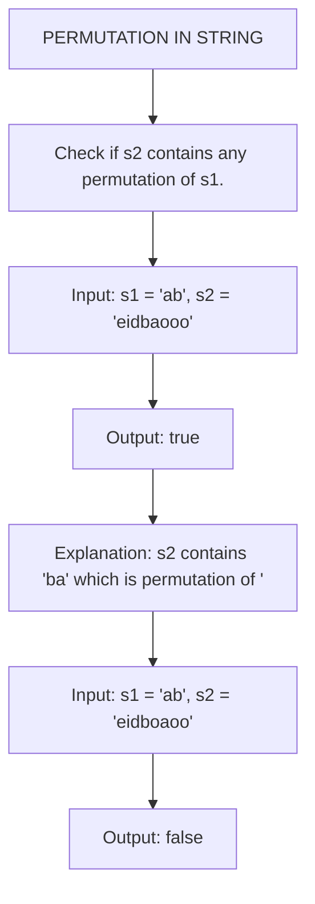

```java
public boolean checkInclusion(String s1, String s2) {
    if (s1.length() > s2.length()) return false;

    int[] s1Count = new int[26];
    int[] s2Count = new int[26];

    for (int i = 0; i < s1.length(); i++) {
        s1Count[s1.charAt(i) - 'a']++;
        s2Count[s2.charAt(i) - 'a']++;
    }

    if (Arrays.equals(s1Count, s2Count)) return true;

    for (int i = s1.length(); i < s2.length(); i++) {
        s2Count[s2.charAt(i) - 'a']++;
        s2Count[s2.charAt(i - s1.length()) - 'a']--;

        if (Arrays.equals(s1Count, s2Count)) return true;
    }
    return false;
}
```

---

### Problem: Minimum Window Substring

**LeetCode 76** | **Difficulty:** Hard
🔗 [https://leetcode.com/problems/minimum-window-substring/](https://leetcode.com/problems/minimum-window-substring/)

```
╔═══════════════════════════════════════════════════════════════════════════╗
║  MINIMUM WINDOW SUBSTRING                                                 ║
╠═══════════════════════════════════════════════════════════════════════════╣
║                                                                           ║
║  Find minimum window in s that contains all characters of t.              ║
║                                                                           ║
║  Input: s = "ADOBECODEBANC", t = "ABC"                                    ║
║  Output: "BANC"                                                           ║
║                                                                           ║
║  Visual:                                                                  ║
║  ADOBECODEBANC                                                            ║
║  A   ─┘    (has A, need B,C)                                              ║
║  ADOBEC    (has A,B,C - valid, len=6)                                     ║
║   DOBEC    (no A - invalid)                                               ║
║  ...                                                                      ║
║         BANC  (has A,B,C - valid, len=4) ← MIN                            ║
║                                                                           ║
╚═══════════════════════════════════════════════════════════════════════════╝
```

**Flow:**
- MINIMUM WINDOW SUBSTRING
- ↓
- Find minimum window in s that contains all characters o
- ↓
- Input: s = 'ADOBECODEBANC', t = 'ABC'
- ↓
- Output: 'BANC'
- ↓
- Visual:
- ↓
- ADOBECODEBANC
- ↓
- A (has A, need B,C)

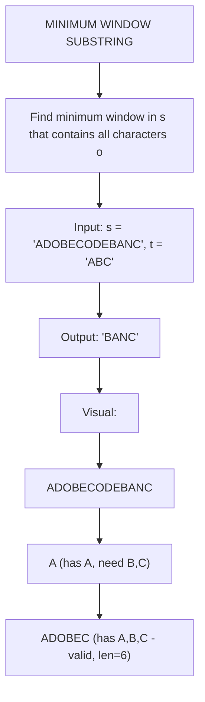

```java
public String minWindow(String s, String t) {
    if (s.length() < t.length()) return "";

    Map<Character, Integer> tCount = new HashMap<>();
    for (char c : t.toCharArray()) {
        tCount.merge(c, 1, Integer::sum);
    }

    int required = tCount.size();
    int formed = 0;
    Map<Character, Integer> windowCount = new HashMap<>();

    int left = 0, minLen = Integer.MAX_VALUE, minStart = 0;

    for (int right = 0; right < s.length(); right++) {
        char c = s.charAt(right);
        windowCount.merge(c, 1, Integer::sum);

        if (tCount.containsKey(c) &&
            windowCount.get(c).intValue() == tCount.get(c).intValue()) {
            formed++;
        }

        while (formed == required) {
            if (right - left + 1 < minLen) {
                minLen = right - left + 1;
                minStart = left;
            }

            char leftChar = s.charAt(left);
            windowCount.merge(leftChar, -1, Integer::sum);

            if (tCount.containsKey(leftChar) &&
                windowCount.get(leftChar) < tCount.get(leftChar)) {
                formed--;
            }
            left++;
        }
    }

    return minLen == Integer.MAX_VALUE ? "" : s.substring(minStart, minStart + minLen);
}
```

---

### 🔒 PREMIUM: Longest Substring with At Most Two Distinct Characters

**LeetCode 159** | **Difficulty:** Medium | **Premium Problem**

```
╔═══════════════════════════════════════════════════════════════════════════╗
║  LONGEST SUBSTRING WITH AT MOST TWO DISTINCT CHARACTERS                   ║
║  (LeetCode 159 - Premium)                                                 ║
╠═══════════════════════════════════════════════════════════════════════════╣
║                                                                           ║
║  Find length of longest substring with at most 2 distinct characters.     ║
║                                                                           ║
║  ─────────────────────────────────────────────────────────────────────    ║
║                                                                           ║
║  Example 1:                                                               ║
║  Input: s = "eceba"                                                       ║
║  Output: 3                                                                ║
║  Explanation: "ece" has 2 distinct characters                             ║
║                                                                           ║
║  Example 2:                                                               ║
║  Input: s = "ccaabbb"                                                     ║
║  Output: 5                                                                ║
║  Explanation: "aabbb" has 2 distinct characters                           ║
║                                                                           ║
║  ─────────────────────────────────────────────────────────────────────    ║
║                                                                           ║
║  Constraints:                                                             ║
║  - 1 <= s.length <= 10^5                                                  ║
║  - s consists of English letters                                          ║
║                                                                           ║
╚═══════════════════════════════════════════════════════════════════════════╝
```

**Flow:**
- LONGEST SUBSTRING WITH AT MOST TWO DISTINCT CHARACTERS
- ↓
- (LeetCode 159 - Premium)
- ↓
- Example 1:
- ↓
- Input: s = 'eceba'
- ↓
- Output: 3
- ↓
- Explanation: 'ece' has 2 distinct characters
- ↓
- Example 2:

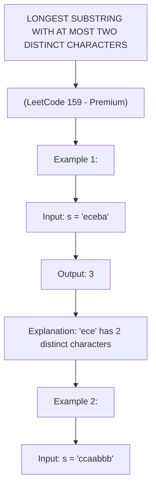

```java
public int lengthOfLongestSubstringTwoDistinct(String s) {
    Map<Character, Integer> map = new HashMap<>();
    int left = 0, maxLen = 0;

    for (int right = 0; right < s.length(); right++) {
        map.merge(s.charAt(right), 1, Integer::sum);

        while (map.size() > 2) {
            char leftChar = s.charAt(left);
            map.merge(leftChar, -1, Integer::sum);
            if (map.get(leftChar) == 0) map.remove(leftChar);
            left++;
        }

        maxLen = Math.max(maxLen, right - left + 1);
    }
    return maxLen;
}
```

---

## SECTION 4: Advanced Sliding Window Problems

### Problem 12: Sliding Window Maximum

**LeetCode 239** | **Difficulty:** Hard

```
╔═══════════════════════════════════════════════════════════════════════════╗
║  SLIDING WINDOW MAXIMUM (LeetCode 239 - Hard)                             ║
╠═══════════════════════════════════════════════════════════════════════════╣
║                                                                           ║
║  Given array nums and sliding window of size k, return max in each        ║
║  window position as the window slides from left to right.                 ║
║                                                                           ║
║  Example:                                                                 ║
║  Input: nums = [1,3,-1,-3,5,3,6,7], k = 3                                 ║
║  Output: [3,3,5,5,6,7]                                                    ║
║                                                                           ║
║  KEY INSIGHT: Use monotonic deque (decreasing) — front always has max     ║
║  TIME: O(n) | SPACE: O(k)                                                 ║
╚═══════════════════════════════════════════════════════════════════════════╝
```

**Flow:**
- SLIDING WINDOW MAXIMUM (LeetCode 239 - Hard)
- ↓
- window position as the window slides from left to right
- ↓
- Example:
- ↓
- Input: nums = [1,3,-1,-3,5,3,6,7], k = 3
- ↓
- Output: [3,3,5,5,6,7]
- ↓
- TIME: O(n)
- ↓
- SPACE: O(k)

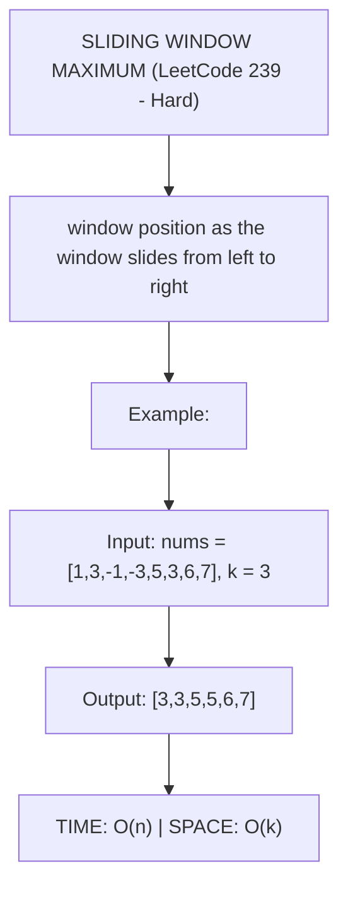

```java
public int[] maxSlidingWindow(int[] nums, int k) {
    int n = nums.length;
    int[] result = new int[n - k + 1];
    Deque<Integer> deque = new ArrayDeque<>();

    for (int i = 0; i < n; i++) {
        while (!deque.isEmpty() && deque.peekFirst() < i - k + 1)
            deque.pollFirst();
        while (!deque.isEmpty() && nums[deque.peekLast()] < nums[i])
            deque.pollLast();
        deque.offerLast(i);
        if (i >= k - 1)
            result[i - k + 1] = nums[deque.peekFirst()];
    }
    return result;
}
```

---

### Problem 13: Subarrays with K Different Integers

**LeetCode 992** | **Difficulty:** Hard

```
╔═══════════════════════════════════════════════════════════════════════════╗
║  SUBARRAYS WITH K DIFFERENT INTEGERS (LeetCode 992 - Hard)                ║
╠═══════════════════════════════════════════════════════════════════════════╣
║                                                                           ║
║  Return count of subarrays with exactly k distinct integers.              ║
║                                                                           ║
║  Example:                                                                 ║
║  Input: nums = [1,2,1,2,3], k = 2  →  Output: 7                           ║
║                                                                           ║
║  KEY TRICK: exactly(k) = atMost(k) - atMost(k-1)                          ║
║  TIME: O(n) | SPACE: O(k)                                                 ║
╚═══════════════════════════════════════════════════════════════════════════╝
```

**Flow:**
- SUBARRAYS WITH K DIFFERENT INTEGERS (LeetCode 992 - Har
- ↓
- Return count of subarrays with exactly k distinct integ
- ↓
- Example:
- ↓
- Input: nums = [1,2,1,2,3], k = 2
- ↓
- Output: 7
- ↓
- Input: nums = [1,2,1,2,3], k = 2
- ↓
- Output: 7
- ↓
- KEY TRICK: exactly(k) = atMost(k) - atMost(k-1)
- ↓
- TIME: O(n)
- ↓
- SPACE: O(k)

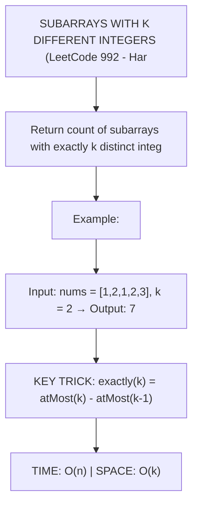

```java
public int subarraysWithKDistinct(int[] nums, int k) {
    return atMost(nums, k) - atMost(nums, k - 1);
}

private int atMost(int[] nums, int k) {
    Map<Integer, Integer> count = new HashMap<>();
    int left = 0, result = 0;
    for (int right = 0; right < nums.length; right++) {
        count.merge(nums[right], 1, Integer::sum);
        while (count.size() > k) {
            int leftVal = nums[left];
            count.merge(leftVal, -1, Integer::sum);
            if (count.get(leftVal) == 0) count.remove(leftVal);
            left++;
        }
        result += right - left + 1;
    }
    return result;
}
```

---

### Problem 14: Grumpy Bookstore Owner

**LeetCode 1052** | **Difficulty:** Medium

```
╔═══════════════════════════════════════════════════════════════════════════╗
║  GRUMPY BOOKSTORE OWNER (LeetCode 1052 - Medium)                          ║
╠═══════════════════════════════════════════════════════════════════════════╣
║                                                                           ║
║  Owner can use technique for k minutes to not be grumpy.                  ║
║  Find max satisfied customers.                                            ║
║                                                                           ║
║  Example:                                                                 ║
║  customers = [1,0,1,2,1,1,7,5], grumpy = [0,1,0,1,0,1,0,1], k=3           ║
║  Output: 16                                                               ║
║                                                                           ║
║  KEY: Base satisfied + sliding window of size k for max extra.            ║
║  TIME: O(n) | SPACE: O(1)                                                 ║
╚═══════════════════════════════════════════════════════════════════════════╝
```

**Flow:**
- GRUMPY BOOKSTORE OWNER (LeetCode 1052 - Medium)
- ↓
- Owner can use technique for k minutes to not be grumpy.
- ↓
- Find max satisfied customers.
- ↓
- Example:
- ↓
- Output: 16
- ↓
- TIME: O(n)
- ↓
- SPACE: O(1)

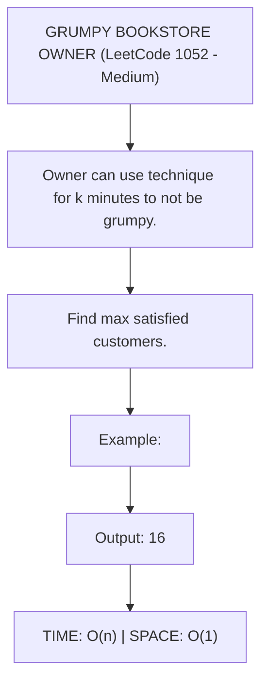

```java
public int maxSatisfied(int[] customers, int[] grumpy, int minutes) {
    int n = customers.length, baseSatisfied = 0;
    for (int i = 0; i < n; i++)
        if (grumpy[i] == 0) baseSatisfied += customers[i];

    int extra = 0, maxExtra = 0;
    for (int i = 0; i < n; i++) {
        if (grumpy[i] == 1) extra += customers[i];
        if (i >= minutes && grumpy[i - minutes] == 1)
            extra -= customers[i - minutes];
        maxExtra = Math.max(maxExtra, extra);
    }
    return baseSatisfied + maxExtra;
}
```

---

### Problem 15: Count Number of Nice Subarrays

**LeetCode 1248** | **Difficulty:** Medium

```
╔═══════════════════════════════════════════════════════════════════════════╗
║  COUNT NUMBER OF NICE SUBARRAYS (LeetCode 1248 - Medium)                  ║
╠═══════════════════════════════════════════════════════════════════════════╣
║                                                                           ║
║  Nice subarray = exactly k odd numbers. Return count.                     ║
║                                                                           ║
║  Example: nums = [1,1,2,1,1], k = 3  →  Output: 2                         ║
║                                                                           ║
║  KEY: exactly(k) = atMost(k) - atMost(k-1)                                ║
║  TIME: O(n) | SPACE: O(1)                                                 ║
╚═══════════════════════════════════════════════════════════════════════════╝
```

**Flow:**
- COUNT NUMBER OF NICE SUBARRAYS (LeetCode 1248 - Medium)
- ↓
- Nice subarray = exactly k odd numbers. Return count.
- ↓
- Example: nums = [1,1,2,1,1], k = 3
- ↓
- Output: 2
- ↓
- Example: nums = [1,1,2,1,1], k = 3
- ↓
- Output: 2
- ↓
- KEY: exactly(k) = atMost(k) - atMost(k-1)
- ↓
- TIME: O(n)
- ↓
- SPACE: O(1)

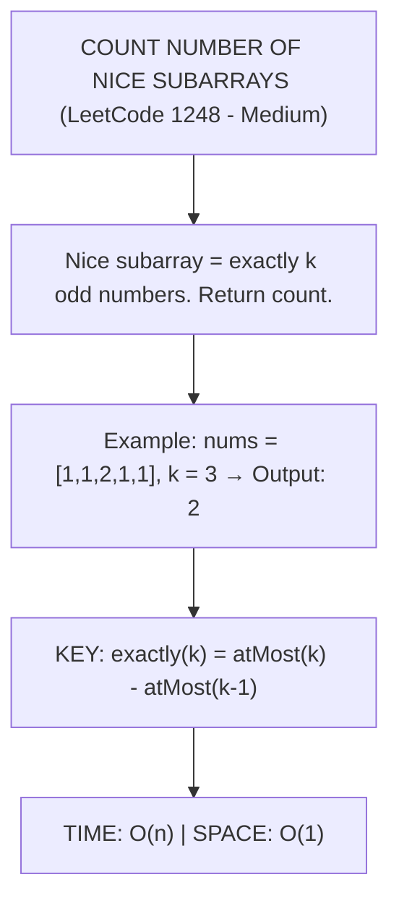

```java
public int numberOfSubarrays(int[] nums, int k) {
    return atMost(nums, k) - atMost(nums, k - 1);
}

private int atMost(int[] nums, int k) {
    int left = 0, result = 0, oddCount = 0;
    for (int right = 0; right < nums.length; right++) {
        if (nums[right] % 2 == 1) oddCount++;
        while (oddCount > k) {
            if (nums[left] % 2 == 1) oddCount--;
            left++;
        }
        result += right - left + 1;
    }
    return result;
}
```

---

### Problem 16: Max Consecutive Ones III

**LeetCode 1004** | **Difficulty:** Medium

```
╔═══════════════════════════════════════════════════════════════════════════╗
║  MAX CONSECUTIVE ONES III (LeetCode 1004 - Medium)                        ║
╠═══════════════════════════════════════════════════════════════════════════╣
║                                                                           ║
║  Max consecutive 1's if you can flip at most k 0's.                       ║
║                                                                           ║
║  Example: nums = [1,1,1,0,0,0,1,1,1,1,0], k = 2  →  Output: 6             ║
║                                                                           ║
║  KEY: Sliding window tracking zeros count. Shrink when > k.               ║
║  TIME: O(n) | SPACE: O(1)                                                 ║
╚═══════════════════════════════════════════════════════════════════════════╝
```

**Flow:**
- MAX CONSECUTIVE ONES III (LeetCode 1004 - Medium)
- ↓
- Max consecutive 1's if you can flip at most k 0's.
- ↓
- Example: nums = [1,1,1,0,0,0,1,1,1,1,0], k = 2
- ↓
- Output
- ↓
- Example: nums = [1,1,1,0,0,0,1,1,1,1,0], k = 2
- ↓
- Output
- ↓
- KEY: Sliding window tracking zeros count. Shrink when &
- ↓
- TIME: O(n)
- ↓
- SPACE: O(1)

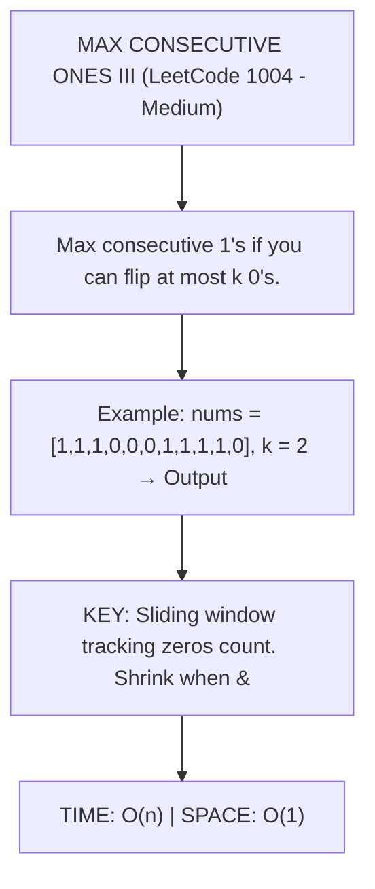

```java
public int longestOnes(int[] nums, int k) {
    int left = 0, maxLen = 0, zeros = 0;
    for (int right = 0; right < nums.length; right++) {
        if (nums[right] == 0) zeros++;
        while (zeros > k) {
            if (nums[left] == 0) zeros--;
            left++;
        }
        maxLen = Math.max(maxLen, right - left + 1);
    }
    return maxLen;
}
```

---

> **Navigation**: [< Previous](04_Arrays.md) | [Back to Index](../00_MASTER_INDEX.md) | [Next >](06_Two_Pointers.md)