> **Navigation**: [< Previous](05_Sliding_Window.md) | [Back to Index](../00_MASTER_INDEX.md) | [Next >](07_Binary_Search.md)

> **Problems 06/14** | [Prev](05_Sliding_Window.md) | [Index](../00_MASTER_INDEX.md) | [Next](07_Binary_Search.md)

---

## 🗺️ Pattern Recognition Header — Two Pointers

> **When do you use Two Pointers?** Ask yourself these questions before every problem:
>

| If you see... | Sub-pattern | First do... |
|---|---|---|
| `sorted array` + `pair summing to target` | Opposite ends | Sort if needed, L=0 R=n-1 |
| `triplets` / `k-sum` | Sort + fix + two-pointer | Fix one, two-pointer rest |
| `remove duplicates in-place` | Same direction (slow/fast) | Slow writes, fast reads |
| `partition / sort colors` | Three pointers | Dutch National Flag |

>
> **The Core Rule:**
> ```
> Works ONLY on sorted arrays (or when order doesn't matter for in-place)
> Saves O(n) space compared to HashMap approach
> Time: O(n log n) for sort + O(n) scan = O(n log n)
> ```
>
> 📖 **Theory:** [01b_Arrays.md — Sub Arrays section](../02_Data_Structures/01b_Arrays.md)
> 📖 **Pattern deep dive:** [07_Two_Pointers_Complete.md](../04_Patterns_Templates/07_Two_Pointers_Complete.md)
> 📖 **Full Pattern Guide:** [00_PATTERN_MASTER_GUIDE.md](../04_Patterns_Templates/00_PATTERN_MASTER_GUIDE.md)

---


> 🔬 **Section Challenge — 🗺️ Pattern Recognition Header — Two Pointers**
>
> **Challenge 1 (Reasoning):** Two-pointer pattern reduces O(N²) brute force to O(N). What is the KEY invariant that makes this safe?
> <details><summary>Answer</summary>
>
> The invariant: all pairs we SKIP are guaranteed to not contain the answer. In 3Sum: once we fix `nums[i]` and use l/r pointers, we can safely skip because the array is sorted. If `sum > 0`: decreasing r decreases the sum (smaller right value). If `sum < 0`: increasing l increases the sum (larger left value). We never skip a valid pair because monotonicity guarantees it.
> </details>
>

# 🚀 Section 5: Two Pointers Advanced Variants

---

## 📌 5.1 Opposite Direction Two Pointers

### Problem: Two Sum II - Input Array Is Sorted

**LeetCode 167** | **Difficulty:** Medium
🔗 [https://leetcode.com/problems/two-sum-ii-input-array-is-sorted/](https://leetcode.com/problems/two-sum-ii-input-array-is-sorted/)


> TWO SUM II - SORTED ARRAY
>
> Array is SORTED. Find two numbers that add to target.
> Return 1-indexed positions.
>
> Input: numbers = [2, 7, 11, 15], target = 9
> Output: [1, 2]
>
> Visual:
> [2,  7,  11,  15]
> ↑            ↑
> L            R   sum=17 > 9, move R left
> ↑        ↑
> L        R       sum=13 > 9, move R left
> ↑    ↑
> L    R           sum=9 = target ✓
>


```java
public int[] twoSum(int[] numbers, int target) {
    int left = 0, right = numbers.length - 1;

    while (left < right) {
        int sum = numbers[left] + numbers[right];
        if (sum == target) {
            return new int[]{left + 1, right + 1};  // 1-indexed
        } else if (sum < target) {
            left++;
        } else {
            right--;
        }
    }
    return new int[]{-1, -1};
}
```

---

### Problem: 3Sum

**LeetCode 15** | **Difficulty:** Medium
🔗 [https://leetcode.com/problems/3sum/](https://leetcode.com/problems/3sum/)

```
╔═══════════════════════════════════════════════════════════════════════════╗
║  3SUM                                                                     ║
╠═══════════════════════════════════════════════════════════════════════════╣
║                                                                           ║
║  Find all unique triplets that sum to zero.                               ║
║                                                                           ║
║  Input: nums = [-1, 0, 1, 2, -1, -4]                                      ║
║  Output: [[-1, -1, 2], [-1, 0, 1]]                                        ║
║                                                                           ║
║  Algorithm:                                                               ║
║  1. Sort the array                                                        ║
║  2. Fix one element, use two pointers for remaining                       ║
║  3. Skip duplicates to avoid duplicate triplets                           ║
║                                                                           ║
║  Sorted: [-4, -1, -1, 0, 1, 2]                                            ║
║           ↑   ↑            ↑                                              ║
║           i   L            R                                              ║
║                                                                           ║
╚═══════════════════════════════════════════════════════════════════════════╝
```

**Flow:**
- 3SUM
- ↓
- Find all unique triplets that sum to zero.
- ↓
- Input: nums = [-1, 0, 1, 2, -1, -4]
- ↓
- Output: [[-1, -1, 2], [-1, 0, 1]]
- ↓
- Algorithm:
- ↓
- 1. Sort the array
- ↓
- 2. Fix one element, use two pointers for remaining

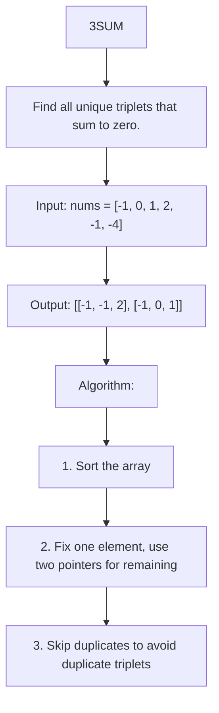

```java
public List<List<Integer>> threeSum(int[] nums) {
    List<List<Integer>> result = new ArrayList<>();
    Arrays.sort(nums);

    for (int i = 0; i < nums.length - 2; i++) {
        // Skip duplicates for i
        if (i > 0 && nums[i] == nums[i - 1]) continue;

        // Early termination: if smallest > 0, no solution possible
        if (nums[i] > 0) break;

        int left = i + 1, right = nums.length - 1;
        int target = -nums[i];

        while (left < right) {
            int sum = nums[left] + nums[right];

            if (sum == target) {
                result.add(Arrays.asList(nums[i], nums[left], nums[right]));

                // Skip duplicates
                while (left < right && nums[left] == nums[left + 1]) left++;
                while (left < right && nums[right] == nums[right - 1]) right--;

                left++;
                right--;
            } else if (sum < target) {
                left++;
            } else {
                right--;
            }
        }
    }
    return result;
}
```

---

### Problem: 3Sum Closest

**LeetCode 16** | **Difficulty:** Medium
🔗 [https://leetcode.com/problems/3sum-closest/](https://leetcode.com/problems/3sum-closest/)

```
╔═══════════════════════════════════════════════════════════════════════════╗
║  3SUM CLOSEST                                                             ║
╠═══════════════════════════════════════════════════════════════════════════╣
║                                                                           ║
║  Find three integers whose sum is closest to target.                      ║
║                                                                           ║
║  Input: nums = [-1, 2, 1, -4], target = 1                                 ║
║  Output: 2                                                                ║
║  Explanation: (-1) + 2 + 1 = 2, closest to target 1                       ║
║                                                                           ║
╚═══════════════════════════════════════════════════════════════════════════╝
```

**Flow:**
- 3SUM CLOSEST
- ↓
- Find three integers whose sum is closest to target.
- ↓
- Input: nums = [-1, 2, 1, -4], target = 1
- ↓
- Output: 2
- ↓
- Explanation: (-1) + 2 + 1 = 2, closest to target 1

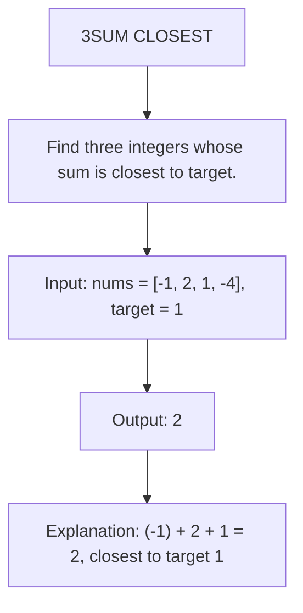

```java
public int threeSumClosest(int[] nums, int target) {
    Arrays.sort(nums);
    int closestSum = nums[0] + nums[1] + nums[2];

    for (int i = 0; i < nums.length - 2; i++) {
        int left = i + 1, right = nums.length - 1;

        while (left < right) {
            int sum = nums[i] + nums[left] + nums[right];

            if (Math.abs(sum - target) < Math.abs(closestSum - target)) {
                closestSum = sum;
            }

            if (sum < target) {
                left++;
            } else if (sum > target) {
                right--;
            } else {
                return sum;  // Exact match
            }
        }
    }
    return closestSum;
}
```

---

### Problem: 4Sum

**LeetCode 18** | **Difficulty:** Medium
🔗 [https://leetcode.com/problems/4sum/](https://leetcode.com/problems/4sum/)

```
╔═══════════════════════════════════════════════════════════════════════════╗
║  4SUM                                                                     ║
╠═══════════════════════════════════════════════════════════════════════════╣
║                                                                           ║
║  Find all unique quadruplets that sum to target.                          ║
║                                                                           ║
║  Input: nums = [1, 0, -1, 0, -2, 2], target = 0                           ║
║  Output: [[-2,-1,1,2], [-2,0,0,2], [-1,0,0,1]]                            ║
║                                                                           ║
║  Pattern: Extend 3Sum with one more loop                                  ║
║                                                                           ║
╚═══════════════════════════════════════════════════════════════════════════╝
```

**Flow:**
- 4SUM
- ↓
- Find all unique quadruplets that sum to target.
- ↓
- Input: nums = [1, 0, -1, 0, -2, 2], target = 0
- ↓
- Output: [[-2,-1,1,2], [-2,0,0,2], [-1,0,0,1]]
- ↓
- Pattern: Extend 3Sum with one more loop

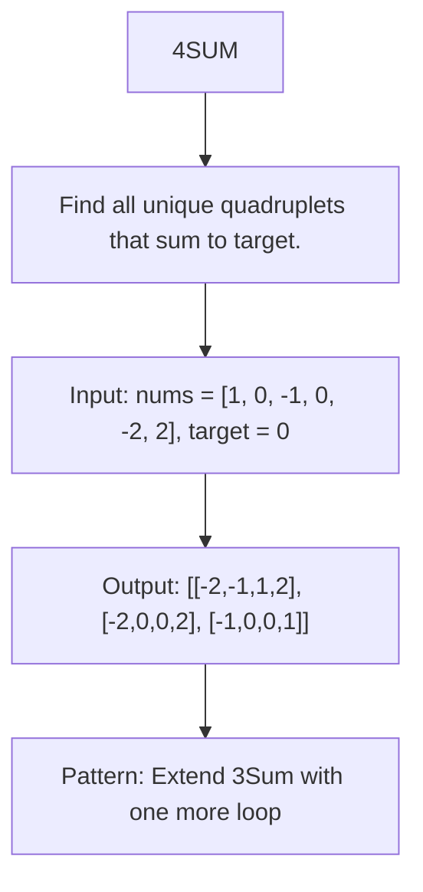

```java
public List<List<Integer>> fourSum(int[] nums, int target) {
    List<List<Integer>> result = new ArrayList<>();
    Arrays.sort(nums);
    int n = nums.length;

    for (int i = 0; i < n - 3; i++) {
        if (i > 0 && nums[i] == nums[i - 1]) continue;

        for (int j = i + 1; j < n - 2; j++) {
            if (j > i + 1 && nums[j] == nums[j - 1]) continue;

            int left = j + 1, right = n - 1;
            long targetSum = (long) target - nums[i] - nums[j];

            while (left < right) {
                int sum = nums[left] + nums[right];

                if (sum == targetSum) {
                    result.add(Arrays.asList(nums[i], nums[j], nums[left], nums[right]));

                    while (left < right && nums[left] == nums[left + 1]) left++;
                    while (left < right && nums[right] == nums[right - 1]) right--;

                    left++;
                    right--;
                } else if (sum < targetSum) {
                    left++;
                } else {
                    right--;
                }
            }
        }
    }
    return result;
}
```

---

### 🔒 PREMIUM: 3Sum Smaller

**LeetCode 259** | **Difficulty:** Medium | **Premium Problem**

```
╔═══════════════════════════════════════════════════════════════════════════╗
║  3SUM SMALLER                                                             ║
║  (LeetCode 259 - Premium)                                                 ║
╠═══════════════════════════════════════════════════════════════════════════╣
║                                                                           ║
║  Count triplets with sum LESS than target.                                ║
║                                                                           ║
║  ─────────────────────────────────────────────────────────────────────    ║
║                                                                           ║
║  Example 1:                                                               ║
║  Input: nums = [-2, 0, 1, 3], target = 2                                  ║
║  Output: 2                                                                ║
║  Explanation:                                                             ║
║  (-2) + 0 + 1 = -1 < 2 ✓                                                  ║
║  (-2) + 0 + 3 = 1 < 2 ✓                                                   ║
║  (-2) + 1 + 3 = 2, not < 2                                                ║
║  0 + 1 + 3 = 4, not < 2                                                   ║
║                                                                           ║
║  Example 2:                                                               ║
║  Input: nums = [], target = 0                                             ║
║  Output: 0                                                                ║
║                                                                           ║
║  Example 3:                                                               ║
║  Input: nums = [0], target = 0                                            ║
║  Output: 0                                                                ║
║                                                                           ║
║  ─────────────────────────────────────────────────────────────────────    ║
║                                                                           ║
║  KEY INSIGHT:                                                             ║
║  If nums[i] + nums[left] + nums[right] < target,                          ║
║  Then ALL pairs (left, left+1), (left, left+2)...(left, right) work!      ║
║  Count = right - left                                                     ║
║                                                                           ║
║  ─────────────────────────────────────────────────────────────────────    ║
║                                                                           ║
║  Constraints:                                                             ║
║  - n == nums.length                                                       ║
║  - 0 <= n <= 3500                                                         ║
║  - -100 <= nums[i] <= 100                                                 ║
║  - -100 <= target <= 100                                                  ║
║                                                                           ║
╚═══════════════════════════════════════════════════════════════════════════╝
```

**Flow:**
- 3SUM SMALLER
- ↓
- (LeetCode 259 - Premium)
- ↓
- Count triplets with sum LESS than target.
- ↓
- Example 1:
- ↓
- Input: nums = [-2, 0, 1, 3], target = 2
- ↓
- Output: 2
- ↓
- Explanation:

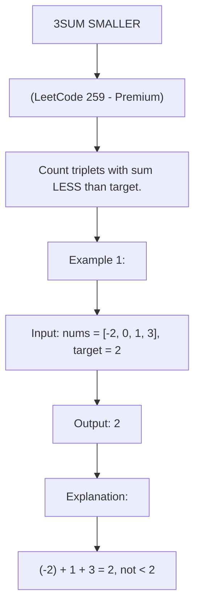

```java
public int threeSumSmaller(int[] nums, int target) {
    Arrays.sort(nums);
    int count = 0;

    for (int i = 0; i < nums.length - 2; i++) {
        int left = i + 1, right = nums.length - 1;

        while (left < right) {
            int sum = nums[i] + nums[left] + nums[right];

            if (sum < target) {
                // All pairs from left to right-1 also work!
                count += right - left;
                left++;
            } else {
                right--;
            }
        }
    }
    return count;
}
```

---

### Problem: Valid Triangle Number

**LeetCode 611** | **Difficulty:** Medium
🔗 [https://leetcode.com/problems/valid-triangle-number/](https://leetcode.com/problems/valid-triangle-number/)

```
╔═══════════════════════════════════════════════════════════════════════════╗
║  VALID TRIANGLE NUMBER                                                    ║
╠═══════════════════════════════════════════════════════════════════════════╣
║                                                                           ║
║  Count triplets that can form a valid triangle.                           ║
║  Triangle rule: sum of any two sides > third side                         ║
║                                                                           ║
║  Input: nums = [2, 2, 3, 4]                                               ║
║  Output: 3                                                                ║
║  Valid: (2,3,4), (2,3,4), (2,2,3)                                         ║
║                                                                           ║
║  KEY: After sorting, only need to check a + b > c                         ║
║  (other conditions automatically satisfied)                               ║
║                                                                           ║
╚═══════════════════════════════════════════════════════════════════════════╝
```

**Flow:**
- VALID TRIANGLE NUMBER
- ↓
- Count triplets that can form a valid triangle.
- ↓
- Triangle rule: sum of any two sides > third side
- ↓
- Input: nums = [2, 2, 3, 4]
- ↓
- Output: 3
- ↓
- Valid: (2,3,4), (2,3,4), (2,2,3)
- ↓
- KEY: After sorting, only need to check a + b > c

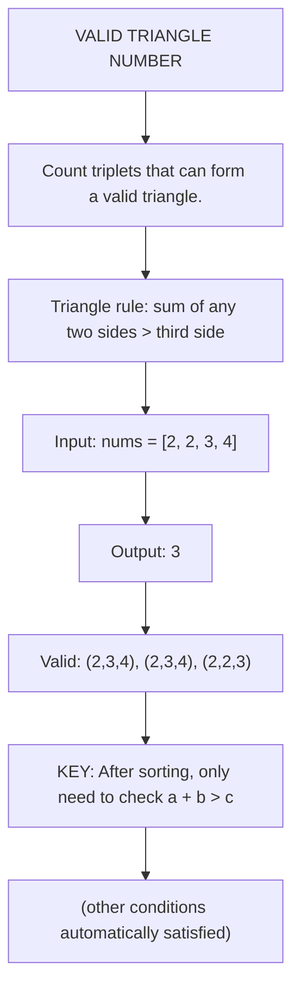

```java
public int triangleNumber(int[] nums) {
    Arrays.sort(nums);
    int count = 0;

    // Fix the largest side at index i
    for (int i = nums.length - 1; i >= 2; i--) {
        int left = 0, right = i - 1;

        while (left < right) {
            if (nums[left] + nums[right] > nums[i]) {
                // All pairs from left to right-1 work!
                count += right - left;
                right--;
            } else {
                left++;
            }
        }
    }
    return count;
}
```

---


> 🔬 **Section Challenge — 📌 5.1 Opposite Direction Two Pointers**
>
> **Challenge 1 (Reasoning):** Two-pointer pattern reduces O(N²) brute force to O(N). What is the KEY invariant that makes this safe?
> <details><summary>Answer</summary>
>
> The invariant: all pairs we SKIP are guaranteed to not contain the answer. In 3Sum: once we fix `nums[i]` and use l/r pointers, we can safely skip because the array is sorted. If `sum > 0`: decreasing r decreases the sum (smaller right value). If `sum < 0`: increasing l increases the sum (larger left value). We never skip a valid pair because monotonicity guarantees it.
> </details>
>

## 📌 5.2 Same Direction Two Pointers

### Problem: Remove Duplicates from Sorted Array

**LeetCode 26** | **Difficulty:** Easy
🔗 [https://leetcode.com/problems/remove-duplicates-from-sorted-array/](https://leetcode.com/problems/remove-duplicates-from-sorted-array/)

```
╔═══════════════════════════════════════════════════════════════════════════╗
║  REMOVE DUPLICATES FROM SORTED ARRAY                                      ║
╠═══════════════════════════════════════════════════════════════════════════╣
║                                                                           ║
║  Remove duplicates in-place. Return new length.                           ║
║                                                                           ║
║  Input: nums = [1, 1, 2]                                                  ║
║  Output: 2, nums = [1, 2, _]                                              ║
║                                                                           ║
║  Visual:                                                                  ║
║  [1, 1, 2]                                                                ║
║   ↑  ↑       slow=0, fast=1, same value, skip                             ║
║   ↑     ↑    slow=0, fast=2, different! copy                              ║
║      ↑  ↑    slow=1, nums[1]=2                                            ║
║  Result: [1, 2, _], length = 2                                            ║
║                                                                           ║
╚═══════════════════════════════════════════════════════════════════════════╝
```

**Flow:**
- REMOVE DUPLICATES FROM SORTED ARRAY
- ↓
- Remove duplicates in-place. Return new length.
- ↓
- Input: nums = [1, 1, 2]
- ↓
- Output: 2, nums = [1, 2, _]
- ↓
- Visual:
- ↓
- ↑ ↑ slow=0, fast=1, same value, skip
- ↓
- ↑ ↑ slow=0, fast=2, different! copy

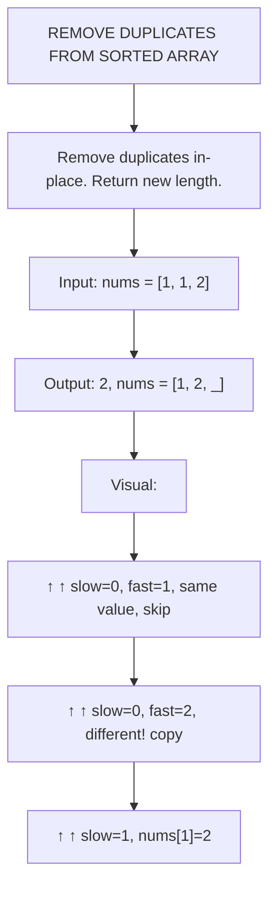

```java
public int removeDuplicates(int[] nums) {
    if (nums.length == 0) return 0;

    int slow = 0;

    for (int fast = 1; fast < nums.length; fast++) {
        if (nums[fast] != nums[slow]) {
            slow++;
            nums[slow] = nums[fast];
        }
    }
    return slow + 1;
}
```

---

### Problem: Remove Duplicates from Sorted Array II

**LeetCode 80** | **Difficulty:** Medium
🔗 [https://leetcode.com/problems/remove-duplicates-from-sorted-array-ii/](https://leetcode.com/problems/remove-duplicates-from-sorted-array-ii/)

```
╔═══════════════════════════════════════════════════════════════════════════╗
║  REMOVE DUPLICATES II (Allow at most 2 duplicates)                        ║
╠═══════════════════════════════════════════════════════════════════════════╣
║                                                                           ║
║  Each element can appear at most TWICE.                                   ║
║                                                                           ║
║  Input: nums = [1, 1, 1, 2, 2, 3]                                         ║
║  Output: 5, nums = [1, 1, 2, 2, 3, _]                                     ║
║                                                                           ║
║  KEY: Compare with nums[slow - 2] instead of nums[slow - 1]               ║
║                                                                           ║
╚═══════════════════════════════════════════════════════════════════════════╝
```

**Flow:**
- REMOVE DUPLICATES II (Allow at most 2 duplicates)
- ↓
- Each element can appear at most TWICE.
- ↓
- Input: nums = [1, 1, 1, 2, 2, 3]
- ↓
- Output: 5, nums = [1, 1, 2, 2, 3, _]
- ↓
- KEY: Compare with nums[slow - 2] instead of nums[slow -

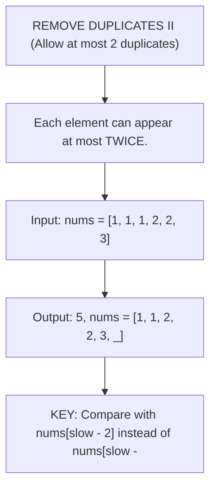

```java
public int removeDuplicates(int[] nums) {
    if (nums.length <= 2) return nums.length;

    int slow = 2;  // First 2 elements are always valid

    for (int fast = 2; fast < nums.length; fast++) {
        if (nums[fast] != nums[slow - 2]) {
            nums[slow] = nums[fast];
            slow++;
        }
    }
    return slow;
}
```

---

### Problem: Remove Element

**LeetCode 27** | **Difficulty:** Easy
🔗 [https://leetcode.com/problems/remove-element/](https://leetcode.com/problems/remove-element/)

```
╔═══════════════════════════════════════════════════════════════════════════╗
║  REMOVE ELEMENT                                                           ║
╠═══════════════════════════════════════════════════════════════════════════╣
║                                                                           ║
║  Remove all instances of val in-place. Return new length.                 ║
║                                                                           ║
║  Input: nums = [3, 2, 2, 3], val = 3                                      ║
║  Output: 2, nums = [2, 2, _, _]                                           ║
║                                                                           ║
╚═══════════════════════════════════════════════════════════════════════════╝
```

**Flow:**
- REMOVE ELEMENT
- ↓
- Remove all instances of val in-place. Return new length
- ↓
- Input: nums = [3, 2, 2, 3], val = 3
- ↓
- Output: 2, nums = [2, 2, _, _]

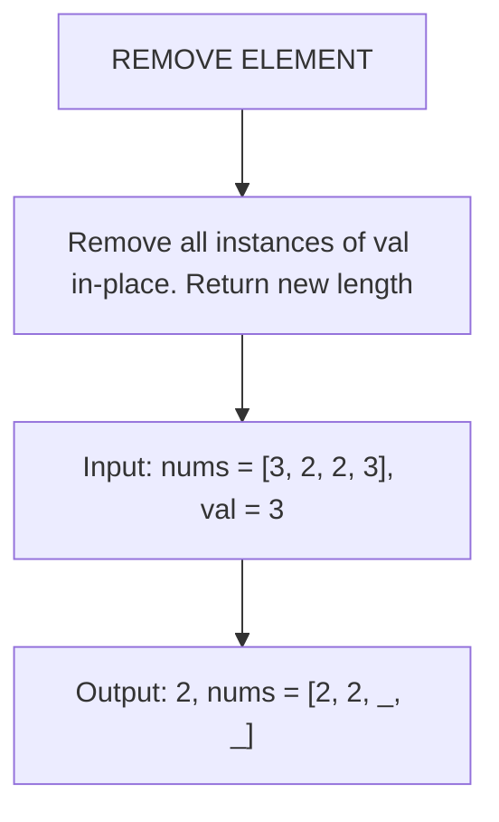

```java
public int removeElement(int[] nums, int val) {
    int slow = 0;

    for (int fast = 0; fast < nums.length; fast++) {
        if (nums[fast] != val) {
            nums[slow] = nums[fast];
            slow++;
        }
    }
    return slow;
}
```

---

### Problem: Sort Colors (Dutch National Flag)

**LeetCode 75** | **Difficulty:** Medium
🔗 [https://leetcode.com/problems/sort-colors/](https://leetcode.com/problems/sort-colors/)

```
╔═══════════════════════════════════════════════════════════════════════════╗
║  SORT COLORS (Dutch National Flag Problem)                                ║
╠═══════════════════════════════════════════════════════════════════════════╣
║                                                                           ║
║  Sort array with only 0s, 1s, and 2s in-place.                            ║
║  One-pass algorithm with constant space.                                  ║
║                                                                           ║
║  Input: nums = [2, 0, 2, 1, 1, 0]                                         ║
║  Output: [0, 0, 1, 1, 2, 2]                                               ║
║                                                                           ║
║  Three Pointers:                                                          ║
║  - low: boundary for 0s (everything before low is 0)                      ║
║  - mid: current element being examined                                    ║
║  - high: boundary for 2s (everything after high is 2)                     ║
║                                                                           ║
║  Visual:                                                                  ║
║  [0, 0, 0, | 1, 1, 1, | ?, ?, ? | 2, 2, 2]                                ║
║            ↑          ↑         ↑                                         ║
║           low        mid       high                                       ║
║                                                                           ║
╚═══════════════════════════════════════════════════════════════════════════╝
```

**Flow:**
- SORT COLORS (Dutch National Flag Problem)
- ↓
- Sort array with only 0s, 1s, and 2s in-place.
- ↓
- One-pass algorithm with constant space.
- ↓
- Input: nums = [2, 0, 2, 1, 1, 0]
- ↓
- Output: [0, 0, 1, 1, 2, 2]
- ↓
- Three Pointers:
- ↓
- - low: boundary for 0s (everything before low is 0)

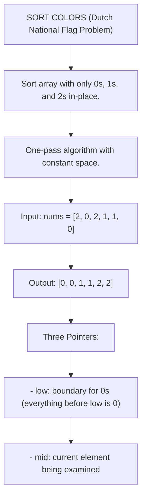

```java
public void sortColors(int[] nums) {
    int low = 0, mid = 0, high = nums.length - 1;

    while (mid <= high) {
        if (nums[mid] == 0) {
            swap(nums, low, mid);
            low++;
            mid++;
        } else if (nums[mid] == 1) {
            mid++;
        } else {  // nums[mid] == 2
            swap(nums, mid, high);
            high--;
            // Don't increment mid! New element needs checking
        }
    }
}

private void swap(int[] nums, int i, int j) {
    int temp = nums[i];
    nums[i] = nums[j];
    nums[j] = temp;
}
```

---

### Problem: Partition Array According to Pivot

**LeetCode 2161** | **Difficulty:** Medium
🔗 [https://leetcode.com/problems/partition-array-according-to-given-pivot/](https://leetcode.com/problems/partition-array-according-to-given-pivot/)

```
╔═══════════════════════════════════════════════════════════════════════════╗
║  PARTITION ARRAY ACCORDING TO PIVOT                                       ║
╠═══════════════════════════════════════════════════════════════════════════╣
║                                                                           ║
║  Rearrange so elements < pivot come before, = pivot in middle,            ║
║  > pivot at end. Maintain relative order.                                 ║
║                                                                           ║
║  Input: nums = [9, 12, 5, 10, 14, 3, 10], pivot = 10                      ║
║  Output: [9, 5, 3, 10, 10, 12, 14]                                        ║
║                                                                           ║
╚═══════════════════════════════════════════════════════════════════════════╝
```

**Flow:**
- PARTITION ARRAY ACCORDING TO PIVOT
- ↓
- > pivot at end. Maintain relative order.
- ↓
- Input: nums = [9, 12, 5, 10, 14, 3, 10], pivot = 10
- ↓
- Output: [9, 5, 3, 10, 10, 12, 14]

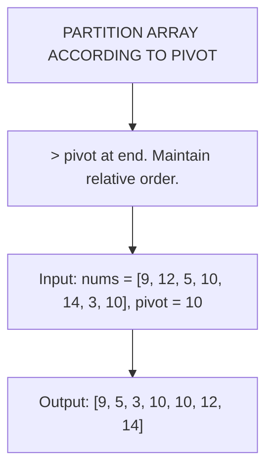

```java
public int[] pivotArray(int[] nums, int pivot) {
    int[] result = new int[nums.length];
    int idx = 0;

    // First pass: elements < pivot
    for (int num : nums) {
        if (num < pivot) result[idx++] = num;
    }

    // Second pass: elements == pivot
    for (int num : nums) {
        if (num == pivot) result[idx++] = num;
    }

    // Third pass: elements > pivot
    for (int num : nums) {
        if (num > pivot) result[idx++] = num;
    }

    return result;
}
```

---


> 🔬 **Section Challenge — 📌 5.2 Same Direction Two Pointers**
>
> **Challenge 1 (Reasoning):** Two-pointer pattern reduces O(N²) brute force to O(N). What is the KEY invariant that makes this safe?
> <details><summary>Answer</summary>
>
> The invariant: all pairs we SKIP are guaranteed to not contain the answer. In 3Sum: once we fix `nums[i]` and use l/r pointers, we can safely skip because the array is sorted. If `sum > 0`: decreasing r decreases the sum (smaller right value). If `sum < 0`: increasing l increases the sum (larger left value). We never skip a valid pair because monotonicity guarantees it.
> </details>
>

## 🔗 5.3 Linked List Two Pointers

### Problem: Linked List Cycle

**LeetCode 141** | **Difficulty:** Easy
🔗 [https://leetcode.com/problems/linked-list-cycle/](https://leetcode.com/problems/linked-list-cycle/)

```
╔═══════════════════════════════════════════════════════════════════════════╗
║  LINKED LIST CYCLE                                                        ║
╠═══════════════════════════════════════════════════════════════════════════╣
║                                                                           ║
║  Detect if linked list has a cycle.                                       ║
║                                                                           ║
║  Visual (with cycle):                                                     ║
║  3 → 2 → 0 → -4                                                           ║
║      ↑__________|                                                         ║
║                                                                           ║
║  Floyd's Cycle Detection (Tortoise & Hare):                               ║
║  - Slow pointer moves 1 step                                              ║
║  - Fast pointer moves 2 steps                                             ║
║  - If they meet, there's a cycle                                          ║
║                                                                           ║
╚═══════════════════════════════════════════════════════════════════════════╝
```

**Flow:**
- LINKED LIST CYCLE
- ↓
- Detect if linked list has a cycle.
- ↓
- Visual (with cycle):
- ↓
- Floyd's Cycle Detection (Tortoise & Hare):
- ↓
- - Slow pointer moves 1 step
- ↓
- - Fast pointer moves 2 steps
- ↓
- - If they meet, there's a cycle

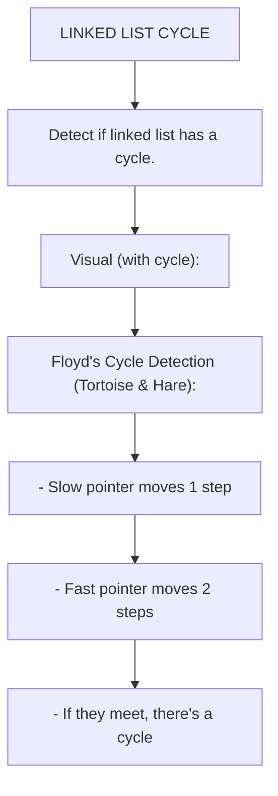

```java
public boolean hasCycle(ListNode head) {
    if (head == null || head.next == null) return false;

    ListNode slow = head, fast = head;

    while (fast != null && fast.next != null) {
        slow = slow.next;
        fast = fast.next.next;

        if (slow == fast) return true;
    }
    return false;
}
```

---

### Problem: Linked List Cycle II (Find Start of Cycle)

**LeetCode 142** | **Difficulty:** Medium
🔗 [https://leetcode.com/problems/linked-list-cycle-ii/](https://leetcode.com/problems/linked-list-cycle-ii/)

```
╔═══════════════════════════════════════════════════════════════════════════╗
║  LINKED LIST CYCLE II - Find Start of Cycle                               ║
╠═══════════════════════════════════════════════════════════════════════════╣
║                                                                           ║
║  Return the node where cycle begins. Return null if no cycle.             ║
║                                                                           ║
║  MATHEMATICAL PROOF:                                                      ║
║  Let:                                                                     ║
║  - Distance from head to cycle start = a                                  ║
║  - Distance from cycle start to meeting point = b                         ║
║  - Cycle length = c                                                       ║
║                                                                           ║
║  When they meet:                                                          ║
║  - Slow traveled: a + b                                                   ║
║  - Fast traveled: a + b + n*c (some multiple of cycle)                    ║
║  - Fast = 2 * Slow → a + b + n*c = 2(a + b)                               ║
║  - Therefore: a = n*c - b                                                 ║
║                                                                           ║
║  After meeting: move one pointer to head, both move 1 step                ║
║  They'll meet at cycle start!                                             ║
║                                                                           ║
╚═══════════════════════════════════════════════════════════════════════════╝
```

**Flow:**
- LINKED LIST CYCLE II - Find Start of Cycle
- ↓
- MATHEMATICAL PROOF:
- ↓
- Let:
- ↓
- - Distance from head to cycle start = a
- ↓
- - Distance from cycle start to meeting point = b
- ↓
- - Cycle length = c
- ↓
- When they meet:

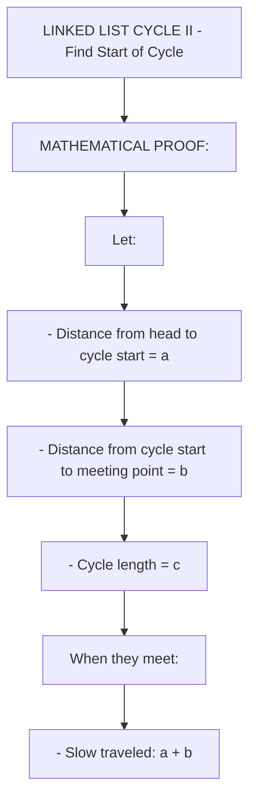

```java
public ListNode detectCycle(ListNode head) {
    if (head == null || head.next == null) return null;

    ListNode slow = head, fast = head;

    // Find meeting point
    while (fast != null && fast.next != null) {
        slow = slow.next;
        fast = fast.next.next;

        if (slow == fast) {
            // Reset slow to head
            slow = head;

            // Both move 1 step until they meet at cycle start
            while (slow != fast) {
                slow = slow.next;
                fast = fast.next;
            }
            return slow;
        }
    }
    return null;
}
```

---

### Problem: Middle of the Linked List

**LeetCode 876** | **Difficulty:** Easy
🔗 [https://leetcode.com/problems/middle-of-the-linked-list/](https://leetcode.com/problems/middle-of-the-linked-list/)

```
╔═══════════════════════════════════════════════════════════════════════════╗
║  MIDDLE OF LINKED LIST                                                    ║
╠═══════════════════════════════════════════════════════════════════════════╣
║                                                                           ║
║  When fast reaches end, slow is at middle.                                ║
║  For even length, return second middle.                                   ║
║                                                                           ║
║  Odd:  1 → 2 → 3 → 4 → 5    Middle = 3                                    ║
║  Even: 1 → 2 → 3 → 4 → 5 → 6    Middle = 4 (second)                       ║
║                                                                           ║
╚═══════════════════════════════════════════════════════════════════════════╝
```

**Flow:**
- MIDDLE OF LINKED LIST
- ↓
- When fast reaches end, slow is at middle.
- ↓
- For even length, return second middle.
- ↓
- Odd: 1
- ↓
- 2
- ↓
- 3
- ↓
- 4
- ↓
- 5 Middle = 3
- ↓
- Odd: 1
- ↓
- 2
- ↓
- 3
- ↓
- 4
- ↓
- 5 Middle = 3
- ↓
- Even: 1
- ↓
- 2
- ↓
- 3
- ↓
- 4
- ↓
- 5
- ↓
- 6 Middle = 4 (second)

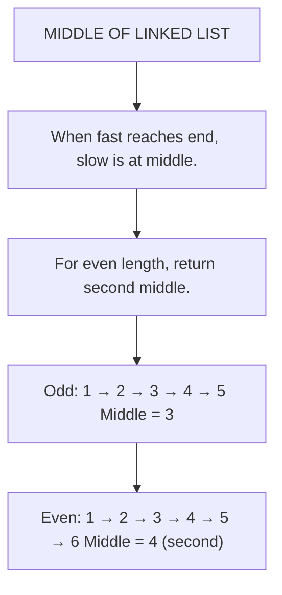

```java
public ListNode middleNode(ListNode head) {
    ListNode slow = head, fast = head;

    while (fast != null && fast.next != null) {
        slow = slow.next;
        fast = fast.next.next;
    }
    return slow;
}
```

---

### Problem: Remove Nth Node From End

**LeetCode 19** | **Difficulty:** Medium
🔗 [https://leetcode.com/problems/remove-nth-node-from-end-of-list/](https://leetcode.com/problems/remove-nth-node-from-end-of-list/)

```
╔═══════════════════════════════════════════════════════════════════════════╗
║  REMOVE NTH NODE FROM END                                                 ║
╠═══════════════════════════════════════════════════════════════════════════╣
║                                                                           ║
║  Remove the nth node from end of list.                                    ║
║                                                                           ║
║  Input: 1 → 2 → 3 → 4 → 5, n = 2                                          ║
║  Output: 1 → 2 → 3 → 5                                                    ║
║                                                                           ║
║  Technique: Advance fast pointer n steps first                            ║
║  Then move both until fast reaches end                                    ║
║  Slow will be at (n+1)th from end                                         ║
║                                                                           ║
╚═══════════════════════════════════════════════════════════════════════════╝
```

**Flow:**
- REMOVE NTH NODE FROM END
- ↓
- Remove the nth node from end of list.
- ↓
- Input: 1
- ↓
- 2
- ↓
- 3
- ↓
- 4
- ↓
- 5, n = 2
- ↓
- Input: 1
- ↓
- 2
- ↓
- 3
- ↓
- 4
- ↓
- 5, n = 2
- ↓
- Output: 1
- ↓
- 2
- ↓
- 3
- ↓
- 5
- ↓
- Output: 1
- ↓
- 2
- ↓
- 3
- ↓
- 5
- ↓
- Technique: Advance fast pointer n steps first
- ↓
- Then move both until fast reaches end
- ↓
- Slow will be at (n+1)th from end

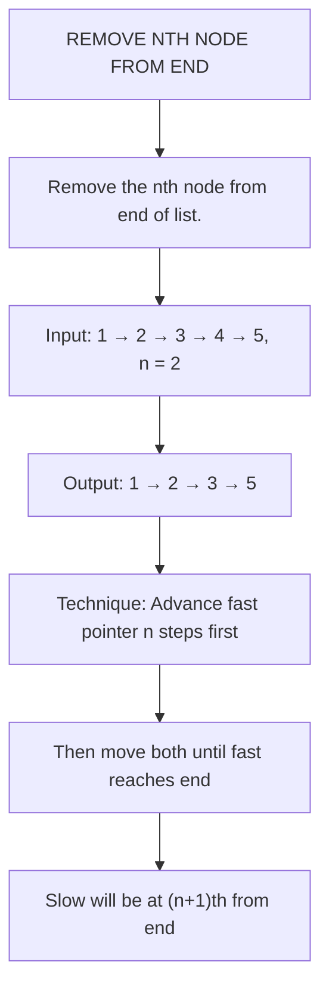

```java
public ListNode removeNthFromEnd(ListNode head, int n) {
    ListNode dummy = new ListNode(0);
    dummy.next = head;

    ListNode fast = dummy, slow = dummy;

    // Move fast n+1 steps ahead
    for (int i = 0; i <= n; i++) {
        fast = fast.next;
    }

    // Move both until fast is null
    while (fast != null) {
        fast = fast.next;
        slow = slow.next;
    }

    // Skip the nth node
    slow.next = slow.next.next;

    return dummy.next;
}
```

---

### 🔒 PREMIUM: Plus One Linked List

**LeetCode 369** | **Difficulty:** Medium | **Premium Problem**

```
╔═══════════════════════════════════════════════════════════════════════════╗
║  PLUS ONE LINKED LIST                                                     ║
║  (LeetCode 369 - Premium)                                                 ║
╠═══════════════════════════════════════════════════════════════════════════╣
║                                                                           ║
║  Linked list represents a number. Add 1 to it.                            ║
║  Most significant digit is at head.                                       ║
║                                                                           ║
║  ─────────────────────────────────────────────────────────────────────    ║
║                                                                           ║
║  Example 1:                                                               ║
║  Input: 1 → 2 → 3                                                         ║
║  Output: 1 → 2 → 4                                                        ║
║  Explanation: 123 + 1 = 124                                               ║
║                                                                           ║
║  Example 2:                                                               ║
║  Input: 1 → 2 → 9                                                         ║
║  Output: 1 → 3 → 0                                                        ║
║  Explanation: 129 + 1 = 130                                               ║
║                                                                           ║
║  Example 3:                                                               ║
║  Input: 9 → 9 → 9                                                         ║
║  Output: 1 → 0 → 0 → 0                                                    ║
║  Explanation: 999 + 1 = 1000                                              ║
║                                                                           ║
║  ─────────────────────────────────────────────────────────────────────    ║
║                                                                           ║
║  KEY INSIGHT: Find rightmost non-9 digit                                  ║
║  - Increment it                                                           ║
║  - Set all following 9s to 0                                              ║
║                                                                           ║
║  ─────────────────────────────────────────────────────────────────────    ║
║                                                                           ║
║  Constraints:                                                             ║
║  - Number of nodes: [1, 100]                                              ║
║  - 0 <= Node.val <= 9                                                     ║
║  - Number doesn't have leading zeros except 0 itself                      ║
║                                                                           ║
╚═══════════════════════════════════════════════════════════════════════════╝
```

**Flow:**
- PLUS ONE LINKED LIST
- ↓
- (LeetCode 369 - Premium)
- ↓
- Linked list represents a number. Add 1 to it.
- ↓
- Most significant digit is at head.
- ↓
- Example 1:
- ↓
- Input: 1
- ↓
- 2
- ↓
- 3
- ↓
- Input: 1
- ↓
- 2
- ↓
- 3
- ↓
- Output: 1
- ↓
- 2
- ↓
- 4

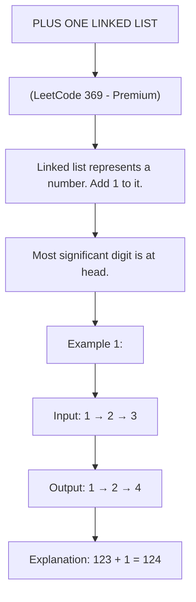

```java
public ListNode plusOne(ListNode head) {
    // Add sentinel node for case like 999 → 1000
    ListNode sentinel = new ListNode(0);
    sentinel.next = head;

    // Find rightmost non-9 digit
    ListNode notNine = sentinel;
    ListNode curr = head;

    while (curr != null) {
        if (curr.val != 9) {
            notNine = curr;
        }
        curr = curr.next;
    }

    // Increment rightmost non-9
    notNine.val++;

    // Set all following 9s to 0
    curr = notNine.next;
    while (curr != null) {
        curr.val = 0;
        curr = curr.next;
    }

    // Return head or sentinel if we added new digit
    return sentinel.val == 1 ? sentinel : head;
}
```

---

---


> 🔬 **Section Challenge — 🔗 5.3 Linked List Two Pointers**
>
> **Challenge 1 (Reasoning):** Two-pointer pattern reduces O(N²) brute force to O(N). What is the KEY invariant that makes this safe?
> <details><summary>Answer</summary>
>
> The invariant: all pairs we SKIP are guaranteed to not contain the answer. In 3Sum: once we fix `nums[i]` and use l/r pointers, we can safely skip because the array is sorted. If `sum > 0`: decreasing r decreases the sum (smaller right value). If `sum < 0`: increasing l increases the sum (larger left value). We never skip a valid pair because monotonicity guarantees it.
> </details>
>

## 🏆 Competitive Programming — Codeforces Problems

| Problem | Link | Techniques | Difficulty |
|---|---|---|---|
| Two Pointers + Sorting | [CF 1520D](https://codeforces.com/problemset/problem/1520/D) | Sort + two pointer merge | ⭐⭐ Medium |
| Odd Selection | [CF 1417C](https://codeforces.com/problemset/problem/1417/C) | Two pointer + counting | ⭐⭐ Medium |
| Boats Competition | [CF 1399C](https://codeforces.com/problemset/problem/1399/C) | Sort + opposite direction | ⭐⭐ Medium |
| PolandBall and Hypothesis | [CF 660F](https://codeforces.com/problemset/problem/660/F) | Two pointer on sequences | ⭐⭐ Medium |
| Make it Increasing | [CF 1188A](https://codeforces.com/problemset/problem/1188/A) | Two pointer traversal | ⭐ Easy |

---


## 🌍 Real-World Applications of Two Pointers

| Technique | Real-World System | How It's Used |
|---|---|---|
| **Opposite direction** | Merge Sort merge step | The merge in O(n) uses two pointers on two sorted halves |
| **Reader-Writer pointers** | Video compression (H.264) | Reader advances through frame, writer places compressed blocks |
| **Fast & Slow (Floyd)** | Memory leak detection | Detect circular references in reference counting systems |
| **Multi-array merge** | Apache Spark merge join | Merge two sorted RDDs using two-pointer technique |
| **In-place partition** | Database sort operations | QuickSort partition in O(n) — core of most DB sort engines |

```
🔥 SYSTEM DESIGN FACT:
   "Git's pack-file format merges thousands of sorted object lists
    using N-way merge with N pointers — exactly like Merge K Sorted Lists."
```

---

> **Navigation**: [< Previous](05_Sliding_Window.md) | [Back to Index](../00_MASTER_INDEX.md) | [Next >](07_Binary_Search.md)

> 🔬 **Section Challenge — 🌍 Real-World Applications of Two Pointers**
>
> **Challenge 1 (Reasoning):** Two-pointer pattern reduces O(N²) brute force to O(N). What is the KEY invariant that makes this safe?
> <details><summary>Answer</summary>
>
> The invariant: all pairs we SKIP are guaranteed to not contain the answer. In 3Sum: once we fix `nums[i]` and use l/r pointers, we can safely skip because the array is sorted. If `sum > 0`: decreasing r decreases the sum (smaller right value). If `sum < 0`: increasing l increases the sum (larger left value). We never skip a valid pair because monotonicity guarantees it.
> </details>
>

