**Navigation**: [< Previous](06_Two_Pointers.md) | [Back to Index](../00_MASTER_INDEX.md) | [Next >](08_Stack_Queue.md)

**Problems 07/14** | [Prev](06_Two_Pointers.md) | [Index](../00_MASTER_INDEX.md) | [Next](08_Stack_Queue.md)

---

## 🗺️ Pattern Recognition Header — Binary Search

**When do you use Binary Search?** Use this checklist:


| Trigger | Sub-type | Template |
|---|---|---|
| `sorted array` + `find target` | Classic BS | `while(l<=r)` |
| `first/last occurrence` | Boundary BS | `while(l<r)` + bias |
| `rotated sorted array` | Rotated BS | Check which half sorted |
| `minimise/maximise` some value | BS on answer | `lo=MIN, hi=MAX, canAchieve(mid)?` |


**The Binary Search Mindset:**
```
1. Can I eliminate HALF the search space at each step?
2. Is there a MONOTONIC property? (F,F,F,T,T,T or T,T,F,F)
If yes to both → Binary Search applies.
```

📖 **Pattern deep dive:** [06_Binary_Search_Patterns.md](../04_Patterns_Templates/06_Binary_Search_Patterns.md)
📖 **Full Pattern Guide:** [00_PATTERN_MASTER_GUIDE.md](../04_Patterns_Templates/00_PATTERN_MASTER_GUIDE.md)

---


🔬 **Section Challenge — 🗺️ Pattern Recognition Header — Binary Search**

**Challenge 1 (Reasoning):** Binary search on `[1,3,5,7,9]` with `target=6`. Trace `lo`, `hi`, `mid` at each step and explain the final state.
<details><summary>Answer</summary>

lo=0,hi=4 → mid=2(val=5): 5<6 → lo=3. lo=3,hi=4 → mid=3(val=7): 7>6 → hi=2. lo(3)>hi(2): loop ends, return -1 (not found). Key insight: lo overtakes hi — this is the standard termination condition. `lo` ends at the insertion point where 6 would go.
</details>

**Challenge 2 (Design):** Binary search on a rotated array `[4,5,6,7,0,1,2]`. How do you determine which half is sorted?
<details><summary>Answer</summary>

Compare `nums[lo]` and `nums[mid]`. If `nums[lo] <= nums[mid]`: left half is sorted. Check if target is in `[nums[lo], nums[mid])` — if yes, search left; else search right. Otherwise right half is sorted. Check if target is in `(nums[mid], nums[hi]]` — if yes, search right; else search left. This always works because at least one half of a rotated sorted array is always sorted.
</details>


# 🔍 Section 6: Binary Search Patterns

---

## 🔍 6.1 Basic Binary Search

### Problem: Binary Search

**LeetCode 704** | **Difficulty:** Easy
🔗 [https://leetcode.com/problems/binary-search/](https://leetcode.com/problems/binary-search/)


BINARY SEARCH - THE FOUNDATION

Search for target in sorted array. Return index or -1.

Input: nums = [-1, 0, 3, 5, 9, 12], target = 9
Output: 4

Visual:
[-1, 0, 3, 5, 9, 12]
L     M      R     mid=5 < 9, search right
L  M   R     mid=9 = target ✓

Template:
while (left <= right)
mid = left + (right - left) / 2
if target found: return mid
if target > mid: left = mid + 1
else: right = mid - 1


```java
public int search(int[] nums, int target) {
    int left = 0, right = nums.length - 1;

    while (left <= right) {
        int mid = left + (right - left) / 2;  // Avoid overflow

        if (nums[mid] == target) {
            return mid;
        } else if (nums[mid] < target) {
            left = mid + 1;
        } else {
            right = mid - 1;
        }
    }
    return -1;
}
```

---

### Problem: Search Insert Position

**LeetCode 35** | **Difficulty:** Easy
🔗 [https://leetcode.com/problems/search-insert-position/](https://leetcode.com/problems/search-insert-position/)

```
╔═══════════════════════════════════════════════════════════════════════════╗
║  SEARCH INSERT POSITION                                                   ║
╠═══════════════════════════════════════════════════════════════════════════╣
║                                                                           ║
║  Find index where target should be inserted to keep array sorted.         ║
║                                                                           ║
║  Input: nums = [1, 3, 5, 6], target = 5                                   ║
║  Output: 2                                                                ║
║                                                                           ║
║  Input: nums = [1, 3, 5, 6], target = 2                                   ║
║  Output: 1                                                                ║
║                                                                           ║
║  Input: nums = [1, 3, 5, 6], target = 7                                   ║
║  Output: 4                                                                ║
║                                                                           ║
╚═══════════════════════════════════════════════════════════════════════════╝
```

**Flow:**
1. SEARCH INSERT POSITION
2. Input: nums = [1, 3, 5, 6], target = 5
3. Output: 2
4. Input: nums = [1, 3, 5, 6], target = 2
5. Output: 1
6. Input: nums = [1, 3, 5, 6], target = 7
7. Output: 4

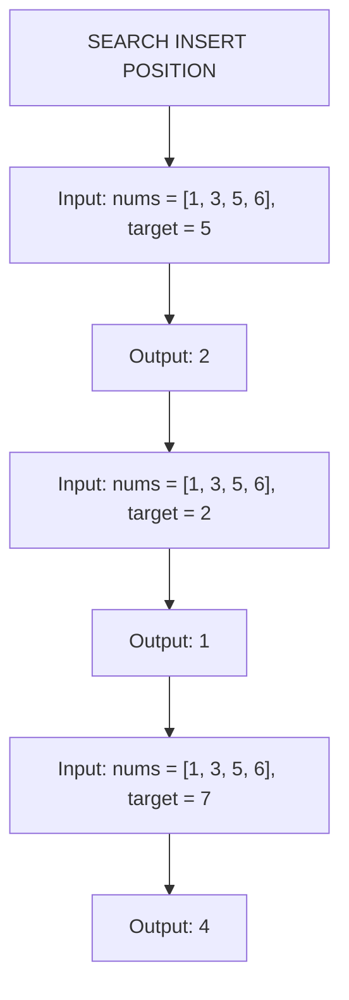

```java
public int searchInsert(int[] nums, int target) {
    int left = 0, right = nums.length - 1;

    while (left <= right) {
        int mid = left + (right - left) / 2;

        if (nums[mid] == target) {
            return mid;
        } else if (nums[mid] < target) {
            left = mid + 1;
        } else {
            right = mid - 1;
        }
    }
    return left;  // Insert position
}
```

---

### Problem: First Bad Version

**LeetCode 278** | **Difficulty:** Easy
🔗 [https://leetcode.com/problems/first-bad-version/](https://leetcode.com/problems/first-bad-version/)

```
╔═══════════════════════════════════════════════════════════════════════════╗
║  FIRST BAD VERSION                                                        ║
╠═══════════════════════════════════════════════════════════════════════════╣
║                                                                           ║
║  Versions 1, 2, ..., n. One is bad. All after it are bad too.             ║
║  Find the first bad version.                                              ║
║                                                                           ║
║  Input: n = 5, bad = 4                                                    ║
║  Versions: [G, G, G, B, B]                                                ║
║             1  2  3  4  5                                                 ║
║  Output: 4                                                                ║
║                                                                           ║
║  Pattern: Find leftmost true (first bad)                                  ║
║                                                                           ║
╚═══════════════════════════════════════════════════════════════════════════╝
```

**Flow:**
1. FIRST BAD VERSION
2. Find the first bad version.
3. Input: n = 5, bad = 4
4. Versions: [G, G, G, B, B]
5. Output: 4
6. Pattern: Find leftmost true (first bad)

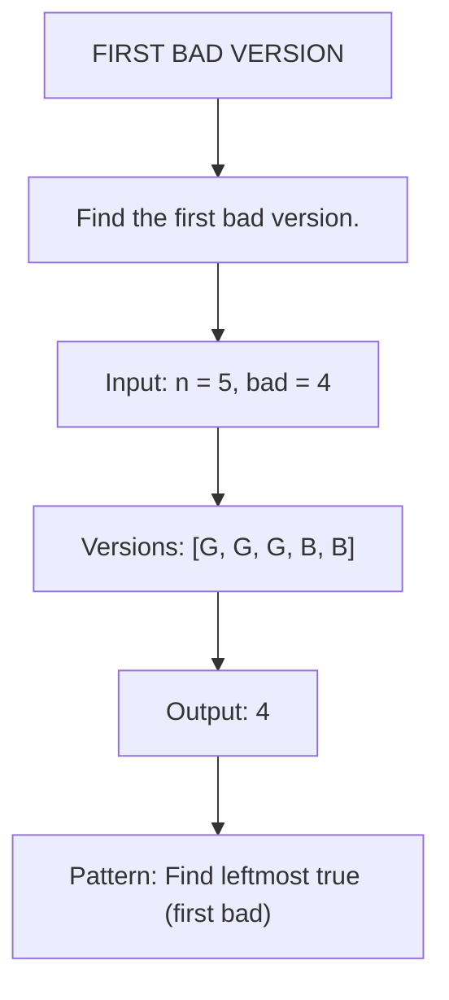

```java
public int firstBadVersion(int n) {
    int left = 1, right = n;

    while (left < right) {
        int mid = left + (right - left) / 2;

        if (isBadVersion(mid)) {
            right = mid;  // Could be answer, don't exclude
        } else {
            left = mid + 1;  // Not bad, search right
        }
    }
    return left;
}
```

---


🔬 **Section Challenge — 🔍 6.1 Basic Binary Search**

**Challenge 1 (Reasoning):** Binary search on `[1,3,5,7,9]` with `target=6`. Trace `lo`, `hi`, `mid` at each step and explain the final state.
<details><summary>Answer</summary>

lo=0,hi=4 → mid=2(val=5): 5<6 → lo=3. lo=3,hi=4 → mid=3(val=7): 7>6 → hi=2. lo(3)>hi(2): loop ends, return -1 (not found). Key insight: lo overtakes hi — this is the standard termination condition. `lo` ends at the insertion point where 6 would go.
</details>

**Challenge 2 (Design):** Binary search on a rotated array `[4,5,6,7,0,1,2]`. How do you determine which half is sorted?
<details><summary>Answer</summary>

Compare `nums[lo]` and `nums[mid]`. If `nums[lo] <= nums[mid]`: left half is sorted. Check if target is in `[nums[lo], nums[mid])` — if yes, search left; else search right. Otherwise right half is sorted. Check if target is in `(nums[mid], nums[hi]]` — if yes, search right; else search left. This always works because at least one half of a rotated sorted array is always sorted.
</details>


## 📌 6.2 Find Boundaries

### Problem: Find First and Last Position

**LeetCode 34** | **Difficulty:** Medium
🔗 [https://leetcode.com/problems/find-first-and-last-position-of-element-in-sorted-array/](https://leetcode.com/problems/find-first-and-last-position-of-element-in-sorted-array/)

```
╔═══════════════════════════════════════════════════════════════════════════╗
║  FIND FIRST AND LAST POSITION                                             ║
╠═══════════════════════════════════════════════════════════════════════════╣
║                                                                           ║
║  Find starting and ending position of target in sorted array.             ║
║                                                                           ║
║  Input: nums = [5, 7, 7, 8, 8, 10], target = 8                            ║
║  Output: [3, 4]                                                           ║
║                                                                           ║
║  Input: nums = [5, 7, 7, 8, 8, 10], target = 6                            ║
║  Output: [-1, -1]                                                         ║
║                                                                           ║
║  Two binary searches: Find leftmost, find rightmost                       ║
║                                                                           ║
╚═══════════════════════════════════════════════════════════════════════════╝
```

**Flow:**
1. FIND FIRST AND LAST POSITION
2. Input: nums = [5, 7, 7, 8, 8, 10], target = 8
3. Output: [3, 4]
4. Input: nums = [5, 7, 7, 8, 8, 10], target = 6
5. Output: [-1, -1]
6. Two binary searches: Find leftmost, find rightmost

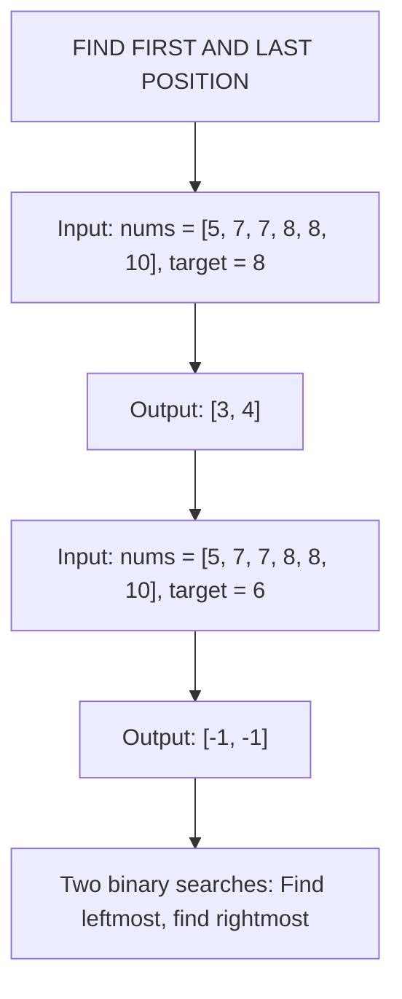

```java
public int[] searchRange(int[] nums, int target) {
    int[] result = {-1, -1};
    if (nums.length == 0) return result;

    // Find leftmost (first occurrence)
    result[0] = findFirst(nums, target);
    if (result[0] == -1) return result;

    // Find rightmost (last occurrence)
    result[1] = findLast(nums, target);

    return result;
}

private int findFirst(int[] nums, int target) {
    int left = 0, right = nums.length - 1;

    while (left < right) {
        int mid = left + (right - left) / 2;

        if (nums[mid] < target) {
            left = mid + 1;
        } else {
            right = mid;  // Keep searching left
        }
    }
    return nums[left] == target ? left : -1;
}

private int findLast(int[] nums, int target) {
    int left = 0, right = nums.length - 1;

    while (left < right) {
        int mid = left + (right - left + 1) / 2;  // Bias right

        if (nums[mid] > target) {
            right = mid - 1;
        } else {
            left = mid;  // Keep searching right
        }
    }
    return nums[left] == target ? left : -1;
}
```

---

### 🔒 PREMIUM: Find Smallest Letter Greater Than Target

**LeetCode 744** | **Difficulty:** Easy
🔗 [https://leetcode.com/problems/find-smallest-letter-greater-than-target/](https://leetcode.com/problems/find-smallest-letter-greater-than-target/)

```
╔═══════════════════════════════════════════════════════════════════════════╗
║  FIND SMALLEST LETTER GREATER THAN TARGET                                 ║
╠═══════════════════════════════════════════════════════════════════════════╣
║                                                                           ║
║  Sorted array of letters. Find smallest letter GREATER than target.       ║
║  Letters wrap around (if none greater, return first letter).              ║
║                                                                           ║
║  Input: letters = ["c","f","j"], target = "a"                             ║
║  Output: "c"                                                              ║
║                                                                           ║
║  Input: letters = ["c","f","j"], target = "c"                             ║
║  Output: "f"                                                              ║
║                                                                           ║
║  Input: letters = ["c","f","j"], target = "k"                             ║
║  Output: "c" (wrap around)                                                ║
║                                                                           ║
╚═══════════════════════════════════════════════════════════════════════════╝
```

**Flow:**
1. FIND SMALLEST LETTER GREATER THAN TARGET
2. Letters wrap around (if none greater, return first lett
3. Input: letters = ['c','f','j'], target = 'a'
4. Output: 'c'
5. Input: letters = ['c','f','j'], target = 'c'
6. Output: 'f'
7. Input: letters = ['c','f','j'], target = 'k'

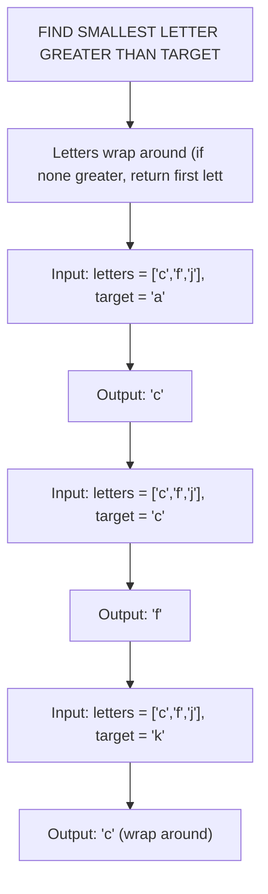

```java
public char nextGreatestLetter(char[] letters, char target) {
    int left = 0, right = letters.length;

    while (left < right) {
        int mid = left + (right - left) / 2;

        if (letters[mid] <= target) {
            left = mid + 1;
        } else {
            right = mid;
        }
    }
    return letters[left % letters.length];  // Wrap around
}
```

---


## 📊 6.3 Rotated Sorted Array

### Problem: Search in Rotated Sorted Array

**LeetCode 33** | **Difficulty:** Medium
🔗 [https://leetcode.com/problems/search-in-rotated-sorted-array/](https://leetcode.com/problems/search-in-rotated-sorted-array/)

```
╔═══════════════════════════════════════════════════════════════════════════╗
║  SEARCH IN ROTATED SORTED ARRAY                                           ║
╠═══════════════════════════════════════════════════════════════════════════╣
║                                                                           ║
║  Array was sorted then rotated at unknown pivot.                          ║
║  No duplicates. Search for target.                                        ║
║                                                                           ║
║  Input: nums = [4, 5, 6, 7, 0, 1, 2], target = 0                          ║
║  Output: 4                                                                ║
║                                                                           ║
║  Visual:                                                                  ║
║  Original: [0, 1, 2, 4, 5, 6, 7]                                          ║
║  Rotated:  [4, 5, 6, 7, 0, 1, 2]                                          ║
║             ↑        ↑                                                    ║
║           sorted   sorted                                                 ║
║                                                                           ║
║  KEY: One half is ALWAYS sorted                                           ║
║  Check if target is in sorted half, then decide direction                 ║
║                                                                           ║
╚═══════════════════════════════════════════════════════════════════════════╝
```

**Flow:**
1. SEARCH IN ROTATED SORTED ARRAY
2. Array was sorted then rotated at unknown pivot.
3. No duplicates. Search for target.
4. Input: nums = [4, 5, 6, 7, 0, 1, 2], target = 0
5. Output: 4
6. Visual:
7. Original: [0, 1, 2, 4, 5, 6, 7]

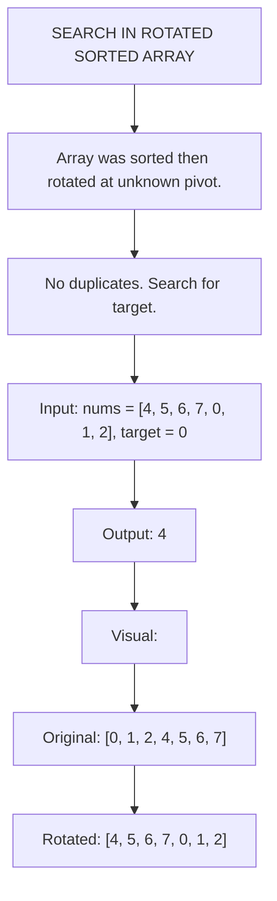

```java
public int search(int[] nums, int target) {
    int left = 0, right = nums.length - 1;

    while (left <= right) {
        int mid = left + (right - left) / 2;

        if (nums[mid] == target) return mid;

        // Check which half is sorted
        if (nums[left] <= nums[mid]) {
            // Left half is sorted
            if (target >= nums[left] && target < nums[mid]) {
                right = mid - 1;
            } else {
                left = mid + 1;
            }
        } else {
            // Right half is sorted
            if (target > nums[mid] && target <= nums[right]) {
                left = mid + 1;
            } else {
                right = mid - 1;
            }
        }
    }
    return -1;
}
```

---

### Problem: Search in Rotated Sorted Array II (With Duplicates)

**LeetCode 81** | **Difficulty:** Medium
🔗 [https://leetcode.com/problems/search-in-rotated-sorted-array-ii/](https://leetcode.com/problems/search-in-rotated-sorted-array-ii/)

```
╔═══════════════════════════════════════════════════════════════════════════╗
║  SEARCH IN ROTATED SORTED ARRAY II (WITH DUPLICATES)                      ║
╠═══════════════════════════════════════════════════════════════════════════╣
║                                                                           ║
║  Same as above but array may have duplicates.                             ║
║                                                                           ║
║  Input: nums = [2, 5, 6, 0, 0, 1, 2], target = 0                          ║
║  Output: true                                                             ║
║                                                                           ║
║  EDGE CASE: nums[left] == nums[mid] == nums[right]                        ║
║  Example: [1, 0, 1, 1, 1] - can't determine which half is sorted          ║
║  Solution: Skip duplicates by left++, right--                             ║
║                                                                           ║
╚═══════════════════════════════════════════════════════════════════════════╝
```

**Flow:**
1. SEARCH IN ROTATED SORTED ARRAY II (WITH DUPLICATES)
2. Same as above but array may have duplicates.
3. Input: nums = [2, 5, 6, 0, 0, 1, 2], target = 0
4. Output: true
5. Solution: Skip duplicates by left++, right--

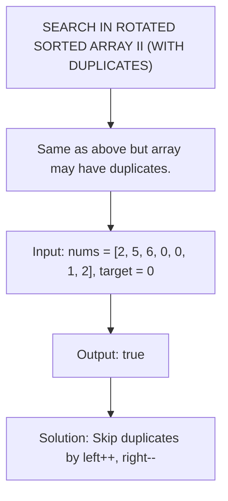

```java
public boolean search(int[] nums, int target) {
    int left = 0, right = nums.length - 1;

    while (left <= right) {
        int mid = left + (right - left) / 2;

        if (nums[mid] == target) return true;

        // Handle duplicates
        if (nums[left] == nums[mid] && nums[mid] == nums[right]) {
            left++;
            right--;
        } else if (nums[left] <= nums[mid]) {
            // Left half sorted
            if (target >= nums[left] && target < nums[mid]) {
                right = mid - 1;
            } else {
                left = mid + 1;
            }
        } else {
            // Right half sorted
            if (target > nums[mid] && target <= nums[right]) {
                left = mid + 1;
            } else {
                right = mid - 1;
            }
        }
    }
    return false;
}
```

---

### Problem: Find Minimum in Rotated Sorted Array

**LeetCode 153** | **Difficulty:** Medium
🔗 [https://leetcode.com/problems/find-minimum-in-rotated-sorted-array/](https://leetcode.com/problems/find-minimum-in-rotated-sorted-array/)

```
╔═══════════════════════════════════════════════════════════════════════════╗
║  FIND MINIMUM IN ROTATED SORTED ARRAY                                     ║
╠═══════════════════════════════════════════════════════════════════════════╣
║                                                                           ║
║  Find minimum element in rotated sorted array (no duplicates).            ║
║                                                                           ║
║  Input: nums = [3, 4, 5, 1, 2]                                            ║
║  Output: 1                                                                ║
║                                                                           ║
║  Visual:                                                                  ║
║       5                                                                   ║
║    4     ╲                                                                ║
║ 3           ╲                                                             ║
║               2                                                           ║
║             1   ← minimum                                                 ║
║                                                                           ║
║  KEY: Compare mid with right                                              ║
║  - If mid > right: min is in right half                                   ║
║  - If mid < right: min is in left half (including mid)                    ║
║                                                                           ║
╚═══════════════════════════════════════════════════════════════════════════╝
```

**Flow:**
1. FIND MINIMUM IN ROTATED SORTED ARRAY
2. Input: nums = [3, 4, 5, 1, 2]
3. Output: 1
4. Visual:
5. 1 ← minimum
6. KEY: Compare mid with right
7. - If mid > right: min is in right half

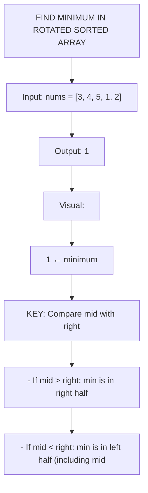

```java
public int findMin(int[] nums) {
    int left = 0, right = nums.length - 1;

    while (left < right) {
        int mid = left + (right - left) / 2;

        if (nums[mid] > nums[right]) {
            // Min is in right half
            left = mid + 1;
        } else {
            // Min is in left half (including mid)
            right = mid;
        }
    }
    return nums[left];
}
```

---

## 🔍 6.4 Binary Search on Answer

### Problem: Sqrt(x)

**LeetCode 69** | **Difficulty:** Easy
🔗 [https://leetcode.com/problems/sqrtx/](https://leetcode.com/problems/sqrtx/)

```
╔═══════════════════════════════════════════════════════════════════════════╗
║  SQRT(X) - Binary Search on Answer                                        ║
╠═══════════════════════════════════════════════════════════════════════════╣
║                                                                           ║
║  Find integer square root (truncate decimals).                            ║
║                                                                           ║
║  Input: x = 8                                                             ║
║  Output: 2 (√8 = 2.828..., truncated to 2)                                ║
║                                                                           ║
║  Binary search range: [1, x]                                              ║
║  Find largest n where n*n <= x                                            ║
║                                                                           ║
╚═══════════════════════════════════════════════════════════════════════════╝
```

**Flow:**
1. SQRT(X) - Binary Search on Answer
2. Find integer square root (truncate decimals).
3. Input: x = 8
4. Output: 2 (√8 = 2.828..., truncated to 2)
5. Binary search range: [1, x]
6. Find largest n where n*n <= x

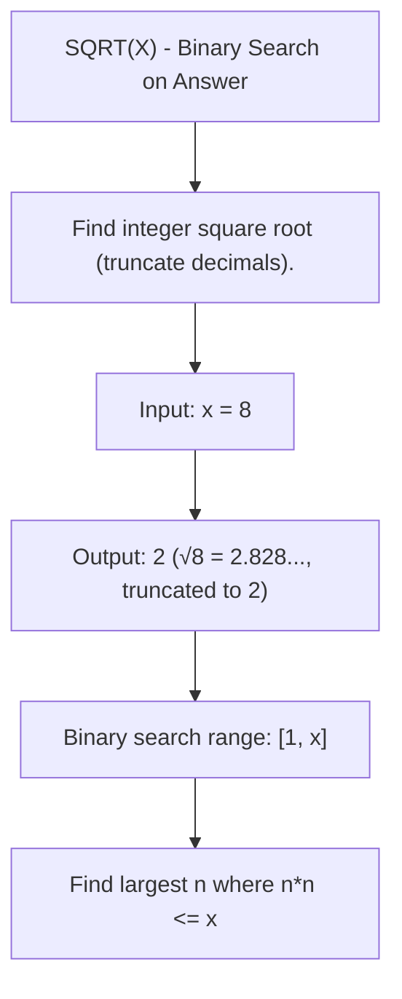

```java
public int mySqrt(int x) {
    if (x < 2) return x;

    long left = 1, right = x / 2;

    while (left <= right) {
        long mid = left + (right - left) / 2;
        long square = mid * mid;

        if (square == x) {
            return (int) mid;
        } else if (square < x) {
            left = mid + 1;
        } else {
            right = mid - 1;
        }
    }
    return (int) right;
}
```

---

### Problem: Koko Eating Bananas

**LeetCode 875** | **Difficulty:** Medium
🔗 [https://leetcode.com/problems/koko-eating-bananas/](https://leetcode.com/problems/koko-eating-bananas/)

```
╔═══════════════════════════════════════════════════════════════════════════╗
║  KOKO EATING BANANAS                                                      ║
╠═══════════════════════════════════════════════════════════════════════════╣
║                                                                           ║
║  Koko eats k bananas/hour. Guard returns in h hours.                      ║
║  Find minimum k to eat all bananas before guard returns.                  ║
║                                                                           ║
║  Input: piles = [3, 6, 7, 11], h = 8                                      ║
║  Output: 4                                                                ║
║  Explanation: At k=4, time needed:                                        ║
║  pile 3: ceil(3/4) = 1 hour                                               ║
║  pile 6: ceil(6/4) = 2 hours                                              ║
║  pile 7: ceil(7/4) = 2 hours                                              ║
║  pile 11: ceil(11/4) = 3 hours                                            ║
║  Total: 8 hours ≤ 8 ✓                                                     ║
║                                                                           ║
║  Binary search on k: range [1, max(piles)]                                ║
║                                                                           ║
╚═══════════════════════════════════════════════════════════════════════════╝
```

**Flow:**
1. KOKO EATING BANANAS
2. Koko eats k bananas/hour. Guard returns in h hours.
3. Find minimum k to eat all bananas before guard returns.
4. Input: piles = [3, 6, 7, 11], h = 8
5. Output: 4
6. Explanation: At k=4, time needed:
7. pile 3: ceil(3/4) = 1 hour

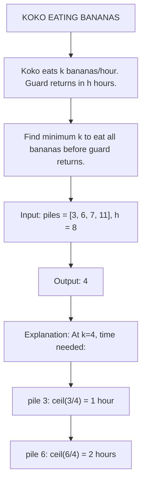

```java
public int minEatingSpeed(int[] piles, int h) {
    int left = 1;
    int right = Arrays.stream(piles).max().getAsInt();

    while (left < right) {
        int mid = left + (right - left) / 2;

        if (canFinish(piles, h, mid)) {
            right = mid;  // Try slower speed
        } else {
            left = mid + 1;  // Need faster speed
        }
    }
    return left;
}

private boolean canFinish(int[] piles, int h, int k) {
    int hours = 0;
    for (int pile : piles) {
        hours += (pile + k - 1) / k;  // Ceiling division
    }
    return hours <= h;
}
```

---

### Problem: Capacity To Ship Packages Within D Days

**LeetCode 1011** | **Difficulty:** Medium
🔗 [https://leetcode.com/problems/capacity-to-ship-packages-within-d-days/](https://leetcode.com/problems/capacity-to-ship-packages-within-d-days/)

```
╔═══════════════════════════════════════════════════════════════════════════╗
║  CAPACITY TO SHIP PACKAGES                                                ║
╠═══════════════════════════════════════════════════════════════════════════╣
║                                                                           ║
║  Find minimum ship capacity to ship all packages in days days.            ║
║  Packages must be shipped IN ORDER.                                       ║
║                                                                           ║
║  Input: weights = [1,2,3,4,5,6,7,8,9,10], days = 5                        ║
║  Output: 15                                                               ║
║  Explanation:                                                             ║
║  Day 1: 1,2,3,4,5 (sum=15)                                                ║
║  Day 2: 6,7 (sum=13)                                                      ║
║  Day 3: 8 (sum=8)                                                         ║
║  Day 4: 9 (sum=9)                                                         ║
║  Day 5: 10 (sum=10)                                                       ║
║                                                                           ║
║  Binary search on capacity: [max(weights), sum(weights)]                  ║
║                                                                           ║
╚═══════════════════════════════════════════════════════════════════════════╝
```

**Flow:**
1. CAPACITY TO SHIP PACKAGES
2. Packages must be shipped IN ORDER.
3. Input: weights = [1,2,3,4,5,6,7,8,9,10], days = 5
4. Output: 15
5. Explanation:
6. Day 1: 1,2,3,4,5 (sum=15)
7. Day 2: 6,7 (sum=13)

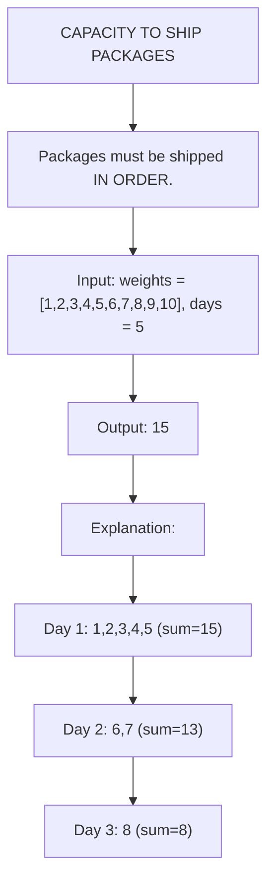

```java
public int shipWithinDays(int[] weights, int days) {
    int left = Arrays.stream(weights).max().getAsInt();
    int right = Arrays.stream(weights).sum();

    while (left < right) {
        int mid = left + (right - left) / 2;

        if (canShip(weights, days, mid)) {
            right = mid;
        } else {
            left = mid + 1;
        }
    }
    return left;
}

private boolean canShip(int[] weights, int days, int capacity) {
    int daysNeeded = 1;
    int currentLoad = 0;

    for (int weight : weights) {
        if (currentLoad + weight > capacity) {
            daysNeeded++;
            currentLoad = weight;
        } else {
            currentLoad += weight;
        }
    }
    return daysNeeded <= days;
}
```

---

### Problem: Split Array Largest Sum

**LeetCode 410** | **Difficulty:** Hard
🔗 [https://leetcode.com/problems/split-array-largest-sum/](https://leetcode.com/problems/split-array-largest-sum/)

```
╔═══════════════════════════════════════════════════════════════════════════╗
║  SPLIT ARRAY LARGEST SUM                                                  ║
╠═══════════════════════════════════════════════════════════════════════════╣
║                                                                           ║
║  Split array into k subarrays. Minimize the largest subarray sum.         ║
║                                                                           ║
║  Input: nums = [7,2,5,10,8], k = 2                                        ║
║  Output: 18                                                               ║
║  Explanation:                                                             ║
║  Split: [7,2,5] and [10,8]                                                ║
║  Sums: 14 and 18                                                          ║
║  Largest sum = 18 (minimized)                                             ║
║                                                                           ║
║  Binary search on max sum allowed                                         ║
║                                                                           ║
╚═══════════════════════════════════════════════════════════════════════════╝
```

**Flow:**
1. SPLIT ARRAY LARGEST SUM
2. Input: nums = [7,2,5,10,8], k = 2
3. Output: 18
4. Explanation:
5. Split: [7,2,5] and [10,8]
6. Sums: 14 and 18
7. Largest sum = 18 (minimized)

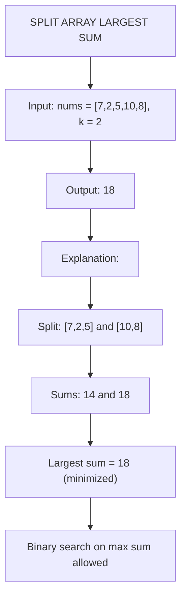

```java
public int splitArray(int[] nums, int k) {
    int left = Arrays.stream(nums).max().getAsInt();
    int right = Arrays.stream(nums).sum();

    while (left < right) {
        int mid = left + (right - left) / 2;

        if (canSplit(nums, k, mid)) {
            right = mid;
        } else {
            left = mid + 1;
        }
    }
    return left;
}

private boolean canSplit(int[] nums, int k, int maxSum) {
    int splits = 1;
    int currentSum = 0;

    for (int num : nums) {
        if (currentSum + num > maxSum) {
            splits++;
            currentSum = num;
        } else {
            currentSum += num;
        }
    }
    return splits <= k;
}
```

---

### 🔒 PREMIUM: Find K-th Smallest Pair Distance

**LeetCode 719** | **Difficulty:** Hard | **Premium-Level**

```
╔═══════════════════════════════════════════════════════════════════════════╗
║  FIND K-TH SMALLEST PAIR DISTANCE                                         ║
║  (LeetCode 719 - Hard)                                                    ║
╠═══════════════════════════════════════════════════════════════════════════╣
║                                                                           ║
║  Given array nums, define distance between pair (i,j) as |nums[i]-nums[j] ║
║  Find the k-th smallest distance among all pairs.                         ║
║                                                                           ║
║  ─────────────────────────────────────────────────────────────────────    ║
║                                                                           ║
║  Example 1:                                                               ║
║  Input: nums = [1, 3, 1], k = 1                                           ║
║  Output: 0                                                                ║
║  Explanation:                                                             ║
║  All distances: (1,3)=2, (1,1)=0, (3,1)=2                                 ║
║  Sorted: [0, 2, 2]                                                        ║
║  1st smallest = 0                                                         ║
║                                                                           ║
║  Example 2:                                                               ║
║  Input: nums = [1, 1, 1], k = 2                                           ║
║  Output: 0                                                                ║
║                                                                           ║
║  Example 3:                                                               ║
║  Input: nums = [1, 6, 1], k = 3                                           ║
║  Output: 5                                                                ║
║                                                                           ║
║  ─────────────────────────────────────────────────────────────────────    ║
║                                                                           ║
║  APPROACH: Binary search on distance + count pairs with dist <= mid       ║
║                                                                           ║
║  ─────────────────────────────────────────────────────────────────────    ║
║                                                                           ║
║  Constraints:                                                             ║
║  - n == nums.length                                                       ║
║  - 2 <= n <= 10^4                                                         ║
║  - 0 <= nums[i] <= 10^6                                                   ║
║  - 1 <= k <= n * (n - 1) / 2                                              ║
║                                                                           ║
╚═══════════════════════════════════════════════════════════════════════════╝
```

**Flow:**
1. FIND K-TH SMALLEST PAIR DISTANCE
2. (LeetCode 719 - Hard)
3. Find the k-th smallest distance among all pairs.
4. Example 1:
5. Input: nums = [1, 3, 1], k = 1
6. Output: 0
7. Explanation:

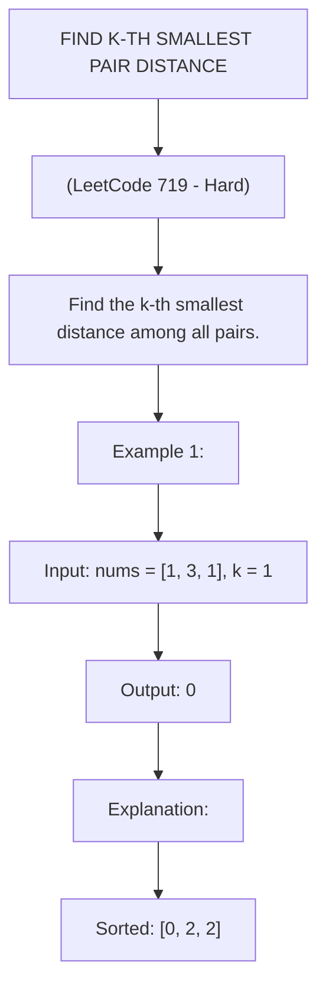

```java
public int smallestDistancePair(int[] nums, int k) {
    Arrays.sort(nums);
    int n = nums.length;

    int left = 0;
    int right = nums[n - 1] - nums[0];

    while (left < right) {
        int mid = left + (right - left) / 2;

        if (countPairs(nums, mid) >= k) {
            right = mid;
        } else {
            left = mid + 1;
        }
    }
    return left;
}

// Count pairs with distance <= maxDist
private int countPairs(int[] nums, int maxDist) {
    int count = 0;
    int left = 0;

    for (int right = 0; right < nums.length; right++) {
        while (nums[right] - nums[left] > maxDist) {
            left++;
        }
        count += right - left;
    }
    return count;
}
```

---


🔬 **Section Challenge — 🔍 6.4 Binary Search on Answer**

**Challenge 1 (Reasoning):** Binary search on `[1,3,5,7,9]` with `target=6`. Trace `lo`, `hi`, `mid` at each step and explain the final state.
<details><summary>Answer</summary>

lo=0,hi=4 → mid=2(val=5): 5<6 → lo=3. lo=3,hi=4 → mid=3(val=7): 7>6 → hi=2. lo(3)>hi(2): loop ends, return -1 (not found). Key insight: lo overtakes hi — this is the standard termination condition. `lo` ends at the insertion point where 6 would go.
</details>

**Challenge 2 (Design):** Binary search on a rotated array `[4,5,6,7,0,1,2]`. How do you determine which half is sorted?
<details><summary>Answer</summary>

Compare `nums[lo]` and `nums[mid]`. If `nums[lo] <= nums[mid]`: left half is sorted. Check if target is in `[nums[lo], nums[mid])` — if yes, search left; else search right. Otherwise right half is sorted. Check if target is in `(nums[mid], nums[hi]]` — if yes, search right; else search left. This always works because at least one half of a rotated sorted array is always sorted.
</details>


## SECTION 5: Additional Binary Search Problems

### Problem 13: Find Peak Element

**LeetCode 162** | **Difficulty:** Medium

```
╔═══════════════════════════════════════════════════════════════════════════╗
║  FIND PEAK ELEMENT (LeetCode 162 - Medium)                                ║
╠═══════════════════════════════════════════════════════════════════════════╣
║                                                                           ║
║  A peak element is strictly greater than its neighbors.                   ║
║  Return index of ANY peak. nums[-1] = nums[n] = -∞.                       ║
║                                                                           ║
║  Example: nums = [1,2,3,1]  →  Output: 2 (nums[2]=3 is peak)              ║
║                                                                           ║
║  KEY: If nums[mid] < nums[mid+1], peak must be on right side.             ║
║  TIME: O(log n) | SPACE: O(1)                                             ║
╚═══════════════════════════════════════════════════════════════════════════╝
```

**Flow:**
1. FIND PEAK ELEMENT (LeetCode 162 - Medium)
2. A peak element is strictly greater than its neighbors.
3. Return index of ANY peak. nums[-1] = nums[n] = -∞.
4. Example: nums = [1,2,3,1]
5. Output: 2 (nums[2]=3 is pea
6. Example: nums = [1,2,3,1]
7. Output: 2 (nums[2]=3 is pea
8. TIME: O(log n)
9. SPACE: O(1)

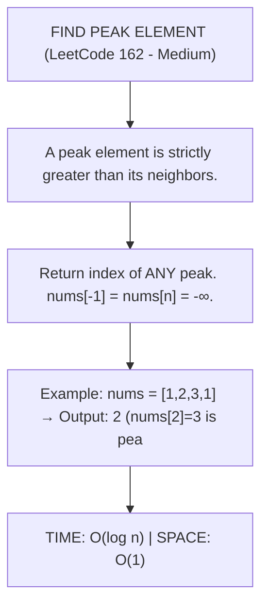

```java
public int findPeakElement(int[] nums) {
    int left = 0, right = nums.length - 1;
    while (left < right) {
        int mid = left + (right - left) / 2;
        if (nums[mid] < nums[mid + 1])
            left = mid + 1;  // peak is on right
        else
            right = mid;     // mid could be peak
    }
    return left;
}
```

---

### Problem 14: Search a 2D Matrix

**LeetCode 74** | **Difficulty:** Medium

```
╔═══════════════════════════════════════════════════════════════════════════╗
║  SEARCH A 2D MATRIX (LeetCode 74 - Medium)                                ║
╠═══════════════════════════════════════════════════════════════════════════╣
║                                                                           ║
║  Each row sorted left to right. First int of each row > last of prev.     ║
║  Determine if target exists in matrix.                                    ║
║                                                                           ║
║  Example:                                                                 ║
║  matrix = [[1,3,5,7],[10,11,16,20],[23,30,34,60]], target = 3             ║
║  Output: true                                                             ║
║                                                                           ║
║  KEY: Treat as sorted 1D array. index → row=idx/cols, col=idx%cols        ║
║  TIME: O(log(m*n)) | SPACE: O(1)                                          ║
╚═══════════════════════════════════════════════════════════════════════════╝
```

**Flow:**
1. SEARCH A 2D MATRIX (LeetCode 74 - Medium)
2. Determine if target exists in matrix.
3. Example:
4. Output: true
5. TIME: O(log(m*n))
6. SPACE: O(1)

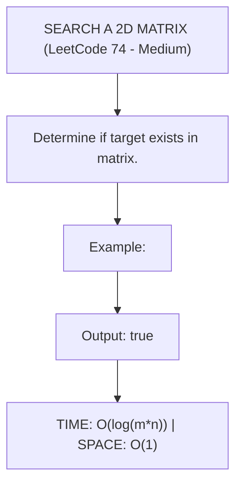

```java
public boolean searchMatrix(int[][] matrix, int target) {
    int m = matrix.length, n = matrix[0].length;
    int left = 0, right = m * n - 1;

    while (left <= right) {
        int mid = left + (right - left) / 2;
        int val = matrix[mid / n][mid % n];

        if (val == target) return true;
        else if (val < target) left = mid + 1;
        else right = mid - 1;
    }
    return false;
}
```

---

### Problem 15: Time Based Key-Value Store

**LeetCode 981** | **Difficulty:** Medium

```
╔═══════════════════════════════════════════════════════════════════════════╗
║  TIME BASED KEY-VALUE STORE (LeetCode 981 - Medium)                       ║
╠═══════════════════════════════════════════════════════════════════════════╣
║                                                                           ║
║  set(key, value, timestamp) — store key-value with timestamp              ║
║  get(key, timestamp) — return value with largest timestamp <= given       ║
║                                                                           ║
║  Example:                                                                 ║
║  set("foo","bar",1), get("foo",1) → "bar"                                 ║
║  get("foo",3) → "bar", set("foo","bar2",4), get("foo",5) → "bar2"         ║
║                                                                           ║
║  KEY: Binary search on timestamps for each key.                           ║
║  TIME: set O(1), get O(log n) | SPACE: O(n)                               ║
╚═══════════════════════════════════════════════════════════════════════════╝
```

**Flow:**
1. TIME BASED KEY-VALUE STORE (LeetCode 981 - Medium)
2. set(key, value, timestamp) — store key-value with times
3. Example:
4. set('foo','bar',1), get('foo',1)
5. 'bar'
6. set('foo','bar',1), get('foo',1)
7. 'bar'
8. KEY: Binary search on timestamps for each key.
9. TIME: set O(1), get O(log n)
10. SPACE: O(n)

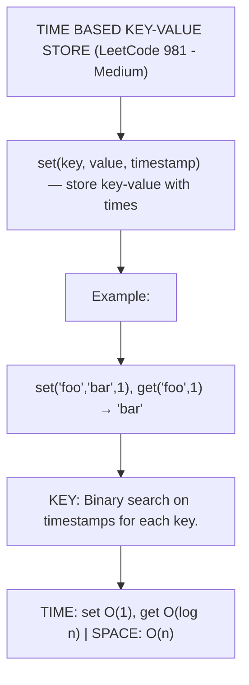

```java
class TimeMap {
    Map<String, List<int[]>> map; // key → list of [timestamp, valueIndex]
    List<String> values;

    // Simpler approach: store timestamps and values together
    Map<String, TreeMap<Integer, String>> store;

    public TimeMap() {
        store = new HashMap<>();
    }

    public void set(String key, String value, int timestamp) {
        store.computeIfAbsent(key, k -> new TreeMap<>()).put(timestamp, value);
    }

    public String get(String key, int timestamp) {
        if (!store.containsKey(key)) return "";
        TreeMap<Integer, String> tree = store.get(key);
        Integer floor = tree.floorKey(timestamp);
        return floor == null ? "" : tree.get(floor);
    }
}
```

---

### Problem 16: Median of Two Sorted Arrays

**LeetCode 4** | **Difficulty:** Hard

```
╔═══════════════════════════════════════════════════════════════════════════╗
║  MEDIAN OF TWO SORTED ARRAYS (LeetCode 4 - Hard)                          ║
╠═══════════════════════════════════════════════════════════════════════════╣
║                                                                           ║
║  Given two sorted arrays nums1 and nums2, return the median.              ║
║  Overall runtime must be O(log(m+n)).                                     ║
║                                                                           ║
║  Example:                                                                 ║
║  nums1 = [1,3], nums2 = [2]  →  Output: 2.0                               ║
║  nums1 = [1,2], nums2 = [3,4]  →  Output: 2.5                             ║
║                                                                           ║
║  KEY: Binary search on partition of shorter array.                        ║
║  Split both arrays so left half has (m+n+1)/2 elements.                   ║
║  TIME: O(log(min(m,n))) | SPACE: O(1)                                     ║
╚═══════════════════════════════════════════════════════════════════════════╝
```

**Flow:**
1. MEDIAN OF TWO SORTED ARRAYS (LeetCode 4 - Hard)
2. Given two sorted arrays nums1 and nums2, return the med
3. Overall runtime must be O(log(m+n)).
4. Example:
5. nums1 = [1,3], nums2 = [2]
6. Output: 2.0
7. nums1 = [1,3], nums2 = [2]
8. Output: 2.0
9. nums1 = [1,2], nums2 = [3,4]
10. Output: 2.5
11. nums1 = [1,2], nums2 = [3,4]
12. Output: 2.5
13. KEY: Binary search on partition of shorter array.

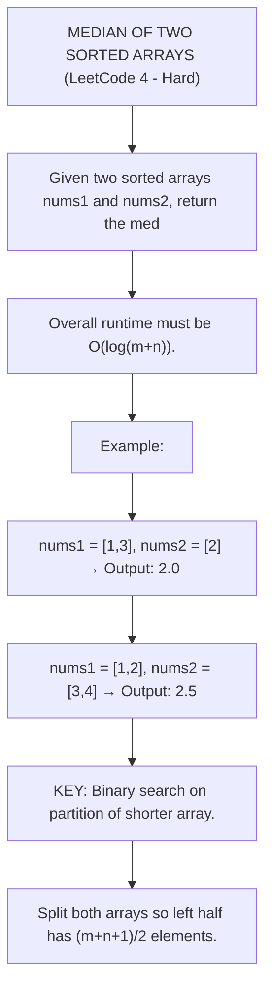

```java
public double findMedianSortedArrays(int[] nums1, int[] nums2) {
    // Ensure nums1 is shorter
    if (nums1.length > nums2.length)
        return findMedianSortedArrays(nums2, nums1);

    int m = nums1.length, n = nums2.length;
    int left = 0, right = m;

    while (left <= right) {
        int i = left + (right - left) / 2;  // partition in nums1
        int j = (m + n + 1) / 2 - i;        // partition in nums2

        int maxLeft1 = (i == 0) ? Integer.MIN_VALUE : nums1[i - 1];
        int minRight1 = (i == m) ? Integer.MAX_VALUE : nums1[i];
        int maxLeft2 = (j == 0) ? Integer.MIN_VALUE : nums2[j - 1];
        int minRight2 = (j == n) ? Integer.MAX_VALUE : nums2[j];

        if (maxLeft1 <= minRight2 && maxLeft2 <= minRight1) {
            if ((m + n) % 2 == 0)
                return (Math.max(maxLeft1, maxLeft2) +
                        Math.min(minRight1, minRight2)) / 2.0;
            else
                return Math.max(maxLeft1, maxLeft2);
        } else if (maxLeft1 > minRight2) {
            right = i - 1;
        } else {
            left = i + 1;
        }
    }
    return 0.0;
}
```

---

### Problem 17: Magnetic Force Between Two Balls

**LeetCode 1552** | **Difficulty:** Medium

```
╔═══════════════════════════════════════════════════════════════════════════╗
║  MAGNETIC FORCE BETWEEN TWO BALLS (LeetCode 1552 - Medium)                ║
╠═══════════════════════════════════════════════════════════════════════════╣
║                                                                           ║
║  Place m balls in basket positions to maximize minimum magnetic force     ║
║  (distance) between any two balls.                                        ║
║                                                                           ║
║  Example:                                                                 ║
║  position = [1,2,3,4,7], m = 3  →  Output: 3                              ║
║  Place at positions 1, 4, 7 → min distance = 3                            ║
║                                                                           ║
║  KEY: Binary search on answer (minimum distance).                         ║
║  For each candidate distance, greedily check if m balls fit.              ║
║  TIME: O(n log(maxDist)) | SPACE: O(1)                                    ║
╚═══════════════════════════════════════════════════════════════════════════╝
```

**Flow:**
1. MAGNETIC FORCE BETWEEN TWO BALLS (LeetCode 1552 - Mediu
2. (distance) between any two balls.
3. Example:
4. position = [1,2,3,4,7], m = 3
5. Output: 3
6. position = [1,2,3,4,7], m = 3
7. Output: 3
8. Place at positions 1, 4, 7
9. min distance = 3
10. Place at positions 1, 4, 7
11. min distance = 3
12. KEY: Binary search on answer (minimum distance).
13. For each candidate distance, greedily check if m balls

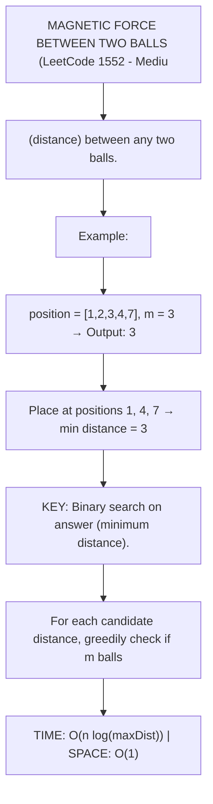

```java
public int maxDistance(int[] position, int m) {
    Arrays.sort(position);
    int left = 1;
    int right = position[position.length - 1] - position[0];

    while (left <= right) {
        int mid = left + (right - left) / 2;
        if (canPlace(position, m, mid))
            left = mid + 1;   // try larger distance
        else
            right = mid - 1;  // distance too large
    }
    return right;
}

private boolean canPlace(int[] position, int m, int minDist) {
    int count = 1, lastPos = position[0];
    for (int i = 1; i < position.length; i++) {
        if (position[i] - lastPos >= minDist) {
            count++;
            lastPos = position[i];
            if (count >= m) return true;
        }
    }
    return false;
}
```

---

---


🔬 **Section Challenge — SECTION 5: Additional Binary Search Problems**

**Challenge 1 (Reasoning):** Binary search on `[1,3,5,7,9]` with `target=6`. Trace `lo`, `hi`, `mid` at each step and explain the final state.
<details><summary>Answer</summary>

lo=0,hi=4 → mid=2(val=5): 5<6 → lo=3. lo=3,hi=4 → mid=3(val=7): 7>6 → hi=2. lo(3)>hi(2): loop ends, return -1 (not found). Key insight: lo overtakes hi — this is the standard termination condition. `lo` ends at the insertion point where 6 would go.
</details>

**Challenge 2 (Design):** Binary search on a rotated array `[4,5,6,7,0,1,2]`. How do you determine which half is sorted?
<details><summary>Answer</summary>

Compare `nums[lo]` and `nums[mid]`. If `nums[lo] <= nums[mid]`: left half is sorted. Check if target is in `[nums[lo], nums[mid])` — if yes, search left; else search right. Otherwise right half is sorted. Check if target is in `(nums[mid], nums[hi]]` — if yes, search right; else search left. This always works because at least one half of a rotated sorted array is always sorted.
</details>


## 🏆 Competitive Programming — Codeforces Problems

| Problem | Link | Techniques | Difficulty |
|---|---|---|---|
| Ответы (Answers) | [CF 702C](https://codeforces.com/problemset/problem/702/C) | Binary search on answer | ⭐⭐ Medium |
| Maximize! | [CF 660F](https://codeforces.com/problemset/problem/660/F) | Ternary search (monotonic) | ⭐⭐ Medium |
| Hamburgers | [CF 371C](https://codeforces.com/problemset/problem/371/C) | Binary search on quantity | ⭐⭐ Medium |
| Maximum on Segments | [CF 1201C](https://codeforces.com/problemset/problem/1201/C) | Binary search on answer | ⭐⭐ Medium |
| Splitting Items | [CF 1202C](https://codeforces.com/problemset/problem/1202/C) | Binary search mid + greedy | ⭐⭐ Medium |
| Divisible by Seven | [CF 622C](https://codeforces.com/problemset/problem/622/C) | Math + Binary search | ⭐⭐⭐ Hard |

---


## 🌍 Real-World Applications of Binary Search

| Technique | Real-World System | How It's Used |
|---|---|---|
| **Classic BS** | Database B-Tree index | Search through sorted leaf pages — log(n) disk seeks |
| **Lower/Upper Bound** | Java's `Arrays.binarySearch()` | Used in sorting, deduplication, range queries |
| **BS on Answer** | CDN load balancing | "Minimum server capacity to handle K requests" = BS on capacity |
| **Git bisect** | Git version control | Binary search through commit history to find which commit introduced a bug |
| **IP Routing table** | Internet routers | Longest prefix match = binary search on sorted IP prefix table |
| **sqrt decomposition** | Database query optimization | BS approximation for square root in range query blocks |

```
🔥 REAL-WORLD INTERVIEW STORY:
   "Git bisect is binary search on your commit history.
    git bisect good <oldcommit> bad <newcommit>
    → git checks out the middle commit automatically → O(log n) bug finding"
```

---


---


🔬 **Section Challenge — 🌍 Real-World Applications of Binary Search**

**Challenge 1 (Reasoning):** Binary search on `[1,3,5,7,9]` with `target=6`. Trace `lo`, `hi`, `mid` at each step and explain the final state.
<details><summary>Answer</summary>

lo=0,hi=4 → mid=2(val=5): 5<6 → lo=3. lo=3,hi=4 → mid=3(val=7): 7>6 → hi=2. lo(3)>hi(2): loop ends, return -1 (not found). Key insight: lo overtakes hi — this is the standard termination condition. `lo` ends at the insertion point where 6 would go.
</details>

**Challenge 2 (Design):** Binary search on a rotated array `[4,5,6,7,0,1,2]`. How do you determine which half is sorted?
<details><summary>Answer</summary>

Compare `nums[lo]` and `nums[mid]`. If `nums[lo] <= nums[mid]`: left half is sorted. Check if target is in `[nums[lo], nums[mid])` — if yes, search left; else search right. Otherwise right half is sorted. Check if target is in `(nums[mid], nums[hi]]` — if yes, search right; else search left. This always works because at least one half of a rotated sorted array is always sorted.
</details>


## 🏋️ Practice & Interview Questions — Algorithms

### Sorting
**Q1.** Which sorting algorithm does Java use for `Arrays.sort(int[])`? Why not MergeSort?
<details><summary>Answer</summary>

**Dual-Pivot QuickSort** — for primitives. MergeSort requires O(N) extra space. QuickSort is in-place and cache-friendly. Stability doesn't matter for primitives (equal ints are indistinguishable). For objects (`Arrays.sort(Object[])`), Java uses **TimSort** (stable, O(N log N) worst).
</details>

**Q2.** Trace Merge Sort on `[4,2,7,1]`.
<details><summary>Answer</summary>

Split: `[4,2]` `[7,1]` → Split: `[4]` `[2]` `[7]` `[1]` → Merge: `[2,4]` `[1,7]` → Merge: `[1,2,4,7]`
</details>

**Q3.** ⭐⭐ Sort Colors (Dutch National Flag — 3-way partition).
<details><summary>Solution</summary>

```java
int lo=0, mid=0, hi=n-1;
while(mid<=hi){
    if(nums[mid]==0) swap(nums,lo++,mid++);
    else if(nums[mid]==1) mid++;
    else swap(nums,mid,hi--);
}
```
</details>

### Binary Search
**Q4.** ⭐ Search in Rotated Sorted Array.
<details><summary>Solution</summary>

```java
int lo=0, hi=n-1;
while(lo<=hi){
    int mid=(lo+hi)/2;
    if(nums[mid]==target) return mid;
    if(nums[lo]<=nums[mid]){ // left half sorted
        if(nums[lo]<=target&&target<nums[mid]) hi=mid-1; else lo=mid+1;
    } else { // right half sorted
        if(nums[mid]<target&&target<=nums[hi]) lo=mid+1; else hi=mid-1;
    }
}
return -1;
```
</details>

**Q5.** ⭐ Find First and Last Position (binary search twice).
<details><summary>Solution</summary>

```java
// First: find leftmost with while(lo<hi){ if arr[mid]>=target hi=mid else lo=mid+1 }
// Last: find rightmost with while(lo<hi){ if arr[mid]<=target lo=mid+1 else hi=mid } return lo-1
```
</details>

**Q6.** ⭐⭐ Koko Eating Bananas — binary search on answer.
<details><summary>Key insight</summary>

Binary search the eating speed k in range [1, max(piles)]. For each k, calculate hours needed. Find minimum k where hours ≤ H.
</details>

### Dynamic Programming
**Q7.** ⭐ Climbing Stairs — n steps, 1 or 2 at a time. How many ways?
<details><summary>Solution</summary>

```java
// Fibonacci sequence! dp[i] = dp[i-1] + dp[i-2]
int a=1, b=1;
for(int i=2;i<=n;i++){ int c=a+b; a=b; b=c; }
return b;
```
</details>

**Q8.** ⭐ Coin Change — minimum coins for amount.
<details><summary>Solution</summary>

```java
int[] dp = new int[amount+1]; Arrays.fill(dp, amount+1);
dp[0]=0;
for(int i=1;i<=amount;i++)
    for(int c:coins) if(c<=i) dp[i]=Math.min(dp[i],dp[i-c]+1);
return dp[amount]>amount?-1:dp[amount];
```
</details>

**Q9.** ⭐⭐ Longest Common Subsequence.
<details><summary>Solution</summary>

```java
int[][] dp=new int[m+1][n+1];
for(int i=1;i<=m;i++) for(int j=1;j<=n;j++){
    if(text1.charAt(i-1)==text2.charAt(j-1)) dp[i][j]=dp[i-1][j-1]+1;
    else dp[i][j]=Math.max(dp[i-1][j],dp[i][j-1]);
}
return dp[m][n];
```
</details>

**Q10.** ⭐⭐ Word Break — can string be segmented using dictionary words?
<details><summary>Solution</summary>

```java
boolean[] dp=new boolean[n+1]; dp[0]=true;
for(int i=1;i<=n;i++) for(String w:wordDict)
    if(i>=w.length()&&dp[i-w.length()]&&s.substring(i-w.length(),i).equals(w)) dp[i]=true;
return dp[n];
```
</details>

**Q11.** ⭐⭐⭐ Edit Distance (Levenshtein).
<details><summary>Solution</summary>

```java
int[][] dp=new int[m+1][n+1];
for(int i=0;i<=m;i++) dp[i][0]=i;
for(int j=0;j<=n;j++) dp[0][j]=j;
for(int i=1;i<=m;i++) for(int j=1;j<=n;j++){
    if(word1.charAt(i-1)==word2.charAt(j-1)) dp[i][j]=dp[i-1][j-1];
    else dp[i][j]=1+Math.min(dp[i-1][j-1],Math.min(dp[i-1][j],dp[i][j-1]));
}
```
</details>

### Graph Algorithms
**Q12.** ⭐ Number of Islands (BFS/DFS grid traversal).
<details><summary>Solution</summary>

```java
for each cell (i,j) if grid[i][j]=='1': count++; BFS/DFS to mark all connected land as visited
```
</details>

**Q13.** ⭐⭐ Course Schedule — detect cycle in directed graph (Topological sort).
<details><summary>Solution</summary>

```java
// Kahn's algorithm: indegree array + BFS queue
// If result size == numCourses → no cycle → can finish
```
</details>

**Q14.** ⭐⭐ Dijkstra's Shortest Path.
<details><summary>Solution</summary>

```java
PriorityQueue<int[]> pq=new PriorityQueue<>((a,b)->a[1]-b[1]); // [node, dist]
pq.offer(new int[]{src,0}); dist[src]=0;
while(!pq.isEmpty()){
    int[] curr=pq.poll(); int u=curr[0],d=curr[1];
    if(d>dist[u]) continue; // stale
    for(int[] neighbor:graph[u]) if(dist[u]+neighbor[1]<dist[neighbor[0]]){
        dist[neighbor[0]]=dist[u]+neighbor[1]; pq.offer(new int[]{neighbor[0],dist[neighbor[0]]});
    }
}
```
</details>

### MCQ Rapid Fire
| # | Question | Answer |
|---|---|---|
| 1 | QuickSort avg/worst | O(N log N) avg, O(N²) worst |
| 2 | MergeSort space complexity | O(N) |
| 3 | HeapSort space complexity | O(1) (in-place) |
| 4 | Binary search precondition | Sorted array |
| 5 | BFS time complexity on graph | O(V+E) |
| 6 | DFS space complexity | O(V) (recursion stack) |
| 7 | Dijkstra fails on | Negative weight edges |
| 8 | Bellman-Ford handles | Negative weights, detects negative cycles |
| 9 | Floyd-Warshall use case | All-pairs shortest path, O(V³) |
| 10 | Topological sort requires | Directed Acyclic Graph (DAG) |


---

## 🧠 Deep Conceptual Questions — Algorithm Design & Analysis

**C1. What does O(N log N) "feel like" and why is it the complexity barrier for comparison-based sorting?**
<details><summary>Deep Answer</summary>

O(N log N) for N=1M ≈ 20M operations. O(N²) ≈ 1 trillion. The difference is 50,000x. **Comparison sort lower bound**: any comparison-based sort must distinguish between N! possible orderings. Each comparison has 2 outcomes. A decision tree with N! leaves needs ≥ log₂(N!) height ≈ N log N (Stirling's approximation). Therefore NO comparison sort can beat O(N log N) in the worst case. Non-comparison sorts (counting sort, radix sort, bucket sort) break this bound by using non-comparison operations — but require constraints on input (e.g., integer range bounded by N).
</details>

**C2. Greedy algorithms: when do they work and what must be proven?**
<details><summary>Deep Answer</summary>

A greedy algorithm makes the locally optimal choice at each step. Works when problem has: (1) **Greedy choice property**: local optimal leads to global optimal — the choice never needs to be revised. (2) **Optimal substructure**: optimal solution to the problem contains optimal solutions to subproblems. To PROVE greedy is correct: use "exchange argument" — assume optimal solution differs from greedy, show you can swap greedy's choice in without making it worse, contradiction. Greedy FAILS when: future choices depend on current choice in complex ways (use DP instead). Classic works: interval scheduling, Huffman coding, Dijkstra. Classic fails: 0-1 knapsack (use DP).
</details>

**C3. Dynamic Programming: what is "overlapping subproblems" and why does it matter?**
<details><summary>Deep Answer</summary>

Overlapping subproblems: the same sub-computation appears multiple times. Fibonacci: `fib(5)` calls `fib(4)` and `fib(3)`. `fib(4)` also calls `fib(3)`. Without memoization: `fib(3)` computed exponentially many times → O(2^N). With memoization: each sub-result computed once and stored → O(N). DP is valuable SPECIFICALLY when: (1) problem has optimal substructure AND (2) subproblems overlap. If no overlap: just use divide-and-conquer (merge sort's subproblems don't overlap → no DP needed). DP = "smart recursion" = avoid recomputing.
</details>

**C4. Top-down (memoization) vs Bottom-up (tabulation) DP — when to choose each?**
<details><summary>Deep Answer</summary>

**Top-down (memoization)**: Write natural recursion + cache results. Easy to implement, only computes needed subproblems (sparse computation). Cons: recursion overhead and stack depth risk. Use when: problem is naturally recursive, only a fraction of subproblems needed. **Bottom-up (tabulation)**: Fill DP table iteratively from base cases. No recursion overhead, better cache performance, easier space optimization. Use when: need all subproblems (or most of them), want to optimize space (can often reduce to 1D from 2D). Rule: start with top-down for correctness verification, optimize to bottom-up for performance.
</details>

**C5. Dijkstra's Algorithm: why does it fail on negative weights?**
<details><summary>Deep Answer</summary>

Dijkstra assumes: once a node is "settled" (extracted from the priority queue with its final shortest distance), that distance is optimal. With negative weights: settling node A at distance 5 might not be final — a path through B (distance 7) → C (edge -10) → A gives distance -3. But A was already settled! Dijkstra doesn't revisit settled nodes. Bellman-Ford handles negatives by relaxing ALL edges N-1 times — no "settled" assumption. For graphs with negative cycles: Bellman-Ford detects them (if distances still decrease after N-1 rounds, there's a negative cycle).
</details>

**C6. Union-Find: why is path compression + union by rank/size nearly O(1)?**
<details><summary>Deep Answer</summary>

**Path compression**: when finding the root of element x, make every node on the path point directly to the root. Flattens the tree. Future finds on those paths: O(1). **Union by rank**: always attach the smaller tree under the larger → limits tree height to O(log N). Combined: inverse Ackermann function α(N) amortized — so slow-growing it's practically constant (α(10^80) = 4). Neither alone is optimal: path compression without union by rank → O(log N) amortized. Union by rank without path compression → O(log N). Together → α(N) ≈ O(1) amortized. Used in: Kruskal's MST, cycle detection, connected components.
</details>

**C7. Binary Search on the Answer — what types of problems does it apply to?**
<details><summary>Deep Answer</summary>

When the answer space is **monotone**: "if X is achievable, then all values less extreme than X are also achievable." Problems: minimize the maximum (aggressive cows, split array), find minimum valid threshold (Koko bananas, minimum days to bloom), divide-and-conquer feasibility. Template: binary search on the answer range [lo, hi], for each mid check `isFeasible(mid)` in O(N) or O(N log N). Total: O(N log(answer_range)). Key insight: reframe "find optimal value" as "find smallest X where condition holds" → enables binary search on a non-array space.
</details>

**C8. Why does merge sort guarantee stability while quicksort doesn't?**
<details><summary>Deep Answer</summary>

**Merge sort stability**: during merge, when two elements are equal, we always take from the LEFT array first → preserves original relative order. **QuickSort instability**: the partition step swaps elements across the pivot without regard to original order. Two equal elements may be placed on opposite sides of the pivot, reversing their order. QuickSort CAN be made stable (Lomuto partition with careful implementation) but loses performance. Java uses TimSort for objects (stable), dual-pivot quicksort for primitives (stability irrelevant since primitives without fields).
</details>

**C9. Backtracking: what's the difference from plain DFS and when to use vs DP?**
<details><summary>Deep Answer</summary>

**Backtracking vs DFS**: DFS visits every path. Backtracking prunes paths early when a constraint is violated — avoids exploring infeasible branches. Same asymptotic but drastically different practical performance with good pruning. **Backtracking vs DP**: backtracking for **combinatorial/enumeration** problems (find all solutions, permutations, subsets). DP for **optimization** problems (find optimal single solution). Backtracking produces exponential solutions in worst case but is necessary when you need ALL solutions. DP finds the optimal in polynomial time when overlapping subproblems exist.
</details>

**C10. What is amortized analysis and how does it differ from average-case analysis?**
<details><summary>Deep Answer</summary>

**Amortized**: analyzes the average cost per operation over a SEQUENCE of operations — in the worst case. No probability involved. Guarantees: N operations ALWAYS take O(N·T) total, even if some individual operations are O(N·T). Example: ArrayList append is O(N) when resizing, but amortized O(1) because resizing is rare. **Average-case**: analyzes expected cost of a SINGLE operation assuming random input. QuickSort is O(N log N) average-case (random pivot). Amortized is a stronger guarantee — it holds even for adversarial input sequences.
</details>


> **Navigation**: [< Previous](06_Two_Pointers.md) | [Back to Index](../00_MASTER_INDEX.md) | [Next >](08_Stack_Queue.md)