> **Navigation**: [< Previous](06_Problems_Two_Pointers.md) | [Back to Index](../00_MASTER_INDEX.md) | [Next >](08_Problems_Stack_Queue.md)

> **Problems 07/14** | [Prev](06_Problems_Two_Pointers.md) | [Index](../00_MASTER_INDEX.md) | [Next](08_Problems_Stack_Queue.md)

---

# 🔍 Section 6: Binary Search Patterns

---

## 🔍 6.1 Basic Binary Search

### Problem: Binary Search

**LeetCode 704** | **Difficulty:** Easy
🔗 [https://leetcode.com/problems/binary-search/](https://leetcode.com/problems/binary-search/)


> BINARY SEARCH - THE FOUNDATION
>
> Search for target in sorted array. Return index or -1.
>
> Input: nums = [-1, 0, 3, 5, 9, 12], target = 9
> Output: 4
>
> Visual:
> [-1, 0, 3, 5, 9, 12]
> L     M      R     mid=5 < 9, search right
> L  M   R     mid=9 = target ✓
>
> Template:
> while (left <= right)
> mid = left + (right - left) / 2
> if target found: return mid
> if target > mid: left = mid + 1
> else: right = mid - 1
>


```java
public int search(int[] nums, int target) {
    int left = 0, right = nums.length - 1;

    while (left <= right) {
        int mid = left + (right - left) / 2;  // Avoid overflow

        if (nums[mid] == target) {
            return mid;
        } else if (nums[mid] < target) {
            left = mid + 1;
        } else {
            right = mid - 1;
        }
    }
    return -1;
}
```

---

### Problem: Search Insert Position

**LeetCode 35** | **Difficulty:** Easy
🔗 [https://leetcode.com/problems/search-insert-position/](https://leetcode.com/problems/search-insert-position/)

```
╔═══════════════════════════════════════════════════════════════════════════╗
║  SEARCH INSERT POSITION                                                   ║
╠═══════════════════════════════════════════════════════════════════════════╣
║                                                                           ║
║  Find index where target should be inserted to keep array sorted.         ║
║                                                                           ║
║  Input: nums = [1, 3, 5, 6], target = 5                                   ║
║  Output: 2                                                                ║
║                                                                           ║
║  Input: nums = [1, 3, 5, 6], target = 2                                   ║
║  Output: 1                                                                ║
║                                                                           ║
║  Input: nums = [1, 3, 5, 6], target = 7                                   ║
║  Output: 4                                                                ║
║                                                                           ║
╚═══════════════════════════════════════════════════════════════════════════╝
```

> **Flow**: SEARCH INSERT POSITION → Input: nums = [1, 3, 5, 6], target = 5 | Input: nums = [1, 3, 5, 6], target = 5 → Output: 2 | Output: 2 → Input: nums = [1, 3, 5, 6], target = 2 | Input: nums = [1, 3, 5, 6], target = 2 → Output: 1 | Output: 1 → Input: nums = [1, 3, 5, 6], target = 7 | Input: nums = [1, 3, 5, 6], target = 7 → Output: 4

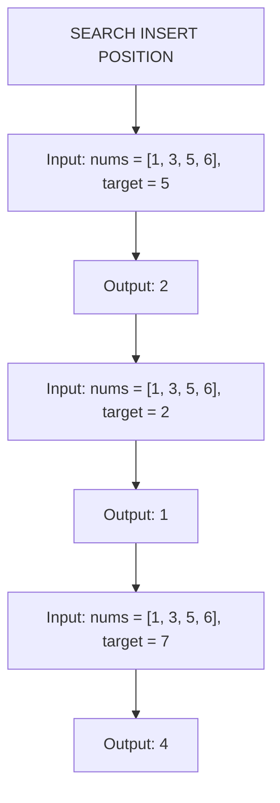

```java
public int searchInsert(int[] nums, int target) {
    int left = 0, right = nums.length - 1;

    while (left <= right) {
        int mid = left + (right - left) / 2;

        if (nums[mid] == target) {
            return mid;
        } else if (nums[mid] < target) {
            left = mid + 1;
        } else {
            right = mid - 1;
        }
    }
    return left;  // Insert position
}
```

---

### Problem: First Bad Version

**LeetCode 278** | **Difficulty:** Easy
🔗 [https://leetcode.com/problems/first-bad-version/](https://leetcode.com/problems/first-bad-version/)

```
╔═══════════════════════════════════════════════════════════════════════════╗
║  FIRST BAD VERSION                                                        ║
╠═══════════════════════════════════════════════════════════════════════════╣
║                                                                           ║
║  Versions 1, 2, ..., n. One is bad. All after it are bad too.             ║
║  Find the first bad version.                                              ║
║                                                                           ║
║  Input: n = 5, bad = 4                                                    ║
║  Versions: [G, G, G, B, B]                                                ║
║             1  2  3  4  5                                                 ║
║  Output: 4                                                                ║
║                                                                           ║
║  Pattern: Find leftmost true (first bad)                                  ║
║                                                                           ║
╚═══════════════════════════════════════════════════════════════════════════╝
```

> **Flow**: FIRST BAD VERSION → Find the first bad version. | Find the first bad version. → Input: n = 5, bad = 4 | Input: n = 5, bad = 4 → Versions: [G, G, G, B, B] | Versions: [G, G, G, B, B] → Output: 4 | Output: 4 → Pattern: Find leftmost true (first bad)

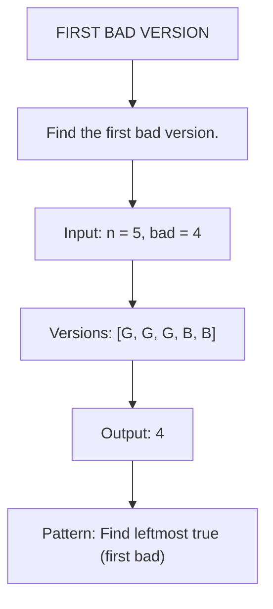

```java
public int firstBadVersion(int n) {
    int left = 1, right = n;

    while (left < right) {
        int mid = left + (right - left) / 2;

        if (isBadVersion(mid)) {
            right = mid;  // Could be answer, don't exclude
        } else {
            left = mid + 1;  // Not bad, search right
        }
    }
    return left;
}
```

---

## 📌 6.2 Find Boundaries

### Problem: Find First and Last Position

**LeetCode 34** | **Difficulty:** Medium
🔗 [https://leetcode.com/problems/find-first-and-last-position-of-element-in-sorted-array/](https://leetcode.com/problems/find-first-and-last-position-of-element-in-sorted-array/)

```
╔═══════════════════════════════════════════════════════════════════════════╗
║  FIND FIRST AND LAST POSITION                                             ║
╠═══════════════════════════════════════════════════════════════════════════╣
║                                                                           ║
║  Find starting and ending position of target in sorted array.             ║
║                                                                           ║
║  Input: nums = [5, 7, 7, 8, 8, 10], target = 8                            ║
║  Output: [3, 4]                                                           ║
║                                                                           ║
║  Input: nums = [5, 7, 7, 8, 8, 10], target = 6                            ║
║  Output: [-1, -1]                                                         ║
║                                                                           ║
║  Two binary searches: Find leftmost, find rightmost                       ║
║                                                                           ║
╚═══════════════════════════════════════════════════════════════════════════╝
```

> **Flow**: FIND FIRST AND LAST POSITION → Input: nums = [5, 7, 7, 8, 8, 10], target = 8 | Input: nums = [5, 7, 7, 8, 8, 10], target = 8 → Output: [3, 4] | Output: [3, 4] → Input: nums = [5, 7, 7, 8, 8, 10], target = 6 | Input: nums = [5, 7, 7, 8, 8, 10], target = 6 → Output: [-1, -1] | Output: [-1, -1] → Two binary searches: Find leftmost, find rightmost

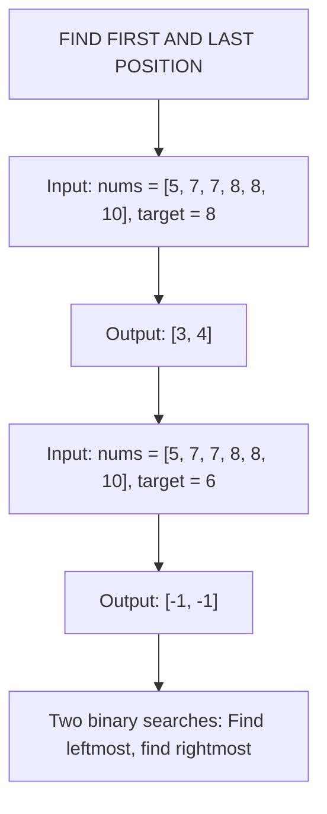

```java
public int[] searchRange(int[] nums, int target) {
    int[] result = {-1, -1};
    if (nums.length == 0) return result;

    // Find leftmost (first occurrence)
    result[0] = findFirst(nums, target);
    if (result[0] == -1) return result;

    // Find rightmost (last occurrence)
    result[1] = findLast(nums, target);

    return result;
}

private int findFirst(int[] nums, int target) {
    int left = 0, right = nums.length - 1;

    while (left < right) {
        int mid = left + (right - left) / 2;

        if (nums[mid] < target) {
            left = mid + 1;
        } else {
            right = mid;  // Keep searching left
        }
    }
    return nums[left] == target ? left : -1;
}

private int findLast(int[] nums, int target) {
    int left = 0, right = nums.length - 1;

    while (left < right) {
        int mid = left + (right - left + 1) / 2;  // Bias right

        if (nums[mid] > target) {
            right = mid - 1;
        } else {
            left = mid;  // Keep searching right
        }
    }
    return nums[left] == target ? left : -1;
}
```

---

### 🔒 PREMIUM: Find Smallest Letter Greater Than Target

**LeetCode 744** | **Difficulty:** Easy
🔗 [https://leetcode.com/problems/find-smallest-letter-greater-than-target/](https://leetcode.com/problems/find-smallest-letter-greater-than-target/)

```
╔═══════════════════════════════════════════════════════════════════════════╗
║  FIND SMALLEST LETTER GREATER THAN TARGET                                 ║
╠═══════════════════════════════════════════════════════════════════════════╣
║                                                                           ║
║  Sorted array of letters. Find smallest letter GREATER than target.       ║
║  Letters wrap around (if none greater, return first letter).              ║
║                                                                           ║
║  Input: letters = ["c","f","j"], target = "a"                             ║
║  Output: "c"                                                              ║
║                                                                           ║
║  Input: letters = ["c","f","j"], target = "c"                             ║
║  Output: "f"                                                              ║
║                                                                           ║
║  Input: letters = ["c","f","j"], target = "k"                             ║
║  Output: "c" (wrap around)                                                ║
║                                                                           ║
╚═══════════════════════════════════════════════════════════════════════════╝
```

> **Flow**: FIND SMALLEST LETTER GREATER THAN TARGET → Letters wrap around (if none greater, return first lett | Letters wrap around (if none greater, return first lett → Input: letters = ['c','f','j'], target = 'a' | Input: letters = ['c','f','j'], target = 'a' → Output: 'c' | Output: 'c' → Input: letters = ['c','f','j'], target = 'c' | Input: letters = ['c','f','j'], target = 'c' → Output: 'f' | Output: 'f' → Input: letters = ['c','f','j'], target = 'k' | ...+1 more

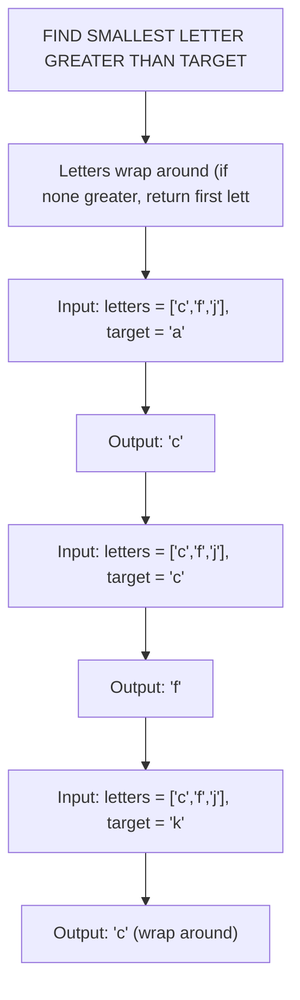

```java
public char nextGreatestLetter(char[] letters, char target) {
    int left = 0, right = letters.length;

    while (left < right) {
        int mid = left + (right - left) / 2;

        if (letters[mid] <= target) {
            left = mid + 1;
        } else {
            right = mid;
        }
    }
    return letters[left % letters.length];  // Wrap around
}
```

---

## 📊 6.3 Rotated Sorted Array

### Problem: Search in Rotated Sorted Array

**LeetCode 33** | **Difficulty:** Medium
🔗 [https://leetcode.com/problems/search-in-rotated-sorted-array/](https://leetcode.com/problems/search-in-rotated-sorted-array/)

```
╔═══════════════════════════════════════════════════════════════════════════╗
║  SEARCH IN ROTATED SORTED ARRAY                                           ║
╠═══════════════════════════════════════════════════════════════════════════╣
║                                                                           ║
║  Array was sorted then rotated at unknown pivot.                          ║
║  No duplicates. Search for target.                                        ║
║                                                                           ║
║  Input: nums = [4, 5, 6, 7, 0, 1, 2], target = 0                          ║
║  Output: 4                                                                ║
║                                                                           ║
║  Visual:                                                                  ║
║  Original: [0, 1, 2, 4, 5, 6, 7]                                          ║
║  Rotated:  [4, 5, 6, 7, 0, 1, 2]                                          ║
║             ↑        ↑                                                    ║
║           sorted   sorted                                                 ║
║                                                                           ║
║  KEY: One half is ALWAYS sorted                                           ║
║  Check if target is in sorted half, then decide direction                 ║
║                                                                           ║
╚═══════════════════════════════════════════════════════════════════════════╝
```

> **Flow**: SEARCH IN ROTATED SORTED ARRAY → Array was sorted then rotated at unknown pivot. | Array was sorted then rotated at unknown pivot. → No duplicates. Search for target. | No duplicates. Search for target. → Input: nums = [4, 5, 6, 7, 0, 1, 2], target = 0 | Input: nums = [4, 5, 6, 7, 0, 1, 2], target = 0 → Output: 4 | Output: 4 → Visual: | Visual: → Original: [0, 1, 2, 4, 5, 6, 7] | ...+1 more

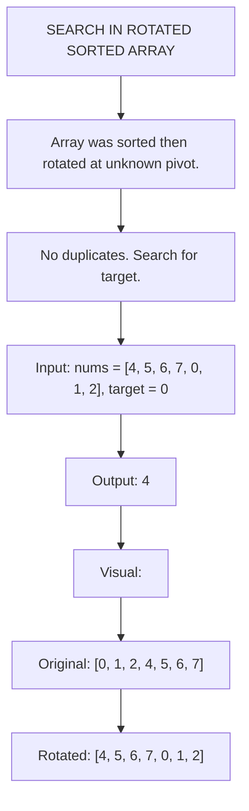

```java
public int search(int[] nums, int target) {
    int left = 0, right = nums.length - 1;

    while (left <= right) {
        int mid = left + (right - left) / 2;

        if (nums[mid] == target) return mid;

        // Check which half is sorted
        if (nums[left] <= nums[mid]) {
            // Left half is sorted
            if (target >= nums[left] && target < nums[mid]) {
                right = mid - 1;
            } else {
                left = mid + 1;
            }
        } else {
            // Right half is sorted
            if (target > nums[mid] && target <= nums[right]) {
                left = mid + 1;
            } else {
                right = mid - 1;
            }
        }
    }
    return -1;
}
```

---

### Problem: Search in Rotated Sorted Array II (With Duplicates)

**LeetCode 81** | **Difficulty:** Medium
🔗 [https://leetcode.com/problems/search-in-rotated-sorted-array-ii/](https://leetcode.com/problems/search-in-rotated-sorted-array-ii/)

```
╔═══════════════════════════════════════════════════════════════════════════╗
║  SEARCH IN ROTATED SORTED ARRAY II (WITH DUPLICATES)                      ║
╠═══════════════════════════════════════════════════════════════════════════╣
║                                                                           ║
║  Same as above but array may have duplicates.                             ║
║                                                                           ║
║  Input: nums = [2, 5, 6, 0, 0, 1, 2], target = 0                          ║
║  Output: true                                                             ║
║                                                                           ║
║  EDGE CASE: nums[left] == nums[mid] == nums[right]                        ║
║  Example: [1, 0, 1, 1, 1] - can't determine which half is sorted          ║
║  Solution: Skip duplicates by left++, right--                             ║
║                                                                           ║
╚═══════════════════════════════════════════════════════════════════════════╝
```

> **Flow**: SEARCH IN ROTATED SORTED ARRAY II (WITH DUPLICATES) → Same as above but array may have duplicates. | Same as above but array may have duplicates. → Input: nums = [2, 5, 6, 0, 0, 1, 2], target = 0 | Input: nums = [2, 5, 6, 0, 0, 1, 2], target = 0 → Output: true | Output: true → Solution: Skip duplicates by left++, right--

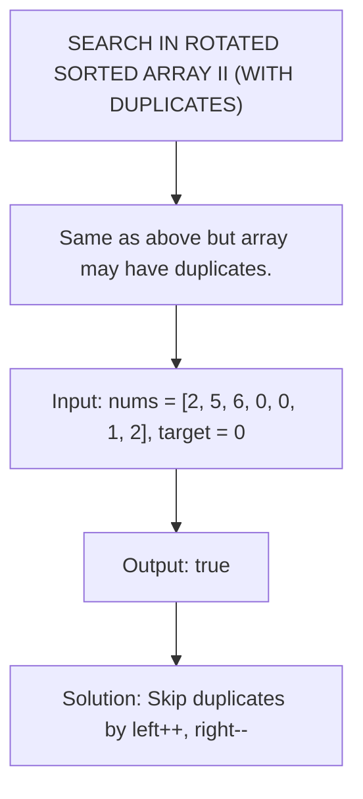

```java
public boolean search(int[] nums, int target) {
    int left = 0, right = nums.length - 1;

    while (left <= right) {
        int mid = left + (right - left) / 2;

        if (nums[mid] == target) return true;

        // Handle duplicates
        if (nums[left] == nums[mid] && nums[mid] == nums[right]) {
            left++;
            right--;
        } else if (nums[left] <= nums[mid]) {
            // Left half sorted
            if (target >= nums[left] && target < nums[mid]) {
                right = mid - 1;
            } else {
                left = mid + 1;
            }
        } else {
            // Right half sorted
            if (target > nums[mid] && target <= nums[right]) {
                left = mid + 1;
            } else {
                right = mid - 1;
            }
        }
    }
    return false;
}
```

---

### Problem: Find Minimum in Rotated Sorted Array

**LeetCode 153** | **Difficulty:** Medium
🔗 [https://leetcode.com/problems/find-minimum-in-rotated-sorted-array/](https://leetcode.com/problems/find-minimum-in-rotated-sorted-array/)

```
╔═══════════════════════════════════════════════════════════════════════════╗
║  FIND MINIMUM IN ROTATED SORTED ARRAY                                     ║
╠═══════════════════════════════════════════════════════════════════════════╣
║                                                                           ║
║  Find minimum element in rotated sorted array (no duplicates).            ║
║                                                                           ║
║  Input: nums = [3, 4, 5, 1, 2]                                            ║
║  Output: 1                                                                ║
║                                                                           ║
║  Visual:                                                                  ║
║       5                                                                   ║
║    4     ╲                                                                ║
║ 3           ╲                                                             ║
║               2                                                           ║
║             1   ← minimum                                                 ║
║                                                                           ║
║  KEY: Compare mid with right                                              ║
║  - If mid > right: min is in right half                                   ║
║  - If mid < right: min is in left half (including mid)                    ║
║                                                                           ║
╚═══════════════════════════════════════════════════════════════════════════╝
```

> **Flow**: FIND MINIMUM IN ROTATED SORTED ARRAY → Input: nums = [3, 4, 5, 1, 2] | Input: nums = [3, 4, 5, 1, 2] → Output: 1 | Output: 1 → Visual: | Visual: → 1 ← minimum | 1 ← minimum → KEY: Compare mid with right | KEY: Compare mid with right → - If mid &gt; right: min is in right half | ...+1 more

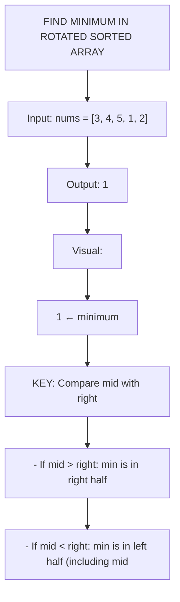

```java
public int findMin(int[] nums) {
    int left = 0, right = nums.length - 1;

    while (left < right) {
        int mid = left + (right - left) / 2;

        if (nums[mid] > nums[right]) {
            // Min is in right half
            left = mid + 1;
        } else {
            // Min is in left half (including mid)
            right = mid;
        }
    }
    return nums[left];
}
```

---

## 🔍 6.4 Binary Search on Answer

### Problem: Sqrt(x)

**LeetCode 69** | **Difficulty:** Easy
🔗 [https://leetcode.com/problems/sqrtx/](https://leetcode.com/problems/sqrtx/)

```
╔═══════════════════════════════════════════════════════════════════════════╗
║  SQRT(X) - Binary Search on Answer                                        ║
╠═══════════════════════════════════════════════════════════════════════════╣
║                                                                           ║
║  Find integer square root (truncate decimals).                            ║
║                                                                           ║
║  Input: x = 8                                                             ║
║  Output: 2 (√8 = 2.828..., truncated to 2)                                ║
║                                                                           ║
║  Binary search range: [1, x]                                              ║
║  Find largest n where n*n <= x                                            ║
║                                                                           ║
╚═══════════════════════════════════════════════════════════════════════════╝
```

> **Flow**: SQRT(X) - Binary Search on Answer → Find integer square root (truncate decimals). | Find integer square root (truncate decimals). → Input: x = 8 | Input: x = 8 → Output: 2 (√8 = 2.828..., truncated to 2) | Output: 2 (√8 = 2.828..., truncated to 2) → Binary search range: [1, x] | Binary search range: [1, x] → Find largest n where n*n &lt;= x

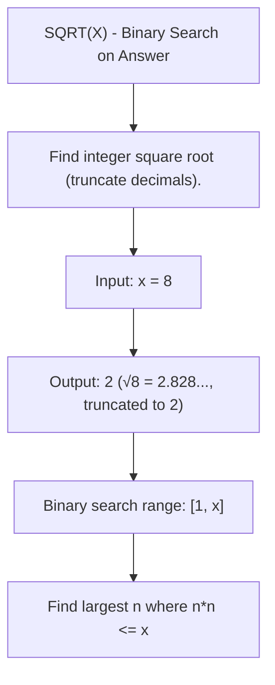

```java
public int mySqrt(int x) {
    if (x < 2) return x;

    long left = 1, right = x / 2;

    while (left <= right) {
        long mid = left + (right - left) / 2;
        long square = mid * mid;

        if (square == x) {
            return (int) mid;
        } else if (square < x) {
            left = mid + 1;
        } else {
            right = mid - 1;
        }
    }
    return (int) right;
}
```

---

### Problem: Koko Eating Bananas

**LeetCode 875** | **Difficulty:** Medium
🔗 [https://leetcode.com/problems/koko-eating-bananas/](https://leetcode.com/problems/koko-eating-bananas/)

```
╔═══════════════════════════════════════════════════════════════════════════╗
║  KOKO EATING BANANAS                                                      ║
╠═══════════════════════════════════════════════════════════════════════════╣
║                                                                           ║
║  Koko eats k bananas/hour. Guard returns in h hours.                      ║
║  Find minimum k to eat all bananas before guard returns.                  ║
║                                                                           ║
║  Input: piles = [3, 6, 7, 11], h = 8                                      ║
║  Output: 4                                                                ║
║  Explanation: At k=4, time needed:                                        ║
║  pile 3: ceil(3/4) = 1 hour                                               ║
║  pile 6: ceil(6/4) = 2 hours                                              ║
║  pile 7: ceil(7/4) = 2 hours                                              ║
║  pile 11: ceil(11/4) = 3 hours                                            ║
║  Total: 8 hours ≤ 8 ✓                                                     ║
║                                                                           ║
║  Binary search on k: range [1, max(piles)]                                ║
║                                                                           ║
╚═══════════════════════════════════════════════════════════════════════════╝
```

> **Flow**: KOKO EATING BANANAS → Koko eats k bananas/hour. Guard returns in h hours. | Koko eats k bananas/hour. Guard returns in h hours. → Find minimum k to eat all bananas before guard returns. | Find minimum k to eat all bananas before guard returns. → Input: piles = [3, 6, 7, 11], h = 8 | Input: piles = [3, 6, 7, 11], h = 8 → Output: 4 | Output: 4 → Explanation: At k=4, time needed: | Explanation: At k=4, time needed: → pile 3: ceil(3/4) = 1 hour | ...+1 more

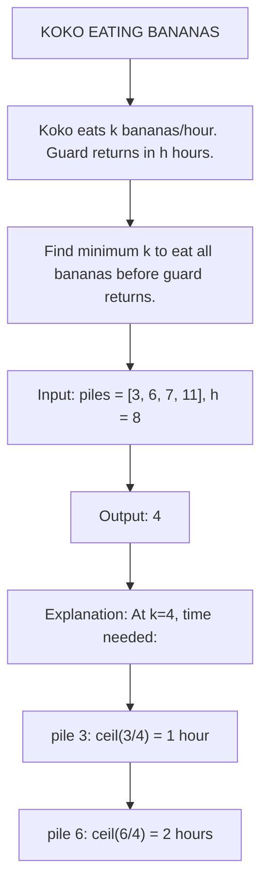

```java
public int minEatingSpeed(int[] piles, int h) {
    int left = 1;
    int right = Arrays.stream(piles).max().getAsInt();

    while (left < right) {
        int mid = left + (right - left) / 2;

        if (canFinish(piles, h, mid)) {
            right = mid;  // Try slower speed
        } else {
            left = mid + 1;  // Need faster speed
        }
    }
    return left;
}

private boolean canFinish(int[] piles, int h, int k) {
    int hours = 0;
    for (int pile : piles) {
        hours += (pile + k - 1) / k;  // Ceiling division
    }
    return hours <= h;
}
```

---

### Problem: Capacity To Ship Packages Within D Days

**LeetCode 1011** | **Difficulty:** Medium
🔗 [https://leetcode.com/problems/capacity-to-ship-packages-within-d-days/](https://leetcode.com/problems/capacity-to-ship-packages-within-d-days/)

```
╔═══════════════════════════════════════════════════════════════════════════╗
║  CAPACITY TO SHIP PACKAGES                                                ║
╠═══════════════════════════════════════════════════════════════════════════╣
║                                                                           ║
║  Find minimum ship capacity to ship all packages in days days.            ║
║  Packages must be shipped IN ORDER.                                       ║
║                                                                           ║
║  Input: weights = [1,2,3,4,5,6,7,8,9,10], days = 5                        ║
║  Output: 15                                                               ║
║  Explanation:                                                             ║
║  Day 1: 1,2,3,4,5 (sum=15)                                                ║
║  Day 2: 6,7 (sum=13)                                                      ║
║  Day 3: 8 (sum=8)                                                         ║
║  Day 4: 9 (sum=9)                                                         ║
║  Day 5: 10 (sum=10)                                                       ║
║                                                                           ║
║  Binary search on capacity: [max(weights), sum(weights)]                  ║
║                                                                           ║
╚═══════════════════════════════════════════════════════════════════════════╝
```

> **Flow**: CAPACITY TO SHIP PACKAGES → Packages must be shipped IN ORDER. | Packages must be shipped IN ORDER. → Input: weights = [1,2,3,4,5,6,7,8,9,10], days = 5 | Input: weights = [1,2,3,4,5,6,7,8,9,10], days = 5 → Output: 15 | Output: 15 → Explanation: | Explanation: → Day 1: 1,2,3,4,5 (sum=15) | Day 1: 1,2,3,4,5 (sum=15) → Day 2: 6,7 (sum=13) | ...+1 more

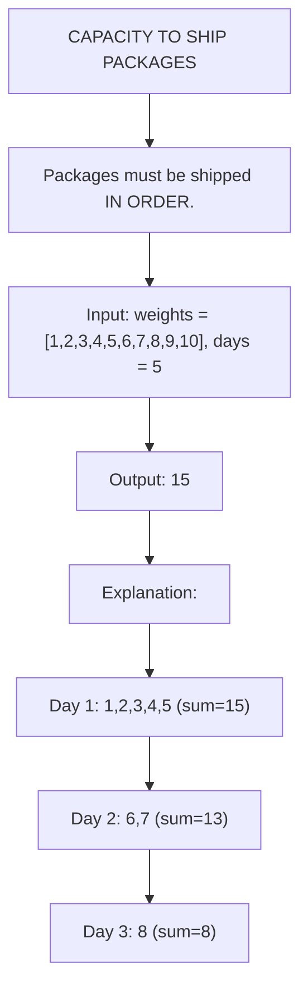

```java
public int shipWithinDays(int[] weights, int days) {
    int left = Arrays.stream(weights).max().getAsInt();
    int right = Arrays.stream(weights).sum();

    while (left < right) {
        int mid = left + (right - left) / 2;

        if (canShip(weights, days, mid)) {
            right = mid;
        } else {
            left = mid + 1;
        }
    }
    return left;
}

private boolean canShip(int[] weights, int days, int capacity) {
    int daysNeeded = 1;
    int currentLoad = 0;

    for (int weight : weights) {
        if (currentLoad + weight > capacity) {
            daysNeeded++;
            currentLoad = weight;
        } else {
            currentLoad += weight;
        }
    }
    return daysNeeded <= days;
}
```

---

### Problem: Split Array Largest Sum

**LeetCode 410** | **Difficulty:** Hard
🔗 [https://leetcode.com/problems/split-array-largest-sum/](https://leetcode.com/problems/split-array-largest-sum/)

```
╔═══════════════════════════════════════════════════════════════════════════╗
║  SPLIT ARRAY LARGEST SUM                                                  ║
╠═══════════════════════════════════════════════════════════════════════════╣
║                                                                           ║
║  Split array into k subarrays. Minimize the largest subarray sum.         ║
║                                                                           ║
║  Input: nums = [7,2,5,10,8], k = 2                                        ║
║  Output: 18                                                               ║
║  Explanation:                                                             ║
║  Split: [7,2,5] and [10,8]                                                ║
║  Sums: 14 and 18                                                          ║
║  Largest sum = 18 (minimized)                                             ║
║                                                                           ║
║  Binary search on max sum allowed                                         ║
║                                                                           ║
╚═══════════════════════════════════════════════════════════════════════════╝
```

> **Flow**: SPLIT ARRAY LARGEST SUM → Input: nums = [7,2,5,10,8], k = 2 | Input: nums = [7,2,5,10,8], k = 2 → Output: 18 | Output: 18 → Explanation: | Explanation: → Split: [7,2,5] and [10,8] | Split: [7,2,5] and [10,8] → Sums: 14 and 18 | Sums: 14 and 18 → Largest sum = 18 (minimized) | ...+1 more

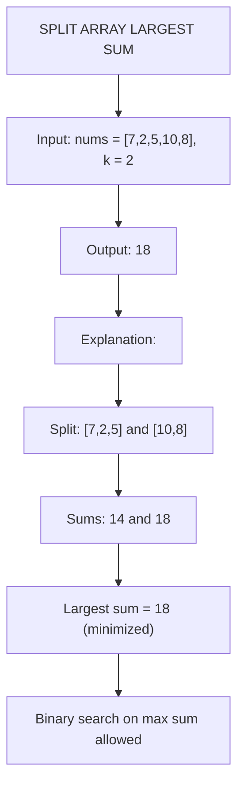

```java
public int splitArray(int[] nums, int k) {
    int left = Arrays.stream(nums).max().getAsInt();
    int right = Arrays.stream(nums).sum();

    while (left < right) {
        int mid = left + (right - left) / 2;

        if (canSplit(nums, k, mid)) {
            right = mid;
        } else {
            left = mid + 1;
        }
    }
    return left;
}

private boolean canSplit(int[] nums, int k, int maxSum) {
    int splits = 1;
    int currentSum = 0;

    for (int num : nums) {
        if (currentSum + num > maxSum) {
            splits++;
            currentSum = num;
        } else {
            currentSum += num;
        }
    }
    return splits <= k;
}
```

---

### 🔒 PREMIUM: Find K-th Smallest Pair Distance

**LeetCode 719** | **Difficulty:** Hard | **Premium-Level**

```
╔═══════════════════════════════════════════════════════════════════════════╗
║  FIND K-TH SMALLEST PAIR DISTANCE                                         ║
║  (LeetCode 719 - Hard)                                                    ║
╠═══════════════════════════════════════════════════════════════════════════╣
║                                                                           ║
║  Given array nums, define distance between pair (i,j) as |nums[i]-nums[j] ║
║  Find the k-th smallest distance among all pairs.                         ║
║                                                                           ║
║  ─────────────────────────────────────────────────────────────────────    ║
║                                                                           ║
║  Example 1:                                                               ║
║  Input: nums = [1, 3, 1], k = 1                                           ║
║  Output: 0                                                                ║
║  Explanation:                                                             ║
║  All distances: (1,3)=2, (1,1)=0, (3,1)=2                                 ║
║  Sorted: [0, 2, 2]                                                        ║
║  1st smallest = 0                                                         ║
║                                                                           ║
║  Example 2:                                                               ║
║  Input: nums = [1, 1, 1], k = 2                                           ║
║  Output: 0                                                                ║
║                                                                           ║
║  Example 3:                                                               ║
║  Input: nums = [1, 6, 1], k = 3                                           ║
║  Output: 5                                                                ║
║                                                                           ║
║  ─────────────────────────────────────────────────────────────────────    ║
║                                                                           ║
║  APPROACH: Binary search on distance + count pairs with dist <= mid       ║
║                                                                           ║
║  ─────────────────────────────────────────────────────────────────────    ║
║                                                                           ║
║  Constraints:                                                             ║
║  - n == nums.length                                                       ║
║  - 2 <= n <= 10^4                                                         ║
║  - 0 <= nums[i] <= 10^6                                                   ║
║  - 1 <= k <= n * (n - 1) / 2                                              ║
║                                                                           ║
╚═══════════════════════════════════════════════════════════════════════════╝
```

> **Flow**: FIND K-TH SMALLEST PAIR DISTANCE → (LeetCode 719 - Hard) | (LeetCode 719 - Hard) → Find the k-th smallest distance among all pairs. | Find the k-th smallest distance among all pairs. → Example 1: | Example 1: → Input: nums = [1, 3, 1], k = 1 | Input: nums = [1, 3, 1], k = 1 → Output: 0 | Output: 0 → Explanation: | ...+1 more

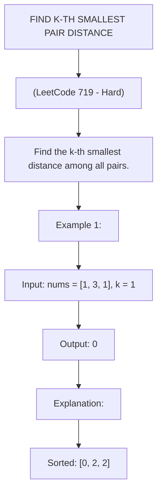

```java
public int smallestDistancePair(int[] nums, int k) {
    Arrays.sort(nums);
    int n = nums.length;

    int left = 0;
    int right = nums[n - 1] - nums[0];

    while (left < right) {
        int mid = left + (right - left) / 2;

        if (countPairs(nums, mid) >= k) {
            right = mid;
        } else {
            left = mid + 1;
        }
    }
    return left;
}

// Count pairs with distance <= maxDist
private int countPairs(int[] nums, int maxDist) {
    int count = 0;
    int left = 0;

    for (int right = 0; right < nums.length; right++) {
        while (nums[right] - nums[left] > maxDist) {
            left++;
        }
        count += right - left;
    }
    return count;
}
```

---

## SECTION 5: Additional Binary Search Problems

### Problem 13: Find Peak Element

**LeetCode 162** | **Difficulty:** Medium

```
╔═══════════════════════════════════════════════════════════════════════════╗
║  FIND PEAK ELEMENT (LeetCode 162 - Medium)                                ║
╠═══════════════════════════════════════════════════════════════════════════╣
║                                                                           ║
║  A peak element is strictly greater than its neighbors.                   ║
║  Return index of ANY peak. nums[-1] = nums[n] = -∞.                       ║
║                                                                           ║
║  Example: nums = [1,2,3,1]  →  Output: 2 (nums[2]=3 is peak)              ║
║                                                                           ║
║  KEY: If nums[mid] < nums[mid+1], peak must be on right side.             ║
║  TIME: O(log n) | SPACE: O(1)                                             ║
╚═══════════════════════════════════════════════════════════════════════════╝
```

> **Flow**: FIND PEAK ELEMENT (LeetCode 162 - Medium) → A peak element is strictly greater than its neighbors. | A peak element is strictly greater than its neighbors. → Return index of ANY peak. nums[-1] = nums[n] = -∞. | Return index of ANY peak. nums[-1] = nums[n] = -∞. → Example: nums = [1,2,3,1] → Output: 2 (nums[2]=3 is pea | Example: nums = [1,2,3,1] → Output: 2 (nums[2]=3 is pea → TIME: O(log n) | SPACE: O(1)

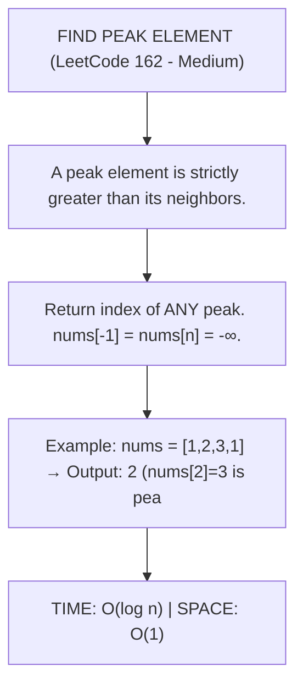

```java
public int findPeakElement(int[] nums) {
    int left = 0, right = nums.length - 1;
    while (left < right) {
        int mid = left + (right - left) / 2;
        if (nums[mid] < nums[mid + 1])
            left = mid + 1;  // peak is on right
        else
            right = mid;     // mid could be peak
    }
    return left;
}
```

---

### Problem 14: Search a 2D Matrix

**LeetCode 74** | **Difficulty:** Medium

```
╔═══════════════════════════════════════════════════════════════════════════╗
║  SEARCH A 2D MATRIX (LeetCode 74 - Medium)                                ║
╠═══════════════════════════════════════════════════════════════════════════╣
║                                                                           ║
║  Each row sorted left to right. First int of each row > last of prev.     ║
║  Determine if target exists in matrix.                                    ║
║                                                                           ║
║  Example:                                                                 ║
║  matrix = [[1,3,5,7],[10,11,16,20],[23,30,34,60]], target = 3             ║
║  Output: true                                                             ║
║                                                                           ║
║  KEY: Treat as sorted 1D array. index → row=idx/cols, col=idx%cols        ║
║  TIME: O(log(m*n)) | SPACE: O(1)                                          ║
╚═══════════════════════════════════════════════════════════════════════════╝
```

> **Flow**: SEARCH A 2D MATRIX (LeetCode 74 - Medium) → Determine if target exists in matrix. | Determine if target exists in matrix. → Example: | Example: → Output: true | Output: true → TIME: O(log(m*n)) | SPACE: O(1)

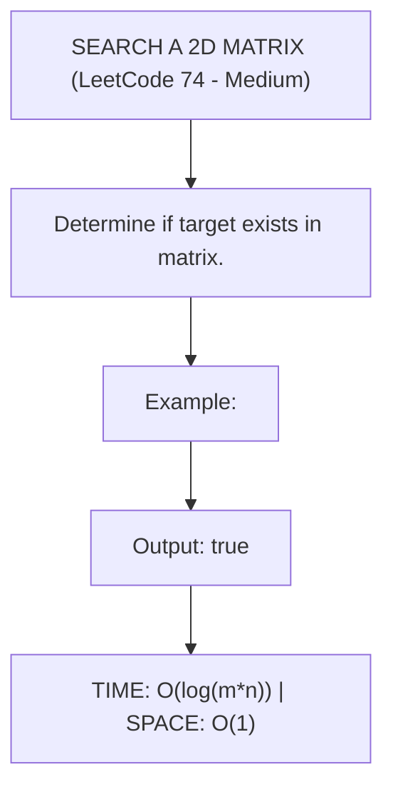

```java
public boolean searchMatrix(int[][] matrix, int target) {
    int m = matrix.length, n = matrix[0].length;
    int left = 0, right = m * n - 1;

    while (left <= right) {
        int mid = left + (right - left) / 2;
        int val = matrix[mid / n][mid % n];

        if (val == target) return true;
        else if (val < target) left = mid + 1;
        else right = mid - 1;
    }
    return false;
}
```

---

### Problem 15: Time Based Key-Value Store

**LeetCode 981** | **Difficulty:** Medium

```
╔═══════════════════════════════════════════════════════════════════════════╗
║  TIME BASED KEY-VALUE STORE (LeetCode 981 - Medium)                       ║
╠═══════════════════════════════════════════════════════════════════════════╣
║                                                                           ║
║  set(key, value, timestamp) — store key-value with timestamp              ║
║  get(key, timestamp) — return value with largest timestamp <= given       ║
║                                                                           ║
║  Example:                                                                 ║
║  set("foo","bar",1), get("foo",1) → "bar"                                 ║
║  get("foo",3) → "bar", set("foo","bar2",4), get("foo",5) → "bar2"         ║
║                                                                           ║
║  KEY: Binary search on timestamps for each key.                           ║
║  TIME: set O(1), get O(log n) | SPACE: O(n)                               ║
╚═══════════════════════════════════════════════════════════════════════════╝
```

> **Flow**: TIME BASED KEY-VALUE STORE (LeetCode 981 - Medium) → set(key, value, timestamp) — store key-value with times | set(key, value, timestamp) — store key-value with times → Example: | Example: → set('foo','bar',1), get('foo',1) → 'bar' | set('foo','bar',1), get('foo',1) → 'bar' → KEY: Binary search on timestamps for each key. | KEY: Binary search on timestamps for each key. → TIME: set O(1), get O(log n) | SPACE: O(n)

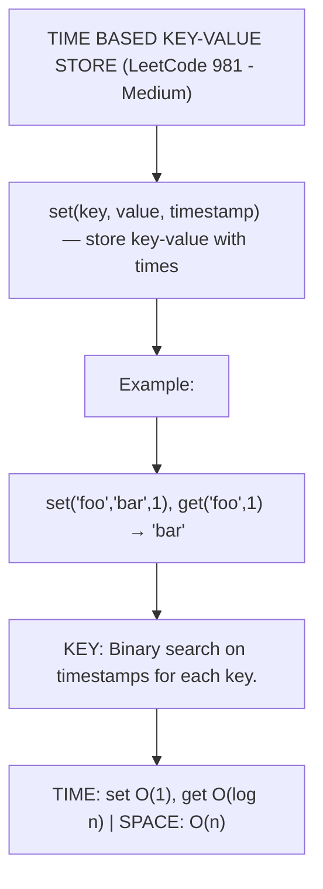

```java
class TimeMap {
    Map<String, List<int[]>> map; // key → list of [timestamp, valueIndex]
    List<String> values;

    // Simpler approach: store timestamps and values together
    Map<String, TreeMap<Integer, String>> store;

    public TimeMap() {
        store = new HashMap<>();
    }

    public void set(String key, String value, int timestamp) {
        store.computeIfAbsent(key, k -> new TreeMap<>()).put(timestamp, value);
    }

    public String get(String key, int timestamp) {
        if (!store.containsKey(key)) return "";
        TreeMap<Integer, String> tree = store.get(key);
        Integer floor = tree.floorKey(timestamp);
        return floor == null ? "" : tree.get(floor);
    }
}
```

---

### Problem 16: Median of Two Sorted Arrays

**LeetCode 4** | **Difficulty:** Hard

```
╔═══════════════════════════════════════════════════════════════════════════╗
║  MEDIAN OF TWO SORTED ARRAYS (LeetCode 4 - Hard)                          ║
╠═══════════════════════════════════════════════════════════════════════════╣
║                                                                           ║
║  Given two sorted arrays nums1 and nums2, return the median.              ║
║  Overall runtime must be O(log(m+n)).                                     ║
║                                                                           ║
║  Example:                                                                 ║
║  nums1 = [1,3], nums2 = [2]  →  Output: 2.0                               ║
║  nums1 = [1,2], nums2 = [3,4]  →  Output: 2.5                             ║
║                                                                           ║
║  KEY: Binary search on partition of shorter array.                        ║
║  Split both arrays so left half has (m+n+1)/2 elements.                   ║
║  TIME: O(log(min(m,n))) | SPACE: O(1)                                     ║
╚═══════════════════════════════════════════════════════════════════════════╝
```

> **Flow**: MEDIAN OF TWO SORTED ARRAYS (LeetCode 4 - Hard) → Given two sorted arrays nums1 and nums2, return the med | Given two sorted arrays nums1 and nums2, return the med → Overall runtime must be O(log(m+n)). | Overall runtime must be O(log(m+n)). → Example: | Example: → nums1 = [1,3], nums2 = [2] → Output: 2.0 | nums1 = [1,3], nums2 = [2] → Output: 2.0 → nums1 = [1,2], nums2 = [3,4] → Output: 2.5 | nums1 = [1,2], nums2 = [3,4] → Output: 2.5 → KEY: Binary search on partition of shorter array. | ...+1 more

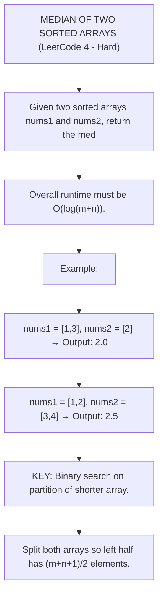

```java
public double findMedianSortedArrays(int[] nums1, int[] nums2) {
    // Ensure nums1 is shorter
    if (nums1.length > nums2.length)
        return findMedianSortedArrays(nums2, nums1);

    int m = nums1.length, n = nums2.length;
    int left = 0, right = m;

    while (left <= right) {
        int i = left + (right - left) / 2;  // partition in nums1
        int j = (m + n + 1) / 2 - i;        // partition in nums2

        int maxLeft1 = (i == 0) ? Integer.MIN_VALUE : nums1[i - 1];
        int minRight1 = (i == m) ? Integer.MAX_VALUE : nums1[i];
        int maxLeft2 = (j == 0) ? Integer.MIN_VALUE : nums2[j - 1];
        int minRight2 = (j == n) ? Integer.MAX_VALUE : nums2[j];

        if (maxLeft1 <= minRight2 && maxLeft2 <= minRight1) {
            if ((m + n) % 2 == 0)
                return (Math.max(maxLeft1, maxLeft2) +
                        Math.min(minRight1, minRight2)) / 2.0;
            else
                return Math.max(maxLeft1, maxLeft2);
        } else if (maxLeft1 > minRight2) {
            right = i - 1;
        } else {
            left = i + 1;
        }
    }
    return 0.0;
}
```

---

### Problem 17: Magnetic Force Between Two Balls

**LeetCode 1552** | **Difficulty:** Medium

```
╔═══════════════════════════════════════════════════════════════════════════╗
║  MAGNETIC FORCE BETWEEN TWO BALLS (LeetCode 1552 - Medium)                ║
╠═══════════════════════════════════════════════════════════════════════════╣
║                                                                           ║
║  Place m balls in basket positions to maximize minimum magnetic force     ║
║  (distance) between any two balls.                                        ║
║                                                                           ║
║  Example:                                                                 ║
║  position = [1,2,3,4,7], m = 3  →  Output: 3                              ║
║  Place at positions 1, 4, 7 → min distance = 3                            ║
║                                                                           ║
║  KEY: Binary search on answer (minimum distance).                         ║
║  For each candidate distance, greedily check if m balls fit.              ║
║  TIME: O(n log(maxDist)) | SPACE: O(1)                                    ║
╚═══════════════════════════════════════════════════════════════════════════╝
```

> **Flow**: MAGNETIC FORCE BETWEEN TWO BALLS (LeetCode 1552 - Mediu → (distance) between any two balls. | (distance) between any two balls. → Example: | Example: → position = [1,2,3,4,7], m = 3 → Output: 3 | position = [1,2,3,4,7], m = 3 → Output: 3 → Place at positions 1, 4, 7 → min distance = 3 | Place at positions 1, 4, 7 → min distance = 3 → KEY: Binary search on answer (minimum distance). | KEY: Binary search on answer (minimum distance). → For each candidate distance, greedily check if m balls | ...+1 more

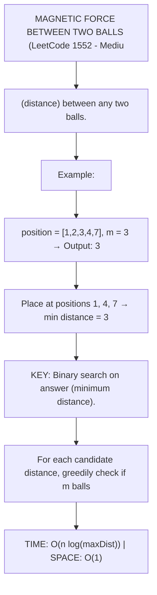

```java
public int maxDistance(int[] position, int m) {
    Arrays.sort(position);
    int left = 1;
    int right = position[position.length - 1] - position[0];

    while (left <= right) {
        int mid = left + (right - left) / 2;
        if (canPlace(position, m, mid))
            left = mid + 1;   // try larger distance
        else
            right = mid - 1;  // distance too large
    }
    return right;
}

private boolean canPlace(int[] position, int m, int minDist) {
    int count = 1, lastPos = position[0];
    for (int i = 1; i < position.length; i++) {
        if (position[i] - lastPos >= minDist) {
            count++;
            lastPos = position[i];
            if (count >= m) return true;
        }
    }
    return false;
}
```

---

> **Navigation**: [< Previous](06_Problems_Two_Pointers.md) | [Back to Index](../00_MASTER_INDEX.md) | [Next >](08_Problems_Stack_Queue.md)