> **Navigation**: [< Previous](07_Binary_Search.md) | [Back to Index](../00_MASTER_INDEX.md) | [Next >](09_Trees.md)

> **Problems 08/14** | [Prev](07_Binary_Search.md) | [Index](../00_MASTER_INDEX.md) | [Next](09_Trees.md)

---

## 🗺️ Pattern Recognition Header — Stack & Queue

> **When to use Stack vs Queue?**
>

| Trigger Words | Structure | Sub-type |
|---|---|---|
| `match brackets / valid expression` | Stack | Push open, pop close |
| `next greater / next smaller element` | Monotonic Stack | Decreasing stack |
| `largest rectangle / area in histogram` | Monotonic Stack | Ascending stack |
| `evaluate arithmetic expression` | Two Stacks | Nums + operators |
| `BFS / level-by-level traversal` | Queue | Standard BFS |
| `sliding window max / min` | Monotonic Deque | Decreasing deque |
| `design min/max stack` | Stack + tracking | Pair (val, minSoFar) |

>
> **The Core Mental Models:**
> ```
> STACK → "What's the LAST (most recent) unresolved thing?"
> QUEUE → "What's the OLDEST (arrived first) thing that I need to process?"
> ```
>
> 📖 **Mental Model:** [04_Array_String_Thinking.md](../14_Mental_Models/04_Array_String_Thinking.md)
> 📖 **Complexity Analysis:** [09_Complexity_Intuition.md](../14_Mental_Models/09_Complexity_Intuition.md)
> 📖 **Full Pattern Guide:** [00_PATTERN_MASTER_GUIDE.md](../04_Patterns_Templates/00_PATTERN_MASTER_GUIDE.md)

---


# 📚 SECTION 7: STACK & QUEUE PROBLEMS

```
┌─────────────────────────────────────────────────────────────────┐
│                    STACK & QUEUE PATTERNS                       │
├─────────────────────────────────────────────────────────────────┤
│  STACK (LIFO):                   QUEUE (FIFO):                  │
│  ┌───┐                           ┌───┬───┬───┬───┐              │
│  │ 3 │ ← top (push/pop)          │ 1 │ 2 │ 3 │ 4 │              │
│  ├───┤                           └───┴───┴───┴───┘              │
│  │ 2 │                             ↑           ↑                │
│  ├───┤                           front       rear               │
│  │ 1 │                         (dequeue)   (enqueue)            │
│  └───┘                                                          │
│                                                                 │
│  MONOTONIC STACK:                MONOTONIC QUEUE:               │
│  [1, 3, 5] ← Increasing          Deque: front ↔ rear            │
│  [5, 3, 1] ← Decreasing          Used for sliding window max    │
└─────────────────────────────────────────────────────────────────┘
```

**Flow:**
- 3 / 2 / 1
- ↓
- 1 2 3 4

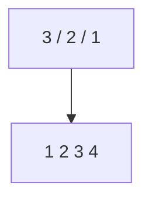

---

## PART 0: WHY Stack/Queue — The Two Most Interview-Tested Data Structures

```
╔══════════════════════════════════════════════════════════════════════════════╗
║        STACK & QUEUE PROBLEMS — COMPLETE UNDERSTANDING & GROWTH MINDSET      ║
╚══════════════════════════════════════════════════════════════════════════════╝

┌──────────────────────────────────────────────────────────────────────────────┐
│ WHY THESE PROBLEMS MATTER                                                    │
├──────────────────────────────────────────────────────────────────────────────┤
│                                                                              │
│ Stack/Queue appear in 20-25% of coding interviews and underpin MANY other    │
│ patterns. If you can't instantly recognize "this needs a stack," every       │
│ expression, matching, and monotonic problem will be out of reach.            │
│                                                                              │
│ REAL-WORLD STACKS:                                                           │
│ • Browser back button: Each page pushed, back button pops                    │
│ • Ctrl+Z / Undo: Every action pushed, undo pops                              │
│ • Call stack: Function A calls B calls C → C returns first                   │
│ • Syntax parsing: Compilers validate bracket matching with stacks            │
│ • Expression evaluation: Calculators process operators/operands via stack    │
│                                                                              │
│ REAL-WORLD QUEUES:                                                           │
│ • Print queue: First document sent → first printed                           │
│ • Web server requests: Process in arrival order                              │
│ • BFS in social networks: "People you may know" (1 hop, 2 hop, 3 hop)        │
│ • Sliding window analytics: "Max CPU usage in last 5 minutes"                │
└──────────────────────────────────────────────────────────────────────────────┘

┌──────────────────────────────────────────────────────────────────────────────┐
│ THE TWO MENTAL MODELS                                                        │
├──────────────────────────────────────────────────────────────────────────────┤
│                                                                              │
│ STACK = "What's the LAST thing that matters?"                                │
│                                                                              │
│   The most RECENT unmatched / unprocessed element is the one I need.         │
│                                                                              │
│   Parentheses:  Last OPEN bracket must match the next CLOSE bracket          │
│   Monotonic:    Last element that hasn't found its Next Greater yet          │
│   Calculator:   Last pending operator/operand in the expression              │
│   Min Stack:    Last minimum still relevant (nothing smaller was added)      │
│                                                                              │
│ QUEUE = "What's the OLDEST thing that matters?"                              │
│                                                                              │
│   Process elements in the ORDER they arrived.                                │
│                                                                              │
│   BFS:          Visit level 1, then level 2, then level 3...                 │
│   Sliding win:  Track elements in window, evict the OLDEST first             │
│   Task sched:   First task submitted → first task executed                   │
│                                                                              │
│ ┌──────────────────────────────────────────────────────────────────┐         │
│ │ DECISION FLOWCHART                                                │        │
│ │                                                                   │        │
│ │ "Match brackets/tags?"              → Stack (push open, pop close)│        │
│ │ "Next greater/smaller element?"     → Monotonic Stack             │        │
│ │ "Evaluate arithmetic expression?"   → Two Stacks (nums + ops)     │        │
│ │ "Sliding window max/min?"           → Monotonic Deque             │        │
│ │ "BFS / level-by-level?"             → Queue                       │        │
│ │ "Most recently used / undo?"        → Stack                       │        │
│ │ "Design a queue/stack using other?" → Tricky (2 stacks/queues)   │         │
│ └──────────────────────────────────────────────────────────────────┘         │
└──────────────────────────────────────────────────────────────────────────────┘

┌──────────────────────────────────────────────────────────────────────────────┐
│ JAVA CODE TEMPLATES                                                          │
├──────────────────────────────────────────────────────────────────────────────┤
│                                                                              │
│ TEMPLATE 1: BRACKET MATCHING (covers 5+ problems)                            │
│                                                                              │
│   Deque<Character> stack = new ArrayDeque<>();                               │
│   for (char c : s.toCharArray()) {                                           │
│       if (isOpening(c)) {                                                    │
│           stack.push(expectedClose(c));                                      │
│       } else {                                                               │
│           if (stack.isEmpty() || stack.pop() != c) return false;             │
│       }                                                                      │
│   }                                                                          │
│   return stack.isEmpty();                                                    │
│                                                                              │
│ TEMPLATE 2: MONOTONIC STACK (Next Greater Element)                           │
│                                                                              │
│   int[] nge = new int[n];                                                    │
│   Arrays.fill(nge, -1);                                                      │
│   Deque<Integer> stack = new ArrayDeque<>();  // stores INDICES              │
│   for (int i = 0; i < n; i++) {                                              │
│       while (!stack.isEmpty() && nums[stack.peek()] < nums[i]) {             │
│           nge[stack.pop()] = nums[i];   // i is the answer for popped        │
│       }                                                                      │
│       stack.push(i);                                                         │
│   }                                                                          │
│                                                                              │
│ TEMPLATE 3: MONOTONIC DEQUE (Sliding Window Max)                             │
│                                                                              │
│   Deque<Integer> deque = new ArrayDeque<>();  // stores INDICES              │
│   for (int i = 0; i < n; i++) {                                              │
│       // Remove elements outside window                                      │
│       while (!deque.isEmpty() && deque.peekFirst() < i - k + 1)              │
│           deque.pollFirst();                                                 │
│       // Maintain decreasing order                                           │
│       while (!deque.isEmpty() && nums[deque.peekLast()] <= nums[i])          │
│           deque.pollLast();                                                  │
│       deque.offerLast(i);                                                    │
│       if (i >= k - 1) result[i-k+1] = nums[deque.peekFirst()];               │
│   }                                                                          │
└──────────────────────────────────────────────────────────────────────────────┘

┌──────────────────────────────────────────────────────────────────────────────┐
│ 5 PROBLEM FAMILIES AT A GLANCE                                               │
├──────────────────────────────────────────────────────────────────────────────┤
│                                                                              │
│ ┌────────────────────┬────────────────────────┬────────────┬──────────────┐  │
│ │ Family             │ Core Problems          │ Structure  │ Difficulty   │  │
│ ├────────────────────┼────────────────────────┼────────────┼──────────────┤  │
│ │ 1. Matching        │ Valid Paren, Decode Str │ Stack      │ Easy-Med     │ │
│ │ 2. Expression      │ Calculator I/II/III    │ 2 Stacks   │ Medium-Hard  │  │
│ │ 3. Next Greater    │ NGE I/II, Daily Temps  │ Mono Stack │ Medium       │  │
│ │ 4. Sliding Window  │ Window Max, Jump Game  │ Mono Deque │ Hard         │  │
│ │ 5. Design          │ MinStack, Queue w/Stack│ Stack+extra│ Easy-Med     │  │
│ └────────────────────┴────────────────────────┴────────────┴──────────────┘  │
│                                                                              │
│ Master families 1 and 3 first — they cover 70% of stack interview Qs.        │
└──────────────────────────────────────────────────────────────────────────────┘

┌──────────────────────────────────────────────────────────────────────────────┐
│ COMPLEXITY QUICK REFERENCE                                                   │
├──────────────────────────────────────────────────────────────────────────────┤
│                                                                              │
│ ┌──────────────────────────┬──────────┬──────────┬────────────────────┐      │
│ │ Operation                │ Time     │ Space    │ Why                │      │
│ ├──────────────────────────┼──────────┼──────────┼────────────────────┤      │
│ │ Valid Parentheses        │ O(n)     │ O(n)     │ 1 pass, stack     │       │
│ │ Min Stack (all ops)      │ O(1)     │ O(n)     │ 2 stacks          │       │
│ │ Next Greater Element     │ O(n)     │ O(n)     │ Each elem push/pop │      │
│ │ Sliding Window Max       │ O(n)     │ O(k)     │ Deque stores ≤k   │       │
│ │ Calculator III           │ O(n)     │ O(n)     │ 2 stacks          │       │
│ │ Largest Rectangle        │ O(n)     │ O(n)     │ Mono stack        │       │
│ └──────────────────────────┴──────────┴──────────┴────────────────────┘      │
│                                                                              │
│ KEY: Almost EVERY stack/queue problem is O(n) time.                          │
│ The trick is recognizing the PATTERN, not optimizing Big-O.                  │
└──────────────────────────────────────────────────────────────────────────────┘

┌──────────────────────────────────────────────────────────────────────────────┐
│ ⚠️  COMMON MISTAKES IN STACK/QUEUE PROBLEMS                                  │
├──────────────────────────────────────────────────────────────────────────────┤
│                                                                              │
│ MISTAKE 1: Using java.util.Stack instead of ArrayDeque                       │
│   Stack<Integer> is legacy (synchronized, slow). Use Deque<Integer>.         │
│   Methods: push(), pop(), peek() work on both. ArrayDeque is 3x faster.      │
│                                                                              │
│ MISTAKE 2: Forgetting to check isEmpty() before pop/peek                     │
│   EVERY pop() and peek() needs a stack.isEmpty() guard.                      │
│   Missing this → EmptyStackException in edge cases.                          │
│                                                                              │
│ MISTAKE 3: Storing VALUES instead of INDICES in monotonic stack              │
│   For NGE/Largest Rectangle: store INDICES, access values via nums[idx].     │
│   You need the INDEX for distance calculations and result placement.         │
│                                                                              │
│ MISTAKE 4: Wrong comparison for Monotonic (< vs <=)                          │
│   "Next GREATER": use < in while condition (pop when strictly less)          │
│   "Next GREATER OR EQUAL": use <= (pop when less or equal)                   │
│   Getting this wrong → subtle bugs, some test cases pass, others fail.       │
│                                                                              │
│ MISTAKE 5: Not handling empty stack at the end of monotonic pass             │
│   Elements remaining in stack have NO Next Greater Element → default to -1   │
│   Pre-fill result array with -1 to handle this automatically.                │
│                                                                              │
│ MISTAKE 6: Circular array — forgetting to iterate 2×n                        │
│   For circular NGE: loop from 0 to 2*n-1, use index % n.                     │
│   Only process indices < n, but compare with wrapped elements.               │
└──────────────────────────────────────────────────────────────────────────────┘

┌──────────────────────────────────────────────────────────────────────────────┐
│ ⭐ EXPECTED OUTPUTS OF MASTERING STACK/QUEUE ⭐                                │
├──────────────────────────────────────────────────────────────────────────────┤
│                                                                              │
│ ✅ See "matching" → instantly write stack push-open/pop-close pattern         │
│ ✅ See "next greater" → monotonic stack template in 2 minutes                 │
│ ✅ See "sliding window max" → monotonic deque with index eviction             │
│ ✅ See "evaluate expression" → two-stack approach (nums + operators)          │
│ ✅ Always use ArrayDeque, NEVER java.util.Stack                               │
│ ✅ Always store INDICES (not values) in monotonic problems                    │
│                                                                              │
│ THE TRANSFORMATION:                                                          │
│ FROM: "I don't know when to use a stack vs queue"                            │
│   TO: "Last relevant thing? Stack. Order of arrival? Queue.                  │
│        Matching brackets, evaluating expressions, next greater — all         │
│        stacks. BFS, sliding window analytics — all queues."                  │
└──────────────────────────────────────────────────────────────────────────────┘
```

📖 **Related theory:** [03_Algorithms/15_Monotonic_Stack_Queue_Complete.md](../03_Algorithms/15_Monotonic_Stack_Queue_Complete.md) — Full monotonic stack/queue theory

---

## 7.1 Basic Stack Problems

> **Pattern:** Use stack for matching (parentheses, tags) and undo operations (min stack).
> **Key insight:** LIFO perfectly models "most recent unmatched" problems.

### Problem 78: Valid Parentheses

**LeetCode 20** 🔗 https://leetcode.com/problems/valid-parentheses/

```
┌────────────────────────────────────────────────────────────────┐
│  VALID PARENTHESES - Check if brackets are balanced            │
├────────────────────────────────────────────────────────────────┤
│  Input: "({[]})"                                               │
│                                                                │
│  Processing with Stack:                                        │
│  ┌───────┬─────────┬───────────────┐                           │
│  │ Char  │ Action  │ Stack State   │                           │
│  ├───────┼─────────┼───────────────┤                           │
│  │   (   │  push ) │ [)]           │                           │
│  │   {   │  push } │ [), }]        │                           │
│  │   [   │  push ] │ [), }, ]]     │                           │
│  │   ]   │  pop    │ [), }]  ✓    │                            │
│  │   }   │  pop    │ [)]      ✓   │                            │
│  │   )   │  pop    │ []       ✓   │                            │
│  └───────┴─────────┴───────────────┘                           │
│                                                                │
│  Stack empty at end → Valid! ✓                                 │
└────────────────────────────────────────────────────────────────┘
```

**Flow:**
- VALID PARENTHESES - Check if brackets are balanced
- ↓
- Input: '({[]})'
- ↓
- Processing with Stack:
- ↓
- Char Action Stack State
- ↓
- ( push ) [)]
- ↓
- { push } [), }]
- ↓
- [ push ] [), }, ]]

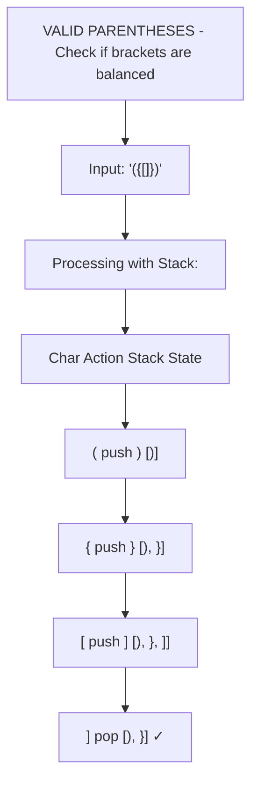

**Examples:**

- Input: `"()"` → Output: `true`
- Input: `"()[]{}"` → Output: `true`
- Input: `"(]"` → Output: `false`

**Constraints:**

- 1 <= s.length <= 10⁴
- s consists of parentheses only '()[]{}'

**Solution:**

```java
public boolean isValid(String s) {
    Stack<Character> stack = new Stack<>();

    for (char c : s.toCharArray()) {
        // Push expected closing bracket
        if (c == '(') stack.push(')');
        else if (c == '{') stack.push('}');
        else if (c == '[') stack.push(']');
        // Check closing bracket
        else if (stack.isEmpty() || stack.pop() != c) {
            return false;
        }
    }

    return stack.isEmpty();
}
```

---

### Problem 79: Min Stack

**LeetCode 155** 🔗 https://leetcode.com/problems/min-stack/

```
┌────────────────────────────────────────────────────────────────┐
│  MIN STACK - Stack that supports getMin() in O(1)              │
├────────────────────────────────────────────────────────────────┤
│  Operations: push(5), push(2), push(7), push(1)                │
│                                                                │
│  Approach 1: Two Stacks                                        │
│  ┌─────────────┬──────────────┐                                │
│  │ Main Stack  │  Min Stack   │                                │
│  ├─────────────┼──────────────┤                                │
│  │     1       │      1       │ ← top                          │
│  │     7       │      2       │                                │
│  │     2       │      2       │                                │
│  │     5       │      5       │                                │
│  └─────────────┴──────────────┘                                │
│                                                                │
│  getMin() → peek min stack → 1                                 │
│                                                                │
│  Approach 2: Single Stack with Pairs                           │
│  Stack: [(5,5), (2,2), (7,2), (1,1)]                           │
│          (val, minSoFar)                                       │
└────────────────────────────────────────────────────────────────┘
```

**Flow:**
- MIN STACK - Stack that supports getMin() in O(1)
- ↓
- Approach 1: Two Stacks
- ↓
- Main Stack Min Stack
- ↓
- 1 1 ← top
- ↓
- getMin()
- ↓
- peek min stack
- ↓
- 1
- ↓
- getMin()
- ↓
- peek min stack
- ↓
- 1
- ↓
- Approach 2: Single Stack with Pairs
- ↓
- (val, minSoFar)

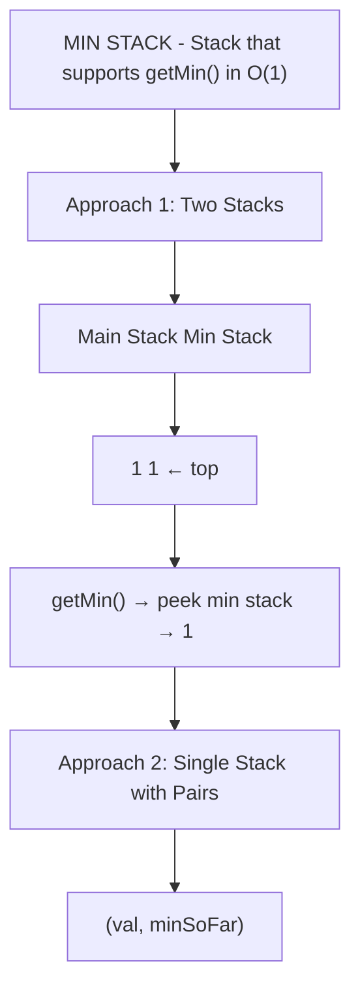

**Operations:**

- `push(val)` - Push element onto stack
- `pop()` - Remove top element
- `top()` - Get top element
- `getMin()` - Retrieve minimum element in O(1)

**Solution:**

```java
class MinStack {
    private Stack<int[]> stack;  // [value, currentMin]

    public MinStack() {
        stack = new Stack<>();
    }

    public void push(int val) {
        int currentMin = stack.isEmpty() ? val : Math.min(val, stack.peek()[1]);
        stack.push(new int[]{val, currentMin});
    }

    public void pop() {
        stack.pop();
    }

    public int top() {
        return stack.peek()[0];
    }

    public int getMin() {
        return stack.peek()[1];
    }
}
```

---

### Problem 80: 🔒 Max Stack (LeetCode 716 - Premium)

```
┌────────────────────────────────────────────────────────────────┐
│  MAX STACK - Stack with popMax() operation                     │
├────────────────────────────────────────────────────────────────┤
│  Design a max stack that supports:                             │
│  - push(x): Push x onto stack                                  │
│  - pop(): Remove top element                                   │
│  - top(): Get top element                                      │
│  - peekMax(): Retrieve maximum element                         │
│  - popMax(): Remove maximum element (topmost if tie)           │
│                                                                │
│  Example:                                                      │
│  MaxStack stack = new MaxStack();                              │
│  stack.push(5);   // Stack: [5]                                │
│  stack.push(1);   // Stack: [5, 1]                             │
│  stack.push(5);   // Stack: [5, 1, 5]                          │
│  stack.top();     // Returns 5                                 │
│  stack.popMax();  // Returns 5, Stack: [5, 1]                  │
│  stack.top();     // Returns 1                                 │
│  stack.peekMax(); // Returns 5                                 │
│  stack.pop();     // Returns 1, Stack: [5]                     │
│  stack.top();     // Returns 5                                 │
│                                                                │
│  Constraints:                                                  │
│  - -10^7 <= x <= 10^7                                          │
│  - At most 10^4 operations                                     │
│  - popMax and pop called only when stack not empty             │
└────────────────────────────────────────────────────────────────┘
```

**Flow:**
- MAX STACK - Stack with popMax() operation
- ↓
- Design a max stack that supports:
- ↓
- - push(x): Push x onto stack
- ↓
- - pop(): Remove top element
- ↓
- - top(): Get top element
- ↓
- - peekMax(): Retrieve maximum element
- ↓
- - popMax(): Remove maximum element (topmost if tie)

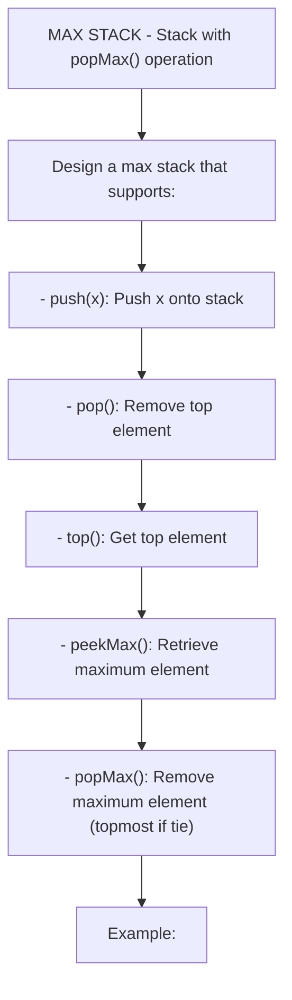

**Solution (Using TreeMap + Doubly Linked List for O(log n)):**

```java
class MaxStack {
    private TreeMap<Integer, List<Node>> map;
    private DoublyLinkedList dll;

    class Node {
        int val;
        Node prev, next;
        Node(int val) { this.val = val; }
    }

    class DoublyLinkedList {
        Node head, tail;

        DoublyLinkedList() {
            head = new Node(0);
            tail = new Node(0);
            head.next = tail;
            tail.prev = head;
        }

        Node addLast(int val) {
            Node node = new Node(val);
            node.prev = tail.prev;
            node.next = tail;
            tail.prev.next = node;
            tail.prev = node;
            return node;
        }

        void remove(Node node) {
            node.prev.next = node.next;
            node.next.prev = node.prev;
        }

        Node getLast() {
            return tail.prev;
        }
    }

    public MaxStack() {
        map = new TreeMap<>();
        dll = new DoublyLinkedList();
    }

    public void push(int x) {
        Node node = dll.addLast(x);
        map.computeIfAbsent(x, k -> new ArrayList<>()).add(node);
    }

    public int pop() {
        Node node = dll.getLast();
        dll.remove(node);
        List<Node> list = map.get(node.val);
        list.remove(list.size() - 1);
        if (list.isEmpty()) map.remove(node.val);
        return node.val;
    }

    public int top() {
        return dll.getLast().val;
    }

    public int peekMax() {
        return map.lastKey();
    }

    public int popMax() {
        int maxVal = map.lastKey();
        List<Node> list = map.get(maxVal);
        Node node = list.remove(list.size() - 1);
        dll.remove(node);
        if (list.isEmpty()) map.remove(maxVal);
        return maxVal;
    }
}
```

---

### Problem 81: Decode String

**LeetCode 394** 🔗 https://leetcode.com/problems/decode-string/

```
┌────────────────────────────────────────────────────────────────┐
│  DECODE STRING - Expand encoded string                         │
├────────────────────────────────────────────────────────────────┤
│  Input: "3[a2[c]]"                                             │
│                                                                │
│  Process with Stack:                                           │
│  ┌──────┬────────────┬───────────────────────────────────────┐ │
│  │ Char │  Action    │  Stack / Result                       │ │
│  ├──────┼────────────┼───────────────────────────────────────┤ │
│  │  3   │ build num  │ num=3                                 │ │
│  │  [   │ push       │ [(3, "")]                             │ │
│  │  a   │ build str  │ currentStr="a"                        │ │
│  │  2   │ build num  │ num=2                                 │ │
│  │  [   │ push       │ [(3,""), (2,"a")]                     │ │
│  │  c   │ build str  │ currentStr="c"                        │ │
│  │  ]   │ pop & rep  │ [(3,"")] → "a" + "cc" = "acc"         │ │
│  │  ]   │ pop & rep  │ [] → "" + "accaccacc"                 │ │
│  └──────┴────────────┴───────────────────────────────────────┘ │
│                                                                │
│  Output: "accaccacc"                                           │
└────────────────────────────────────────────────────────────────┘
```

**Flow:**
- DECODE STRING - Expand encoded string
- ↓
- Input: '3[a2[c]]'
- ↓
- Process with Stack:
- ↓
- Char Action Stack / Result
- ↓
- 3 build num num=3
- ↓
- [ push [(3, '')]
- ↓
- a build str currentStr='a'

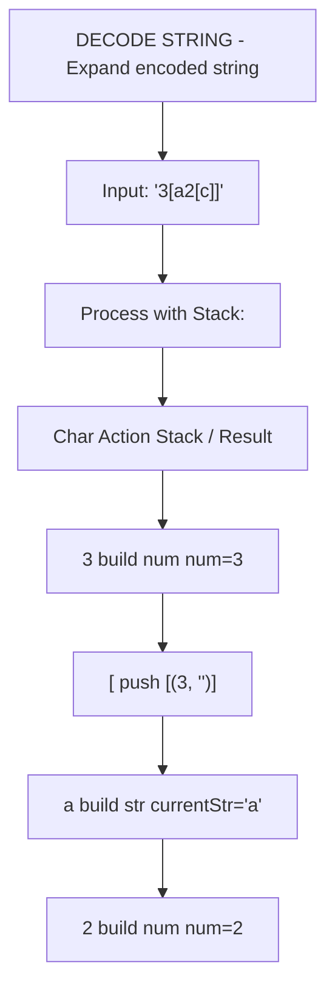

**Examples:**

- Input: `"3[a]2[bc]"` → Output: `"aaabcbc"`
- Input: `"3[a2[c]]"` → Output: `"accaccacc"`
- Input: `"2[abc]3[cd]ef"` → Output: `"abcabccdcdcdef"`

**Solution:**

```java
public String decodeString(String s) {
    Stack<Integer> countStack = new Stack<>();
    Stack<StringBuilder> stringStack = new Stack<>();
    StringBuilder current = new StringBuilder();
    int num = 0;

    for (char c : s.toCharArray()) {
        if (Character.isDigit(c)) {
            num = num * 10 + (c - '0');
        } else if (c == '[') {
            countStack.push(num);
            stringStack.push(current);
            current = new StringBuilder();
            num = 0;
        } else if (c == ']') {
            int repeatTimes = countStack.pop();
            StringBuilder prev = stringStack.pop();
            for (int i = 0; i < repeatTimes; i++) {
                prev.append(current);
            }
            current = prev;
        } else {
            current.append(c);
        }
    }

    return current.toString();
}
```

---

### Problem 82: Evaluate Reverse Polish Notation

**LeetCode 150** 🔗 https://leetcode.com/problems/evaluate-reverse-polish-notation/

```
┌────────────────────────────────────────────────────────────────┐
│  REVERSE POLISH NOTATION (Postfix Expression)                  │
├────────────────────────────────────────────────────────────────┤
│  Input: ["2","1","+","3","*"]                                  │
│                                                                │
│  Infix equivalent: ((2 + 1) * 3) = 9                           │
│                                                                │
│  Stack Processing:                                             │
│  ┌────────┬──────────────────┬─────────────┐                   │
│  │ Token  │ Action           │ Stack       │                   │
│  ├────────┼──────────────────┼─────────────┤                   │
│  │   2    │ push             │ [2]         │                   │
│  │   1    │ push             │ [2, 1]      │                   │
│  │   +    │ pop 1,2 → 2+1=3  │ [3]         │                   │
│  │   3    │ push             │ [3, 3]      │                   │
│  │   *    │ pop 3,3 → 3*3=9  │ [9]         │                   │
│  └────────┴──────────────────┴─────────────┘                   │
│                                                                │
│  Result: 9                                                     │
└────────────────────────────────────────────────────────────────┘
```

**Flow:**
- REVERSE POLISH NOTATION (Postfix Expression)
- ↓
- Input: ['2','1','+','3','*']
- ↓
- Infix equivalent: ((2 + 1) * 3) = 9
- ↓
- Stack Processing:
- ↓
- Token Action Stack
- ↓
- 2 push [2]
- ↓
- 1 push [2, 1]

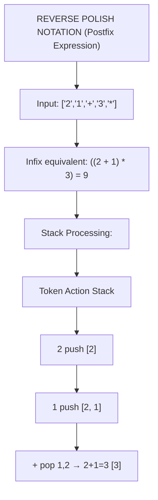

**Examples:**

- Input: `["2","1","+","3","*"]` → Output: `9` (((2+1)\*3))
- Input: `["4","13","5","/","+"]` → Output: `6` ((4+(13/5)))
- Input: `["10","6","9","3","+","-11","*","/","*","17","+","5","+"]` → Output: `22`

**Solution:**

```java
public int evalRPN(String[] tokens) {
    Stack<Integer> stack = new Stack<>();

    for (String token : tokens) {
        if ("+-*/".contains(token)) {
            int b = stack.pop();
            int a = stack.pop();

            switch (token) {
                case "+": stack.push(a + b); break;
                case "-": stack.push(a - b); break;
                case "*": stack.push(a * b); break;
                case "/": stack.push(a / b); break;
            }
        } else {
            stack.push(Integer.parseInt(token));
        }
    }

    return stack.pop();
}
```

---

### Problem 83: 🔒 Basic Calculator III (LeetCode 772 - Premium)

```
┌────────────────────────────────────────────────────────────────┐
│  BASIC CALCULATOR III - Evaluate expression with +,-,*,/,()    │
├────────────────────────────────────────────────────────────────┤
│  Implement a basic calculator to evaluate a simple expression  │
│  string. The expression string contains only non-negative      │
│  integers, +, -, *, / operators, open ( and closing )          │
│  parentheses, and empty spaces.                                │
│                                                                │
│  Examples:                                                     │
│  Input: "1+1"              → Output: 2                         │
│  Input: "6-4/2"            → Output: 4                         │
│  Input: "2*(5+5*2)/3+(6/2+8)" → Output: 21                     │
│  Input: "(2+6*3+5-(3*14/7+2)*5)+3" → Output: -12               │
│                                                                │
│  Constraints:                                                  │
│  - 1 <= s.length <= 10^4                                       │
│  - s consists of digits, +, -, *, /, (, ), and spaces          │
│  - s represents a valid expression                             │
│  - All intermediate results in range [-2^31, 2^31 - 1]         │
└────────────────────────────────────────────────────────────────┘
```

**Flow:**
- BASIC CALCULATOR III - Evaluate expression with +,-,*,/
- ↓
- string. The expression string contains only non-negativ
- ↓
- integers, +, -, *, / operators, open ( and closing )
- ↓
- parentheses, and empty spaces.
- ↓
- Examples:
- ↓
- Input: '1+1'
- ↓
- Output: 2
- ↓
- Input: '1+1'
- ↓
- Output: 2
- ↓
- Input: '6-4/2'
- ↓
- Output: 4

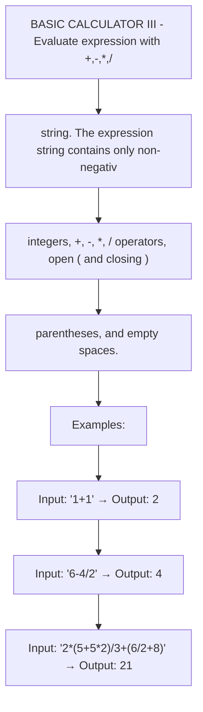

**Solution:**

```java
public int calculate(String s) {
    Queue<Character> queue = new LinkedList<>();
    for (char c : s.toCharArray()) {
        if (c != ' ') queue.offer(c);
    }
    queue.offer('+');  // Sentinel
    return helper(queue);
}

private int helper(Queue<Character> queue) {
    int num = 0, prev = 0, sum = 0;
    char prevOp = '+';

    while (!queue.isEmpty()) {
        char c = queue.poll();

        if (Character.isDigit(c)) {
            num = num * 10 + (c - '0');
        } else if (c == '(') {
            num = helper(queue);  // Recursively evaluate parentheses
        } else {
            // Apply previous operator
            switch (prevOp) {
                case '+': sum += prev; prev = num; break;
                case '-': sum += prev; prev = -num; break;
                case '*': prev *= num; break;
                case '/': prev /= num; break;
            }

            if (c == ')') break;  // Return from recursion

            num = 0;
            prevOp = c;
        }
    }

    return sum + prev;
}
```

---


> 🔬 **Section Challenge — 7.1 Basic Stack Problems**
>
> **Challenge 1 (Reasoning):** Monotonic DECREASING stack — when you push a new element, which existing elements are popped and what information do those pops tell you?
> <details><summary>Answer</summary>
>
> In a decreasing stack (top is smallest), pushing element `x`: all elements smaller than `x` are popped. For each popped element `y`: `x` is the NEXT GREATER ELEMENT of `y`. This is the key insight: the pop event = answer event. Application: Daily Temperatures (next warmer day), Largest Rectangle in Histogram (right boundary), Next Greater Element. Each element is pushed and popped exactly once → O(N) total.
> </details>
>

## 7.2 Monotonic Stack Problems

> **Pattern:** Maintain stack in increasing/decreasing order. Elements popped have found their NGE/NSE.
> **Template:** `while (!stack.isEmpty() && arr[i] > arr[stack.peek()]) { popped = stack.pop(); answer[popped] = arr[i]; } stack.push(i);`
> **Key insight:** Each element is pushed and popped AT MOST once → O(n) total, not O(n²).

```
┌────────────────────────────────────────────────────────────────┐
│  MONOTONIC STACK - Elements in sorted order                    │
├────────────────────────────────────────────────────────────────┤
│  DECREASING Stack (for Next Greater Element):                  │
│  ┌───────────────────────────────────────────────────────────┐ │
│  │ Array: [2, 1, 2, 4, 3]                                    │ │
│  │                                                           │ │
│  │ i=0: stack=[2]                                            │ │
│  │ i=1: 1 < 2, stack=[2,1]                                   │ │
│  │ i=2: 2 > 1, pop→NGE[1]=2, 2==2 push, stack=[2,2]          │ │
│  │ i=3: 4 > 2, pop→NGE[2]=4, 4>2 pop→NGE[0]=4, stack=[4]     │ │
│  │ i=4: 3 < 4, stack=[4,3]                                   │ │
│  │                                                           │ │
│  │ NGE = [4, 2, 4, -1, -1]                                   │ │
│  └───────────────────────────────────────────────────────────┘ │
│                                                                │
│  INCREASING Stack (for Next Smaller Element):                  │
│  Same concept, but pop when current < stack top                │
└────────────────────────────────────────────────────────────────┘
```

**Flow:**
- MONOTONIC STACK - Elements in sorted order
- ↓
- DECREASING Stack (for Next Greater Element):
- ↓
- Array: [2, 1, 2, 4, 3]
- ↓
- i=0: stack=[2]
- ↓
- i=1: 1 < 2, stack=[2,1]
- ↓
- i=4: 3 < 4, stack=[4,3]
- ↓
- NGE = [4, 2, 4, -1, -1]

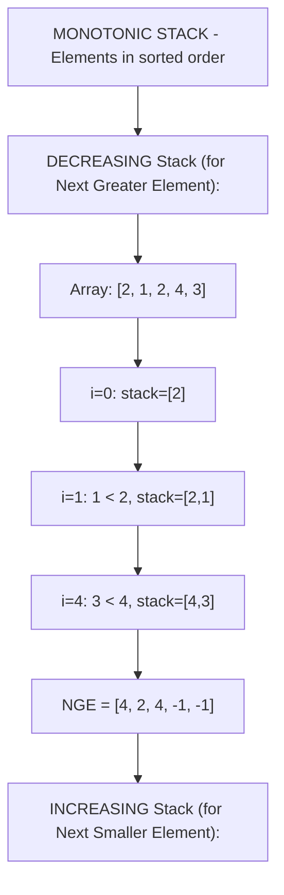

---

### Problem 84: Daily Temperatures

**LeetCode 739** 🔗 https://leetcode.com/problems/daily-temperatures/

```
┌────────────────────────────────────────────────────────────────┐
│  DAILY TEMPERATURES - Days until warmer temperature            │
├────────────────────────────────────────────────────────────────┤
│  temperatures = [73, 74, 75, 71, 69, 72, 76, 73]               │
│                                                                │
│  Visual Process (Monotonic Decreasing Stack by index):         │
│  ┌─────┬──────┬─────────────────────┬─────────────┐            │
│  │  i  │ temp │ Stack (indices)     │ Result      │            │
│  ├─────┼──────┼─────────────────────┼─────────────┤            │
│  │  0  │  73  │ [0]                 │ [_,_,_,_,_,_,_,_]        │
│  │  1  │  74  │ 74>73, pop, [1]     │ [1,_,_,_,_,_,_,_]        │
│  │  2  │  75  │ 75>74, pop, [2]     │ [1,1,_,_,_,_,_,_]        │
│  │  3  │  71  │ 71<75, [2,3]        │ [1,1,_,_,_,_,_,_]        │
│  │  4  │  69  │ 69<71, [2,3,4]      │ [1,1,_,_,_,_,_,_]        │
│  │  5  │  72  │ 72>69,71 pop×2 [2,5]│ [1,1,_,2,1,_,_,_]        │
│  │  6  │  76  │ 76>72,75 pop×2 [6] │ [1,1,4,2,1,1,_,_]         │
│  │  7  │  73  │ 73<76, [6,7]        │ [1,1,4,2,1,1,_,_]        │
│  └─────┴──────┴─────────────────────┴─────────────┘            │
│                                                                │
│  Output: [1, 1, 4, 2, 1, 1, 0, 0]                              │
└────────────────────────────────────────────────────────────────┘
```

**Flow:**
- DAILY TEMPERATURES - Days until warmer temperature
- ↓
- temperatures = [73, 74, 75, 71, 69, 72, 76, 73]
- ↓
- Visual Process (Monotonic Decreasing Stack by index):
- ↓
- i temp Stack (indices) Result
- ↓
- 1 74 74>73, pop, [1] [1,_,_,_,_,_,_,_]
- ↓
- 2 75 75>74, pop, [2] [1,1,_,_,_,_,_,_]
- ↓
- 5 72 72>69,71 pop×2 [2,5] [1,1,_,2,1,_,_,_]

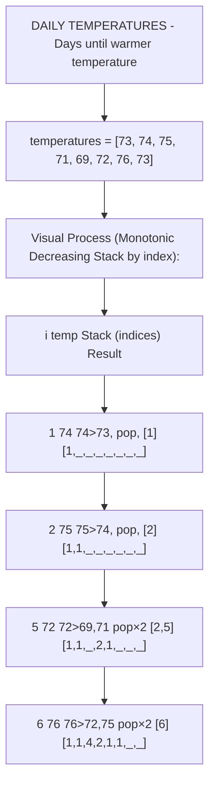

**Solution:**

```java
public int[] dailyTemperatures(int[] temperatures) {
    int n = temperatures.length;
    int[] result = new int[n];
    Stack<Integer> stack = new Stack<>();  // Store indices

    for (int i = 0; i < n; i++) {
        // Pop while current temp is greater than temp at stack top
        while (!stack.isEmpty() && temperatures[i] > temperatures[stack.peek()]) {
            int prevIndex = stack.pop();
            result[prevIndex] = i - prevIndex;
        }
        stack.push(i);
    }

    return result;  // Remaining indices in stack have result 0 (no warmer day)
}
```

---

### Problem 85: Next Greater Element I

**LeetCode 496** 🔗 https://leetcode.com/problems/next-greater-element-i/

```
┌────────────────────────────────────────────────────────────────┐
│  NEXT GREATER ELEMENT I                                        │
├────────────────────────────────────────────────────────────────┤
│  nums1 = [4, 1, 2]  (subset of nums2)                          │
│  nums2 = [1, 3, 4, 2]                                          │
│                                                                │
│  Find NGE in nums2 for each element in nums1:                  │
│                                                                │
│  nums2:  [1,  3,  4,  2]                                       │
│  NGE:    [3,  4, -1, -1]                                       │
│                                                                │
│  For nums1 = [4, 1, 2]:                                        │
│  - 4 → NGE in nums2 = -1                                       │
│  - 1 → NGE in nums2 = 3                                        │
│  - 2 → NGE in nums2 = -1                                       │
│                                                                │
│  Output: [-1, 3, -1]                                           │
└────────────────────────────────────────────────────────────────┘
```

**Flow:**
- NEXT GREATER ELEMENT I
- ↓
- nums1 = [4, 1, 2] (subset of nums2)
- ↓
- nums2 = [1, 3, 4, 2]
- ↓
- Find NGE in nums2 for each element in nums1:
- ↓
- nums2: [1, 3, 4, 2]
- ↓
- NGE: [3, 4, -1, -1]
- ↓
- For nums1 = [4, 1, 2]:

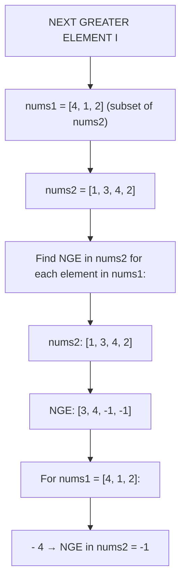

**Solution:**

```java
public int[] nextGreaterElement(int[] nums1, int[] nums2) {
    Map<Integer, Integer> ngeMap = new HashMap<>();
    Stack<Integer> stack = new Stack<>();

    // Build NGE map for nums2
    for (int num : nums2) {
        while (!stack.isEmpty() && num > stack.peek()) {
            ngeMap.put(stack.pop(), num);
        }
        stack.push(num);
    }

    // Remaining elements have no NGE
    while (!stack.isEmpty()) {
        ngeMap.put(stack.pop(), -1);
    }

    // Build result for nums1
    int[] result = new int[nums1.length];
    for (int i = 0; i < nums1.length; i++) {
        result[i] = ngeMap.get(nums1[i]);
    }

    return result;
}
```

---

### Problem 86: Next Greater Element II (Circular Array)

**LeetCode 503** 🔗 https://leetcode.com/problems/next-greater-element-ii/

```
┌────────────────────────────────────────────────────────────────┐
│  NEXT GREATER ELEMENT II - Circular Array                      │
├────────────────────────────────────────────────────────────────┤
│  nums = [1, 2, 1]  (circular: ...1, 2, 1, 1, 2, 1...)          │
│                                                                │
│  For each element, search circularly:                          │
│  ┌───────┬─────────────────────┬─────────┐                     │
│  │ Index │ Element → Search    │   NGE   │                     │
│  ├───────┼─────────────────────┼─────────┤                     │
│  │   0   │ 1 → 2,1,1,2 → 2     │    2    │                     │
│  │   1   │ 2 → 1,1,2 → -1      │   -1    │                     │
│  │   2   │ 1 → 1,2 → 2         │    2    │                     │
│  └───────┴─────────────────────┴─────────┘                     │
│                                                                │
│  Trick: Iterate 2n times, use i % n                            │
│                                                                │
│  Output: [2, -1, 2]                                            │
└────────────────────────────────────────────────────────────────┘
```

**Flow:**
- NEXT GREATER ELEMENT II - Circular Array
- ↓
- nums = [1, 2, 1] (circular: ...1, 2, 1, 1, 2, 1...)
- ↓
- For each element, search circularly:
- ↓
- Index Element
- ↓
- Search NGE
- ↓
- Index Element
- ↓
- Search NGE
- ↓
- Trick: Iterate 2n times, use i % n
- ↓
- Output: [2, -1, 2]

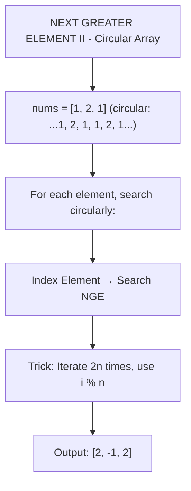

**Solution:**

```java
public int[] nextGreaterElements(int[] nums) {
    int n = nums.length;
    int[] result = new int[n];
    Arrays.fill(result, -1);
    Stack<Integer> stack = new Stack<>();

    // Iterate twice to simulate circular array
    for (int i = 0; i < 2 * n; i++) {
        int num = nums[i % n];

        while (!stack.isEmpty() && num > nums[stack.peek()]) {
            result[stack.pop()] = num;
        }

        // Only push indices in first iteration
        if (i < n) {
            stack.push(i);
        }
    }

    return result;
}
```

---

### Problem 87: Largest Rectangle in Histogram

**LeetCode 84** 🔗 https://leetcode.com/problems/largest-rectangle-in-histogram/

```
┌────────────────────────────────────────────────────────────────┐
│  LARGEST RECTANGLE IN HISTOGRAM                                │
├────────────────────────────────────────────────────────────────┤
│  heights = [2, 1, 5, 6, 2, 3]                                  │
│                                                                │
│       6                                                        │
│     ┌───┐                                                      │
│   5 │   │                                                      │
│  ┌──┤   │                                                      │
│  │  │   │     3                                                │
│  │  │   │   ┌───┐                                              │
│  │  │   │ 2 │   │                                              │
│  │  │   ├───┤   │                                              │
│  │1 │   │   │   │                                              │
│ ─┴──┴───┴───┴───┴───                                           │
│  2  1  5   6   2   3                                           │
│                                                                │
│  Largest rectangle = 10 (5×2 using heights 5,6)                │
│     ┌──────────┐                                               │
│     │██████████│ ← Area = 5 × 2 = 10                           │
│  ┌──┤██████████│                                               │
│  │  │██████████│                                               │
│  ...                                                           │
└────────────────────────────────────────────────────────────────┘
```

**Flow:**
- LARGEST RECTANGLE IN HISTOGRAM
- ↓
- heights = [2, 1, 5, 6, 2, 3]
- ↓
- Largest rectangle = 10 (5×2 using heights 5,6)
- ↓
- ██████████ ← Area = 5 × 2 = 10

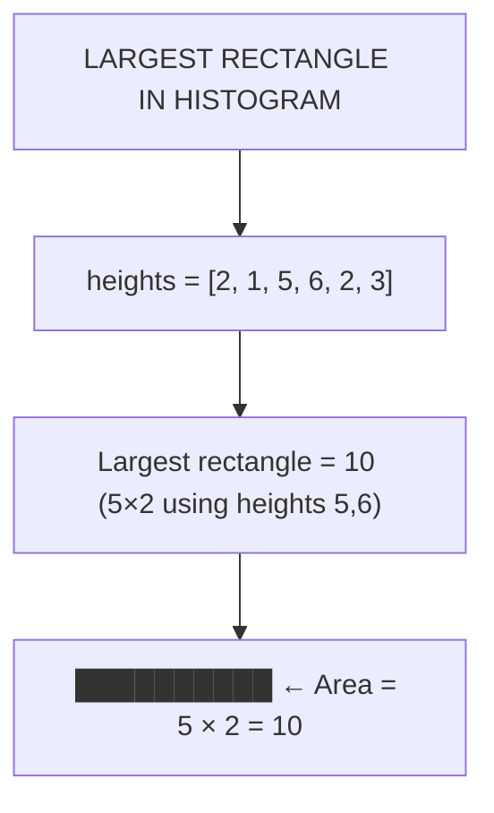

**Key Insight:** For each bar, find how far it can extend left and right.

**Solution:**

```java
public int largestRectangleArea(int[] heights) {
    int n = heights.length;
    Stack<Integer> stack = new Stack<>();
    int maxArea = 0;

    for (int i = 0; i <= n; i++) {
        int h = (i == n) ? 0 : heights[i];

        while (!stack.isEmpty() && h < heights[stack.peek()]) {
            int height = heights[stack.pop()];
            int width = stack.isEmpty() ? i : i - stack.peek() - 1;
            maxArea = Math.max(maxArea, height * width);
        }

        stack.push(i);
    }

    return maxArea;
}
```

**Visual Stack Trace:**

```
┌─────┬────────┬──────────────┬────────────────┬──────────┐
│  i  │ height │ Stack        │ Calculation    │ maxArea  │
├─────┼────────┼──────────────┼────────────────┼──────────┤
│  0  │   2    │ [0]          │ -              │    0     │
│  1  │   1    │ [1]          │ h=2,w=1,a=2    │    2     │
│  2  │   5    │ [1,2]        │ -              │    2     │
│  3  │   6    │ [1,2,3]      │ -              │    2     │
│  4  │   2    │ [1,4]        │ h=6,w=1,a=6    │    6     │
│     │        │              │ h=5,w=2,a=10   │   10     │
│  5  │   3    │ [1,4,5]      │ -              │   10     │
│  6  │   0    │ []           │ h=3,w=1,a=3    │   10     │
│     │        │              │ h=2,w=4,a=8    │   10     │
│     │        │              │ h=1,w=6,a=6    │   10     │
└─────┴────────┴──────────────┴────────────────┴──────────┘
```

---

### Problem 88: Maximal Rectangle

**LeetCode 85** 🔗 https://leetcode.com/problems/maximal-rectangle/

```
┌────────────────────────────────────────────────────────────────┐
│  MAXIMAL RECTANGLE - Largest rectangle of 1s in binary matrix  │
├────────────────────────────────────────────────────────────────┤
│  matrix = [                                                    │
│    ["1","0","1","0","0"],                                      │
│    ["1","0","1","1","1"],                                      │
│    ["1","1","1","1","1"],                                      │
│    ["1","0","0","1","0"]                                       │
│  ]                                                             │
│                                                                │
│  Convert each row to histogram heights:                        │
│  ┌───────────────────────────────────────────────────────────┐ │
│  │ Row 0: heights = [1, 0, 1, 0, 0] → maxRect in hist        │ │
│  │ Row 1: heights = [2, 0, 2, 1, 1] → maxRect in hist        │ │
│  │ Row 2: heights = [3, 1, 3, 2, 2] → maxRect in hist = 6    │ │
│  │ Row 3: heights = [4, 0, 0, 3, 0] → maxRect in hist        │ │
│  └───────────────────────────────────────────────────────────┘ │
│                                                                │
│  The maximum rectangle of 6 comes from row 2:                  │
│  heights [3, 1, 3, 2, 2] → use [2, 2, 2] with height 2 = 6     │
└────────────────────────────────────────────────────────────────┘
```

**Flow:**
- matrix = [
- ↓
- Convert each row to histogram heights:
- ↓
- Row 0: heights = [1, 0, 1, 0, 0]
- ↓
- maxRect in hist
- ↓
- Row 0: heights = [1, 0, 1, 0, 0]
- ↓
- maxRect in hist
- ↓
- Row 1: heights = [2, 0, 2, 1, 1]
- ↓
- maxRect in hist
- ↓
- Row 1: heights = [2, 0, 2, 1, 1]
- ↓
- maxRect in hist
- ↓
- Row 2: heights = [3, 1, 3, 2, 2]
- ↓
- maxRect in hist = 6
- ↓
- Row 2: heights = [3, 1, 3, 2, 2]
- ↓
- maxRect in hist = 6
- ↓
- Row 3: heights = [4, 0, 0, 3, 0]
- ↓
- maxRect in hist
- ↓
- Row 3: heights = [4, 0, 0, 3, 0]
- ↓
- maxRect in hist
- ↓
- The maximum rectangle of 6 comes from row 2:

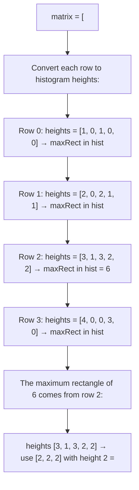

**Solution:**

```java
public int maximalRectangle(char[][] matrix) {
    if (matrix.length == 0) return 0;

    int rows = matrix.length;
    int cols = matrix[0].length;
    int[] heights = new int[cols];
    int maxArea = 0;

    for (int i = 0; i < rows; i++) {
        // Update histogram heights
        for (int j = 0; j < cols; j++) {
            heights[j] = matrix[i][j] == '1' ? heights[j] + 1 : 0;
        }

        // Calculate max rectangle for current histogram
        maxArea = Math.max(maxArea, largestRectangleArea(heights));
    }

    return maxArea;
}

// Same as Problem 87
private int largestRectangleArea(int[] heights) {
    Stack<Integer> stack = new Stack<>();
    int maxArea = 0;
    int n = heights.length;

    for (int i = 0; i <= n; i++) {
        int h = (i == n) ? 0 : heights[i];
        while (!stack.isEmpty() && h < heights[stack.peek()]) {
            int height = heights[stack.pop()];
            int width = stack.isEmpty() ? i : i - stack.peek() - 1;
            maxArea = Math.max(maxArea, height * width);
        }
        stack.push(i);
    }

    return maxArea;
}
```

---

### Problem 89: Trapping Rain Water

**LeetCode 42** 🔗 https://leetcode.com/problems/trapping-rain-water/

```
┌────────────────────────────────────────────────────────────────┐
│  TRAPPING RAIN WATER                                           │
├────────────────────────────────────────────────────────────────┤
│  height = [0,1,0,2,1,0,1,3,2,1,2,1]                            │
│                                                                │
│          3 │                 █                                 │
│          2 │         █ ░ ░ ░ █ █ ░ █                           │
│          1 │     █ ░ █ █ ░ █ █ █ █ █ █                         │
│          0 └───────────────────────────                        │
│              0 1 0 2 1 0 1 3 2 1 2 1                           │
│                                                                │
│  ░ = Trapped water = 6 units                                   │
│                                                                │
│  For each position i:                                          │
│  water[i] = min(maxLeft[i], maxRight[i]) - height[i]           │
└────────────────────────────────────────────────────────────────┘
```

**Flow:**
- TRAPPING RAIN WATER
- ↓
- height = [0,1,0,2,1,0,1,3,2,1,2,1]
- ↓
- ░ = Trapped water = 6 units
- ↓
- For each position i:
- ↓
- water[i] = min(maxLeft[i], maxRight[i]) - height[i]

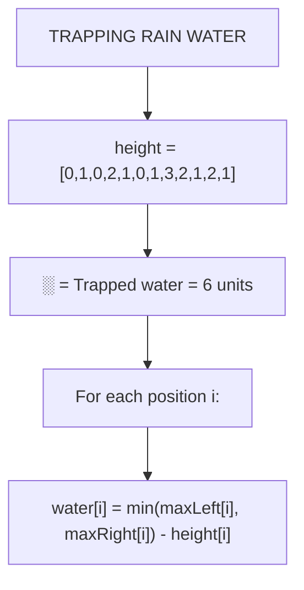

**Solution 1: Two Pointers (O(n) time, O(1) space)**

```java
public int trap(int[] height) {
    int left = 0, right = height.length - 1;
    int leftMax = 0, rightMax = 0;
    int water = 0;

    while (left < right) {
        if (height[left] < height[right]) {
            if (height[left] >= leftMax) {
                leftMax = height[left];
            } else {
                water += leftMax - height[left];
            }
            left++;
        } else {
            if (height[right] >= rightMax) {
                rightMax = height[right];
            } else {
                water += rightMax - height[right];
            }
            right--;
        }
    }

    return water;
}
```

**Solution 2: Monotonic Stack**

```java
public int trapStack(int[] height) {
    Stack<Integer> stack = new Stack<>();
    int water = 0;

    for (int i = 0; i < height.length; i++) {
        while (!stack.isEmpty() && height[i] > height[stack.peek()]) {
            int bottom = stack.pop();

            if (stack.isEmpty()) break;

            int left = stack.peek();
            int width = i - left - 1;
            int h = Math.min(height[left], height[i]) - height[bottom];
            water += width * h;
        }
        stack.push(i);
    }

    return water;
}
```

---


> 🔬 **Section Challenge — 7.2 Monotonic Stack Problems**
>
> **Challenge 1 (Reasoning):** Monotonic DECREASING stack — when you push a new element, which existing elements are popped and what information do those pops tell you?
> <details><summary>Answer</summary>
>
> In a decreasing stack (top is smallest), pushing element `x`: all elements smaller than `x` are popped. For each popped element `y`: `x` is the NEXT GREATER ELEMENT of `y`. This is the key insight: the pop event = answer event. Application: Daily Temperatures (next warmer day), Largest Rectangle in Histogram (right boundary), Next Greater Element. Each element is pushed and popped exactly once → O(N) total.
> </details>
>

## 7.3 Queue Problems

> **Pattern:** FIFO processing. BFS uses queue naturally. Sliding window max uses monotonic deque.
> **Key insight for Sliding Window Max:** Maintain a decreasing deque. Front = current max. Pop front if outside window. Pop back if new element is larger.

### Problem 90: Implement Queue using Stacks

**LeetCode 232** 🔗 https://leetcode.com/problems/implement-queue-using-stacks/

```
┌────────────────────────────────────────────────────────────────┐
│  IMPLEMENT QUEUE USING STACKS                                  │
├────────────────────────────────────────────────────────────────┤
│  Use 2 stacks: inputStack and outputStack                      │
│                                                                │
│  push(1), push(2), push(3):                                    │
│  ┌──────────────┐    ┌──────────────┐                          │
│  │ inputStack   │    │ outputStack  │                          │
│  │    [1,2,3]   │    │    []        │                          │
│  └──────────────┘    └──────────────┘                          │
│                                                                │
│  pop() → need front (1):                                       │
│  Transfer input→output:                                        │
│  ┌──────────────┐    ┌──────────────┐                          │
│  │ inputStack   │    │ outputStack  │                          │
│  │    []        │    │   [3,2,1]    │ ← pop returns 1          │
│  └──────────────┘    └──────────────┘                          │
│                                                                │
│  Now outputStack has correct order for FIFO                    │
└────────────────────────────────────────────────────────────────┘
```

**Flow:**
- inputStack / [1,2,3]
- ↓
- outputStack / []
- ↓
- inputStack / []
- ↓
- outputStack / [3,2,1]

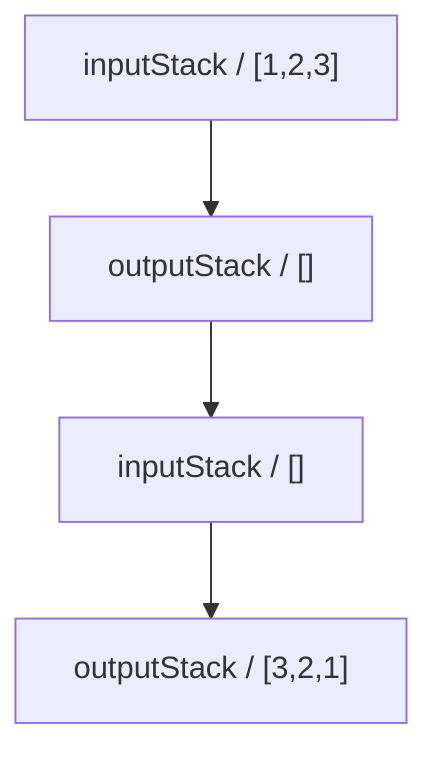

**Solution:**

```java
class MyQueue {
    private Stack<Integer> input;
    private Stack<Integer> output;

    public MyQueue() {
        input = new Stack<>();
        output = new Stack<>();
    }

    public void push(int x) {
        input.push(x);
    }

    public int pop() {
        peek();  // Ensure output has elements
        return output.pop();
    }

    public int peek() {
        if (output.isEmpty()) {
            while (!input.isEmpty()) {
                output.push(input.pop());
            }
        }
        return output.peek();
    }

    public boolean empty() {
        return input.isEmpty() && output.isEmpty();
    }
}
```

---

### Problem 91: Implement Stack using Queues

**LeetCode 225** 🔗 https://leetcode.com/problems/implement-stack-using-queues/

```
┌────────────────────────────────────────────────────────────────┐
│  IMPLEMENT STACK USING QUEUES                                  │
├────────────────────────────────────────────────────────────────┤
│  Approach: Make push O(n) to keep LIFO order                   │
│                                                                │
│  push(1): queue = [1]                                          │
│  push(2): add 2, rotate 1 time                                 │
│           [1,2] → poll 1, add 1 → [2,1]                        │
│  push(3): add 3, rotate 2 times                                │
│           [2,1,3] → [1,3,2] → [3,2,1]                          │
│                                                                │
│  Now front of queue is top of stack!                           │
│  pop() → returns 3                                             │
│  top() → returns 2                                             │
└────────────────────────────────────────────────────────────────┘
```

**Flow:**
- IMPLEMENT STACK USING QUEUES
- ↓
- Approach: Make push O(n) to keep LIFO order
- ↓
- push(1): queue = [1]
- ↓
- push(2): add 2, rotate 1 time
- ↓
- [1,2]
- ↓
- poll 1, add 1
- ↓
- [2,1]
- ↓
- [1,2]
- ↓
- poll 1, add 1
- ↓
- [2,1]
- ↓
- push(3): add 3, rotate 2 times
- ↓
- Now front of queue is top of stack!

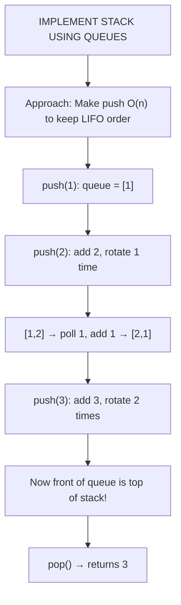

**Solution:**

```java
class MyStack {
    private Queue<Integer> queue;

    public MyStack() {
        queue = new LinkedList<>();
    }

    public void push(int x) {
        queue.add(x);
        // Rotate to put x at front
        int size = queue.size();
        for (int i = 0; i < size - 1; i++) {
            queue.add(queue.poll());
        }
    }

    public int pop() {
        return queue.poll();
    }

    public int top() {
        return queue.peek();
    }

    public boolean empty() {
        return queue.isEmpty();
    }
}
```

---

### Problem 92: Sliding Window Maximum

**LeetCode 239** 🔗 https://leetcode.com/problems/sliding-window-maximum/

```
┌────────────────────────────────────────────────────────────────┐
│  SLIDING WINDOW MAXIMUM - Max in each window of size k         │
├────────────────────────────────────────────────────────────────┤
│  nums = [1, 3, -1, -3, 5, 3, 6, 7], k = 3                      │
│                                                                │
│  Use Monotonic Decreasing Deque (store indices):               │
│  ┌────────────────────────────────────────────────────────────┐│
│  │ Window      │ Deque (indices)  │ Max │                     ││
│  ├─────────────┼──────────────────┼─────┤                     ││
│  │ [1,3,-1]    │ [1,2]→vals[3,-1] │  3  │                     ││
│  │ [3,-1,-3]   │ [1,2,3]→[3,-1,-3]│  3  │                     ││
│  │ [-1,-3,5]   │ [4]→[5]          │  5  │                     ││
│  │ [-3,5,3]    │ [4,5]→[5,3]      │  5  │                     ││
│  │ [5,3,6]     │ [6]→[6]          │  6  │                     ││
│  │ [3,6,7]     │ [7]→[7]          │  7  │                     ││
│  └────────────────────────────────────────────────────────────┘│
│                                                                │
│  Output: [3, 3, 5, 5, 6, 7]                                    │
│                                                                │
│  Why Monotonic Decreasing?                                     │
│  - Front always has maximum                                    │
│  - Smaller elements behind larger can never be max             │
└────────────────────────────────────────────────────────────────┘
```

**Flow:**
- SLIDING WINDOW MAXIMUM - Max in each window of size k
- ↓
- nums = [1, 3, -1, -3, 5, 3, 6, 7], k = 3
- ↓
- Use Monotonic Decreasing Deque (store indices):
- ↓
- Window Deque (indices) Max
- ↓
- [1,3,-1] [1,2]
- ↓
- vals[3,-1] 3
- ↓
- [1,3,-1] [1,2]
- ↓
- vals[3,-1] 3
- ↓
- Output: [3, 3, 5, 5, 6, 7]
- ↓
- Why Monotonic Decreasing?

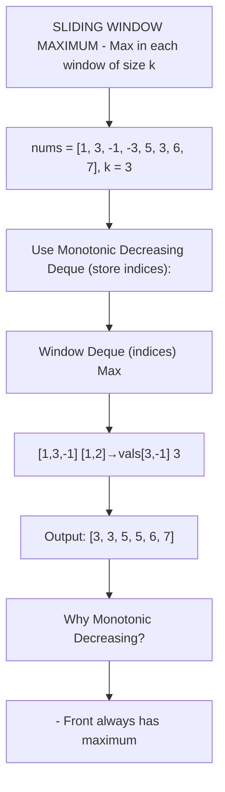

**Solution:**

```java
public int[] maxSlidingWindow(int[] nums, int k) {
    int n = nums.length;
    int[] result = new int[n - k + 1];
    Deque<Integer> deque = new ArrayDeque<>();  // Store indices

    for (int i = 0; i < n; i++) {
        // Remove indices out of window
        while (!deque.isEmpty() && deque.peekFirst() < i - k + 1) {
            deque.pollFirst();
        }

        // Remove smaller elements (they'll never be max)
        while (!deque.isEmpty() && nums[deque.peekLast()] < nums[i]) {
            deque.pollLast();
        }

        deque.offerLast(i);

        // Window is complete
        if (i >= k - 1) {
            result[i - k + 1] = nums[deque.peekFirst()];
        }
    }

    return result;
}
```

---

### Problem 93: 🔒 Shortest Subarray with Sum at Least K (LeetCode 862 - Hard)

```
┌────────────────────────────────────────────────────────────────┐
│  SHORTEST SUBARRAY WITH SUM AT LEAST K                         │
├────────────────────────────────────────────────────────────────┤
│  Return the length of the shortest non-empty subarray with     │
│  sum at least k. If no such subarray exists, return -1.        │
│  Note: Array can have NEGATIVE numbers!                        │
│                                                                │
│  Examples:                                                     │
│  Input: nums = [1], k = 1        → Output: 1                   │
│  Input: nums = [1,2], k = 4      → Output: -1                  │
│  Input: nums = [2,-1,2], k = 3   → Output: 3                   │
│                                                                │
│  Constraints:                                                  │
│  - 1 <= nums.length <= 10^5                                    │
│  - -10^5 <= nums[i] <= 10^5                                    │
│  - 1 <= k <= 10^9                                              │
│                                                                │
│  Key Insight: Use prefix sum + monotonic deque                 │
│  prefix[j] - prefix[i] >= k means subarray (i,j] has sum >= k  │
└────────────────────────────────────────────────────────────────┘
```

**Flow:**
- SHORTEST SUBARRAY WITH SUM AT LEAST K
- ↓
- Return the length of the shortest non-empty subarray wi
- ↓
- sum at least k. If no such subarray exists, return -1.
- ↓
- Note: Array can have NEGATIVE numbers!
- ↓
- Examples:
- ↓
- Input: nums = [1], k = 1
- ↓
- Output: 1
- ↓
- Input: nums = [1], k = 1
- ↓
- Output: 1
- ↓
- Input: nums = [1,2], k = 4
- ↓
- Output: -1

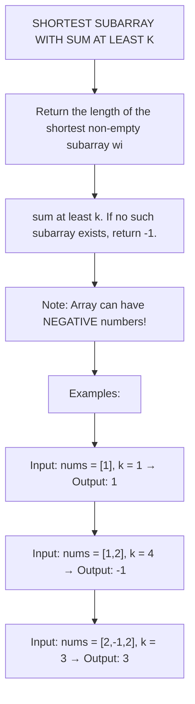

**Solution:**

```java
public int shortestSubarray(int[] nums, int k) {
    int n = nums.length;
    long[] prefix = new long[n + 1];

    // Build prefix sum
    for (int i = 0; i < n; i++) {
        prefix[i + 1] = prefix[i] + nums[i];
    }

    int minLen = Integer.MAX_VALUE;
    Deque<Integer> deque = new ArrayDeque<>();

    for (int i = 0; i <= n; i++) {
        // Check if current prefix - some earlier prefix >= k
        while (!deque.isEmpty() && prefix[i] - prefix[deque.peekFirst()] >= k) {
            minLen = Math.min(minLen, i - deque.pollFirst());
        }

        // Maintain monotonic increasing deque
        // Remove larger prefix sums (they give shorter subarrays)
        while (!deque.isEmpty() && prefix[i] <= prefix[deque.peekLast()]) {
            deque.pollLast();
        }

        deque.offerLast(i);
    }

    return minLen == Integer.MAX_VALUE ? -1 : minLen;
}
```

---

### Problem 94: 🔒 Design Circular Queue (LeetCode 622)

```
┌────────────────────────────────────────────────────────────────┐
│  DESIGN CIRCULAR QUEUE                                         │
├────────────────────────────────────────────────────────────────┤
│  Design your implementation of the circular queue.             │
│                                                                │
│  Circular Queue visualization (capacity=5):                    │
│       ┌───┬───┬───┬───┬───┐                                    │
│       │ 1 │ 2 │ 3 │   │   │                                    │
│       └───┴───┴───┴───┴───┘                                    │
│         ↑           ↑                                          │
│       front       rear                                         │
│                                                                │
│  After enQueue(4), enQueue(5):                                 │
│       ┌───┬───┬───┬───┬───┐                                    │
│       │ 1 │ 2 │ 3 │ 4 │ 5 │  (Full!)                           │
│       └───┴───┴───┴───┴───┘                                    │
│         ↑               ↑                                      │
│       front           rear                                     │
│                                                                │
│  deQueue() twice, then enQueue(6):                             │
│       ┌───┬───┬───┬───┬───┐                                    │
│       │ 6 │   │ 3 │ 4 │ 5 │  (Wraps around!)                   │
│       └───┴───┴───┴───┴───┘                                    │
│         ↑   ↑                                                  │
│       rear front                                               │
│                                                                │
│  Operations:                                                   │
│  - MyCircularQueue(k): Initialize with size k                  │
│  - enQueue(value): Insert element, return success              │
│  - deQueue(): Delete front element, return success             │
│  - Front(): Get front item                                     │
│  - Rear(): Get rear item                                       │
│  - isEmpty(): Check if empty                                   │
│  - isFull(): Check if full                                     │
└────────────────────────────────────────────────────────────────┘
```

**Flow:**
- 1 2 3
- ↓
- 1 2 3 4 5
- ↓
- 6 3 4 5

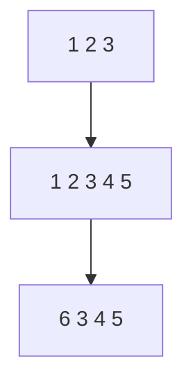

**Solution:**

```java
class MyCircularQueue {
    private int[] data;
    private int front, rear, size, capacity;

    public MyCircularQueue(int k) {
        data = new int[k];
        capacity = k;
        front = 0;
        rear = -1;
        size = 0;
    }

    public boolean enQueue(int value) {
        if (isFull()) return false;

        rear = (rear + 1) % capacity;
        data[rear] = value;
        size++;
        return true;
    }

    public boolean deQueue() {
        if (isEmpty()) return false;

        front = (front + 1) % capacity;
        size--;
        return true;
    }

    public int Front() {
        return isEmpty() ? -1 : data[front];
    }

    public int Rear() {
        return isEmpty() ? -1 : data[rear];
    }

    public boolean isEmpty() {
        return size == 0;
    }

    public boolean isFull() {
        return size == capacity;
    }
}
```

---

### Problem 95: 🔒 Design Circular Deque (LeetCode 641)

```
┌────────────────────────────────────────────────────────────────┐
│  DESIGN CIRCULAR DEQUE (Double-ended Queue)                    │
├────────────────────────────────────────────────────────────────┤
│  Design a circular deque with these operations:                │
│  - insertFront(): Add at front                                 │
│  - insertLast(): Add at rear                                   │
│  - deleteFront(): Remove from front                            │
│  - deleteLast(): Remove from rear                              │
│  - getFront(): Get front element                               │
│  - getRear(): Get rear element                                 │
│  - isEmpty(): Check if empty                                   │
│  - isFull(): Check if full                                     │
│                                                                │
│  Example:                                                      │
│  MyCircularDeque deque = new MyCircularDeque(3);               │
│  deque.insertLast(1);  // return true                          │
│  deque.insertLast(2);  // return true                          │
│  deque.insertFront(3); // return true                          │
│  deque.insertFront(4); // return false (full)                  │
│  deque.getRear();      // return 2                             │
│  deque.isFull();       // return true                          │
│  deque.deleteLast();   // return true                          │
│  deque.insertFront(4); // return true                          │
│  deque.getFront();     // return 4                             │
│                                                                │
│  Constraints:                                                  │
│  - 1 <= k <= 1000                                              │
│  - 0 <= value <= 1000                                          │
│  - At most 2000 calls to operations                            │
└────────────────────────────────────────────────────────────────┘
```

**Flow:**
- DESIGN CIRCULAR DEQUE (Double-ended Queue)
- ↓
- Design a circular deque with these operations:
- ↓
- - insertFront(): Add at front
- ↓
- - insertLast(): Add at rear
- ↓
- - deleteFront(): Remove from front
- ↓
- - deleteLast(): Remove from rear
- ↓
- - getFront(): Get front element

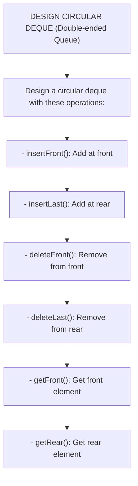

**Solution:**

```java
class MyCircularDeque {
    private int[] data;
    private int front, rear, size, capacity;

    public MyCircularDeque(int k) {
        data = new int[k];
        capacity = k;
        front = 0;
        rear = k - 1;
        size = 0;
    }

    public boolean insertFront(int value) {
        if (isFull()) return false;

        front = (front - 1 + capacity) % capacity;
        data[front] = value;
        size++;
        return true;
    }

    public boolean insertLast(int value) {
        if (isFull()) return false;

        rear = (rear + 1) % capacity;
        data[rear] = value;
        size++;
        return true;
    }

    public boolean deleteFront() {
        if (isEmpty()) return false;

        front = (front + 1) % capacity;
        size--;
        return true;
    }

    public boolean deleteLast() {
        if (isEmpty()) return false;

        rear = (rear - 1 + capacity) % capacity;
        size--;
        return true;
    }

    public int getFront() {
        return isEmpty() ? -1 : data[front];
    }

    public int getRear() {
        return isEmpty() ? -1 : data[rear];
    }

    public boolean isEmpty() {
        return size == 0;
    }

    public boolean isFull() {
        return size == capacity;
    }
}
```

---

## 7.4 Advanced Stack Problems

> **Pattern:** Greedy stack operations — use stack to build optimal sequence by popping suboptimal elements.
> **Remove K Digits:** Pop stack top if it's larger than current digit (greedy: smaller digits first).
> **132 Pattern:** Monotonic stack tracking the "2" (third element) while scanning backwards.

### Problem 96: Remove K Digits

**LeetCode 402** 🔗 https://leetcode.com/problems/remove-k-digits/

```
┌────────────────────────────────────────────────────────────────┐
│  REMOVE K DIGITS - Make smallest number by removing k digits   │
├────────────────────────────────────────────────────────────────┤
│  num = "1432219", k = 3                                        │
│                                                                │
│  Use monotonic increasing stack:                               │
│  ┌───────┬─────────────────────────┬─────────┐                 │
│  │ Digit │ Stack                   │ k       │                 │
│  ├───────┼─────────────────────────┼─────────┤                 │
│  │   1   │ [1]                     │ 3       │                 │
│  │   4   │ [1,4]                   │ 3       │                 │
│  │   3   │ [1,3] (pop 4)           │ 2       │                 │
│  │   2   │ [1,2] (pop 3)           │ 1       │                 │
│  │   2   │ [1,2,2]                 │ 1       │                 │
│  │   1   │ [1,2,1] (pop 2)         │ 0       │                 │
│  │   9   │ [1,2,1,9]               │ 0       │                 │
│  └───────┴─────────────────────────┴─────────┘                 │
│                                                                │
│  Result: "1219"                                                │
└────────────────────────────────────────────────────────────────┘
```

**Flow:**
- REMOVE K DIGITS - Make smallest number by removing k di
- ↓
- num = '1432219', k = 3
- ↓
- Use monotonic increasing stack:
- ↓
- Digit Stack k
- ↓
- 3 [1,3] (pop 4) 2
- ↓
- 2 [1,2] (pop 3) 1
- ↓
- 1 [1,2,1] (pop 2) 0

```mermaid
flowchart TD
    N1["REMOVE K DIGITS - Make smallest number by removing k di"]
    N2["num = '1432219', k = 3"]
    N3["Use monotonic increasing stack:"]
    N4["Digit Stack k"]
    N5["3 [1,3] (pop 4) 2"]
    N6["2 [1,2] (pop 3) 1"]
    N7["1 [1,2,1] (pop 2) 0"]
    N8["Result: '1219'"]
    N1 --> N2
    N2 --> N3
    N3 --> N4
    N4 --> N5
    N5 --> N6
    N6 --> N7
    N7 --> N8
```

**Solution:**

```java
public String removeKdigits(String num, int k) {
    if (k >= num.length()) return "0";

    Deque<Character> stack = new ArrayDeque<>();

    for (char c : num.toCharArray()) {
        while (k > 0 && !stack.isEmpty() && stack.peekLast() > c) {
            stack.pollLast();
            k--;
        }
        stack.addLast(c);
    }

    // Remove remaining k digits from end
    while (k-- > 0) {
        stack.pollLast();
    }

    // Build result, removing leading zeros
    StringBuilder result = new StringBuilder();
    boolean leadingZero = true;

    for (char c : stack) {
        if (leadingZero && c == '0') continue;
        leadingZero = false;
        result.append(c);
    }

    return result.length() == 0 ? "0" : result.toString();
}
```

---

### Problem 97: Remove Duplicate Letters

**LeetCode 316** 🔗 https://leetcode.com/problems/remove-duplicate-letters/

```
┌────────────────────────────────────────────────────────────────┐
│  REMOVE DUPLICATE LETTERS - Smallest lexicographic result      │
├────────────────────────────────────────────────────────────────┤
│  s = "cbacdcbc"                                                │
│                                                                │
│  Goal: Remove duplicates, keep smallest lex order              │
│  Each letter appears exactly once in result                    │
│                                                                │
│  Process:                                                      │
│  ┌───────┬──────────────┬──────────────────────────┐           │
│  │ Char  │ Stack        │ Reason                   │           │
│  ├───────┼──────────────┼──────────────────────────┤           │
│  │   c   │ [c]          │ push                     │           │
│  │   b   │ [b]          │ b<c, c appears later,pop │           │
│  │   a   │ [a]          │ a<b, b appears later,pop │           │
│  │   c   │ [a,c]        │ push                     │           │
│  │   d   │ [a,c,d]      │ push                     │           │
│  │   c   │ [a,c,d]      │ c already in stack, skip │           │
│  │   b   │ [a,b,c,d]    │ b<d but d last, b<c...   │           │
│  │   c   │ [a,b,c,d]    │ c already in stack, skip │           │
│  └───────┴──────────────┴──────────────────────────┘           │
│                                                                │
│  Wait... let me redo: Final = "acdb"                           │
└────────────────────────────────────────────────────────────────┘
```

**Flow:**
- REMOVE DUPLICATE LETTERS - Smallest lexicographic resul
- ↓
- s = 'cbacdcbc'
- ↓
- Goal: Remove duplicates, keep smallest lex order
- ↓
- Each letter appears exactly once in result
- ↓
- Process:
- ↓
- Char Stack Reason
- ↓
- c [c] push

```mermaid
flowchart TD
    N1["REMOVE DUPLICATE LETTERS - Smallest lexicographic resul"]
    N2["s = 'cbacdcbc'"]
    N3["Goal: Remove duplicates, keep smallest lex order"]
    N4["Each letter appears exactly once in result"]
    N5["Process:"]
    N6["Char Stack Reason"]
    N7["c [c] push"]
    N8["b [b] b&lt;c, c appears later,pop"]
    N1 --> N2
    N2 --> N3
    N3 --> N4
    N4 --> N5
    N5 --> N6
    N6 --> N7
    N7 --> N8
```

**Solution:**

```java
public String removeDuplicateLetters(String s) {
    int[] lastIndex = new int[26];
    boolean[] inStack = new boolean[26];

    // Find last occurrence of each character
    for (int i = 0; i < s.length(); i++) {
        lastIndex[s.charAt(i) - 'a'] = i;
    }

    Deque<Character> stack = new ArrayDeque<>();

    for (int i = 0; i < s.length(); i++) {
        char c = s.charAt(i);
        int idx = c - 'a';

        // Skip if already in stack
        if (inStack[idx]) continue;

        // Pop larger chars that appear later
        while (!stack.isEmpty() &&
               c < stack.peekLast() &&
               lastIndex[stack.peekLast() - 'a'] > i) {
            inStack[stack.pollLast() - 'a'] = false;
        }

        stack.addLast(c);
        inStack[idx] = true;
    }

    StringBuilder result = new StringBuilder();
    for (char c : stack) {
        result.append(c);
    }

    return result.toString();
}
```

---

### Problem 98: 🔒 132 Pattern

**LeetCode 456** 🔗 https://leetcode.com/problems/132-pattern/

```
┌────────────────────────────────────────────────────────────────┐
│  132 PATTERN - Find i < j < k where a[i] < a[k] < a[j]         │
├────────────────────────────────────────────────────────────────┤
│  Example: [3, 1, 4, 2]                                         │
│           a[i]=1, a[j]=4, a[k]=2 → 1 < 2 < 4 ✓                 │
│                                                                │
│  Pattern Visualization:                                        │
│       4 ┌───┐                                                  │
│         │   │                                                  │
│     3 ──┤   │                                                  │
│       2 │   └───┐                                              │
│         │       │                                              │
│     1 ──┴───────┴──                                            │
│         i   j   k                                              │
│                                                                │
│  Approach: Iterate from right, track "a[k]" candidates         │
│  using monotonic decreasing stack                              │
└────────────────────────────────────────────────────────────────┘
```

**Flow:**
- 132 PATTERN - Find i < j < k where a[i] < a[k]
- ↓
- Example: [3, 1, 4, 2]
- ↓
- Pattern Visualization:
- ↓
- Approach: Iterate from right, track 'a[k]' candidates
- ↓
- using monotonic decreasing stack

```mermaid
flowchart TD
    N1["132 PATTERN - Find i &lt; j &lt; k where a[i] &lt; a[k]"]
    N2["Example: [3, 1, 4, 2]"]
    N3["Pattern Visualization:"]
    N4["Approach: Iterate from right, track 'a[k]' candidates"]
    N5["using monotonic decreasing stack"]
    N1 --> N2
    N2 --> N3
    N3 --> N4
    N4 --> N5
```

**Solution:**

```java
public boolean find132pattern(int[] nums) {
    int n = nums.length;
    if (n < 3) return false;

    Stack<Integer> stack = new Stack<>();
    int third = Integer.MIN_VALUE;  // The "2" in 132 (a[k])

    // Iterate from right to left
    for (int i = n - 1; i >= 0; i--) {
        // Current is potential a[i], check if smaller than "2"
        if (nums[i] < third) return true;

        // Current is potential a[j], pop smaller elements as "2" candidates
        while (!stack.isEmpty() && nums[i] > stack.peek()) {
            third = stack.pop();  // This becomes the "2"
        }

        stack.push(nums[i]);
    }

    return false;
}
```

---

### Problem 99: Online Stock Span

**LeetCode 901** 🔗 https://leetcode.com/problems/online-stock-span/

```
┌────────────────────────────────────────────────────────────────┐
│  ONLINE STOCK SPAN - Days before with price <= today           │
├────────────────────────────────────────────────────────────────┤
│  Prices: [100, 80, 60, 70, 60, 75, 85]                         │
│                                                                │
│  For each day, count consecutive days before (including today) │
│  where price <= today's price:                                 │
│                                                                │
│  ┌───────┬───────┬─────────────────────────────┬───────┐       │
│  │ Day   │ Price │ Explanation                 │ Span  │       │
│  ├───────┼───────┼─────────────────────────────┼───────┤       │
│  │  0    │  100  │ Just today                  │   1   │       │
│  │  1    │   80  │ Just today (100>80)         │   1   │       │
│  │  2    │   60  │ Just today (80>60)          │   1   │       │
│  │  3    │   70  │ [60,70]                     │   2   │       │
│  │  4    │   60  │ Just today (70>60)          │   1   │       │
│  │  5    │   75  │ [60,70,60,75]               │   4   │       │
│  │  6    │   85  │ [60,70,60,75,85]            │   6   │       │
│  └───────┴───────┴─────────────────────────────┴───────┘       │
│                                                                │
│  Use stack of (price, span) pairs                              │
└────────────────────────────────────────────────────────────────┘
```

**Flow:**
- ONLINE STOCK SPAN - Days before with price <= today
- ↓
- Prices: [100, 80, 60, 70, 60, 75, 85]
- ↓
- where price <= today's price:
- ↓
- Day Price Explanation Span
- ↓
- 0 100 Just today 1
- ↓
- 1 80 Just today (100>80) 1
- ↓
- 2 60 Just today (80>60) 1

```mermaid
flowchart TD
    N1["ONLINE STOCK SPAN - Days before with price &lt;= today"]
    N2["Prices: [100, 80, 60, 70, 60, 75, 85]"]
    N3["where price &lt;= today's price:"]
    N4["Day Price Explanation Span"]
    N5["0 100 Just today 1"]
    N6["1 80 Just today (100&gt;80) 1"]
    N7["2 60 Just today (80&gt;60) 1"]
    N8["4 60 Just today (70&gt;60) 1"]
    N1 --> N2
    N2 --> N3
    N3 --> N4
    N4 --> N5
    N5 --> N6
    N6 --> N7
    N7 --> N8
```

**Solution:**

```java
class StockSpanner {
    private Stack<int[]> stack;  // [price, span]

    public StockSpanner() {
        stack = new Stack<>();
    }

    public int next(int price) {
        int span = 1;

        // Pop and accumulate spans of smaller prices
        while (!stack.isEmpty() && stack.peek()[0] <= price) {
            span += stack.pop()[1];
        }

        stack.push(new int[]{price, span});
        return span;
    }
}
```

---


> 🔬 **Section Challenge — 7.4 Advanced Stack Problems**
>
> **Challenge 1 (Reasoning):** Monotonic DECREASING stack — when you push a new element, which existing elements are popped and what information do those pops tell you?
> <details><summary>Answer</summary>
>
> In a decreasing stack (top is smallest), pushing element `x`: all elements smaller than `x` are popped. For each popped element `y`: `x` is the NEXT GREATER ELEMENT of `y`. This is the key insight: the pop event = answer event. Application: Daily Temperatures (next warmer day), Largest Rectangle in Histogram (right boundary), Next Greater Element. Each element is pushed and popped exactly once → O(N) total.
> </details>
>

## 7.5 HackerEarth & Codeforces Stack/Queue Problems

### Problem 100: Balanced Brackets (HackerEarth)

```
┌────────────────────────────────────────────────────────────────┐
│  BALANCED BRACKETS - Extended validation                       │
├────────────────────────────────────────────────────────────────┤
│  Given a string containing brackets and other characters,      │
│  determine if the brackets are balanced.                       │
│                                                                │
│  Valid: "{[()]}", "a{b[c(d)e]f}g", "(())()"                    │
│  Invalid: "{[}]", "(()", "a{b(c]d}e"                           │
│                                                                │
│  Examples:                                                     │
│  Input: "{[a+b]*[c-d]}"  → Output: "YES"                       │
│  Input: "({[}])"         → Output: "NO" (mismatched)           │
│  Input: "((()))"         → Output: "YES"                       │
│                                                                │
│  Constraints:                                                  │
│  - 1 <= |s| <= 10^5                                            │
│  - String contains alphanumeric and bracket characters         │
└────────────────────────────────────────────────────────────────┘
```

**Flow:**
- BALANCED BRACKETS - Extended validation
- ↓
- Given a string containing brackets and other characters
- ↓
- determine if the brackets are balanced.
- ↓
- Invalid: '{[}]', '(()', 'a{b(c]d}e'
- ↓
- Examples:
- ↓
- Input: '{[a+b]*[c-d]}'
- ↓
- Output: 'YES'
- ↓
- Input: '{[a+b]*[c-d]}'
- ↓
- Output: 'YES'
- ↓
- Input: '({[}])'
- ↓
- Output: 'NO' (mismatched)

```mermaid
flowchart TD
    N1["BALANCED BRACKETS - Extended validation"]
    N2["Given a string containing brackets and other characters"]
    N3["determine if the brackets are balanced."]
    N4["Invalid: '{[}]', '(()', 'a{b(c]d}e'"]
    N5["Examples:"]
    N6["Input: '{[a+b]*[c-d]}' → Output: 'YES'"]
    N7["Input: '({[}])' → Output: 'NO' (mismatched)"]
    N8["Input: '((()))' → Output: 'YES'"]
    N1 --> N2
    N2 --> N3
    N3 --> N4
    N4 --> N5
    N5 --> N6
    N6 --> N7
    N7 --> N8
```

**Solution:**

```java
public String isBalanced(String s) {
    Stack<Character> stack = new Stack<>();

    for (char c : s.toCharArray()) {
        if (c == '(' || c == '{' || c == '[') {
            stack.push(c);
        } else if (c == ')' || c == '}' || c == ']') {
            if (stack.isEmpty()) return "NO";

            char top = stack.pop();
            if ((c == ')' && top != '(') ||
                (c == '}' && top != '{') ||
                (c == ']' && top != '[')) {
                return "NO";
            }
        }
        // Ignore other characters
    }

    return stack.isEmpty() ? "YES" : "NO";
}
```

---

### Problem 101: Maximum Element (HackerEarth/HackerRank)

```
┌────────────────────────────────────────────────────────────────┐
│  MAXIMUM ELEMENT - Stack with max queries                      │
├────────────────────────────────────────────────────────────────┤
│  Support these operations:                                     │
│  1 x : Push x onto the stack                                   │
│  2   : Pop the top element                                     │
│  3   : Print the maximum element in the stack                  │
│                                                                │
│  Example:                                                      │
│  Operations: 1 97, 2, 1 20, 2, 1 26, 1 20, 2, 3, 1 91, 3       │
│                                                                │
│  ┌────────┬────────────────┬────────────┬──────────┐           │
│  │ Query  │ Action         │ Stack      │ Output   │           │
│  ├────────┼────────────────┼────────────┼──────────┤           │
│  │ 1 97   │ push 97        │ [97]       │ -        │           │
│  │ 2      │ pop            │ []         │ -        │           │
│  │ 1 20   │ push 20        │ [20]       │ -        │           │
│  │ 2      │ pop            │ []         │ -        │           │
│  │ 1 26   │ push 26        │ [26]       │ -        │           │
│  │ 1 20   │ push 20        │ [26,20]    │ -        │           │
│  │ 2      │ pop            │ [26]       │ -        │           │
│  │ 3      │ print max      │ [26]       │ 26       │           │
│  │ 1 91   │ push 91        │ [26,91]    │ -        │           │
│  │ 3      │ print max      │ [26,91]    │ 91       │           │
│  └────────┴────────────────┴────────────┴──────────┘           │
└────────────────────────────────────────────────────────────────┘
```

**Flow:**
- MAXIMUM ELEMENT - Stack with max queries
- ↓
- Support these operations:
- ↓
- 1 x : Push x onto the stack
- ↓
- 2 : Pop the top element
- ↓
- 3 : Print the maximum element in the stack
- ↓
- Example:
- ↓
- Operations: 1 97, 2, 1 20, 2, 1 26, 1 20, 2, 3, 1 91, 3

```mermaid
flowchart TD
    N1["MAXIMUM ELEMENT - Stack with max queries"]
    N2["Support these operations:"]
    N3["1 x : Push x onto the stack"]
    N4["2 : Pop the top element"]
    N5["3 : Print the maximum element in the stack"]
    N6["Example:"]
    N7["Operations: 1 97, 2, 1 20, 2, 1 26, 1 20, 2, 3, 1 91, 3"]
    N8["Query Action Stack Output"]
    N1 --> N2
    N2 --> N3
    N3 --> N4
    N4 --> N5
    N5 --> N6
    N6 --> N7
    N7 --> N8
```

**Solution:**

```java
public void processQueries(int[][] queries) {
    Stack<int[]> stack = new Stack<>();  // [value, maxSoFar]

    for (int[] query : queries) {
        int type = query[0];

        if (type == 1) {
            int x = query[1];
            int currentMax = stack.isEmpty() ? x : Math.max(x, stack.peek()[1]);
            stack.push(new int[]{x, currentMax});
        } else if (type == 2) {
            if (!stack.isEmpty()) {
                stack.pop();
            }
        } else {  // type == 3
            if (!stack.isEmpty()) {
                System.out.println(stack.peek()[1]);
            }
        }
    }
}
```

---

### Problem 102: Nearest Smaller Element (Codeforces-style)

```
┌────────────────────────────────────────────────────────────────┐
│  NEAREST SMALLER ELEMENT                                       │
├────────────────────────────────────────────────────────────────┤
│  For each element, find the nearest smaller element to its     │
│  left. If none exists, output -1.                              │
│                                                                │
│  Input: [4, 5, 2, 10, 8]                                       │
│                                                                │
│  ┌───────┬─────────┬───────────────────────┬─────────┐         │
│  │ Index │ Element │ Elements to Left      │ Answer  │         │
│  ├───────┼─────────┼───────────────────────┼─────────┤         │
│  │   0   │    4    │ none                  │   -1    │         │
│  │   1   │    5    │ 4                     │    4    │         │
│  │   2   │    2    │ 4,5 (none smaller)    │   -1    │         │
│  │   3   │   10    │ 4,5,2 → nearest is 2  │    2    │         │
│  │   4   │    8    │ 4,5,2,10 → nearest 2  │    2    │         │
│  └───────┴─────────┴───────────────────────┴─────────┘         │
│                                                                │
│  Output: [-1, 4, -1, 2, 2]                                     │
│                                                                │
│  Constraints:                                                  │
│  - 1 <= n <= 10^5                                              │
│  - 1 <= a[i] <= 10^9                                           │
└────────────────────────────────────────────────────────────────┘
```

**Flow:**
- NEAREST SMALLER ELEMENT
- ↓
- For each element, find the nearest smaller element to i
- ↓
- left. If none exists, output -1.
- ↓
- Input: [4, 5, 2, 10, 8]
- ↓
- Index Element Elements to Left Answer
- ↓
- 0 4 none -1
- ↓
- 2 2 4,5 (none smaller) -1

```mermaid
flowchart TD
    N1["NEAREST SMALLER ELEMENT"]
    N2["For each element, find the nearest smaller element to i"]
    N3["left. If none exists, output -1."]
    N4["Input: [4, 5, 2, 10, 8]"]
    N5["Index Element Elements to Left Answer"]
    N6["0 4 none -1"]
    N7["2 2 4,5 (none smaller) -1"]
    N8["3 10 4,5,2 → nearest is 2 2"]
    N1 --> N2
    N2 --> N3
    N3 --> N4
    N4 --> N5
    N5 --> N6
    N6 --> N7
    N7 --> N8
```

**Solution:**

```java
public int[] nearestSmallerElement(int[] arr) {
    int n = arr.length;
    int[] result = new int[n];
    Stack<Integer> stack = new Stack<>();

    for (int i = 0; i < n; i++) {
        // Pop elements >= current
        while (!stack.isEmpty() && stack.peek() >= arr[i]) {
            stack.pop();
        }

        result[i] = stack.isEmpty() ? -1 : stack.peek();
        stack.push(arr[i]);
    }

    return result;
}
```

---

### Problem 103: Prefix to Postfix Conversion (HackerEarth)

```
┌────────────────────────────────────────────────────────────────┐
│  PREFIX TO POSTFIX CONVERSION                                  │
├────────────────────────────────────────────────────────────────┤
│  Convert prefix expression to postfix using stack              │
│                                                                │
│  Prefix:  *+AB-CD   (operator before operands)                 │
│  Postfix: AB+CD-*   (operator after operands)                  │
│                                                                │
│  Algorithm: Read from RIGHT to LEFT                            │
│  ┌───────┬──────────────────────────────┬─────────────────────┐│
│  │ Char  │ Action                       │ Stack               ││
│  ├───────┼──────────────────────────────┼─────────────────────┤│
│  │   D   │ push                         │ [D]                 ││
│  │   C   │ push                         │ [D, C]              ││
│  │   -   │ pop C,D → "CD-" push         │ [D, CD-]            ││
│  │   B   │ push                         │ [D, CD-, B]         ││
│  │   A   │ push                         │ [D, CD-, B, A]      ││
│  │   +   │ pop A,B → "AB+" push         │ [D, CD-, AB+]       ││
│  │   *   │ pop AB+,CD- → "AB+CD-*"      │ [AB+CD-*]           ││
│  └───────┴──────────────────────────────┴─────────────────────┘│
│                                                                │
│  Result: "AB+CD-*"                                             │
└────────────────────────────────────────────────────────────────┘
```

**Flow:**
- PREFIX TO POSTFIX CONVERSION
- ↓
- Convert prefix expression to postfix using stack
- ↓
- Prefix: *+AB-CD (operator before operands)
- ↓
- Postfix: AB+CD-* (operator after operands)
- ↓
- Algorithm: Read from RIGHT to LEFT
- ↓
- Char Action Stack
- ↓
- D push [D]

```mermaid
flowchart TD
    N1["PREFIX TO POSTFIX CONVERSION"]
    N2["Convert prefix expression to postfix using stack"]
    N3["Prefix: *+AB-CD (operator before operands)"]
    N4["Postfix: AB+CD-* (operator after operands)"]
    N5["Algorithm: Read from RIGHT to LEFT"]
    N6["Char Action Stack"]
    N7["D push [D]"]
    N8["C push [D, C]"]
    N1 --> N2
    N2 --> N3
    N3 --> N4
    N4 --> N5
    N5 --> N6
    N6 --> N7
    N7 --> N8
```

**Solution:**

```java
public String prefixToPostfix(String prefix) {
    Stack<String> stack = new Stack<>();

    // Read from right to left
    for (int i = prefix.length() - 1; i >= 0; i--) {
        char c = prefix.charAt(i);

        if (Character.isLetterOrDigit(c)) {
            stack.push(String.valueOf(c));
        } else {
            // Operator: pop two operands
            String op1 = stack.pop();
            String op2 = stack.pop();
            // Postfix: operand1 + operand2 + operator
            stack.push(op1 + op2 + c);
        }
    }

    return stack.pop();
}
```

---

---


> 🔬 **Section Challenge — 7.5 HackerEarth & Codeforces Stack/Queue Problems**
>
> **Challenge 1 (Reasoning):** Monotonic DECREASING stack — when you push a new element, which existing elements are popped and what information do those pops tell you?
> <details><summary>Answer</summary>
>
> In a decreasing stack (top is smallest), pushing element `x`: all elements smaller than `x` are popped. For each popped element `y`: `x` is the NEXT GREATER ELEMENT of `y`. This is the key insight: the pop event = answer event. Application: Daily Temperatures (next warmer day), Largest Rectangle in Histogram (right boundary), Next Greater Element. Each element is pushed and popped exactly once → O(N) total.
> </details>
>

## 🏆 Competitive Programming — Codeforces Problems

| Problem | Link | Technique | Difficulty |
|---|---|---|---|
| Longest Regular Bracket Sequence | [CF 5C](https://codeforces.com/problemset/problem/5/C) | Stack → longest valid bracket span | ⭐⭐ Medium |
| Queue on Segments | [CF 566E](https://codeforces.com/problemset/problem/566/E) | Deque + segment tree | ⭐⭐⭐ Hard |
| Constructing Streets | [CF 1264C](https://codeforces.com/problemset/problem/1264/C) | Monotonic stack application | ⭐⭐ Medium |
| Stock Market | [CF 865C](https://codeforces.com/problemset/problem/865/C) | Stack-based price calculation | ⭐⭐ Medium |
| Towers | [CF 37B](https://codeforces.com/problemset/problem/37/B) | Priority queue ordering | ⭐ Easy |

---


## 🌍 Real-World Applications of Stack & Queue

| Technique | Real-World System | How It's Used |
|---|---|---|
| **Stack (LIFO)** | JVM call stack | Every method call pushes a frame; return pops it — StackOverflowError when limit exceeded |
| **Stack (undo/redo)** | VS Code / Photoshop | Action stack; undo = pop; redo = push to redo stack |
| **Monotonic Stack** | Financial systems | "Next day price is higher than today?" = monotonic stack for stock span |
| **Queue (FIFO)** | Kafka, RabbitMQ | Message queue ensures FIFO delivery between microservices |
| **Deque (double-ended)** | Browser back/forward | Deque for page history; can push/pop from either end |
| **Priority Queue** | OS task scheduler | Always run highest-priority ready thread |

```
🔥 MONOTONIC STACK = MOST UNDERRATED INTERVIEW PATTERN:
   "Largest Rectangle in Histogram" (LC 84) = monotonic stack
   This exact algorithm runs in: Apache Kafka (lag monitoring),
   AWS CloudWatch (threshold breach detection)
   "When did metric exceed threshold last time?" = next greater element
```

---


---


> 🔬 **Section Challenge — 🌍 Real-World Applications of Stack & Queue**
>
> **Challenge 1 (Reasoning):** Monotonic DECREASING stack — when you push a new element, which existing elements are popped and what information do those pops tell you?
> <details><summary>Answer</summary>
>
> In a decreasing stack (top is smallest), pushing element `x`: all elements smaller than `x` are popped. For each popped element `y`: `x` is the NEXT GREATER ELEMENT of `y`. This is the key insight: the pop event = answer event. Application: Daily Temperatures (next warmer day), Largest Rectangle in Histogram (right boundary), Next Greater Element. Each element is pushed and popped exactly once → O(N) total.
> </details>
>

## 🏋️ Practice & Interview Questions — Stack & Queue

### Predict / Trace
**Q1.** Stack has [1,2,3] (3 is top). After pop(), pop(), push(5) — what's the stack?
<details><summary>Answer</summary>

[1, 5] — popped 3 and 2, pushed 5 on top of 1.
</details>

**Q2.** Evaluate postfix `3 4 + 2 *` using a stack — trace each step.
<details><summary>Answer</summary>

push 3 → [3]; push 4 → [3,4]; + → pop 3,4, push 7 → [7]; push 2 → [7,2]; * → pop 7,2, push 14 → [14]. Result: 14
</details>

### LeetCode / Coding
**Q3.** ⭐ Valid Parentheses — O(N).
<details><summary>Solution</summary>

```java
Deque<Character> stack = new ArrayDeque<>();
for(char c : s.toCharArray()){
    if(c=='('||c=='{'||c=='[') stack.push(c);
    else {
        if(stack.isEmpty()) return false;
        char top = stack.pop();
        if(c==')'&&top!='('||c=='}'&&top!='{'||c==']'&&top!='[') return false;
    }
}
return stack.isEmpty();
```
</details>

**Q4.** ⭐ Min Stack — O(1) getMin().
<details><summary>Solution</summary>

```java
Deque<Integer> stack=new ArrayDeque<>(), minStack=new ArrayDeque<>();
void push(int v){ stack.push(v); if(minStack.isEmpty()||v<=minStack.peek()) minStack.push(v); }
void pop(){ if(stack.pop().equals(minStack.peek())) minStack.pop(); }
int getMin(){ return minStack.peek(); }
```
</details>

**Q5.** ⭐⭐ Daily Temperatures — next warmer day for each day (monotonic stack).
<details><summary>Solution</summary>

```java
int[] res = new int[n]; Deque<Integer> stack = new ArrayDeque<>();
for(int i=0;i<n;i++){
    while(!stack.isEmpty()&&temperatures[i]>temperatures[stack.peek()])
        res[stack.peek()] = i - stack.pop();
    stack.push(i);
}
```
</details>

**Q6.** ⭐⭐ Largest Rectangle in Histogram (monotonic stack).
<details><summary>Solution</summary>

```java
Deque<Integer> stack = new ArrayDeque<>();
int maxArea = 0;
for(int i=0;i<=n;i++){
    int h = (i==n)?0:heights[i];
    while(!stack.isEmpty()&&h<heights[stack.peek()]){
        int height=heights[stack.pop()];
        int width=stack.isEmpty()?i:(i-stack.peek()-1);
        maxArea=Math.max(maxArea,height*width);
    }
    stack.push(i);
}
```
</details>

**Q7.** ⭐⭐ Implement Queue using 2 Stacks.
<details><summary>Solution</summary>

```java
// Two stacks: inbox (for push), outbox (for pop)
// Move inbox→outbox only when outbox is empty
void push(int x){ inbox.push(x); }
int pop(){ if(outbox.isEmpty()) while(!inbox.isEmpty()) outbox.push(inbox.pop()); return outbox.pop(); }
```
</details>

**Q8.** ⭐⭐ Decode String — `3[a2[bc]]` → `abcbcabcbcabcbc`.
<details><summary>Solution</summary>

```java
Deque<Integer> counts=new ArrayDeque<>();
Deque<StringBuilder> builders=new ArrayDeque<>();
StringBuilder curr=new StringBuilder(); int k=0;
for(char c:s.toCharArray()){
    if(Character.isDigit(c)) k=k*10+(c-'0');
    else if(c=='['){ counts.push(k); builders.push(curr); curr=new StringBuilder(); k=0; }
    else if(c==']'){ int times=counts.pop(); StringBuilder prev=builders.pop(); while(times-->0) prev.append(curr); curr=prev; }
    else curr.append(c);
}
return curr.toString();
```
</details>

### MCQ Rapid Fire
| # | Question | Answer |
|---|---|---|
| 1 | Stack LIFO/FIFO? | LIFO |
| 2 | Queue LIFO/FIFO? | FIFO |
| 3 | Java Stack class — recommended alternative? | Deque / ArrayDeque |
| 4 | ArrayDeque vs LinkedList for stack/queue | ArrayDeque (no boxing, cache-friendly) |
| 5 | Monotonic stack usage | Next greater/smaller element problems |
| 6 | BFS uses which data structure? | Queue |
| 7 | DFS (iterative) uses which structure? | Stack |
| 8 | peek() vs poll() on empty queue | peek()=null, poll()=null (no exception) |


---

## 🧠 Deep Conceptual Questions — Stack & Queue

**C1. Why is a monotonic stack called "monotonic" and what property does it maintain?**
<details><summary>Deep Answer</summary>

A monotonic stack maintains elements in **strictly increasing or decreasing order** from bottom to top. When a new element arrives that violates the monotonicity (e.g., a larger element in a decreasing stack), elements are popped until the property is restored, THEN the new element is pushed. The pop events are the answer events: when element X is popped because Y is larger, Y is the "next greater element" of X. This processes each element exactly once (each is pushed and popped at most once) → O(N) total.
</details>

**C2. Why use `ArrayDeque` instead of `Stack` class in Java?**
<details><summary>Deep Answer</summary>

Java's `Stack` extends `Vector` (legacy, synchronized). Every push/pop acquires a mutex lock — unnecessary for single-threaded stack use. `ArrayDeque` has zero synchronization overhead, pure array-backed, cache-friendly. Also: `Stack`'s interface allows index-based access and `insertElementAt` which shouldn't exist on a stack (breaks the abstraction). `ArrayDeque` implements `Deque` — clean stack interface (`push`, `pop`, `peek`). **Never use `Stack` in modern Java.**
</details>

**C3. BFS uses a Queue — what property of queues makes BFS work correctly?**
<details><summary>Deep Answer</summary>

BFS needs to process nodes **level by level** — explore all nodes at distance D before any node at distance D+1. Queue's FIFO property guarantees this: nodes enqueued at distance D are dequeued and processed before nodes at distance D+1 (which are enqueued during processing D). If you used a Stack (DFS): you'd go depth-first — immediately explore children of the first node before its siblings. The FIFO vs LIFO distinction is the entire algorithmic difference between BFS and DFS.
</details>

**C4. Why is the "largest rectangle in histogram" problem solved with a monotonic stack?**
<details><summary>Deep Answer</summary>

For each bar, the rectangle it forms extends left/right until a shorter bar is hit. A monotonic increasing stack maintains bars in increasing height. When a shorter bar arrives (say height 3 comes after [2,5,7]):
- Pop 7: rectangle with height 7, width determined by current index and stack top
- Pop 5: rectangle with height 5, wider width

The stack tells us: bars still in the stack haven't found their "right boundary" yet (no shorter bar has come). When they're finally popped, we know both their left and right boundaries. This is the key geometric insight: the stack holds "potential rectangles still growing."
</details>

**C5. Implement a Queue with O(1) amortized enqueue and dequeue — why is amortized important?**
<details><summary>Deep Answer</summary>

Two-stack queue: transfer from stack1 to stack2 only when stack2 is empty. Individual dequeue can be O(N) (transfer cost). But each element is transferred at most once. Over N operations: total transfer cost = N. Average = O(1). This is amortized O(1). Real-world relevance: Python's `queue.Queue` uses this pattern. Java's `ArrayDeque` achieves true O(1) with a circular array — amortized O(1) when resizing without transfer cost.
</details>

**C6. What is the call stack and how do recursive algorithms relate to it?**
<details><summary>Deep Answer</summary>

The **call stack** is a stack of stack frames. Each function call pushes a frame (local variables, return address, parameters). Return pops the frame. Recursive DFS naturally uses the call stack AS its traversal stack. Iterative DFS explicitly manages a stack in heap memory. Iterative is often preferred for: (1) avoiding stack overflow on deep recursion (JVM default: ~500-1000 frames), (2) more control over traversal order, (3) ability to pause/resume traversal.
</details>


> **Navigation**: [< Previous](07_Binary_Search.md) | [Back to Index](../00_MASTER_INDEX.md) | [Next >](09_Trees.md)