> **Navigation**: [< Previous](08_Stack_Queue.md) | [Back to Index](../00_MASTER_INDEX.md) | [Next >](10_Graphs.md)

> **Problems 09/14** | [Prev](08_Stack_Queue.md) | [Index](../00_MASTER_INDEX.md) | [Next](10_Graphs.md)

---

# 📚 SECTION 8: TREE PROBLEMS (BFS/DFS)

```
┌─────────────────────────────────────────────────────────────────┐
│                    TREE TRAVERSAL PATTERNS                      │
├─────────────────────────────────────────────────────────────────┤
│  BINARY TREE STRUCTURE:                                         │
│            ┌───┐                                                │
│            │ 1 │ ← Root                                         │
│            └─┬─┘                                                │
│         ┌───┴───┐                                               │
│       ┌─┴─┐   ┌─┴─┐                                             │
│       │ 2 │   │ 3 │                                             │
│       └─┬─┘   └─┬─┘                                             │
│      ┌──┴──┐    └──┐                                            │
│    ┌─┴─┐ ┌─┴─┐   ┌─┴─┐                                          │
│    │ 4 │ │ 5 │   │ 6 │                                          │
│    └───┘ └───┘   └───┘                                          │
│                                                                 │
│  TRAVERSAL ORDERS:                                              │
│  ┌────────────┬──────────────────┬──────────────────┐           │
│  │ Preorder   │ Root→Left→Right  │ 1,2,4,5,3,6      │           │
│  │ Inorder    │ Left→Root→Right  │ 4,2,5,1,3,6      │           │
│  │ Postorder  │ Left→Right→Root  │ 4,5,2,6,3,1      │           │
│  │ Level Order│ Level by level   │ 1,2,3,4,5,6      │           │
│  └────────────┴──────────────────┴──────────────────┘           │
│                                                                 │
│  DFS vs BFS:                                                    │
│  ┌─────────────────────┬─────────────────────────────┐          │
│  │ DFS (Stack/Recursion)│ BFS (Queue)                │          │
│  │ - Go deep first      │ - Go wide first            │          │
│  │ - Preorder/In/Post   │ - Level order traversal    │          │
│  │ - Path problems      │ - Shortest path problems   │          │
│  │ - Tree height/depth  │ - Level-wise processing    │          │
│  └─────────────────────┴─────────────────────────────┘          │
└─────────────────────────────────────────────────────────────────┘
```

> **Flow**: 2 3 → 4 5 | 4 5 → Preorder Root→Left→Right 1,2,4,5,3,6 / Inorder Left→Roo | Preorder Root→Left→Right 1,2,4,5,3,6 / Inorder Left→Roo → DFS (Stack/Recursion) BFS (Queue) / - Go deep first - G

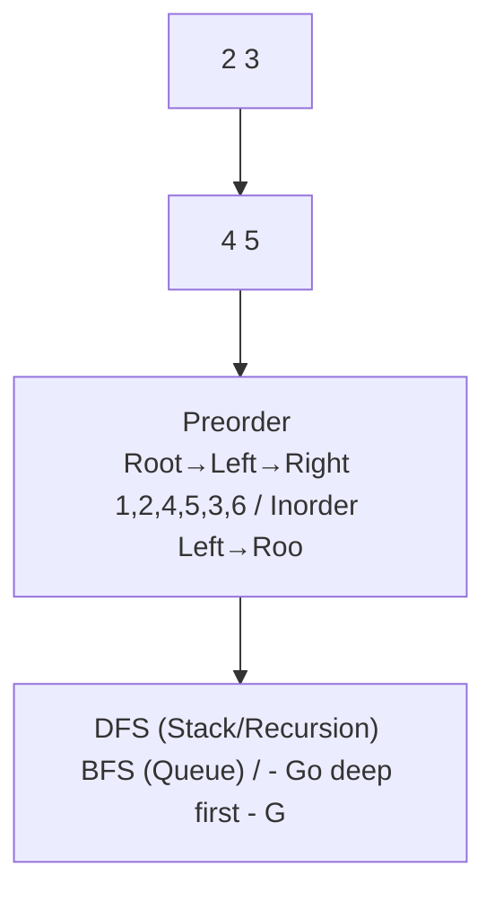

---

## PART 0: WHY Trees Are the #1 Interview Topic & How to Think About Them

```
╔══════════════════════════════════════════════════════════════════════════════╗
║          TREE PROBLEMS — COMPLETE UNDERSTANDING & GROWTH MINDSET             ║
╚══════════════════════════════════════════════════════════════════════════════╝

┌──────────────────────────────────────────────────────────────────────────────┐
│ WHY ARE TREES THE #1 INTERVIEW TOPIC?                                        │
├──────────────────────────────────────────────────────────────────────────────┤
│                                                                              │
│ Trees test BOTH recursion skills AND data structure understanding.           │
│ They account for 20-25% of coding interview questions.                       │
│                                                                              │
│ REAL-WORLD SYSTEMS BUILT ON TREES:                                           │
│ • File systems: Every folder/file is a tree node                             │
│ • DOM (web pages): HTML → head/body → div/p... is a tree                     │
│ • Databases: B-trees, B+ trees power every SQL database index                │
│ • Compilers: Abstract Syntax Tree (AST) represents code structure            │
│ • Operating systems: Process hierarchy (parent/child processes)              │
│ • AI/ML: Decision trees, random forests, parse trees in NLP                  │
│ • Network routing: Spanning trees prevent packet loops                       │
│                                                                              │
│ Google, Amazon, Meta report tree problems in ~30% of coding rounds.          │
└──────────────────────────────────────────────────────────────────────────────┘

┌──────────────────────────────────────────────────────────────────────────────┐
│ THE MENTAL MODEL: Every Tree Problem = "Info goes UP or DOWN?"               │
├──────────────────────────────────────────────────────────────────────────────┤
│                                                                              │
│ TREE PROBLEMS HAVE EXACTLY TWO INFORMATION FLOWS:                            │
│                                                                              │
│                        [root = 1]                                            │
│                       ↙↓   ↑↘                                                │
│              TOP-DOWN ↓     ↑ BOTTOM-UP                                      │
│              (pass info ↓     ↑ (return info                                 │
│               to kids)  ↓     ↑  to parent)                                  │
│                     [2]   [3]                                                │
│                    ↙  ↘     ↘                                                │
│                 [4]    [5]   [6]                                             │
│                                                                              │
│  ↓ TOP-DOWN (passing info FROM parent TO children):                          │
│    • BST validation: pass [min, max] range down                              │
│    • Path sum: pass remaining target down                                    │
│    • Depth counter: pass current_depth + 1 down                              │
│    • Root-to-leaf paths: pass path prefix down                               │
│                                                                              │
│  ↑ BOTTOM-UP (returning info FROM children TO parent):                       │
│    • Height/depth: max(leftHeight, rightHeight) + 1                          │
│    • Is balanced: both subtrees balanced AND heights differ ≤ 1              │
│    • Subtree sum: leftSum + rightSum + node.val                              │
│    • Same tree: leftSame AND rightSame AND values equal                      │
│                                                                              │
│  ↕ BOTH DIRECTIONS (hardest problems):                                       │
│    • Max path sum: return best single-path UP, track global across paths     │
│    • Diameter: return height UP, track max(leftH + rightH) globally          │
│    • Lowest Common Ancestor: return found nodes UP, meet in the middle       │
│                                                                              │
│  DECISION FLOWCHART:                                                         │
│  ┌─────────────────────────────────────────────────────────────────────┐     │
│  │ Does the problem need info from ANCESTORS (parents, grandparents)? │      │
│  │   YES → TOP-DOWN: Pass info as parameters                        │        │
│  │   NO  → Does it need info from DESCENDANTS (children)?           │        │
│  │          YES → BOTTOM-UP: Return info in recursive calls         │        │
│  │          BOTH? → Use both: pass DOWN + return UP + global tracker│        │
│  └─────────────────────────────────────────────────────────────────────┘     │
└──────────────────────────────────────────────────────────────────────────────┘
```

> **Flow**: TREE PROBLEMS — COMPLETE UNDERSTANDING & GROWTH MINDSET → WHY ARE TREES THE #1 INTERVIEW TOPIC? | WHY ARE TREES THE #1 INTERVIEW TOPIC? → They account for 20-25% of coding interview questions. | They account for 20-25% of coding interview questions. → REAL-WORLD SYSTEMS BUILT ON TREES: | REAL-WORLD SYSTEMS BUILT ON TREES: → • File systems: Every folder/file is a tree node | • File systems: Every folder/file is a tree node → • DOM (web pages): HTML → head/body → div/p... is a tre | • DOM (web pages): HTML → head/body → div/p... is a tre → • AI/ML: Decision trees, random forests, parse trees in | ...+1 more

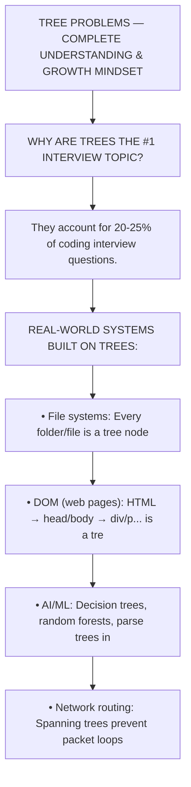

```java
// TOP-DOWN TEMPLATE (info flows from parent → children)
void topDown(TreeNode node, int infoFromParent) {
    if (node == null) return;                    // Base case
    // USE info from parent (e.g., depth, range, running sum)
    // Process current node with infoFromParent
    topDown(node.left, updatedInfo);             // Pass to left child
    topDown(node.right, updatedInfo);            // Pass to right child
}

// BOTTOM-UP TEMPLATE (info flows from children → parent)
int bottomUp(TreeNode node) {
    if (node == null) return baseValue;          // Base case
    int leftResult = bottomUp(node.left);        // Get from left subtree
    int rightResult = bottomUp(node.right);      // Get from right subtree
    return combine(leftResult, rightResult);     // Combine and return UP
}

// BOTH DIRECTIONS (hardest — e.g., diameter, max path sum)
int globalMax = 0;  // Track answer across all nodes
int bothDirections(TreeNode node) {
    if (node == null) return 0;
    int left = bothDirections(node.left);        // Info from below
    int right = bothDirections(node.right);      // Info from below
    globalMax = Math.max(globalMax, left + right + node.val);  // ACROSS
    return Math.max(left, right) + node.val;     // Return BEST SINGLE PATH up
}
```

```
┌──────────────────────────────────────────────────────────────────────────────┐
│ THE 5 TREE PROBLEM PATTERNS (covers 95% of interviews)                       │
├──────────────────────────────────────────────────────────────────────────────┤
│                                                                              │
│ ┌───────────────────┬──────────────────────────┬────────────────────────┐    │
│ │ Pattern           │ Template                 │ Problems               │    │
│ ├───────────────────┼──────────────────────────┼────────────────────────┤    │
│ │ 1. TRAVERSAL      │ DFS (stack) / BFS (queue)│ Inorder, Preorder,     │    │
│ │                   │ Process all nodes         │ Level Order, Zigzag    │   │
│ ├───────────────────┼──────────────────────────┼────────────────────────┤    │
│ │ 2. PROPERTY CHECK │ Return boolean/value UP  │ Max Depth, Balanced,   │    │
│ │    (Bottom-up)    │ Compare left + right      │ Symmetric, Same Tree   │   │
│ ├───────────────────┼──────────────────────────┼────────────────────────┤    │
│ │ 3. PATH / SUM     │ Carry sum DOWN           │ Path Sum, Path Sum II, │    │
│ │    (Both dirs)    │ + track global answer     │ Max Path Sum, Diameter │   │
│ ├───────────────────┼──────────────────────────┼────────────────────────┤    │
│ │ 4. BST PROPERTY   │ Use min < root < max     │ Validate BST, Search,  │    │
│ │                   │ Pass range DOWN           │ LCA in BST, Kth Small  │   │
│ ├───────────────────┼──────────────────────────┼────────────────────────┤    │
│ │ 5. CONSTRUCTION   │ Divide array by root pos │ Build from Preorder+   │    │
│ │                   │ Recurse on left/right     │ Inorder, Serialize     │   │
│ └───────────────────┴──────────────────────────┴────────────────────────┘    │
│                                                                              │
│ MINI WORKED EXAMPLES:                                                        │
│                                                                              │
│ PATTERN 1 — Level Order: Use queue. Process level by level.                  │
│      1          Queue: [1] → process → add children → [2,3]                  │
│     / \         Queue: [2,3] → process → add children → [4,5,6]              │
│    2   3        Queue: [4,5,6] → process → add children → []                 │
│   / \   \       Result: [[1], [2,3], [4,5,6]]                                │
│  4   5   6                                                                   │
│                                                                              │
│ PATTERN 2 — Max Depth (Bottom-up):                                           │
│      1    depth(1) = 1 + max(depth(2), depth(3))                             │
│     / \   depth(2) = 1 + max(depth(4), depth(5)) = 1 + max(1,1) = 2          │
│    2   3  depth(3) = 1 + max(0, depth(6)) = 1 + 1 = 2                        │
│   / \   \ depth = 1 + max(2, 2) = 3                                          │
│  4   5   6                                                                   │
│                                                                              │
│ PATTERN 4 — Validate BST (Top-down):                                         │
│      5    isValid(5, -∞, +∞) → check 5 in range                              │
│     / \   isValid(3, -∞, 5)  → 3 < 5 ✅                                       │
│    3   7  isValid(7, 5, +∞)  → 7 > 5 ✅                                       │
│   / \     isValid(1, -∞, 3)  → 1 < 3 ✅                                       │
│  1   4    isValid(4, 3, 5)   → 3 < 4 < 5 ✅                                   │
└──────────────────────────────────────────────────────────────────────────────┘

┌──────────────────────────────────────────────────────────────────────────────┐
│ COMPLEXITY CHEAT SHEET                                                       │
├──────────────────────────────────────────────────────────────────────────────┤
│                                                                              │
│ Most tree solutions: O(n) time, O(h) space where h = height                  │
│                                                                              │
│ ┌──────────────────────┬─────────┬────────────────────────────────────┐      │
│ │ Tree Shape           │ Height  │ Space for Recursion                │      │
│ ├──────────────────────┼─────────┼────────────────────────────────────┤      │
│ │ Balanced (best)      │ log(n)  │ O(log n) — e.g., 20 for 10⁶ nodes│        │
│ │ Skewed (worst)       │ n       │ O(n) — StackOverflow risk!        │       │
│ │ Complete/Perfect     │ log(n)  │ O(log n)                          │       │
│ │ Random BST (avg)     │ ~1.39logn│ O(log n)                         │       │
│ └──────────────────────┴─────────┴────────────────────────────────────┘      │
│                                                                              │
│ BFS: O(n) time, O(w) space where w = max width of any level                  │
│   Perfect tree: w = n/2 at the widest level                                  │
│   Skewed tree:  w = 1 at every level                                         │
│                                                                              │
│ ⚡ DFS vs BFS: Use DFS when answer involves root-to-leaf paths.               │
│   Use BFS when answer involves levels (level order, min depth).              │
│   Both are O(n) time. Space: DFS = O(h), BFS = O(w).                         │
└──────────────────────────────────────────────────────────────────────────────┘

┌──────────────────────────────────────────────────────────────────────────────┐
│ ⚠️  COMMON MISTAKES IN TREE PROBLEMS                                         │
├──────────────────────────────────────────────────────────────────────────────┤
│                                                                              │
│ MISTAKE 1: Forgetting null check                                             │
│   WRONG: if (node.val == target)  → NullPointerException on null nodes       │
│   RIGHT: if (node == null) return; then check node.val                       │
│                                                                              │
│ MISTAKE 2: Confusing top-down and bottom-up                                  │
│   "Is balanced?" needs BOTH height (bottom-up) AND comparison.               │
│   Doing it top-down = O(n²) because you recompute heights.                   │
│   Fix: Return height from each subtree. Check |leftH - rightH| ≤ 1.          │
│                                                                              │
│ MISTAKE 3: BST validation — checking only parent, not ancestors              │
│   WRONG: node.left.val < node.val && node.right.val > node.val               │
│      5     This checks 4 < 5 ✅ and 6 > 3 ✅                                   │
│     / \    But 6 > 5 violates BST! (6 is in left subtree of 5)               │
│    3   7   RIGHT: Pass [min, max] range DOWN from root.                      │
│   / \                                                                        │
│  1   6 ← INVALID! (6 > 5 but is in left subtree)                             │
│                                                                              │
│ MISTAKE 4: Not handling skewed tree stack overflow                           │
│   Input: 10⁴ nodes in a straight line → recursion depth = 10⁴                │
│   Java default stack ~5000 frames. Can overflow!                             │
│   Fix: Mention iterative approach or increase stack size.                    │
│                                                                              │
│ MISTAKE 5: Max path sum — returning path-across-root instead of single path  │
│   The path through node = left + right + node.val (can be answer)            │
│   But RETURN to parent = max(left, right) + node.val (single path only!)     │
│   You can't go left-root-right and ALSO continue up to parent.               │
│                                                                              │
│ MISTAKE 6: Iterative inorder — forgetting to go left first                   │
│   Must push ALL left children first, then pop, then go right.                │
│   Common bug: pushing node then immediately going right.                     │
└──────────────────────────────────────────────────────────────────────────────┘

┌──────────────────────────────────────────────────────────────────────────────┐
│ RECURSIVE vs ITERATIVE — WHEN TO USE WHICH                                   │
├──────────────────────────────────────────────────────────────────────────────┤
│                                                                              │
│ RECURSIVE (use when):                                                        │
│ • Bottom-up problems (return info upward)                                    │
│ • BST range problems (natural parameter passing)                             │
│ • Construction problems (divide and conquer)                                 │
│ • Time pressure in interview (faster to write)                               │
│                                                                              │
│ ITERATIVE (use when):                                                        │
│ • Interviewer specifically asks for it                                       │
│ • Very deep trees (stack overflow risk)                                      │
│ • Level order traversal (BFS with queue)                                     │
│ • Need to stop early (Morris traversal for O(1) space)                       │
│                                                                              │
│ 💡 Interview tip: Start recursive. If asked "can you do iteratively?",        │
│ use explicit stack for DFS, queue for BFS.                                   │
└──────────────────────────────────────────────────────────────────────────────┘

┌──────────────────────────────────────────────────────────────────────────────┐
│ ⭐ EXPECTED OUTPUTS OF MASTERING TREE PROBLEMS ⭐                              │
├──────────────────────────────────────────────────────────────────────────────┤
│                                                                              │
│ ✅ See any tree problem → instantly classify: traversal/property/path/BST     │
│ ✅ Know if info goes UP or DOWN (or both) within 30 seconds                   │
│ ✅ Write recursive DFS in 2 minutes, iterative in 5 minutes                   │
│ ✅ Handle all edge cases: null, single node, skewed, balanced                 │
│ ✅ Convert between recursive ↔ iterative for any traversal                    │
│ ✅ Solve "Max Path Sum" and "Diameter" (the hardest standard tree problems)   │
│ ✅ Build trees from traversal arrays (preorder+inorder, etc.)                 │
│                                                                              │
│ THE TRANSFORMATION:                                                          │
│ FROM: "I'll try random DFS/BFS and see what happens"                         │
│   TO: "This needs info from children → bottom-up. I'll return height,        │
│        check balance at each node, O(n) time, O(h) space."                   │
└──────────────────────────────────────────────────────────────────────────────┘
```

📖 **Related theory:** [03_Algorithms/05_Trees_Graphs.md](../03_Algorithms/05_Trees_Graphs.md) — Full tree theory & implementations

---

## 8.1 Tree Traversal Problems

> **Pattern:** Traverse all nodes in a specific order. These are template problems — memorize the iterative versions.
> **Key insight:** Recursive is trivial. Interviewers want ITERATIVE solutions using an explicit stack (DFS) or queue (BFS).

### Problem 104: Binary Tree Inorder Traversal

**LeetCode 94** 🔗 https://leetcode.com/problems/binary-tree-inorder-traversal/

```
┌────────────────────────────────────────────────────────────────┐
│  INORDER TRAVERSAL: Left → Root → Right                        │
├────────────────────────────────────────────────────────────────┤
│        1                                                       │
│         \                                                      │
│          2        Inorder: [1, 3, 2]                           │
│         /                                                      │
│        3                                                       │
│                                                                │
│  Recursive call flow:                                          │
│  inorder(1) → inorder(null) → visit 1 → inorder(2)             │
│            → inorder(3) → visit 3 → visit 2 → inorder(null)    │
└────────────────────────────────────────────────────────────────┘
```

> **Flow**: INORDER TRAVERSAL: Left → Root → Right → 2 Inorder: [1, 3, 2] | 2 Inorder: [1, 3, 2] → Recursive call flow: | Recursive call flow: → inorder(1) → inorder(null) → visit 1 → inorder(2) | inorder(1) → inorder(null) → visit 1 → inorder(2) → → inorder(3) → visit 3 → visit 2 → inorder(null)

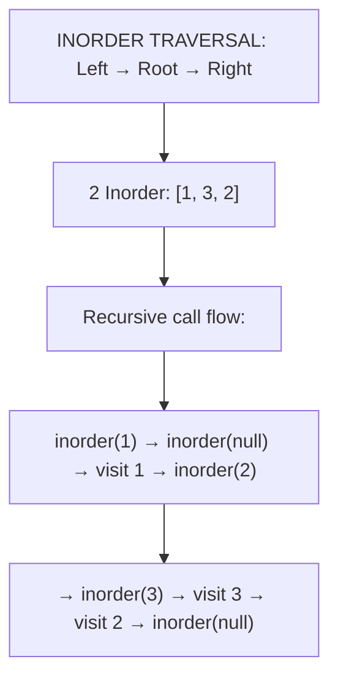

**Solution (Recursive):**

```java
public List<Integer> inorderTraversal(TreeNode root) {
    List<Integer> result = new ArrayList<>();
    inorder(root, result);
    return result;
}

private void inorder(TreeNode node, List<Integer> result) {
    if (node == null) return;

    inorder(node.left, result);   // Left
    result.add(node.val);          // Root
    inorder(node.right, result);  // Right
}
```

**Solution (Iterative with Stack):**

```java
public List<Integer> inorderTraversal(TreeNode root) {
    List<Integer> result = new ArrayList<>();
    Stack<TreeNode> stack = new Stack<>();
    TreeNode curr = root;

    while (curr != null || !stack.isEmpty()) {
        // Go to leftmost
        while (curr != null) {
            stack.push(curr);
            curr = curr.left;
        }

        // Process node
        curr = stack.pop();
        result.add(curr.val);

        // Move to right subtree
        curr = curr.right;
    }

    return result;
}
```

---

### Problem 105: Binary Tree Preorder Traversal

**LeetCode 144** 🔗 https://leetcode.com/problems/binary-tree-preorder-traversal/

```
┌────────────────────────────────────────────────────────────────┐
│  PREORDER TRAVERSAL: Root → Left → Right                       │
├────────────────────────────────────────────────────────────────┤
│        1                                                       │
│       / \                                                      │
│      2   3        Preorder: [1, 2, 4, 5, 3]                    │
│     / \                                                        │
│    4   5                                                       │
│                                                                │
│  Process order: 1 → 2 → 4 → 5 → 3                              │
└────────────────────────────────────────────────────────────────┘
```

> **Flow**: PREORDER TRAVERSAL: Root → Left → Right → 2 3 Preorder: [1, 2, 4, 5, 3] | 2 3 Preorder: [1, 2, 4, 5, 3] → Process order: 1 → 2 → 4 → 5 → 3

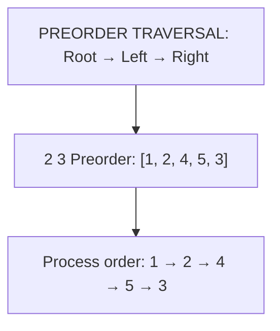

**Solution (Iterative):**

```java
public List<Integer> preorderTraversal(TreeNode root) {
    List<Integer> result = new ArrayList<>();
    if (root == null) return result;

    Stack<TreeNode> stack = new Stack<>();
    stack.push(root);

    while (!stack.isEmpty()) {
        TreeNode node = stack.pop();
        result.add(node.val);  // Process root first

        // Push right first so left is processed first
        if (node.right != null) stack.push(node.right);
        if (node.left != null) stack.push(node.left);
    }

    return result;
}
```

---

### Problem 106: Binary Tree Postorder Traversal

**LeetCode 145** 🔗 https://leetcode.com/problems/binary-tree-postorder-traversal/

```
┌────────────────────────────────────────────────────────────────┐
│  POSTORDER TRAVERSAL: Left → Right → Root                      │
├────────────────────────────────────────────────────────────────┤
│        1                                                       │
│       / \                                                      │
│      2   3        Postorder: [4, 5, 2, 3, 1]                   │
│     / \                                                        │
│    4   5                                                       │
│                                                                │
│  Trick: Reverse of (Root → Right → Left)                       │
│  Modified preorder: 1→3→2→5→4 then reverse → 4,5,2,3,1         │
└────────────────────────────────────────────────────────────────┘
```

> **Flow**: POSTORDER TRAVERSAL: Left → Right → Root → 2 3 Postorder: [4, 5, 2, 3, 1] | 2 3 Postorder: [4, 5, 2, 3, 1] → Trick: Reverse of (Root → Right → Left) | Trick: Reverse of (Root → Right → Left) → Modified preorder: 1→3→2→5→4 then reverse → 4,5,2,3,1

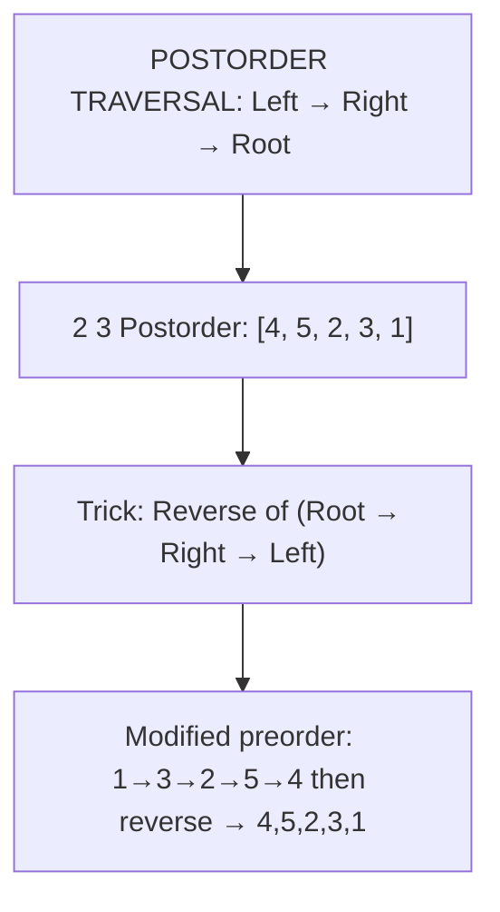

**Solution:**

```java
public List<Integer> postorderTraversal(TreeNode root) {
    LinkedList<Integer> result = new LinkedList<>();
    if (root == null) return result;

    Stack<TreeNode> stack = new Stack<>();
    stack.push(root);

    while (!stack.isEmpty()) {
        TreeNode node = stack.pop();
        result.addFirst(node.val);  // Add to front (reverse)

        // Push left first, then right
        if (node.left != null) stack.push(node.left);
        if (node.right != null) stack.push(node.right);
    }

    return result;
}
```

---

### Problem 107: Binary Tree Level Order Traversal

**LeetCode 102** 🔗 https://leetcode.com/problems/binary-tree-level-order-traversal/

```
┌────────────────────────────────────────────────────────────────┐
│  LEVEL ORDER TRAVERSAL (BFS)                                   │
├────────────────────────────────────────────────────────────────┤
│        3         Level 0: [3]                                  │
│       / \        Level 1: [9, 20]                              │
│      9  20       Level 2: [15, 7]                              │
│        /  \                                                    │
│       15   7     Output: [[3], [9,20], [15,7]]                 │
│                                                                │
│  BFS with Queue:                                               │
│  ┌───────────────────────────────────────────────────────────┐ │
│  │ Step │ Queue              │ Level Output                  │ │
│  ├──────┼────────────────────┼───────────────────────────────┤ │
│  │  1   │ [3]                │ Process: [3]                  │ │
│  │  2   │ [9, 20]            │ Process: [9, 20]              │ │
│  │  3   │ [15, 7]            │ Process: [15, 7]              │ │
│  └───────────────────────────────────────────────────────────┘ │
└────────────────────────────────────────────────────────────────┘
```

> **Flow**: LEVEL ORDER TRAVERSAL (BFS) → 3 Level 0: [3] | 3 Level 0: [3] → / \ Level 1: [9, 20] | / \ Level 1: [9, 20] → 9 20 Level 2: [15, 7] | 9 20 Level 2: [15, 7] → 15 7 Output: [[3], [9,20], [15,7]] | 15 7 Output: [[3], [9,20], [15,7]] → BFS with Queue: | BFS with Queue: → Step Queue Level Output | ...+1 more

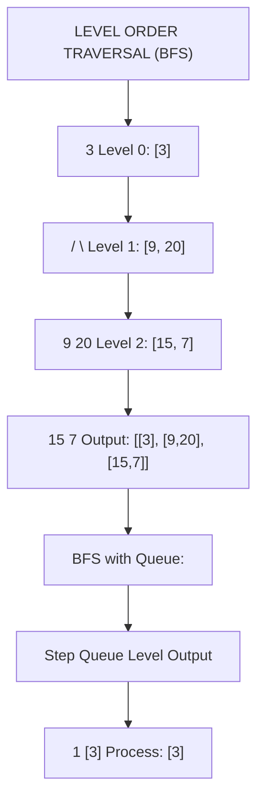

**Solution:**

```java
public List<List<Integer>> levelOrder(TreeNode root) {
    List<List<Integer>> result = new ArrayList<>();
    if (root == null) return result;

    Queue<TreeNode> queue = new LinkedList<>();
    queue.offer(root);

    while (!queue.isEmpty()) {
        int levelSize = queue.size();
        List<Integer> currentLevel = new ArrayList<>();

        for (int i = 0; i < levelSize; i++) {
            TreeNode node = queue.poll();
            currentLevel.add(node.val);

            if (node.left != null) queue.offer(node.left);
            if (node.right != null) queue.offer(node.right);
        }

        result.add(currentLevel);
    }

    return result;
}
```

---

### Problem 108: Binary Tree Zigzag Level Order Traversal

**LeetCode 103** 🔗 https://leetcode.com/problems/binary-tree-zigzag-level-order-traversal/

```
┌────────────────────────────────────────────────────────────────┐
│  ZIGZAG LEVEL ORDER                                            │
├────────────────────────────────────────────────────────────────┤
│        3         Level 0 (→): [3]                              │
│       / \        Level 1 (←): [20, 9]                          │
│      9  20       Level 2 (→): [15, 7]                          │
│        /  \                                                    │
│       15   7     Output: [[3], [20,9], [15,7]]                 │
│                                                                │
│  Alternate direction each level                                │
└────────────────────────────────────────────────────────────────┘
```

> **Flow**: ZIGZAG LEVEL ORDER → 3 Level 0 (→): [3] | 3 Level 0 (→): [3] → / \ Level 1 (←): [20, 9] | / \ Level 1 (←): [20, 9] → 9 20 Level 2 (→): [15, 7] | 9 20 Level 2 (→): [15, 7] → 15 7 Output: [[3], [20,9], [15,7]] | 15 7 Output: [[3], [20,9], [15,7]] → Alternate direction each level

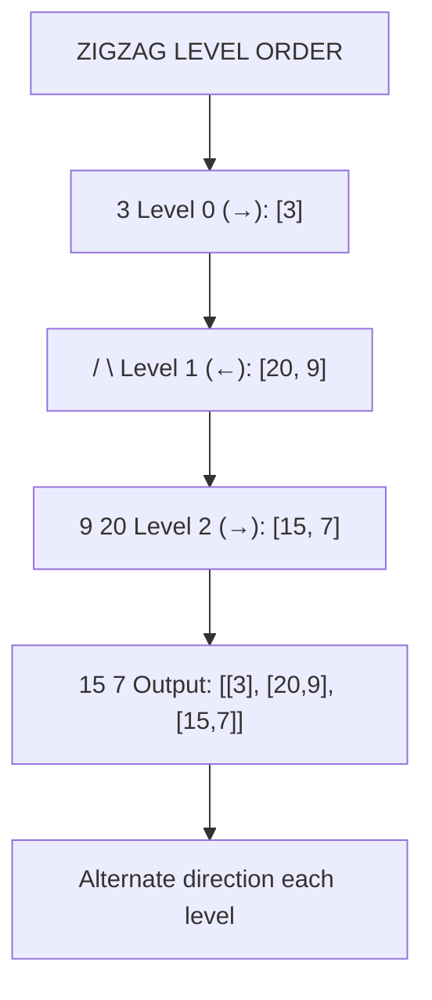

**Solution:**

```java
public List<List<Integer>> zigzagLevelOrder(TreeNode root) {
    List<List<Integer>> result = new ArrayList<>();
    if (root == null) return result;

    Queue<TreeNode> queue = new LinkedList<>();
    queue.offer(root);
    boolean leftToRight = true;

    while (!queue.isEmpty()) {
        int levelSize = queue.size();
        LinkedList<Integer> currentLevel = new LinkedList<>();

        for (int i = 0; i < levelSize; i++) {
            TreeNode node = queue.poll();

            if (leftToRight) {
                currentLevel.addLast(node.val);
            } else {
                currentLevel.addFirst(node.val);
            }

            if (node.left != null) queue.offer(node.left);
            if (node.right != null) queue.offer(node.right);
        }

        result.add(currentLevel);
        leftToRight = !leftToRight;
    }

    return result;
}
```

---

### Problem 109: 🔒 Binary Tree Vertical Order Traversal (LeetCode 314 - Premium)

```
┌────────────────────────────────────────────────────────────────┐
│  VERTICAL ORDER TRAVERSAL                                      │
├────────────────────────────────────────────────────────────────┤
│  Given a binary tree, return the vertical order traversal      │
│  of its nodes' values (column by column from left to right).   │
│  If nodes are in the same row and column, order left to right. │
│                                                                │
│        3 (col 0)                                               │
│       / \                                                      │
│      9   20      Column mapping:                               │
│     /   /  \     col -2: [4]                                   │
│    4   15   7    col -1: [9]                                   │
│       /          col  0: [3, 15]                               │
│      5           col  1: [20, 5]                               │
│                  col  2: [7]                                   │
│                                                                │
│  Output: [[4], [9], [3,15], [20,5], [7]]                       │
│                                                                │
│  Constraints:                                                  │
│  - Number of nodes in range [0, 100]                           │
│  - -100 <= Node.val <= 100                                     │
└────────────────────────────────────────────────────────────────┘
```

> **Flow**: VERTICAL ORDER TRAVERSAL → Given a binary tree, return the vertical order traversa | Given a binary tree, return the vertical order traversa → of its nodes' values (column by column from left to rig | of its nodes' values (column by column from left to rig → 3 (col 0) | 3 (col 0) → 9 20 Column mapping: | 9 20 Column mapping: → / / \ col -2: [4] | / / \ col -2: [4] → 4 15 7 col -1: [9] | ...+1 more

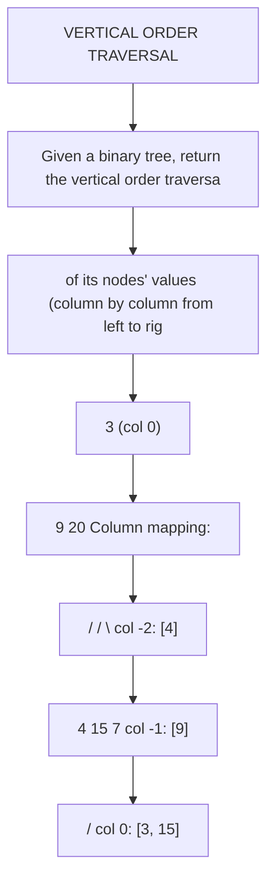

**Solution:**

```java
public List<List<Integer>> verticalOrder(TreeNode root) {
    List<List<Integer>> result = new ArrayList<>();
    if (root == null) return result;

    Map<Integer, List<Integer>> columnMap = new TreeMap<>();
    Queue<TreeNode> nodeQueue = new LinkedList<>();
    Queue<Integer> colQueue = new LinkedList<>();

    nodeQueue.offer(root);
    colQueue.offer(0);

    while (!nodeQueue.isEmpty()) {
        TreeNode node = nodeQueue.poll();
        int col = colQueue.poll();

        columnMap.computeIfAbsent(col, k -> new ArrayList<>()).add(node.val);

        if (node.left != null) {
            nodeQueue.offer(node.left);
            colQueue.offer(col - 1);
        }
        if (node.right != null) {
            nodeQueue.offer(node.right);
            colQueue.offer(col + 1);
        }
    }

    result.addAll(columnMap.values());
    return result;
}
```

---

## 8.2 Tree Property Problems

> **Pattern:** Bottom-up recursion — ask children for their info, combine at parent.
> **Template:** `int helper(node) { left = helper(left); right = helper(right); return combine(left, right); }`
> **Key insight:** The answer at every node depends on the answer from BOTH children. Think: "What do I need from my children to answer for myself?"

### Problem 110: Maximum Depth of Binary Tree

**LeetCode 104** 🔗 https://leetcode.com/problems/maximum-depth-of-binary-tree/

```
┌────────────────────────────────────────────────────────────────┐
│  MAXIMUM DEPTH (Height)                                        │
├────────────────────────────────────────────────────────────────┤
│        3          depth = 1 + max(depth(left), depth(right))   │
│       / \                                                      │
│      9  20        depth(3) = 1 + max(1, 2) = 3                 │
│        /  \       depth(9) = 1 + max(0, 0) = 1                 │
│       15   7      depth(20) = 1 + max(1, 1) = 2                │
│                                                                │
│  Maximum Depth = 3                                             │
└────────────────────────────────────────────────────────────────┘
```

> **Flow**: MAXIMUM DEPTH (Height) → 3 depth = 1 + max(depth(left), depth(right)) | 3 depth = 1 + max(depth(left), depth(right)) → 9 20 depth(3) = 1 + max(1, 2) = 3 | 9 20 depth(3) = 1 + max(1, 2) = 3 → / \ depth(9) = 1 + max(0, 0) = 1 | / \ depth(9) = 1 + max(0, 0) = 1 → 15 7 depth(20) = 1 + max(1, 1) = 2 | 15 7 depth(20) = 1 + max(1, 1) = 2 → Maximum Depth = 3

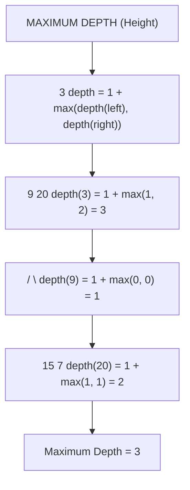

**Solution:**

```java
public int maxDepth(TreeNode root) {
    if (root == null) return 0;

    int leftDepth = maxDepth(root.left);
    int rightDepth = maxDepth(root.right);

    return 1 + Math.max(leftDepth, rightDepth);
}

// Iterative BFS approach
public int maxDepthBFS(TreeNode root) {
    if (root == null) return 0;

    Queue<TreeNode> queue = new LinkedList<>();
    queue.offer(root);
    int depth = 0;

    while (!queue.isEmpty()) {
        int levelSize = queue.size();
        depth++;

        for (int i = 0; i < levelSize; i++) {
            TreeNode node = queue.poll();
            if (node.left != null) queue.offer(node.left);
            if (node.right != null) queue.offer(node.right);
        }
    }

    return depth;
}
```

---

### Problem 111: Minimum Depth of Binary Tree

**LeetCode 111** 🔗 https://leetcode.com/problems/minimum-depth-of-binary-tree/

```
┌────────────────────────────────────────────────────────────────┐
│  MINIMUM DEPTH - Shortest path from root to leaf               │
├────────────────────────────────────────────────────────────────┤
│        3                    3                                  │
│       / \                    \                                 │
│      9  20                   20                                │
│        /  \                 /  \                               │
│       15   7               15   7                              │
│                                                                │
│  Min depth = 2           Min depth = 3 (not 1!)                │
│  (3→9 is leaf)           (3 is not a leaf)                     │
│                                                                │
│  ⚠️ TRAP: If one child is null, use the other child's depth    │
└────────────────────────────────────────────────────────────────┘
```

> **Flow**: MINIMUM DEPTH - Shortest path from root to leaf → Min depth = 2 Min depth = 3 (not 1!) | Min depth = 2 Min depth = 3 (not 1!) → (3→9 is leaf) (3 is not a leaf) | (3→9 is leaf) (3 is not a leaf) → ⚠️ TRAP: If one child is null, use the other child's de

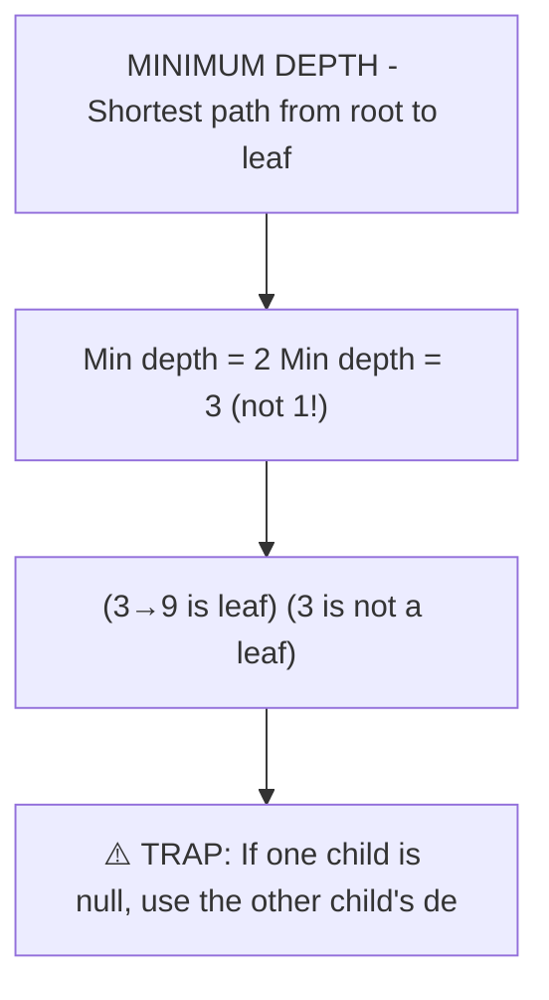

**Solution:**

```java
public int minDepth(TreeNode root) {
    if (root == null) return 0;

    // If only one child exists, must go through that child
    if (root.left == null) return 1 + minDepth(root.right);
    if (root.right == null) return 1 + minDepth(root.left);

    return 1 + Math.min(minDepth(root.left), minDepth(root.right));
}

// BFS is more efficient - finds first leaf
public int minDepthBFS(TreeNode root) {
    if (root == null) return 0;

    Queue<TreeNode> queue = new LinkedList<>();
    queue.offer(root);
    int depth = 0;

    while (!queue.isEmpty()) {
        depth++;
        int levelSize = queue.size();

        for (int i = 0; i < levelSize; i++) {
            TreeNode node = queue.poll();

            // Found first leaf!
            if (node.left == null && node.right == null) {
                return depth;
            }

            if (node.left != null) queue.offer(node.left);
            if (node.right != null) queue.offer(node.right);
        }
    }

    return depth;
}
```

---

### Problem 112: Balanced Binary Tree

**LeetCode 110** 🔗 https://leetcode.com/problems/balanced-binary-tree/

```
┌────────────────────────────────────────────────────────────────┐
│  BALANCED BINARY TREE                                          │
├────────────────────────────────────────────────────────────────┤
│  A tree is balanced if for every node, the height difference   │
│  between left and right subtrees is at most 1.                 │
│                                                                │
│  Balanced:              Unbalanced:                            │
│        3                      1                                │
│       / \                      \                               │
│      9  20                      2                              │
│        /  \                      \                             │
│       15   7                      3                            │
│                                    \                           │
│  |h(L) - h(R)| <= 1               4 ← depth diff > 1           │
└────────────────────────────────────────────────────────────────┘
```

> **Flow**: BALANCED BINARY TREE → A tree is balanced if for every node, the height differ | A tree is balanced if for every node, the height differ → between left and right subtrees is at most 1. | between left and right subtrees is at most 1. → Balanced: Unbalanced: | Balanced: Unbalanced: → |h(L) - h(R)| &lt;= 1 4 ← depth diff &gt; 1

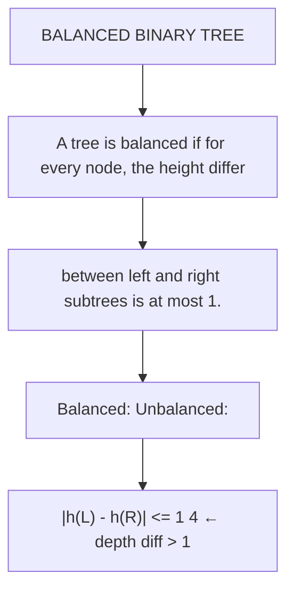

**Solution:**

```java
public boolean isBalanced(TreeNode root) {
    return checkHeight(root) != -1;
}

private int checkHeight(TreeNode node) {
    if (node == null) return 0;

    int leftHeight = checkHeight(node.left);
    if (leftHeight == -1) return -1;  // Left subtree unbalanced

    int rightHeight = checkHeight(node.right);
    if (rightHeight == -1) return -1;  // Right subtree unbalanced

    // Check current node balance
    if (Math.abs(leftHeight - rightHeight) > 1) return -1;

    return 1 + Math.max(leftHeight, rightHeight);
}
```

---

### Problem 113: Same Tree

**LeetCode 100** 🔗 https://leetcode.com/problems/same-tree/

```
┌────────────────────────────────────────────────────────────────┐
│  SAME TREE - Check if two trees are identical                  │
├────────────────────────────────────────────────────────────────┤
│      1         1                    1         1                │
│     / \       / \                  / \       / \               │
│    2   3     2   3                2   1     1   2              │
│                                                                │
│  Same: true                      Same: false                   │
│                                  (structure same, values diff) │
└────────────────────────────────────────────────────────────────┘
```

> **Flow**: SAME TREE - Check if two trees are identical → Same: true Same: false | Same: true Same: false → (structure same, values diff)

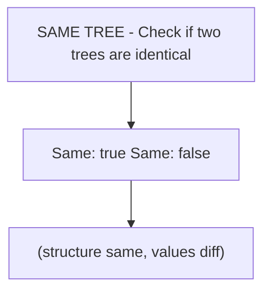

**Solution:**

```java
public boolean isSameTree(TreeNode p, TreeNode q) {
    // Both null
    if (p == null && q == null) return true;

    // One null, other not
    if (p == null || q == null) return false;

    // Values different
    if (p.val != q.val) return false;

    // Check both subtrees
    return isSameTree(p.left, q.left) && isSameTree(p.right, q.right);
}
```

---

### Problem 114: Symmetric Tree

**LeetCode 101** 🔗 https://leetcode.com/problems/symmetric-tree/

```
┌────────────────────────────────────────────────────────────────┐
│  SYMMETRIC TREE - Mirror image of itself                       │
├────────────────────────────────────────────────────────────────┤
│  Symmetric:                    Not Symmetric:                  │
│        1                            1                          │
│       / \                          / \                         │
│      2   2                        2   2                        │
│     / \ / \                        \   \                       │
│    3  4 4  3                        3   3                      │
│                                                                │
│  Check: left.left == right.right AND left.right == right.left  │
└────────────────────────────────────────────────────────────────┘
```

> **Flow**: SYMMETRIC TREE - Mirror image of itself → Symmetric: Not Symmetric:

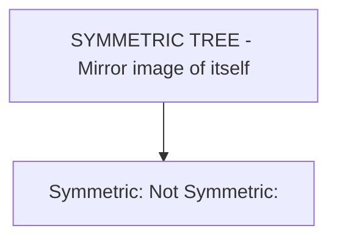

**Solution:**

```java
public boolean isSymmetric(TreeNode root) {
    if (root == null) return true;
    return isMirror(root.left, root.right);
}

private boolean isMirror(TreeNode left, TreeNode right) {
    if (left == null && right == null) return true;
    if (left == null || right == null) return false;

    return (left.val == right.val) &&
           isMirror(left.left, right.right) &&
           isMirror(left.right, right.left);
}

// Iterative with Queue
public boolean isSymmetricIterative(TreeNode root) {
    if (root == null) return true;

    Queue<TreeNode> queue = new LinkedList<>();
    queue.offer(root.left);
    queue.offer(root.right);

    while (!queue.isEmpty()) {
        TreeNode left = queue.poll();
        TreeNode right = queue.poll();

        if (left == null && right == null) continue;
        if (left == null || right == null) return false;
        if (left.val != right.val) return false;

        queue.offer(left.left);
        queue.offer(right.right);
        queue.offer(left.right);
        queue.offer(right.left);
    }

    return true;
}
```

---

### Problem 115: Invert Binary Tree

**LeetCode 226** 🔗 https://leetcode.com/problems/invert-binary-tree/

```
┌────────────────────────────────────────────────────────────────┐
│  INVERT BINARY TREE - Mirror/Flip the tree                     │
├────────────────────────────────────────────────────────────────┤
│  Input:           Output:                                      │
│       4               4                                        │
│      / \             / \                                       │
│     2   7    →      7   2                                      │
│    / \ / \         / \ / \                                     │
│   1  3 6  9       9  6 3  1                                    │
│                                                                │
│  At each node: swap left and right children                    │
└────────────────────────────────────────────────────────────────┘
```

> **Flow**: INVERT BINARY TREE - Mirror/Flip the tree → Input: Output: | Input: Output: → At each node: swap left and right children

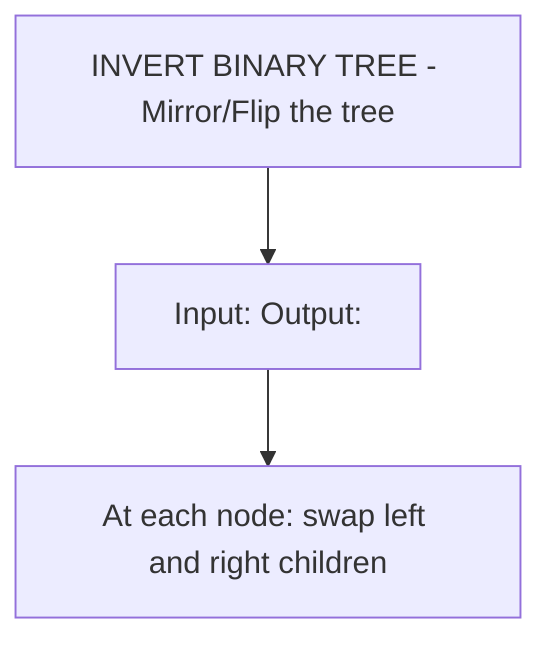

**Solution:**

```java
public TreeNode invertTree(TreeNode root) {
    if (root == null) return null;

    // Swap children
    TreeNode temp = root.left;
    root.left = root.right;
    root.right = temp;

    // Recursively invert subtrees
    invertTree(root.left);
    invertTree(root.right);

    return root;
}
```

---

## 8.3 Path & Sum Problems

> **Pattern:** Top-down state passing — carry a running sum/path from root downward.
> **Template:** `void dfs(node, remainingSum) { if leaf and sum==0: found! dfs(left, sum-val); dfs(right, sum-val); }`
> **Key insight:** Pass the TARGET minus current value down. At a leaf, check if target reached 0.
> **Hardest problem here:** #119 Max Path Sum — uses BOTH top-down and bottom-up. Global variable tracks the best "arch" path.

### Problem 116: Path Sum

**LeetCode 112** 🔗 https://leetcode.com/problems/path-sum/

```
┌────────────────────────────────────────────────────────────────┐
│  PATH SUM - Root to leaf path with target sum                  │
├────────────────────────────────────────────────────────────────┤
│  targetSum = 22                                                │
│                                                                │
│         5                                                      │
│        / \                                                     │
│       4   8         Path: 5→4→11→2 = 22 ✓                      │
│      /   / \                                                   │
│     11  13  4                                                  │
│    /  \      \                                                 │
│   7    2      1                                                │
│                                                                │
│  ⚠️ Must reach a LEAF node (no children)                       │
└────────────────────────────────────────────────────────────────┘
```

> **Flow**: PATH SUM - Root to leaf path with target sum → targetSum = 22 | targetSum = 22 → 4 8 Path: 5→4→11→2 = 22 ✓ | 4 8 Path: 5→4→11→2 = 22 ✓ → ⚠️ Must reach a LEAF node (no children)

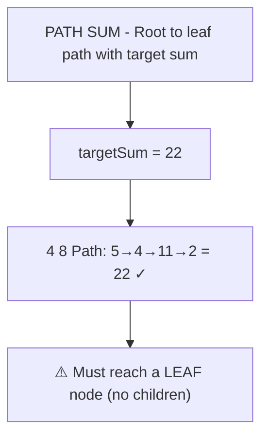

**Solution:**

```java
public boolean hasPathSum(TreeNode root, int targetSum) {
    if (root == null) return false;

    // Reached a leaf
    if (root.left == null && root.right == null) {
        return root.val == targetSum;
    }

    // Continue to children with reduced sum
    int remaining = targetSum - root.val;
    return hasPathSum(root.left, remaining) ||
           hasPathSum(root.right, remaining);
}
```

---

### Problem 117: Path Sum II

**LeetCode 113** 🔗 https://leetcode.com/problems/path-sum-ii/

```
┌────────────────────────────────────────────────────────────────┐
│  PATH SUM II - Find ALL paths with target sum                  │
├────────────────────────────────────────────────────────────────┤
│  targetSum = 22                                                │
│                                                                │
│         5                                                      │
│        / \                                                     │
│       4   8                                                    │
│      /   / \                                                   │
│     11  13  4                                                  │
│    /  \    / \                                                 │
│   7    2  5   1                                                │
│                                                                │
│  Output: [[5,4,11,2], [5,8,4,5]]                               │
└────────────────────────────────────────────────────────────────┘
```

> **Flow**: PATH SUM II - Find ALL paths with target sum → targetSum = 22 | targetSum = 22 → Output: [[5,4,11,2], [5,8,4,5]]

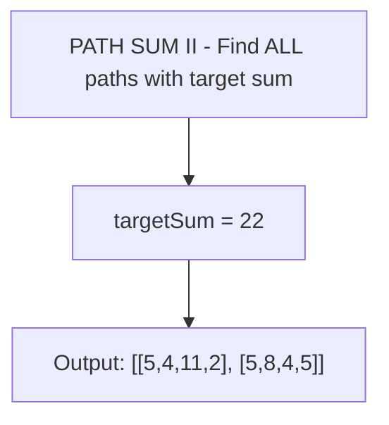

**Solution:**

```java
public List<List<Integer>> pathSum(TreeNode root, int targetSum) {
    List<List<Integer>> result = new ArrayList<>();
    backtrack(root, targetSum, new ArrayList<>(), result);
    return result;
}

private void backtrack(TreeNode node, int remaining,
                       List<Integer> path, List<List<Integer>> result) {
    if (node == null) return;

    path.add(node.val);

    // Found valid path to leaf
    if (node.left == null && node.right == null && node.val == remaining) {
        result.add(new ArrayList<>(path));
    } else {
        backtrack(node.left, remaining - node.val, path, result);
        backtrack(node.right, remaining - node.val, path, result);
    }

    // Backtrack
    path.remove(path.size() - 1);
}
```

---

### Problem 118: 🔒 Path Sum III (LeetCode 437)

> 💡 **Approach:** Prefix sum on a tree! Same idea as "Subarray Sum Equals K" but on tree paths.
> Keep a HashMap of `prefix_sum → count` as you traverse down.
> At each node: `count += map.get(currentSum - target)`.
> **Critical:** BACKTRACK the map when returning up (unlike array version).
> **Time:** O(n) | **Space:** O(h)

**LeetCode 437** 🔗 https://leetcode.com/problems/path-sum-iii/

```
┌────────────────────────────────────────────────────────────────┐
│  PATH SUM III - Path doesn't need to start at root or end      │
│  at leaf, but must go downwards                                │
├────────────────────────────────────────────────────────────────┤
│  targetSum = 8                                                 │
│                                                                │
│        10                                                      │
│       /  \                                                     │
│      5   -3                                                    │
│     / \    \                                                   │
│    3   2   11                                                  │
│   / \   \                                                      │
│  3  -2   1                                                     │
│                                                                │
│  Paths that sum to 8:                                          │
│  1. 5→3 = 8                                                    │
│  2. 5→2→1 = 8                                                  │
│  3. -3→11 = 8                                                  │
│  Output: 3                                                     │
│                                                                │
│  Use Prefix Sum technique with HashMap!                        │
└────────────────────────────────────────────────────────────────┘
```

> **Flow**: PATH SUM III - Path doesn't need to start at root or en → at leaf, but must go downwards | at leaf, but must go downwards → targetSum = 8 | targetSum = 8 → Paths that sum to 8: | Paths that sum to 8: → Output: 3 | Output: 3 → Use Prefix Sum technique with HashMap!

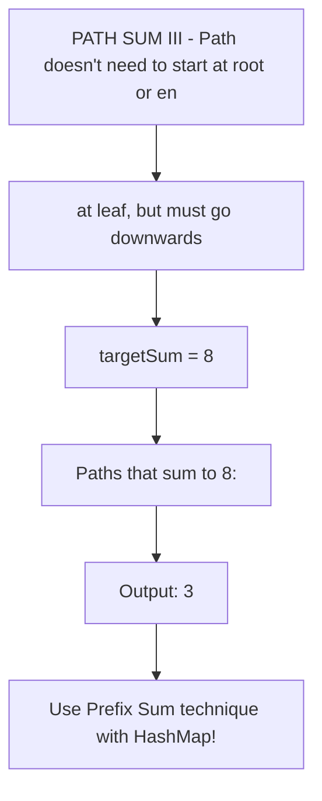

**Solution:**

```java
public int pathSum(TreeNode root, int targetSum) {
    Map<Long, Integer> prefixSumCount = new HashMap<>();
    prefixSumCount.put(0L, 1);  // Empty path

    return dfs(root, 0, targetSum, prefixSumCount);
}

private int dfs(TreeNode node, long currentSum, int target,
                Map<Long, Integer> prefixSumCount) {
    if (node == null) return 0;

    currentSum += node.val;

    // Check if (currentSum - target) exists as a previous prefix sum
    int count = prefixSumCount.getOrDefault(currentSum - target, 0);

    // Add current prefix sum to map
    prefixSumCount.merge(currentSum, 1, Integer::sum);

    // Recurse
    count += dfs(node.left, currentSum, target, prefixSumCount);
    count += dfs(node.right, currentSum, target, prefixSumCount);

    // Backtrack - remove current prefix sum
    prefixSumCount.merge(currentSum, -1, Integer::sum);

    return count;
}
```

---

### Problem 119: Binary Tree Maximum Path Sum

> 💡 **Approach:** This is the HARDEST tree problem. Uses bottom-up return + global tracking.
> At each node: return the best single-arm path upward (node + max(left, right)).
> But also check if using BOTH arms (left + node + right) beats the global max.
> **Key trick:** `Math.max(gain, 0)` — ignore negative subtrees entirely.
> **Time:** O(n) | **Space:** O(h)

**LeetCode 124** 🔗 https://leetcode.com/problems/binary-tree-maximum-path-sum/

```
┌────────────────────────────────────────────────────────────────┐
│  MAXIMUM PATH SUM - Path can start and end at any node         │
├────────────────────────────────────────────────────────────────┤
│      -10                                                       │
│      /  \                                                      │
│     9   20                                                     │
│        /  \                                                    │
│       15   7                                                   │
│                                                                │
│  Max path: 15→20→7 = 42                                        │
│                                                                │
│  At each node, we can:                                         │
│  1. Include node + left path                                   │
│  2. Include node + right path                                  │
│  3. Include node + both paths (forms arch)                     │
│  4. Just the node itself                                       │
│                                                                │
│  ⚠️ Path that goes through root can't extend further up        │
└────────────────────────────────────────────────────────────────┘
```

> **Flow**: MAXIMUM PATH SUM - Path can start and end at any node → Max path: 15→20→7 = 42 | Max path: 15→20→7 = 42 → At each node, we can: | At each node, we can: → 1. Include node + left path | 1. Include node + left path → 2. Include node + right path | 2. Include node + right path → 3. Include node + both paths (forms arch) | 3. Include node + both paths (forms arch) → 4. Just the node itself | ...+1 more

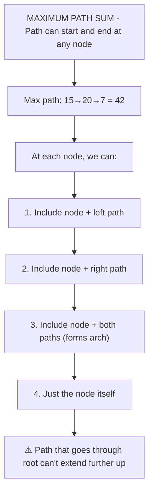

**Solution:**

```java
private int maxSum;

public int maxPathSum(TreeNode root) {
    maxSum = Integer.MIN_VALUE;
    maxGain(root);
    return maxSum;
}

private int maxGain(TreeNode node) {
    if (node == null) return 0;

    // Max sum of left/right paths (ignore negative paths)
    int leftGain = Math.max(maxGain(node.left), 0);
    int rightGain = Math.max(maxGain(node.right), 0);

    // Path through current node (arch shape)
    int pathThroughNode = node.val + leftGain + rightGain;
    maxSum = Math.max(maxSum, pathThroughNode);

    // Return max path starting from this node going down one side
    return node.val + Math.max(leftGain, rightGain);
}
```

---

### Problem 120: Diameter of Binary Tree

**LeetCode 543** 🔗 https://leetcode.com/problems/diameter-of-binary-tree/

```
┌────────────────────────────────────────────────────────────────┐
│  DIAMETER - Longest path between any two nodes (in edges)      │
├────────────────────────────────────────────────────────────────┤
│          1                                                     │
│         / \                                                    │
│        2   3                                                   │
│       / \                                                      │
│      4   5                                                     │
│                                                                │
│  Longest path: 4→2→1→3 or 5→2→1→3 = 3 edges                    │
│  Diameter = 3                                                  │
│                                                                │
│  Note: Path may NOT pass through root!                         │
│          1                                                     │
│         /                                                      │
│        2        Diameter = 4→2→5→6→7 = 4                       │
│       / \                                                      │
│      4   5                                                     │
│         / \                                                    │
│        6   7                                                   │
└────────────────────────────────────────────────────────────────┘
```

> **Flow**: DIAMETER - Longest path between any two nodes (in edges → Longest path: 4→2→1→3 or 5→2→1→3 = 3 edges | Longest path: 4→2→1→3 or 5→2→1→3 = 3 edges → Diameter = 3 | Diameter = 3 → Note: Path may NOT pass through root! | Note: Path may NOT pass through root! → 2 Diameter = 4→2→5→6→7 = 4

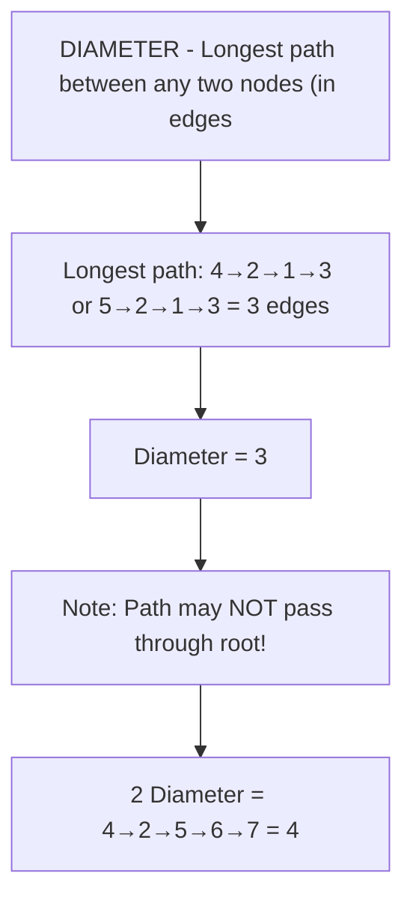

**Solution:**

```java
private int diameter;

public int diameterOfBinaryTree(TreeNode root) {
    diameter = 0;
    depth(root);
    return diameter;
}

private int depth(TreeNode node) {
    if (node == null) return 0;

    int leftDepth = depth(node.left);
    int rightDepth = depth(node.right);

    // Diameter through this node = left depth + right depth
    diameter = Math.max(diameter, leftDepth + rightDepth);

    return 1 + Math.max(leftDepth, rightDepth);
}
```

---

## 8.4 Binary Search Tree (BST) Problems

```
┌────────────────────────────────────────────────────────────────┐
│  BINARY SEARCH TREE PROPERTY                                   │
├────────────────────────────────────────────────────────────────┤
│  For every node:                                               │
│  - All values in LEFT subtree < node value                     │
│  - All values in RIGHT subtree > node value                    │
│                                                                │
│         8                                                      │
│        / \                                                     │
│       3   10        Valid BST:                                 │
│      / \    \       - Left of 8: {1,3,6} all < 8               │
│     1   6    14     - Right of 8: {10,14} all > 8              │
│        / \   /      - Inorder: 1,3,6,8,10,13,14 (sorted!)      │
│       4   7 13                                                 │
└────────────────────────────────────────────────────────────────┘
```

> **Flow**: BINARY SEARCH TREE PROPERTY → For every node: | For every node: → - All values in LEFT subtree &lt; node value | - All values in LEFT subtree &lt; node value → - All values in RIGHT subtree &gt; node value | - All values in RIGHT subtree &gt; node value → 3 10 Valid BST: | 3 10 Valid BST: → / \ \ - Left of 8: {1,3,6} all &lt; 8 | / \ \ - Left of 8: {1,3,6} all &lt; 8 → 1 6 14 - Right of 8: {10,14} all &gt; 8 | ...+1 more

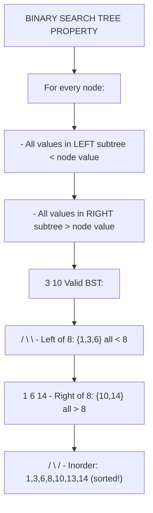

---

### Problem 121: Validate Binary Search Tree

**LeetCode 98** 🔗 https://leetcode.com/problems/validate-binary-search-tree/

```
┌────────────────────────────────────────────────────────────────┐
│  VALIDATE BST                                                  │
├────────────────────────────────────────────────────────────────┤
│  Valid BST:           Invalid BST:                             │
│       2                    5                                   │
│      / \                  / \                                  │
│     1   3                1   4  ← 4 < 5 but 3 > right val!     │
│                             / \                                │
│  true                      3   6                               │
│                                                                │
│  ⚠️ Common mistake: Only checking immediate children           │
│  Must check against valid RANGE for each node                  │
└────────────────────────────────────────────────────────────────┘
```

> **Flow**: VALIDATE BST → Valid BST: Invalid BST: | Valid BST: Invalid BST: → 1 3 1 4 ← 4 &lt; 5 but 3 &gt; right val! | 1 3 1 4 ← 4 &lt; 5 but 3 &gt; right val! → true 3 6 | true 3 6 → ⚠️ Common mistake: Only checking immediate children | ⚠️ Common mistake: Only checking immediate children → Must check against valid RANGE for each node

```mermaid
flowchart TD
    N1["VALIDATE BST"]
    N2["Valid BST: Invalid BST:"]
    N3["1 3 1 4 ← 4 &lt; 5 but 3 &gt; right val!"]
    N4["true 3 6"]
    N5["⚠️ Common mistake: Only checking immediate children"]
    N6["Must check against valid RANGE for each node"]
    N1 --> N2
    N2 --> N3
    N3 --> N4
    N4 --> N5
    N5 --> N6
```

**Solution:**

```java
public boolean isValidBST(TreeNode root) {
    return validate(root, Long.MIN_VALUE, Long.MAX_VALUE);
}

private boolean validate(TreeNode node, long min, long max) {
    if (node == null) return true;

    // Check if value is within valid range
    if (node.val <= min || node.val >= max) return false;

    // Left subtree: all values must be < node.val
    // Right subtree: all values must be > node.val
    return validate(node.left, min, node.val) &&
           validate(node.right, node.val, max);
}

// Alternative: Inorder traversal should be sorted
public boolean isValidBSTInorder(TreeNode root) {
    Stack<TreeNode> stack = new Stack<>();
    TreeNode prev = null;
    TreeNode curr = root;

    while (curr != null || !stack.isEmpty()) {
        while (curr != null) {
            stack.push(curr);
            curr = curr.left;
        }

        curr = stack.pop();

        // Check if inorder is sorted
        if (prev != null && curr.val <= prev.val) return false;
        prev = curr;

        curr = curr.right;
    }

    return true;
}
```

---

### Problem 122: Search in a Binary Search Tree

**LeetCode 700** 🔗 https://leetcode.com/problems/search-in-a-binary-search-tree/

```
┌────────────────────────────────────────────────────────────────┐
│  SEARCH IN BST                                                 │
├────────────────────────────────────────────────────────────────┤
│       4                  Search for 2:                         │
│      / \                 4 > 2 → go left                       │
│     2   7                2 == 2 → found!                       │
│    / \                                                         │
│   1   3                  Return subtree rooted at 2            │
│                                                                │
│  Time: O(h) where h = height (O(log n) for balanced)           │
└────────────────────────────────────────────────────────────────┘
```

> **Flow**: SEARCH IN BST → 4 Search for 2: | 4 Search for 2: → / \ 4 &gt; 2 → go left | / \ 4 &gt; 2 → go left → 2 7 2 == 2 → found! | 2 7 2 == 2 → found! → 1 3 Return subtree rooted at 2 | 1 3 Return subtree rooted at 2 → Time: O(h) where h = height (O(log n) for balanced)

```mermaid
flowchart TD
    N1["SEARCH IN BST"]
    N2["4 Search for 2:"]
    N3["/ \ 4 &gt; 2 → go left"]
    N4["2 7 2 == 2 → found!"]
    N5["1 3 Return subtree rooted at 2"]
    N6["Time: O(h) where h = height (O(log n) for balanced)"]
    N1 --> N2
    N2 --> N3
    N3 --> N4
    N4 --> N5
    N5 --> N6
```

**Solution:**

```java
public TreeNode searchBST(TreeNode root, int val) {
    if (root == null || root.val == val) return root;

    return val < root.val ?
           searchBST(root.left, val) :
           searchBST(root.right, val);
}

// Iterative
public TreeNode searchBSTIterative(TreeNode root, int val) {
    while (root != null && root.val != val) {
        root = val < root.val ? root.left : root.right;
    }
    return root;
}
```

---

### Problem 123: Lowest Common Ancestor of a BST

**LeetCode 235** 🔗 https://leetcode.com/problems/lowest-common-ancestor-of-a-binary-search-tree/

```
┌────────────────────────────────────────────────────────────────┐
│  LOWEST COMMON ANCESTOR (LCA) in BST                           │
├────────────────────────────────────────────────────────────────┤
│         6                                                      │
│        / \                                                     │
│       2   8                                                    │
│      / \ / \                                                   │
│     0  4 7  9         LCA(2, 8) = 6                            │
│       / \             LCA(2, 4) = 2                            │
│      3   5            LCA(3, 5) = 4                            │
│                                                                │
│  BST Property helps:                                           │
│  - If both < node → LCA is in left                             │
│  - If both > node → LCA is in right                            │
│  - Otherwise, current node is LCA (split point)                │
└────────────────────────────────────────────────────────────────┘
```

> **Flow**: LOWEST COMMON ANCESTOR (LCA) in BST → 0 4 7 9 LCA(2, 8) = 6 | 0 4 7 9 LCA(2, 8) = 6 → / \ LCA(2, 4) = 2 | / \ LCA(2, 4) = 2 → 3 5 LCA(3, 5) = 4 | 3 5 LCA(3, 5) = 4 → BST Property helps: | BST Property helps: → - If both &lt; node → LCA is in left | - If both &lt; node → LCA is in left → - If both &gt; node → LCA is in right | ...+1 more

```mermaid
flowchart TD
    N1["LOWEST COMMON ANCESTOR (LCA) in BST"]
    N2["0 4 7 9 LCA(2, 8) = 6"]
    N3["/ \ LCA(2, 4) = 2"]
    N4["3 5 LCA(3, 5) = 4"]
    N5["BST Property helps:"]
    N6["- If both &lt; node → LCA is in left"]
    N7["- If both &gt; node → LCA is in right"]
    N8["- Otherwise, current node is LCA (split point)"]
    N1 --> N2
    N2 --> N3
    N3 --> N4
    N4 --> N5
    N5 --> N6
    N6 --> N7
    N7 --> N8
```

**Solution:**

```java
public TreeNode lowestCommonAncestor(TreeNode root, TreeNode p, TreeNode q) {
    while (root != null) {
        if (p.val < root.val && q.val < root.val) {
            root = root.left;   // Both in left subtree
        } else if (p.val > root.val && q.val > root.val) {
            root = root.right;  // Both in right subtree
        } else {
            return root;  // Split point - this is LCA
        }
    }
    return null;
}
```

---

### Problem 124: Lowest Common Ancestor of a Binary Tree

> 💡 **Approach:** Classic interview question. Recursive post-order traversal.
> For each node: search left subtree and right subtree for p and q.
> If BOTH return non-null → this node is the LCA (p and q are in different subtrees).
> If only ONE returns non-null → that result IS the LCA (both p and q are in same subtree).
> **Why it works:** The FIRST node where p and q "split" into different subtrees must be their LCA.
> **Time:** O(n) | **Space:** O(h)

**LeetCode 236** 🔗 https://leetcode.com/problems/lowest-common-ancestor-of-a-binary-tree/

```
┌────────────────────────────────────────────────────────────────┐
│  LCA in General Binary Tree (not BST)                          │
├────────────────────────────────────────────────────────────────┤
│         3                                                      │
│        / \                                                     │
│       5   1                                                    │
│      / \ / \                                                   │
│     6  2 0  8        LCA(5, 1) = 3                             │
│       / \            LCA(5, 4) = 5                             │
│      7   4           LCA(6, 4) = 5                             │
│                                                                │
│  General approach (no BST property):                           │
│  - Search both subtrees for p and q                            │
│  - If found in different subtrees → current is LCA             │
│  - If both in same subtree → recurse                           │
└────────────────────────────────────────────────────────────────┘
```

> **Flow**: LCA in General Binary Tree (not BST) → 6 2 0 8 LCA(5, 1) = 3 | 6 2 0 8 LCA(5, 1) = 3 → / \ LCA(5, 4) = 5 | / \ LCA(5, 4) = 5 → 7 4 LCA(6, 4) = 5 | 7 4 LCA(6, 4) = 5 → General approach (no BST property): | General approach (no BST property): → - Search both subtrees for p and q | - Search both subtrees for p and q → - If found in different subtrees → current is LCA | ...+1 more

```mermaid
flowchart TD
    N1["LCA in General Binary Tree (not BST)"]
    N2["6 2 0 8 LCA(5, 1) = 3"]
    N3["/ \ LCA(5, 4) = 5"]
    N4["7 4 LCA(6, 4) = 5"]
    N5["General approach (no BST property):"]
    N6["- Search both subtrees for p and q"]
    N7["- If found in different subtrees → current is LCA"]
    N8["- If both in same subtree → recurse"]
    N1 --> N2
    N2 --> N3
    N3 --> N4
    N4 --> N5
    N5 --> N6
    N6 --> N7
    N7 --> N8
```

**Solution:**

```java
public TreeNode lowestCommonAncestor(TreeNode root, TreeNode p, TreeNode q) {
    if (root == null || root == p || root == q) return root;

    TreeNode left = lowestCommonAncestor(root.left, p, q);
    TreeNode right = lowestCommonAncestor(root.right, p, q);

    // p and q found in different subtrees
    if (left != null && right != null) return root;

    // Both in same subtree
    return left != null ? left : right;
}
```

---

### Problem 125: Kth Smallest Element in a BST

**LeetCode 230** 🔗 https://leetcode.com/problems/kth-smallest-element-in-a-bst/

```
┌────────────────────────────────────────────────────────────────┐
│  Kth SMALLEST IN BST                                           │
├────────────────────────────────────────────────────────────────┤
│       3                                                        │
│      / \         Inorder: [1, 2, 3, 4]                         │
│     1   4                                                      │
│      \           k=1 → return 1                                │
│       2          k=2 → return 2                                │
│                  k=3 → return 3                                │
│                                                                │
│  Inorder traversal of BST gives sorted order!                  │
└────────────────────────────────────────────────────────────────┘
```

> **Flow**: Kth SMALLEST IN BST → / \ Inorder: [1, 2, 3, 4] | / \ Inorder: [1, 2, 3, 4] → \ k=1 → return 1 | \ k=1 → return 1 → 2 k=2 → return 2 | 2 k=2 → return 2 → k=3 → return 3 | k=3 → return 3 → Inorder traversal of BST gives sorted order!

```mermaid
flowchart TD
    N1["Kth SMALLEST IN BST"]
    N2["/ \ Inorder: [1, 2, 3, 4]"]
    N3["\ k=1 → return 1"]
    N4["2 k=2 → return 2"]
    N5["k=3 → return 3"]
    N6["Inorder traversal of BST gives sorted order!"]
    N1 --> N2
    N2 --> N3
    N3 --> N4
    N4 --> N5
    N5 --> N6
```

**Solution:**

```java
public int kthSmallest(TreeNode root, int k) {
    Stack<TreeNode> stack = new Stack<>();
    TreeNode curr = root;

    while (curr != null || !stack.isEmpty()) {
        while (curr != null) {
            stack.push(curr);
            curr = curr.left;
        }

        curr = stack.pop();
        k--;

        if (k == 0) return curr.val;

        curr = curr.right;
    }

    return -1;  // k is invalid
}
```

---

### Problem 126: 🔒 Inorder Successor in BST (LeetCode 285 - Premium)

```
┌────────────────────────────────────────────────────────────────┐
│  INORDER SUCCESSOR IN BST                                      │
├────────────────────────────────────────────────────────────────┤
│  Given a BST and a node p, find the in-order successor of      │
│  that node (smallest node greater than p).                     │
│                                                                │
│       5                                                        │
│      / \                                                       │
│     3   6                                                      │
│    / \                                                         │
│   2   4           Successor(3) = 4                             │
│  /                Successor(4) = 5                             │
│ 1                 Successor(6) = null                          │
│                                                                │
│  If p has right child → leftmost in right subtree              │
│  Else → nearest ancestor where p is in left subtree            │
│                                                                │
│  Constraints:                                                  │
│  - Number of nodes: [1, 10^4]                                  │
│  - All node values unique                                      │
│  - p exists in the tree                                        │
└────────────────────────────────────────────────────────────────┘
```

> **Flow**: INORDER SUCCESSOR IN BST → Given a BST and a node p, find the in-order successor o | Given a BST and a node p, find the in-order successor o → that node (smallest node greater than p). | that node (smallest node greater than p). → 2 4 Successor(3) = 4 | 2 4 Successor(3) = 4 → / Successor(4) = 5 | / Successor(4) = 5 → 1 Successor(6) = null | 1 Successor(6) = null → If p has right child → leftmost in right subtree | ...+1 more

```mermaid
flowchart TD
    N1["INORDER SUCCESSOR IN BST"]
    N2["Given a BST and a node p, find the in-order successor o"]
    N3["that node (smallest node greater than p)."]
    N4["2 4 Successor(3) = 4"]
    N5["/ Successor(4) = 5"]
    N6["1 Successor(6) = null"]
    N7["If p has right child → leftmost in right subtree"]
    N8["Else → nearest ancestor where p is in left subtree"]
    N1 --> N2
    N2 --> N3
    N3 --> N4
    N4 --> N5
    N5 --> N6
    N6 --> N7
    N7 --> N8
```

**Solution:**

```java
public TreeNode inorderSuccessor(TreeNode root, TreeNode p) {
    TreeNode successor = null;

    while (root != null) {
        if (p.val < root.val) {
            successor = root;  // Current node could be successor
            root = root.left;
        } else {
            root = root.right;  // Successor must be in right
        }
    }

    return successor;
}
```

---

## 8.5 Tree Construction Problems

> **Pattern:** Divide-and-conquer using traversal properties.
> **Key insight:** Preorder's first element = root. Find that root in inorder → everything left = left subtree, everything right = right subtree. Recurse.
> **Optimization:** Use a HashMap to store inorder indices for O(1) root lookup instead of O(n) scan.

### Problem 127: Construct Binary Tree from Preorder and Inorder

**LeetCode 105** 🔗 https://leetcode.com/problems/construct-binary-tree-from-preorder-and-inorder-traversal/

```
┌─────────────────────────────────────────────────────────────────┐
│  BUILD TREE FROM PREORDER & INORDER                             │
├─────────────────────────────────────────────────────────────────┤
│  preorder = [3, 9, 20, 15, 7]  (Root, Left, Right)              │
│  inorder  = [9, 3, 15, 20, 7]  (Left, Root, Right)              │
│                                                                 │
│  Step 1: First preorder element (3) is ROOT                     │
│  Step 2: Find 3 in inorder → splits left [9] and right [15,20,7]│
│  Step 3: Recursively build subtrees                             │
│                                                                 │
│        3                                                        │
│       / \                                                       │
│      9  20                                                      │
│        /  \                                                     │
│       15   7                                                    │
└─────────────────────────────────────────────────────────────────┘
```

> **Flow**: BUILD TREE FROM PREORDER & INORDER → preorder = [3, 9, 20, 15, 7] (Root, Left, Right) | preorder = [3, 9, 20, 15, 7] (Root, Left, Right) → inorder = [9, 3, 15, 20, 7] (Left, Root, Right) | inorder = [9, 3, 15, 20, 7] (Left, Root, Right) → Step 1: First preorder element (3) is ROOT | Step 1: First preorder element (3) is ROOT → Step 3: Recursively build subtrees

```mermaid
flowchart TD
    N1["BUILD TREE FROM PREORDER & INORDER"]
    N2["preorder = [3, 9, 20, 15, 7] (Root, Left, Right)"]
    N3["inorder = [9, 3, 15, 20, 7] (Left, Root, Right)"]
    N4["Step 1: First preorder element (3) is ROOT"]
    N5["Step 3: Recursively build subtrees"]
    N1 --> N2
    N2 --> N3
    N3 --> N4
    N4 --> N5
```

**Solution:**

```java
private int preorderIndex;
private Map<Integer, Integer> inorderIndexMap;

public TreeNode buildTree(int[] preorder, int[] inorder) {
    preorderIndex = 0;
    inorderIndexMap = new HashMap<>();

    // Store inorder indices for O(1) lookup
    for (int i = 0; i < inorder.length; i++) {
        inorderIndexMap.put(inorder[i], i);
    }

    return build(preorder, 0, inorder.length - 1);
}

private TreeNode build(int[] preorder, int left, int right) {
    if (left > right) return null;

    // Root is next element in preorder
    int rootVal = preorder[preorderIndex++];
    TreeNode root = new TreeNode(rootVal);

    // Find root position in inorder
    int inorderIndex = inorderIndexMap.get(rootVal);

    // Build left subtree (elements before root in inorder)
    root.left = build(preorder, left, inorderIndex - 1);
    // Build right subtree (elements after root in inorder)
    root.right = build(preorder, inorderIndex + 1, right);

    return root;
}
```

---

### Problem 128: Construct Binary Tree from Inorder and Postorder

**LeetCode 106** 🔗 https://leetcode.com/problems/construct-binary-tree-from-inorder-and-postorder-traversal/

```
┌────────────────────────────────────────────────────────────────┐
│  BUILD TREE FROM INORDER & POSTORDER                           │
├────────────────────────────────────────────────────────────────┤
│  inorder   = [9, 3, 15, 20, 7]  (Left, Root, Right)            │
│  postorder = [9, 15, 7, 20, 3]  (Left, Right, Root)            │
│                                                                │
│  LAST postorder element (3) is ROOT                            │
│  Process postorder from END (right to left)                    │
│  Build RIGHT subtree before LEFT (reverse of preorder)         │
│                                                                │
│        3                                                       │
│       / \                                                      │
│      9  20                                                     │
│        /  \                                                    │
│       15   7                                                   │
└────────────────────────────────────────────────────────────────┘
```

> **Flow**: BUILD TREE FROM INORDER & POSTORDER → inorder = [9, 3, 15, 20, 7] (Left, Root, Right) | inorder = [9, 3, 15, 20, 7] (Left, Root, Right) → postorder = [9, 15, 7, 20, 3] (Left, Right, Root) | postorder = [9, 15, 7, 20, 3] (Left, Right, Root) → LAST postorder element (3) is ROOT | LAST postorder element (3) is ROOT → Process postorder from END (right to left) | Process postorder from END (right to left) → Build RIGHT subtree before LEFT (reverse of preorder)

```mermaid
flowchart TD
    N1["BUILD TREE FROM INORDER & POSTORDER"]
    N2["inorder = [9, 3, 15, 20, 7] (Left, Root, Right)"]
    N3["postorder = [9, 15, 7, 20, 3] (Left, Right, Root)"]
    N4["LAST postorder element (3) is ROOT"]
    N5["Process postorder from END (right to left)"]
    N6["Build RIGHT subtree before LEFT (reverse of preorder)"]
    N1 --> N2
    N2 --> N3
    N3 --> N4
    N4 --> N5
    N5 --> N6
```

**Solution:**

```java
private int postorderIndex;
private Map<Integer, Integer> inorderIndexMap;

public TreeNode buildTree(int[] inorder, int[] postorder) {
    postorderIndex = postorder.length - 1;
    inorderIndexMap = new HashMap<>();

    for (int i = 0; i < inorder.length; i++) {
        inorderIndexMap.put(inorder[i], i);
    }

    return build(postorder, 0, inorder.length - 1);
}

private TreeNode build(int[] postorder, int left, int right) {
    if (left > right) return null;

    int rootVal = postorder[postorderIndex--];
    TreeNode root = new TreeNode(rootVal);

    int inorderIndex = inorderIndexMap.get(rootVal);

    // Build RIGHT first (postorder processes right before left)
    root.right = build(postorder, inorderIndex + 1, right);
    root.left = build(postorder, left, inorderIndex - 1);

    return root;
}
```

---

### Problem 129: Serialize and Deserialize Binary Tree

**LeetCode 297** 🔗 https://leetcode.com/problems/serialize-and-deserialize-binary-tree/

```
┌────────────────────────────────────────────────────────────────┐
│  SERIALIZE AND DESERIALIZE BINARY TREE                         │
├────────────────────────────────────────────────────────────────┤
│       1                                                        │
│      / \         Serialize: "1,2,null,null,3,4,null,null,5"    │
│     2   3        (Preorder with null markers)                  │
│        / \                                                     │
│       4   5      Deserialize: Rebuild from string              │
│                                                                │
│  Using preorder traversal with null markers works because      │
│  null positions indicate exact tree structure                  │
└────────────────────────────────────────────────────────────────┘
```

> **Flow**: SERIALIZE AND DESERIALIZE BINARY TREE → / \ Serialize: '1,2,null,null,3,4,null,null,5' | / \ Serialize: '1,2,null,null,3,4,null,null,5' → 2 3 (Preorder with null markers) | 2 3 (Preorder with null markers) → 4 5 Deserialize: Rebuild from string | 4 5 Deserialize: Rebuild from string → Using preorder traversal with null markers works becaus | Using preorder traversal with null markers works becaus → null positions indicate exact tree structure

```mermaid
flowchart TD
    N1["SERIALIZE AND DESERIALIZE BINARY TREE"]
    N2["/ \ Serialize: '1,2,null,null,3,4,null,null,5'"]
    N3["2 3 (Preorder with null markers)"]
    N4["4 5 Deserialize: Rebuild from string"]
    N5["Using preorder traversal with null markers works becaus"]
    N6["null positions indicate exact tree structure"]
    N1 --> N2
    N2 --> N3
    N3 --> N4
    N4 --> N5
    N5 --> N6
```

**Solution:**

```java
public class Codec {

    // Serialize: Preorder traversal with null markers
    public String serialize(TreeNode root) {
        StringBuilder sb = new StringBuilder();
        serializeHelper(root, sb);
        return sb.toString();
    }

    private void serializeHelper(TreeNode node, StringBuilder sb) {
        if (node == null) {
            sb.append("null,");
            return;
        }

        sb.append(node.val).append(",");
        serializeHelper(node.left, sb);
        serializeHelper(node.right, sb);
    }

    // Deserialize: Rebuild from preorder string
    public TreeNode deserialize(String data) {
        Queue<String> queue = new LinkedList<>(Arrays.asList(data.split(",")));
        return deserializeHelper(queue);
    }

    private TreeNode deserializeHelper(Queue<String> queue) {
        String val = queue.poll();

        if (val.equals("null")) return null;

        TreeNode node = new TreeNode(Integer.parseInt(val));
        node.left = deserializeHelper(queue);
        node.right = deserializeHelper(queue);

        return node;
    }
}
```

---

## 8.6 HackerEarth & Codeforces Tree Problems

### Problem 130: Count Leaf Nodes (HackerEarth)

```
┌────────────────────────────────────────────────────────────────┐
│  COUNT LEAF NODES                                              │
├────────────────────────────────────────────────────────────────┤
│  A leaf node has no children (both left and right are null).   │
│                                                                │
│        1                                                       │
│       / \                                                      │
│      2   3         Leaf nodes: 4, 5, 6                         │
│     / \   \        Count = 3                                   │
│    4   5   6                                                   │
│                                                                │
│  Constraints:                                                  │
│  - 1 <= n <= 10^5                                              │
└────────────────────────────────────────────────────────────────┘
```

> **Flow**: COUNT LEAF NODES → A leaf node has no children (both left and right are nu | A leaf node has no children (both left and right are nu → 2 3 Leaf nodes: 4, 5, 6 | 2 3 Leaf nodes: 4, 5, 6 → / \ \ Count = 3 | / \ \ Count = 3 → Constraints:

```mermaid
flowchart TD
    N1["COUNT LEAF NODES"]
    N2["A leaf node has no children (both left and right are nu"]
    N3["2 3 Leaf nodes: 4, 5, 6"]
    N4["/ \ \ Count = 3"]
    N5["Constraints:"]
    N1 --> N2
    N2 --> N3
    N3 --> N4
    N4 --> N5
```

**Solution:**

```java
public int countLeaves(TreeNode root) {
    if (root == null) return 0;

    // Is a leaf
    if (root.left == null && root.right == null) return 1;

    return countLeaves(root.left) + countLeaves(root.right);
}
```

---

### Problem 131: Sum of All Nodes (HackerEarth)

```
┌────────────────────────────────────────────────────────────────┐
│  SUM OF ALL NODES                                              │
├────────────────────────────────────────────────────────────────┤
│        1                                                       │
│       / \                                                      │
│      2   3         Sum = 1 + 2 + 3 + 4 + 5 + 6 = 21            │
│     / \   \                                                    │
│    4   5   6                                                   │
│                                                                │
│  Simple DFS traversal                                          │
└────────────────────────────────────────────────────────────────┘
```

> **Flow**: SUM OF ALL NODES → 2 3 Sum = 1 + 2 + 3 + 4 + 5 + 6 = 21 | 2 3 Sum = 1 + 2 + 3 + 4 + 5 + 6 = 21 → Simple DFS traversal

```mermaid
flowchart TD
    N1["SUM OF ALL NODES"]
    N2["2 3 Sum = 1 + 2 + 3 + 4 + 5 + 6 = 21"]
    N3["Simple DFS traversal"]
    N1 --> N2
    N2 --> N3
```

**Solution:**

```java
public int sumOfNodes(TreeNode root) {
    if (root == null) return 0;

    return root.val + sumOfNodes(root.left) + sumOfNodes(root.right);
}
```

---

### Problem 132: Level with Maximum Sum (Codeforces-style)

```
┌────────────────────────────────────────────────────────────────┐
│  LEVEL WITH MAXIMUM SUM                                        │
├────────────────────────────────────────────────────────────────┤
│  Find the level (1-indexed) with the maximum sum.              │
│                                                                │
│        1          Level 1: sum = 1                             │
│       / \         Level 2: sum = 2 + 3 = 5                     │
│      2   3        Level 3: sum = 4 + 5 + 6 = 15 ← Maximum      │
│     / \   \                                                    │
│    4   5   6      Output: 3                                    │
│                                                                │
│  Constraints:                                                  │
│  - 1 <= n <= 10^4                                              │
│  - -10^5 <= node.val <= 10^5                                   │
└────────────────────────────────────────────────────────────────┘
```

> **Flow**: LEVEL WITH MAXIMUM SUM → Find the level (1-indexed) with the maximum sum. | Find the level (1-indexed) with the maximum sum. → 1 Level 1: sum = 1 | 1 Level 1: sum = 1 → / \ Level 2: sum = 2 + 3 = 5 | / \ Level 2: sum = 2 + 3 = 5 → 2 3 Level 3: sum = 4 + 5 + 6 = 15 ← Maximum | 2 3 Level 3: sum = 4 + 5 + 6 = 15 ← Maximum → 4 5 6 Output: 3 | 4 5 6 Output: 3 → Constraints: | ...+1 more

```mermaid
flowchart TD
    N1["LEVEL WITH MAXIMUM SUM"]
    N2["Find the level (1-indexed) with the maximum sum."]
    N3["1 Level 1: sum = 1"]
    N4["/ \ Level 2: sum = 2 + 3 = 5"]
    N5["2 3 Level 3: sum = 4 + 5 + 6 = 15 ← Maximum"]
    N6["4 5 6 Output: 3"]
    N7["Constraints:"]
    N8["- -10^5 &lt;= node.val &lt;= 10^5"]
    N1 --> N2
    N2 --> N3
    N3 --> N4
    N4 --> N5
    N5 --> N6
    N6 --> N7
    N7 --> N8
```

**Solution:**

```java
public int maxLevelSum(TreeNode root) {
    if (root == null) return 0;

    Queue<TreeNode> queue = new LinkedList<>();
    queue.offer(root);

    int maxSum = Integer.MIN_VALUE;
    int maxLevel = 1;
    int currentLevel = 0;

    while (!queue.isEmpty()) {
        currentLevel++;
        int levelSize = queue.size();
        int levelSum = 0;

        for (int i = 0; i < levelSize; i++) {
            TreeNode node = queue.poll();
            levelSum += node.val;

            if (node.left != null) queue.offer(node.left);
            if (node.right != null) queue.offer(node.right);
        }

        if (levelSum > maxSum) {
            maxSum = levelSum;
            maxLevel = currentLevel;
        }
    }

    return maxLevel;
}
```

---

### Problem 133: Print Nodes at K Distance (HackerEarth)

```
┌────────────────────────────────────────────────────────────────┐
│  NODES AT K DISTANCE FROM ROOT                                 │
├────────────────────────────────────────────────────────────────┤
│        1          k = 2                                        │
│       / \                                                      │
│      2   3        Nodes at distance 2: [4, 5, 6]               │
│     / \   \                                                    │
│    4   5   6                                                   │
│                                                                │
│  Distance from root = Level - 1                                │
│  Nodes at distance k are at level k+1                          │
└────────────────────────────────────────────────────────────────┘
```

> **Flow**: NODES AT K DISTANCE FROM ROOT → 2 3 Nodes at distance 2: [4, 5, 6] | 2 3 Nodes at distance 2: [4, 5, 6] → Distance from root = Level - 1 | Distance from root = Level - 1 → Nodes at distance k are at level k+1

```mermaid
flowchart TD
    N1["NODES AT K DISTANCE FROM ROOT"]
    N2["2 3 Nodes at distance 2: [4, 5, 6]"]
    N3["Distance from root = Level - 1"]
    N4["Nodes at distance k are at level k+1"]
    N1 --> N2
    N2 --> N3
    N3 --> N4
```

**Solution:**

```java
public List<Integer> nodesAtKDistance(TreeNode root, int k) {
    List<Integer> result = new ArrayList<>();
    findNodes(root, k, result);
    return result;
}

private void findNodes(TreeNode node, int k, List<Integer> result) {
    if (node == null) return;

    if (k == 0) {
        result.add(node.val);
        return;
    }

    findNodes(node.left, k - 1, result);
    findNodes(node.right, k - 1, result);
}
```

---

### Problem 134: Check if Tree is Complete (Codeforces-style)

```
┌────────────────────────────────────────────────────────────────┐
│  CHECK IF COMPLETE BINARY TREE                                 │
├────────────────────────────────────────────────────────────────┤
│  A complete binary tree has all levels filled except possibly  │
│  the last, and all nodes in last level are as left as possible.│
│                                                                │
│  Complete:              Not Complete:                          │
│       1                      1                                 │
│      / \                    / \                                │
│     2   3                  2   3                               │
│    / \                    / \   \                              │
│   4   5                  4   5   6  (gap at left of last level)│
│                                                                │
│  BFS approach: After seeing first null, no more non-null nodes │
└────────────────────────────────────────────────────────────────┘
```

> **Flow**: CHECK IF COMPLETE BINARY TREE → Complete: Not Complete: | Complete: Not Complete: → 4 5 4 5 6 (gap at left of last level)

```mermaid
flowchart TD
    N1["CHECK IF COMPLETE BINARY TREE"]
    N2["Complete: Not Complete:"]
    N3["4 5 4 5 6 (gap at left of last level)"]
    N1 --> N2
    N2 --> N3
```

**Solution:**

```java
public boolean isCompleteTree(TreeNode root) {
    if (root == null) return true;

    Queue<TreeNode> queue = new LinkedList<>();
    queue.offer(root);
    boolean seenNull = false;

    while (!queue.isEmpty()) {
        TreeNode node = queue.poll();

        if (node == null) {
            seenNull = true;
        } else {
            // If we've seen null and now see non-null, not complete
            if (seenNull) return false;

            queue.offer(node.left);
            queue.offer(node.right);
        }
    }

    return true;
}
```

---

### Problem 135: Left View of Binary Tree (HackerEarth)

```
┌────────────────────────────────────────────────────────────────┐
│  LEFT VIEW OF BINARY TREE                                      │
├────────────────────────────────────────────────────────────────┤
│  Print first node of each level (as seen from left side)       │
│                                                                │
│        1     ←                                                 │
│       / \                                                      │
│      2   3   ← (2 is leftmost at this level)                   │
│       \   \                                                    │
│        5   4 ← (5 is leftmost at this level)                   │
│                                                                │
│  Left view: [1, 2, 5]                                          │
│                                                                │
│  Right view would be: [1, 3, 4]                                │
└────────────────────────────────────────────────────────────────┘
```

> **Flow**: LEFT VIEW OF BINARY TREE → Print first node of each level (as seen from left side) | Print first node of each level (as seen from left side) → 2 3 ← (2 is leftmost at this level) | 2 3 ← (2 is leftmost at this level) → 5 4 ← (5 is leftmost at this level) | 5 4 ← (5 is leftmost at this level) → Left view: [1, 2, 5] | Left view: [1, 2, 5] → Right view would be: [1, 3, 4]

```mermaid
flowchart TD
    N1["LEFT VIEW OF BINARY TREE"]
    N2["Print first node of each level (as seen from left side)"]
    N3["2 3 ← (2 is leftmost at this level)"]
    N4["5 4 ← (5 is leftmost at this level)"]
    N5["Left view: [1, 2, 5]"]
    N6["Right view would be: [1, 3, 4]"]
    N1 --> N2
    N2 --> N3
    N3 --> N4
    N4 --> N5
    N5 --> N6
```

**Solution:**

```java
public List<Integer> leftSideView(TreeNode root) {
    List<Integer> result = new ArrayList<>();
    if (root == null) return result;

    Queue<TreeNode> queue = new LinkedList<>();
    queue.offer(root);

    while (!queue.isEmpty()) {
        int levelSize = queue.size();

        for (int i = 0; i < levelSize; i++) {
            TreeNode node = queue.poll();

            // First node of each level
            if (i == 0) {
                result.add(node.val);
            }

            if (node.left != null) queue.offer(node.left);
            if (node.right != null) queue.offer(node.right);
        }
    }

    return result;
}

// Recursive approach
public List<Integer> leftSideViewDFS(TreeNode root) {
    List<Integer> result = new ArrayList<>();
    dfs(root, 0, result);
    return result;
}

private void dfs(TreeNode node, int level, List<Integer> result) {
    if (node == null) return;

    // First time visiting this level
    if (level == result.size()) {
        result.add(node.val);
    }

    dfs(node.left, level + 1, result);  // Visit left first for left view
    dfs(node.right, level + 1, result);
}
```

---

> **Navigation**: [< Previous](08_Stack_Queue.md) | [Back to Index](../00_MASTER_INDEX.md) | [Next >](10_Graphs.md)