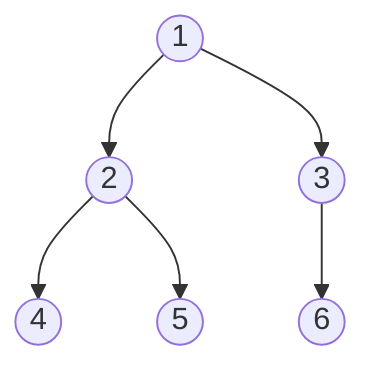
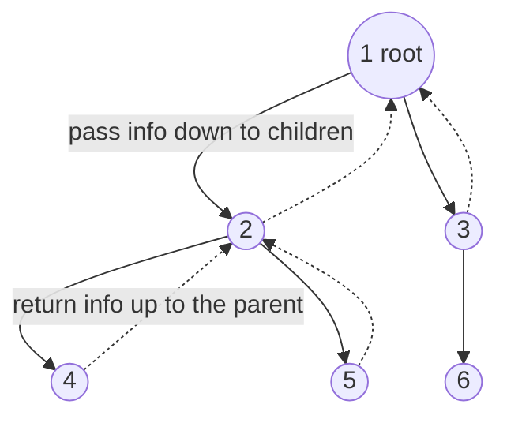
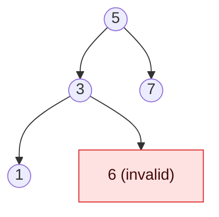

# 📚 SECTION 8: TREE PROBLEMS (BFS/DFS)

> **Navigation**: [Chapter overview](../09_Trees.md) | [8.1 Tree Traversal Problems →](02_tree_traversal_problems.md)
> Page 1 of 7 in **Trees**


### Tree traversal patterns

**Binary tree structure**



**How to read this diagram.** Node 1 is the root. Node 2 has children 4 and 5; node 3 has a single child 6. The traversal table below uses this tree.

**Traversal orders**

| Traversal | Order | Result |
| --- | --- | --- |
| Preorder | Root → Left → Right | 1, 2, 4, 5, 3, 6 |
| Inorder | Left → Root → Right | 4, 2, 5, 1, 3, 6 |
| Postorder | Left → Right → Root | 4, 5, 2, 6, 3, 1 |
| Level order | Level by level | 1, 2, 3, 4, 5, 6 |

**DFS versus BFS**

| DFS (stack or recursion) | BFS (queue) |
| --- | --- |
| Go deep first | Go wide first |
| Preorder / inorder / postorder | Level-order traversal |
| Path problems | Shortest-path problems |
| Tree height and depth | Level-wise processing |

---

## PART 0: WHY Trees Are the #1 Interview Topic & How to Think About Them

**Tree Problems — Complete Understanding & Growth Mindset**

### WHY ARE Trees the #1 Interview Topic?

Trees test BOTH recursion skills AND data structure understanding.  
Tree questions are among the most common in coding interviews.

**Real-world Systems Built on Trees**:

- File systems: Every folder/file is a tree node
- DOM (web pages): HTML → head/body → div/p... is a tree
- Databases: B-trees, B+ trees power every SQL database index
- Compilers: Abstract Syntax Tree (AST) represents code structure
- Operating systems: Process hierarchy (parent/child processes)
- AI/ML: Decision trees, random forests, parse trees in NLP
- Network routing: Spanning trees prevent packet loops

### The mental model: every tree problem = "does info go up or down?"

**Tree Problems Have Exactly TWO Information Flows**:



**How to read this diagram.** Solid arrows pass information **top-down** (from a parent to its children as parameters). Dotted arrows return information **bottom-up** (from children to their parent as return values).


↓ TOP-DOWN (passing info FROM parent TO children):
- BST validation: pass [min, max] range down
- Path sum: pass remaining target down
- Depth counter: pass current_depth + 1 down
- Root-to-leaf paths: pass path prefix down

↑ BOTTOM-UP (returning info FROM children TO parent):
- Height/depth: max(leftHeight, rightHeight) + 1
- Is balanced: both subtrees balanced AND heights differ ≤ 1
- Subtree sum: leftSum + rightSum + node.val
- Same tree: leftSame AND rightSame AND values equal

↕ BOTH DIRECTIONS (hardest problems):
- Max path sum: return best single-path UP, track global across paths
- Diameter: return height UP, track max(leftH + rightH) globally
- Lowest Common Ancestor: return found nodes UP, meet in the middle

**Decision Flowchart**:

```text
Does the problem need info from ANCESTORS (parents, grandparents)?
  YES → TOP-DOWN: Pass info as parameters
  NO  → Does it need info from DESCENDANTS (children)?
         YES → BOTTOM-UP: Return info in recursive calls
         BOTH? → Use both: pass DOWN + return UP + global tracker
```

```java
// TOP-DOWN TEMPLATE (info flows from parent → children)
void topDown(TreeNode node, int infoFromParent) {
    if (node == null) return;                    // Base case
    // USE info from parent (e.g., depth, range, running sum)
    // Process current node with infoFromParent
    topDown(node.left, updatedInfo);             // Pass to left child
    topDown(node.right, updatedInfo);            // Pass to right child
}

// BOTTOM-UP TEMPLATE (info flows from children → parent)
int bottomUp(TreeNode node) {
    if (node == null) return baseValue;          // Base case
    int leftResult = bottomUp(node.left);        // Get from left subtree
    int rightResult = bottomUp(node.right);      // Get from right subtree
    return combine(leftResult, rightResult);     // Combine and return UP
}

// BOTH DIRECTIONS (hardest — e.g., diameter, max path sum)
int globalMax = 0;  // Track answer across all nodes
int bothDirections(TreeNode node) {
    if (node == null) return 0;
    int left = bothDirections(node.left);        // Info from below
    int right = bothDirections(node.right);      // Info from below
    globalMax = Math.max(globalMax, left + right + node.val);  // ACROSS
    return Math.max(left, right) + node.val;     // Return BEST SINGLE PATH up
}
```

### THE 5 TREE PROBLEM PATTERNS (covers 95% of interviews)

| Pattern | Template | Problems |
| --- | --- | --- |
| 1. TRAVERSAL | DFS (stack) / BFS (queue)<br>Process all nodes | Inorder, Preorder, Level Order, Zigzag |
| 2. PROPERTY CHECK (Bottom-up) | Return boolean/value UP<br>Compare left + right | Max Depth, Balanced, Symmetric, Same Tree |
| 3. PATH / SUM (Both dirs) | Carry sum DOWN + track global answer | Path Sum, Path Sum II, Max Path Sum, Diameter |
| 4. BST PROPERTY | Use min < root < max<br>Pass range DOWN | Validate BST, Search, LCA in BST, Kth Small |
| 5. CONSTRUCTION | Divide array by root pos<br>Recurse on left/right | Build from Preorder+<br>Inorder, Serialize |

**Mini Worked Examples**:

**Pattern 1: — Level Order: Use queue. Process level by level.**

1          Queue: [1] → process → add children → [2,3]  
/ \         Queue: [2,3] → process → add children → [4,5,6]  
2   3        Queue: [4,5,6] → process → add children → []  
/ \   \       Result: [[1], [2,3], [4,5,6]]  
4   5   6

**Pattern 2: — Max Depth (Bottom-up):**

1    depth(1) = 1 + max(depth(2), depth(3))  
/ \   depth(2) = 1 + max(depth(4), depth(5)) = 1 + max(1,1) = 2  
2   3  depth(3) = 1 + max(0, depth(6)) = 1 + 1 = 2  
/ \   \ depth = 1 + max(2, 2) = 3  
4   5   6

**Pattern 4: — Validate BST (Top-down):**

5    isValid(5, -∞, +∞) → check 5 in range  
/ \   isValid(3, -∞, 5)  → 3 < 5 ✅  
3   7  isValid(7, 5, +∞)  → 7 > 5 ✅  
/ \     isValid(1, -∞, 3)  → 1 < 3 ✅  
1   4    isValid(4, 3, 5)   → 3 < 4 < 5 ✅

### Complexity Cheat Sheet

Most tree solutions: O(n) time, O(h) space where h = height

| Tree Shape | Height | Space for Recursion |
| --- | --- | --- |
| Balanced (best) | log(n) | O(log n) — e.g., 20 for 10⁶ nodes |
| Skewed (worst) | n | O(n) — StackOverflow risk! |
| Complete/Perfect | log(n) | O(log n) |
| Random BST (avg) | ~1.39logn | O(log n) |

BFS: O(n) time, O(w) space where w = max width of any level  
Perfect tree: w = n/2 at the widest level  
Skewed tree:  w = 1 at every level

⚡ DFS vs BFS: Use DFS when answer involves root-to-leaf paths.  
Use BFS when answer involves levels (level order, min depth).  
Both are O(n) time. Space: DFS = O(h), BFS = O(w).

### ⚠️  Common Mistakes in Tree Problems

**Mistake 1: Forgetting null check**

```java
WRONG: if (node.val == target)  → NullPointerException on null nodes
RIGHT: if (node == null) return; then check node.val
```

**Mistake 2: Confusing top-down and bottom-up**

"Is balanced?" needs BOTH height (bottom-up) AND comparison.  
Doing it top-down = O(n²) because you recompute heights.  
Fix: Return height from each subtree. Check |leftH - rightH| ≤ 1.

**Mistake 3: BST validation — checking only parent, not ancestors**

WRONG: checking only `node.left.val < node.val && node.right.val > node.val`.



**How to read this diagram.** Locally, `3 > 1` and `3 < 6` look fine, and 6 is greater than its parent 3. But 6 sits in the **left** subtree of 5, so it must be smaller than 5. Checking only the parent misses this.

RIGHT: pass a `[min, max]` range **down** from the root, narrowing it at each step.


**Mistake 4: Not handling skewed tree stack overflow**

Input: 10⁴ nodes in a straight line → recursion depth = 10⁴  
Java default stack ~5000 frames. Can overflow!  
Fix: Mention iterative approach or increase stack size.

**Mistake 5: Max path sum — returning path-across-root instead of single path**

The path through node = left + right + node.val (can be answer)  
But RETURN to parent = max(left, right) + node.val (single path only!)  
You can't go left-root-right and ALSO continue up to parent.

**Mistake 6: Iterative inorder — forgetting to go left first**

Must push ALL left children first, then pop, then go right.  
Common bug: pushing node then immediately going right.

### RECURSIVE vs ITERATIVE — WHEN TO USE WHICH

RECURSIVE (use when):
- Bottom-up problems (return info upward)
- BST range problems (natural parameter passing)
- Construction problems (divide and conquer)
- Time pressure in interview (faster to write)

ITERATIVE (use when):
- Interviewer specifically asks for it
- Very deep trees (stack overflow risk)
- Level order traversal (BFS with queue)
- Need to stop early (Morris traversal for O(1) space)

💡 Interview tip: Start recursive. If asked "can you do iteratively?",  
use explicit stack for DFS, queue for BFS.

### ⭐ Expected Outputs of Mastering Tree Problems ⭐

- ✅ See any tree problem → instantly classify: traversal/property/path/BST
- ✅ Know if info goes UP or DOWN (or both) within 30 seconds
- ✅ Write recursive DFS in 2 minutes, iterative in 5 minutes
- ✅ Handle all edge cases: null, single node, skewed, balanced
- ✅ Convert between recursive ↔ iterative for any traversal
- ✅ Solve "Max Path Sum" and "Diameter" (the hardest standard tree problems)
- ✅ Build trees from traversal arrays (preorder+inorder, etc.)

**The Transformation**:

FROM: "I'll try random DFS/BFS and see what happens"  
TO: "This needs info from children → bottom-up. I'll return height,  
check balance at each node, O(n) time, O(h) space."

📖 **Related theory:** [03_Algorithms/05_Trees.md](../../03_Algorithms/05_Trees.md) — Full tree theory & implementations

---

[Chapter overview](../09_Trees.md) | [8.1 Tree Traversal Problems →](02_tree_traversal_problems.md)
