> **Navigation**: [< Previous](09_Trees.md) | [Back to Index](../00_MASTER_INDEX.md) | [Next >](11_Dynamic_Programming.md)

> **Problems 10/14** | [Prev](09_Trees.md) | [Index](../00_MASTER_INDEX.md) | [Next](11_Dynamic_Programming.md)

---

## 🗺️ Pattern Recognition Header — Graphs

> **Graph Algorithm Selector** — Use this before every problem:
>

| If it asks... | Algorithm | Time |
|---|---|---|
| `count islands / connected components` | DFS/BFS flood fill | O(V+E) |
| `shortest path (unweighted)` | BFS level-by-level | O(V+E) |
| `shortest path (weighted, non-negative)` | Dijkstra (min-heap) | O((V+E)logV) |
| `dependency order / course schedule` | Topological Sort (Kahn's or DFS) | O(V+E) |
| `detect cycle in directed graph` | DFS 3-color (WHITE/GRAY/BLACK) | O(V+E) |
| `union / merge components dynamically` | Union-Find | O(E·α(V)) |
| `bipartite check` | BFS 2-coloring | O(V+E) |

>
> **First Question for Every Graph Problem:**
> ```
> 1. What are the NODES?
> 2. What are the EDGES? (directed or undirected?)
> 3. Is it weighted?
> → Then pick your algorithm from the table above.
> ```
>
> 📖 **Mental Model:** [03_Graph_Tree_Thinking.md](../14_Mental_Models/03_Graph_Tree_Thinking.md)
> 📖 **Theory:** [01f_Trees_Heaps.md](../02_Data_Structures/01f_Trees_Heaps.md)
> 📖 **Full Pattern Guide:** [00_PATTERN_MASTER_GUIDE.md](../04_Patterns_Templates/00_PATTERN_MASTER_GUIDE.md)

---


> 🔬 **Section Challenge — 🗺️ Pattern Recognition Header — Graphs**
>
> **Challenge 1 (Reasoning):** BFS finds shortest path in unweighted graphs but not in weighted graphs. Why exactly?
> <details><summary>Answer</summary>
>
> BFS explores by 'hop count' (number of edges). Each level = one more edge away from source. All edges are treated as weight=1. In a weighted graph, the 'shortest by hop count' path may not be 'shortest by weight sum'. Example: A→B (weight 1, 1 hop) vs A→C→B (weight 0.1+0.1=0.2, 2 hops). BFS finds A→B (1 hop), Dijkstra finds A→C→B (lower total weight). BFS is optimal ONLY when all edges have equal weight.
> </details>
>
> **Challenge 2 (Design):** Detect if a directed graph has a cycle. Write the algorithm and explain why we need 3 states (not 2).
> <details><summary>Answer</summary>
>
> 3 states: UNVISITED, IN_PROGRESS (currently in DFS path), DONE. DFS: mark node IN_PROGRESS before visiting neighbors. If we reach an IN_PROGRESS node → cycle found. Mark DONE when all neighbors processed. Why 3 states: with 2 (visited/unvisited), we'd get false positives — reaching a VISITED node that was processed in a DIFFERENT DFS subtree is not a cycle. IN_PROGRESS specifically marks nodes in the CURRENT DFS path (potential back edge).
> </details>
>

# 📚 SECTION 9: GRAPH ALGORITHMS

```
┌─────────────────────────────────────────────────────────────────┐
│                    GRAPH FUNDAMENTALS                           │
├─────────────────────────────────────────────────────────────────┤
│  GRAPH REPRESENTATION:                                          │
│                                                                 │
│  1. Adjacency List (Most common):                               │
│     0 → [1, 2]                     0 ─── 1                      │
│     1 → [0, 2, 3]                  │ \   │                      │
│     2 → [0, 1]                     │  \  │                      │
│     3 → [1]                        2 ─── 3                      │
│                                                                 │
│  2. Adjacency Matrix:                                           │
│       0  1  2  3                                                │
│     ┌─────────────┐                                             │
│   0 │ 0  1  1  0 │                                              │
│   1 │ 1  0  1  1 │                                              │
│   2 │ 1  1  0  0 │                                              │
│   3 │ 0  1  0  0 │                                              │
│     └─────────────┘                                             │
│                                                                 │
│  3. Edge List: [(0,1), (0,2), (1,2), (1,3)]                     │
│                                                                 │
├─────────────────────────────────────────────────────────────────┤
│  DFS vs BFS:                                                    │
│  ┌─────────────────────┬─────────────────────────────┐          │
│  │ DFS (Stack/Recursion)│ BFS (Queue)                │          │
│  │ - Go deep first      │ - Go level by level        │          │
│  │ - Detect cycles      │ - Shortest path (unweight) │          │
│  │ - Path finding       │ - Level order traversal    │          │
│  │ - Topological sort   │ - Min steps problems       │          │
│  │ - Connected comp     │ - Bipartite check          │          │
│  └─────────────────────┴─────────────────────────────┘          │
└─────────────────────────────────────────────────────────────────┘
```

**Flow:**
- 0 1 1 0 / 1 0 1 1 / 1 1 0 0 / 0 1 0 0
- ↓
- DFS (Stack/Recursion) BFS (Queue) / - Go deep first - G

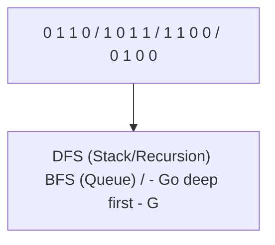

---

## PART 0: WHY Graph Problems & How to Think About Them

```
╔══════════════════════════════════════════════════════════════════════════════╗
║          GRAPH PROBLEMS — COMPLETE UNDERSTANDING & GROWTH MINDSET            ║
╚══════════════════════════════════════════════════════════════════════════════╝

┌──────────────────────────────────────────────────────────────────────────────┐
│ WHY ARE GRAPHS SO IMPORTANT?                                                 │
├──────────────────────────────────────────────────────────────────────────────┤
│                                                                              │
│ Graphs model RELATIONSHIPS. Any system with connections is a graph:          │
│                                                                              │
│ • Social networks: 2.9B Facebook users, each a node, friendships = edges     │
│ • Internet: Every router = node, cable = edge. BGP uses shortest path        │
│ • Google Maps: Every intersection = node, road = weighted edge               │
│ • Course prerequisites: courses = nodes, "must take A before B" = edge       │
│ • Package dependencies: npm packages = nodes, imports = edges                │
│ • Airline routes: cities = nodes, flights = weighted edges                   │
│                                                                              │
│ Graph problems appear in 15-20% of coding interviews.                        │
│ Companies love  them because they test: traversal logic, cycle handling,     │
│ shortest paths, topological ordering, and connected components.              │
└──────────────────────────────────────────────────────────────────────────────┘

┌──────────────────────────────────────────────────────────────────────────────┐
│ THE MENTAL MODEL: "What are the NODES? What are the EDGES?"                  │
├──────────────────────────────────────────────────────────────────────────────┤
│                                                                              │
│ EVERY graph problem starts with this question. Once you answer it,           │
│ the problem reduces to a STANDARD graph algorithm.                           │
│                                                                              │
│ ┌──────────────────────┬──────────────────┬──────────────────────┐           │
│ │ Problem              │ Node =           │ Edge =               │           │
│ ├──────────────────────┼──────────────────┼──────────────────────┤           │
│ │ Number of Islands    │ Cell (r,c)       │ Adjacent land cells  │           │
│ │ Course Schedule      │ Course number    │ Prerequisite         │           │
│ │ Word Ladder          │ Word             │ Differ by 1 letter   │           │
│ │ Cheapest Flights     │ City             │ Flight (weighted)    │           │
│ │ Clone Graph          │ Graph node       │ Neighbor pointer     │           │
│ │ Accounts Merge       │ Email address    │ Same account         │           │
│ │ Alien Dictionary     │ Character        │ Order relationship   │           │
│ └──────────────────────┴──────────────────┴──────────────────────┘           │
│                                                                              │
│ GRID AS GRAPH:                                                               │
│   Grid is just a graph with implicit edges!                                  │
│   ┌───┬───┬───┐                                                              │
│   │ 1 │ 1 │ 0 │    Node (0,0) connects to → (0,1) and (1,0)                  │
│   ├───┼───┼───┤    Node (0,1) connects to → (0,0), (0,2), (1,1)              │
│   │ 1 │ 0 │ 0 │    4-directional: dirs = {{0,1},{0,-1},{1,0},{-1,0}}         │
│   ├───┼───┼───┤                                                              │
│   │ 0 │ 0 │ 1 │    V = rows × cols,  E = up to 4 × V                         │
│   └───┴───┴───┘    Time for BFS/DFS on grid: O(rows × cols)                  │
└──────────────────────────────────────────────────────────────────────────────┘
```

**Flow:**
- Problem Node = Edge = / Number of Islands Cell (r,c) Ad
- ↓
- 1 1 0 / 1 0 0 / 0 0 1

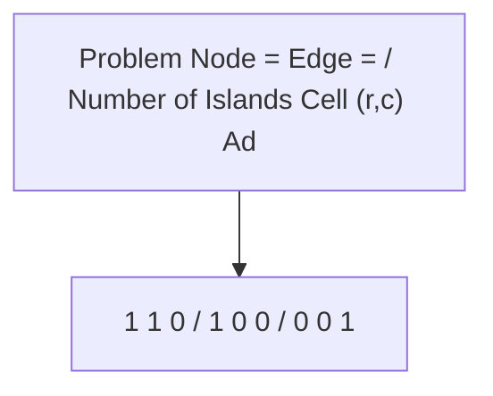

```java
// BFS TEMPLATE (use for shortest path in unweighted graph/grid)
int bfs(int[][] grid, int[] start, int[] end) {
    int rows = grid.length, cols = grid[0].length;
    Queue<int[]> queue = new LinkedList<>();
    boolean[][] visited = new boolean[rows][cols];
    int[][] dirs = {{0,1},{0,-1},{1,0},{-1,0}};  // Right, Left, Down, Up
    
    queue.offer(start);
    visited[start[0]][start[1]] = true;
    int steps = 0;
    
    while (!queue.isEmpty()) {
        int size = queue.size();              // Process level by level!
        for (int i = 0; i < size; i++) {
            int[] curr = queue.poll();
            if (curr[0]==end[0] && curr[1]==end[1]) return steps;
            for (int[] d : dirs) {
                int nr = curr[0]+d[0], nc = curr[1]+d[1];
                if (nr>=0 && nr<rows && nc>=0 && nc<cols 
                    && !visited[nr][nc] && grid[nr][nc]==1) {
                    visited[nr][nc] = true;
                    queue.offer(new int[]{nr, nc});
                }
            }
        }
        steps++;                             // Increment after each level
    }
    return -1;  // Not reachable
}

// DFS TEMPLATE (use for exploring/counting components)
void dfs(int[][] grid, int r, int c, boolean[][] visited) {
    if (r<0 || r>=grid.length || c<0 || c>=grid[0].length 
        || visited[r][c] || grid[r][c]==0) return;
    visited[r][c] = true;
    dfs(grid, r+1, c, visited);  // Down
    dfs(grid, r-1, c, visited);  // Up
    dfs(grid, r, c+1, visited);  // Right
    dfs(grid, r, c-1, visited);  // Left
}
```

```
┌──────────────────────────────────────────────────────────────────────────────┐
│ THE 6 GRAPH PROBLEM PATTERNS                                                 │
├──────────────────────────────────────────────────────────────────────────────┤
│                                                                              │
│ ┌──────────────────────┬──────────────────────────┬────────────────────┐     │
│ │ Pattern              │ Algorithm                │ Problems           │     │
│ ├──────────────────────┼──────────────────────────┼────────────────────┤     │
│ │ 1. TRAVERSAL/EXPLORE │ BFS or DFS on grid/graph │ Islands, Flood Fill│     │
│ │ 2. CYCLE DETECTION   │ DFS 3-color / Kahn's     │ Course Schedule    │     │
│ │ 3. SHORTEST PATH     │ BFS (unwtd) / Dijkstra   │ Word Ladder, Maze │      │
│ │ 4. CONNECTIVITY      │ Union-Find or DFS         │ Components, Merge │     │
│ │ 5. ORDERING          │ Topological Sort          │ Alien Dictionary  │     │
│ │ 6. CLASSIFICATION    │ BFS 2-coloring            │ Bipartite         │     │
│ └──────────────────────┴──────────────────────────┴────────────────────┘     │
│                                                                              │
│ DECISION TREE FOR INTERVIEWS:                                                │
│                                                                              │
│   "Shortest path?" ──Yes──→ Weighted? ──Yes──→ All non-negative? ──Yes──→    │
│                                                       Dijkstra O((V+E)logV)  │
│                                          No───→ Bellman-Ford O(VE)           │
│                              No───→ BFS O(V+E)                               │
│                                                                              │
│   "Order/dependency?"──Yes──→ Topological Sort (Kahn's BFS or DFS post)      │
│                                                                              │
│   "Connected?" ──Yes──→ Dynamic (edges added)? ──Yes──→ Union-Find           │
│                                                  No───→ DFS/BFS              │
│                                                                              │
│   "Cycle?" ──Yes──→ Directed? ──Yes──→ DFS 3-color or Kahn's (topo fails)    │
│                                 No───→ Union-Find or DFS                     │
│                                                                              │
│   "Explore all cells/nodes?" ──Yes──→ DFS (simpler) or BFS (level-aware)     │
└──────────────────────────────────────────────────────────────────────────────┘

┌──────────────────────────────────────────────────────────────────────────────┐
│ ⚠️  COMMON MISTAKES IN GRAPH PROBLEMS                                        │
├──────────────────────────────────────────────────────────────────────────────┤
│                                                                              │
│ MISTAKE 1: Forgetting visited check → infinite loop                          │
│   DFS without marking visited → cycles → stack overflow                      │
│   BFS without visited → add same node to queue hundreds of times             │
│   Fix: ALWAYS mark visited BEFORE adding to queue/recursing.                 │
│                                                                              │
│ MISTAKE 2: BFS visited timing — marking when DEQUEUING instead of ENQUEUING  │
│   WRONG: mark visited when you poll(). Allows duplicates in queue.           │
│   RIGHT: mark visited when you offer(). Each node enters queue ONCE.         │
│                                                                              │
│ MISTAKE 3: Directed vs Undirected cycle detection                            │
│   Undirected: Visiting an already-visited node (not parent) = cycle.         │
│   Directed: Need 3-color DFS: WHITE(unvisited), GRAY(in-progress), BLACK.    │
│   Visiting a GRAY node = back edge = cycle. WRONG: treating BLACK as cycle.  │
│                                                                              │
│ MISTAKE 4: Off-by-one in BFS level counting                                  │
│   Steps = number of BFS levels, NOT number of nodes processed.               │
│   Must process entire level before incrementing step count.                  │
│   Fix: Use `int size = queue.size()` loop pattern.                           │
│                                                                              │
│ MISTAKE 5: Building adjacency list wrong for undirected graphs               │
│   Must add BOTH directions: graph[a].add(b) AND graph[b].add(a).             │
│   Forgetting one direction → some paths unreachable.                         │
│                                                                              │
│ MISTAKE 6: Not handling disconnected components                              │
│   "Count components" — must loop through ALL nodes, not just start from 0.   │
│   Some nodes might not be reachable from node 0!                             │
└──────────────────────────────────────────────────────────────────────────────┘

┌──────────────────────────────────────────────────────────────────────────────┐
│ GRAPH REPRESENTATION — CHOOSING THE RIGHT ONE                                │
├──────────────────────────────────────────────────────────────────────────────┤
│                                                                              │
│ ┌──────────────────┬─────────────────┬───────────────────────────────┐       │
│ │ Representation   │ Space           │ When to Use                   │       │
│ ├──────────────────┼─────────────────┼───────────────────────────────┤       │
│ │ Adjacency List   │ O(V + E)        │ Sparse graphs (most problems)│        │
│ │ Adjacency Matrix │ O(V²)           │ Dense graphs, O(1) edge check│        │
│ │ Edge List        │ O(E)            │ Kruskal's MST, simple union  │        │
│ │ Implicit (Grid)  │ O(R×C)          │ Grid problems (no extra graph)│       │
│ └──────────────────┴─────────────────┴───────────────────────────────┘       │
│                                                                              │
│ 95% of interview graphs: Use Adjacency List (HashMap or List of Lists).      │
│ Grid problems: Don't build explicit graph! Use dirs array directly.          │
└──────────────────────────────────────────────────────────────────────────────┘

┌──────────────────────────────────────────────────────────────────────────────┐
│ COMPLEXITY CHEAT SHEET                                                       │
├──────────────────────────────────────────────────────────────────────────────┤
│                                                                              │
│ V = vertices, E = edges                                                      │
│  BFS/DFS traversal:   O(V + E) time,  O(V) space                             │
│  Dijkstra (min-heap): O((V+E) log V), O(V) space                             │
│  Bellman-Ford:        O(V × E),       O(V) space                             │
│  Union-Find:          O(E × α(V)),    O(V) space                             │
│  Topological sort:    O(V + E),       O(V) space                             │
│  Floyd-Warshall:      O(V³),          O(V²) space                            │
│                                                                              │
│  Grid problems: V = R×C, E ≤ 4×R×C → O(R×C) for BFS/DFS                      │
│                                                                              │
│  Interview constraints guide:                                                │
│    n ≤ 10⁴ → O(V+E) BFS/DFS works easily                                     │
│    n ≤ 10³ → Dijkstra or O(V²) algorithms fine                               │
│    n ≤ 400 → Floyd-Warshall O(V³) possible                                   │
│    n ≤ 20  → Bitmask DP on graph states                                      │
└──────────────────────────────────────────────────────────────────────────────┘

┌──────────────────────────────────────────────────────────────────────────────┐
│ ⭐ EXPECTED OUTPUTS OF MASTERING GRAPH PROBLEMS ⭐                             │
├──────────────────────────────────────────────────────────────────────────────┤
│                                                                              │
│ ✅ Identify nodes & edges in ANY problem in 30 seconds                        │
│ ✅ Choose BFS vs DFS vs Dijkstra vs Union-Find instantly                      │
│ ✅ Write BFS/DFS templates from memory in 2 minutes                           │
│ ✅ Handle directed vs undirected correctly (cycle detection, traversal)       │
│ ✅ Build adjacency list from edge list or grid                                │
│ ✅ Implement topological sort (both Kahn's BFS and DFS post-order)            │
│ ✅ Know Dijkstra for weighted shortest path                                   │
│                                                                              │
│ THE TRANSFORMATION:                                                          │
│ FROM: "I don't even know where to start with this graph problem"             │
│   TO: "Nodes = cities, edges = flights. Weighted shortest path →             │
│        Dijkstra with min-heap. O((V+E) log V)."                              │
└──────────────────────────────────────────────────────────────────────────────┘
```

📖 **Related theory:** [03_Algorithms/05_Trees.md](../03_Algorithms/05_Trees.md) — Full graph theory & implementations

---


> 🔬 **Section Challenge — PART 0: WHY Graph Problems & How to Think About Them**
>
> **Challenge 1 (Reasoning):** BFS finds shortest path in unweighted graphs but not in weighted graphs. Why exactly?
> <details><summary>Answer</summary>
>
> BFS explores by 'hop count' (number of edges). Each level = one more edge away from source. All edges are treated as weight=1. In a weighted graph, the 'shortest by hop count' path may not be 'shortest by weight sum'. Example: A→B (weight 1, 1 hop) vs A→C→B (weight 0.1+0.1=0.2, 2 hops). BFS finds A→B (1 hop), Dijkstra finds A→C→B (lower total weight). BFS is optimal ONLY when all edges have equal weight.
> </details>
>
> **Challenge 2 (Design):** Detect if a directed graph has a cycle. Write the algorithm and explain why we need 3 states (not 2).
> <details><summary>Answer</summary>
>
> 3 states: UNVISITED, IN_PROGRESS (currently in DFS path), DONE. DFS: mark node IN_PROGRESS before visiting neighbors. If we reach an IN_PROGRESS node → cycle found. Mark DONE when all neighbors processed. Why 3 states: with 2 (visited/unvisited), we'd get false positives — reaching a VISITED node that was processed in a DIFFERENT DFS subtree is not a cycle. IN_PROGRESS specifically marks nodes in the CURRENT DFS path (potential back edge).
> </details>
>

## 9.1 Graph Traversal (BFS/DFS)

> **Pattern:** Explore connected regions. DFS to mark & count, BFS for multi-source spreading.
> **Key insight for grids:** Treat each cell as a node. "Sink" visited cells (mark '0' or use visited set).

### Problem 136: Number of Islands

**LeetCode 200** 🔗 https://leetcode.com/problems/number-of-islands/

```
┌────────────────────────────────────────────────────────────────┐
│  NUMBER OF ISLANDS - Count connected components of '1's        │
├────────────────────────────────────────────────────────────────┤
│  grid = [                                                      │
│    ["1","1","0","0","0"],                                      │
│    ["1","1","0","0","0"],   Island 1: top-left 1s              │
│    ["0","0","1","0","0"],   Island 2: middle 1                 │
│    ["0","0","0","1","1"]    Island 3: bottom-right 1s          │
│  ]                                                             │
│                                                                │
│  Visual:                                                       │
│  ┌───┬───┬───┬───┬───┐                                         │
│  │ 1 │ 1 │ 0 │ 0 │ 0 │   🏝️ Island 1                           │
│  ├───┼───┼───┼───┼───┤                                         │
│  │ 1 │ 1 │ 0 │ 0 │ 0 │                                         │
│  ├───┼───┼───┼───┼───┤                                         │
│  │ 0 │ 0 │ 1 │ 0 │ 0 │   🏝️ Island 2                           │
│  ├───┼───┼───┼───┼───┤                                         │
│  │ 0 │ 0 │ 0 │ 1 │ 1 │   🏝️ Island 3                           │
│  └───┴───┴───┴───┴───┘                                         │
│                                                                │
│  Output: 3                                                     │
└────────────────────────────────────────────────────────────────┘
```

**Flow:**
- NUMBER OF ISLANDS - Count connected components of '1's
- ↓
- grid = [
- ↓
- ['1','1','0','0','0'], Island 1: top-left 1s
- ↓
- ['0','0','1','0','0'], Island 2: middle 1
- ↓
- ['0','0','0','1','1'] Island 3: bottom-right 1s
- ↓
- Visual:
- ↓
- 1 1 0 0 0 🏝️ Island 1

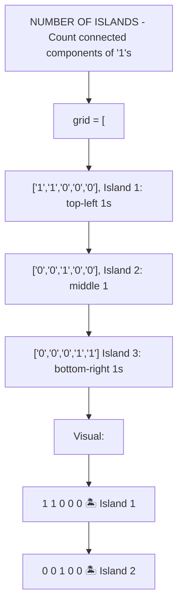

**Solution (DFS):**

```java
public int numIslands(char[][] grid) {
    if (grid == null || grid.length == 0) return 0;

    int count = 0;
    int rows = grid.length, cols = grid[0].length;

    for (int i = 0; i < rows; i++) {
        for (int j = 0; j < cols; j++) {
            if (grid[i][j] == '1') {
                count++;
                dfs(grid, i, j);  // Sink the island
            }
        }
    }

    return count;
}

private void dfs(char[][] grid, int i, int j) {
    // Boundary check and water check
    if (i < 0 || i >= grid.length || j < 0 || j >= grid[0].length
        || grid[i][j] == '0') {
        return;
    }

    grid[i][j] = '0';  // Mark as visited (sink)

    // Explore 4 directions
    dfs(grid, i + 1, j);  // Down
    dfs(grid, i - 1, j);  // Up
    dfs(grid, i, j + 1);  // Right
    dfs(grid, i, j - 1);  // Left
}
```

**Solution (BFS):**

```java
public int numIslandsBFS(char[][] grid) {
    if (grid == null || grid.length == 0) return 0;

    int count = 0;
    int rows = grid.length, cols = grid[0].length;
    int[][] directions = {{1,0}, {-1,0}, {0,1}, {0,-1}};

    for (int i = 0; i < rows; i++) {
        for (int j = 0; j < cols; j++) {
            if (grid[i][j] == '1') {
                count++;

                Queue<int[]> queue = new LinkedList<>();
                queue.offer(new int[]{i, j});
                grid[i][j] = '0';

                while (!queue.isEmpty()) {
                    int[] cell = queue.poll();

                    for (int[] dir : directions) {
                        int ni = cell[0] + dir[0];
                        int nj = cell[1] + dir[1];

                        if (ni >= 0 && ni < rows && nj >= 0 && nj < cols
                            && grid[ni][nj] == '1') {
                            queue.offer(new int[]{ni, nj});
                            grid[ni][nj] = '0';
                        }
                    }
                }
            }
        }
    }

    return count;
}
```

---

### Problem 137: Max Area of Island

**LeetCode 695** 🔗 https://leetcode.com/problems/max-area-of-island/

```
┌────────────────────────────────────────────────────────────────┐
│  MAX AREA OF ISLAND                                            │
├────────────────────────────────────────────────────────────────┤
│  grid = [                                                      │
│    [0,0,1,0,0,0,0,1,0,0,0,0,0],                                │
│    [0,0,0,0,0,0,0,1,1,1,0,0,0],                                │
│    [0,1,1,0,1,0,0,0,0,0,0,0,0],                                │
│    [0,1,0,0,1,1,0,0,1,0,1,0,0],                                │
│    [0,1,0,0,1,1,0,0,1,1,1,0,0],                                │
│    [0,0,0,0,0,0,0,0,0,0,1,0,0],                                │
│    [0,0,0,0,0,0,0,1,1,1,0,0,0],                                │
│    [0,0,0,0,0,0,0,1,1,0,0,0,0]                                 │
│  ]                                                             │
│                                                                │
│  Maximum area = 6 (the island in middle-right)                 │
└────────────────────────────────────────────────────────────────┘
```

**Flow:**
- MAX AREA OF ISLAND
- ↓
- grid = [
- ↓
- Maximum area = 6 (the island in middle-right)

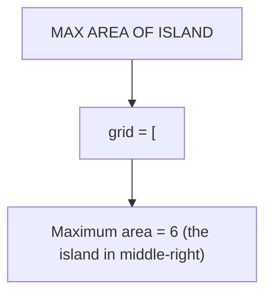

**Solution:**

```java
public int maxAreaOfIsland(int[][] grid) {
    int maxArea = 0;

    for (int i = 0; i < grid.length; i++) {
        for (int j = 0; j < grid[0].length; j++) {
            if (grid[i][j] == 1) {
                maxArea = Math.max(maxArea, dfs(grid, i, j));
            }
        }
    }

    return maxArea;
}

private int dfs(int[][] grid, int i, int j) {
    if (i < 0 || i >= grid.length || j < 0 || j >= grid[0].length
        || grid[i][j] == 0) {
        return 0;
    }

    grid[i][j] = 0;  // Mark visited

    return 1 + dfs(grid, i+1, j) + dfs(grid, i-1, j)
             + dfs(grid, i, j+1) + dfs(grid, i, j-1);
}
```

---

### Problem 138: Clone Graph

**LeetCode 133** 🔗 https://leetcode.com/problems/clone-graph/

```
┌────────────────────────────────────────────────────────────────┐
│  CLONE GRAPH - Deep copy of undirected graph                   │
├────────────────────────────────────────────────────────────────┤
│  Input:                   Output (Clone):                      │
│      1 ─── 2                  1' ─── 2'                        │
│      │     │                  │      │                         │
│      │     │                  │      │                         │
│      4 ─── 3                  4' ─── 3'                        │
│                                                                │
│  Each node has: val, List<Node> neighbors                      │
│                                                                │
│  Key: Use HashMap to track original → clone mapping            │
│  Prevents infinite loop when graph has cycles                  │
└────────────────────────────────────────────────────────────────┘
```

**Flow:**
- CLONE GRAPH - Deep copy of undirected graph
- ↓
- Input: Output (Clone):
- ↓
- Each node has: val, List<Node> neighbors
- ↓
- Key: Use HashMap to track original
- ↓
- clone mapping
- ↓
- Key: Use HashMap to track original
- ↓
- clone mapping
- ↓
- Prevents infinite loop when graph has cycles

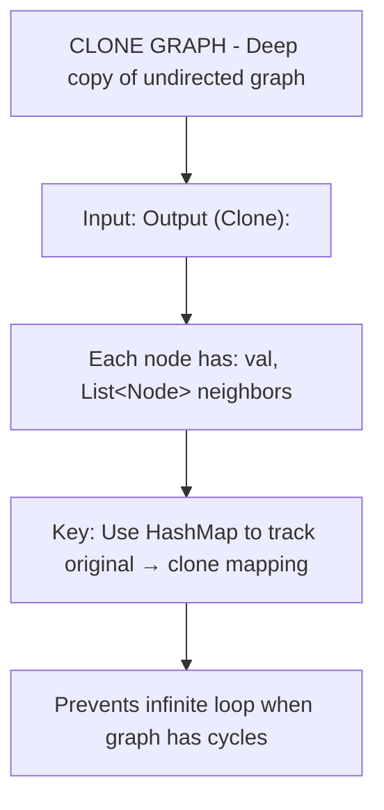

**Solution:**

```java
private Map<Node, Node> visited = new HashMap<>();

public Node cloneGraph(Node node) {
    if (node == null) return null;

    // Already cloned
    if (visited.containsKey(node)) {
        return visited.get(node);
    }

    // Create clone
    Node clone = new Node(node.val, new ArrayList<>());
    visited.put(node, clone);

    // Clone neighbors
    for (Node neighbor : node.neighbors) {
        clone.neighbors.add(cloneGraph(neighbor));
    }

    return clone;
}
```

---

### Problem 139: Flood Fill

**LeetCode 733** 🔗 https://leetcode.com/problems/flood-fill/

```
┌────────────────────────────────────────────────────────────────┐
│  FLOOD FILL - Like paint bucket tool                           │
├────────────────────────────────────────────────────────────────┤
│  image = [[1,1,1],    sr=1, sc=1, color=2                      │
│           [1,1,0],                                             │
│           [1,0,1]]                                             │
│                                                                │
│  Start at (1,1), change all connected 1s to 2:                 │
│                                                                │
│  Before:          After:                                       │
│  ┌───┬───┬───┐    ┌───┬───┬───┐                                │
│  │ 1 │ 1 │ 1 │    │ 2 │ 2 │ 2 │                                │
│  ├───┼───┼───┤    ├───┼───┼───┤                                │
│  │ 1 │ 1 │ 0 │ →  │ 2 │ 2 │ 0 │                                │
│  ├───┼───┼───┤    ├───┼───┼───┤                                │
│  │ 1 │ 0 │ 1 │    │ 2 │ 0 │ 1 │                                │
│  └───┴───┴───┘    └───┴───┴───┘                                │
└────────────────────────────────────────────────────────────────┘
```

**Flow:**
- 1 1 1 / 1 1 0 / 1 0 1
- ↓
- 2 2 2 / 2 2 0 / 2 0 1

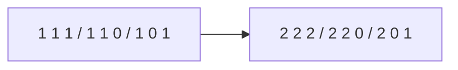

**Solution:**

```java
public int[][] floodFill(int[][] image, int sr, int sc, int color) {
    int originalColor = image[sr][sc];

    // Avoid infinite loop if same color
    if (originalColor != color) {
        dfs(image, sr, sc, originalColor, color);
    }

    return image;
}

private void dfs(int[][] image, int r, int c, int original, int newColor) {
    if (r < 0 || r >= image.length || c < 0 || c >= image[0].length
        || image[r][c] != original) {
        return;
    }

    image[r][c] = newColor;

    dfs(image, r + 1, c, original, newColor);
    dfs(image, r - 1, c, original, newColor);
    dfs(image, r, c + 1, original, newColor);
    dfs(image, r, c - 1, original, newColor);
}
```

---

### Problem 140: Rotting Oranges

**LeetCode 994** 🔗 https://leetcode.com/problems/rotting-oranges/

```
┌────────────────────────────────────────────────────────────────┐
│  ROTTING ORANGES - Multi-source BFS                            │
├────────────────────────────────────────────────────────────────┤
│  0 = empty, 1 = fresh orange, 2 = rotten orange                │
│  Each minute, fresh oranges adjacent to rotten become rotten   │
│                                                                │
│  grid = [[2,1,1],                                              │
│          [1,1,0],                                              │
│          [0,1,1]]                                              │
│                                                                │
│  Minute 0:    Minute 1:    Minute 2:    Minute 3:    Minute 4: │
│  ┌───┬───┬───┐ ┌───┬───┬───┐ ┌───┬───┬───┐ ┌───┬───┬───┐ ┌───┬───┬───┐
│  │ 2 │ 1 │ 1 │ │ 2 │ 2 │ 1 │ │ 2 │ 2 │ 2 │ │ 2 │ 2 │ 2 │ │ 2 │ 2 │ 2 │
│  ├───┼───┼───┤ ├───┼───┼───┤ ├───┼───┼───┤ ├───┼───┼───┤ ├───┼───┼───┤
│  │ 1 │ 1 │ 0 │ │ 2 │ 1 │ 0 │ │ 2 │ 2 │ 0 │ │ 2 │ 2 │ 0 │ │ 2 │ 2 │ 0 │
│  ├───┼───┼───┤ ├───┼───┼───┤ ├───┼───┼───┤ ├───┼───┼───┤ ├───┼───┼───┤
│  │ 0 │ 1 │ 1 │ │ 0 │ 1 │ 1 │ │ 0 │ 1 │ 1 │ │ 0 │ 2 │ 1 │ │ 0 │ 2 │ 2 │
│  └───┴───┴───┘ └───┴───┴───┘ └───┴───┴───┘ └───┴───┴───┘ └───┴───┴───┘
│                                                                │
│  Output: 4 minutes                                             │
└────────────────────────────────────────────────────────────────┘
```

**Flow:**
- 2 1 1 / 1 1 0 / 0 1 1
- ↓
- 2 2 1 / 2 1 0 / 0 1 1
- ↓
- 2 2 2 / 2 2 0 / 0 1 1
- ↓
- 2 2 2 / 2 2 0 / 0 2 1
- ↓
- 2 2 2 / 2 2 0 / 0 2 2

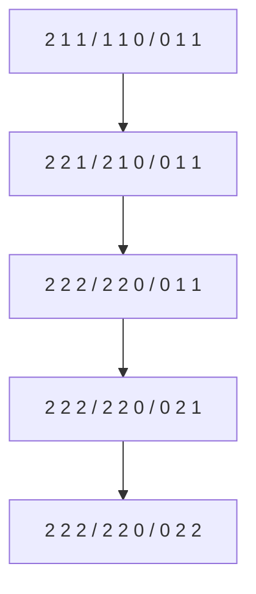

**Solution:**

```java
public int orangesRotting(int[][] grid) {
    int rows = grid.length, cols = grid[0].length;
    Queue<int[]> queue = new LinkedList<>();
    int fresh = 0;

    // Find all rotten oranges and count fresh
    for (int i = 0; i < rows; i++) {
        for (int j = 0; j < cols; j++) {
            if (grid[i][j] == 2) {
                queue.offer(new int[]{i, j});
            } else if (grid[i][j] == 1) {
                fresh++;
            }
        }
    }

    if (fresh == 0) return 0;

    int[][] directions = {{1,0}, {-1,0}, {0,1}, {0,-1}};
    int minutes = 0;

    while (!queue.isEmpty()) {
        int size = queue.size();
        boolean rotted = false;

        for (int i = 0; i < size; i++) {
            int[] cell = queue.poll();

            for (int[] dir : directions) {
                int ni = cell[0] + dir[0];
                int nj = cell[1] + dir[1];

                if (ni >= 0 && ni < rows && nj >= 0 && nj < cols
                    && grid[ni][nj] == 1) {
                    grid[ni][nj] = 2;
                    fresh--;
                    queue.offer(new int[]{ni, nj});
                    rotted = true;
                }
            }
        }

        if (rotted) minutes++;
    }

    return fresh == 0 ? minutes : -1;
}
```

---

### Problem 141: 🔒 Walls and Gates (LeetCode 286 - Premium)

```
┌────────────────────────────────────────────────────────────────┐
│  WALLS AND GATES - Multi-source BFS from gates                 │
├────────────────────────────────────────────────────────────────┤
│  Given m x n grid:                                             │
│  -1 = Wall, 0 = Gate, INF = Empty room                         │
│                                                                │
│  Fill each empty room with distance to nearest gate.           │
│                                                                │
│  Input:                        Output:                         │
│  ┌─────┬─────┬─────┬─────┐    ┌─────┬─────┬─────┬─────┐        │
│  │ INF │  -1 │  0  │ INF │    │  3  │  -1 │  0  │  1  │        │
│  ├─────┼─────┼─────┼─────┤    ├─────┼─────┼─────┼─────┤        │
│  │ INF │ INF │ INF │  -1 │ →  │  2  │  2  │  1  │  -1 │        │
│  ├─────┼─────┼─────┼─────┤    ├─────┼─────┼─────┼─────┤        │
│  │ INF │  -1 │ INF │  -1 │    │  1  │  -1 │  2  │  -1 │        │
│  ├─────┼─────┼─────┼─────┤    ├─────┼─────┼─────┼─────┤        │
│  │  0  │  -1 │ INF │ INF │    │  0  │  -1 │  3  │  4  │        │
│  └─────┴─────┴─────┴─────┘    └─────┴─────┴─────┴─────┘        │
│                                                                │
│  Constraints:                                                  │
│  - m == rooms.length, n == rooms[i].length                     │
│  - 1 <= m, n <= 250                                            │
│  - rooms[i][j] is -1, 0, or 2^31 - 1                           │
└────────────────────────────────────────────────────────────────┘
```

**Flow:**
- INF -1 0 INF / INF INF INF -1 / INF -1 INF -1 / 0 -1 IN
- ↓
- 3 -1 0 1 / 2 2 1 -1 / 1 -1 2 -1 / 0 -1 3 4

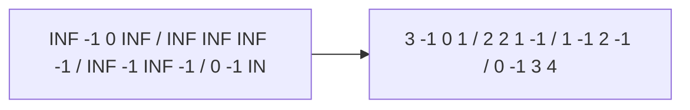

**Solution:**

```java
public void wallsAndGates(int[][] rooms) {
    int rows = rooms.length, cols = rooms[0].length;
    int INF = Integer.MAX_VALUE;
    Queue<int[]> queue = new LinkedList<>();

    // Add all gates to queue
    for (int i = 0; i < rows; i++) {
        for (int j = 0; j < cols; j++) {
            if (rooms[i][j] == 0) {
                queue.offer(new int[]{i, j});
            }
        }
    }

    int[][] directions = {{1,0}, {-1,0}, {0,1}, {0,-1}};

    while (!queue.isEmpty()) {
        int[] cell = queue.poll();
        int r = cell[0], c = cell[1];

        for (int[] dir : directions) {
            int nr = r + dir[0];
            int nc = c + dir[1];

            if (nr >= 0 && nr < rows && nc >= 0 && nc < cols
                && rooms[nr][nc] == INF) {
                rooms[nr][nc] = rooms[r][c] + 1;
                queue.offer(new int[]{nr, nc});
            }
        }
    }
}
```

---


> 🔬 **Section Challenge — 9.1 Graph Traversal (BFS/DFS)**
>
> **Challenge 1 (Reasoning):** BFS finds shortest path in unweighted graphs but not in weighted graphs. Why exactly?
> <details><summary>Answer</summary>
>
> BFS explores by 'hop count' (number of edges). Each level = one more edge away from source. All edges are treated as weight=1. In a weighted graph, the 'shortest by hop count' path may not be 'shortest by weight sum'. Example: A→B (weight 1, 1 hop) vs A→C→B (weight 0.1+0.1=0.2, 2 hops). BFS finds A→B (1 hop), Dijkstra finds A→C→B (lower total weight). BFS is optimal ONLY when all edges have equal weight.
> </details>
>
> **Challenge 2 (Design):** Detect if a directed graph has a cycle. Write the algorithm and explain why we need 3 states (not 2).
> <details><summary>Answer</summary>
>
> 3 states: UNVISITED, IN_PROGRESS (currently in DFS path), DONE. DFS: mark node IN_PROGRESS before visiting neighbors. If we reach an IN_PROGRESS node → cycle found. Mark DONE when all neighbors processed. Why 3 states: with 2 (visited/unvisited), we'd get false positives — reaching a VISITED node that was processed in a DIFFERENT DFS subtree is not a cycle. IN_PROGRESS specifically marks nodes in the CURRENT DFS path (potential back edge).
> </details>
>

## 9.2 Graph Cycle Detection

> **Pattern:** Detect if a directed graph has a cycle. Two approaches:
> 1. **DFS 3-coloring:** WHITE(unvisited) → GRAY(in-progress) → BLACK(done). If you visit a GRAY node → cycle!
> 2. **Kahn's Algorithm:** Remove nodes with in-degree 0 repeatedly. If nodes remain → cycle.
> **Key insight:** Course Schedule = "Can all courses be taken?" = "Does the prerequisite graph have a cycle?"

### Problem 142: Course Schedule (Cycle Detection)

**LeetCode 207** 🔗 https://leetcode.com/problems/course-schedule/

```
┌────────────────────────────────────────────────────────────────┐
│  COURSE SCHEDULE - Detect cycle in directed graph              │
├────────────────────────────────────────────────────────────────┤
│  numCourses = 4                                                │
│  prerequisites = [[1,0], [2,0], [3,1], [3,2]]                  │
│  [a,b] means: to take course a, you must first take course b   │
│                                                                │
│       0                                                        │
│      / \                                                       │
│     ↓   ↓                                                      │
│     1   2        No cycle → Can finish all courses ✓           │
│      \ /                                                       │
│       ↓                                                        │
│       3                                                        │
│                                                                │
│  With cycle: [[1,0], [0,1]]                                    │
│       0 ↔ 1      Cycle! → Cannot finish ✗                      │
└────────────────────────────────────────────────────────────────┘
```

**Flow:**
- COURSE SCHEDULE - Detect cycle in directed graph / numC
- ↓
- 1 2 No cycle
- ↓
- Can finish all courses ✓
- ↓
- 1 2 No cycle
- ↓
- Can finish all courses ✓
- ↓
- With cycle: [[1,0], [0,1]] / 0 ↔ 1 Cycle!
- ↓
- Cannot fini

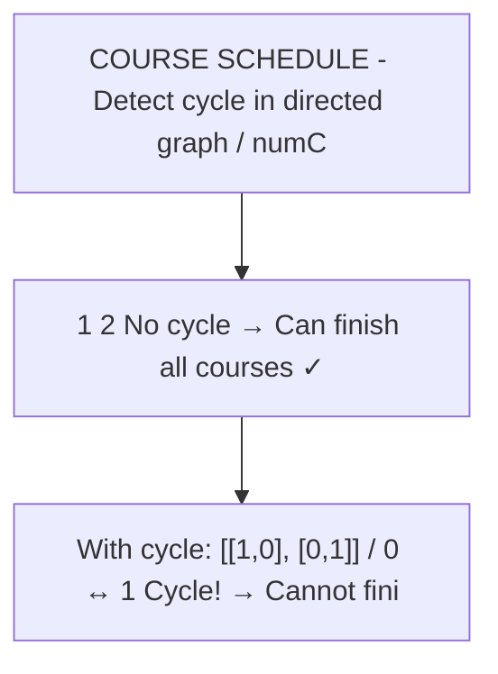

**Solution (DFS with colors):**

```java
public boolean canFinish(int numCourses, int[][] prerequisites) {
    List<List<Integer>> graph = new ArrayList<>();
    for (int i = 0; i < numCourses; i++) {
        graph.add(new ArrayList<>());
    }

    for (int[] prereq : prerequisites) {
        graph.get(prereq[1]).add(prereq[0]);
    }

    // 0 = unvisited, 1 = visiting (in current path), 2 = visited
    int[] state = new int[numCourses];

    for (int i = 0; i < numCourses; i++) {
        if (hasCycle(graph, i, state)) {
            return false;
        }
    }

    return true;
}

private boolean hasCycle(List<List<Integer>> graph, int node, int[] state) {
    if (state[node] == 1) return true;   // Back edge = cycle
    if (state[node] == 2) return false;  // Already processed

    state[node] = 1;  // Mark as visiting

    for (int neighbor : graph.get(node)) {
        if (hasCycle(graph, neighbor, state)) {
            return true;
        }
    }

    state[node] = 2;  // Mark as visited
    return false;
}
```

---

### Problem 143: Course Schedule II (Topological Sort)

**LeetCode 210** 🔗 https://leetcode.com/problems/course-schedule-ii/

```
┌────────────────────────────────────────────────────────────────┐
│  COURSE SCHEDULE II - Return valid course order                │
├────────────────────────────────────────────────────────────────┤
│  numCourses = 4                                                │
│  prerequisites = [[1,0], [2,0], [3,1], [3,2]]                  │
│                                                                │
│  Valid orders:                                                 │
│  [0, 1, 2, 3] or [0, 2, 1, 3]                                  │
│                                                                │
│  Topological Sort: Order where all prerequisites come first    │
│                                                                │
│  Using Kahn's Algorithm (BFS):                                 │
│  1. Calculate in-degree for each node                          │
│  2. Start with nodes having in-degree 0                        │
│  3. Remove node, reduce neighbors' in-degree                   │
│  4. Add nodes with in-degree 0 to queue                        │
└────────────────────────────────────────────────────────────────┘
```

**Flow:**
- COURSE SCHEDULE II - Return valid course order
- ↓
- numCourses = 4
- ↓
- prerequisites = [[1,0], [2,0], [3,1], [3,2]]
- ↓
- Valid orders:
- ↓
- Topological Sort: Order where all prerequisites come fi
- ↓
- Using Kahn's Algorithm (BFS):
- ↓
- 1. Calculate in-degree for each node

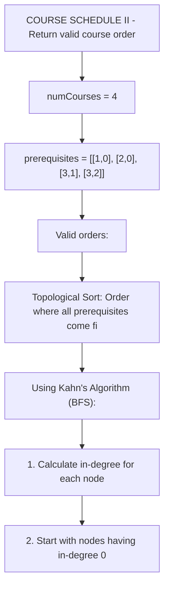

**Solution (Kahn's Algorithm - BFS):**

```java
public int[] findOrder(int numCourses, int[][] prerequisites) {
    List<List<Integer>> graph = new ArrayList<>();
    int[] inDegree = new int[numCourses];

    for (int i = 0; i < numCourses; i++) {
        graph.add(new ArrayList<>());
    }

    for (int[] prereq : prerequisites) {
        graph.get(prereq[1]).add(prereq[0]);
        inDegree[prereq[0]]++;
    }

    Queue<Integer> queue = new LinkedList<>();
    for (int i = 0; i < numCourses; i++) {
        if (inDegree[i] == 0) {
            queue.offer(i);
        }
    }

    int[] result = new int[numCourses];
    int index = 0;

    while (!queue.isEmpty()) {
        int course = queue.poll();
        result[index++] = course;

        for (int neighbor : graph.get(course)) {
            inDegree[neighbor]--;
            if (inDegree[neighbor] == 0) {
                queue.offer(neighbor);
            }
        }
    }

    return index == numCourses ? result : new int[0];
}
```

---

### Problem 144: Graph Valid Tree

**LeetCode 261 (Premium)** 🔗 (Premium)

```
┌────────────────────────────────────────────────────────────────┐
│  GRAPH VALID TREE                                              │
├────────────────────────────────────────────────────────────────┤
│  A valid tree has:                                             │
│  1. No cycles                                                  │
│  2. All nodes connected (single connected component)           │
│  3. Exactly n-1 edges for n nodes                              │
│                                                                │
│  Example 1: n=5, edges=[[0,1],[0,2],[0,3],[1,4]]               │
│       0                                                        │
│      /|\                                                       │
│     1 2 3    Valid tree ✓                                      │
│     |                                                          │
│     4                                                          │
│                                                                │
│  Example 2: n=5, edges=[[0,1],[1,2],[2,3],[1,3],[1,4]]         │
│     0─1─4                                                      │
│       │\                                                       │
│       2─3    Has cycle (1-2-3-1) ✗                             │
│                                                                │
│  Constraints:                                                  │
│  - 1 <= n <= 2000                                              │
│  - 0 <= edges.length <= 5000                                   │
└────────────────────────────────────────────────────────────────┘
```

**Flow:**
- GRAPH VALID TREE
- ↓
- A valid tree has:
- ↓
- 1. No cycles
- ↓
- 2. All nodes connected (single connected component)
- ↓
- 3. Exactly n-1 edges for n nodes
- ↓
- Example 1: n=5, edges=[[0,1],[0,2],[0,3],[1,4]]
- ↓
- 1 2 3 Valid tree ✓

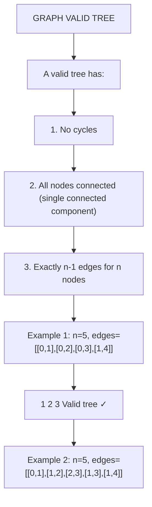

**Solution (Union-Find):**

```java
public boolean validTree(int n, int[][] edges) {
    // Tree must have exactly n-1 edges
    if (edges.length != n - 1) return false;

    int[] parent = new int[n];
    for (int i = 0; i < n; i++) parent[i] = i;

    for (int[] edge : edges) {
        int p1 = find(parent, edge[0]);
        int p2 = find(parent, edge[1]);

        // Same parent means cycle
        if (p1 == p2) return false;

        parent[p1] = p2;  // Union
    }

    return true;
}

private int find(int[] parent, int x) {
    if (parent[x] != x) {
        parent[x] = find(parent, parent[x]);
    }
    return parent[x];
}
```

---


> 🔬 **Section Challenge — 9.2 Graph Cycle Detection**
>
> **Challenge 1 (Reasoning):** BFS finds shortest path in unweighted graphs but not in weighted graphs. Why exactly?
> <details><summary>Answer</summary>
>
> BFS explores by 'hop count' (number of edges). Each level = one more edge away from source. All edges are treated as weight=1. In a weighted graph, the 'shortest by hop count' path may not be 'shortest by weight sum'. Example: A→B (weight 1, 1 hop) vs A→C→B (weight 0.1+0.1=0.2, 2 hops). BFS finds A→B (1 hop), Dijkstra finds A→C→B (lower total weight). BFS is optimal ONLY when all edges have equal weight.
> </details>
>
> **Challenge 2 (Design):** Detect if a directed graph has a cycle. Write the algorithm and explain why we need 3 states (not 2).
> <details><summary>Answer</summary>
>
> 3 states: UNVISITED, IN_PROGRESS (currently in DFS path), DONE. DFS: mark node IN_PROGRESS before visiting neighbors. If we reach an IN_PROGRESS node → cycle found. Mark DONE when all neighbors processed. Why 3 states: with 2 (visited/unvisited), we'd get false positives — reaching a VISITED node that was processed in a DIFFERENT DFS subtree is not a cycle. IN_PROGRESS specifically marks nodes in the CURRENT DFS path (potential back edge).
> </details>
>

## 9.3 Shortest Path Problems

> **Pattern:** Find minimum distance/steps. Choose algorithm based on edge weights:
> - **Unweighted graph** → BFS (each edge = 1 step)
> - **Non-negative weights** → Dijkstra's with min-heap
> - **Negative weights** → Bellman-Ford
> - **K stops limit** → Modified Dijkstra or BFS with state (node, stops)
> **Key insight:** BFS naturally gives shortest path in unweighted graphs because it explores level-by-level.

### Problem 145: 01 Matrix

**LeetCode 542** 🔗 https://leetcode.com/problems/01-matrix/

```
┌────────────────────────────────────────────────────────────────┐
│  01 MATRIX - Distance to nearest 0 for each cell               │
├────────────────────────────────────────────────────────────────┤
│  Input:                  Output:                               │
│  ┌───┬───┬───┐           ┌───┬───┬───┐                         │
│  │ 0 │ 0 │ 0 │           │ 0 │ 0 │ 0 │                         │
│  ├───┼───┼───┤           ├───┼───┼───┤                         │
│  │ 0 │ 1 │ 0 │     →     │ 0 │ 1 │ 0 │                         │
│  ├───┼───┼───┤           ├───┼───┼───┤                         │
│  │ 1 │ 1 │ 1 │           │ 1 │ 2 │ 1 │                         │
│  └───┴───┴───┘           └───┴───┴───┘                         │
│                                                                │
│  Multi-source BFS from all 0s simultaneously                   │
└────────────────────────────────────────────────────────────────┘
```

**Flow:**
- 01 MATRIX - Distance to nearest 0 for each cell
- ↓
- Input: Output:
- ↓
- Multi-source BFS from all 0s simultaneously

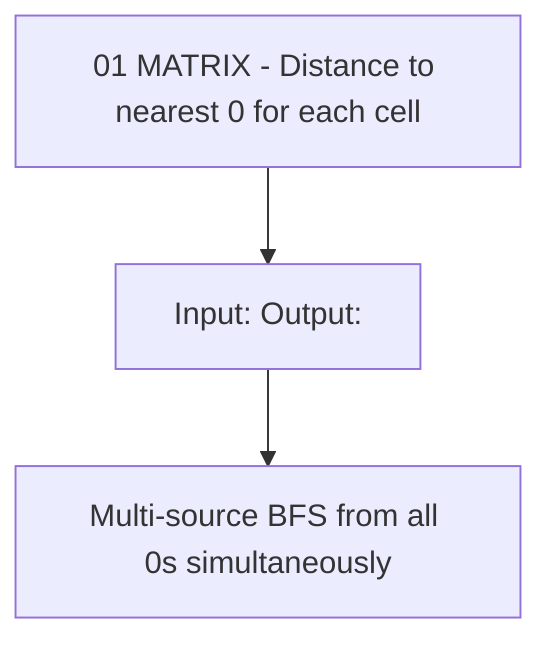

**Solution:**

```java
public int[][] updateMatrix(int[][] mat) {
    int rows = mat.length, cols = mat[0].length;
    Queue<int[]> queue = new LinkedList<>();

    // Add all 0s to queue, mark 1s as unvisited
    for (int i = 0; i < rows; i++) {
        for (int j = 0; j < cols; j++) {
            if (mat[i][j] == 0) {
                queue.offer(new int[]{i, j});
            } else {
                mat[i][j] = -1;  // Mark as unvisited
            }
        }
    }

    int[][] directions = {{1,0}, {-1,0}, {0,1}, {0,-1}};

    while (!queue.isEmpty()) {
        int[] cell = queue.poll();

        for (int[] dir : directions) {
            int nr = cell[0] + dir[0];
            int nc = cell[1] + dir[1];

            if (nr >= 0 && nr < rows && nc >= 0 && nc < cols
                && mat[nr][nc] == -1) {
                mat[nr][nc] = mat[cell[0]][cell[1]] + 1;
                queue.offer(new int[]{nr, nc});
            }
        }
    }

    return mat;
}
```

---

### Problem 146: Shortest Path in Binary Matrix

**LeetCode 1091** 🔗 https://leetcode.com/problems/shortest-path-in-binary-matrix/

```
┌────────────────────────────────────────────────────────────────┐
│  SHORTEST PATH IN BINARY MATRIX                                │
├────────────────────────────────────────────────────────────────┤
│  Find shortest clear path from top-left to bottom-right        │
│  Can move in 8 directions (including diagonals)                │
│  0 = clear, 1 = blocked                                        │
│                                                                │
│  grid = [[0,0,0],                                              │
│          [1,1,0],                                              │
│          [1,1,0]]                                              │
│                                                                │
│  Path: (0,0)→(0,1)→(0,2)→(1,2)→(2,2)                           │
│  ┌───┬───┬───┐                                                 │
│  │ S │ * │ * │                                                 │
│  ├───┼───┼───┤   Length = 4                                    │
│  │ █ │ █ │ * │                                                 │
│  ├───┼───┼───┤                                                 │
│  │ █ │ █ │ E │                                                 │
│  └───┴───┴───┘                                                 │
└────────────────────────────────────────────────────────────────┘
```

**Flow:**
- SHORTEST PATH IN BINARY MATRIX
- ↓
- Find shortest clear path from top-left to bottom-right
- ↓
- Can move in 8 directions (including diagonals)
- ↓
- 0 = clear, 1 = blocked
- ↓
- grid = [[0,0,0],
- ↓
- Length = 4

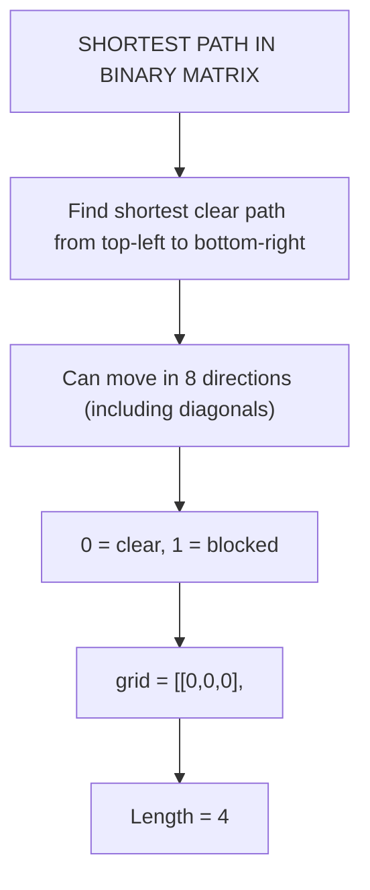

**Solution:**

```java
public int shortestPathBinaryMatrix(int[][] grid) {
    int n = grid.length;
    if (grid[0][0] == 1 || grid[n-1][n-1] == 1) return -1;

    int[][] directions = {
        {0,1}, {0,-1}, {1,0}, {-1,0},
        {1,1}, {1,-1}, {-1,1}, {-1,-1}
    };

    Queue<int[]> queue = new LinkedList<>();
    queue.offer(new int[]{0, 0, 1});  // row, col, distance
    grid[0][0] = 1;  // Mark visited

    while (!queue.isEmpty()) {
        int[] cell = queue.poll();
        int r = cell[0], c = cell[1], dist = cell[2];

        if (r == n-1 && c == n-1) return dist;

        for (int[] dir : directions) {
            int nr = r + dir[0];
            int nc = c + dir[1];

            if (nr >= 0 && nr < n && nc >= 0 && nc < n && grid[nr][nc] == 0) {
                queue.offer(new int[]{nr, nc, dist + 1});
                grid[nr][nc] = 1;
            }
        }
    }

    return -1;
}
```

---

### Problem 147: Network Delay Time (Dijkstra's)

**LeetCode 743** 🔗 https://leetcode.com/problems/network-delay-time/

```
┌────────────────────────────────────────────────────────────────┐
│  NETWORK DELAY TIME - Dijkstra's Algorithm                     │
├────────────────────────────────────────────────────────────────┤
│  times = [[2,1,1],[2,3,1],[3,4,1]], n=4, k=2                   │
│                                                                │
│       1 ←──(1)── 2                                             │
│                  │                                             │
│                 (1)                                            │
│                  ↓                                             │
│                  3 ──(1)──→ 4                                  │
│                                                                │
│  Start from node 2:                                            │
│  - Node 2: time 0                                              │
│  - Node 1: time 1 (via 2→1)                                    │
│  - Node 3: time 1 (via 2→3)                                    │
│  - Node 4: time 2 (via 2→3→4)                                  │
│                                                                │
│  All nodes reached, max time = 2                               │
└────────────────────────────────────────────────────────────────┘
```

**Flow:**
- NETWORK DELAY TIME - Dijkstra's Algorithm
- ↓
- Start from node 2:
- ↓
- - Node 2: time 0
- ↓
- - Node 1: time 1 (via 2
- ↓
- 1)
- ↓
- - Node 1: time 1 (via 2
- ↓
- 1)
- ↓
- - Node 3: time 1 (via 2
- ↓
- 3)
- ↓
- - Node 3: time 1 (via 2
- ↓
- 3)
- ↓
- - Node 4: time 2 (via 2
- ↓
- 3
- ↓
- 4)
- ↓
- - Node 4: time 2 (via 2
- ↓
- 3
- ↓
- 4)
- ↓
- All nodes reached, max time = 2

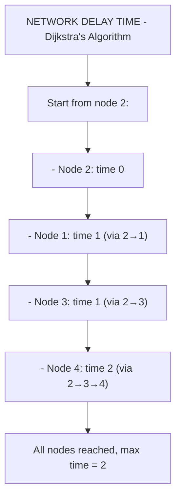

**Solution:**

```java
public int networkDelayTime(int[][] times, int n, int k) {
    // Build adjacency list
    Map<Integer, List<int[]>> graph = new HashMap<>();
    for (int[] time : times) {
        graph.computeIfAbsent(time[0], x -> new ArrayList<>())
             .add(new int[]{time[1], time[2]});
    }

    // Min-heap: [time, node]
    PriorityQueue<int[]> pq = new PriorityQueue<>((a, b) -> a[0] - b[0]);
    pq.offer(new int[]{0, k});

    int[] dist = new int[n + 1];
    Arrays.fill(dist, Integer.MAX_VALUE);
    dist[k] = 0;

    while (!pq.isEmpty()) {
        int[] curr = pq.poll();
        int time = curr[0], node = curr[1];

        if (time > dist[node]) continue;

        if (!graph.containsKey(node)) continue;

        for (int[] edge : graph.get(node)) {
            int neighbor = edge[0], weight = edge[1];
            int newTime = time + weight;

            if (newTime < dist[neighbor]) {
                dist[neighbor] = newTime;
                pq.offer(new int[]{newTime, neighbor});
            }
        }
    }

    int maxTime = 0;
    for (int i = 1; i <= n; i++) {
        if (dist[i] == Integer.MAX_VALUE) return -1;
        maxTime = Math.max(maxTime, dist[i]);
    }

    return maxTime;
}
```

---

### Problem 148: 🔒 Cheapest Flights Within K Stops (LeetCode 787)

**LeetCode 787** 🔗 https://leetcode.com/problems/cheapest-flights-within-k-stops/

```
┌────────────────────────────────────────────────────────────────┐
│  CHEAPEST FLIGHTS WITHIN K STOPS                               │
├────────────────────────────────────────────────────────────────┤
│  n = 4, flights = [[0,1,100],[1,2,100],[2,0,100],[1,3,600],    │
│                    [2,3,200]]                                  │
│  src = 0, dst = 3, k = 1                                       │
│                                                                │
│       ┌────(100)────┐                                          │
│       ↓             │                                          │
│       1 ──(600)──→ 3                                           │
│       │             ↑                                          │
│     (100)         (200)                                        │
│       ↓             │                                          │
│       2 ────────────┘                                          │
│       │                                                        │
│     (100)                                                      │
│       ↓                                                        │
│       0                                                        │
│                                                                │
│  With at most 1 stop:                                          │
│  - 0→1→3 = 700 (1 stop)                                        │
│  - 0→1→2→3 = 400 but has 2 stops ✗                             │
│                                                                │
│  Output: 700                                                   │
└────────────────────────────────────────────────────────────────┘
```

**Flow:**
- CHEAPEST FLIGHTS WITHIN K STOPS
- ↓
- n = 4, flights = [[0,1,100],[1,2,100],[2,0,100],[1,3,60
- ↓
- With at most 1 stop:
- ↓
- - 0
- ↓
- 1
- ↓
- 3 = 700 (1 stop)
- ↓
- - 0
- ↓
- 1
- ↓
- 3 = 700 (1 stop)
- ↓
- - 0
- ↓
- 1
- ↓
- 2
- ↓
- 3 = 400 but has 2 stops ✗
- ↓
- - 0
- ↓
- 1
- ↓
- 2
- ↓
- 3 = 400 but has 2 stops ✗
- ↓
- Output: 700

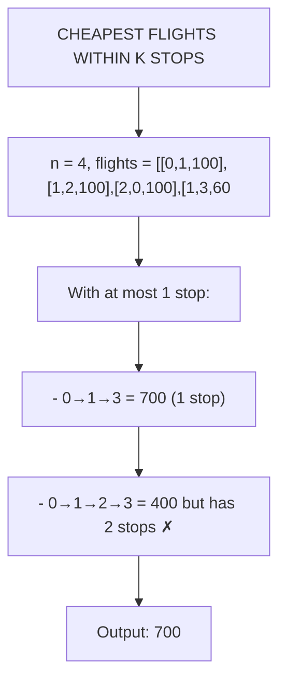

**Solution (Modified Dijkstra):**

```java
public int findCheapestPrice(int n, int[][] flights, int src, int dst, int k) {
    Map<Integer, List<int[]>> graph = new HashMap<>();
    for (int[] f : flights) {
        graph.computeIfAbsent(f[0], x -> new ArrayList<>())
             .add(new int[]{f[1], f[2]});
    }

    // [cost, node, stops]
    PriorityQueue<int[]> pq = new PriorityQueue<>((a, b) -> a[0] - b[0]);
    pq.offer(new int[]{0, src, 0});

    // Track min stops to reach each node
    int[] minStops = new int[n];
    Arrays.fill(minStops, Integer.MAX_VALUE);

    while (!pq.isEmpty()) {
        int[] curr = pq.poll();
        int cost = curr[0], node = curr[1], stops = curr[2];

        if (node == dst) return cost;
        if (stops > k) continue;
        if (stops >= minStops[node]) continue;

        minStops[node] = stops;

        if (!graph.containsKey(node)) continue;

        for (int[] next : graph.get(node)) {
            pq.offer(new int[]{cost + next[1], next[0], stops + 1});
        }
    }

    return -1;
}
```

---

## 9.4 Union-Find (Disjoint Set)

> **Pattern:** Dynamic connectivity — merge groups and check membership.
> **When to use over BFS/DFS:** When edges arrive one-by-one (online), or when you need to count components after each merge.
> **Template:** Find with path compression + Union by rank → O(α(n)) ≈ O(1) per operation.

```
┌────────────────────────────────────────────────────────────────┐
│  UNION-FIND DATA STRUCTURE                                     │
├────────────────────────────────────────────────────────────────┤
│  Operations:                                                   │
│  - find(x): Find root/representative of x's set                │
│  - union(x, y): Merge sets containing x and y                  │
│                                                                │
│  Optimizations:                                                │
│  1. Path Compression: Flatten tree during find                 │
│  2. Union by Rank: Attach smaller tree under larger            │
│                                                                │
│  Example:                                                      │
│  Initial: {0}, {1}, {2}, {3}, {4}                              │
│                                                                │
│  union(0,1): {0,1}, {2}, {3}, {4}                              │
│  union(2,3): {0,1}, {2,3}, {4}                                 │
│  union(1,3): {0,1,2,3}, {4}                                    │
│                                                                │
│  find(0) == find(3)? → true (same set)                         │
│  find(0) == find(4)? → false (different sets)                  │
│                                                                │
│  Time: O(α(n)) ≈ O(1) amortized per operation                  │
└────────────────────────────────────────────────────────────────┘
```

**Flow:**
- UNION-FIND DATA STRUCTURE
- ↓
- Operations:
- ↓
- - find(x): Find root/representative of x's set
- ↓
- - union(x, y): Merge sets containing x and y
- ↓
- Optimizations:
- ↓
- 1. Path Compression: Flatten tree during find
- ↓
- 2. Union by Rank: Attach smaller tree under larger

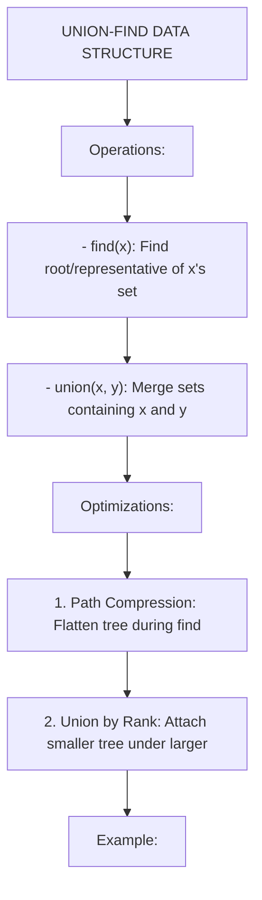

---

### Problem 149: Number of Connected Components

**LeetCode 323 (Premium)** 🔗 (Premium)

```
┌────────────────────────────────────────────────────────────────┐
│  NUMBER OF CONNECTED COMPONENTS                                │
├────────────────────────────────────────────────────────────────┤
│  n = 5, edges = [[0,1], [1,2], [3,4]]                          │
│                                                                │
│  0 ─── 1 ─── 2        3 ─── 4                                  │
│                                                                │
│  Component 1: {0,1,2}                                          │
│  Component 2: {3,4}                                            │
│                                                                │
│  Output: 2                                                     │
│                                                                │
│  Constraints:                                                  │
│  - 1 <= n <= 2000                                              │
│  - 0 <= edges.length <= 5000                                   │
│  - No duplicate edges                                          │
└────────────────────────────────────────────────────────────────┘
```

**Flow:**
- NUMBER OF CONNECTED COMPONENTS
- ↓
- n = 5, edges = [[0,1], [1,2], [3,4]]
- ↓
- Component 1: {0,1,2}
- ↓
- Component 2: {3,4}
- ↓
- Output: 2
- ↓
- Constraints:
- ↓
- - 0 <= edges.length <= 5000

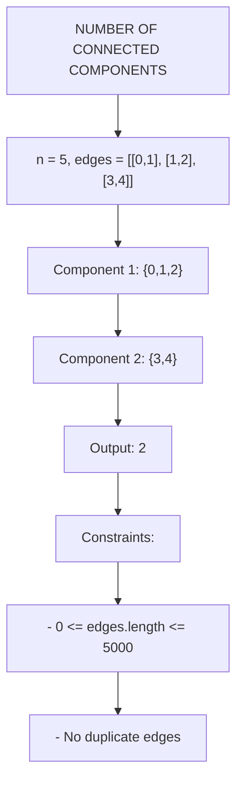

**Solution:**

```java
public int countComponents(int n, int[][] edges) {
    int[] parent = new int[n];
    int[] rank = new int[n];

    for (int i = 0; i < n; i++) parent[i] = i;

    int components = n;

    for (int[] edge : edges) {
        if (union(parent, rank, edge[0], edge[1])) {
            components--;
        }
    }

    return components;
}

private int find(int[] parent, int x) {
    if (parent[x] != x) {
        parent[x] = find(parent, parent[x]);  // Path compression
    }
    return parent[x];
}

private boolean union(int[] parent, int[] rank, int x, int y) {
    int px = find(parent, x);
    int py = find(parent, y);

    if (px == py) return false;  // Already same component

    // Union by rank
    if (rank[px] < rank[py]) {
        parent[px] = py;
    } else if (rank[px] > rank[py]) {
        parent[py] = px;
    } else {
        parent[py] = px;
        rank[px]++;
    }

    return true;
}
```

---

### Problem 150: Redundant Connection

**LeetCode 684** 🔗 https://leetcode.com/problems/redundant-connection/

```
┌────────────────────────────────────────────────────────────────┐
│  REDUNDANT CONNECTION - Find edge that creates cycle           │
├────────────────────────────────────────────────────────────────┤
│  edges = [[1,2], [1,3], [2,3]]                                 │
│                                                                │
│       1                                                        │
│      / \                                                       │
│     2───3   Edge [2,3] creates the cycle                       │
│                                                                │
│  Return the last edge that creates a cycle                     │
│  Output: [2, 3]                                                │
└────────────────────────────────────────────────────────────────┘
```

**Flow:**
- REDUNDANT CONNECTION - Find edge that creates cycle
- ↓
- edges = [[1,2], [1,3], [2,3]]
- ↓
- 2 3 Edge [2,3] creates the cycle
- ↓
- Return the last edge that creates a cycle
- ↓
- Output: [2, 3]

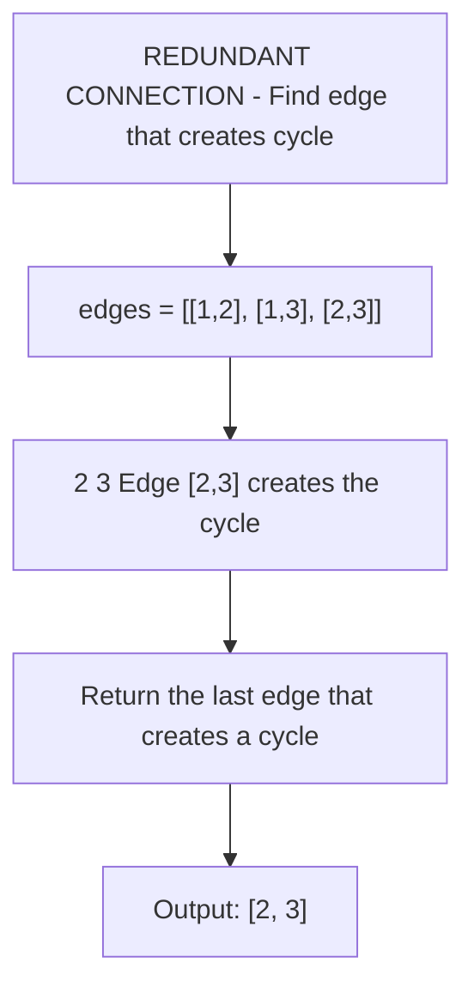

**Solution:**

```java
public int[] findRedundantConnection(int[][] edges) {
    int n = edges.length;
    int[] parent = new int[n + 1];

    for (int i = 1; i <= n; i++) parent[i] = i;

    for (int[] edge : edges) {
        int p1 = find(parent, edge[0]);
        int p2 = find(parent, edge[1]);

        if (p1 == p2) {
            return edge;  // This edge creates cycle
        }

        parent[p1] = p2;
    }

    return new int[0];
}

private int find(int[] parent, int x) {
    if (parent[x] != x) {
        parent[x] = find(parent, parent[x]);
    }
    return parent[x];
}
```

---

### Problem 151: Accounts Merge

**LeetCode 721** 🔗 https://leetcode.com/problems/accounts-merge/

```
┌────────────────────────────────────────────────────────────────┐
│  ACCOUNTS MERGE - Merge accounts with same email               │
├────────────────────────────────────────────────────────────────┤
│  accounts = [                                                  │
│    ["John", "john@mail.com", "john_work@mail.com"],            │
│    ["John", "john@mail.com", "john_home@mail.com"],            │
│    ["Mary", "mary@mail.com"],                                  │
│    ["John", "johnny@mail.com"]                                 │
│  ]                                                             │
│                                                                │
│  John (account 0) and John (account 1) share "john@mail.com"   │
│  → Merge them                                                  │
│                                                                │
│  Output: [                                                     │
│    ["John", "john@mail.com", "john_home@mail.com",             │
│            "john_work@mail.com"],                              │
│    ["Mary", "mary@mail.com"],                                  │
│    ["John", "johnny@mail.com"]                                 │
│  ]                                                             │
└────────────────────────────────────────────────────────────────┘
```

**Flow:**
- ACCOUNTS MERGE - Merge accounts with same email
- ↓
- accounts = [
- ↓
- ['John', 'john@mail.com', 'john_work@mail.com'],
- ↓
- ['John', 'john@mail.com', 'john_home@mail.com'],
- ↓
- ['Mary', 'mary@mail.com'],
- ↓
- ['John', 'johnny@mail.com']
- ↓
- John (account 0) and John (account 1) share 'john@mail.

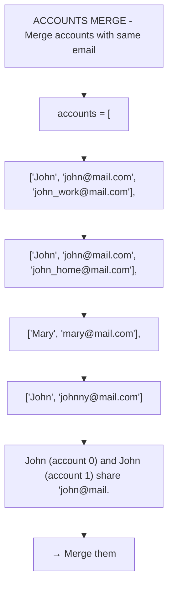

**Solution:**

```java
public List<List<String>> accountsMerge(List<List<String>> accounts) {
    Map<String, String> emailToName = new HashMap<>();
    Map<String, String> parent = new HashMap<>();

    // Initialize: each email is its own parent
    for (List<String> account : accounts) {
        String name = account.get(0);
        for (int i = 1; i < account.size(); i++) {
            String email = account.get(i);
            emailToName.put(email, name);
            parent.put(email, email);
        }
    }

    // Union emails in same account
    for (List<String> account : accounts) {
        String firstEmail = account.get(1);
        for (int i = 2; i < account.size(); i++) {
            union(parent, firstEmail, account.get(i));
        }
    }

    // Group emails by root
    Map<String, TreeSet<String>> groups = new HashMap<>();
    for (String email : parent.keySet()) {
        String root = find(parent, email);
        groups.computeIfAbsent(root, x -> new TreeSet<>()).add(email);
    }

    // Build result
    List<List<String>> result = new ArrayList<>();
    for (String root : groups.keySet()) {
        List<String> account = new ArrayList<>();
        account.add(emailToName.get(root));
        account.addAll(groups.get(root));
        result.add(account);
    }

    return result;
}

private String find(Map<String, String> parent, String x) {
    if (!parent.get(x).equals(x)) {
        parent.put(x, find(parent, parent.get(x)));
    }
    return parent.get(x);
}

private void union(Map<String, String> parent, String x, String y) {
    parent.put(find(parent, x), find(parent, y));
}
```

---


> 🔬 **Section Challenge — 9.4 Union-Find (Disjoint Set)**
>
> **Challenge 1 (Reasoning):** `LEFT JOIN` returns all rows from the left table. When does it return MORE rows than the left table?
> <details><summary>Answer</summary>
>
> When the right table has MULTIPLE matching rows for one left-table row. Example: Orders LEFT JOIN OrderItems — one order with 5 items = 5 result rows for that one order. Analogy: `1 order × 5 items = 5 rows`. Always check your join multiplicity. Use `SELECT COUNT(*) vs COUNT(DISTINCT left.id)` to detect row explosion.
> </details>
>
> **Challenge 2 (Bug Hunt):** `SELECT * FROM A, B WHERE A.id = B.a_id` — what join type is this and is it equivalent to `A JOIN B ON A.id = B.a_id`?
> <details><summary>Answer</summary>
>
> It's an old-style INNER JOIN. Functionally equivalent to `A INNER JOIN B ON A.id = B.a_id` — only returns rows where both sides match. BUT: the comma syntax is dangerous. Forgetting the WHERE clause on a multi-table comma join → CROSS JOIN (cartesian product). Explicit JOIN syntax with ON makes intent clear and prevents the accidental cross join.
> </details>
>

## 9.5 Advanced Graph Problems

> **Pattern:** These problems require creative graph modeling.
> - **Word Ladder:** Each word = node, differ-by-1-letter = edge → BFS for shortest transformation
> - **Alien Dictionary:** Characters → nodes, ordering rules → directed edges → Topological sort
> - **Bipartite:** 2-color the graph. If any edge connects same-color nodes → not bipartite.

### Problem 152: Word Ladder

**LeetCode 127** 🔗 https://leetcode.com/problems/word-ladder/

```
┌────────────────────────────────────────────────────────────────┐
│  WORD LADDER - Shortest transformation sequence                │
├────────────────────────────────────────────────────────────────┤
│  beginWord = "hit", endWord = "cog"                            │
│  wordList = ["hot","dot","dog","lot","log","cog"]              │
│                                                                │
│  Transformation: Change one letter at a time                   │
│  Each intermediate word must be in wordList                    │
│                                                                │
│  hit → hot → dot → dog → cog                                   │
│   │     │     │     │                                          │
│   └─────┴─────┴─────┴──→ 5 words                               │
│                                                                │
│  Graph representation:                                         │
│  hot ─── dot ─── dog                                           │
│   │       │       │                                            │
│  lot ─── log ─── cog                                           │
│                                                                │
│  BFS finds shortest path                                       │
└────────────────────────────────────────────────────────────────┘
```

**Flow:**
- WORD LADDER - Shortest transformation sequence
- ↓
- beginWord = 'hit', endWord = 'cog'
- ↓
- wordList = ['hot','dot','dog','lot','log','cog']
- ↓
- Transformation: Change one letter at a time
- ↓
- Each intermediate word must be in wordList
- ↓
- hit
- ↓
- hot
- ↓
- dot
- ↓
- dog
- ↓
- cog
- ↓
- hit
- ↓
- hot
- ↓
- dot
- ↓
- dog
- ↓
- cog
- ↓
- 5 words

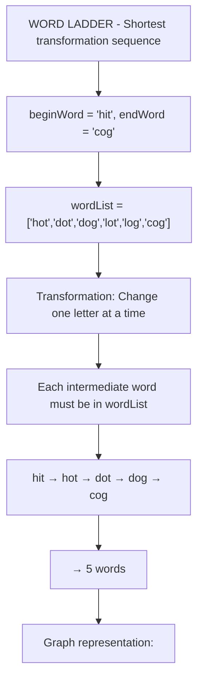

**Solution:**

```java
public int ladderLength(String beginWord, String endWord, List<String> wordList) {
    Set<String> wordSet = new HashSet<>(wordList);
    if (!wordSet.contains(endWord)) return 0;

    Queue<String> queue = new LinkedList<>();
    queue.offer(beginWord);

    Set<String> visited = new HashSet<>();
    visited.add(beginWord);

    int level = 1;

    while (!queue.isEmpty()) {
        int size = queue.size();

        for (int i = 0; i < size; i++) {
            String word = queue.poll();

            if (word.equals(endWord)) return level;

            // Try changing each character
            char[] chars = word.toCharArray();
            for (int j = 0; j < chars.length; j++) {
                char original = chars[j];

                for (char c = 'a'; c <= 'z'; c++) {
                    if (c == original) continue;

                    chars[j] = c;
                    String newWord = new String(chars);

                    if (wordSet.contains(newWord) && !visited.contains(newWord)) {
                        queue.offer(newWord);
                        visited.add(newWord);
                    }
                }

                chars[j] = original;
            }
        }

        level++;
    }

    return 0;
}
```

---

### Problem 153: 🔒 Alien Dictionary (LeetCode 269 - Premium)

```
┌────────────────────────────────────────────────────────────────┐
│  ALIEN DICTIONARY - Find character order from sorted words     │
├────────────────────────────────────────────────────────────────┤
│  words = ["wrt", "wrf", "er", "ett", "rftt"]                   │
│  These words are sorted in alien language order                │
│                                                                │
│  Compare adjacent words to find relationships:                 │
│  "wrt" vs "wrf" → t comes before f (t < f)                     │
│  "wrf" vs "er"  → w comes before e (w < e)                     │
│  "er" vs "ett"  → r comes before t (r < t)                     │
│  "ett" vs "rftt"→ e comes before r (e < r)                     │
│                                                                │
│  Build graph: w→e→r→t→f                                        │
│  Topological sort gives: "wertf"                               │
│                                                                │
│  Constraints:                                                  │
│  - 1 <= words.length <= 100                                    │
│  - 1 <= words[i].length <= 100                                 │
│  - All characters are lowercase English letters                │
└────────────────────────────────────────────────────────────────┘
```

**Flow:**
- ALIEN DICTIONARY - Find character order from sorted wor
- ↓
- words = ['wrt', 'wrf', 'er', 'ett', 'rftt']
- ↓
- These words are sorted in alien language order
- ↓
- Compare adjacent words to find relationships:
- ↓
- 'wrt' vs 'wrf'
- ↓
- t comes before f (t < f)
- ↓
- 'wrt' vs 'wrf'
- ↓
- t comes before f (t < f)
- ↓
- 'wrf' vs 'er'
- ↓
- w comes before e (w < e)
- ↓
- 'wrf' vs 'er'
- ↓
- w comes before e (w < e)
- ↓
- 'er' vs 'ett'
- ↓
- r comes before t (r < t)

```mermaid
flowchart TD
    N1["ALIEN DICTIONARY - Find character order from sorted wor"]
    N2["words = ['wrt', 'wrf', 'er', 'ett', 'rftt']"]
    N3["These words are sorted in alien language order"]
    N4["Compare adjacent words to find relationships:"]
    N5["'wrt' vs 'wrf' → t comes before f (t &lt; f)"]
    N6["'wrf' vs 'er' → w comes before e (w &lt; e)"]
    N7["'er' vs 'ett' → r comes before t (r &lt; t)"]
    N8["'ett' vs 'rftt'→ e comes before r (e &lt; r)"]
    N1 --> N2
    N2 --> N3
    N3 --> N4
    N4 --> N5
    N5 --> N6
    N6 --> N7
    N7 --> N8
```

**Solution:**

```java
public String alienOrder(String[] words) {
    Map<Character, Set<Character>> graph = new HashMap<>();
    Map<Character, Integer> inDegree = new HashMap<>();

    // Initialize all characters
    for (String word : words) {
        for (char c : word.toCharArray()) {
            graph.putIfAbsent(c, new HashSet<>());
            inDegree.putIfAbsent(c, 0);
        }
    }

    // Build graph by comparing adjacent words
    for (int i = 0; i < words.length - 1; i++) {
        String w1 = words[i], w2 = words[i + 1];

        // Invalid case: prefix comes after longer word
        if (w1.length() > w2.length() && w1.startsWith(w2)) {
            return "";
        }

        for (int j = 0; j < Math.min(w1.length(), w2.length()); j++) {
            char c1 = w1.charAt(j), c2 = w2.charAt(j);
            if (c1 != c2) {
                if (!graph.get(c1).contains(c2)) {
                    graph.get(c1).add(c2);
                    inDegree.put(c2, inDegree.get(c2) + 1);
                }
                break;
            }
        }
    }

    // Topological sort
    Queue<Character> queue = new LinkedList<>();
    for (char c : inDegree.keySet()) {
        if (inDegree.get(c) == 0) queue.offer(c);
    }

    StringBuilder result = new StringBuilder();
    while (!queue.isEmpty()) {
        char c = queue.poll();
        result.append(c);

        for (char next : graph.get(c)) {
            inDegree.put(next, inDegree.get(next) - 1);
            if (inDegree.get(next) == 0) queue.offer(next);
        }
    }

    return result.length() == inDegree.size() ? result.toString() : "";
}
```

---

### Problem 154: Is Graph Bipartite?

**LeetCode 785** 🔗 https://leetcode.com/problems/is-graph-bipartite/

```
┌────────────────────────────────────────────────────────────────┐
│  IS GRAPH BIPARTITE - Can nodes be divided into 2 sets?        │
├────────────────────────────────────────────────────────────────┤
│  A graph is bipartite if we can color nodes with 2 colors      │
│  such that no two adjacent nodes have the same color.          │
│                                                                │
│  Bipartite:               Not Bipartite:                       │
│     0 ─── 1                  0 ─── 1                           │
│     │     │                  │ \   │                           │
│     │     │                  │  \  │                           │
│     3 ─── 2                  3 ─── 2                           │
│                                                                │
│  Colors: 0,2=RED, 1,3=BLUE   Triangle can't be 2-colored       │
└────────────────────────────────────────────────────────────────┘
```

**Flow:**
- IS GRAPH BIPARTITE - Can nodes be divided into 2 sets?
- ↓
- A graph is bipartite if we can color nodes with 2 color
- ↓
- such that no two adjacent nodes have the same color.
- ↓
- Bipartite: Not Bipartite:
- ↓
- Colors: 0,2=RED, 1,3=BLUE Triangle can't be 2-colored

```mermaid
flowchart TD
    N1["IS GRAPH BIPARTITE - Can nodes be divided into 2 sets?"]
    N2["A graph is bipartite if we can color nodes with 2 color"]
    N3["such that no two adjacent nodes have the same color."]
    N4["Bipartite: Not Bipartite:"]
    N5["Colors: 0,2=RED, 1,3=BLUE Triangle can't be 2-colored"]
    N1 --> N2
    N2 --> N3
    N3 --> N4
    N4 --> N5
```

**Solution:**

```java
public boolean isBipartite(int[][] graph) {
    int n = graph.length;
    int[] colors = new int[n];  // 0=uncolored, 1=red, -1=blue

    for (int i = 0; i < n; i++) {
        if (colors[i] == 0 && !bfs(graph, colors, i)) {
            return false;
        }
    }

    return true;
}

private boolean bfs(int[][] graph, int[] colors, int start) {
    Queue<Integer> queue = new LinkedList<>();
    queue.offer(start);
    colors[start] = 1;

    while (!queue.isEmpty()) {
        int node = queue.poll();

        for (int neighbor : graph[node]) {
            if (colors[neighbor] == 0) {
                colors[neighbor] = -colors[node];  // Opposite color
                queue.offer(neighbor);
            } else if (colors[neighbor] == colors[node]) {
                return false;  // Same color = not bipartite
            }
        }
    }

    return true;
}
```

---


> 🔬 **Section Challenge — 9.5 Advanced Graph Problems**
>
> **Challenge 1 (Reasoning):** BFS finds shortest path in unweighted graphs but not in weighted graphs. Why exactly?
> <details><summary>Answer</summary>
>
> BFS explores by 'hop count' (number of edges). Each level = one more edge away from source. All edges are treated as weight=1. In a weighted graph, the 'shortest by hop count' path may not be 'shortest by weight sum'. Example: A→B (weight 1, 1 hop) vs A→C→B (weight 0.1+0.1=0.2, 2 hops). BFS finds A→B (1 hop), Dijkstra finds A→C→B (lower total weight). BFS is optimal ONLY when all edges have equal weight.
> </details>
>
> **Challenge 2 (Design):** Detect if a directed graph has a cycle. Write the algorithm and explain why we need 3 states (not 2).
> <details><summary>Answer</summary>
>
> 3 states: UNVISITED, IN_PROGRESS (currently in DFS path), DONE. DFS: mark node IN_PROGRESS before visiting neighbors. If we reach an IN_PROGRESS node → cycle found. Mark DONE when all neighbors processed. Why 3 states: with 2 (visited/unvisited), we'd get false positives — reaching a VISITED node that was processed in a DIFFERENT DFS subtree is not a cycle. IN_PROGRESS specifically marks nodes in the CURRENT DFS path (potential back edge).
> </details>
>

## 9.6 HackerEarth & Codeforces Graph Problems

### Problem 155: Find the Town Judge (HackerEarth-style)

```
┌────────────────────────────────────────────────────────────────┐
│  FIND THE TOWN JUDGE                                           │
├────────────────────────────────────────────────────────────────┤
│  In a town of n people, one might be the judge.                │
│  The judge:                                                    │
│  1. Trusts nobody                                              │
│  2. Everybody else trusts the judge                            │
│                                                                │
│  trust = [[1,2], [3,2]]  (a trusts b)                          │
│  n = 3                                                         │
│                                                                │
│     1 ───→ 2 ←─── 3                                            │
│                                                                │
│  Person 2: in-degree = 2 (n-1), out-degree = 0                 │
│  Output: 2                                                     │
│                                                                │
│  Constraints:                                                  │
│  - 1 <= n <= 1000                                              │
│  - 0 <= trust.length <= 10^4                                   │
└────────────────────────────────────────────────────────────────┘
```

**Flow:**
- FIND THE TOWN JUDGE
- ↓
- In a town of n people, one might be the judge.
- ↓
- The judge:
- ↓
- 1. Trusts nobody
- ↓
- 2. Everybody else trusts the judge
- ↓
- trust = [[1,2], [3,2]] (a trusts b)
- ↓
- Person 2: in-degree = 2 (n-1), out-degree = 0

```mermaid
flowchart TD
    N1["FIND THE TOWN JUDGE"]
    N2["In a town of n people, one might be the judge."]
    N3["The judge:"]
    N4["1. Trusts nobody"]
    N5["2. Everybody else trusts the judge"]
    N6["trust = [[1,2], [3,2]] (a trusts b)"]
    N7["Person 2: in-degree = 2 (n-1), out-degree = 0"]
    N8["Output: 2"]
    N1 --> N2
    N2 --> N3
    N3 --> N4
    N4 --> N5
    N5 --> N6
    N6 --> N7
    N7 --> N8
```

**Solution:**

```java
public int findJudge(int n, int[][] trust) {
    int[] trustScore = new int[n + 1];

    for (int[] t : trust) {
        trustScore[t[0]]--;  // Trusts someone
        trustScore[t[1]]++;  // Is trusted
    }

    for (int i = 1; i <= n; i++) {
        if (trustScore[i] == n - 1) {
            return i;  // Trusted by everyone else, trusts no one
        }
    }

    return -1;
}
```

---

### Problem 156: Minimum Spanning Tree (Codeforces-style)

```
┌────────────────────────────────────────────────────────────────┐
│  MINIMUM SPANNING TREE - Kruskal's Algorithm                   │
├────────────────────────────────────────────────────────────────┤
│  Connect all nodes with minimum total edge weight              │
│  n = 4, edges = [[1,2,1], [1,3,4], [2,3,2], [3,4,3]]           │
│                                                                │
│       1 ──(1)── 2                                              │
│        \       /                                               │
│       (4)   (2)                                                │
│          \ /                                                   │
│           3                                                    │
│           │                                                    │
│          (3)                                                   │
│           │                                                    │
│           4                                                    │
│                                                                │
│  MST edges: [1,2,1], [2,3,2], [3,4,3]                          │
│  Total weight = 1 + 2 + 3 = 6                                  │
│                                                                │
│  Kruskal's: Sort edges, add if doesn't create cycle            │
└────────────────────────────────────────────────────────────────┘
```

**Flow:**
- MINIMUM SPANNING TREE - Kruskal's Algorithm
- ↓
- Connect all nodes with minimum total edge weight
- ↓
- n = 4, edges = [[1,2,1], [1,3,4], [2,3,2], [3,4,3]]
- ↓
- MST edges: [1,2,1], [2,3,2], [3,4,3]
- ↓
- Total weight = 1 + 2 + 3 = 6
- ↓
- Kruskal's: Sort edges, add if doesn't create cycle

```mermaid
flowchart TD
    N1["MINIMUM SPANNING TREE - Kruskal's Algorithm"]
    N2["Connect all nodes with minimum total edge weight"]
    N3["n = 4, edges = [[1,2,1], [1,3,4], [2,3,2], [3,4,3]]"]
    N4["MST edges: [1,2,1], [2,3,2], [3,4,3]"]
    N5["Total weight = 1 + 2 + 3 = 6"]
    N6["Kruskal's: Sort edges, add if doesn't create cycle"]
    N1 --> N2
    N2 --> N3
    N3 --> N4
    N4 --> N5
    N5 --> N6
```

**Solution:**

```java
public int minSpanningTree(int n, int[][] edges) {
    // Sort edges by weight
    Arrays.sort(edges, (a, b) -> a[2] - b[2]);

    int[] parent = new int[n + 1];
    for (int i = 1; i <= n; i++) parent[i] = i;

    int totalWeight = 0;
    int edgesUsed = 0;

    for (int[] edge : edges) {
        int u = edge[0], v = edge[1], weight = edge[2];

        int pu = find(parent, u);
        int pv = find(parent, v);

        if (pu != pv) {
            parent[pu] = pv;
            totalWeight += weight;
            edgesUsed++;

            if (edgesUsed == n - 1) break;
        }
    }

    return edgesUsed == n - 1 ? totalWeight : -1;
}

private int find(int[] parent, int x) {
    if (parent[x] != x) {
        parent[x] = find(parent, parent[x]);
    }
    return parent[x];
}
```

---

### Problem 157: Detect Cycle in Undirected Graph (HackerEarth)

```
┌────────────────────────────────────────────────────────────────┐
│  DETECT CYCLE IN UNDIRECTED GRAPH                              │
├────────────────────────────────────────────────────────────────┤
│  Has Cycle:               No Cycle:                            │
│     0 ─── 1                  0 ─── 1                           │
│     │     │                  │                                 │
│     │     │                  │                                 │
│     3 ─── 2                  2 ─── 3                           │
│                                                                │
│  DFS: If we visit a node that's already visited and            │
│  it's not the parent → cycle detected                          │
└────────────────────────────────────────────────────────────────┘
```

**Flow:**
- DETECT CYCLE IN UNDIRECTED GRAPH
- ↓
- Has Cycle: No Cycle:
- ↓
- DFS: If we visit a node that's already visited and
- ↓
- it's not the parent
- ↓
- cycle detected

```mermaid
flowchart TD
    N1["DETECT CYCLE IN UNDIRECTED GRAPH"]
    N2["Has Cycle: No Cycle:"]
    N3["DFS: If we visit a node that's already visited and"]
    N4["it's not the parent → cycle detected"]
    N1 --> N2
    N2 --> N3
    N3 --> N4
```

**Solution:**

```java
public boolean hasCycle(int n, int[][] edges) {
    List<List<Integer>> graph = new ArrayList<>();
    for (int i = 0; i < n; i++) {
        graph.add(new ArrayList<>());
    }

    for (int[] edge : edges) {
        graph.get(edge[0]).add(edge[1]);
        graph.get(edge[1]).add(edge[0]);
    }

    boolean[] visited = new boolean[n];

    for (int i = 0; i < n; i++) {
        if (!visited[i]) {
            if (dfs(graph, visited, i, -1)) {
                return true;
            }
        }
    }

    return false;
}

private boolean dfs(List<List<Integer>> graph, boolean[] visited,
                    int node, int parent) {
    visited[node] = true;

    for (int neighbor : graph.get(node)) {
        if (!visited[neighbor]) {
            if (dfs(graph, visited, neighbor, node)) {
                return true;
            }
        } else if (neighbor != parent) {
            return true;  // Back edge = cycle
        }
    }

    return false;
}
```

---

### Problem 158: Strongly Connected Components (Codeforces-style)

```
┌────────────────────────────────────────────────────────────────┐
│  STRONGLY CONNECTED COMPONENTS (Kosaraju's Algorithm)          │
├────────────────────────────────────────────────────────────────┤
│  A directed graph's SCC is a maximal set of vertices where     │
│  every vertex is reachable from every other vertex.            │
│                                                                │
│       0 ───→ 1                                                 │
│       ↑     ↙                                                  │
│       │   ↙                                                    │
│       2 ←───────                                               │
│       │                                                        │
│       ↓                                                        │
│       3 ←──→ 4                                                 │
│                                                                │
│  SCC 1: {0, 1, 2}  (form a cycle)                              │
│  SCC 2: {3, 4}     (form a cycle)                              │
│                                                                │
│  Kosaraju's Algorithm:                                         │
│  1. DFS to get finish order                                    │
│  2. Transpose graph                                            │
│  3. DFS in reverse finish order on transposed graph            │
└────────────────────────────────────────────────────────────────┘
```

**Flow:**
- STRONGLY CONNECTED COMPONENTS (Kosaraju's Algorithm)
- ↓
- A directed graph's SCC is a maximal set of vertices whe
- ↓
- every vertex is reachable from every other vertex.
- ↓
- SCC 1: {0, 1, 2} (form a cycle)
- ↓
- SCC 2: {3, 4} (form a cycle)
- ↓
- Kosaraju's Algorithm:
- ↓
- 1. DFS to get finish order

```mermaid
flowchart TD
    N1["STRONGLY CONNECTED COMPONENTS (Kosaraju's Algorithm)"]
    N2["A directed graph's SCC is a maximal set of vertices whe"]
    N3["every vertex is reachable from every other vertex."]
    N4["SCC 1: {0, 1, 2} (form a cycle)"]
    N5["SCC 2: {3, 4} (form a cycle)"]
    N6["Kosaraju's Algorithm:"]
    N7["1. DFS to get finish order"]
    N8["2. Transpose graph"]
    N1 --> N2
    N2 --> N3
    N3 --> N4
    N4 --> N5
    N5 --> N6
    N6 --> N7
    N7 --> N8
```

**Solution:**

```java
public int countSCCs(int n, int[][] edges) {
    List<List<Integer>> graph = new ArrayList<>();
    List<List<Integer>> transpose = new ArrayList<>();

    for (int i = 0; i < n; i++) {
        graph.add(new ArrayList<>());
        transpose.add(new ArrayList<>());
    }

    for (int[] edge : edges) {
        graph.get(edge[0]).add(edge[1]);
        transpose.get(edge[1]).add(edge[0]);
    }

    // Step 1: Get finish order
    boolean[] visited = new boolean[n];
    Stack<Integer> stack = new Stack<>();

    for (int i = 0; i < n; i++) {
        if (!visited[i]) {
            dfs1(graph, visited, i, stack);
        }
    }

    // Step 2: DFS on transpose in reverse finish order
    Arrays.fill(visited, false);
    int sccCount = 0;

    while (!stack.isEmpty()) {
        int node = stack.pop();
        if (!visited[node]) {
            dfs2(transpose, visited, node);
            sccCount++;
        }
    }

    return sccCount;
}

private void dfs1(List<List<Integer>> graph, boolean[] visited,
                  int node, Stack<Integer> stack) {
    visited[node] = true;
    for (int neighbor : graph.get(node)) {
        if (!visited[neighbor]) {
            dfs1(graph, visited, neighbor, stack);
        }
    }
    stack.push(node);
}

private void dfs2(List<List<Integer>> graph, boolean[] visited, int node) {
    visited[node] = true;
    for (int neighbor : graph.get(node)) {
        if (!visited[neighbor]) {
            dfs2(graph, visited, neighbor);
        }
    }
}
```

---

---


> 🔬 **Section Challenge — 9.6 HackerEarth & Codeforces Graph Problems**
>
> **Challenge 1 (Reasoning):** BFS finds shortest path in unweighted graphs but not in weighted graphs. Why exactly?
> <details><summary>Answer</summary>
>
> BFS explores by 'hop count' (number of edges). Each level = one more edge away from source. All edges are treated as weight=1. In a weighted graph, the 'shortest by hop count' path may not be 'shortest by weight sum'. Example: A→B (weight 1, 1 hop) vs A→C→B (weight 0.1+0.1=0.2, 2 hops). BFS finds A→B (1 hop), Dijkstra finds A→C→B (lower total weight). BFS is optimal ONLY when all edges have equal weight.
> </details>
>
> **Challenge 2 (Design):** Detect if a directed graph has a cycle. Write the algorithm and explain why we need 3 states (not 2).
> <details><summary>Answer</summary>
>
> 3 states: UNVISITED, IN_PROGRESS (currently in DFS path), DONE. DFS: mark node IN_PROGRESS before visiting neighbors. If we reach an IN_PROGRESS node → cycle found. Mark DONE when all neighbors processed. Why 3 states: with 2 (visited/unvisited), we'd get false positives — reaching a VISITED node that was processed in a DIFFERENT DFS subtree is not a cycle. IN_PROGRESS specifically marks nodes in the CURRENT DFS path (potential back edge).
> </details>
>

## 🏆 Competitive Programming — Codeforces Problems

| Problem | Link | Technique | Difficulty |
|---|---|---|---|
| Codeforces Round Edges | [CF 920E](https://codeforces.com/problemset/problem/920/E) | DFS on tree | ⭐⭐ Medium |
| Rome Roads | [CF 1547F](https://codeforces.com/problemset/problem/1547/F) | Dijkstra + MST | ⭐⭐⭐ Hard |
| Connected Component | [CF 1209G](https://codeforces.com/problemset/problem/1209/G) | BFS + complement graph trick | ⭐⭐⭐ Hard |
| Longest Path in Tree | [CF 1006E](https://codeforces.com/problemset/problem/1006/E) | Tree diameter BFS | ⭐⭐ Medium |
| Bipartiteness | [CF 901C](https://codeforces.com/problemset/problem/901/C) | BFS 2-coloring | ⭐⭐ Medium |
| Course Schedule | [CF 236D](https://codeforces.com/problemset/problem/236/D) | Topological sort | ⭐⭐ Medium |
| King of the Road | [CF 598D](https://codeforces.com/problemset/problem/598/D) | DFS with conditions | ⭐⭐ Medium |

---


## 🌍 Real-World Applications of Graph Algorithms

| Algorithm | Real-World System | How It's Used |
|---|---|---|
| **BFS (shortest path)** | Google Maps / Waze | Find shortest route in unweighted road network |
| **Dijkstra (weighted shortest)** | Google Maps (weighted) | Route considering road distances and traffic weights |
| **Topological Sort** | Build systems (Maven, Gradle) | Compile dependencies in correct order (no circular deps) |
| **DFS cycle detection** | JavaScript bundlers (Webpack) | Detect circular imports that would cause infinite loops |
| **Union-Find (DSU)** | Social networks (Facebook) | "Connected components" = friend groups; union when friendship added |
| **BFS multi-source** | Multiplayer game map | Spawn zone distance map computed from all player spawn points |
| **Bellman-Ford** | Internet routing (BGP) | Find shortest path tolerating negative metric weights |

```
🔥 TOPOLOGICAL SORT IN REAL LIFE:
   You run: gradle build
   Gradle reads your build.gradle dependencies → builds a directed graph
   → Topological Sort → compile in correct order
   
   If circular dependency: "BUILD FAILED: Circular dependency detected"
   That's exactly cycle detection in a directed graph (DFS WHITE/GRAY/BLACK)!
```

---


---


> 🔬 **Section Challenge — 🌍 Real-World Applications of Graph Algorithms**
>
> **Challenge 1 (Reasoning):** BFS finds shortest path in unweighted graphs but not in weighted graphs. Why exactly?
> <details><summary>Answer</summary>
>
> BFS explores by 'hop count' (number of edges). Each level = one more edge away from source. All edges are treated as weight=1. In a weighted graph, the 'shortest by hop count' path may not be 'shortest by weight sum'. Example: A→B (weight 1, 1 hop) vs A→C→B (weight 0.1+0.1=0.2, 2 hops). BFS finds A→B (1 hop), Dijkstra finds A→C→B (lower total weight). BFS is optimal ONLY when all edges have equal weight.
> </details>
>
> **Challenge 2 (Design):** Detect if a directed graph has a cycle. Write the algorithm and explain why we need 3 states (not 2).
> <details><summary>Answer</summary>
>
> 3 states: UNVISITED, IN_PROGRESS (currently in DFS path), DONE. DFS: mark node IN_PROGRESS before visiting neighbors. If we reach an IN_PROGRESS node → cycle found. Mark DONE when all neighbors processed. Why 3 states: with 2 (visited/unvisited), we'd get false positives — reaching a VISITED node that was processed in a DIFFERENT DFS subtree is not a cycle. IN_PROGRESS specifically marks nodes in the CURRENT DFS path (potential back edge).
> </details>
>

## 🏋️ Practice & Interview Questions — Algorithms

### Sorting
**Q1.** Which sorting algorithm does Java use for `Arrays.sort(int[])`? Why not MergeSort?
<details><summary>Answer</summary>

**Dual-Pivot QuickSort** — for primitives. MergeSort requires O(N) extra space. QuickSort is in-place and cache-friendly. Stability doesn't matter for primitives (equal ints are indistinguishable). For objects (`Arrays.sort(Object[])`), Java uses **TimSort** (stable, O(N log N) worst).
</details>

**Q2.** Trace Merge Sort on `[4,2,7,1]`.
<details><summary>Answer</summary>

Split: `[4,2]` `[7,1]` → Split: `[4]` `[2]` `[7]` `[1]` → Merge: `[2,4]` `[1,7]` → Merge: `[1,2,4,7]`
</details>

**Q3.** ⭐⭐ Sort Colors (Dutch National Flag — 3-way partition).
<details><summary>Solution</summary>

```java
int lo=0, mid=0, hi=n-1;
while(mid<=hi){
    if(nums[mid]==0) swap(nums,lo++,mid++);
    else if(nums[mid]==1) mid++;
    else swap(nums,mid,hi--);
}
```
</details>

### Binary Search
**Q4.** ⭐ Search in Rotated Sorted Array.
<details><summary>Solution</summary>

```java
int lo=0, hi=n-1;
while(lo<=hi){
    int mid=(lo+hi)/2;
    if(nums[mid]==target) return mid;
    if(nums[lo]<=nums[mid]){ // left half sorted
        if(nums[lo]<=target&&target<nums[mid]) hi=mid-1; else lo=mid+1;
    } else { // right half sorted
        if(nums[mid]<target&&target<=nums[hi]) lo=mid+1; else hi=mid-1;
    }
}
return -1;
```
</details>

**Q5.** ⭐ Find First and Last Position (binary search twice).
<details><summary>Solution</summary>

```java
// First: find leftmost with while(lo<hi){ if arr[mid]>=target hi=mid else lo=mid+1 }
// Last: find rightmost with while(lo<hi){ if arr[mid]<=target lo=mid+1 else hi=mid } return lo-1
```
</details>

**Q6.** ⭐⭐ Koko Eating Bananas — binary search on answer.
<details><summary>Key insight</summary>

Binary search the eating speed k in range [1, max(piles)]. For each k, calculate hours needed. Find minimum k where hours ≤ H.
</details>

### Dynamic Programming
**Q7.** ⭐ Climbing Stairs — n steps, 1 or 2 at a time. How many ways?
<details><summary>Solution</summary>

```java
// Fibonacci sequence! dp[i] = dp[i-1] + dp[i-2]
int a=1, b=1;
for(int i=2;i<=n;i++){ int c=a+b; a=b; b=c; }
return b;
```
</details>

**Q8.** ⭐ Coin Change — minimum coins for amount.
<details><summary>Solution</summary>

```java
int[] dp = new int[amount+1]; Arrays.fill(dp, amount+1);
dp[0]=0;
for(int i=1;i<=amount;i++)
    for(int c:coins) if(c<=i) dp[i]=Math.min(dp[i],dp[i-c]+1);
return dp[amount]>amount?-1:dp[amount];
```
</details>

**Q9.** ⭐⭐ Longest Common Subsequence.
<details><summary>Solution</summary>

```java
int[][] dp=new int[m+1][n+1];
for(int i=1;i<=m;i++) for(int j=1;j<=n;j++){
    if(text1.charAt(i-1)==text2.charAt(j-1)) dp[i][j]=dp[i-1][j-1]+1;
    else dp[i][j]=Math.max(dp[i-1][j],dp[i][j-1]);
}
return dp[m][n];
```
</details>

**Q10.** ⭐⭐ Word Break — can string be segmented using dictionary words?
<details><summary>Solution</summary>

```java
boolean[] dp=new boolean[n+1]; dp[0]=true;
for(int i=1;i<=n;i++) for(String w:wordDict)
    if(i>=w.length()&&dp[i-w.length()]&&s.substring(i-w.length(),i).equals(w)) dp[i]=true;
return dp[n];
```
</details>

**Q11.** ⭐⭐⭐ Edit Distance (Levenshtein).
<details><summary>Solution</summary>

```java
int[][] dp=new int[m+1][n+1];
for(int i=0;i<=m;i++) dp[i][0]=i;
for(int j=0;j<=n;j++) dp[0][j]=j;
for(int i=1;i<=m;i++) for(int j=1;j<=n;j++){
    if(word1.charAt(i-1)==word2.charAt(j-1)) dp[i][j]=dp[i-1][j-1];
    else dp[i][j]=1+Math.min(dp[i-1][j-1],Math.min(dp[i-1][j],dp[i][j-1]));
}
```
</details>

### Graph Algorithms
**Q12.** ⭐ Number of Islands (BFS/DFS grid traversal).
<details><summary>Solution</summary>

```java
for each cell (i,j) if grid[i][j]=='1': count++; BFS/DFS to mark all connected land as visited
```
</details>

**Q13.** ⭐⭐ Course Schedule — detect cycle in directed graph (Topological sort).
<details><summary>Solution</summary>

```java
// Kahn's algorithm: indegree array + BFS queue
// If result size == numCourses → no cycle → can finish
```
</details>

**Q14.** ⭐⭐ Dijkstra's Shortest Path.
<details><summary>Solution</summary>

```java
PriorityQueue<int[]> pq=new PriorityQueue<>((a,b)->a[1]-b[1]); // [node, dist]
pq.offer(new int[]{src,0}); dist[src]=0;
while(!pq.isEmpty()){
    int[] curr=pq.poll(); int u=curr[0],d=curr[1];
    if(d>dist[u]) continue; // stale
    for(int[] neighbor:graph[u]) if(dist[u]+neighbor[1]<dist[neighbor[0]]){
        dist[neighbor[0]]=dist[u]+neighbor[1]; pq.offer(new int[]{neighbor[0],dist[neighbor[0]]});
    }
}
```
</details>

### MCQ Rapid Fire
| # | Question | Answer |
|---|---|---|
| 1 | QuickSort avg/worst | O(N log N) avg, O(N²) worst |
| 2 | MergeSort space complexity | O(N) |
| 3 | HeapSort space complexity | O(1) (in-place) |
| 4 | Binary search precondition | Sorted array |
| 5 | BFS time complexity on graph | O(V+E) |
| 6 | DFS space complexity | O(V) (recursion stack) |
| 7 | Dijkstra fails on | Negative weight edges |
| 8 | Bellman-Ford handles | Negative weights, detects negative cycles |
| 9 | Floyd-Warshall use case | All-pairs shortest path, O(V³) |
| 10 | Topological sort requires | Directed Acyclic Graph (DAG) |


---

## 🧠 Deep Conceptual Questions — Algorithm Design & Analysis

**C1. What does O(N log N) "feel like" and why is it the complexity barrier for comparison-based sorting?**
<details><summary>Deep Answer</summary>

O(N log N) for N=1M ≈ 20M operations. O(N²) ≈ 1 trillion. The difference is 50,000x. **Comparison sort lower bound**: any comparison-based sort must distinguish between N! possible orderings. Each comparison has 2 outcomes. A decision tree with N! leaves needs ≥ log₂(N!) height ≈ N log N (Stirling's approximation). Therefore NO comparison sort can beat O(N log N) in the worst case. Non-comparison sorts (counting sort, radix sort, bucket sort) break this bound by using non-comparison operations — but require constraints on input (e.g., integer range bounded by N).
</details>

**C2. Greedy algorithms: when do they work and what must be proven?**
<details><summary>Deep Answer</summary>

A greedy algorithm makes the locally optimal choice at each step. Works when problem has: (1) **Greedy choice property**: local optimal leads to global optimal — the choice never needs to be revised. (2) **Optimal substructure**: optimal solution to the problem contains optimal solutions to subproblems. To PROVE greedy is correct: use "exchange argument" — assume optimal solution differs from greedy, show you can swap greedy's choice in without making it worse, contradiction. Greedy FAILS when: future choices depend on current choice in complex ways (use DP instead). Classic works: interval scheduling, Huffman coding, Dijkstra. Classic fails: 0-1 knapsack (use DP).
</details>

**C3. Dynamic Programming: what is "overlapping subproblems" and why does it matter?**
<details><summary>Deep Answer</summary>

Overlapping subproblems: the same sub-computation appears multiple times. Fibonacci: `fib(5)` calls `fib(4)` and `fib(3)`. `fib(4)` also calls `fib(3)`. Without memoization: `fib(3)` computed exponentially many times → O(2^N). With memoization: each sub-result computed once and stored → O(N). DP is valuable SPECIFICALLY when: (1) problem has optimal substructure AND (2) subproblems overlap. If no overlap: just use divide-and-conquer (merge sort's subproblems don't overlap → no DP needed). DP = "smart recursion" = avoid recomputing.
</details>

**C4. Top-down (memoization) vs Bottom-up (tabulation) DP — when to choose each?**
<details><summary>Deep Answer</summary>

**Top-down (memoization)**: Write natural recursion + cache results. Easy to implement, only computes needed subproblems (sparse computation). Cons: recursion overhead and stack depth risk. Use when: problem is naturally recursive, only a fraction of subproblems needed. **Bottom-up (tabulation)**: Fill DP table iteratively from base cases. No recursion overhead, better cache performance, easier space optimization. Use when: need all subproblems (or most of them), want to optimize space (can often reduce to 1D from 2D). Rule: start with top-down for correctness verification, optimize to bottom-up for performance.
</details>

**C5. Dijkstra's Algorithm: why does it fail on negative weights?**
<details><summary>Deep Answer</summary>

Dijkstra assumes: once a node is "settled" (extracted from the priority queue with its final shortest distance), that distance is optimal. With negative weights: settling node A at distance 5 might not be final — a path through B (distance 7) → C (edge -10) → A gives distance -3. But A was already settled! Dijkstra doesn't revisit settled nodes. Bellman-Ford handles negatives by relaxing ALL edges N-1 times — no "settled" assumption. For graphs with negative cycles: Bellman-Ford detects them (if distances still decrease after N-1 rounds, there's a negative cycle).
</details>

**C6. Union-Find: why is path compression + union by rank/size nearly O(1)?**
<details><summary>Deep Answer</summary>

**Path compression**: when finding the root of element x, make every node on the path point directly to the root. Flattens the tree. Future finds on those paths: O(1). **Union by rank**: always attach the smaller tree under the larger → limits tree height to O(log N). Combined: inverse Ackermann function α(N) amortized — so slow-growing it's practically constant (α(10^80) = 4). Neither alone is optimal: path compression without union by rank → O(log N) amortized. Union by rank without path compression → O(log N). Together → α(N) ≈ O(1) amortized. Used in: Kruskal's MST, cycle detection, connected components.
</details>

**C7. Binary Search on the Answer — what types of problems does it apply to?**
<details><summary>Deep Answer</summary>

When the answer space is **monotone**: "if X is achievable, then all values less extreme than X are also achievable." Problems: minimize the maximum (aggressive cows, split array), find minimum valid threshold (Koko bananas, minimum days to bloom), divide-and-conquer feasibility. Template: binary search on the answer range [lo, hi], for each mid check `isFeasible(mid)` in O(N) or O(N log N). Total: O(N log(answer_range)). Key insight: reframe "find optimal value" as "find smallest X where condition holds" → enables binary search on a non-array space.
</details>

**C8. Why does merge sort guarantee stability while quicksort doesn't?**
<details><summary>Deep Answer</summary>

**Merge sort stability**: during merge, when two elements are equal, we always take from the LEFT array first → preserves original relative order. **QuickSort instability**: the partition step swaps elements across the pivot without regard to original order. Two equal elements may be placed on opposite sides of the pivot, reversing their order. QuickSort CAN be made stable (Lomuto partition with careful implementation) but loses performance. Java uses TimSort for objects (stable), dual-pivot quicksort for primitives (stability irrelevant since primitives without fields).
</details>

**C9. Backtracking: what's the difference from plain DFS and when to use vs DP?**
<details><summary>Deep Answer</summary>

**Backtracking vs DFS**: DFS visits every path. Backtracking prunes paths early when a constraint is violated — avoids exploring infeasible branches. Same asymptotic but drastically different practical performance with good pruning. **Backtracking vs DP**: backtracking for **combinatorial/enumeration** problems (find all solutions, permutations, subsets). DP for **optimization** problems (find optimal single solution). Backtracking produces exponential solutions in worst case but is necessary when you need ALL solutions. DP finds the optimal in polynomial time when overlapping subproblems exist.
</details>

**C10. What is amortized analysis and how does it differ from average-case analysis?**
<details><summary>Deep Answer</summary>

**Amortized**: analyzes the average cost per operation over a SEQUENCE of operations — in the worst case. No probability involved. Guarantees: N operations ALWAYS take O(N·T) total, even if some individual operations are O(N·T). Example: ArrayList append is O(N) when resizing, but amortized O(1) because resizing is rare. **Average-case**: analyzes expected cost of a SINGLE operation assuming random input. QuickSort is O(N log N) average-case (random pivot). Amortized is a stronger guarantee — it holds even for adversarial input sequences.
</details>


> **Navigation**: [< Previous](09_Trees.md) | [Back to Index](../00_MASTER_INDEX.md) | [Next >](11_Dynamic_Programming.md)