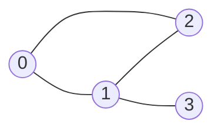
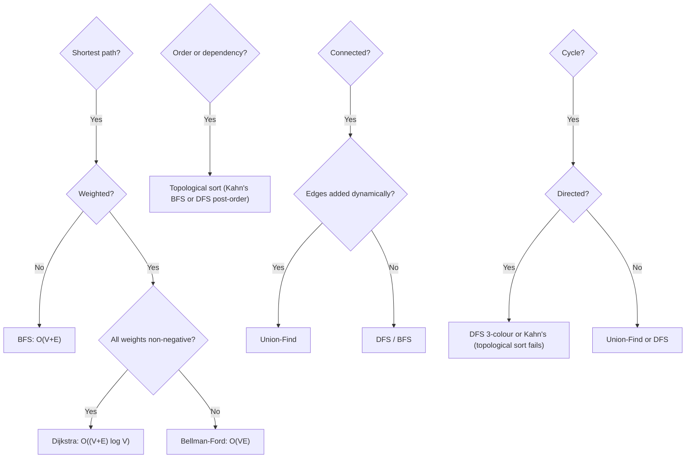

# 📚 SECTION 9: GRAPH ALGORITHMS

> **Navigation**: [Chapter overview](../10_Graphs.md) | [9.1 Graph Traversal (BFS/DFS) →](02_graph_traversal_bfs_dfs.md)
> Page 1 of 7 in **Graphs**


### Graph fundamentals

**Graph representation.** The example graph has edges 0–1, 0–2, 1–2 and 1–3:



**How to read this diagram.** Arrows show the direction of flow from one step or component to the next.

**1. Adjacency list** (most common)

| Vertex | Neighbours |
| --- | --- |
| 0 | `[1, 2]` |
| 1 | `[0, 2, 3]` |
| 2 | `[0, 1]` |
| 3 | `[1]` |

**2. Adjacency matrix**

| | 0 | 1 | 2 | 3 |
| --- | --- | --- | --- | --- |
| **0** | 0 | 1 | 1 | 0 |
| **1** | 1 | 0 | 1 | 1 |
| **2** | 1 | 1 | 0 | 0 |
| **3** | 0 | 1 | 0 | 0 |

**3. Edge list:** `[(0,1), (0,2), (1,2), (1,3)]`

**DFS versus BFS**

| DFS (stack or recursion) | BFS (queue) |
| --- | --- |
| Go deep first | Go level by level |
| Detect cycles | Shortest path (unweighted) |
| Path finding | Level-order traversal |
| Topological sort | Minimum-steps problems |
| Connected components | Bipartite check |

---

## PART 0: WHY Graph Problems & How to Think About Them

### Why are graphs so important?

Graphs model **relationships**. Any system with connections is a graph:

- Social networks: each person is a node and each friendship is an edge.
- The internet: each router is a node and each link is an edge; BGP chooses paths between networks.
- Maps: every intersection is a node and every road is a weighted edge.
- Course prerequisites: courses are nodes, "must take A before B" is an edge.
- Package dependencies: packages are nodes, imports are edges.
- Airline routes: cities are nodes, flights are weighted edges.

Graph problems are a staple of coding interviews because they test traversal logic, cycle handling, shortest paths, topological ordering and connected components.

### The mental model: "What are the nodes? What are the edges?"

Every graph problem starts with this question. Once you answer it, the problem reduces to a standard graph algorithm.

| Problem | Node = | Edge = |
| --- | --- | --- |
| Number of Islands | Cell `(r, c)` | Adjacent land cells |
| Course Schedule | Course number | Prerequisite |
| Word Ladder | Word | Differ by one letter |
| Cheapest Flights | City | Flight (weighted) |
| Clone Graph | Graph node | Neighbour pointer |
| Accounts Merge | Email address | Same account |
| Alien Dictionary | Character | Order relationship |

**Grid as a graph.** A grid is just a graph with implicit edges.

| | col 0 | col 1 | col 2 |
| --- | --- | --- | --- |
| **row 0** | 1 | 1 | 0 |
| **row 1** | 1 | 0 | 0 |
| **row 2** | 0 | 0 | 1 |

- Node `(0,0)` connects to `(0,1)` and `(1,0)`; node `(0,1)` connects to `(0,0)`, `(0,2)` and `(1,1)`.
- 4-directional moves: `dirs = {{0,1},{0,-1},{1,0},{-1,0}}`.
- `V = rows × cols` and `E` is up to `4 × V`, so BFS or DFS on a grid takes `O(rows × cols)`.

```java
// BFS TEMPLATE (use for shortest path in unweighted graph/grid)
int bfs(int[][] grid, int[] start, int[] end) {
    int rows = grid.length, cols = grid[0].length;
    Queue<int[]> queue = new LinkedList<>();
    boolean[][] visited = new boolean[rows][cols];
    int[][] dirs = {{0,1},{0,-1},{1,0},{-1,0}};  // Right, Left, Down, Up

    queue.offer(start);
    visited[start[0]][start[1]] = true;
    int steps = 0;

    while (!queue.isEmpty()) {
        int size = queue.size();              // Process level by level!
        for (int i = 0; i < size; i++) {
            int[] curr = queue.poll();
            if (curr[0]==end[0] && curr[1]==end[1]) return steps;
            for (int[] d : dirs) {
                int nr = curr[0]+d[0], nc = curr[1]+d[1];
                if (nr>=0 && nr<rows && nc>=0 && nc<cols
                    && !visited[nr][nc] && grid[nr][nc]==1) {
                    visited[nr][nc] = true;
                    queue.offer(new int[]{nr, nc});
                }
            }
        }
        steps++;                             // Increment after each level
    }
    return -1;  // Not reachable
}

// DFS TEMPLATE (use for exploring/counting components)
void dfs(int[][] grid, int r, int c, boolean[][] visited) {
    if (r<0 || r>=grid.length || c<0 || c>=grid[0].length
        || visited[r][c] || grid[r][c]==0) return;
    visited[r][c] = true;
    dfs(grid, r+1, c, visited);  // Down
    dfs(grid, r-1, c, visited);  // Up
    dfs(grid, r, c+1, visited);  // Right
    dfs(grid, r, c-1, visited);  // Left
}
```

### The 6 Graph Problem Patterns

| Pattern | Algorithm | Problems |
| --- | --- | --- |
| 1. TRAVERSAL/EXPLORE | BFS or DFS on grid/graph | Islands, Flood Fill |
| 2. CYCLE DETECTION | DFS 3-color / Kahn's | Course Schedule |
| 3. SHORTEST PATH | BFS (unwtd) / Dijkstra | Word Ladder, Maze |
| 4. CONNECTIVITY | Union-Find or DFS | Components, Merge |
| 5. ORDERING | Topological Sort | Alien Dictionary |
| 6. CLASSIFICATION | BFS 2-coloring | Bipartite |

**Decision Tree for Interviews**:



**How to read this diagram.** Start at the question that matches the problem and follow the Yes/No answers down to the algorithm. The four question groups are independent entry points.

- **Explore all cells or nodes?** DFS (simpler) or BFS (level-aware).

### ⚠️  Common Mistakes in Graph Problems

**Mistake 1: Forgetting visited check → infinite loop**

DFS without marking visited → cycles → stack overflow  
BFS without visited → add same node to queue hundreds of times  
Fix: ALWAYS mark visited BEFORE adding to queue/recursing.

**Mistake 2: BFS visited timing — marking when DEQUEUING instead of ENQUEUING**

WRONG: mark visited when you poll(). Allows duplicates in queue.  
RIGHT: mark visited when you offer(). Each node enters queue ONCE.

**Mistake 3: Directed vs Undirected cycle detection**

Undirected: Visiting an already-visited node (not parent) = cycle.  
Directed: Need 3-color DFS: WHITE(unvisited), GRAY(in-progress), BLACK.  
Visiting a GRAY node = back edge = cycle. WRONG: treating BLACK as cycle.

**Mistake 4: Off-by-one in BFS level counting**

Steps = number of BFS levels, NOT number of nodes processed.  
Must process entire level before incrementing step count.  
Fix: Use `int size = queue.size()` loop pattern.

**Mistake 5: Building adjacency list wrong for undirected graphs**

Must add BOTH directions: graph[a].add(b) AND graph[b].add(a).  
Forgetting one direction → some paths unreachable.

**Mistake 6: Not handling disconnected components**

"Count components" — must loop through ALL nodes, not just start from 0.  
Some nodes might not be reachable from node 0!

### Graph Representation — Choosing the Right ONE

| Representation | Space | When to Use |
| --- | --- | --- |
| Adjacency List | O(V + E) | Sparse graphs (most problems) |
| Adjacency Matrix | O(V²) | Dense graphs, O(1) edge check |
| Edge List | O(E) | Kruskal's MST, simple union |
| Implicit (Grid) | O(R×C) | Grid problems (no extra graph) |

95% of interview graphs: Use Adjacency List (HashMap or List of Lists).  
Grid problems: Don't build explicit graph! Use dirs array directly.

### Complexity Cheat Sheet

V = vertices, E = edges  
BFS/DFS traversal:   O(V + E) time,  O(V) space  
Dijkstra (min-heap): O((V+E) log V), O(V) space  
Bellman-Ford:        O(V × E),       O(V) space  
Union-Find:          O(E × α(V)),    O(V) space  
Topological sort:    O(V + E),       O(V) space  
Floyd-Warshall:      O(V³),          O(V²) space

Grid problems: V = R×C, E ≤ 4×R×C → O(R×C) for BFS/DFS

Interview constraints guide:  
n ≤ 10⁴ → O(V+E) BFS/DFS works easily  
n ≤ 10³ → Dijkstra or O(V²) algorithms fine  
n ≤ 400 → Floyd-Warshall O(V³) possible  
n ≤ 20  → Bitmask DP on graph states

### ⭐ Expected Outputs of Mastering Graph Problems ⭐

- ✅ Identify nodes & edges in ANY problem in 30 seconds
- ✅ Choose BFS vs DFS vs Dijkstra vs Union-Find instantly
- ✅ Write BFS/DFS templates from memory in 2 minutes
- ✅ Handle directed vs undirected correctly (cycle detection, traversal)
- ✅ Build adjacency list from edge list or grid
- ✅ Implement topological sort (both Kahn's BFS and DFS post-order)
- ✅ Know Dijkstra for weighted shortest path

**The Transformation**:

FROM: "I don't even know where to start with this graph problem"  
TO: "Nodes = cities, edges = flights. Weighted shortest path →  
Dijkstra with min-heap. O((V+E) log V)."

📖 **Related theory:** [03_Algorithms/05_Trees.md](../../03_Algorithms/05_Trees.md) — Full graph theory & implementations

---

🔬 **Section Challenge — PART 0: WHY Graph Problems & How to Think About Them**

**Challenge 1 (Graph Representation Selection):** You model a road navigation system. 100,000 cities (nodes), average 4 connections (edges) per city. **Who** selects adjacency list? **When** would you use adjacency matrix? **What** is the memory cost difference?

<details><summary>Answer</summary>

**Who selects adjacency list:** The developer, based on the edge-to-vertex ratio. 100k cities × 4 connections = 400k edges. **Adjacency list memory:** O(V + E) = O(100k + 400k) = 500k entries (each as an integer). ~2 MB. **Adjacency matrix memory:** O(V²) = 100k × 100k = 10^10 entries. 10 billion bits = 1.25 GB minimum. Impossible. **When adjacency matrix:** Dense graphs (E ≈ V²), very small V (<1000 nodes), or O(1) edge existence checks needed frequently. Flight connectivity between 50 airports: 50×50 = 2500 entries — matrix is fine. **Directed vs undirected:** In adjacency list for undirected graph, each edge `u-v` appears TWICE: once in `adj[u]` and once in `adj[v]`. Total entries = 2E. For directed graph: E entries (each directed edge stored once). **Weighted edges:** Adjacency list stores `List<int[]>` where `int[] = {neighbor, weight}`. Matrix stores `int[V][V]` with weight values (0 = no edge, but 0 can be a valid weight — use `Integer.MAX_VALUE` for no edge).

</details>

<details><summary>More detail</summary>

BFS explores by 'hop count' (number of edges). Each level = one more edge away from source. All edges are treated as weight=1. In a weighted graph, the 'shortest by hop count' path may not be 'shortest by weight sum'. Example: A→B (weight 1, 1 hop) vs A→C→B (weight 0.1+0.1=0.2, 2 hops). BFS finds A→B (1 hop), Dijkstra finds A→C→B (lower total weight). BFS is optimal ONLY when all edges have equal weight.

</details>

---

[Chapter overview](../10_Graphs.md) | [9.1 Graph Traversal (BFS/DFS) →](02_graph_traversal_bfs_dfs.md)
