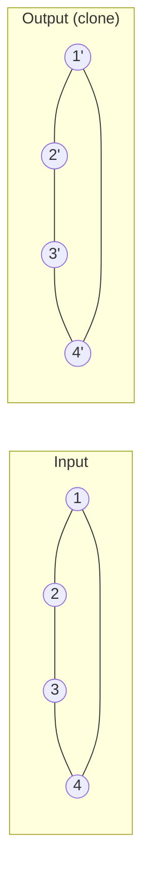

# 9.1 Graph Traversal (BFS/DFS)

> **Navigation**: [← SECTION 9: GRAPH ALGORITHMS](01_section_9_graph_algorithms.md) | [Chapter overview](../10_Graphs.md) | [9.2 Graph Cycle Detection →](03_graph_cycle_detection.md)
> Page 2 of 7 in **Graphs**


**Pattern:** Explore connected regions. DFS to mark & count, BFS for multi-source spreading.
**Key insight for grids:** Treat each cell as a node. "Sink" visited cells (mark '0' or use visited set).

## Problem 136: Number of Islands

**LeetCode 200** 🔗 https://leetcode.com/problems/number-of-islands/

### NUMBER OF ISLANDS - Count connected components of '1's

```java
grid = [
  ["1","1","0","0","0"],
  ["1","1","0","0","0"],
  ["0","0","1","0","0"],
  ["0","0","0","1","1"]
]
```

| | c0 | c1 | c2 | c3 | c4 | Island |
| --- | --- | --- | --- | --- | --- | --- |
| **r0** | 1 | 1 | 0 | 0 | 0 | 🏝️ Island 1 (top-left 1s) |
| **r1** | 1 | 1 | 0 | 0 | 0 | |
| **r2** | 0 | 0 | 1 | 0 | 0 | 🏝️ Island 2 (the middle 1) |
| **r3** | 0 | 0 | 0 | 1 | 1 | 🏝️ Island 3 (bottom-right 1s) |


Output: 3

**Solution (DFS):**

```java
public int numIslands(char[][] grid) {
    if (grid == null || grid.length == 0) return 0;

    int count = 0;
    int rows = grid.length, cols = grid[0].length;

    for (int i = 0; i < rows; i++) {
        for (int j = 0; j < cols; j++) {
            if (grid[i][j] == '1') {
                count++;
                dfs(grid, i, j);  // Sink the island
            }
        }
    }

    return count;
}

private void dfs(char[][] grid, int i, int j) {
    // Boundary check and water check
    if (i < 0 || i >= grid.length || j < 0 || j >= grid[0].length
        || grid[i][j] == '0') {
        return;
    }

    grid[i][j] = '0';  // Mark as visited (sink)

    // Explore 4 directions
    dfs(grid, i + 1, j);  // Down
    dfs(grid, i - 1, j);  // Up
    dfs(grid, i, j + 1);  // Right
    dfs(grid, i, j - 1);  // Left
}
```

**Solution (BFS):**

```java
public int numIslandsBFS(char[][] grid) {
    if (grid == null || grid.length == 0) return 0;

    int count = 0;
    int rows = grid.length, cols = grid[0].length;
    int[][] directions = {{1,0}, {-1,0}, {0,1}, {0,-1}};

    for (int i = 0; i < rows; i++) {
        for (int j = 0; j < cols; j++) {
            if (grid[i][j] == '1') {
                count++;

                Queue<int[]> queue = new LinkedList<>();
                queue.offer(new int[]{i, j});
                grid[i][j] = '0';

                while (!queue.isEmpty()) {
                    int[] cell = queue.poll();

                    for (int[] dir : directions) {
                        int ni = cell[0] + dir[0];
                        int nj = cell[1] + dir[1];

                        if (ni >= 0 && ni < rows && nj >= 0 && nj < cols
                            && grid[ni][nj] == '1') {
                            queue.offer(new int[]{ni, nj});
                            grid[ni][nj] = '0';
                        }
                    }
                }
            }
        }
    }

    return count;
}
```

---

## Problem 137: Max Area of Island

**LeetCode 695** 🔗 https://leetcode.com/problems/max-area-of-island/

**MAX AREA OF ISLAND**

```text
grid = [
  [0,0,1,0,0,0,0,1,0,0,0,0,0],
  [0,0,0,0,0,0,0,1,1,1,0,0,0],
  [0,1,1,0,1,0,0,0,0,0,0,0,0],
  [0,1,0,0,1,1,0,0,1,0,1,0,0],
  [0,1,0,0,1,1,0,0,1,1,1,0,0],
  [0,0,0,0,0,0,0,0,0,0,1,0,0],
  [0,0,0,0,0,0,0,1,1,1,0,0,0],
  [0,0,0,0,0,0,0,1,1,0,0,0,0]
]

Maximum area = 6 (the island in middle-right)
```

**Solution:**

```java
public int maxAreaOfIsland(int[][] grid) {
    int maxArea = 0;

    for (int i = 0; i < grid.length; i++) {
        for (int j = 0; j < grid[0].length; j++) {
            if (grid[i][j] == 1) {
                maxArea = Math.max(maxArea, dfs(grid, i, j));
            }
        }
    }

    return maxArea;
}

private int dfs(int[][] grid, int i, int j) {
    if (i < 0 || i >= grid.length || j < 0 || j >= grid[0].length
        || grid[i][j] == 0) {
        return 0;
    }

    grid[i][j] = 0;  // Mark visited

    return 1 + dfs(grid, i+1, j) + dfs(grid, i-1, j)
             + dfs(grid, i, j+1) + dfs(grid, i, j-1);
}
```

---

## Problem 138: Clone Graph

**LeetCode 133** 🔗 https://leetcode.com/problems/clone-graph/

**CLONE GRAPH - Deep copy of undirected graph**



**How to read this diagram.** The clone has the same shape as the input, but every node is a new object.

- Each node has `val` and `List<Node> neighbors`.
- **Key:** use a HashMap to track the original → clone mapping. It prevents an infinite loop when the graph has cycles.

**Solution:**

```java
private Map<Node, Node> visited = new HashMap<>();

public Node cloneGraph(Node node) {
    if (node == null) return null;

    // Already cloned
    if (visited.containsKey(node)) {
        return visited.get(node);
    }

    // Create clone
    Node clone = new Node(node.val, new ArrayList<>());
    visited.put(node, clone);

    // Clone neighbors
    for (Node neighbor : node.neighbors) {
        clone.neighbors.add(cloneGraph(neighbor));
    }

    return clone;
}
```

---

## Problem 139: Flood Fill

**LeetCode 733** 🔗 https://leetcode.com/problems/flood-fill/

### FLOOD FILL - Like paint bucket tool

image = [[1,1,1],    sr=1, sc=1, color=2  
[1,1,0],  
[1,0,1]]

Start at (1,1), change all connected 1s to 2:

Before:          After:

| 1 | 1 | 1 |  | 2 | 2 | 2 |
| --- | --- | --- | --- | --- | --- | --- |
| 1 | 1 | 0 | → | 2 | 2 | 0 |
| 1 | 0 | 1 |  | 2 | 0 | 1 |

**Solution:**

```java
public int[][] floodFill(int[][] image, int sr, int sc, int color) {
    int originalColor = image[sr][sc];

    // Avoid infinite loop if same color
    if (originalColor != color) {
        dfs(image, sr, sc, originalColor, color);
    }

    return image;
}

private void dfs(int[][] image, int r, int c, int original, int newColor) {
    if (r < 0 || r >= image.length || c < 0 || c >= image[0].length
        || image[r][c] != original) {
        return;
    }

    image[r][c] = newColor;

    dfs(image, r + 1, c, original, newColor);
    dfs(image, r - 1, c, original, newColor);
    dfs(image, r, c + 1, original, newColor);
    dfs(image, r, c - 1, original, newColor);
}
```

---

## Problem 140: Rotting Oranges

**LeetCode 994** 🔗 https://leetcode.com/problems/rotting-oranges/

### ROTTING ORANGES - Multi-source BFS

0 = empty, 1 = fresh orange, 2 = rotten orange  
Each minute, fresh oranges adjacent to rotten become rotten

grid = [[2,1,1],  
[1,1,0],  
[0,1,1]]

Minute 0:    Minute 1:    Minute 2:    Minute 3:    Minute 4:

| 2 | 1 | 1 |  | 2 | 2 | 1 |  | 2 | 2 | 2 |  | 2 | 2 | 2 |  | 2 | 2 | 2 |
| --- | --- | --- | --- | --- | --- | --- | --- | --- | --- | --- | --- | --- | --- | --- | --- | --- | --- | --- |
| 1 | 1 | 0 |  | 2 | 1 | 0 |  | 2 | 2 | 0 |  | 2 | 2 | 0 |  | 2 | 2 | 0 |
| 0 | 1 | 1 |  | 0 | 1 | 1 |  | 0 | 1 | 1 |  | 0 | 2 | 1 |  | 0 | 2 | 2 |

Output: 4 minutes

**Solution:**

```java
public int orangesRotting(int[][] grid) {
    int rows = grid.length, cols = grid[0].length;
    Queue<int[]> queue = new LinkedList<>();
    int fresh = 0;

    // Find all rotten oranges and count fresh
    for (int i = 0; i < rows; i++) {
        for (int j = 0; j < cols; j++) {
            if (grid[i][j] == 2) {
                queue.offer(new int[]{i, j});
            } else if (grid[i][j] == 1) {
                fresh++;
            }
        }
    }

    if (fresh == 0) return 0;

    int[][] directions = {{1,0}, {-1,0}, {0,1}, {0,-1}};
    int minutes = 0;

    while (!queue.isEmpty()) {
        int size = queue.size();
        boolean rotted = false;

        for (int i = 0; i < size; i++) {
            int[] cell = queue.poll();

            for (int[] dir : directions) {
                int ni = cell[0] + dir[0];
                int nj = cell[1] + dir[1];

                if (ni >= 0 && ni < rows && nj >= 0 && nj < cols
                    && grid[ni][nj] == 1) {
                    grid[ni][nj] = 2;
                    fresh--;
                    queue.offer(new int[]{ni, nj});
                    rotted = true;
                }
            }
        }

        if (rotted) minutes++;
    }

    return fresh == 0 ? minutes : -1;
}
```

---

## Problem 141: 🔒 Walls and Gates (LeetCode 286 - Premium)

### WALLS AND GATES - Multi-source BFS from gates

Given m x n grid:  
-1 = Wall, 0 = Gate, INF = Empty room

Fill each empty room with distance to nearest gate.

Input:                        Output:

| INF | -1 | 0 | INF |  | 3 | -1 | 0 | 1 |
| --- | --- | --- | --- | --- | --- | --- | --- | --- |
| INF | INF | INF | -1 | → | 2 | 2 | 1 | -1 |
| INF | -1 | INF | -1 |  | 1 | -1 | 2 | -1 |
| 0 | -1 | INF | INF |  | 0 | -1 | 3 | 4 |

Constraints:
- m == rooms.length, n == rooms[i].length
- 1 <= m, n <= 250
- rooms[i][j] is -1, 0, or 2^31 - 1

**Solution:**

```java
public void wallsAndGates(int[][] rooms) {
    int rows = rooms.length, cols = rooms[0].length;
    int INF = Integer.MAX_VALUE;
    Queue<int[]> queue = new LinkedList<>();

    // Add all gates to queue
    for (int i = 0; i < rows; i++) {
        for (int j = 0; j < cols; j++) {
            if (rooms[i][j] == 0) {
                queue.offer(new int[]{i, j});
            }
        }
    }

    int[][] directions = {{1,0}, {-1,0}, {0,1}, {0,-1}};

    while (!queue.isEmpty()) {
        int[] cell = queue.poll();
        int r = cell[0], c = cell[1];

        for (int[] dir : directions) {
            int nr = r + dir[0];
            int nc = c + dir[1];

            if (nr >= 0 && nr < rows && nc >= 0 && nc < cols
                && rooms[nr][nc] == INF) {
                rooms[nr][nc] = rooms[r][c] + 1;
                queue.offer(new int[]{nr, nc});
            }
        }
    }
}
```

---

🔬 **Section Challenge — 9.1 Graph Traversal (BFS/DFS)**

**Challenge 1 (BFS Iterative vs DFS Recursive Template):** For graph traversal, BFS uses a queue. DFS can be recursive or iterative (explicit stack). **Who** should use recursive DFS? **When** does iterative DFS differ from recursive DFS in traversal ORDER? **What** visited-tracking mechanism is required for graphs (not needed for trees)?

<details><summary>Answer</summary>

**Who uses recursive DFS:** Code that processes tree-like graphs with bounded depth (depth < ~5000). Interview solutions where clarity matters. NOT production code on arbitrary graphs (StackOverflow risk). **Iterative DFS vs recursive DFS order:** Iterative DFS using a stack processes nodes differently than recursive DFS. If you push all neighbors left-to-right, the LAST pushed is processed first (LIFO stack). To match recursive DFS order exactly, push neighbors RIGHT-TO-LEFT. This is a subtle, common interview gotcha. **Visited tracking (graph vs tree):** Trees have no cycles — no visited tracking needed. Graphs can have cycles — without a `boolean[] visited` array, DFS loops infinitely. Mark visited BEFORE or IMMEDIATELY AFTER pushing/enqueueing a node. Marking AFTER processing (at the visit site) leaves a window where duplicate work occurs in multi-path graphs. **BFS visited timing:** Mark `visited[neighbor] = true` when ENQUEUEING (not when dequeuing). Otherwise, in dense graphs, the same node gets enqueued multiple times before it's ever dequeued, causing O(E) enqueue operations instead of O(V).

</details>

<details><summary>More detail</summary>

BFS explores by 'hop count' (number of edges). Each level = one more edge away from source. All edges are treated as weight=1. In a weighted graph, the 'shortest by hop count' path may not be 'shortest by weight sum'. Example: A→B (weight 1, 1 hop) vs A→C→B (weight 0.1+0.1=0.2, 2 hops). BFS finds A→B (1 hop), Dijkstra finds A→C→B (lower total weight). BFS is optimal ONLY when all edges have equal weight.

</details>

---

[← SECTION 9: GRAPH ALGORITHMS](01_section_9_graph_algorithms.md) | [Chapter overview](../10_Graphs.md) | [9.2 Graph Cycle Detection →](03_graph_cycle_detection.md)
