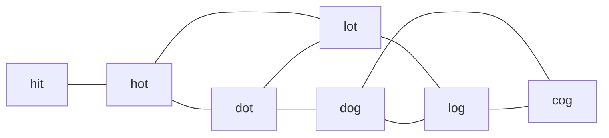
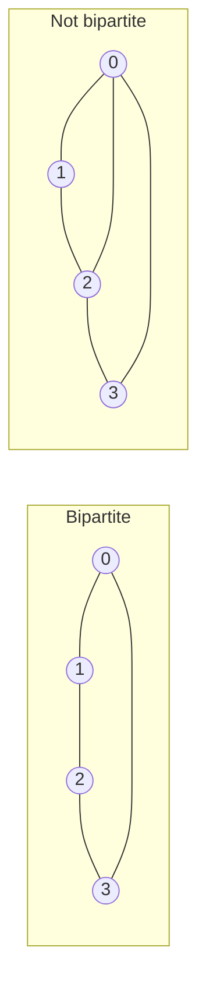

# 9.5 Advanced Graph Problems

> **Navigation**: [← 9.4 Union-Find (Disjoint Set)](05_union_find_disjoint_set.md) | [Chapter overview](../10_Graphs.md) | [9.6 HackerEarth & Codeforces Graph Problems →](07_hackerearth_codeforces_graph_problems.md)
> Page 6 of 7 in **Graphs**


**Pattern:** These problems require creative graph modeling.

- **Word Ladder:** Each word = node, differ-by-1-letter = edge → BFS for shortest transformation
- **Alien Dictionary:** Characters → nodes, ordering rules → directed edges → Topological sort
- **Bipartite:** 2-color the graph. If any edge connects same-color nodes → not bipartite.

## Problem 152: Word Ladder

**LeetCode 127** 🔗 https://leetcode.com/problems/word-ladder/

**Word Ladder: shortest transformation sequence**

`beginWord = "hit"`, `endWord = "cog"`, `wordList = ["hot","dot","dog","lot","log","cog"]`. Change one letter at a time, and every intermediate word must be in `wordList`.



**How to read this diagram.** Words are nodes, and an edge joins two words that differ by exactly one letter. BFS from `hit` finds the shortest path: `hit → hot → dot → dog → cog`, which is **5 words** long (4 transformations).

**Solution:**

```java
public int ladderLength(String beginWord, String endWord, List<String> wordList) {
    Set<String> wordSet = new HashSet<>(wordList);
    if (!wordSet.contains(endWord)) return 0;

    Queue<String> queue = new LinkedList<>();
    queue.offer(beginWord);

    Set<String> visited = new HashSet<>();
    visited.add(beginWord);

    int level = 1;

    while (!queue.isEmpty()) {
        int size = queue.size();

        for (int i = 0; i < size; i++) {
            String word = queue.poll();

            if (word.equals(endWord)) return level;

            // Try changing each character
            char[] chars = word.toCharArray();
            for (int j = 0; j < chars.length; j++) {
                char original = chars[j];

                for (char c = 'a'; c <= 'z'; c++) {
                    if (c == original) continue;

                    chars[j] = c;
                    String newWord = new String(chars);

                    if (wordSet.contains(newWord) && !visited.contains(newWord)) {
                        queue.offer(newWord);
                        visited.add(newWord);
                    }
                }

                chars[j] = original;
            }
        }

        level++;
    }

    return 0;
}
```

---

## Problem 153: 🔒 Alien Dictionary (LeetCode 269 - Premium)

**ALIEN DICTIONARY - Find character order from sorted words**

```text
words = ["wrt", "wrf", "er", "ett", "rftt"]
These words are sorted in alien language order

Compare adjacent words to find relationships:
"wrt" vs "wrf" → t comes before f (t < f)
"wrf" vs "er"  → w comes before e (w < e)
"er" vs "ett"  → r comes before t (r < t)
"ett" vs "rftt"→ e comes before r (e < r)

Build graph: w→e→r→t→f
Topological sort gives: "wertf"

Constraints:
- 1 <= words.length <= 100
- 1 <= words[i].length <= 100
- All characters are lowercase English letters
```

**Solution:**

```java
public String alienOrder(String[] words) {
    Map<Character, Set<Character>> graph = new HashMap<>();
    Map<Character, Integer> inDegree = new HashMap<>();

    // Initialize all characters
    for (String word : words) {
        for (char c : word.toCharArray()) {
            graph.putIfAbsent(c, new HashSet<>());
            inDegree.putIfAbsent(c, 0);
        }
    }

    // Build graph by comparing adjacent words
    for (int i = 0; i < words.length - 1; i++) {
        String w1 = words[i], w2 = words[i + 1];

        // Invalid case: prefix comes after longer word
        if (w1.length() > w2.length() && w1.startsWith(w2)) {
            return "";
        }

        for (int j = 0; j < Math.min(w1.length(), w2.length()); j++) {
            char c1 = w1.charAt(j), c2 = w2.charAt(j);
            if (c1 != c2) {
                if (!graph.get(c1).contains(c2)) {
                    graph.get(c1).add(c2);
                    inDegree.put(c2, inDegree.get(c2) + 1);
                }
                break;
            }
        }
    }

    // Topological sort
    Queue<Character> queue = new LinkedList<>();
    for (char c : inDegree.keySet()) {
        if (inDegree.get(c) == 0) queue.offer(c);
    }

    StringBuilder result = new StringBuilder();
    while (!queue.isEmpty()) {
        char c = queue.poll();
        result.append(c);

        for (char next : graph.get(c)) {
            inDegree.put(next, inDegree.get(next) - 1);
            if (inDegree.get(next) == 0) queue.offer(next);
        }
    }

    return result.length() == inDegree.size() ? result.toString() : "";
}
```

---

## Problem 154: Is Graph Bipartite?

**LeetCode 785** 🔗 https://leetcode.com/problems/is-graph-bipartite/

**IS GRAPH BIPARTITE - Can nodes be divided into 2 sets?**

A graph is bipartite if we can color the nodes with 2 colors so that no two adjacent nodes have the same color.



**How to read this diagram.** The square on the left can be colored 0, 2 = RED and 1, 3 = BLUE. The graph on the right adds the edge 0—2, which creates the triangle 0-1-2, and a triangle cannot be 2-colored.

**Solution:**

```java
public boolean isBipartite(int[][] graph) {
    int n = graph.length;
    int[] colors = new int[n];  // 0=uncolored, 1=red, -1=blue

    for (int i = 0; i < n; i++) {
        if (colors[i] == 0 && !bfs(graph, colors, i)) {
            return false;
        }
    }

    return true;
}

private boolean bfs(int[][] graph, int[] colors, int start) {
    Queue<Integer> queue = new LinkedList<>();
    queue.offer(start);
    colors[start] = 1;

    while (!queue.isEmpty()) {
        int node = queue.poll();

        for (int neighbor : graph[node]) {
            if (colors[neighbor] == 0) {
                colors[neighbor] = -colors[node];  // Opposite color
                queue.offer(neighbor);
            } else if (colors[neighbor] == colors[node]) {
                return false;  // Same color = not bipartite
            }
        }
    }

    return true;
}
```

---

🔬 **Section Challenge — 9.5 Advanced Graph Problems**

**Challenge 1 (Union-Find Path Compression + Rank):** Union-Find with both path compression AND union by rank. **Who** provides which speedup? **When** does Union-Find degrade to O(n) per operation without these optimizations? **What** is the amortized complexity with both?

<details><summary>Answer</summary>

**Who provides which speedup:** Path compression: `find()`. When finding the root, set every traversed node's parent DIRECTLY to root. Future finds are O(1). Union by rank: `union()`. Always attach the shorter tree under the taller tree. Keeps tree height O(log n) instead of O(n). **Without optimizations:** Union-Find is essentially a tree of parent pointers. In the worst case (union in sorted order, no rank), the tree degenerates into a linked list of height n. Each `find()` takes O(n). For n operations: O(n²). **With path compression only:** O(log n) amortized per operation. **With union by rank only:** O(log n) worst case per operation. **With BOTH:** O(α(n)) amortized per operation. α(n) is the inverse Ackermann function. For all practical n (n < 10^80), α(n) ≤ 4. Effectively O(1) amortized. **Interview trace:** `union(1,2), union(2,3), union(3,4)` without rank → chain 1→2→3→4. `find(1)` traverses 3 hops. With path compression: after `find(1)`, all nodes point directly to root 4. Next `find(1)`: 1 hop. This is the path compression effect — the tree flattens itself as you use it.

</details>

<details><summary>More detail</summary>

BFS explores by 'hop count' (number of edges). Each level = one more edge away from source. All edges are treated as weight=1. In a weighted graph, the 'shortest by hop count' path may not be 'shortest by weight sum'. Example: A→B (weight 1, 1 hop) vs A→C→B (weight 0.1+0.1=0.2, 2 hops). BFS finds A→B (1 hop), Dijkstra finds A→C→B (lower total weight). BFS is optimal ONLY when all edges have equal weight.

</details>

---

[← 9.4 Union-Find (Disjoint Set)](05_union_find_disjoint_set.md) | [Chapter overview](../10_Graphs.md) | [9.6 HackerEarth & Codeforces Graph Problems →](07_hackerearth_codeforces_graph_problems.md)
