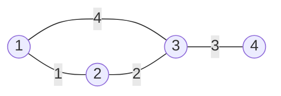
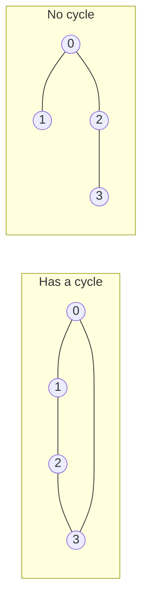
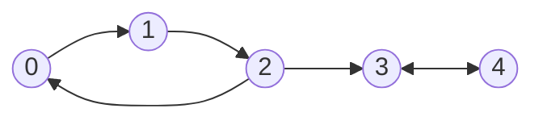

# 9.6 HackerEarth & Codeforces Graph Problems

> **Navigation**: [← 9.5 Advanced Graph Problems](06_advanced_graph_problems.md) | [Chapter overview](../10_Graphs.md)
> Page 7 of 7 in **Graphs**


## Problem 155: Find the Town Judge (HackerEarth-style)

**FIND THE TOWN JUDGE**

```text
In a town of n people, one might be the judge.
The judge:
1. Trusts nobody
2. Everybody else trusts the judge

trust = [[1,2], [3,2]]  (a trusts b)
n = 3

   1 ───→ 2 ←─── 3

Person 2: in-degree = 2 (n-1), out-degree = 0
Output: 2

Constraints:
- 1 <= n <= 1000
- 0 <= trust.length <= 10^4
```

**Solution:**

```java
public int findJudge(int n, int[][] trust) {
    int[] trustScore = new int[n + 1];

    for (int[] t : trust) {
        trustScore[t[0]]--;  // Trusts someone
        trustScore[t[1]]++;  // Is trusted
    }

    for (int i = 1; i <= n; i++) {
        if (trustScore[i] == n - 1) {
            return i;  // Trusted by everyone else, trusts no one
        }
    }

    return -1;
}
```

---

## Problem 156: Minimum Spanning Tree (Codeforces-style)

**MINIMUM SPANNING TREE - Kruskal's Algorithm**

Connect all nodes with the minimum total edge weight.

`n = 4`, `edges = [[1,2,1], [1,3,4], [2,3,2], [3,4,3]]`



**How to read this diagram.** Each edge is labelled with its weight.

- MST edges: `[1,2,1]`, `[2,3,2]`, `[3,4,3]`.
- Total weight = 1 + 2 + 3 = **6**.
- Kruskal's: sort the edges and add each one if it does not create a cycle.

**Solution:**

```java
public int minSpanningTree(int n, int[][] edges) {
    // Sort edges by weight
    Arrays.sort(edges, (a, b) -> a[2] - b[2]);

    int[] parent = new int[n + 1];
    for (int i = 1; i <= n; i++) parent[i] = i;

    int totalWeight = 0;
    int edgesUsed = 0;

    for (int[] edge : edges) {
        int u = edge[0], v = edge[1], weight = edge[2];

        int pu = find(parent, u);
        int pv = find(parent, v);

        if (pu != pv) {
            parent[pu] = pv;
            totalWeight += weight;
            edgesUsed++;

            if (edgesUsed == n - 1) break;
        }
    }

    return edgesUsed == n - 1 ? totalWeight : -1;
}

private int find(int[] parent, int x) {
    if (parent[x] != x) {
        parent[x] = find(parent, parent[x]);
    }
    return parent[x];
}
```

---

## Problem 157: Detect Cycle in Undirected Graph (HackerEarth)

**DETECT CYCLE IN UNDIRECTED GRAPH**



**How to read this diagram.** The left graph is a square, so it contains a cycle. The right graph is a tree.

DFS: if we visit a node that is already visited and it is not the parent, a cycle is detected.

**Solution:**

```java
public boolean hasCycle(int n, int[][] edges) {
    List<List<Integer>> graph = new ArrayList<>();
    for (int i = 0; i < n; i++) {
        graph.add(new ArrayList<>());
    }

    for (int[] edge : edges) {
        graph.get(edge[0]).add(edge[1]);
        graph.get(edge[1]).add(edge[0]);
    }

    boolean[] visited = new boolean[n];

    for (int i = 0; i < n; i++) {
        if (!visited[i]) {
            if (dfs(graph, visited, i, -1)) {
                return true;
            }
        }
    }

    return false;
}

private boolean dfs(List<List<Integer>> graph, boolean[] visited,
                    int node, int parent) {
    visited[node] = true;

    for (int neighbor : graph.get(node)) {
        if (!visited[neighbor]) {
            if (dfs(graph, visited, neighbor, node)) {
                return true;
            }
        } else if (neighbor != parent) {
            return true;  // Back edge = cycle
        }
    }

    return false;
}
```

---

## Problem 158: Strongly Connected Components (Codeforces-style)

**STRONGLY CONNECTED COMPONENTS (Kosaraju's Algorithm)**

A strongly connected component (SCC) of a directed graph is a maximal set of vertices where every vertex is reachable from every other vertex.



**How to read this diagram.** Vertices 0, 1 and 2 form a cycle, and 3 and 4 point to each other, so there are two SCCs.

- SCC 1: `{0, 1, 2}`
- SCC 2: `{3, 4}`

**Kosaraju's algorithm**

1. DFS to get the finish order.
2. Transpose the graph.
3. DFS in reverse finish order on the transposed graph.

**Solution:**

```java
public int countSCCs(int n, int[][] edges) {
    List<List<Integer>> graph = new ArrayList<>();
    List<List<Integer>> transpose = new ArrayList<>();

    for (int i = 0; i < n; i++) {
        graph.add(new ArrayList<>());
        transpose.add(new ArrayList<>());
    }

    for (int[] edge : edges) {
        graph.get(edge[0]).add(edge[1]);
        transpose.get(edge[1]).add(edge[0]);
    }

    // Step 1: Get finish order
    boolean[] visited = new boolean[n];
    Stack<Integer> stack = new Stack<>();

    for (int i = 0; i < n; i++) {
        if (!visited[i]) {
            dfs1(graph, visited, i, stack);
        }
    }

    // Step 2: DFS on transpose in reverse finish order
    Arrays.fill(visited, false);
    int sccCount = 0;

    while (!stack.isEmpty()) {
        int node = stack.pop();
        if (!visited[node]) {
            dfs2(transpose, visited, node);
            sccCount++;
        }
    }

    return sccCount;
}

private void dfs1(List<List<Integer>> graph, boolean[] visited,
                  int node, Stack<Integer> stack) {
    visited[node] = true;
    for (int neighbor : graph.get(node)) {
        if (!visited[neighbor]) {
            dfs1(graph, visited, neighbor, stack);
        }
    }
    stack.push(node);
}

private void dfs2(List<List<Integer>> graph, boolean[] visited, int node) {
    visited[node] = true;
    for (int neighbor : graph.get(node)) {
        if (!visited[neighbor]) {
            dfs2(graph, visited, neighbor);
        }
    }
}
```

---

---

🔬 **Section Challenge — 9.6 HackerEarth & Codeforces Graph Problems**

**Challenge 1 (Dijkstra Priority Queue Choice):** You implement Dijkstra's with `PriorityQueue<int[]>` (min-heap). A node's distance gets updated. You add a NEW entry with the shorter distance (lazy deletion). **Who** processes the stale entry? **When** does lazy deletion cause correctness issues? **What** is the memory tradeoff vs `TreeSet`?

<details><summary>Answer</summary>

**Who processes the stale entry:** Your code. When dequeuing a node, check if the dequeued distance equals the current known best: `if (dist > d[node]) continue;`. This skips stale (outdated) entries. The lazy deletion pattern inserts multiple entries for the same node; the first (smallest distance) dequeue processes the correct one, subsequent are skipped. **When lazy deletion causes correctness issues:** Never — if you add the `dist > d[node]` check. Without this check, stale entries are processed and may update `d[neighbor]` with WORSE distances. The neighbors' distances would be correct only if you always take min, but processing stale entries wastes time. **Memory tradeoff vs `TreeSet`:** `PriorityQueue` (lazy deletion): O(E) total entries (one per edge relaxation). Can't decrease-key, so you insert duplicates. Memory = O(E). `TreeSet` (or Fibonacci heap): supports true decrease-key. O(V) entries (exactly one per vertex). Memory = O(V). For sparse graphs (E ≈ V): both are similar. For dense graphs: lazy PQ has O(E) entries = O(V²). `TreeSet` stays O(V). **Standard interview approach:** Use `PriorityQueue` with lazy deletion. It's simpler to implement and O((V+E)logE) which simplifies to O((V+E)logV) for most graphs.

</details>

<details><summary>More detail</summary>

BFS explores by 'hop count' (number of edges). Each level = one more edge away from source. All edges are treated as weight=1. In a weighted graph, the 'shortest by hop count' path may not be 'shortest by weight sum'. Example: A→B (weight 1, 1 hop) vs A→C→B (weight 0.1+0.1=0.2, 2 hops). BFS finds A→B (1 hop), Dijkstra finds A→C→B (lower total weight). BFS is optimal ONLY when all edges have equal weight.

</details>

## 🏆 Competitive Programming — Codeforces Problems

| Problem                | Link                                                         | Technique                    | Difficulty  |
| ---------------------- | ------------------------------------------------------------ | ---------------------------- | ----------- |
| Codeforces Round Edges | [CF 920E](https://codeforces.com/problemset/problem/920/E)   | DFS on tree                  | ⭐⭐ Medium |
| Rome Roads             | [CF 1547F](https://codeforces.com/problemset/problem/1547/F) | Dijkstra + MST               | ⭐⭐⭐ Hard |
| Connected Component    | [CF 1209G](https://codeforces.com/problemset/problem/1209/G) | BFS + complement graph trick | ⭐⭐⭐ Hard |
| Longest Path in Tree   | [CF 1006E](https://codeforces.com/problemset/problem/1006/E) | Tree diameter BFS            | ⭐⭐ Medium |
| Bipartiteness          | [CF 901C](https://codeforces.com/problemset/problem/901/C)   | BFS 2-coloring               | ⭐⭐ Medium |
| Course Schedule        | [CF 236D](https://codeforces.com/problemset/problem/236/D)   | Topological sort             | ⭐⭐ Medium |
| King of the Road       | [CF 598D](https://codeforces.com/problemset/problem/598/D)   | DFS with conditions          | ⭐⭐ Medium |

---

## 🌍 Real-World Applications of Graph Algorithms

| Algorithm                        | Real-World System             | How It's Used                                                       |
| -------------------------------- | ----------------------------- | ------------------------------------------------------------------- |
| **BFS (shortest path)**          | Google Maps / Waze            | Find shortest route in unweighted road network                      |
| **Dijkstra (weighted shortest)** | Google Maps (weighted)        | Route considering road distances and traffic weights                |
| **Topological Sort**             | Build systems (Maven, Gradle) | Compile dependencies in correct order (no circular deps)            |
| **DFS cycle detection**          | JavaScript bundlers (Webpack) | Detect circular imports that would cause infinite loops             |
| **Union-Find (DSU)**             | Social networks (Facebook)    | "Connected components" = friend groups; union when friendship added |
| **BFS multi-source**             | Multiplayer game map          | Spawn zone distance map computed from all player spawn points       |
| **Bellman-Ford**                 | Internet routing (BGP)        | Find shortest path tolerating negative metric weights               |

```
🔥 TOPOLOGICAL SORT IN REAL LIFE:
   You run: gradle build
   Gradle reads your build.gradle dependencies → builds a directed graph
   → Topological Sort → compile in correct order

   If circular dependency: "BUILD FAILED: Circular dependency detected"
   That's exactly cycle detection in a directed graph (DFS WHITE/GRAY/BLACK)!
```

---

---

🔬 **Section Challenge — 🌍 Real-World Applications of Graph Algorithms**

**Challenge 1 (Real-World Graph Algorithm Selection):** A ride-sharing app needs: (A) shortest route between two GPS points, (B) detect if a driver is driving in circles, (C) find all reachable restaurants within 2km. **Who** selects which algorithm? **What** graph algorithm solves each?

<details><summary>Answer</summary>

**(A) Shortest route (GPS navigation) → Dijkstra's Algorithm (or A\*).** Road weights = travel time/distance. Dijkstra finds shortest path by total weight. A* improves Dijkstra with a heuristic (straight-line distance to destination) to explore fewer nodes. Production GPS uses bidirectional Dijkstra or Contraction Hierarchies for sub-millisecond routing on 100M+ node road graphs. **(B) Detect driver driving in circles → Cycle Detection (DFS/Floyd's).** Model the route as a directed graph: each intersection = node, each turn = directed edge. DFS with a 3-color marker detects if the driver revisits a node in the current path. Floyd's tortoise-hare is used on the coordinates sequence if modeled as a linked list. **(C) Find all reachable restaurants within 2km → BFS with distance cutoff.** Start from driver's location, BFS through road network. Stop expanding neighbors when distance exceeds 2km. All nodes visited = reachable restaurants. This is a BFS "level-limited" search. Multi-source BFS (start from ALL restaurants simultaneously) can find which driver is closest to each restaurant. **Who selects:** The software architect, based on: Is the graph weighted? (Dijkstra). Is it directional? (directed DFS). Is the search space bounded? (BFS cutoff). Does it need to scale to millions of nodes? (A*, Contraction Hierarchies).

</details>

<details><summary>More detail</summary>

BFS explores by 'hop count' (number of edges). Each level = one more edge away from source. All edges are treated as weight=1. In a weighted graph, the 'shortest by hop count' path may not be 'shortest by weight sum'. Example: A→B (weight 1, 1 hop) vs A→C→B (weight 0.1+0.1=0.2, 2 hops). BFS finds A→B (1 hop), Dijkstra finds A→C→B (lower total weight). BFS is optimal ONLY when all edges have equal weight.

</details>

---

### Historical Evolution

Graph theory begins with Euler's 1736 analysis of the Königsberg bridges. Dijkstra designed his shortest-path algorithm in 1956 and published it in 1959; Bellman–Ford has several roots (Shimbel 1955, Ford 1956, Bellman 1958, Moore 1959); Kruskal (1956) and Prim (1957, after Jarník 1930) gave minimum spanning trees; Floyd and Warshall published all-pairs methods in 1962; Kahn (1962) gave topological sorting; Tarjan (1972) found strongly connected components with one DFS; Hart, Nilsson and Raphael introduced A* in 1968.

- **Euler — 1736**: Königsberg bridges
- **Dijkstra — 1956/1959**: Shortest paths, non-negative weights
- **Kruskal / Prim — 1956 / 1957**: Minimum spanning trees
- **Floyd, Warshall — 1962**: All-pairs shortest paths
- **Kahn — 1962**: Topological sort
- **Tarjan — 1972**: Strongly connected components

---

[← 9.5 Advanced Graph Problems](06_advanced_graph_problems.md) | [Chapter overview](../10_Graphs.md)
