**Navigation**: [< Previous](10_Graphs.md) | [Back to Index](../00_MASTER_INDEX.md) | [Next >](12_Backtracking.md)

**Problems 11/14** | [Prev](10_Graphs.md) | [Index](../00_MASTER_INDEX.md) | [Next](12_Backtracking.md)

---

## 🗺️ Pattern Recognition Header — Dynamic Programming

**DP Signal Words:** `minimum cost`, `maximum profit`, `number of ways`, `longest/shortest`, `can you reach`, `partition into`, `subsequence`, `subset sum`

**Quick Identification:**
```
1. Is there a CHOICE at each step?
2. Do SUBPROBLEMS OVERLAP? (computed multiple times)
3. Do you need MINIMUM/MAXIMUM/COUNT?
→ ALL YES? → DP
```


| DP Category | State | Trigger Words |
|---|---|---|
| 1D Linear | `dp[i]` = answer for first i | Climbing stairs, house robber, coin change |
| 2D Grid | `dp[i][j]` = answer at cell | Unique paths, min path sum |
| Two Sequence | `dp[i][j]` = match i of s1, j of s2 | LCS, edit distance |
| Knapsack | `dp[i][w]` = best with i items, capacity w | 0/1 knapsack, partition equal subset |
| Subsequence | `dp[i]` = best ending at i | LIS, word break |


📖 **Theory:** [04b_DP_Fundamentals.md](../03_Algorithms/04b_DP_Fundamentals.md)
📖 **Patterns:** [16_DP_Pattern_Recognition.md](../04_Patterns_Templates/16_DP_Pattern_Recognition.md)
📖 **Full Pattern Guide:** [00_PATTERN_MASTER_GUIDE.md](../04_Patterns_Templates/00_PATTERN_MASTER_GUIDE.md)

---


🔬 **Section Challenge — 🗺️ Pattern Recognition Header — Dynamic Programming**

**Challenge 1 (Reasoning):** How do you identify that a problem requires DP vs Greedy? What's the key test?
<details><summary>Answer</summary>

Greedy test: does the locally optimal choice always lead to the globally optimal solution? (Prove via exchange argument.) If yes → greedy. If making a local choice requires knowing future choices → DP. Example: Coin Change with standard coins [1,5,10,25] → greedy works (always pick largest). Coin Change with coins [1,3,4] and amount 6 → greedy picks 4+1+1=3 coins, optimal is 3+3=2 coins. Greedy fails → DP.
</details>

**Challenge 2 (Design):** You need to find the number of ways to climb N stairs taking 1 or 2 steps at a time. Define the DP state and recurrence.
<details><summary>Answer</summary>

State: `dp[i]` = number of ways to reach step i. Recurrence: `dp[i] = dp[i-1] + dp[i-2]` (come from step i-1 via 1 step, or from step i-2 via 2 steps). Base: `dp[0]=1` (one way: don't move), `dp[1]=1`. This is exactly Fibonacci. Space optimization: only need last 2 values → O(1) space.
</details>


# 📚 SECTION 10: DYNAMIC PROGRAMMING PATTERNS

```
┌─────────────────────────────────────────────────────────────────┐
│                    DP FUNDAMENTALS                              │
├─────────────────────────────────────────────────────────────────┤
│  KEY PATTERNS:                                                  │
│  1. 1D DP: Single array/sequence                                │
│  2. 2D DP: Two sequences or grid                                │
│  3. Interval DP: Subarray/substring problems                    │
│  4. State Machine DP: Multiple states                           │
│  5. Knapsack: Selection problems                                │
│                                                                 │
│  APPROACH:                                                      │
│  1. Define state: dp[i] = ?                                     │
│  2. Find recurrence: dp[i] = f(dp[i-1], ...)                    │
│  3. Base case: dp[0] = ?                                        │
│  4. Build order: Bottom-up or Top-down                          │
│  5. Optimize space if possible                                  │
└─────────────────────────────────────────────────────────────────┘
```

**Flow:**
1. DP FUNDAMENTALS
2. KEY PATTERNS:
3. 1. 1D DP: Single array/sequence
4. 2. 2D DP: Two sequences or grid
5. 3. Interval DP: Subarray/substring problems
6. 4. State Machine DP: Multiple states
7. 5. Knapsack: Selection problems

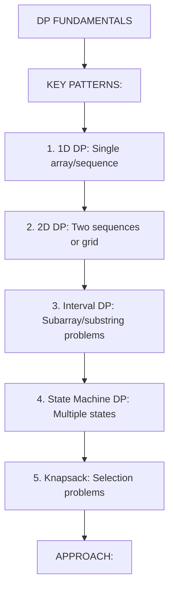

---

## PART 0: WHY DP — The Most Feared Interview Topic & How to Tame It

## Why Is Dp The Most Feared Interview Topic

DP appears in ~25% of coding interviews. Companies test it because:
- It reveals if you can DECOMPOSE complex problems
- It tests mathematical thinking (recurrences)
- Wrong approach = exponential time; right approach = polynomial time
REAL-WORLD DP IN PRODUCTION:
- Spell check: "Edit Distance" = DP (Word, Google Docs)
- GPS routing: Shortest path = DP variant (Google Maps, Waze)
- Text justification: Knuth's algorithm = DP (LaTeX, Word)
- RNA folding: Zuker's algorithm = DP (bioinformatics)
- Speech recognition: Viterbi algorithm = DP (Siri, Alexa)
- Git diff: Longest Common Subsequence = DP
- Stock trading: Portfolio optimization = DP
## The Core Insight: Overlapping Subproblems

DP = Recursion + Memoization (avoid re-computing same thing)

**Example**: Fibonacci(5) WITHOUT memoization:
fib(5)
╱        ╲
fib(4)          fib(3)        ← fib(3) computed TWICE
╱      ╲         ╱     ╲
fib(3)   fib(2)   fib(2)   fib(1)   ← fib(2) computed 3 TIMES
╱    ╲     ╱ ╲     ╱ ╲
fib(2) fib(1) 1   0   1   0               ← fib(1) computed 5 TIMES
╱ ╲
1   0
Total calls for fib(n) without memo: O(2ⁿ) → fib(40) = 1 BILLION calls!
Total calls for fib(n) WITH memo:    O(n)   → fib(40) = 40 calls!

**With Memoization**: compute each fib(k) ONCE, store result.
fib(5) → needs fib(4), fib(3)
fib(4) → needs fib(3), fib(2) → fib(3) already stored! Skip!
Result: n computations instead of 2ⁿ. That's the power of DP.
EVERY DP problem has this structure:
1. You have CHOICES at each step
2. Each choice leads to a SMALLER subproblem
3. Subproblems OVERLAP (same subproblem solved many times)
4. You need the OPTIMAL choice (min/max/count)


## The 4-Step Framework (Use For Every Dp Problem)

Step 1: DEFINE STATE → "What does dp[i] represent?"
Step 2: RECURRENCE   → "How does dp[i] relate to smaller dp[j]?"
Step 3: BASE CASE    → "What are the trivial answers? dp[0] = ?"
Step 4: BUILD ORDER  → "Bottom-up (tabulation) or top-down (memoization)?"
WORKED EXAMPLE — Coin Change (LC 322):
coins = [1, 3, 4], amount = 6. Find MIN coins.
Step 1: dp[i] = minimum coins to make amount i
Step 2: dp[i] = min(dp[i - coin] + 1) for each coin ≤ i
Step 3: dp[0] = 0 (zero coins for amount 0)
Step 4: Bottom-up, i from 1 to amount
dp[0]=0  dp[1]=1(+1) dp[2]=2(+1+1) dp[3]=1(+3) dp[4]=1(+4)
dp[5] = min(dp[5-1]+1, dp[5-3]+1, dp[5-4]+1)
= min(dp[4]+1,   dp[2]+1,   dp[1]+1)
= min(2, 3, 2) = 2  → coins: 1+4 or 3+3? Both work, answer = 2
dp[6] = min(dp[5]+1, dp[3]+1, dp[2]+1) = min(3, 2, 3) = 2 → 3+3 ✅
💡 THE SECRET: Step 1 is the HARDEST. Once state is defined correctly,
the recurrence usually follows naturally. When stuck, try:
- dp[i] = answer for first i elements
- dp[i][j] = answer for substring from i to j
- dp[i][j] = answer using first i items with capacity j

```java
// TOP-DOWN (Memoization) — Easier to write, natural recursive thinking
int[] memo;
int coinChange(int[] coins, int amount) {
    memo = new int[amount + 1];
    Arrays.fill(memo, -1);
    int result = dp(coins, amount);
    return result == Integer.MAX_VALUE ? -1 : result;
}
int dp(int[] coins, int amount) {
    if (amount == 0) return 0;                    // Base case
    if (amount < 0) return Integer.MAX_VALUE;     // Invalid
    if (memo[amount] != -1) return memo[amount];  // Already computed!
    int min = Integer.MAX_VALUE;
    for (int coin : coins) {
        int sub = dp(coins, amount - coin);
        if (sub != Integer.MAX_VALUE) min = Math.min(min, sub + 1);
    }
    return memo[amount] = min;                    // Store and return
}

// BOTTOM-UP (Tabulation) — Faster in practice, no recursion overhead
int coinChangeBottomUp(int[] coins, int amount) {
    int[] dp = new int[amount + 1];
    Arrays.fill(dp, amount + 1);                  // "Infinity"
    dp[0] = 0;                                    // Base case
    for (int i = 1; i <= amount; i++) {
        for (int coin : coins) {
            if (coin <= i) dp[i] = Math.min(dp[i], dp[i - coin] + 1);
        }
    }
    return dp[amount] > amount ? -1 : dp[amount];
}
```

```
┌──────────────────────────────────────────────────────────────────────────────┐
│ TOP-DOWN vs BOTTOM-UP — WHEN TO USE WHICH                                    │
├──────────────────────────────────────────────────────────────────────────────┤
│                                                                              │
│ ┌────────────────────┬───────────────────┬───────────────────────────┐       │
│ │ Factor             │ Top-Down (memo)   │ Bottom-Up (tabulation)   │        │
│ ├────────────────────┼───────────────────┼───────────────────────────┤       │
│ │ Ease of writing    │ ✅ Easier         │ Harder (need build order)│         │
│ │ Stack overflow?    │ ❌ Risk for deep  │ ✅ No recursion          │          │
│ │ Speed (constant)   │ Slower (overhead) │ ✅ Faster (no function   │         │
│ │                    │                   │    call overhead)         │       │
│ │ Space optimization │ Harder            │ ✅ Can reduce to O(1)   │          │
│ │                    │                   │    if dp[i] depends on   │        │
│ │                    │                   │    only last 1-2 values  │        │
│ │ Computes all states│ ✅ Only needed    │ ❌ Computes all          │          │
│ │ Interview use      │ Start here        │ Optimize if asked       │         │
│ └────────────────────┴───────────────────┴───────────────────────────┘       │
│                                                                              │
│ Interview strategy:                                                          │
│ 1. Explain the recurrence first (state + transition)                         │
│ 2. Code top-down if time is tight (faster to write)                          │
│ 3. Convert to bottom-up if asked to optimize                                 │
│ 4. Optimize space if possible (dp[i] = f(dp[i-1]) → just 2 variables)        │
└──────────────────────────────────────────────────────────────────────────────┘

┌──────────────────────────────────────────────────────────────────────────────┐
│ THE 5 DP CATEGORIES (Pattern → Template → Problems)                          │
├──────────────────────────────────────────────────────────────────────────────┤
│                                                                              │
│ ┌──────────────────┬─────────────────────────┬──────────────────────────┐    │
│ │ Category         │ State Definition        │ Problems Here            │    │
│ ├──────────────────┼─────────────────────────┼──────────────────────────┤    │
│ │ 1. LINEAR 1D     │ dp[i] = answer for      │ Climbing Stairs, House   │    │
│ │                  │ first i elements or     │ Robber, Max Subarray,    │    │
│ │                  │ ending at index i       │ Coin Change, Decode Ways │    │
│ ├──────────────────┼─────────────────────────┼──────────────────────────┤    │
│ │ 2. GRID 2D       │ dp[i][j] = answer at    │ Unique Paths, Min Path   │    │
│ │                  │ cell (i,j) from (0,0)   │ Sum, Maximal Square      │    │
│ ├──────────────────┼─────────────────────────┼──────────────────────────┤    │
│ │ 3. TWO SEQUENCE  │ dp[i][j] = matching     │ LCS, Edit Distance,      │    │
│ │                  │ first i of s1 & j of s2 │ Interleaving String      │    │
│ ├──────────────────┼─────────────────────────┼──────────────────────────┤    │
│ │ 4. KNAPSACK      │ dp[i][w] = best with    │ 0/1 Knapsack, Partition  │    │
│ │                  │ first i items & cap w   │ Equal Subset, Target Sum │    │
│ ├──────────────────┼─────────────────────────┼──────────────────────────┤    │
│ │ 5. SUBSEQUENCE   │ dp[i] = best ending at i│ LIS, Word Break,         │    │
│ │                  │ or dp[i][j] = interval  │ Palindrome Subsequence   │    │
│ └──────────────────┴─────────────────────────┴──────────────────────────┘    │
│                                                                              │
│ RECOGNIZING THE CATEGORY:                                                    │
│   "1D array + choices at each index" → LINEAR 1D                             │
│   "Grid + reach from top-left to bottom-right" → GRID 2D                     │
│   "Two strings + matching/editing" → TWO SEQUENCE                            │
│   "Items + capacity/budget" → KNAPSACK                                       │
│   "Best subsequence" → SUBSEQUENCE                                           │
└──────────────────────────────────────────────────────────────────────────────┘

┌──────────────────────────────────────────────────────────────────────────────┐
│ "WRONG STATE" — A FULL WORKED EXAMPLE                                        │
├──────────────────────────────────────────────────────────────────────────────┤
│                                                                              │
│ House Robber (LC 198): Rob houses in a line, can't rob adjacent.             │
│ houses = [2, 7, 9, 3, 1]                                                     │
│                                                                              │
│ WRONG STATE: dp[i] = max money robbing houses 0..i INCLUDING house i         │
│   dp[0]=2, dp[1]=7, dp[2]=9+dp[0]=11, dp[3]=3+dp[1]=10...                    │
│   Problem: dp[3] = 3 + dp[1] = 10, but what if NOT robbing house 2           │
│   was better? This state FORCES us to rob house i.                           │
│                                                                              │
│ RIGHT STATE: dp[i] = max money from houses 0..i (may or may NOT rob i)       │
│   dp[i] = max(                                                               │
│     dp[i-1],                    // Skip house i                              │
│     dp[i-2] + houses[i]         // Rob house i (must skip i-1)               │
│   )                                                                          │
│   dp[0]=2, dp[1]=max(2,7)=7, dp[2]=max(7,2+9)=11,                            │
│   dp[3]=max(11,7+3)=11, dp[4]=max(11,11+1)=12 ✅                              │
│                                                                              │
│ LESSON: The state must capture ENOUGH information to make the                │
│ recurrence work. If your recurrence has "it depends" cases, your             │
│ state is probably wrong — add a dimension.                                   │
└──────────────────────────────────────────────────────────────────────────────┘

┌──────────────────────────────────────────────────────────────────────────────┐
│ WHEN TO USE DP vs GREEDY vs BACKTRACKING                                     │
├──────────────────────────────────────────────────────────────────────────────┤
│                                                                              │
│ "Find MINIMUM/MAXIMUM value"     → DP (optimization)                         │
│ "Count NUMBER OF WAYS"           → DP (counting)                             │
│ "Can you reach / is it possible" → DP (feasibility)                          │
│ "List ALL valid answers"         → Backtracking (NOT DP!)                    │
│ "Always pick locally best"       → Greedy (if exchange argument works)       │
│                                                                              │
│ CONFIRMATION TEST: If you can write dp[i] = f(dp[j] for j < i),              │
│ it's DP. If you can't define overlapping subproblems, reconsider.            │
│                                                                              │
│ DP SIGNALS in problem statements:                                            │
│   "minimum cost", "maximum profit", "number of ways", "longest/shortest",    │
│   "can you reach", "partition into", "subsequence", "subset sum"             │
└──────────────────────────────────────────────────────────────────────────────┘

┌──────────────────────────────────────────────────────────────────────────────┐
│ ⚠️  COMMON MISTAKES IN DP                                                    │
├──────────────────────────────────────────────────────────────────────────────┤
│                                                                              │
│ MISTAKE 1: Wrong state definition (see worked example above)                 │
│   Fix: Verify your state captures ALL info needed for the recurrence.        │
│   Test: Can you compute dp[i] knowing ONLY dp[0..i-1]? If not, add dims.     │
│                                                                              │
│ MISTAKE 2: Forgetting base cases                                             │
│   dp[0] is almost always needed. For 2D: initialize first row + first col.   │
│   Common bug: dp[0][0] not set → everything cascades wrong.                  │
│                                                                              │
│ MISTAKE 3: Wrong build order (bottom-up)                                     │
│   If dp[i] depends on dp[i+1], you must iterate i from HIGH to LOW.          │
│   If dp[i][j] depends on dp[i-1][j-1], iterate i low→high, j low→high.       │
│   Fix: Draw dependency arrows, fill in order of arrows.                      │
│                                                                              │
│ MISTAKE 4: Not considering space optimization                                │
│   dp[i] depends on only dp[i-1]? → Use 2 variables instead of array.         │
│   dp[i][j] depends on only current and previous row? → Use 2 rows.           │
│   This can reduce O(n²) space to O(n) or even O(1).                          │
│                                                                              │
│ MISTAKE 5: Confusing "subarray" vs "subsequence" in state                    │
│   Subarray: CONTIGUOUS → dp[i] = answer ENDING at i (must include i)         │
│   Subsequence: NON-contiguous → dp[i] = answer for first i elements          │
│   Using wrong one = completely wrong recurrence.                             │
│                                                                              │
│ MISTAKE 6: Integer overflow in counting problems                             │
│   "Count number of ways" often needs modulo 10⁹+7.                           │
│   Intermediate sums can overflow int. Use long in Java.                      │
└──────────────────────────────────────────────────────────────────────────────┘

┌──────────────────────────────────────────────────────────────────────────────┐
│ DIFFICULTIES IN LEARNING DP                                                  │
├──────────────────────────────────────────────────────────────────────────────┤
│                                                                              │
│ 1. "I CAN'T FIGURE OUT THE STATE"                                            │
│    Strategy: Start with BRUTE FORCE recursion. What parameters change?       │
│    Those parameters ARE your state dimensions.                               │
│    E.g., knapsack brute force: recurse(index, remainingCapacity)             │
│    → State: dp[index][capacity]                                              │
│                                                                              │
│ 2. "I CAN'T WRITE THE RECURRENCE"                                            │
│    Think about the LAST element. What are the choices for the last item?     │
│    Include it or exclude it? That gives you dp[i] = max/min/sum of options.  │
│                                                                              │
│ 3. "I DON'T KNOW IF IT'S DP OR GREEDY"                                       │
│    Ask: "Can I prove exchange argument?" Yes → Greedy. No → DP.              │
│    Ask: "Are subproblems overlapping?" Yes → DP. No → Divide & Conquer.      │
│                                                                              │
│ 4. "BOTTOM-UP IS CONFUSING"                                                  │
│    Start with top-down (recursive + memo). It's the SAME logic.              │
│    Then convert: memo parameters → array dimensions, recursion → loops.      │
│                                                                              │
│ 5. "TOO MANY DP TYPES"                                                       │
│    Master the 5 categories above. 95% of interview DP falls into one.        │
│    Practice 3-4 problems per category = 15-20 total = interview-ready.       │
└──────────────────────────────────────────────────────────────────────────────┘

┌──────────────────────────────────────────────────────────────────────────────┐
│ ⭐ EXPECTED OUTPUTS OF MASTERING DP PROBLEMS ⭐                                │
├──────────────────────────────────────────────────────────────────────────────┤
│                                                                              │
│ ✅ Recognize DP in 1 minute: "overlapping subproblems + optimal substructure" │
│ ✅ Define state for any problem using the "what changes in recursion" trick   │
│ ✅ Write recurrence from state definition in 2-3 minutes                      │
│ ✅ Convert top-down ↔ bottom-up fluently                                      │
│ ✅ Optimize space (2D→1D, 1D→two variables) when possible                     │
│ ✅ Handle all 5 categories (linear, grid, two-seq, knapsack, subsequence)     │
│ ✅ Explain time/space complexity of any DP solution                           │
│                                                                              │
│ THE TRANSFORMATION:                                                          │
│ FROM: "DP is scary, I'll try to avoid these problems"                        │
│   TO: "I see overlapping subproblems. State = dp[i] = answer for first i.    │
│        Recurrence: dp[i] = max(dp[i-1], dp[i-2]+val[i]). Base: dp[0]=0.      │
│        Bottom-up loop: O(n) time, O(1) space with 2 variables."              │
└──────────────────────────────────────────────────────────────────────────────┘
```

📖 **Related theory:** [03_Algorithms/04b_DP_Fundamentals.md](../03_Algorithms/04b_DP_Fundamentals.md) — Full DP theory with visual state diagrams

---

## 10.1 1D Dynamic Programming

**Pattern:** `dp[i]` depends on previous 1-2 values. Often optimizable to O(1) space.
**Key insight:** Most 1D DP is a disguised Fibonacci or decision problem.

### Problem 159: Climbing Stairs

**LeetCode 70** 🔗 https://leetcode.com/problems/climbing-stairs/

```
┌────────────────────────────────────────────────────────────────┐
│  CLIMBING STAIRS - Ways to reach top (1 or 2 steps)            │
├────────────────────────────────────────────────────────────────┤
│  n = 4 stairs                                                  │
│                                                                │
│  Ways:     ┌───┐                                               │
│  1+1+1+1   │ 4 │ ← Goal                                        │
│  1+1+2     ├───┤                                               │
│  1+2+1     │ 3 │                                               │
│  2+1+1     ├───┤                                               │
│  2+2       │ 2 │                                               │
│            ├───┤                                               │
│            │ 1 │                                               │
│            ├───┤                                               │
│            │ 0 │ ← Start                                       │
│            └───┘                                               │
│                                                                │
│  dp[i] = dp[i-1] + dp[i-2] (Fibonacci!)                        │
│  Output: 5 ways                                                │
└────────────────────────────────────────────────────────────────┘
```

**Flow:**
1. CLIMBING STAIRS - Ways to reach top (1 or 2 steps)
2. n = 4 stairs
3. Ways:
4. 1+1+1+1 4 ← Goal
5. 0 ← Start
6. dp[i] = dp[i-1] + dp[i-2] (Fibonacci!)
7. Output: 5 ways

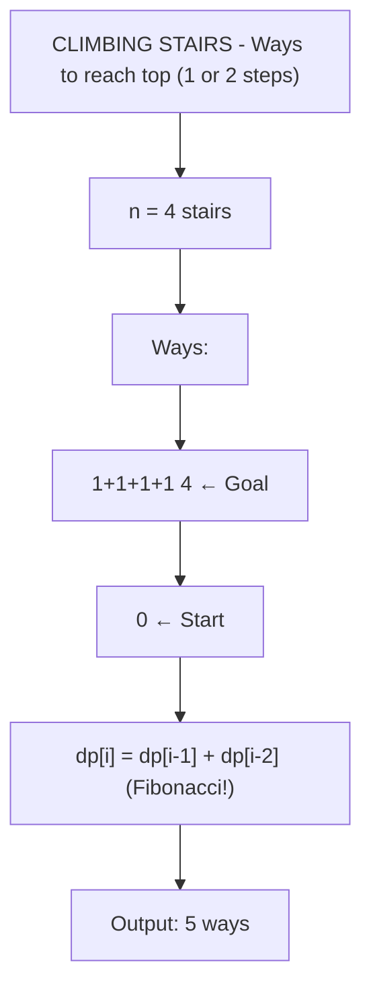

**Solution:**

```java
public int climbStairs(int n) {
    if (n <= 2) return n;

    int prev2 = 1, prev1 = 2;

    for (int i = 3; i <= n; i++) {
        int curr = prev1 + prev2;
        prev2 = prev1;
        prev1 = curr;
    }

    return prev1;
}
```

---

### Problem 160: House Robber

**LeetCode 198** 🔗 https://leetcode.com/problems/house-robber/

```
┌────────────────────────────────────────────────────────────────┐
│  HOUSE ROBBER - Max money without robbing adjacent houses      │
├────────────────────────────────────────────────────────────────┤
│  nums = [2, 7, 9, 3, 1]                                        │
│                                                                │
│  Houses:  [2]  [7]  [9]  [3]  [1]                              │
│            │    │    │    │    │                               │
│            0    1    2    3    4                               │
│                                                                │
│  Rob house 0, 2, 4: 2 + 9 + 1 = 12 ✓                           │
│  Rob house 1, 3: 7 + 3 = 10                                    │
│                                                                │
│  dp[i] = max(dp[i-1], dp[i-2] + nums[i])                       │
│  "Skip current" or "Rob current + skip previous"               │
└────────────────────────────────────────────────────────────────┘
```

**Flow:**
1. HOUSE ROBBER - Max money without robbing adjacent house
2. nums = [2, 7, 9, 3, 1]
3. Houses: [2] [7] [9] [3] [1]
4. Rob house 0, 2, 4: 2 + 9 + 1 = 12 ✓
5. Rob house 1, 3: 7 + 3 = 10
6. dp[i] = max(dp[i-1], dp[i-2] + nums[i])
7. 'Skip current' or 'Rob current + skip previous'

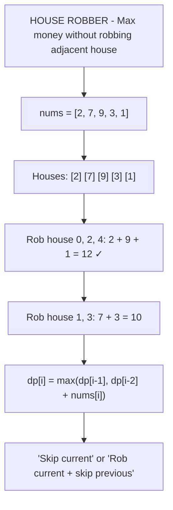

**Solution:**

```java
public int rob(int[] nums) {
    if (nums.length == 1) return nums[0];

    int prev2 = 0, prev1 = nums[0];

    for (int i = 1; i < nums.length; i++) {
        int curr = Math.max(prev1, prev2 + nums[i]);
        prev2 = prev1;
        prev1 = curr;
    }

    return prev1;
}
```

---

### Problem 161: House Robber II (Circular)

**LeetCode 213** 🔗 https://leetcode.com/problems/house-robber-ii/

```
┌────────────────────────────────────────────────────────────────┐
│  HOUSE ROBBER II - Houses in circle                            │
├────────────────────────────────────────────────────────────────┤
│  nums = [2, 3, 2]                                              │
│                                                                │
│      ┌─── 2 ───┐                                               │
│      │         │                                               │
│      2    ○    3     First and last are adjacent!              │
│      │         │                                               │
│      └─────────┘                                               │
│                                                                │
│  Can't rob both first and last house.                          │
│  Solution: max(rob[0..n-2], rob[1..n-1])                       │
│                                                                │
│  Output: 3 (rob house 1 only)                                  │
└────────────────────────────────────────────────────────────────┘
```

**Flow:**
1. HOUSE ROBBER II - Houses in circle
2. nums = [2, 3, 2]
3. 2 ○ 3 First and last are adjacent!
4. Can't rob both first and last house.
5. Solution: max(rob[0..n-2], rob[1..n-1])
6. Output: 3 (rob house 1 only)

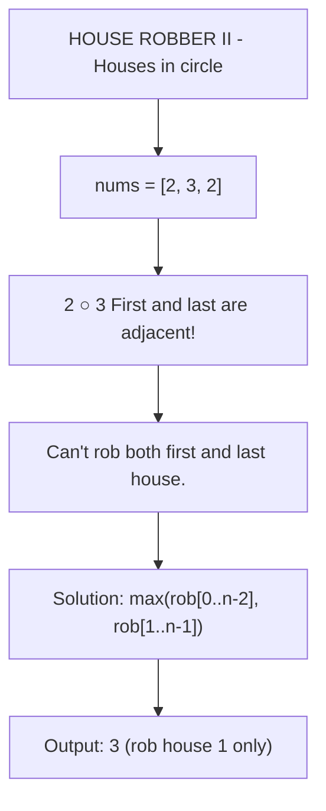

**Solution:**

```java
public int rob(int[] nums) {
    if (nums.length == 1) return nums[0];

    return Math.max(
        robRange(nums, 0, nums.length - 2),
        robRange(nums, 1, nums.length - 1)
    );
}

private int robRange(int[] nums, int start, int end) {
    int prev2 = 0, prev1 = 0;

    for (int i = start; i <= end; i++) {
        int curr = Math.max(prev1, prev2 + nums[i]);
        prev2 = prev1;
        prev1 = curr;
    }

    return prev1;
}
```

---

### Problem 162: Maximum Subarray (Kadane's)

**LeetCode 53** 🔗 https://leetcode.com/problems/maximum-subarray/

```
┌────────────────────────────────────────────────────────────────┐
│  MAXIMUM SUBARRAY - Kadane's Algorithm                         │
├────────────────────────────────────────────────────────────────┤
│  nums = [-2, 1, -3, 4, -1, 2, 1, -5, 4]                        │
│                                                                │
│  At each position, decide:                                     │
│  - Start new subarray here?                                    │
│  - Or extend previous subarray?                                │
│                                                                │
│  dp[i] = max(nums[i], dp[i-1] + nums[i])                       │
│                                                                │
│  Index:  0   1   2   3   4   5   6   7   8                     │
│  nums:  -2   1  -3   4  -1   2   1  -5   4                     │
│  dp:    -2   1  -2   4   3   5   6   1   5                     │
│                      └───────────┘                             │
│                      Max subarray: [4,-1,2,1] = 6              │
└────────────────────────────────────────────────────────────────┘
```

**Flow:**
1. MAXIMUM SUBARRAY - Kadane's Algorithm
2. nums = [-2, 1, -3, 4, -1, 2, 1, -5, 4]
3. At each position, decide:
4. - Start new subarray here?
5. - Or extend previous subarray?
6. dp[i] = max(nums[i], dp[i-1] + nums[i])
7. Index: 0 1 2 3 4 5 6 7 8

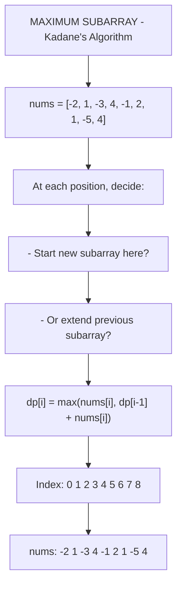

**Solution:**

```java
public int maxSubArray(int[] nums) {
    int maxSum = nums[0];
    int currentSum = nums[0];

    for (int i = 1; i < nums.length; i++) {
        currentSum = Math.max(nums[i], currentSum + nums[i]);
        maxSum = Math.max(maxSum, currentSum);
    }

    return maxSum;
}
```

---

### Problem 163: Coin Change

💡 **Approach:** Unbounded knapsack variant. `dp[amount]` = min coins to make that amount.
For each coin, check: `dp[i] = min(dp[i], dp[i - coin] + 1)`.
**Why BFS also works:** Think of it as shortest path where each coin is an edge.
**Greedy FAILS here:** Coins [1, 3, 4], amount 6 → Greedy picks 4+1+1=3 coins, optimal is 3+3=2 coins.
**Time:** O(amount × coins) | **Space:** O(amount)

**LeetCode 322** 🔗 https://leetcode.com/problems/coin-change/

```
┌────────────────────────────────────────────────────────────────┐
│  COIN CHANGE - Minimum coins to make amount                    │
├────────────────────────────────────────────────────────────────┤
│  coins = [1, 2, 5], amount = 11                                │
│                                                                │
│  dp[i] = min coins to make amount i                            │
│                                                                │
│  Amount:  0  1  2  3  4  5  6  7  8  9  10  11                 │
│  dp:      0  1  1  2  2  1  2  2  3  3   2   3                 │
│                                                                │
│  For amount 11:                                                │
│  - Use coin 5: dp[11-5] + 1 = dp[6] + 1 = 3                    │
│  - Use coin 2: dp[11-2] + 1 = dp[9] + 1 = 4                    │
│  - Use coin 1: dp[11-1] + 1 = dp[10] + 1 = 3                   │
│  Min = 3 (5 + 5 + 1)                                           │
└────────────────────────────────────────────────────────────────┘
```

**Flow:**
1. COIN CHANGE - Minimum coins to make amount
2. coins = [1, 2, 5], amount = 11
3. dp[i] = min coins to make amount i
4. Amount: 0 1 2 3 4 5 6 7 8 9 10 11
5. For amount 11:
6. - Use coin 5: dp[11-5] + 1 = dp[6] + 1 = 3
7. - Use coin 2: dp[11-2] + 1 = dp[9] + 1 = 4

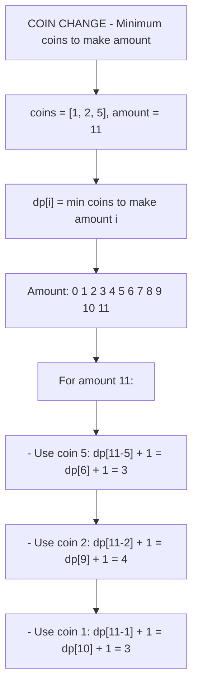

**Solution:**

```java
public int coinChange(int[] coins, int amount) {
    int[] dp = new int[amount + 1];
    Arrays.fill(dp, amount + 1);
    dp[0] = 0;

    for (int i = 1; i <= amount; i++) {
        for (int coin : coins) {
            if (coin <= i) {
                dp[i] = Math.min(dp[i], dp[i - coin] + 1);
            }
        }
    }

    return dp[amount] > amount ? -1 : dp[amount];
}
```

---


🔬 **Section Challenge — 10.1 1D Dynamic Programming**

**Challenge 1 (Reasoning):** How do you identify that a problem requires DP vs Greedy? What's the key test?
<details><summary>Answer</summary>

Greedy test: does the locally optimal choice always lead to the globally optimal solution? (Prove via exchange argument.) If yes → greedy. If making a local choice requires knowing future choices → DP. Example: Coin Change with standard coins [1,5,10,25] → greedy works (always pick largest). Coin Change with coins [1,3,4] and amount 6 → greedy picks 4+1+1=3 coins, optimal is 3+3=2 coins. Greedy fails → DP.
</details>

**Challenge 2 (Design):** You need to find the number of ways to climb N stairs taking 1 or 2 steps at a time. Define the DP state and recurrence.
<details><summary>Answer</summary>

State: `dp[i]` = number of ways to reach step i. Recurrence: `dp[i] = dp[i-1] + dp[i-2]` (come from step i-1 via 1 step, or from step i-2 via 2 steps). Base: `dp[0]=1` (one way: don't move), `dp[1]=1`. This is exactly Fibonacci. Space optimization: only need last 2 values → O(1) space.
</details>


## 10.2 2D Dynamic Programming

**Pattern:** `dp[i][j]` = answer at grid cell (i,j) or matching i elements of seq1 with j elements of seq2.
**Grid problems:** `dp[i][j] = dp[i-1][j] + dp[i][j-1]` (paths) or `min(dp[i-1][j], dp[i][j-1]) + grid[i][j]` (cost).
**Two-sequence:** Build a 2D table. Diagonal = match, else take best of skipping one from each sequence.

### Problem 164: Unique Paths

**LeetCode 62** 🔗 https://leetcode.com/problems/unique-paths/

```
┌────────────────────────────────────────────────────────────────┐
│  UNIQUE PATHS - Count paths from top-left to bottom-right      │
├────────────────────────────────────────────────────────────────┤
│  m = 3, n = 7 (3 rows, 7 cols)                                 │
│                                                                │
│  ┌───┬───┬───┬───┬───┬───┬───┐                                 │
│  │ 1 │ 1 │ 1 │ 1 │ 1 │ 1 │ 1 │                                 │
│  ├───┼───┼───┼───┼───┼───┼───┤                                 │
│  │ 1 │ 2 │ 3 │ 4 │ 5 │ 6 │ 7 │                                 │
│  ├───┼───┼───┼───┼───┼───┼───┤                                 │
│  │ 1 │ 3 │ 6 │10 │15 │21 │28 │                                 │
│  └───┴───┴───┴───┴───┴───┴───┘                                 │
│                                                                │
│  dp[i][j] = dp[i-1][j] + dp[i][j-1]                            │
│  Output: 28 paths                                              │
└────────────────────────────────────────────────────────────────┘
```

**Flow:**
1. UNIQUE PATHS - Count paths from top-left to bottom-righ
2. m = 3, n = 7 (3 rows, 7 cols)
3. Output: 28 paths

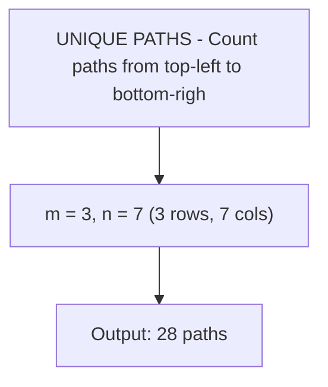

**Solution:**

```java
public int uniquePaths(int m, int n) {
    int[] dp = new int[n];
    Arrays.fill(dp, 1);

    for (int i = 1; i < m; i++) {
        for (int j = 1; j < n; j++) {
            dp[j] = dp[j] + dp[j - 1];
        }
    }

    return dp[n - 1];
}
```

---

### Problem 165: Unique Paths II (With Obstacles)

**LeetCode 63** 🔗 https://leetcode.com/problems/unique-paths-ii/

```
┌────────────────────────────────────────────────────────────────┐
│  UNIQUE PATHS II - Grid with obstacles                         │
├────────────────────────────────────────────────────────────────┤
│  grid = [[0,0,0],                                              │
│          [0,1,0],    1 = obstacle                              │
│          [0,0,0]]                                              │
│                                                                │
│  ┌───┬───┬───┐                                                 │
│  │ 1 │ 1 │ 1 │                                                 │
│  ├───┼───┼───┤                                                 │
│  │ 1 │ X │ 1 │    X = blocked                                  │
│  ├───┼───┼───┤                                                 │
│  │ 1 │ 1 │ 2 │                                                 │
│  └───┴───┴───┘                                                 │
│                                                                │
│  Output: 2 paths                                               │
└────────────────────────────────────────────────────────────────┘
```

**Flow:**
1. UNIQUE PATHS II - Grid with obstacles
2. grid = [[0,0,0],
3. [0,1,0], 1 = obstacle
4. 1 X 1 X = blocked
5. Output: 2 paths

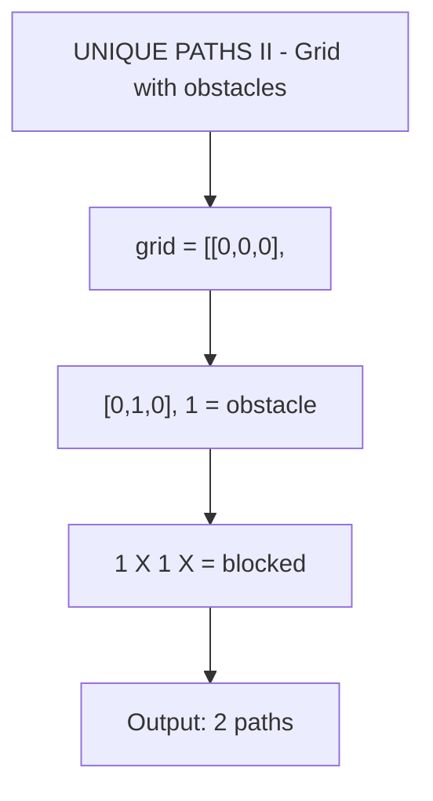

**Solution:**

```java
public int uniquePathsWithObstacles(int[][] grid) {
    int m = grid.length, n = grid[0].length;

    if (grid[0][0] == 1) return 0;

    int[] dp = new int[n];
    dp[0] = 1;

    for (int i = 0; i < m; i++) {
        for (int j = 0; j < n; j++) {
            if (grid[i][j] == 1) {
                dp[j] = 0;
            } else if (j > 0) {
                dp[j] = dp[j] + dp[j - 1];
            }
        }
    }

    return dp[n - 1];
}
```

---

### Problem 166: Minimum Path Sum

**LeetCode 64** 🔗 https://leetcode.com/problems/minimum-path-sum/

```
┌────────────────────────────────────────────────────────────────┐
│  MINIMUM PATH SUM - Min cost path top-left to bottom-right     │
├────────────────────────────────────────────────────────────────┤
│  grid = [[1,3,1],                                              │
│          [1,5,1],                                              │
│          [4,2,1]]                                              │
│                                                                │
│  ┌───┬───┬───┐     ┌───┬───┬───┐                               │
│  │ 1 │ 3 │ 1 │     │ 1 │ 4 │ 5 │  dp values                    │
│  ├───┼───┼───┤  →  ├───┼───┼───┤                               │
│  │ 1 │ 5 │ 1 │     │ 2 │ 7 │ 6 │                               │
│  ├───┼───┼───┤     ├───┼───┼───┤                               │
│  │ 4 │ 2 │ 1 │     │ 6 │ 8 │ 7 │                               │
│  └───┴───┴───┘     └───┴───┴───┘                               │
│                                                                │
│  Path: 1→3→1→1→1 = 7                                           │
└────────────────────────────────────────────────────────────────┘
```

**Flow:**
1. 1 3 1 / 1 5 1 / 4 2 1
2. 1 4 5 / 2 7 6 / 6 8 7

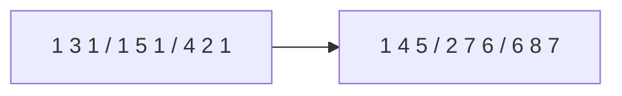

**Solution:**

```java
public int minPathSum(int[][] grid) {
    int m = grid.length, n = grid[0].length;

    for (int i = 0; i < m; i++) {
        for (int j = 0; j < n; j++) {
            if (i == 0 && j == 0) continue;
            else if (i == 0) grid[i][j] += grid[i][j-1];
            else if (j == 0) grid[i][j] += grid[i-1][j];
            else grid[i][j] += Math.min(grid[i-1][j], grid[i][j-1]);
        }
    }

    return grid[m-1][n-1];
}
```

---

### Problem 167: Longest Common Subsequence

**LeetCode 1143** 🔗 https://leetcode.com/problems/longest-common-subsequence/

```
┌────────────────────────────────────────────────────────────────┐
│  LONGEST COMMON SUBSEQUENCE                                    │
├────────────────────────────────────────────────────────────────┤
│  text1 = "abcde", text2 = "ace"                                │
│                                                                │
│      ""  a  c  e                                               │
│  ""   0  0  0  0                                               │
│  a    0  1  1  1     If match: dp[i][j] = dp[i-1][j-1] + 1     │
│  b    0  1  1  1     Else: dp[i][j] = max(dp[i-1][j],          │
│  c    0  1  2  2                          dp[i][j-1])          │
│  d    0  1  2  2                                               │
│  e    0  1  2  3                                               │
│                                                                │
│  LCS = "ace", length = 3                                       │
└────────────────────────────────────────────────────────────────┘
```

**Flow:**
1. LONGEST COMMON SUBSEQUENCE
2. text1 = 'abcde', text2 = 'ace'
3. a 0 1 1 1 If match: dp[i][j] = dp[i-1][j-1] + 1
4. b 0 1 1 1 Else: dp[i][j] = max(dp[i-1][j],
5. LCS = 'ace', length = 3

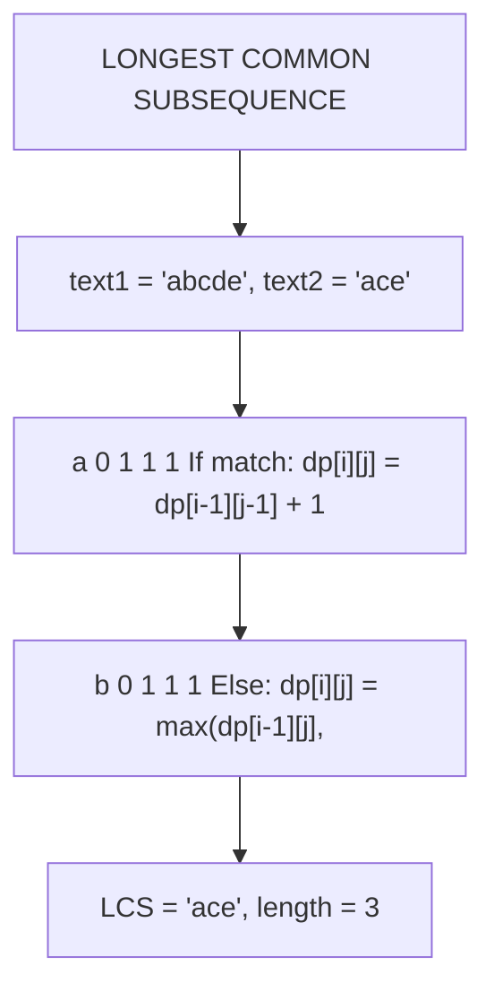

**Solution:**

```java
public int longestCommonSubsequence(String text1, String text2) {
    int m = text1.length(), n = text2.length();
    int[][] dp = new int[m + 1][n + 1];

    for (int i = 1; i <= m; i++) {
        for (int j = 1; j <= n; j++) {
            if (text1.charAt(i-1) == text2.charAt(j-1)) {
                dp[i][j] = dp[i-1][j-1] + 1;
            } else {
                dp[i][j] = Math.max(dp[i-1][j], dp[i][j-1]);
            }
        }
    }

    return dp[m][n];
}
```

---

### Problem 168: Edit Distance

💡 **Approach:** Classic 2-sequence DP. `dp[i][j]` = min operations to convert `word1[0..i-1]` to `word2[0..j-1]`.
Three choices at each step: Insert (`dp[i][j-1]+1`), Delete (`dp[i-1][j]+1`), Replace (`dp[i-1][j-1]+1`).
If characters match: `dp[i][j] = dp[i-1][j-1]` (no operation needed).
**Why this matters:** Used in spell-check, DNA sequence alignment, diff tools.
**Time:** O(mn) | **Space:** O(mn), optimizable to O(min(m,n))

**LeetCode 72** 🔗 https://leetcode.com/problems/edit-distance/

```
┌────────────────────────────────────────────────────────────────┐
│  EDIT DISTANCE - Min operations to convert word1 to word2      │
├────────────────────────────────────────────────────────────────┤
│  word1 = "horse", word2 = "ros"                                │
│  Operations: Insert, Delete, Replace                           │
│                                                                │
│      ""  r  o  s                                               │
│  ""   0  1  2  3                                               │
│  h    1  1  2  3    If match: dp[i][j] = dp[i-1][j-1]          │
│  o    2  2  1  2    Else: 1 + min(dp[i-1][j],    // delete     │
│  r    3  2  2  2                 dp[i][j-1],    // insert      │
│  s    4  3  3  2                 dp[i-1][j-1])  // replace     │
│  e    5  4  4  3                                               │
│                                                                │
│  Output: 3 (horse → rorse → rose → ros)                        │
└────────────────────────────────────────────────────────────────┘
```

**Flow:**
1. EDIT DISTANCE - Min operations to convert word1 to word
2. word1 = 'horse', word2 = 'ros'
3. Operations: Insert, Delete, Replace
4. h 1 1 2 3 If match: dp[i][j] = dp[i-1][j-1]
5. o 2 2 1 2 Else: 1 + min(dp[i-1][j], // delete
6. r 3 2 2 2 dp[i][j-1], // insert
7. s 4 3 3 2 dp[i-1][j-1]) // replace

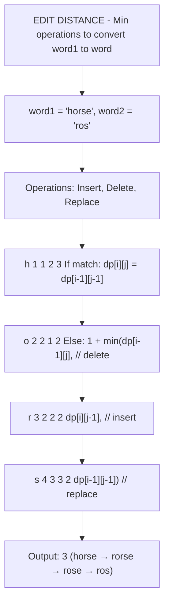

**Solution:**

```java
public int minDistance(String word1, String word2) {
    int m = word1.length(), n = word2.length();
    int[][] dp = new int[m + 1][n + 1];

    // Base cases
    for (int i = 0; i <= m; i++) dp[i][0] = i;
    for (int j = 0; j <= n; j++) dp[0][j] = j;

    for (int i = 1; i <= m; i++) {
        for (int j = 1; j <= n; j++) {
            if (word1.charAt(i-1) == word2.charAt(j-1)) {
                dp[i][j] = dp[i-1][j-1];
            } else {
                dp[i][j] = 1 + Math.min(dp[i-1][j-1],
                               Math.min(dp[i-1][j], dp[i][j-1]));
            }
        }
    }

    return dp[m][n];
}
```

---


🔬 **Section Challenge — 10.2 2D Dynamic Programming**

**Challenge 1 (Reasoning):** How do you identify that a problem requires DP vs Greedy? What's the key test?
<details><summary>Answer</summary>

Greedy test: does the locally optimal choice always lead to the globally optimal solution? (Prove via exchange argument.) If yes → greedy. If making a local choice requires knowing future choices → DP. Example: Coin Change with standard coins [1,5,10,25] → greedy works (always pick largest). Coin Change with coins [1,3,4] and amount 6 → greedy picks 4+1+1=3 coins, optimal is 3+3=2 coins. Greedy fails → DP.
</details>

**Challenge 2 (Design):** You need to find the number of ways to climb N stairs taking 1 or 2 steps at a time. Define the DP state and recurrence.
<details><summary>Answer</summary>

State: `dp[i]` = number of ways to reach step i. Recurrence: `dp[i] = dp[i-1] + dp[i-2]` (come from step i-1 via 1 step, or from step i-2 via 2 steps). Base: `dp[0]=1` (one way: don't move), `dp[1]=1`. This is exactly Fibonacci. Space optimization: only need last 2 values → O(1) space.
</details>


## 10.3 Knapsack Problems

**Pattern:** Given items with values/weights + a capacity, maximize value or check feasibility.
**0/1 Knapsack template:** `dp[i][w] = max(dp[i-1][w], dp[i-1][w-weight[i]] + value[i])`
**Space optimization:** Since each row only depends on previous row, use 1D array (iterate capacity BACKWARDS to avoid using updated values).
**Key insight:** "Partition into equal subsets" = "Is there a subset summing to total/2?" = Knapsack!

### Problem 169: 0/1 Knapsack

**Classic Problem**

```
┌────────────────────────────────────────────────────────────────┐
│  0/1 KNAPSACK - Max value with weight limit                    │
├────────────────────────────────────────────────────────────────┤
│  weights = [1, 2, 3], values = [6, 10, 12], capacity = 5       │
│                                                                │
│  Item 0: weight=1, value=6                                     │
│  Item 1: weight=2, value=10                                    │
│  Item 2: weight=3, value=12                                    │
│                                                                │
│  Take items 1 and 2: weight=5, value=22 ✓                      │
│                                                                │
│      Cap:  0  1  2  3  4  5                                    │
│  Item 0:   0  6  6  6  6  6                                    │
│  Item 1:   0  6 10 16 16 16                                    │
│  Item 2:   0  6 10 16 18 22                                    │
└────────────────────────────────────────────────────────────────┘
```

**Flow:**
1. 0/1 KNAPSACK - Max value with weight limit
2. Item 0: weight=1, value=6
3. Item 1: weight=2, value=10
4. Item 2: weight=3, value=12
5. Take items 1 and 2: weight=5, value=22 ✓
6. Cap: 0 1 2 3 4 5
7. Item 0: 0 6 6 6 6 6

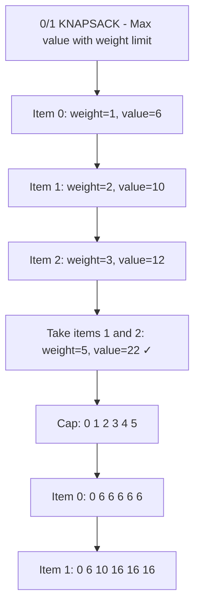

**Solution:**

```java
public int knapsack(int[] weights, int[] values, int capacity) {
    int n = weights.length;
    int[] dp = new int[capacity + 1];

    for (int i = 0; i < n; i++) {
        // Traverse backwards to avoid using same item twice
        for (int w = capacity; w >= weights[i]; w--) {
            dp[w] = Math.max(dp[w], dp[w - weights[i]] + values[i]);
        }
    }

    return dp[capacity];
}
```

---

### Problem 170: Partition Equal Subset Sum

**LeetCode 416** 🔗 https://leetcode.com/problems/partition-equal-subset-sum/

```
┌────────────────────────────────────────────────────────────────┐
│  PARTITION EQUAL SUBSET SUM                                    │
├────────────────────────────────────────────────────────────────┤
│  nums = [1, 5, 11, 5]                                          │
│  Total = 22, Target = 11                                       │
│                                                                │
│  Can we find subset with sum = 11?                             │
│  Yes! [1, 5, 5] and [11]                                       │
│                                                                │
│  This is 0/1 Knapsack with target = sum/2                      │
│                                                                │
│  dp[i] = true if sum i is achievable                           │
└────────────────────────────────────────────────────────────────┘
```

**Flow:**
1. PARTITION EQUAL SUBSET SUM
2. nums = [1, 5, 11, 5]
3. Total = 22, Target = 11
4. Can we find subset with sum = 11?
5. Yes! [1, 5, 5] and [11]
6. This is 0/1 Knapsack with target = sum/2
7. dp[i] = true if sum i is achievable

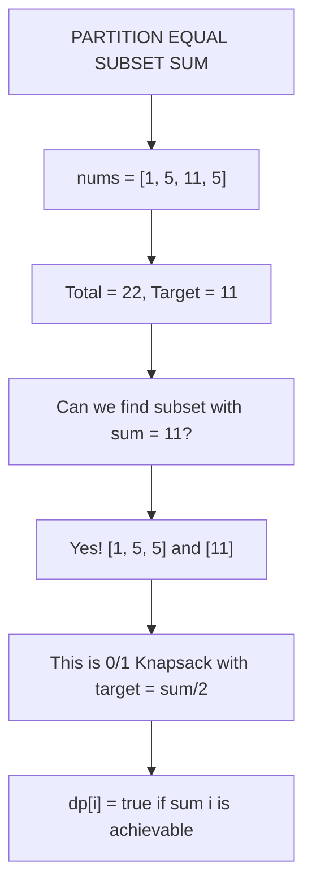

**Solution:**

```java
public boolean canPartition(int[] nums) {
    int sum = 0;
    for (int num : nums) sum += num;

    if (sum % 2 != 0) return false;

    int target = sum / 2;
    boolean[] dp = new boolean[target + 1];
    dp[0] = true;

    for (int num : nums) {
        for (int i = target; i >= num; i--) {
            dp[i] = dp[i] || dp[i - num];
        }
    }

    return dp[target];
}
```

---

### Problem 171: Target Sum

**LeetCode 494** 🔗 https://leetcode.com/problems/target-sum/

```
┌────────────────────────────────────────────────────────────────┐
│  TARGET SUM - Assign + or - to reach target                    │
├────────────────────────────────────────────────────────────────┤
│  nums = [1, 1, 1, 1, 1], target = 3                            │
│                                                                │
│  Ways to get 3:                                                │
│  -1 +1 +1 +1 +1 = 3                                            │
│  +1 -1 +1 +1 +1 = 3                                            │
│  +1 +1 -1 +1 +1 = 3                                            │
│  +1 +1 +1 -1 +1 = 3                                            │
│  +1 +1 +1 +1 -1 = 3                                            │
│                                                                │
│  Output: 5 ways                                                │
│                                                                │
│  Let P = sum of positives, N = sum of negatives                │
│  P - N = target, P + N = sum                                   │
│  P = (target + sum) / 2                                        │
│  → Find subsets with sum P                                     │
└────────────────────────────────────────────────────────────────┘
```

**Flow:**
1. TARGET SUM - Assign + or - to reach target
2. nums = [1, 1, 1, 1, 1], target = 3
3. Ways to get 3:
4. Output: 5 ways
5. Let P = sum of positives, N = sum of negatives
6. P - N = target, P + N = sum
7. P = (target + sum) / 2

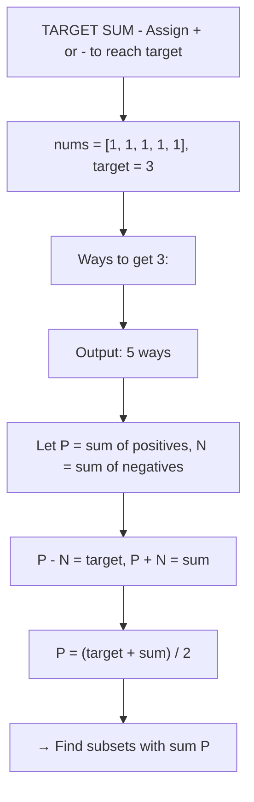

**Solution:**

```java
public int findTargetSumWays(int[] nums, int target) {
    int sum = 0;
    for (int num : nums) sum += num;

    if ((sum + target) % 2 != 0 || Math.abs(target) > sum) return 0;

    int subsetSum = (sum + target) / 2;
    int[] dp = new int[subsetSum + 1];
    dp[0] = 1;

    for (int num : nums) {
        for (int i = subsetSum; i >= num; i--) {
            dp[i] += dp[i - num];
        }
    }

    return dp[subsetSum];
}
```

---

## 10.4 Subsequence Problems

**Pattern:** Find optimal subsequence (elements don't need to be contiguous).
**LIS template:** `dp[i] = max length of increasing subsequence ending at i` → O(n²). Binary search optimization → O(n log n).
**Word Break:** `dp[i] = true if s[0..i-1] can be segmented`. Try all dictionary words as suffixes.
**Key insight:** Subsequence ≠ Substring. Subsequence can skip elements; substring must be contiguous.

### Problem 172: Longest Increasing Subsequence

**LeetCode 300** 🔗 https://leetcode.com/problems/longest-increasing-subsequence/

```
┌────────────────────────────────────────────────────────────────┐
│  LONGEST INCREASING SUBSEQUENCE                                │
├────────────────────────────────────────────────────────────────┤
│  nums = [10, 9, 2, 5, 3, 7, 101, 18]                           │
│                                                                │
│  LIS: [2, 3, 7, 101] or [2, 5, 7, 101]                         │
│  Length = 4                                                    │
│                                                                │
│  O(n²) DP: dp[i] = max length ending at i                      │
│  Index:  0   1  2  3  4  5   6   7                             │
│  nums:  10   9  2  5  3  7 101  18                             │
│  dp:     1   1  1  2  2  3   4   4                             │
│                                                                │
│  O(n log n): Binary search on patience sorting                 │
└────────────────────────────────────────────────────────────────┘
```

**Flow:**
1. LONGEST INCREASING SUBSEQUENCE
2. nums = [10, 9, 2, 5, 3, 7, 101, 18]
3. LIS: [2, 3, 7, 101] or [2, 5, 7, 101]
4. Length = 4
5. O(n²) DP: dp[i] = max length ending at i
6. Index: 0 1 2 3 4 5 6 7
7. nums: 10 9 2 5 3 7 101 18

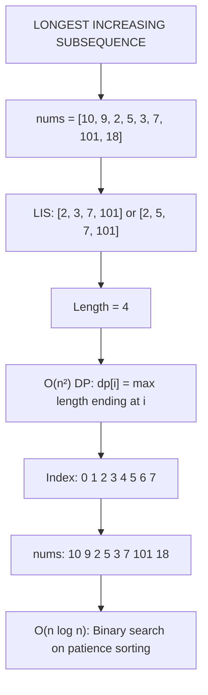

**Solution (O(n log n)):**

```java
public int lengthOfLIS(int[] nums) {
    List<Integer> tails = new ArrayList<>();

    for (int num : nums) {
        int pos = binarySearch(tails, num);
        if (pos == tails.size()) {
            tails.add(num);
        } else {
            tails.set(pos, num);
        }
    }

    return tails.size();
}

private int binarySearch(List<Integer> tails, int target) {
    int left = 0, right = tails.size();
    while (left < right) {
        int mid = left + (right - left) / 2;
        if (tails.get(mid) < target) {
            left = mid + 1;
        } else {
            right = mid;
        }
    }
    return left;
}
```

---

### Problem 173: Word Break

**LeetCode 139** 🔗 https://leetcode.com/problems/word-break/

```
┌────────────────────────────────────────────────────────────────┐
│  WORD BREAK - Can string be segmented into dictionary words?   │
├────────────────────────────────────────────────────────────────┤
│  s = "leetcode", wordDict = ["leet", "code"]                   │
│                                                                │
│  "leetcode" = "leet" + "code" ✓                                │
│                                                                │
│  dp[i] = true if s[0..i) can be segmented                      │
│                                                                │
│  Index:  0  1  2  3  4  5  6  7  8                             │
│  s:      "" l  e  e  t  c  o  d  e                             │
│  dp:      T F  F  F  T  F  F  F  T                             │
│              "leet"↗         "code"↗                           │
└────────────────────────────────────────────────────────────────┘
```

**Flow:**
1. WORD BREAK - Can string be segmented into dictionary wo
2. s = 'leetcode', wordDict = ['leet', 'code']
3. 'leetcode' = 'leet' + 'code' ✓
4. dp[i] = true if s[0..i) can be segmented
5. Index: 0 1 2 3 4 5 6 7 8
6. 'leet'↗ 'code'↗

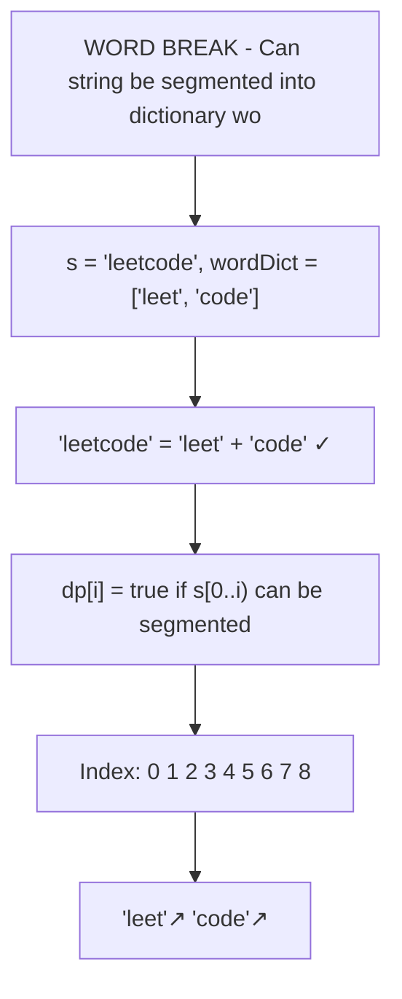

**Solution:**

```java
public boolean wordBreak(String s, List<String> wordDict) {
    Set<String> words = new HashSet<>(wordDict);
    boolean[] dp = new boolean[s.length() + 1];
    dp[0] = true;

    for (int i = 1; i <= s.length(); i++) {
        for (int j = 0; j < i; j++) {
            if (dp[j] && words.contains(s.substring(j, i))) {
                dp[i] = true;
                break;
            }
        }
    }

    return dp[s.length()];
}
```

---

### Problem 174: Longest Palindromic Subsequence

**LeetCode 516** 🔗 https://leetcode.com/problems/longest-palindromic-subsequence/

```
┌────────────────────────────────────────────────────────────────┐
│  LONGEST PALINDROMIC SUBSEQUENCE                               │
├────────────────────────────────────────────────────────────────┤
│  s = "bbbab"                                                   │
│                                                                │
│  LPS = "bbbb", length = 4                                      │
│                                                                │
│  dp[i][j] = LPS length in s[i..j]                              │
│                                                                │
│      b  b  b  a  b                                             │
│  b   1  2  3  3  4                                             │
│  b      1  2  2  3                                             │
│  b         1  1  3                                             │
│  a            1  1                                             │
│  b               1                                             │
│                                                                │
│  If s[i]==s[j]: dp[i][j] = dp[i+1][j-1] + 2                    │
│  Else: dp[i][j] = max(dp[i+1][j], dp[i][j-1])                  │
└────────────────────────────────────────────────────────────────┘
```

**Flow:**
1. LONGEST PALINDROMIC SUBSEQUENCE
2. s = 'bbbab'
3. LPS = 'bbbb', length = 4
4. dp[i][j] = LPS length in s[i..j]
5. Else: dp[i][j] = max(dp[i+1][j], dp[i][j-1])

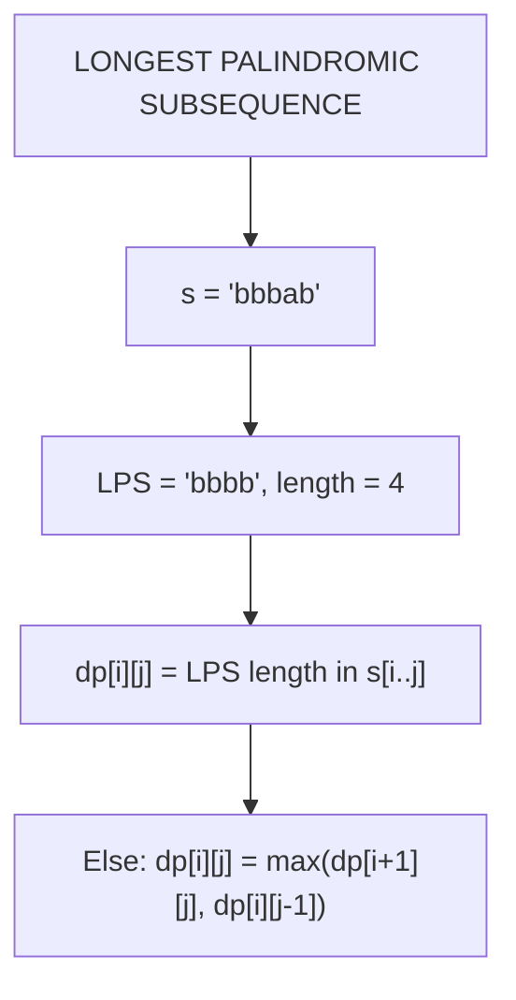

**Solution:**

```java
public int longestPalindromeSubseq(String s) {
    int n = s.length();
    int[][] dp = new int[n][n];

    // Base case: single characters
    for (int i = 0; i < n; i++) dp[i][i] = 1;

    // Fill diagonally
    for (int len = 2; len <= n; len++) {
        for (int i = 0; i <= n - len; i++) {
            int j = i + len - 1;

            if (s.charAt(i) == s.charAt(j)) {
                dp[i][j] = dp[i+1][j-1] + 2;
            } else {
                dp[i][j] = Math.max(dp[i+1][j], dp[i][j-1]);
            }
        }
    }

    return dp[0][n-1];
}
```

---

## 10.5 State Machine DP

**Pattern:** Multiple states at each step (e.g., holding stock, not holding, in cooldown).
**Template:** Define one dp variable per state. Transition between states based on actions.
**Key insight:** Draw the state machine diagram first! Then the recurrence writes itself.

### Problem 175: Best Time to Buy and Sell Stock with Cooldown

**LeetCode 309** 🔗 https://leetcode.com/problems/best-time-to-buy-and-sell-stock-with-cooldown/

```
┌────────────────────────────────────────────────────────────────┐
│  STOCK WITH COOLDOWN                                           │
├────────────────────────────────────────────────────────────────┤
│  prices = [1, 2, 3, 0, 2]                                      │
│  After sell, must wait 1 day before buying again               │
│                                                                │
│  States:                                                       │
│  ┌─────────┐    buy    ┌─────────┐                             │
│  │  REST   │ ────────→ │  HOLD   │                             │
│  └─────────┘           └─────────┘                             │
│       ↑                     │                                  │
│       │                    sell                                │
│       │                     │                                  │
│       │    ┌─────────┐      │                                  │
│       └────│ COOLDOWN│ ←────┘                                  │
│            └─────────┘                                         │
│                                                                │
│  rest[i] = max(rest[i-1], cool[i-1])                           │
│  hold[i] = max(hold[i-1], rest[i-1] - price)                   │
│  cool[i] = hold[i-1] + price                                   │
└────────────────────────────────────────────────────────────────┘
```

**Flow:**
1. REST --(buy)--> HOLD
2. REST
3. COOLDOWN
4. HOLD
5. COOLDOWN

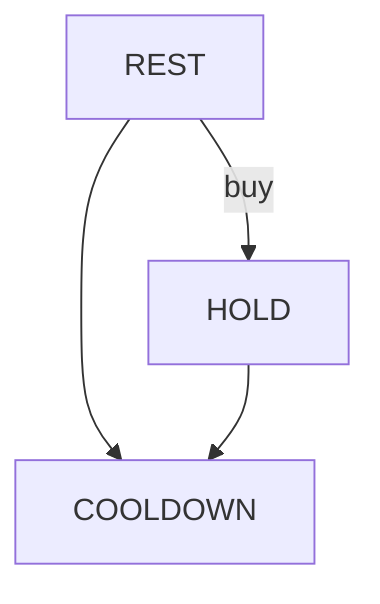

**Solution:**

```java
public int maxProfit(int[] prices) {
    int rest = 0, hold = Integer.MIN_VALUE, cool = 0;

    for (int price : prices) {
        int prevHold = hold;
        hold = Math.max(hold, rest - price);
        rest = Math.max(rest, cool);
        cool = prevHold + price;
    }

    return Math.max(rest, cool);
}
```

---

---


## 🏆 Competitive Programming — Codeforces Problems

| Problem | Link | DP Type | Difficulty |
|---|---|---|---|
| Coins | [CF 16C](https://codeforces.com/problemset/problem/16/C) | 1D DP (Coin Change variant) | ⭐⭐ Medium |
| Palindrome DP | [CF 5C](https://codeforces.com/problemset/problem/5/C) | 1D DP on strings | ⭐⭐ Medium |
| Maximum Sum of Digits | [CF 1217C](https://codeforces.com/problemset/problem/1217/C) | Digit DP | ⭐⭐ Medium |
| Berland Sequence | [CF 837D](https://codeforces.com/problemset/problem/837/D) | Greedy + DP | ⭐⭐⭐ Hard |
| Tanya and Postcard | [CF 1555E](https://codeforces.com/problemset/problem/1555/E) | Matching DP | ⭐⭐⭐ Hard |
| Space Journey | [CF 1600E](https://codeforces.com/problemset/problem/1600/E) | Graph DP | ⭐⭐⭐ Hard |

---


## 🌍 Real-World Applications of Dynamic Programming

| DP Pattern | Real-World System | How It's Used |
|---|---|---|
| **Edit Distance (2D String DP)** | Git diff / spell checkers | `diff` tool uses edit distance to find minimal changes between files |
| **LCS (Longest Common Subsequence)** | DNA sequence alignment | BLAST algorithm aligns DNA/protein sequences using LCS DP |
| **Knapsack** | Budget/resource allocation | "Maximum feature value within sprint budget" = 0/1 Knapsack |
| **1D DP (Fibonacci-style)** | Compiler optimization | DAG-based instruction scheduling uses DP on topological order |
| **Matrix chain multiplication** | ML frameworks (TensorFlow) | Optimal order for matrix multiplications in neural network backprop |
| **Bellman-Ford (DP on graphs)** | Network routing (RIP protocol) | Distance vector routing = Bellman-Ford DP relaxation |

```
🔥 ICONIC INTERVIEW CONNECTION:
   "When Google Docs shows you 'suggested changes' — that's edit distance DP.
    The diff between your document and theirs = minimum edit operations."
```

---


---


🔬 **Section Challenge — 🌍 Real-World Applications of Dynamic Programming**

**Challenge 1 (Reasoning):** How do you identify that a problem requires DP vs Greedy? What's the key test?
<details><summary>Answer</summary>

Greedy test: does the locally optimal choice always lead to the globally optimal solution? (Prove via exchange argument.) If yes → greedy. If making a local choice requires knowing future choices → DP. Example: Coin Change with standard coins [1,5,10,25] → greedy works (always pick largest). Coin Change with coins [1,3,4] and amount 6 → greedy picks 4+1+1=3 coins, optimal is 3+3=2 coins. Greedy fails → DP.
</details>

**Challenge 2 (Design):** You need to find the number of ways to climb N stairs taking 1 or 2 steps at a time. Define the DP state and recurrence.
<details><summary>Answer</summary>

State: `dp[i]` = number of ways to reach step i. Recurrence: `dp[i] = dp[i-1] + dp[i-2]` (come from step i-1 via 1 step, or from step i-2 via 2 steps). Base: `dp[0]=1` (one way: don't move), `dp[1]=1`. This is exactly Fibonacci. Space optimization: only need last 2 values → O(1) space.
</details>


