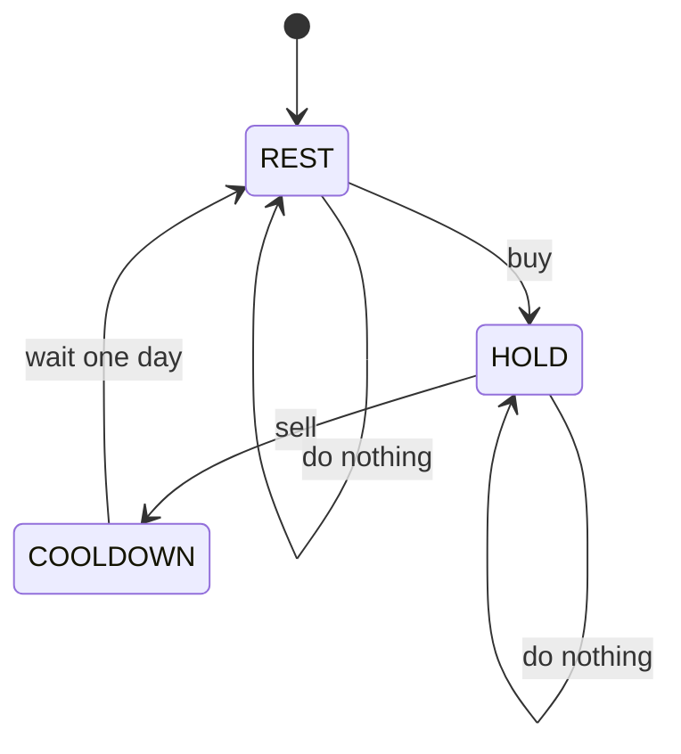

# 10.4 Subsequence Problems

> **Navigation**: [← 10.3 Knapsack Problems](04_knapsack_problems.md) | [Chapter overview](../11_Dynamic_Programming.md)
> Page 5 of 5 in **Dynamic Programming**


**Pattern:** Find optimal subsequence (elements don't need to be contiguous).
**LIS template:** `dp[i] = max length of increasing subsequence ending at i` → O(n²). Binary search optimization → O(n log n).
**Word Break:** `dp[i] = true if s[0..i-1] can be segmented`. Try all dictionary words as suffixes.
**Key insight:** Subsequence ≠ Substring. Subsequence can skip elements; substring must be contiguous.

## Problem 172: Longest Increasing Subsequence

**LeetCode 300** 🔗 https://leetcode.com/problems/longest-increasing-subsequence/

**LONGEST INCREASING SUBSEQUENCE**

```text
nums = [10, 9, 2, 5, 3, 7, 101, 18]

LIS: [2, 3, 7, 101] or [2, 5, 7, 101]
Length = 4

O(n²) DP: dp[i] = max length ending at i
Index:  0   1  2  3  4  5   6   7
nums:  10   9  2  5  3  7 101  18
dp:     1   1  1  2  2  3   4   4

O(n log n): Binary search on patience sorting
```

**Solution (O(n log n)):**

```java
public int lengthOfLIS(int[] nums) {
    List<Integer> tails = new ArrayList<>();

    for (int num : nums) {
        int pos = binarySearch(tails, num);
        if (pos == tails.size()) {
            tails.add(num);
        } else {
            tails.set(pos, num);
        }
    }

    return tails.size();
}

private int binarySearch(List<Integer> tails, int target) {
    int left = 0, right = tails.size();
    while (left < right) {
        int mid = left + (right - left) / 2;
        if (tails.get(mid) < target) {
            left = mid + 1;
        } else {
            right = mid;
        }
    }
    return left;
}
```

---

## Problem 173: Word Break

**LeetCode 139** 🔗 https://leetcode.com/problems/word-break/

**WORD BREAK - Can string be segmented into dictionary words?**

```text
s = "leetcode", wordDict = ["leet", "code"]

"leetcode" = "leet" + "code" ✓

dp[i] = true if s[0..i) can be segmented

Index:  0  1  2  3  4  5  6  7  8
s:      "" l  e  e  t  c  o  d  e
dp:      T F  F  F  T  F  F  F  T
            "leet"↗         "code"↗
```

**Solution:**

```java
public boolean wordBreak(String s, List<String> wordDict) {
    Set<String> words = new HashSet<>(wordDict);
    boolean[] dp = new boolean[s.length() + 1];
    dp[0] = true;

    for (int i = 1; i <= s.length(); i++) {
        for (int j = 0; j < i; j++) {
            if (dp[j] && words.contains(s.substring(j, i))) {
                dp[i] = true;
                break;
            }
        }
    }

    return dp[s.length()];
}
```

---

## Problem 174: Longest Palindromic Subsequence

**LeetCode 516** 🔗 https://leetcode.com/problems/longest-palindromic-subsequence/

**LONGEST PALINDROMIC SUBSEQUENCE**

```text
s = "bbbab"

LPS = "bbbb", length = 4

dp[i][j] = LPS length in s[i..j]

    b  b  b  a  b
b   1  2  3  3  4
b      1  2  2  3
b         1  1  3
a            1  1
b               1

If s[i]==s[j]: dp[i][j] = dp[i+1][j-1] + 2
Else: dp[i][j] = max(dp[i+1][j], dp[i][j-1])
```

**Solution:**

```java
public int longestPalindromeSubseq(String s) {
    int n = s.length();
    int[][] dp = new int[n][n];

    // Base case: single characters
    for (int i = 0; i < n; i++) dp[i][i] = 1;

    // Fill diagonally
    for (int len = 2; len <= n; len++) {
        for (int i = 0; i <= n - len; i++) {
            int j = i + len - 1;

            if (s.charAt(i) == s.charAt(j)) {
                dp[i][j] = dp[i+1][j-1] + 2;
            } else {
                dp[i][j] = Math.max(dp[i+1][j], dp[i][j-1]);
            }
        }
    }

    return dp[0][n-1];
}
```

---

## 10.5 State Machine DP

**Pattern:** Multiple states at each step (e.g., holding stock, not holding, in cooldown).
**Template:** Define one dp variable per state. Transition between states based on actions.
**Key insight:** Draw the state machine diagram first! Then the recurrence writes itself.

### Problem 175: Best Time to Buy and Sell Stock with Cooldown

**LeetCode 309** 🔗 https://leetcode.com/problems/best-time-to-buy-and-sell-stock-with-cooldown/

**Best time to buy and sell stock with cooldown**

`prices = [1, 2, 3, 0, 2]`. After selling, you must wait one day before buying again.



**How to read this diagram.** On each day you are in one of three states. Buying moves you from REST to HOLD, selling moves you from HOLD to COOLDOWN, and the cooldown day always leads back to REST.

- `rest[i] = max(rest[i-1], cool[i-1])`
- `hold[i] = max(hold[i-1], rest[i-1] - price)`
- `cool[i] = hold[i-1] + price`

**Solution:**

```java
public int maxProfit(int[] prices) {
    int rest = 0, hold = Integer.MIN_VALUE, cool = 0;

    for (int price : prices) {
        int prevHold = hold;
        hold = Math.max(hold, rest - price);
        rest = Math.max(rest, cool);
        cool = prevHold + price;
    }

    return Math.max(rest, cool);
}
```

---

---

## 🏆 Competitive Programming — Codeforces Problems

| Problem               | Link                                                         | DP Type                     | Difficulty  |
| --------------------- | ------------------------------------------------------------ | --------------------------- | ----------- |
| Coins                 | [CF 16C](https://codeforces.com/problemset/problem/16/C)     | 1D DP (Coin Change variant) | ⭐⭐ Medium |
| Palindrome DP         | [CF 5C](https://codeforces.com/problemset/problem/5/C)       | 1D DP on strings            | ⭐⭐ Medium |
| Maximum Sum of Digits | [CF 1217C](https://codeforces.com/problemset/problem/1217/C) | Digit DP                    | ⭐⭐ Medium |
| Berland Sequence      | [CF 837D](https://codeforces.com/problemset/problem/837/D)   | Greedy + DP                 | ⭐⭐⭐ Hard |
| Tanya and Postcard    | [CF 1555E](https://codeforces.com/problemset/problem/1555/E) | Matching DP                 | ⭐⭐⭐ Hard |
| Space Journey         | [CF 1600E](https://codeforces.com/problemset/problem/1600/E) | Graph DP                    | ⭐⭐⭐ Hard |

---

## 🌍 Real-World Applications of Dynamic Programming

| DP Pattern                           | Real-World System              | How It's Used                                                        |
| ------------------------------------ | ------------------------------ | -------------------------------------------------------------------- |
| **Edit Distance (2D String DP)**     | Git diff / spell checkers      | `diff` tool uses edit distance to find minimal changes between files |
| **LCS (Longest Common Subsequence)** | DNA sequence alignment         | BLAST algorithm aligns DNA/protein sequences using LCS DP            |
| **Knapsack**                         | Budget/resource allocation     | "Maximum feature value within sprint budget" = 0/1 Knapsack          |
| **1D DP (Fibonacci-style)**          | Compiler optimization          | DAG-based instruction scheduling uses DP on topological order        |
| **Matrix chain multiplication**      | ML frameworks (TensorFlow)     | Optimal order for matrix multiplications in neural network backprop  |
| **Bellman-Ford (DP on graphs)**      | Network routing (RIP protocol) | Distance vector routing = Bellman-Ford DP relaxation                 |

```
🔥 ICONIC INTERVIEW CONNECTION:
   "When Google Docs shows you 'suggested changes' — that's edit distance DP.
    The diff between your document and theirs = minimum edit operations."
```

---

[← 10.3 Knapsack Problems](04_knapsack_problems.md) | [Chapter overview](../11_Dynamic_Programming.md)
