**Navigation**: [< Previous](12_Backtracking.md) | [Back to Index](../00_MASTER_INDEX.md) | [Next >](14_Mixed_Competitive.md)

**Problems 13/14** | [Prev](12_Backtracking.md) | [Index](../00_MASTER_INDEX.md) | [Next](14_Mixed_Competitive.md)

---

## 🗺️ Pattern Recognition Header — Greedy

**Is this a Greedy problem?** Ask: *"Can I make the locally best choice and never look back?"*


| Signal Words / Problem Type | Greedy Strategy | Key Sort |
|---|---|---|
| `intervals / meetings / schedule` | Sort by END time, pick non-overlapping | `(a,b) → a[1]-b[1]` |
| `merge intervals / cover ranges` | Sort by START time, extend current | `(a,b) → a[0]-b[0]` |
| `min intervals to remove` | Sort by end, count overlapping with lastEnd | end time |
| `can reach end / jump game` | Track `farthest`, scan L→R | none (array scan) |
| `task scheduler / cooldown` | Schedule most-frequent first | max-heap by freq |
| `connect sticks / minimize cost` | Always merge smallest first (Huffman) | min-heap |
| `assign to groups / fractional` | Sort both sides, match greedily | value/weight |


**⚠️ Greedy vs DP Decision:**
```
CAN find a counterexample where local-best ≠ global-best? → Use DP
ALL local-best choices lead to global best (exchange argument holds)? → Greedy

WORKS:   Interval select, Jump Game, Huffman, Dijkstra, MST
FAILS:   0/1 Knapsack, Coin Change (arbitrary), LIS, Edit Distance
```

📖 **Mental Model:** [11_Greedy_vs_DP_Decision.md](../14_Mental_Models/11_Greedy_vs_DP_Decision.md)
📖 **Complexity Guide:** [09_Complexity_Intuition.md](../14_Mental_Models/09_Complexity_Intuition.md)
📖 **Full Pattern Guide:** [00_PATTERN_MASTER_GUIDE.md](../04_Patterns_Templates/00_PATTERN_MASTER_GUIDE.md)

---


🔬 **Section Challenge — 🗺️ Pattern Recognition Header — Greedy**

**Challenge 1 (Reasoning):** Interval scheduling: select maximum number of non-overlapping intervals. Why does sorting by END time work, not by START time or duration?
<details><summary>Answer</summary>

Sorting by end time: greedily picking the interval that ends earliest leaves maximum time for future intervals. Formal proof (exchange argument): suppose optimal solution picks interval A instead of interval B (B ends earlier). We can swap A for B without losing any other interval (B ends ≤ A ends, so anything compatible with A is also compatible with B). Sorting by start time fails: a very long interval starting early would block many shorter intervals. Sorting by duration fails: a short interval might overlap two others.
</details>


# 📚 SECTION 12: GREEDY ALGORITHMS

## Greedy Fundamentals


💡 **KEY INSIGHT:**
Make locally optimal choice at each step → Global optimum

**When To Use Greedy**:
1. Optimal substructure: Optimal solution contains optimal
solutions to subproblems
2. Greedy choice property: Local optimal leads to global

**Common Patterns**:
- Interval scheduling (meetings, activities)
- Huffman coding
- Minimum spanning tree (Kruskal's, Prim's)
- Dijkstra's shortest path
- Fractional knapsack
⚠️ GREEDY DOESN'T ALWAYS WORK:
- 0/1 Knapsack → Need DP
- Longest path → Need DP/Backtracking

---


🔬 **Section Challenge — Greedy Fundamentals**

**Challenge 1 (Reasoning):** Interval scheduling: select maximum number of non-overlapping intervals. Why does sorting by END time work, not by START time or duration?
<details><summary>Answer</summary>

Sorting by end time: greedily picking the interval that ends earliest leaves maximum time for future intervals. Formal proof (exchange argument): suppose optimal solution picks interval A instead of interval B (B ends earlier). We can swap A for B without losing any other interval (B ends ≤ A ends, so anything compatible with A is also compatible with B). Sorting by start time fails: a very long interval starting early would block many shorter intervals. Sorting by duration fails: a short interval might overlap two others.
</details>


## PART 0: WHY Greedy — The Algorithm That Feels Like Cheating (But Isn't)


🔬 **Section Challenge — PART 0: WHY Greedy — The Algorithm That Feels Like Cheating (But Isn't)**

**Challenge 1 (Reasoning):** Interval scheduling: select maximum number of non-overlapping intervals. Why does sorting by END time work, not by START time or duration?
<details><summary>Answer</summary>

Sorting by end time: greedily picking the interval that ends earliest leaves maximum time for future intervals. Formal proof (exchange argument): suppose optimal solution picks interval A instead of interval B (B ends earlier). We can swap A for B without losing any other interval (B ends ≤ A ends, so anything compatible with A is also compatible with B). Sorting by start time fails: a very long interval starting early would block many shorter intervals. Sorting by duration fails: a short interval might overlap two others.
</details>


## Why Greedy Problems Are Tricky (And Important)

Greedy algorithms feel simple: "just pick the best choice."
The HARD PART: proving the greedy choice is CORRECT.
Greedy appears in ~15% of interviews. The trap:
- You often RECOGNIZE the greedy answer intuitively
- But you can't PROVE it → interviewer asks "why does this work?"
- Or worse: you assume greedy works when it DOESN'T → wrong answer
TWO PROPERTIES REQUIRED (must have BOTH):
1. GREEDY CHOICE PROPERTY: The locally best choice leads to global best
2. OPTIMAL SUBSTRUCTURE: After making a choice, the remaining problem
is a smaller version of the same problem
WORKS vs DOESN'T WORK:
┬
- ✅ Greedy WORKS        │ ❌ Greedy FAILS (need DP)
┼
Activity Selection     │ 0/1 Knapsack
Fractional Knapsack    │ Longest Increasing Subsequence
Huffman Coding         │ Coin Change (arbitrary coins)
Dijkstra's Algorithm   │ Edit Distance
Kruskal's MST          │ Matrix Chain Multiplication
Jump Game I            │ Palindrome Partitioning min cuts
┴


🔬 **Section Challenge — Why Greedy Problems Are Tricky (And Important)**

**Challenge 1 (Reasoning):** Interval scheduling: select maximum number of non-overlapping intervals. Why does sorting by END time work, not by START time or duration?
<details><summary>Answer</summary>

Sorting by end time: greedily picking the interval that ends earliest leaves maximum time for future intervals. Formal proof (exchange argument): suppose optimal solution picks interval A instead of interval B (B ends earlier). We can swap A for B without losing any other interval (B ends ≤ A ends, so anything compatible with A is also compatible with B). Sorting by start time fails: a very long interval starting early would block many shorter intervals. Sorting by duration fails: a short interval might overlap two others.
</details>


## The Mental Model: "Sort + Scan + Never Look Back"

Almost EVERY greedy problem follows this 3-step recipe:
STEP 1: SORT the input by some criterion
STEP 2: SCAN left to right, making the best choice at each step
STEP 3: NEVER reconsider a past choice
The KEY is knowing HOW to sort:
Intervals:    Sort by END TIME → finish earliest, maximize room
Jump Game:    Don't sort! Scan L→R, track farthest reachable
Gas Station:  Scan L→R, track surplus (gas - cost). Reset at deficit.
Task Scheduler: Sort by frequency → schedule most frequent first
Assign Cookies: Sort both arrays → match smallest cookie to child
HOW TO VERIFY (Exchange Argument — the proof technique):
"If I swap my greedy choice with any other choice, the solution
gets WORSE or stays the SAME → greedy is optimal."
WORKED EXAMPLE — Activity Selection:
Activities: [(1,3), (2,5), (4,7), (6,8), (5,9)]
Sort by end: [(1,3), (2,5), (4,7), (6,8), (5,9)]
Pick (1,3) ✓ — ends earliest
Skip (2,5)   — starts before 3? No, 2 < 3 ❌ — WAIT, 2 < 3 so skip
Pick (4,7) ✓ — starts at 4 ≥ 3
Pick (6,8)   — starts at 6 < 7? YES → skip
Skip (5,9)   — starts at 5 < 7 → skip
Result: [(1,3), (4,7)] = 2 activities
Proof: If we replaced (1,3) with (2,5), we'd free LESS room for
future activities. Swapping always makes it worse → greedy is correct.

```java
// GREEDY INTERVAL TEMPLATE — covers 5+ problems
public int maxNonOverlapping(int[][] intervals) {
    // STEP 1: Sort by end time
    Arrays.sort(intervals, (a, b) -> a[1] - b[1]);
    
    int count = 0;
    int lastEnd = Integer.MIN_VALUE;
    
    // STEP 2: Scan, greedily pick if no overlap
    for (int[] interval : intervals) {
        if (interval[0] >= lastEnd) {  // no overlap
            count++;
            lastEnd = interval[1];      // update boundary
        }
        // STEP 3: Skip overlapping — never reconsider
    }
    return count;
}
```

```
┌──────────────────────────────────────────────────────────────────────────────┐
│ THE 3 GREEDY CATEGORIES IN THIS CHAPTER                                      │
├──────────────────────────────────────────────────────────────────────────────┤
│                                                                              │
│ ┌──────────────────┬─────────────────────────────────┬───────────────────┐   │
│ │ Category         │ Sorting / Scanning Strategy     │ Problems          │   │
│ ├──────────────────┼─────────────────────────────────┼───────────────────┤   │
│ │ 1. INTERVALS     │ Sort by end time (or start time)│ 189-193           │   │
│ │                  │ Pick non-overlapping greedily   │ Meeting Rooms     │   │
│ │                  │                                  │ Merge Intervals   │  │
│ ├──────────────────┼─────────────────────────────────┼───────────────────┤   │
│ │ 2. ARRAY GREEDY  │ Scan L→R, track running state  │ 194-197           │    │
│ │                  │ (farthest reach, surplus, etc.) │ Jump Game         │   │
│ │                  │                                  │ Gas Station       │  │
│ ├──────────────────┼─────────────────────────────────┼───────────────────┤   │
│ │ 3. STRING/MATH   │ Problem-specific ordering       │ 198-201           │   │
│ │                  │ (frequency, digit removal, etc.)│ Task Scheduler    │   │
│ └──────────────────┴─────────────────────────────────┴───────────────────┘   │
│                                                                              │
│ PRIORITY: Master Intervals first — they appear in 50%+ of greedy Qs.         │
└──────────────────────────────────────────────────────────────────────────────┘

┌──────────────────────────────────────────────────────────────────────────────┐
│ ⚠️  COMMON MISTAKES IN GREEDY PROBLEMS                                       │
├──────────────────────────────────────────────────────────────────────────────┤
│                                                                              │
│ MISTAKE 1: Assuming greedy works without verifying                           │
│   WRONG: "Pick the highest-value item first."                                │
│   0/1 Knapsack counterexample: W=50. Items: (60,10), (100,20), (120,30).     │
│   Greedy by value/weight picks 60+100=160. DP gets 100+120=220.              │
│   RULE: If items can't be split → probably NOT greedy.                       │
│                                                                              │
│ MISTAKE 2: Sorting by wrong criterion for intervals                          │
│   "Non-overlapping intervals" → sort by END time, not start time.            │
│   "Merge intervals" → sort by START time, not end time.                      │
│   Different problems need different sort keys!                               │
│                                                                              │
│ MISTAKE 3: Off-by-one in overlap detection                                   │
│   [1,5] and [5,8] — do they overlap?                                         │
│   If endpoints inclusive: YES (share point 5)                                │
│   If end-exclusive: NO (5 is end of first, start of second)                  │
│   Always check problem definition! LeetCode usually: start ≤ x < end.        │
│                                                                              │
│ MISTAKE 4: Jump Game — forgetting that farthest updates continuously         │
│   Wrong: only check if current index == farthest                             │
│   Right: update farthest = max(farthest, i + nums[i]) at EVERY step          │
│   If i > farthest at any point → can't reach end.                            │
│                                                                              │
│ MISTAKE 5: Gas Station — brute force O(n²) when O(n) suffices                │
│   Key insight: if total gas ≥ total cost → answer always exists.             │
│   Track surplus. When it goes negative → restart from next station.          │
│   Single pass, O(n). Many candidates miss this optimization.                 │
│                                                                              │
│ MISTAKE 6: Trying greedy on Coin Change with arbitrary denominations         │
│   Coins = [1, 3, 4], Amount = 6.                                             │
│   Greedy picks 4+1+1 = 3 coins. Optimal: 3+3 = 2 coins.                      │
│   Greedy only works for canonical coin systems (US coins: 1,5,10,25).        │
└──────────────────────────────────────────────────────────────────────────────┘

┌──────────────────────────────────────────────────────────────────────────────┐
│ DIFFICULTIES IN LEARNING GREEDY                                              │
├──────────────────────────────────────────────────────────────────────────────┤
│                                                                              │
│ 1. "How do I know if greedy works vs DP?"                                    │
│    → Try to find a counterexample. If you can swap the greedy choice with    │
│      another and get a better answer → greedy fails, use DP.                 │
│                                                                              │
│ 2. "The proof seems obvious but I can't formalize it"                        │
│    → Exchange argument: Assume optimal solution differs from greedy.         │
│      Show you can replace the different choice with greedy's choice          │
│      without making the solution worse. That's the full proof.               │
│                                                                              │
│ 3. "I keep getting TLE on interval problems"                                 │
│    → Are you sorting? Unsorted intervals → O(n²) comparisons.                │
│      Sort by end time first → single O(n) pass after O(n log n) sort.        │
│                                                                              │
│ 4. "Jump Game II was way harder than Jump Game I"                            │
│    → Jump I = "can you reach end?" (track farthest). Jump II = "min          │
│      jumps to reach end?" (BFS-like greedy with level boundaries).           │
└──────────────────────────────────────────────────────────────────────────────┘

┌──────────────────────────────────────────────────────────────────────────────┐
│ ⭐ EXPECTED OUTPUTS OF MASTERING GREEDY ⭐                                     │
├──────────────────────────────────────────────────────────────────────────────┤
│                                                                              │
│ ✅ Instantly distinguish Greedy vs DP based on counterexample thinking        │
│ ✅ Sort intervals by END time for scheduling, START time for merging          │
│ ✅ Write interval greedy template (sort + scan + lastEnd) from memory         │
│ ✅ Solve Jump Game in O(n) with farthest-reachable tracking                   │
│ ✅ Explain exchange argument proof at whiteboard                              │
│ ✅ Recognize when greedy FAILS and pivot to DP                                │
│                                                                              │
│ THE TRANSFORMATION:                                                          │
│ FROM: "I always try greedy and sometimes it's wrong"                         │
│   TO: "I check greedy-choice property + optimal substructure. If both        │
│        hold, I sort by the right key, scan once, never look back.            │
│        If not, I reach for DP and can explain WHY."                          │
└──────────────────────────────────────────────────────────────────────────────┘
```

📖 **Related theory:** [03_Algorithms/12_Greedy_Algorithms_Complete.md](../03_Algorithms/12_Greedy_Algorithms_Complete.md) — Full greedy theory with exchange argument proofs

---

## 12.1 Interval Problems

**Pattern:** Sort by end time. Greedily pick non-overlapping intervals.
**Key insight:** Finishing earliest leaves the most room for future activities.
**Template:** Sort by `end`, keep `lastEnd`, skip if `start < lastEnd`.

### Problem 189: Meeting Rooms

**LeetCode 252 (Premium)** 🔒

```
┌────────────────────────────────────────────────────────────────┐
│  MEETING ROOMS - Can attend all meetings?                      │
├────────────────────────────────────────────────────────────────┤
│  intervals = [[0,30], [5,10], [15,20]]                         │
│                                                                │
│  Timeline:                                                     │
│  0────────────────────────────30  Meeting 1                    │
│       5────10                      Meeting 2 (overlaps!)       │
│            15────20                Meeting 3 (overlaps!)       │
│                                                                │
│  Output: false (meetings overlap)                              │
│                                                                │
│  Constraints:                                                  │
│  - 0 <= intervals.length <= 10^4                               │
│  - intervals[i].length == 2                                    │
│  - 0 <= start < end <= 10^6                                    │
└────────────────────────────────────────────────────────────────┘
```

**Flow:**
1. MEETING ROOMS - Can attend all meetings?
2. intervals = [[0,30], [5,10], [15,20]]
3. Timeline:
4. 0 30 Meeting 1
5. 5 10 Meeting 2 (overlaps!)
6. 15 20 Meeting 3 (overlaps!)
7. Output: false (meetings overlap)

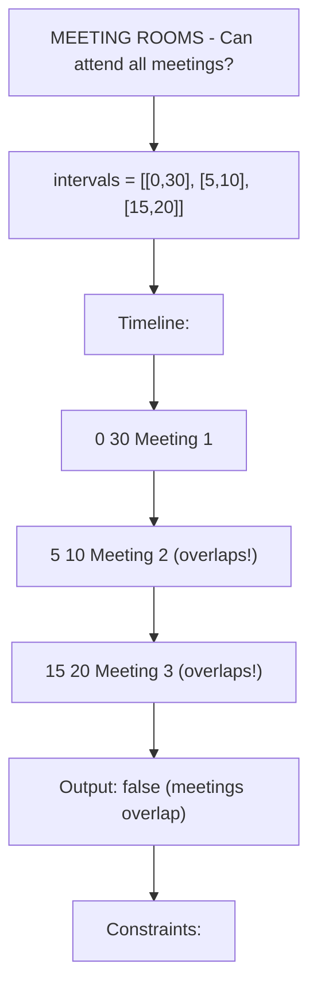

**Solution:**

```java
public boolean canAttendMeetings(int[][] intervals) {
    // Sort by start time
    Arrays.sort(intervals, (a, b) -> a[0] - b[0]);

    for (int i = 1; i < intervals.length; i++) {
        // If current starts before previous ends → overlap
        if (intervals[i][0] < intervals[i-1][1]) {
            return false;
        }
    }

    return true;
}
```

---

### Problem 190: Meeting Rooms II

**LeetCode 253 (Premium)** 🔒

```
┌────────────────────────────────────────────────────────────────┐
│  MEETING ROOMS II - Minimum rooms needed                       │
├────────────────────────────────────────────────────────────────┤
│  intervals = [[0,30], [5,10], [15,20]]                         │
│                                                                │
│  Room 1: |═══════════════════════════════| [0,30]              │
│  Room 2:      |════|      |═════|          [5,10], [15,20]     │
│                                                                │
│  Output: 2 rooms needed                                        │
│                                                                │
│  Approach: Track concurrent meetings using min-heap            │
│  Heap stores end times of ongoing meetings                     │
└────────────────────────────────────────────────────────────────┘
```

**Flow:**
1. MEETING ROOMS II - Minimum rooms needed
2. intervals = [[0,30], [5,10], [15,20]]
3. Room 1:
4. [0,30]
5. Room 1:
6. [0,30]
7. Room 2:
8. [5,10], [15,20]
9. Room 2:
10. [5,10], [15,20]
11. Output: 2 rooms needed
12. Approach: Track concurrent meetings using min-heap
13. Heap stores end times of ongoing meetings

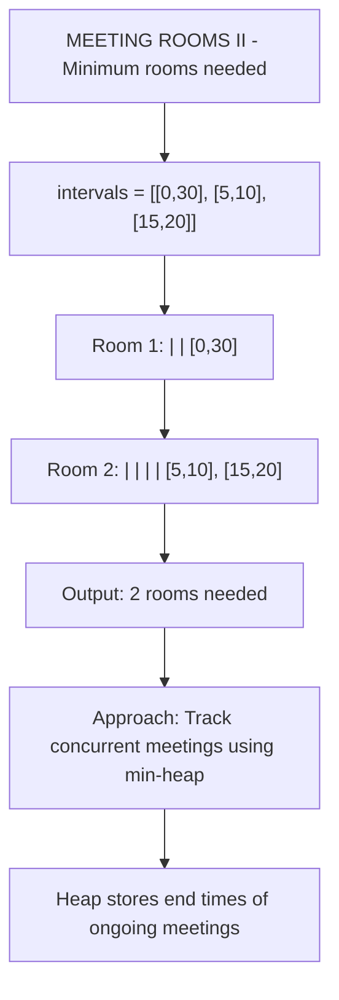

**Solution:**

```java
public int minMeetingRooms(int[][] intervals) {
    if (intervals.length == 0) return 0;

    // Sort by start time
    Arrays.sort(intervals, (a, b) -> a[0] - b[0]);

    // Min-heap to track end times
    PriorityQueue<Integer> heap = new PriorityQueue<>();
    heap.offer(intervals[0][1]);

    for (int i = 1; i < intervals.length; i++) {
        // If earliest ending meeting ends before current starts
        if (intervals[i][0] >= heap.peek()) {
            heap.poll();  // Reuse that room
        }
        heap.offer(intervals[i][1]);  // Add current meeting's end
    }

    return heap.size();
}
```

---

### Problem 191: Non-overlapping Intervals

**LeetCode 435** 🔗 https://leetcode.com/problems/non-overlapping-intervals/

```
┌────────────────────────────────────────────────────────────────┐
│  NON-OVERLAPPING INTERVALS - Min removals for no overlap       │
├────────────────────────────────────────────────────────────────┤
│  intervals = [[1,2], [2,3], [3,4], [1,3]]                      │
│                                                                │
│  1──2  2──3  3──4                                              │
│  1─────3     (overlaps with both above)                        │
│                                                                │
│  Remove [1,3] → No overlaps                                    │
│  Output: 1                                                     │
│                                                                │
│  Greedy: Sort by end time, keep non-overlapping                │
└────────────────────────────────────────────────────────────────┘
```

**Flow:**
1. NON-OVERLAPPING INTERVALS - Min removals for no overlap
2. intervals = [[1,2], [2,3], [3,4], [1,3]]
3. 1 3 (overlaps with both above)
4. Remove [1,3]
5. No overlaps
6. Remove [1,3]
7. No overlaps
8. Output: 1
9. Greedy: Sort by end time, keep non-overlapping

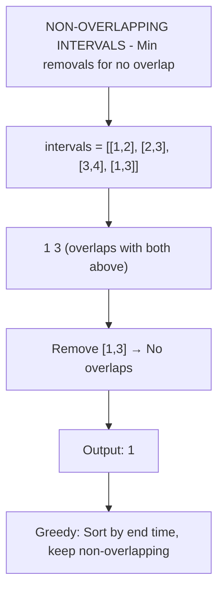

**Solution:**

```java
public int eraseOverlapIntervals(int[][] intervals) {
    if (intervals.length == 0) return 0;

    // Sort by END time (greedy choice)
    Arrays.sort(intervals, (a, b) -> a[1] - b[1]);

    int count = 0;
    int prevEnd = intervals[0][1];

    for (int i = 1; i < intervals.length; i++) {
        if (intervals[i][0] < prevEnd) {
            // Overlap: remove current (it ends later)
            count++;
        } else {
            prevEnd = intervals[i][1];
        }
    }

    return count;
}
```

---

### Problem 192: Merge Intervals

**LeetCode 56** 🔗 https://leetcode.com/problems/merge-intervals/

```
┌────────────────────────────────────────────────────────────────┐
│  MERGE INTERVALS                                               │
├────────────────────────────────────────────────────────────────┤
│  intervals = [[1,3], [2,6], [8,10], [15,18]]                   │
│                                                                │
│  1───3                                                         │
│    2─────6                                                     │
│              8──10                                             │
│                     15──18                                     │
│  └───────┘                                                     │
│  Merged: [1,6]                                                 │
│                                                                │
│  Output: [[1,6], [8,10], [15,18]]                              │
└────────────────────────────────────────────────────────────────┘
```

**Flow:**
1. MERGE INTERVALS
2. intervals = [[1,3], [2,6], [8,10], [15,18]]
3. Merged: [1,6]
4. Output: [[1,6], [8,10], [15,18]]

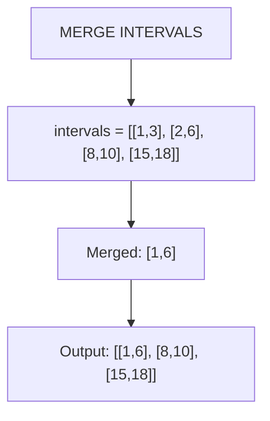

**Solution:**

```java
public int[][] merge(int[][] intervals) {
    if (intervals.length <= 1) return intervals;

    // Sort by start time
    Arrays.sort(intervals, (a, b) -> a[0] - b[0]);

    List<int[]> result = new ArrayList<>();
    int[] current = intervals[0];
    result.add(current);

    for (int[] interval : intervals) {
        if (interval[0] <= current[1]) {
            // Overlapping: extend current
            current[1] = Math.max(current[1], interval[1]);
        } else {
            // Non-overlapping: add new interval
            current = interval;
            result.add(current);
        }
    }

    return result.toArray(new int[result.size()][]);
}
```

---

### Problem 193: Insert Interval

**LeetCode 57** 🔗 https://leetcode.com/problems/insert-interval/

```
┌────────────────────────────────────────────────────────────────┐
│  INSERT INTERVAL                                               │
├────────────────────────────────────────────────────────────────┤
│  intervals = [[1,3], [6,9]], newInterval = [2,5]               │
│                                                                │
│  1───3    6───9                                                │
│    2─────5                                                     │
│  └─────┘                                                       │
│  Merge [1,3] and [2,5] → [1,5]                                 │
│                                                                │
│  Output: [[1,5], [6,9]]                                        │
└────────────────────────────────────────────────────────────────┘
```

**Flow:**
1. INSERT INTERVAL
2. intervals = [[1,3], [6,9]], newInterval = [2,5]
3. Merge [1,3] and [2,5]
4. [1,5]
5. Merge [1,3] and [2,5]
6. [1,5]
7. Output: [[1,5], [6,9]]

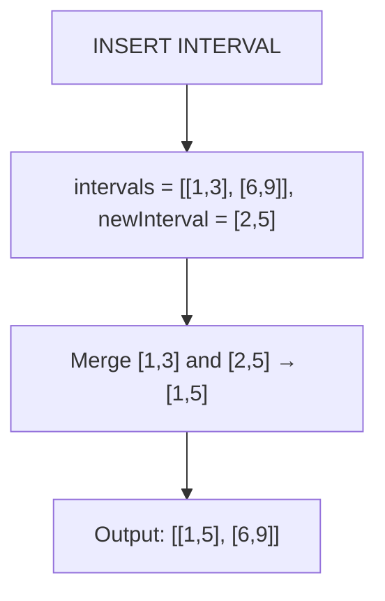

**Solution:**

```java
public int[][] insert(int[][] intervals, int[] newInterval) {
    List<int[]> result = new ArrayList<>();
    int i = 0;

    // Add all intervals ending before newInterval starts
    while (i < intervals.length && intervals[i][1] < newInterval[0]) {
        result.add(intervals[i++]);
    }

    // Merge overlapping intervals
    while (i < intervals.length && intervals[i][0] <= newInterval[1]) {
        newInterval[0] = Math.min(newInterval[0], intervals[i][0]);
        newInterval[1] = Math.max(newInterval[1], intervals[i][1]);
        i++;
    }
    result.add(newInterval);

    // Add remaining intervals
    while (i < intervals.length) {
        result.add(intervals[i++]);
    }

    return result.toArray(new int[result.size()][]);
}
```

---


## 12.2 Array Greedy

**Pattern:** Scan the array maintaining a greedy invariant (farthest jump, surplus gas, candy needed).
**Jump Game strategy:** Track `farthest = max(farthest, i + nums[i])`. If you can reach end → true.
**Gas Station:** Total gas ≥ total cost → solution exists. Start from the point where deficit resets.

### Problem 194: Jump Game

**LeetCode 55** 🔗 https://leetcode.com/problems/jump-game/

```
┌────────────────────────────────────────────────────────────────┐
│  JUMP GAME - Can reach last index?                             │
├────────────────────────────────────────────────────────────────┤
│  nums = [2, 3, 1, 1, 4]                                        │
│                                                                │
│  Index:  0   1   2   3   4                                     │
│  Value:  2   3   1   1   4                                     │
│          └───┴───┘               From 0, can jump to 1 or 2    │
│              └───┴───┴───┘       From 1, can reach 4!          │
│                                                                │
│  Output: true                                                  │
│                                                                │
│  Greedy: Track max reachable index                             │
└────────────────────────────────────────────────────────────────┘
```

**Flow:**
1. JUMP GAME - Can reach last index?
2. nums = [2, 3, 1, 1, 4]
3. Index: 0 1 2 3 4
4. Value: 2 3 1 1 4
5. From 0, can jump to 1 or 2
6. From 1, can reach 4!
7. Output: true

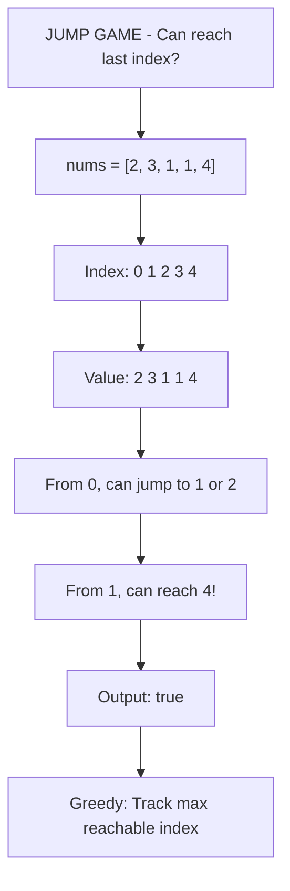

**Solution:**

```java
public boolean canJump(int[] nums) {
    int maxReach = 0;

    for (int i = 0; i < nums.length; i++) {
        if (i > maxReach) return false;  // Can't reach this index
        maxReach = Math.max(maxReach, i + nums[i]);
        if (maxReach >= nums.length - 1) return true;
    }

    return true;
}
```

---

### Problem 195: Jump Game II

**LeetCode 45** 🔗 https://leetcode.com/problems/jump-game-ii/

```
┌────────────────────────────────────────────────────────────────┐
│  JUMP GAME II - Minimum jumps to reach end                     │
├────────────────────────────────────────────────────────────────┤
│  nums = [2, 3, 1, 1, 4]                                        │
│                                                                │
│  Jump 1: 0 → 1 (jump to index 1)                               │
│  Jump 2: 1 → 4 (jump to index 4)                               │
│                                                                │
│  Output: 2 jumps                                               │
│                                                                │
│  Greedy: BFS-like level traversal                              │
└────────────────────────────────────────────────────────────────┘
```

**Flow:**
1. JUMP GAME II - Minimum jumps to reach end
2. nums = [2, 3, 1, 1, 4]
3. Jump 1: 0
4. 1 (jump to index 1)
5. Jump 1: 0
6. 1 (jump to index 1)
7. Jump 2: 1
8. 4 (jump to index 4)
9. Jump 2: 1
10. 4 (jump to index 4)
11. Output: 2 jumps
12. Greedy: BFS-like level traversal

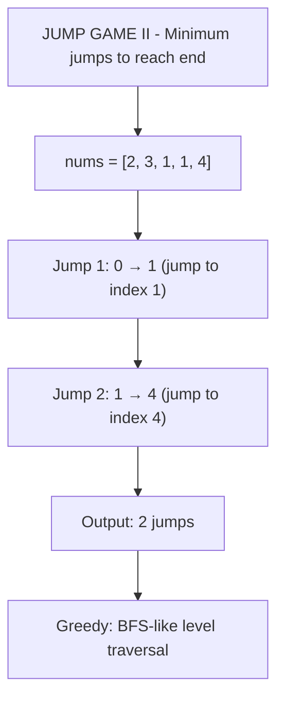

**Solution:**

```java
public int jump(int[] nums) {
    int jumps = 0;
    int currentEnd = 0;    // End of current jump range
    int farthest = 0;      // Farthest we can reach

    for (int i = 0; i < nums.length - 1; i++) {
        farthest = Math.max(farthest, i + nums[i]);

        if (i == currentEnd) {
            jumps++;
            currentEnd = farthest;
        }
    }

    return jumps;
}
```

---

### Problem 196: Gas Station

**LeetCode 134** 🔗 https://leetcode.com/problems/gas-station/

```
┌────────────────────────────────────────────────────────────────┐
│  GAS STATION - Find starting station for circular trip         │
├────────────────────────────────────────────────────────────────┤
│  gas  = [1, 2, 3, 4, 5]                                        │
│  cost = [3, 4, 5, 1, 2]                                        │
│                                                                │
│  Station: 0   1   2   3   4                                    │
│  net:    -2  -2  -2  +3  +3                                    │
│                                                                │
│  Start at station 3:                                           │
│  3→4: tank = 4-1 = 3                                           │
│  4→0: tank = 3+5-2 = 6                                         │
│  0→1: tank = 6+1-3 = 4                                         │
│  1→2: tank = 4+2-4 = 2                                         │
│  2→3: tank = 2+3-5 = 0 ✓                                       │
│                                                                │
│  Output: 3                                                     │
└────────────────────────────────────────────────────────────────┘
```

**Flow:**
1. GAS STATION - Find starting station for circular trip
2. gas = [1, 2, 3, 4, 5]
3. cost = [3, 4, 5, 1, 2]
4. Station: 0 1 2 3 4
5. net: -2 -2 -2 +3 +3
6. Start at station 3:
7. 3
8. 4: tank = 4-1 = 3

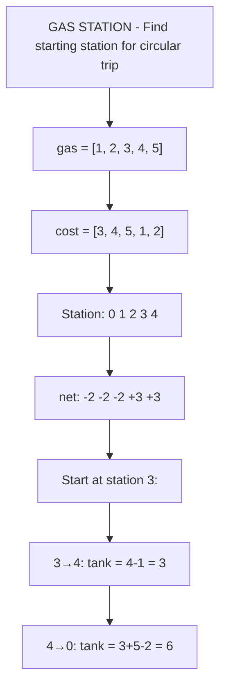

**Solution:**

```java
public int canCompleteCircuit(int[] gas, int[] cost) {
    int totalTank = 0;
    int currentTank = 0;
    int startStation = 0;

    for (int i = 0; i < gas.length; i++) {
        int net = gas[i] - cost[i];
        totalTank += net;
        currentTank += net;

        if (currentTank < 0) {
            // Can't reach station i+1 from startStation
            startStation = i + 1;
            currentTank = 0;
        }
    }

    return totalTank >= 0 ? startStation : -1;
}
```

---

### Problem 197: Candy

**LeetCode 135** 🔗 https://leetcode.com/problems/candy/

```
┌────────────────────────────────────────────────────────────────┐
│  CANDY - Min candies for ratings                               │
├────────────────────────────────────────────────────────────────┤
│  ratings = [1, 0, 2]                                           │
│                                                                │
│  Rules:                                                        │
│  - Each child gets at least 1 candy                            │
│  - Higher rating than neighbor → more candies than neighbor    │
│                                                                │
│  Candies: [2, 1, 2]                                            │
│  Child 0: rating 1 > rating 0, gets 2                          │
│  Child 1: lowest rating, gets 1                                │
│  Child 2: rating 2 > rating 0, gets 2                          │
│                                                                │
│  Output: 5 total candies                                       │
└────────────────────────────────────────────────────────────────┘
```

**Flow:**
1. CANDY - Min candies for ratings
2. ratings = [1, 0, 2]
3. Rules:
4. - Each child gets at least 1 candy
5. - Higher rating than neighbor
6. more candies than neigh
7. - Higher rating than neighbor
8. more candies than neigh
9. Candies: [2, 1, 2]
10. Child 0: rating 1 > rating 0, gets 2

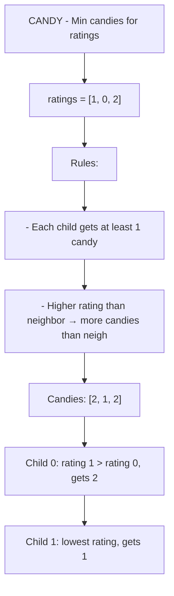

**Solution:**

```java
public int candy(int[] ratings) {
    int n = ratings.length;
    int[] candies = new int[n];
    Arrays.fill(candies, 1);

    // Left to right: handle increasing ratings
    for (int i = 1; i < n; i++) {
        if (ratings[i] > ratings[i-1]) {
            candies[i] = candies[i-1] + 1;
        }
    }

    // Right to left: handle decreasing ratings
    for (int i = n - 2; i >= 0; i--) {
        if (ratings[i] > ratings[i+1]) {
            candies[i] = Math.max(candies[i], candies[i+1] + 1);
        }
    }

    int total = 0;
    for (int c : candies) total += c;
    return total;
}
```

---


🔬 **Section Challenge — 12.2 Array Greedy**

**Challenge 1 (Reasoning):** Interval scheduling: select maximum number of non-overlapping intervals. Why does sorting by END time work, not by START time or duration?
<details><summary>Answer</summary>

Sorting by end time: greedily picking the interval that ends earliest leaves maximum time for future intervals. Formal proof (exchange argument): suppose optimal solution picks interval A instead of interval B (B ends earlier). We can swap A for B without losing any other interval (B ends ≤ A ends, so anything compatible with A is also compatible with B). Sorting by start time fails: a very long interval starting early would block many shorter intervals. Sorting by duration fails: a short interval might overlap two others.
</details>


## 12.3 String Greedy

**Pattern:** Process characters with greedy rules based on frequency or position.
**Partition Labels:** Track last occurrence of each char. Extend partition end to max last occurrence.
**Task Scheduler:** Most frequent task determines idle slots. Fill idle slots with other tasks.

### Problem 198: Partition Labels

**LeetCode 763** 🔗 https://leetcode.com/problems/partition-labels/

```
┌────────────────────────────────────────────────────────────────┐
│  PARTITION LABELS - Max partitions with unique chars           │
├────────────────────────────────────────────────────────────────┤
│  s = "ababcbacadefegdehijhklij"                                │
│                                                                │
│  Partition such that each letter appears in at most one part:  │
│  "ababcbaca" | "defegde" | "hijhklij"                          │
│       9           7           8                                │
│                                                                │
│  Output: [9, 7, 8]                                             │
│                                                                │
│  Greedy: Track last occurrence of each char                    │
└────────────────────────────────────────────────────────────────┘
```

**Flow:**
1. PARTITION LABELS - Max partitions with unique chars
2. s = 'ababcbacadefegdehijhklij'
3. 'ababcbaca'
4. 'defegde'
5. 'hijhklij'
6. 'ababcbaca'
7. 'defegde'
8. 'hijhklij'
9. Output: [9, 7, 8]
10. Greedy: Track last occurrence of each char

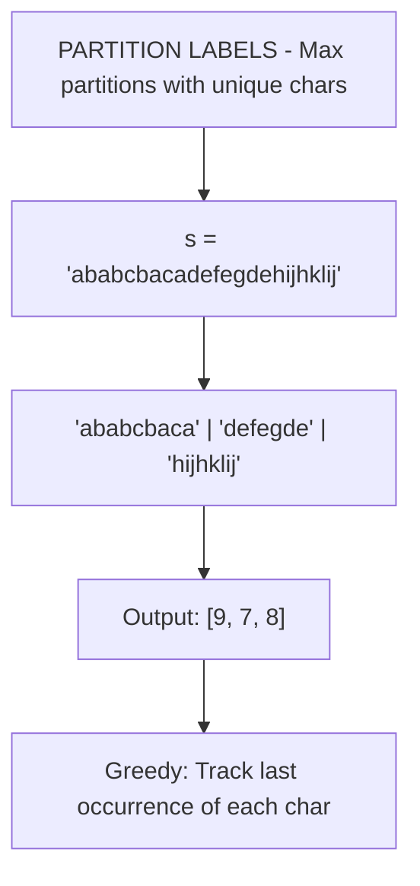

**Solution:**

```java
public List<Integer> partitionLabels(String s) {
    // Find last occurrence of each character
    int[] lastIndex = new int[26];
    for (int i = 0; i < s.length(); i++) {
        lastIndex[s.charAt(i) - 'a'] = i;
    }

    List<Integer> result = new ArrayList<>();
    int start = 0, end = 0;

    for (int i = 0; i < s.length(); i++) {
        end = Math.max(end, lastIndex[s.charAt(i) - 'a']);

        if (i == end) {
            result.add(end - start + 1);
            start = i + 1;
        }
    }

    return result;
}
```

---

### Problem 199: Task Scheduler

**LeetCode 621** 🔗 https://leetcode.com/problems/task-scheduler/

```
┌────────────────────────────────────────────────────────────────┐
│  TASK SCHEDULER - Min time with cooldown                       │
├────────────────────────────────────────────────────────────────┤
│  tasks = ["A","A","A","B","B","B"], n = 2                      │
│                                                                │
│  Must wait n intervals before same task again                  │
│                                                                │
│  A → _ → _ → A → _ → _ → A                                     │
│  A → B → _ → A → B → _ → A → B                                 │
│  A → B → idle → A → B → idle → A → B                           │
│                                                                │
│  Output: 8 intervals                                           │
│                                                                │
│  Formula: (maxFreq - 1) * (n + 1) + countMaxFreq               │
└────────────────────────────────────────────────────────────────┘
```

**Flow:**
1. TASK SCHEDULER - Min time with cooldown
2. tasks = ['A','A','A','B','B','B'], n = 2
3. Must wait n intervals before same task again
4. A
5. B
6. idle
7. A
8. B
9. idle
10. A
11. B
12. A
13. B
14. idle
15. A
16. B
17. idle
18. A
19. B
20. Output: 8 intervals
21. Formula: (maxFreq - 1) * (n + 1) + countMaxFreq

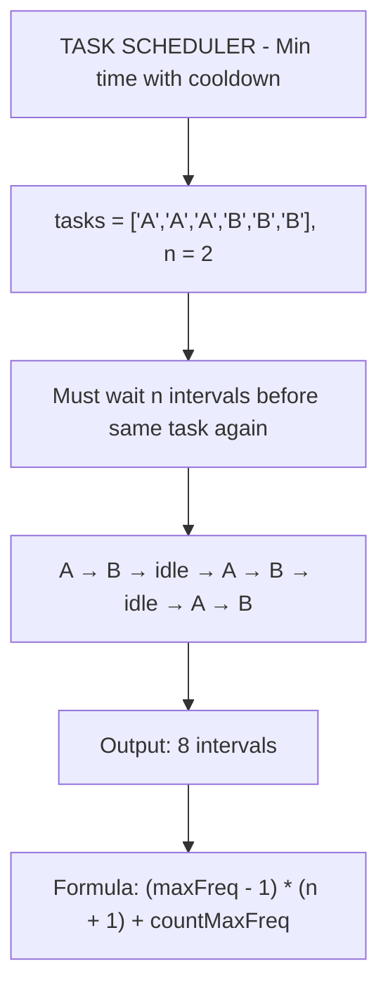

**Solution:**

```java
public int leastInterval(char[] tasks, int n) {
    int[] freq = new int[26];
    for (char task : tasks) {
        freq[task - 'A']++;
    }

    int maxFreq = 0;
    int countMax = 0;

    for (int f : freq) {
        if (f > maxFreq) {
            maxFreq = f;
            countMax = 1;
        } else if (f == maxFreq) {
            countMax++;
        }
    }

    // Formula: (maxFreq - 1) * (n + 1) + countMaxFreq
    int slots = (maxFreq - 1) * (n + 1) + countMax;

    return Math.max(slots, tasks.length);
}
```

---


🔬 **Section Challenge — 12.3 String Greedy**

**Challenge 1 (Reasoning):** Interval scheduling: select maximum number of non-overlapping intervals. Why does sorting by END time work, not by START time or duration?
<details><summary>Answer</summary>

Sorting by end time: greedily picking the interval that ends earliest leaves maximum time for future intervals. Formal proof (exchange argument): suppose optimal solution picks interval A instead of interval B (B ends earlier). We can swap A for B without losing any other interval (B ends ≤ A ends, so anything compatible with A is also compatible with B). Sorting by start time fails: a very long interval starting early would block many shorter intervals. Sorting by duration fails: a short interval might overlap two others.
</details>


## 12.4 Math Greedy

### Problem 200: Maximum Subarray (Kadane's - also DP)

**LeetCode 53** 🔗 https://leetcode.com/problems/maximum-subarray/

```
┌────────────────────────────────────────────────────────────────┐
│  MAXIMUM SUBARRAY - Kadane's as Greedy                         │
├────────────────────────────────────────────────────────────────┤
│  nums = [-2, 1, -3, 4, -1, 2, 1, -5, 4]                        │
│                                                                │
│  Greedy choice: At each position, decide to:                   │
│  - Extend previous subarray, OR                                │
│  - Start fresh from current element                            │
│                                                                │
│  If previous sum is negative, start fresh!                     │
│                                                                │
│  Max subarray: [4, -1, 2, 1] = 6                               │
└────────────────────────────────────────────────────────────────┘
```

**Flow:**
1. MAXIMUM SUBARRAY - Kadane's as Greedy
2. nums = [-2, 1, -3, 4, -1, 2, 1, -5, 4]
3. Greedy choice: At each position, decide to:
4. - Extend previous subarray, OR
5. - Start fresh from current element
6. If previous sum is negative, start fresh!
7. Max subarray: [4, -1, 2, 1] = 6

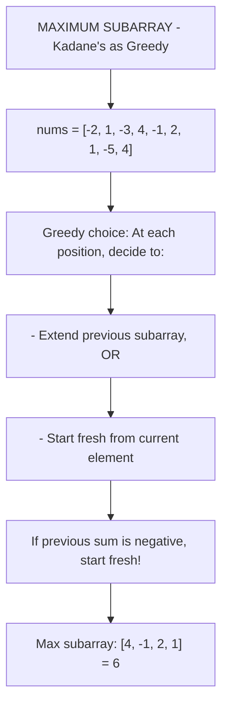

**Solution:**

```java
public int maxSubArray(int[] nums) {
    int maxSum = nums[0];
    int currentSum = nums[0];

    for (int i = 1; i < nums.length; i++) {
        // Greedy: extend or start fresh
        currentSum = Math.max(nums[i], currentSum + nums[i]);
        maxSum = Math.max(maxSum, currentSum);
    }

    return maxSum;
}
```

---

### Problem 201: Best Time to Buy and Sell Stock II

**LeetCode 122** 🔗 https://leetcode.com/problems/best-time-to-buy-and-sell-stock-ii/

```
┌────────────────────────────────────────────────────────────────┐
│  STOCK II - Multiple transactions allowed                      │
├────────────────────────────────────────────────────────────────┤
│  prices = [7, 1, 5, 3, 6, 4]                                   │
│                                                                │
│      7                                                         │
│       \    5       6                                           │
│        \  /\      /\                                           │
│         1   \   /    4                                         │
│              3                                                 │
│                                                                │
│  Buy at 1, sell at 5: profit = 4                               │
│  Buy at 3, sell at 6: profit = 3                               │
│  Total: 7                                                      │
│                                                                │
│  Greedy: Collect ALL positive differences                      │
└────────────────────────────────────────────────────────────────┘
```

**Flow:**
1. STOCK II - Multiple transactions allowed
2. prices = [7, 1, 5, 3, 6, 4]
3. Buy at 1, sell at 5: profit = 4
4. Buy at 3, sell at 6: profit = 3
5. Total: 7
6. Greedy: Collect ALL positive differences

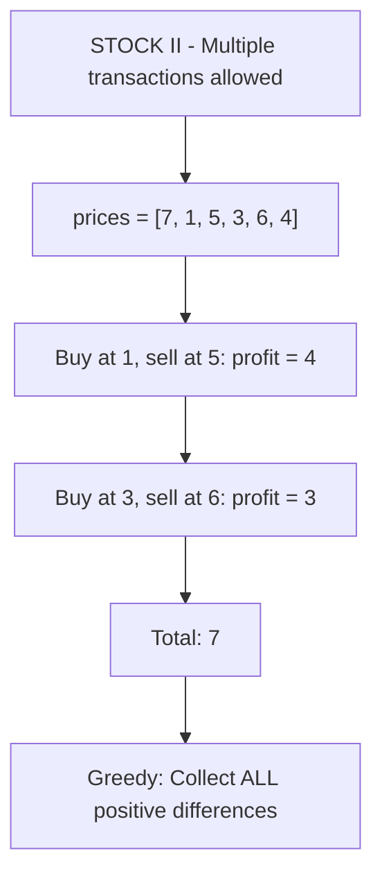

**Solution:**

```java
public int maxProfit(int[] prices) {
    int profit = 0;

    for (int i = 1; i < prices.length; i++) {
        // Greedy: take every positive difference
        if (prices[i] > prices[i-1]) {
            profit += prices[i] - prices[i-1];
        }
    }

    return profit;
}
```

---

---


🔬 **Section Challenge — 12.4 Math Greedy**

**Challenge 1 (Reasoning):** Interval scheduling: select maximum number of non-overlapping intervals. Why does sorting by END time work, not by START time or duration?
<details><summary>Answer</summary>

Sorting by end time: greedily picking the interval that ends earliest leaves maximum time for future intervals. Formal proof (exchange argument): suppose optimal solution picks interval A instead of interval B (B ends earlier). We can swap A for B without losing any other interval (B ends ≤ A ends, so anything compatible with A is also compatible with B). Sorting by start time fails: a very long interval starting early would block many shorter intervals. Sorting by duration fails: a short interval might overlap two others.
</details>


## 🏆 Competitive Programming — Codeforces Problems

| Problem | Link | Technique | Difficulty |
|---|---|---|---|
| Taxi | [CF 158B](https://codeforces.com/problemset/problem/158/B) | Greedy pairing | ⭐ Easy |
| Vasya and String | [CF 676C](https://codeforces.com/problemset/problem/676/C) | Greedy + sliding window | ⭐⭐ Medium |
| Petya and Strings | [CF 96A](https://codeforces.com/problemset/problem/96/A) | Lexicographic greedy | ⭐ Easy |
| Potions | [CF 1526C](https://codeforces.com/problemset/problem/1526/C) | Greedy + min-heap | ⭐⭐ Medium |
| Minimize the Permutation | [CF 1968B](https://codeforces.com/problemset/problem/1968/B) | Greedy on array | ⭐⭐ Medium |
| Petya and Exam | [CF 832B](https://codeforces.com/problemset/problem/832/B) | Greedy time scheduling | ⭐⭐ Medium |

---


## 🌍 Real-World Applications of Greedy Algorithms

| Technique | Real-World System | How It's Used |
|---|---|---|
| **Interval scheduling (earliest deadline)** | Calendar apps / meeting schedulers | Pack maximum non-overlapping meetings in a day |
| **Huffman coding** | ZIP, gzip, JPEG compression | Always merge the two least-frequent characters first |
| **Prim's/Kruskal's (MST)** | Network infrastructure planning | Minimum cable to connect all offices |
| **Dijkstra's (greedy relaxation)** | GPS navigation | At each step, pick the closest unvisited node |
| **Job scheduling (OS)** | CPU / task schedulers | Shortest-job-first scheduling minimizes average wait time |
| **Coin change (denominations designed for greedy)** | Currency systems worldwide | US/EU coins designed so greedy works (unlike arbitrary denominations) |

```
🔥 HUFFMAN IN EVERY FILE YOU DOWNLOAD:
   Characters: 'e'→15%, 't'→10%, 'a'→8%, others less frequent
   
   Huffman greedy: always merge 2 rarest nodes into one
   Result: 'e' → "0" (1 bit), 't' → "10" (2 bits), rare chars → longer codes
   
   On average: ~2.5 bits/char instead of 8 bits = 68% compression
   "This is in EVERY .zip file, every HTTP gzip response, every JPEG"
```

---


---


🔬 **Section Challenge — 🌍 Real-World Applications of Greedy Algorithms**

**Challenge 1 (Reasoning):** Interval scheduling: select maximum number of non-overlapping intervals. Why does sorting by END time work, not by START time or duration?
<details><summary>Answer</summary>

Sorting by end time: greedily picking the interval that ends earliest leaves maximum time for future intervals. Formal proof (exchange argument): suppose optimal solution picks interval A instead of interval B (B ends earlier). We can swap A for B without losing any other interval (B ends ≤ A ends, so anything compatible with A is also compatible with B). Sorting by start time fails: a very long interval starting early would block many shorter intervals. Sorting by duration fails: a short interval might overlap two others.
</details>


## 🏋️ Practice & Interview Questions — Algorithms

### Sorting
**Q1.** Which sorting algorithm does Java use for `Arrays.sort(int[])`? Why not MergeSort?
<details><summary>Answer</summary>

**Dual-Pivot QuickSort** — for primitives. MergeSort requires O(N) extra space. QuickSort is in-place and cache-friendly. Stability doesn't matter for primitives (equal ints are indistinguishable). For objects (`Arrays.sort(Object[])`), Java uses **TimSort** (stable, O(N log N) worst).
</details>

**Q2.** Trace Merge Sort on `[4,2,7,1]`.
<details><summary>Answer</summary>

Split: `[4,2]` `[7,1]` → Split: `[4]` `[2]` `[7]` `[1]` → Merge: `[2,4]` `[1,7]` → Merge: `[1,2,4,7]`
</details>

**Q3.** ⭐⭐ Sort Colors (Dutch National Flag — 3-way partition).
<details><summary>Solution</summary>

```java
int lo=0, mid=0, hi=n-1;
while(mid<=hi){
    if(nums[mid]==0) swap(nums,lo++,mid++);
    else if(nums[mid]==1) mid++;
    else swap(nums,mid,hi--);
}
```
</details>

### Binary Search
**Q4.** ⭐ Search in Rotated Sorted Array.
<details><summary>Solution</summary>

```java
int lo=0, hi=n-1;
while(lo<=hi){
    int mid=(lo+hi)/2;
    if(nums[mid]==target) return mid;
    if(nums[lo]<=nums[mid]){ // left half sorted
        if(nums[lo]<=target&&target<nums[mid]) hi=mid-1; else lo=mid+1;
    } else { // right half sorted
        if(nums[mid]<target&&target<=nums[hi]) lo=mid+1; else hi=mid-1;
    }
}
return -1;
```
</details>

**Q5.** ⭐ Find First and Last Position (binary search twice).
<details><summary>Solution</summary>

```java
// First: find leftmost with while(lo<hi){ if arr[mid]>=target hi=mid else lo=mid+1 }
// Last: find rightmost with while(lo<hi){ if arr[mid]<=target lo=mid+1 else hi=mid } return lo-1
```
</details>

**Q6.** ⭐⭐ Koko Eating Bananas — binary search on answer.
<details><summary>Key insight</summary>

Binary search the eating speed k in range [1, max(piles)]. For each k, calculate hours needed. Find minimum k where hours ≤ H.
</details>

### Dynamic Programming
**Q7.** ⭐ Climbing Stairs — n steps, 1 or 2 at a time. How many ways?
<details><summary>Solution</summary>

```java
// Fibonacci sequence! dp[i] = dp[i-1] + dp[i-2]
int a=1, b=1;
for(int i=2;i<=n;i++){ int c=a+b; a=b; b=c; }
return b;
```
</details>

**Q8.** ⭐ Coin Change — minimum coins for amount.
<details><summary>Solution</summary>

```java
int[] dp = new int[amount+1]; Arrays.fill(dp, amount+1);
dp[0]=0;
for(int i=1;i<=amount;i++)
    for(int c:coins) if(c<=i) dp[i]=Math.min(dp[i],dp[i-c]+1);
return dp[amount]>amount?-1:dp[amount];
```
</details>

**Q9.** ⭐⭐ Longest Common Subsequence.
<details><summary>Solution</summary>

```java
int[][] dp=new int[m+1][n+1];
for(int i=1;i<=m;i++) for(int j=1;j<=n;j++){
    if(text1.charAt(i-1)==text2.charAt(j-1)) dp[i][j]=dp[i-1][j-1]+1;
    else dp[i][j]=Math.max(dp[i-1][j],dp[i][j-1]);
}
return dp[m][n];
```
</details>

**Q10.** ⭐⭐ Word Break — can string be segmented using dictionary words?
<details><summary>Solution</summary>

```java
boolean[] dp=new boolean[n+1]; dp[0]=true;
for(int i=1;i<=n;i++) for(String w:wordDict)
    if(i>=w.length()&&dp[i-w.length()]&&s.substring(i-w.length(),i).equals(w)) dp[i]=true;
return dp[n];
```
</details>

**Q11.** ⭐⭐⭐ Edit Distance (Levenshtein).
<details><summary>Solution</summary>

```java
int[][] dp=new int[m+1][n+1];
for(int i=0;i<=m;i++) dp[i][0]=i;
for(int j=0;j<=n;j++) dp[0][j]=j;
for(int i=1;i<=m;i++) for(int j=1;j<=n;j++){
    if(word1.charAt(i-1)==word2.charAt(j-1)) dp[i][j]=dp[i-1][j-1];
    else dp[i][j]=1+Math.min(dp[i-1][j-1],Math.min(dp[i-1][j],dp[i][j-1]));
}
```
</details>

### Graph Algorithms
**Q12.** ⭐ Number of Islands (BFS/DFS grid traversal).
<details><summary>Solution</summary>

```java
for each cell (i,j) if grid[i][j]=='1': count++; BFS/DFS to mark all connected land as visited
```
</details>

**Q13.** ⭐⭐ Course Schedule — detect cycle in directed graph (Topological sort).
<details><summary>Solution</summary>

```java
// Kahn's algorithm: indegree array + BFS queue
// If result size == numCourses → no cycle → can finish
```
</details>

**Q14.** ⭐⭐ Dijkstra's Shortest Path.
<details><summary>Solution</summary>

```java
PriorityQueue<int[]> pq=new PriorityQueue<>((a,b)->a[1]-b[1]); // [node, dist]
pq.offer(new int[]{src,0}); dist[src]=0;
while(!pq.isEmpty()){
    int[] curr=pq.poll(); int u=curr[0],d=curr[1];
    if(d>dist[u]) continue; // stale
    for(int[] neighbor:graph[u]) if(dist[u]+neighbor[1]<dist[neighbor[0]]){
        dist[neighbor[0]]=dist[u]+neighbor[1]; pq.offer(new int[]{neighbor[0],dist[neighbor[0]]});
    }
}
```
</details>

### MCQ Rapid Fire
| # | Question | Answer |
|---|---|---|
| 1 | QuickSort avg/worst | O(N log N) avg, O(N²) worst |
| 2 | MergeSort space complexity | O(N) |
| 3 | HeapSort space complexity | O(1) (in-place) |
| 4 | Binary search precondition | Sorted array |
| 5 | BFS time complexity on graph | O(V+E) |
| 6 | DFS space complexity | O(V) (recursion stack) |
| 7 | Dijkstra fails on | Negative weight edges |
| 8 | Bellman-Ford handles | Negative weights, detects negative cycles |
| 9 | Floyd-Warshall use case | All-pairs shortest path, O(V³) |
| 10 | Topological sort requires | Directed Acyclic Graph (DAG) |


---

## 🧠 Deep Conceptual Questions — Algorithm Design & Analysis

**C1. What does O(N log N) "feel like" and why is it the complexity barrier for comparison-based sorting?**
<details><summary>Deep Answer</summary>

O(N log N) for N=1M ≈ 20M operations. O(N²) ≈ 1 trillion. The difference is 50,000x. **Comparison sort lower bound**: any comparison-based sort must distinguish between N! possible orderings. Each comparison has 2 outcomes. A decision tree with N! leaves needs ≥ log₂(N!) height ≈ N log N (Stirling's approximation). Therefore NO comparison sort can beat O(N log N) in the worst case. Non-comparison sorts (counting sort, radix sort, bucket sort) break this bound by using non-comparison operations — but require constraints on input (e.g., integer range bounded by N).
</details>

**C2. Greedy algorithms: when do they work and what must be proven?**
<details><summary>Deep Answer</summary>

A greedy algorithm makes the locally optimal choice at each step. Works when problem has: (1) **Greedy choice property**: local optimal leads to global optimal — the choice never needs to be revised. (2) **Optimal substructure**: optimal solution to the problem contains optimal solutions to subproblems. To PROVE greedy is correct: use "exchange argument" — assume optimal solution differs from greedy, show you can swap greedy's choice in without making it worse, contradiction. Greedy FAILS when: future choices depend on current choice in complex ways (use DP instead). Classic works: interval scheduling, Huffman coding, Dijkstra. Classic fails: 0-1 knapsack (use DP).
</details>

**C3. Dynamic Programming: what is "overlapping subproblems" and why does it matter?**
<details><summary>Deep Answer</summary>

Overlapping subproblems: the same sub-computation appears multiple times. Fibonacci: `fib(5)` calls `fib(4)` and `fib(3)`. `fib(4)` also calls `fib(3)`. Without memoization: `fib(3)` computed exponentially many times → O(2^N). With memoization: each sub-result computed once and stored → O(N). DP is valuable SPECIFICALLY when: (1) problem has optimal substructure AND (2) subproblems overlap. If no overlap: just use divide-and-conquer (merge sort's subproblems don't overlap → no DP needed). DP = "smart recursion" = avoid recomputing.
</details>

**C4. Top-down (memoization) vs Bottom-up (tabulation) DP — when to choose each?**
<details><summary>Deep Answer</summary>

**Top-down (memoization)**: Write natural recursion + cache results. Easy to implement, only computes needed subproblems (sparse computation). Cons: recursion overhead and stack depth risk. Use when: problem is naturally recursive, only a fraction of subproblems needed. **Bottom-up (tabulation)**: Fill DP table iteratively from base cases. No recursion overhead, better cache performance, easier space optimization. Use when: need all subproblems (or most of them), want to optimize space (can often reduce to 1D from 2D). Rule: start with top-down for correctness verification, optimize to bottom-up for performance.
</details>

**C5. Dijkstra's Algorithm: why does it fail on negative weights?**
<details><summary>Deep Answer</summary>

Dijkstra assumes: once a node is "settled" (extracted from the priority queue with its final shortest distance), that distance is optimal. With negative weights: settling node A at distance 5 might not be final — a path through B (distance 7) → C (edge -10) → A gives distance -3. But A was already settled! Dijkstra doesn't revisit settled nodes. Bellman-Ford handles negatives by relaxing ALL edges N-1 times — no "settled" assumption. For graphs with negative cycles: Bellman-Ford detects them (if distances still decrease after N-1 rounds, there's a negative cycle).
</details>

**C6. Union-Find: why is path compression + union by rank/size nearly O(1)?**
<details><summary>Deep Answer</summary>

**Path compression**: when finding the root of element x, make every node on the path point directly to the root. Flattens the tree. Future finds on those paths: O(1). **Union by rank**: always attach the smaller tree under the larger → limits tree height to O(log N). Combined: inverse Ackermann function α(N) amortized — so slow-growing it's practically constant (α(10^80) = 4). Neither alone is optimal: path compression without union by rank → O(log N) amortized. Union by rank without path compression → O(log N). Together → α(N) ≈ O(1) amortized. Used in: Kruskal's MST, cycle detection, connected components.
</details>

**C7. Binary Search on the Answer — what types of problems does it apply to?**
<details><summary>Deep Answer</summary>

When the answer space is **monotone**: "if X is achievable, then all values less extreme than X are also achievable." Problems: minimize the maximum (aggressive cows, split array), find minimum valid threshold (Koko bananas, minimum days to bloom), divide-and-conquer feasibility. Template: binary search on the answer range [lo, hi], for each mid check `isFeasible(mid)` in O(N) or O(N log N). Total: O(N log(answer_range)). Key insight: reframe "find optimal value" as "find smallest X where condition holds" → enables binary search on a non-array space.
</details>

**C8. Why does merge sort guarantee stability while quicksort doesn't?**
<details><summary>Deep Answer</summary>

**Merge sort stability**: during merge, when two elements are equal, we always take from the LEFT array first → preserves original relative order. **QuickSort instability**: the partition step swaps elements across the pivot without regard to original order. Two equal elements may be placed on opposite sides of the pivot, reversing their order. QuickSort CAN be made stable (Lomuto partition with careful implementation) but loses performance. Java uses TimSort for objects (stable), dual-pivot quicksort for primitives (stability irrelevant since primitives without fields).
</details>

**C9. Backtracking: what's the difference from plain DFS and when to use vs DP?**
<details><summary>Deep Answer</summary>

**Backtracking vs DFS**: DFS visits every path. Backtracking prunes paths early when a constraint is violated — avoids exploring infeasible branches. Same asymptotic but drastically different practical performance with good pruning. **Backtracking vs DP**: backtracking for **combinatorial/enumeration** problems (find all solutions, permutations, subsets). DP for **optimization** problems (find optimal single solution). Backtracking produces exponential solutions in worst case but is necessary when you need ALL solutions. DP finds the optimal in polynomial time when overlapping subproblems exist.
</details>

**C10. What is amortized analysis and how does it differ from average-case analysis?**
<details><summary>Deep Answer</summary>

**Amortized**: analyzes the average cost per operation over a SEQUENCE of operations — in the worst case. No probability involved. Guarantees: N operations ALWAYS take O(N·T) total, even if some individual operations are O(N·T). Example: ArrayList append is O(N) when resizing, but amortized O(1) because resizing is rare. **Average-case**: analyzes expected cost of a SINGLE operation assuming random input. QuickSort is O(N log N) average-case (random pivot). Amortized is a stronger guarantee — it holds even for adversarial input sequences.
</details>


> **Navigation**: [< Previous](12_Backtracking.md) | [Back to Index](../00_MASTER_INDEX.md) | [Next >](14_Mixed_Competitive.md)