> **Navigation**: [< Previous](13_Greedy.md) | [Back to Index](../00_MASTER_INDEX.md) | [Next >](15_LinkedList.md)

> **Problems 14/14** | [Prev](13_Greedy.md) | [Index](../00_MASTER_INDEX.md) | 

---

# 📚 SECTION 13: HACKEREARTH & CODEFORCES MIXED PROBLEMS

```
┌─────────────────────────────────────────────────────────────────┐
│              COMPETITIVE PROGRAMMING PATTERNS                   │
├─────────────────────────────────────────────────────────────────┤
│  WHY PRACTICE THESE PLATFORMS?                                  │
│  - Different problem styles than LeetCode                       │
│  - Focus on mathematical thinking                               │
│  - Time complexity matters more                                 │
│  - Better at handling edge cases                                │
│                                                                 │
│  COMMON TOPICS:                                                 │
│  • Number Theory (primes, GCD, modular arithmetic)              │
│  • Combinatorics                                                │
│  • Bit Manipulation                                             │
│  • Sorting & Searching variations                               │
│  • Implementation problems                                      │
│  • Ad-hoc problems (pattern recognition)                        │
└─────────────────────────────────────────────────────────────────┘
```

> **Flow**: COMPETITIVE PROGRAMMING PATTERNS → WHY PRACTICE THESE PLATFORMS? | WHY PRACTICE THESE PLATFORMS? → - Different problem styles than LeetCode | - Different problem styles than LeetCode → - Focus on mathematical thinking | - Focus on mathematical thinking → - Time complexity matters more | - Time complexity matters more → - Better at handling edge cases | - Better at handling edge cases → COMMON TOPICS: | ...+1 more

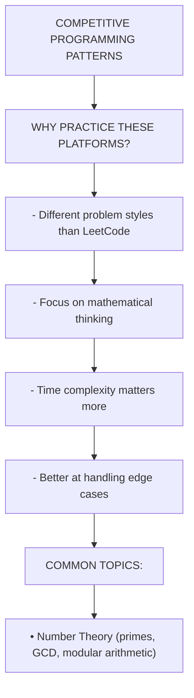

---

## 13.1 Number Theory Problems

### Problem 202: Sieve of Eratosthenes (HackerEarth Classic)

```
┌────────────────────────────────────────────────────────────────┐
│  SIEVE OF ERATOSTHENES - Find all primes up to N               │
├────────────────────────────────────────────────────────────────┤
│  n = 30                                                        │
│                                                                │
│  Initial: 2  3  4  5  6  7  8  9 10 11 12 ... 30               │
│                                                                │
│  Mark multiples of 2: ✗4 ✗6 ✗8 ✗10 ✗12...                      │
│  Mark multiples of 3: ✗9 ✗15 ✗21 ✗27...                        │
│  Mark multiples of 5: ✗25...                                   │
│                                                                │
│  Primes: 2, 3, 5, 7, 11, 13, 17, 19, 23, 29                    │
│                                                                │
│  Time: O(n log log n), Space: O(n)                             │
└────────────────────────────────────────────────────────────────┘
```

> **Flow**: SIEVE OF ERATOSTHENES - Find all primes up to N → Initial: 2 3 4 5 6 7 8 9 10 11 12 ... 30 | Initial: 2 3 4 5 6 7 8 9 10 11 12 ... 30 → Mark multiples of 2: ✗4 ✗6 ✗8 ✗10 ✗12... | Mark multiples of 2: ✗4 ✗6 ✗8 ✗10 ✗12... → Mark multiples of 3: ✗9 ✗15 ✗21 ✗27... | Mark multiples of 3: ✗9 ✗15 ✗21 ✗27... → Mark multiples of 5: ✗25... | Mark multiples of 5: ✗25... → Primes: 2, 3, 5, 7, 11, 13, 17, 19, 23, 29 | Primes: 2, 3, 5, 7, 11, 13, 17, 19, 23, 29 → Time: O(n log log n), Space: O(n)

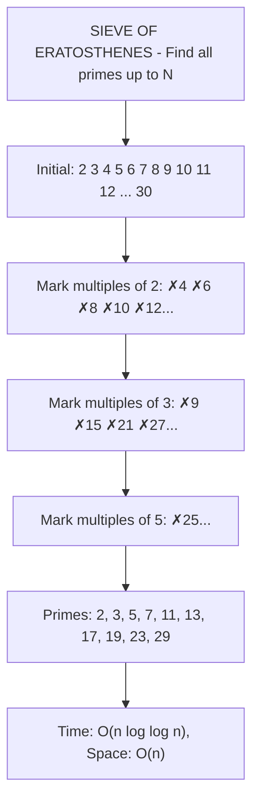

**Solution:**

```java
public List<Integer> sieveOfEratosthenes(int n) {
    boolean[] isPrime = new boolean[n + 1];
    Arrays.fill(isPrime, true);
    isPrime[0] = isPrime[1] = false;

    for (int i = 2; i * i <= n; i++) {
        if (isPrime[i]) {
            for (int j = i * i; j <= n; j += i) {
                isPrime[j] = false;
            }
        }
    }

    List<Integer> primes = new ArrayList<>();
    for (int i = 2; i <= n; i++) {
        if (isPrime[i]) primes.add(i);
    }
    return primes;
}
```

---

### Problem 203: Prime Factorization (Codeforces Style)

```
┌────────────────────────────────────────────────────────────────┐
│  PRIME FACTORIZATION - Find all prime factors                  │
├────────────────────────────────────────────────────────────────┤
│  n = 84                                                        │
│                                                                │
│  84 ÷ 2 = 42                                                   │
│  42 ÷ 2 = 21                                                   │
│  21 ÷ 3 = 7                                                    │
│  7 ÷ 7 = 1                                                     │
│                                                                │
│  84 = 2² × 3 × 7                                               │
│                                                                │
│  Output: {2: 2, 3: 1, 7: 1}                                    │
└────────────────────────────────────────────────────────────────┘
```

> **Flow**: PRIME FACTORIZATION - Find all prime factors → Output: {2: 2, 3: 1, 7: 1}

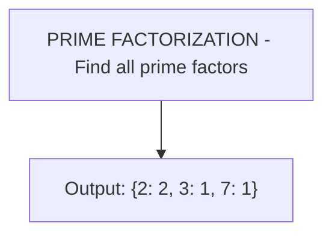

**Solution:**

```java
public Map<Integer, Integer> primeFactors(int n) {
    Map<Integer, Integer> factors = new HashMap<>();

    // Check for 2s
    while (n % 2 == 0) {
        factors.merge(2, 1, Integer::sum);
        n /= 2;
    }

    // Check odd factors
    for (int i = 3; i * i <= n; i += 2) {
        while (n % i == 0) {
            factors.merge(i, 1, Integer::sum);
            n /= i;
        }
    }

    // If n is still > 1, it's a prime factor
    if (n > 1) {
        factors.put(n, 1);
    }

    return factors;
}
```

---

### Problem 204: Modular Exponentiation (HackerEarth)

```
┌────────────────────────────────────────────────────────────────┐
│  MODULAR EXPONENTIATION - Calculate (base^exp) % mod           │
├────────────────────────────────────────────────────────────────┤
│  base = 2, exp = 10, mod = 1000                                │
│                                                                │
│  Naive: 2^10 = 1024 → 1024 % 1000 = 24                         │
│                                                                │
│  Fast (Binary Exponentiation):                                 │
│  2^10 = 2^8 × 2^2 = 256 × 4 = 1024                             │
│                                                                │
│  10 in binary = 1010                                           │
│  2^1 = 2 (bit 1: skip)                                         │
│  2^2 = 4 (bit 2: use) → result = 4                             │
│  2^4 = 16 (bit 3: skip)                                        │
│  2^8 = 256 (bit 4: use) → result = 4 × 256 = 1024              │
│                                                                │
│  Time: O(log exp)                                              │
└────────────────────────────────────────────────────────────────┘
```

> **Flow**: MODULAR EXPONENTIATION - Calculate (base^exp) % mod → Naive: 2^10 = 1024 → 1024 % 1000 = 24 | Naive: 2^10 = 1024 → 1024 % 1000 = 24 → Fast (Binary Exponentiation): | Fast (Binary Exponentiation): → 10 in binary = 1010 | 10 in binary = 1010 → 2^1 = 2 (bit 1: skip) | 2^1 = 2 (bit 1: skip) → 2^2 = 4 (bit 2: use) → result = 4 | 2^2 = 4 (bit 2: use) → result = 4 → 2^4 = 16 (bit 3: skip) | ...+1 more

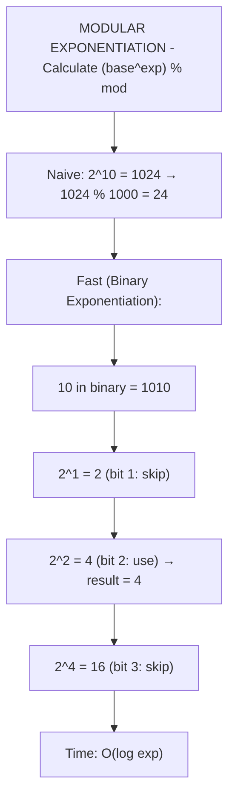

**Solution:**

```java
public long modPow(long base, long exp, long mod) {
    long result = 1;
    base = base % mod;

    while (exp > 0) {
        // If exp is odd, multiply base with result
        if ((exp & 1) == 1) {
            result = (result * base) % mod;
        }

        // exp must be even now
        exp = exp >> 1;  // exp = exp / 2
        base = (base * base) % mod;
    }

    return result;
}
```

---

### Problem 205: GCD and LCM (Codeforces)

```
┌────────────────────────────────────────────────────────────────┐
│  GCD (Greatest Common Divisor) using Euclidean Algorithm       │
├────────────────────────────────────────────────────────────────┤
│  a = 48, b = 18                                                │
│                                                                │
│  48 = 18 × 2 + 12                                              │
│  18 = 12 × 1 + 6                                               │
│  12 = 6 × 2 + 0                                                │
│                                                                │
│  GCD(48, 18) = 6                                               │
│                                                                │
│  LCM(a, b) = (a × b) / GCD(a, b)                               │
│  LCM(48, 18) = 864 / 6 = 144                                   │
└────────────────────────────────────────────────────────────────┘
```

> **Flow**: GCD (Greatest Common Divisor) using Euclidean Algorithm → GCD(48, 18) = 6 | GCD(48, 18) = 6 → LCM(a, b) = (a × b) / GCD(a, b) | LCM(a, b) = (a × b) / GCD(a, b) → LCM(48, 18) = 864 / 6 = 144

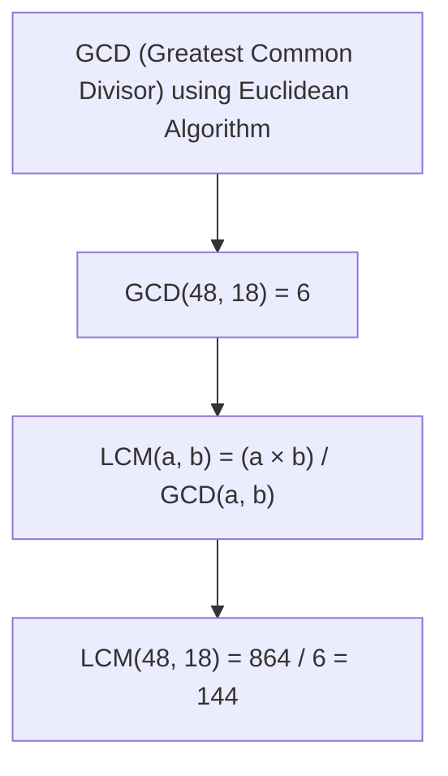

**Solution:**

```java
public int gcd(int a, int b) {
    while (b != 0) {
        int temp = b;
        b = a % b;
        a = temp;
    }
    return a;
}

public long lcm(int a, int b) {
    return (long) a * b / gcd(a, b);
}

// GCD of array
public int gcdOfArray(int[] arr) {
    int result = arr[0];
    for (int i = 1; i < arr.length; i++) {
        result = gcd(result, arr[i]);
    }
    return result;
}
```

---

## 13.2 Bit Manipulation

### Problem 206: Count Set Bits (HackerEarth)

```
┌────────────────────────────────────────────────────────────────┐
│  COUNT SET BITS - Number of 1s in binary representation        │
├────────────────────────────────────────────────────────────────┤
│  n = 13                                                        │
│  Binary: 1101                                                  │
│  Set bits: 3                                                   │
│                                                                │
│  Brian Kernighan's Algorithm:                                  │
│  n & (n-1) removes rightmost set bit                           │
│                                                                │
│  13 = 1101                                                     │
│  12 = 1100                                                     │
│  13 & 12 = 1100 (12) → count = 1                               │
│  12 & 11 = 1000 (8)  → count = 2                               │
│  8 & 7 = 0           → count = 3                               │
└────────────────────────────────────────────────────────────────┘
```

> **Flow**: COUNT SET BITS - Number of 1s in binary representation → Binary: 1101 | Binary: 1101 → Set bits: 3 | Set bits: 3 → Brian Kernighan's Algorithm: | Brian Kernighan's Algorithm: → n & (n-1) removes rightmost set bit | n & (n-1) removes rightmost set bit → 13 & 12 = 1100 (12) → count = 1 | 13 & 12 = 1100 (12) → count = 1 → 12 & 11 = 1000 (8) → count = 2 | ...+1 more

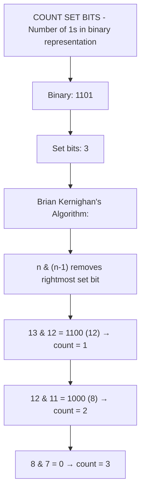

**Solution:**

```java
public int countSetBits(int n) {
    int count = 0;
    while (n != 0) {
        n = n & (n - 1);  // Remove rightmost set bit
        count++;
    }
    return count;
}

// Count set bits from 1 to n
public int countSetBitsRange(int n) {
    int count = 0;
    for (int i = 1; i <= n; i++) {
        count += countSetBits(i);
    }
    return count;
}
```

---

### Problem 207: Power of Two (Codeforces)

```
┌────────────────────────────────────────────────────────────────┐
│  POWER OF TWO - Check if n is power of 2                       │
├────────────────────────────────────────────────────────────────┤
│  Powers of 2 have exactly ONE set bit:                         │
│  1  = 0001                                                     │
│  2  = 0010                                                     │
│  4  = 0100                                                     │
│  8  = 1000                                                     │
│  16 = 10000                                                    │
│                                                                │
│  Trick: n & (n-1) == 0 for powers of 2                         │
│                                                                │
│  8 = 1000, 7 = 0111                                            │
│  8 & 7 = 0000 → True                                           │
│                                                                │
│  6 = 0110, 5 = 0101                                            │
│  6 & 5 = 0100 → False                                          │
└────────────────────────────────────────────────────────────────┘
```

> **Flow**: POWER OF TWO - Check if n is power of 2 → Powers of 2 have exactly ONE set bit: | Powers of 2 have exactly ONE set bit: → Trick: n & (n-1) == 0 for powers of 2 | Trick: n & (n-1) == 0 for powers of 2 → 8 & 7 = 0000 → True | 8 & 7 = 0000 → True → 6 & 5 = 0100 → False

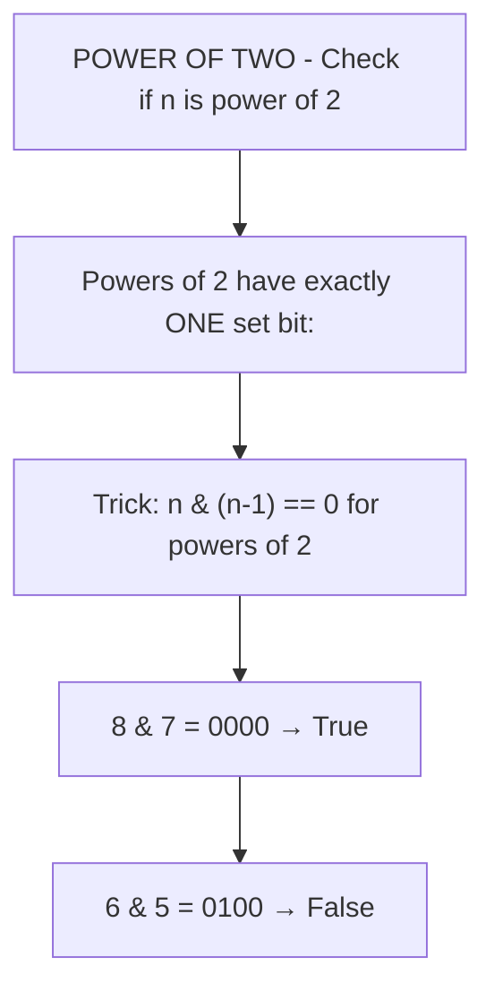

**Solution:**

```java
public boolean isPowerOfTwo(int n) {
    return n > 0 && (n & (n - 1)) == 0;
}

// Find highest power of 2 <= n
public int highestPowerOf2(int n) {
    n |= n >> 1;
    n |= n >> 2;
    n |= n >> 4;
    n |= n >> 8;
    n |= n >> 16;
    return (n + 1) >> 1;
}
```

---

### Problem 208: XOR Queries (HackerEarth)

```
┌────────────────────────────────────────────────────────────────┐
│  XOR QUERIES - XOR of range [L, R]                             │
├────────────────────────────────────────────────────────────────┤
│  arr = [1, 3, 4, 8], queries = [[0,1], [1,2], [0,3]]           │
│                                                                │
│  XOR properties:                                               │
│  - a ⊕ a = 0                                                   │
│  - a ⊕ 0 = a                                                   │
│  - Associative and commutative                                 │
│                                                                │
│  Prefix XOR: [1, 1⊕3, 1⊕3⊕4, 1⊕3⊕4⊕8]                          │
│            = [1, 2, 6, 14]                                     │
│                                                                │
│  XOR[L,R] = prefix[R] ⊕ prefix[L-1]                            │
│  XOR[1,2] = prefix[2] ⊕ prefix[0] = 6 ⊕ 1 = 7                  │
│  Check: 3 ⊕ 4 = 7 ✓                                            │
└────────────────────────────────────────────────────────────────┘
```

> **Flow**: XOR QUERIES - XOR of range [L, R] → arr = [1, 3, 4, 8], queries = [[0,1], [1,2], [0,3]] | arr = [1, 3, 4, 8], queries = [[0,1], [1,2], [0,3]] → XOR properties: | XOR properties: → - Associative and commutative | - Associative and commutative → Prefix XOR: [1, 1⊕3, 1⊕3⊕4, 1⊕3⊕4⊕8] | Prefix XOR: [1, 1⊕3, 1⊕3⊕4, 1⊕3⊕4⊕8] → XOR[L,R] = prefix[R] ⊕ prefix[L-1] | XOR[L,R] = prefix[R] ⊕ prefix[L-1] → Check: 3 ⊕ 4 = 7 ✓

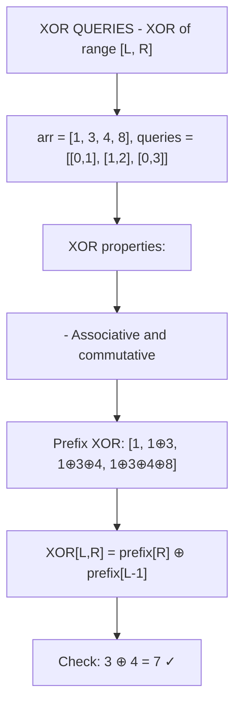

**Solution:**

```java
public int[] xorQueries(int[] arr, int[][] queries) {
    int n = arr.length;
    int[] prefix = new int[n + 1];

    // Build prefix XOR
    for (int i = 0; i < n; i++) {
        prefix[i + 1] = prefix[i] ^ arr[i];
    }

    int[] result = new int[queries.length];
    for (int i = 0; i < queries.length; i++) {
        int left = queries[i][0];
        int right = queries[i][1];
        result[i] = prefix[right + 1] ^ prefix[left];
    }

    return result;
}
```

---

## 13.3 Implementation Problems

### Problem 209: Spiral Matrix (Codeforces Style)

```
┌────────────────────────────────────────────────────────────────┐
│  SPIRAL MATRIX - Print matrix in spiral order                  │
├────────────────────────────────────────────────────────────────┤
│  matrix = [[1,2,3],                                            │
│            [4,5,6],                                            │
│            [7,8,9]]                                            │
│                                                                │
│  ┌───┬───┬───┐                                                 │
│  │ 1 → 2 → 3 │                                                 │
│  ├───┼───┼─↓─┤                                                 │
│  │ 4 → 5 │ 6 │                                                 │
│  ├─↑─┼───┼─↓─┤                                                 │
│  │ 7 ← 8 ← 9 │                                                 │
│  └───┴───┴───┘                                                 │
│                                                                │
│  Output: [1,2,3,6,9,8,7,4,5]                                   │
└────────────────────────────────────────────────────────────────┘
```

> **Flow**: SPIRAL MATRIX - Print matrix in spiral order → matrix = [[1,2,3], | matrix = [[1,2,3], → Output: [1,2,3,6,9,8,7,4,5]

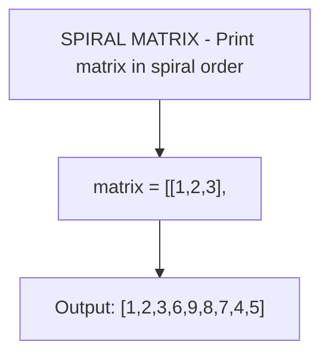

**Solution:**

```java
public List<Integer> spiralOrder(int[][] matrix) {
    List<Integer> result = new ArrayList<>();
    if (matrix.length == 0) return result;

    int top = 0, bottom = matrix.length - 1;
    int left = 0, right = matrix[0].length - 1;

    while (top <= bottom && left <= right) {
        // Right
        for (int i = left; i <= right; i++) {
            result.add(matrix[top][i]);
        }
        top++;

        // Down
        for (int i = top; i <= bottom; i++) {
            result.add(matrix[i][right]);
        }
        right--;

        // Left
        if (top <= bottom) {
            for (int i = right; i >= left; i--) {
                result.add(matrix[bottom][i]);
            }
            bottom--;
        }

        // Up
        if (left <= right) {
            for (int i = bottom; i >= top; i--) {
                result.add(matrix[i][left]);
            }
            left++;
        }
    }

    return result;
}
```

---

### Problem 210: Rotate Array (HackerEarth)

```
┌────────────────────────────────────────────────────────────────┐
│  ROTATE ARRAY - Rotate by k positions                          │
├────────────────────────────────────────────────────────────────┤
│  nums = [1,2,3,4,5,6,7], k = 3                                 │
│                                                                │
│  Method: Reverse three times                                   │
│                                                                │
│  Original:      [1,2,3,4,5,6,7]                                │
│  Reverse all:   [7,6,5,4,3,2,1]                                │
│  Reverse 0..k-1:[5,6,7,4,3,2,1]                                │
│  Reverse k..n-1:[5,6,7,1,2,3,4]                                │
│                                                                │
│  Output: [5,6,7,1,2,3,4]                                       │
└────────────────────────────────────────────────────────────────┘
```

> **Flow**: ROTATE ARRAY - Rotate by k positions → nums = [1,2,3,4,5,6,7], k = 3 | nums = [1,2,3,4,5,6,7], k = 3 → Method: Reverse three times | Method: Reverse three times → Original: [1,2,3,4,5,6,7] | Original: [1,2,3,4,5,6,7] → Reverse all: [7,6,5,4,3,2,1] | Reverse all: [7,6,5,4,3,2,1] → Reverse 0..k-1:[5,6,7,4,3,2,1] | Reverse 0..k-1:[5,6,7,4,3,2,1] → Reverse k..n-1:[5,6,7,1,2,3,4] | ...+1 more

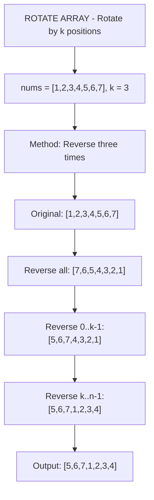

**Solution:**

```java
public void rotate(int[] nums, int k) {
    k = k % nums.length;  // Handle k > length

    reverse(nums, 0, nums.length - 1);
    reverse(nums, 0, k - 1);
    reverse(nums, k, nums.length - 1);
}

private void reverse(int[] nums, int start, int end) {
    while (start < end) {
        int temp = nums[start];
        nums[start] = nums[end];
        nums[end] = temp;
        start++;
        end--;
    }
}
```

---

### Problem 211: Next Permutation (Codeforces)

```
┌────────────────────────────────────────────────────────────────┐
│  NEXT PERMUTATION - Next lexicographically greater             │
├────────────────────────────────────────────────────────────────┤
│  nums = [1,2,3] → [1,3,2]                                      │
│  nums = [3,2,1] → [1,2,3] (wrap around)                        │
│  nums = [1,1,5] → [1,5,1]                                      │
│                                                                │
│  Algorithm:                                                    │
│  1. Find largest i where nums[i] < nums[i+1]                   │
│  2. Find largest j where nums[j] > nums[i]                     │
│  3. Swap nums[i] and nums[j]                                   │
│  4. Reverse from i+1 to end                                    │
│                                                                │
│  Example: [1,3,5,4,2]                                          │
│  Step 1: i = 1 (3 < 5)                                         │
│  Step 2: j = 3 (4 > 3)                                         │
│  Step 3: [1,4,5,3,2]                                           │
│  Step 4: [1,4,2,3,5]                                           │
└────────────────────────────────────────────────────────────────┘
```

> **Flow**: NEXT PERMUTATION - Next lexicographically greater → nums = [1,2,3] → [1,3,2] | nums = [1,2,3] → [1,3,2] → nums = [3,2,1] → [1,2,3] (wrap around) | nums = [3,2,1] → [1,2,3] (wrap around) → nums = [1,1,5] → [1,5,1] | nums = [1,1,5] → [1,5,1] → Algorithm: | Algorithm: → 1. Find largest i where nums[i] &lt; nums[i+1] | 1. Find largest i where nums[i] &lt; nums[i+1] → 2. Find largest j where nums[j] &gt; nums[i] | ...+1 more

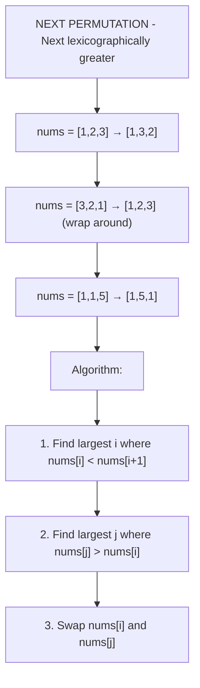

**Solution:**

```java
public void nextPermutation(int[] nums) {
    int n = nums.length;
    int i = n - 2;

    // Find first decreasing element from right
    while (i >= 0 && nums[i] >= nums[i + 1]) {
        i--;
    }

    if (i >= 0) {
        // Find element just larger than nums[i]
        int j = n - 1;
        while (nums[j] <= nums[i]) {
            j--;
        }
        swap(nums, i, j);
    }

    // Reverse from i+1 to end
    reverse(nums, i + 1, n - 1);
}

private void swap(int[] nums, int i, int j) {
    int temp = nums[i];
    nums[i] = nums[j];
    nums[j] = temp;
}

private void reverse(int[] nums, int start, int end) {
    while (start < end) {
        swap(nums, start++, end--);
    }
}
```

---

## 13.4 Sorting & Searching Variations

### Problem 212: Count Inversions (HackerEarth Classic)

```
┌────────────────────────────────────────────────────────────────┐
│  COUNT INVERSIONS - Pairs where i < j but arr[i] > arr[j]      │
├────────────────────────────────────────────────────────────────┤
│  arr = [2, 4, 1, 3, 5]                                         │
│                                                                │
│  Inversions:                                                   │
│  (2, 1): 2 > 1                                                 │
│  (4, 1): 4 > 1                                                 │
│  (4, 3): 4 > 3                                                 │
│                                                                │
│  Total: 3 inversions                                           │
│                                                                │
│  Approach: Modified Merge Sort                                 │
│  During merge, count inversions when right element chosen      │
└────────────────────────────────────────────────────────────────┘
```

> **Flow**: COUNT INVERSIONS - Pairs where i &lt; j but arr[i] &gt; → arr = [2, 4, 1, 3, 5] | arr = [2, 4, 1, 3, 5] → Inversions: | Inversions: → Total: 3 inversions | Total: 3 inversions → Approach: Modified Merge Sort | Approach: Modified Merge Sort → During merge, count inversions when right element chose

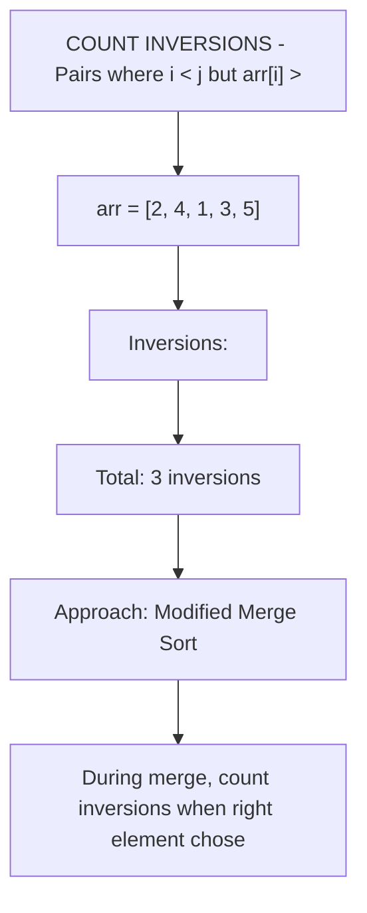

**Solution:**

```java
private int inversions = 0;

public int countInversions(int[] arr) {
    inversions = 0;
    mergeSort(arr, 0, arr.length - 1);
    return inversions;
}

private void mergeSort(int[] arr, int left, int right) {
    if (left < right) {
        int mid = left + (right - left) / 2;
        mergeSort(arr, left, mid);
        mergeSort(arr, mid + 1, right);
        merge(arr, left, mid, right);
    }
}

private void merge(int[] arr, int left, int mid, int right) {
    int[] temp = new int[right - left + 1];
    int i = left, j = mid + 1, k = 0;

    while (i <= mid && j <= right) {
        if (arr[i] <= arr[j]) {
            temp[k++] = arr[i++];
        } else {
            temp[k++] = arr[j++];
            inversions += (mid - i + 1);  // Count inversions
        }
    }

    while (i <= mid) temp[k++] = arr[i++];
    while (j <= right) temp[k++] = arr[j++];

    System.arraycopy(temp, 0, arr, left, temp.length);
}
```

---

### Problem 213: Aggressive Cows (Codeforces/SPOJ Classic)

```
┌────────────────────────────────────────────────────────────────┐
│  AGGRESSIVE COWS - Max minimum distance between cows           │
├────────────────────────────────────────────────────────────────┤
│  stalls = [1, 2, 4, 8, 9], cows = 3                            │
│                                                                │
│  Place 3 cows to maximize minimum distance                     │
│                                                                │
│  Try placing at 1, 4, 9: min distance = 3                      │
│  Try placing at 1, 4, 8: min distance = 3                      │
│  Try placing at 1, 8, 9: min distance = 1                      │
│                                                                │
│  Binary search on answer:                                      │
│  - Can we place cows with min distance = mid?                  │
│                                                                │
│  Output: 3                                                     │
└────────────────────────────────────────────────────────────────┘
```

> **Flow**: AGGRESSIVE COWS - Max minimum distance between cows → stalls = [1, 2, 4, 8, 9], cows = 3 | stalls = [1, 2, 4, 8, 9], cows = 3 → Place 3 cows to maximize minimum distance | Place 3 cows to maximize minimum distance → Try placing at 1, 4, 9: min distance = 3 | Try placing at 1, 4, 9: min distance = 3 → Try placing at 1, 4, 8: min distance = 3 | Try placing at 1, 4, 8: min distance = 3 → Try placing at 1, 8, 9: min distance = 1 | Try placing at 1, 8, 9: min distance = 1 → Binary search on answer: | ...+1 more

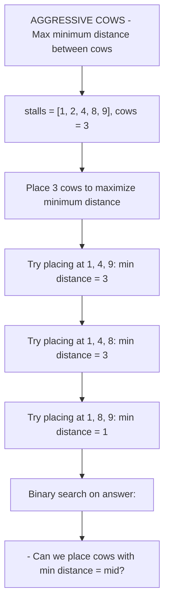

**Solution:**

```java
public int aggressiveCows(int[] stalls, int cows) {
    Arrays.sort(stalls);

    int left = 1;
    int right = stalls[stalls.length - 1] - stalls[0];
    int result = 0;

    while (left <= right) {
        int mid = left + (right - left) / 2;

        if (canPlace(stalls, cows, mid)) {
            result = mid;
            left = mid + 1;  // Try for larger distance
        } else {
            right = mid - 1;
        }
    }

    return result;
}

private boolean canPlace(int[] stalls, int cows, int minDist) {
    int count = 1;
    int lastPos = stalls[0];

    for (int i = 1; i < stalls.length; i++) {
        if (stalls[i] - lastPos >= minDist) {
            count++;
            lastPos = stalls[i];

            if (count == cows) return true;
        }
    }

    return false;
}
```

---

## 13.5 Ad-hoc & Pattern Recognition

### Problem 214: Longest Consecutive Sequence (HackerEarth)

```
┌────────────────────────────────────────────────────────────────┐
│  LONGEST CONSECUTIVE SEQUENCE                                  │
├────────────────────────────────────────────────────────────────┤
│  nums = [100, 4, 200, 1, 3, 2]                                 │
│                                                                │
│  Sequences: [1,2,3,4], [100], [200]                            │
│                                                                │
│  Longest: [1,2,3,4] → length 4                                 │
│                                                                │
│  Approach: Use HashSet                                         │
│  Only start counting from sequence beginning (n-1 not in set)  │
└────────────────────────────────────────────────────────────────┘
```

> **Flow**: LONGEST CONSECUTIVE SEQUENCE → nums = [100, 4, 200, 1, 3, 2] | nums = [100, 4, 200, 1, 3, 2] → Sequences: [1,2,3,4], [100], [200] | Sequences: [1,2,3,4], [100], [200] → Longest: [1,2,3,4] → length 4 | Longest: [1,2,3,4] → length 4 → Approach: Use HashSet

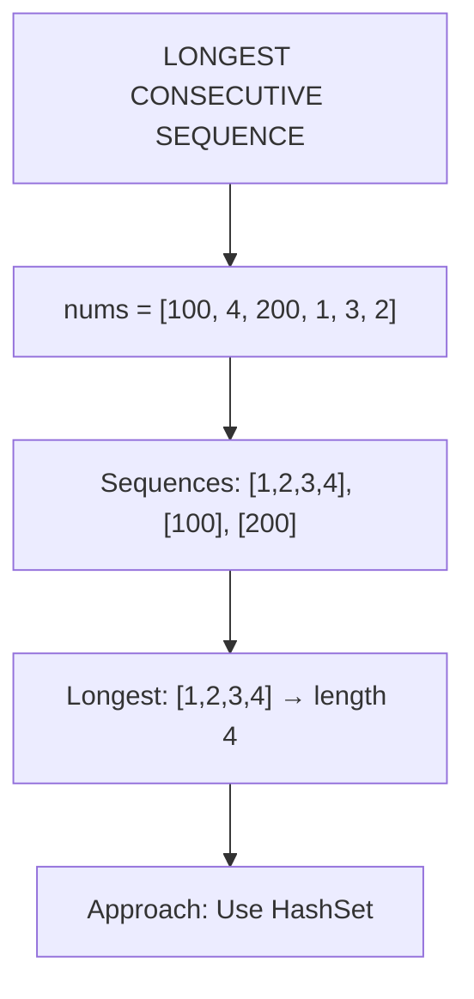

**Solution:**

```java
public int longestConsecutive(int[] nums) {
    Set<Integer> set = new HashSet<>();
    for (int num : nums) set.add(num);

    int longest = 0;

    for (int num : set) {
        // Only start from beginning of sequence
        if (!set.contains(num - 1)) {
            int current = num;
            int length = 1;

            while (set.contains(current + 1)) {
                current++;
                length++;
            }

            longest = Math.max(longest, length);
        }
    }

    return longest;
}
```

---

### Problem 215: Subarray Sum Equals K (Codeforces Style)

```
┌────────────────────────────────────────────────────────────────┐
│  SUBARRAY SUM EQUALS K - Count subarrays with sum k            │
├────────────────────────────────────────────────────────────────┤
│  nums = [1, 1, 1], k = 2                                       │
│                                                                │
│  Subarrays with sum 2:                                         │
│  [1,1] at index 0-1                                            │
│  [1,1] at index 1-2                                            │
│                                                                │
│  Output: 2                                                     │
│                                                                │
│  Prefix sum trick:                                             │
│  If prefix[j] - prefix[i] = k, subarray [i+1, j] has sum k     │
│  Count prefix[j] - k occurrences using HashMap                 │
└────────────────────────────────────────────────────────────────┘
```

> **Flow**: SUBARRAY SUM EQUALS K - Count subarrays with sum k → nums = [1, 1, 1], k = 2 | nums = [1, 1, 1], k = 2 → Subarrays with sum 2: | Subarrays with sum 2: → [1,1] at index 0-1 | [1,1] at index 0-1 → [1,1] at index 1-2 | [1,1] at index 1-2 → Output: 2 | Output: 2 → Prefix sum trick: | ...+1 more

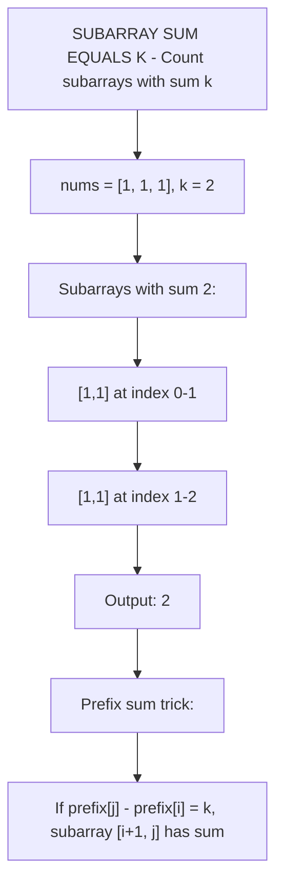

**Solution:**

```java
public int subarraySum(int[] nums, int k) {
    Map<Integer, Integer> prefixCount = new HashMap<>();
    prefixCount.put(0, 1);  // Empty prefix

    int sum = 0;
    int count = 0;

    for (int num : nums) {
        sum += num;

        // If (sum - k) exists, we found subarrays
        count += prefixCount.getOrDefault(sum - k, 0);

        prefixCount.merge(sum, 1, Integer::sum);
    }

    return count;
}
```

---

# 🎉 CONGRATULATIONS! ALL SECTIONS COMPLETE!

```
┌─────────────────────────────────────────────────────────────────┐
│              📊 PRACTICE PROBLEMS SUMMARY                        │
├─────────────────────────────────────────────────────────────────┤
│                                                                 │
│  SECTION 1-3: Basic Math, Strings, Arrays     (~30 problems)    │
│  SECTION 4: Sliding Window Patterns           (12 problems)     │
│  SECTION 5: Two Pointers Advanced             (17 problems)     │
│  SECTION 6: Binary Search Patterns            (13 problems)     │
│  SECTION 7: Stack & Queue Problems            (26 problems)     │
│  SECTION 8: Tree Problems (BFS/DFS)           (32 problems)     │
│  SECTION 9: Graph Algorithms                  (23 problems)     │
│  SECTION 10: Dynamic Programming              (17 problems)     │
│  SECTION 11: Backtracking Problems            (13 problems)     │
│  SECTION 12: Greedy Algorithms                (13 problems)     │
│  SECTION 13: HackerEarth & Codeforces         (14 problems)     │
│                                                                 │
│  ═══════════════════════════════════════════════════════════    │
│  TOTAL: ~210+ PROBLEMS WITH SOLUTIONS & VISUALIZATIONS          │
│  ═══════════════════════════════════════════════════════════    │
│                                                                 │
│  🎯 All problems include:                                        │
│  • ASCII box visualizations                                     │
│  • Step-by-step explanations                                    │
│  • Optimized Java solutions                                     │
│  • Time/Space complexity                                        │
│  • LeetCode links (free) or full descriptions (premium)         │
│                                                                 │
│  💪 Keep practicing and good luck! 💪                             │
└─────────────────────────────────────────────────────────────────┘
```

> **Flow**: 📊 PRACTICE PROBLEMS SUMMARY → SECTION 1-3: Basic Math, Strings, Arrays (~30 problems) | SECTION 1-3: Basic Math, Strings, Arrays (~30 problems) → SECTION 4: Sliding Window Patterns (12 problems) | SECTION 4: Sliding Window Patterns (12 problems) → SECTION 5: Two Pointers Advanced (17 problems) | SECTION 5: Two Pointers Advanced (17 problems) → SECTION 6: Binary Search Patterns (13 problems) | SECTION 6: Binary Search Patterns (13 problems) → SECTION 7: Stack & Queue Problems (26 problems) | SECTION 7: Stack & Queue Problems (26 problems) → SECTION 8: Tree Problems (BFS/DFS) (32 problems) | ...+1 more

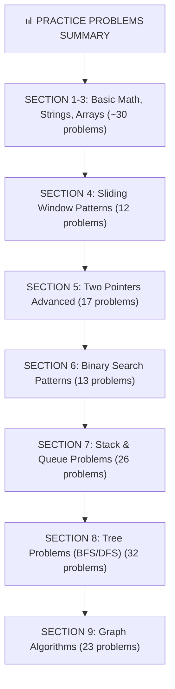

---

## 📋 PROBLEM TRACKING CHECKLIST

### Basic Math

- [ ] Check if Prime
- [ ] Count Primes (LeetCode 204)
- [ ] Nth Prime Number
- [ ] Previous/Next Prime
- [ ] Prime Factors
- [ ] 🔒 Closest Prime Numbers in Range

### Fibonacci

- [ ] Nth Fibonacci (LeetCode 509)
- [ ] Sum of First N Fibonacci
- [ ] Check if Fibonacci
- [ ] Tribonacci (LeetCode 1137)
- [ ] Climbing Stairs (LeetCode 70)

### Digit Manipulation

- [ ] Sum of Digits
- [ ] Add Digits (LeetCode 258)
- [ ] Reverse Integer (LeetCode 7)
- [ ] Palindrome Number (LeetCode 9)
- [ ] Happy Number (LeetCode 202)

### 📌 Gcd/lcm

- [ ] GCD (Euclidean Algorithm)
- [ ] 🔒 GCD of Array (LeetCode 1979)

### Strings - Isomorphic/Pattern

- [ ] Isomorphic Strings (LeetCode 205)
- [ ] Word Pattern (LeetCode 290)
- [ ] 🔒 Word Pattern II (LeetCode 291)
- [ ] 🔒 Group Isomorphic Strings

### Strings - Anagram

- [ ] Valid Anagram (LeetCode 242)
- [ ] Find All Anagrams (LeetCode 438)
- [ ] 🔒 Strobogrammatic Number (LeetCode 246)
- [ ] 🔒 Strobogrammatic Number II (LeetCode 247)

### Strings - Palindrome

- [ ] Valid Palindrome II (LeetCode 680)
- [ ] 🔒 Palindrome Permutation (LeetCode 266)

### Arrays

- [ ] Two Sum (LeetCode 1)
- [ ] 🔒 Two Sum III (LeetCode 170)
- [ ] Contains Duplicate (LeetCode 217)
- [ ] 🔒 Contains Duplicate III (LeetCode 220)
- [ ] Move Zeroes (LeetCode 283)
- [ ] 🔒 Meeting Rooms (LeetCode 252)
- [ ] 🔒 Meeting Rooms II (LeetCode 253)
- [ ] 🔒 Missing Ranges (LeetCode 163)

### Sliding Window - Fixed Size

- [ ] Maximum Sum Subarray of Size K
- [ ] Maximum Average Subarray I (LeetCode 643)
- [ ] Subarrays with Avg >= Threshold (LeetCode 1343)
- [ ] 🔒 Max Sum Distinct Subarrays (LeetCode 2461)

### Sliding Window - Variable Size

- [ ] Minimum Size Subarray Sum (LeetCode 209)
- [ ] 🔒 Longest Substring K Distinct (LeetCode 340)
- [ ] Fruit Into Baskets (LeetCode 904)
- [ ] Longest Repeating Char Replacement (LeetCode 424)
- [ ] Max Consecutive Ones III (LeetCode 1004)

### Sliding Window - String Matching

- [ ] Permutation in String (LeetCode 567)
- [ ] Minimum Window Substring (LeetCode 76)
- [ ] 🔒 Longest Substring 2 Distinct (LeetCode 159)

### Two Pointers - Opposite Direction

- [ ] Two Sum II Sorted (LeetCode 167)
- [ ] 3Sum (LeetCode 15)
- [ ] 3Sum Closest (LeetCode 16)
- [ ] 4Sum (LeetCode 18)
- [ ] 🔒 3Sum Smaller (LeetCode 259)
- [ ] Valid Triangle Number (LeetCode 611)

### Two Pointers - Same Direction

- [ ] Remove Duplicates (LeetCode 26)
- [ ] Remove Duplicates II (LeetCode 80)
- [ ] Remove Element (LeetCode 27)
- [ ] Sort Colors (LeetCode 75)
- [ ] Partition Array (LeetCode 2161)

### Two Pointers - Linked List

- [ ] Linked List Cycle (LeetCode 141)
- [ ] Linked List Cycle II (LeetCode 142)
- [ ] Middle of Linked List (LeetCode 876)
- [ ] Remove Nth From End (LeetCode 19)
- [ ] 🔒 Plus One Linked List (LeetCode 369)

### Binary Search - Basic

- [ ] Binary Search (LeetCode 704)
- [ ] Search Insert Position (LeetCode 35)
- [ ] First Bad Version (LeetCode 278)

### Binary Search - Find Boundaries

- [ ] Find First and Last Position (LeetCode 34)
- [ ] Find Smallest Letter Greater (LeetCode 744)

### Binary Search - Rotated Array

- [ ] Search in Rotated Array (LeetCode 33)
- [ ] Search in Rotated II (LeetCode 81)
- [ ] Find Minimum in Rotated (LeetCode 153)

### Binary Search - On Answer

- [ ] Sqrt(x) (LeetCode 69)
- [ ] Koko Eating Bananas (LeetCode 875)
- [ ] Capacity To Ship (LeetCode 1011)
- [ ] Split Array Largest Sum (LeetCode 410)
- [ ] K-th Smallest Pair Distance (LeetCode 719)

### Stack - Basic

- [ ] Valid Parentheses (LeetCode 20)
- [ ] Min Stack (LeetCode 155)
- [ ] 🔒 Max Stack (LeetCode 716)
- [ ] Decode String (LeetCode 394)
- [ ] Evaluate Reverse Polish Notation (LeetCode 150)
- [ ] 🔒 Basic Calculator III (LeetCode 772)

### Stack - Monotonic Stack

- [ ] Daily Temperatures (LeetCode 739)
- [ ] Next Greater Element I (LeetCode 496)
- [ ] Next Greater Element II (LeetCode 503)
- [ ] Largest Rectangle in Histogram (LeetCode 84)
- [ ] Maximal Rectangle (LeetCode 85)
- [ ] Trapping Rain Water (LeetCode 42)

### Queue Problems

- [ ] Implement Queue using Stacks (LeetCode 232)
- [ ] Implement Stack using Queues (LeetCode 225)
- [ ] Sliding Window Maximum (LeetCode 239)
- [ ] 🔒 Shortest Subarray Sum >= K (LeetCode 862)
- [ ] 🔒 Design Circular Queue (LeetCode 622)
- [ ] 🔒 Design Circular Deque (LeetCode 641)

### Stack - Advanced

- [ ] Remove K Digits (LeetCode 402)
- [ ] Remove Duplicate Letters (LeetCode 316)
- [ ] 132 Pattern (LeetCode 456)
- [ ] Online Stock Span (LeetCode 901)

### Stack/Queue - HackerEarth & Codeforces

- [ ] Balanced Brackets (HackerEarth)
- [ ] Maximum Element (HackerEarth)
- [ ] Nearest Smaller Element (Codeforces)
- [ ] Prefix to Postfix Conversion (HackerEarth)

### Tree Traversal

- [ ] Binary Tree Inorder Traversal (LeetCode 94)
- [ ] Binary Tree Preorder Traversal (LeetCode 144)
- [ ] Binary Tree Postorder Traversal (LeetCode 145)
- [ ] Binary Tree Level Order Traversal (LeetCode 102)
- [ ] Binary Tree Zigzag Level Order (LeetCode 103)
- [ ] 🔒 Vertical Order Traversal (LeetCode 314)

### Tree Properties

- [ ] Maximum Depth of Binary Tree (LeetCode 104)
- [ ] Minimum Depth of Binary Tree (LeetCode 111)
- [ ] Balanced Binary Tree (LeetCode 110)
- [ ] Same Tree (LeetCode 100)
- [ ] Symmetric Tree (LeetCode 101)
- [ ] Invert Binary Tree (LeetCode 226)

### Tree Path & Sum

- [ ] Path Sum (LeetCode 112)
- [ ] Path Sum II (LeetCode 113)
- [ ] Path Sum III (LeetCode 437)
- [ ] Binary Tree Maximum Path Sum (LeetCode 124)
- [ ] Diameter of Binary Tree (LeetCode 543)

### Binary Search Tree

- [ ] Validate Binary Search Tree (LeetCode 98)
- [ ] Search in a BST (LeetCode 700)
- [ ] LCA of a BST (LeetCode 235)
- [ ] LCA of a Binary Tree (LeetCode 236)
- [ ] Kth Smallest Element in BST (LeetCode 230)
- [ ] 🔒 Inorder Successor in BST (LeetCode 285)

### Tree Construction

- [ ] Construct from Preorder & Inorder (LeetCode 105)
- [ ] Construct from Inorder & Postorder (LeetCode 106)
- [ ] Serialize and Deserialize (LeetCode 297)

### Tree - HackerEarth & Codeforces

- [ ] Count Leaf Nodes (HackerEarth)
- [ ] Sum of All Nodes (HackerEarth)
- [ ] Level with Maximum Sum (Codeforces)
- [ ] Nodes at K Distance (HackerEarth)
- [ ] Check if Complete Tree (Codeforces)
- [ ] Left View of Binary Tree (HackerEarth)

### Graph Traversal (BFS/DFS)

- [ ] Number of Islands (LeetCode 200)
- [ ] Max Area of Island (LeetCode 695)
- [ ] Clone Graph (LeetCode 133)
- [ ] Flood Fill (LeetCode 733)
- [ ] Rotting Oranges (LeetCode 994)
- [ ] 🔒 Walls and Gates (LeetCode 286)

### Graph Cycle Detection

- [ ] Course Schedule (LeetCode 207)
- [ ] Course Schedule II (LeetCode 210)
- [ ] 🔒 Graph Valid Tree (LeetCode 261)

### Graph Shortest Path

- [ ] 01 Matrix (LeetCode 542)
- [ ] Shortest Path in Binary Matrix (LeetCode 1091)
- [ ] Network Delay Time (LeetCode 743)
- [ ] 🔒 Cheapest Flights Within K Stops (LeetCode 787)

### Graph Union-Find

- [ ] 🔒 Number of Connected Components (LeetCode 323)
- [ ] Redundant Connection (LeetCode 684)
- [ ] Accounts Merge (LeetCode 721)

### Graph Advanced

- [ ] Word Ladder (LeetCode 127)
- [ ] 🔒 Alien Dictionary (LeetCode 269)
- [ ] Is Graph Bipartite? (LeetCode 785)

### Graph - HackerEarth & Codeforces

- [ ] Find the Town Judge (HackerEarth-style)
- [ ] Minimum Spanning Tree (Codeforces-style)
- [ ] Detect Cycle in Undirected Graph (HackerEarth)
- [ ] Strongly Connected Components (Codeforces)

### DP - 1D Problems

- [ ] Climbing Stairs (LeetCode 70)
- [ ] House Robber (LeetCode 198)
- [ ] House Robber II (LeetCode 213)
- [ ] Maximum Subarray - Kadane's (LeetCode 53)
- [ ] Coin Change (LeetCode 322)

### DP - 2D Problems

- [ ] Unique Paths (LeetCode 62)
- [ ] Unique Paths II (LeetCode 63)
- [ ] Minimum Path Sum (LeetCode 64)
- [ ] Longest Common Subsequence (LeetCode 1143)
- [ ] Edit Distance (LeetCode 72)

### DP - Knapsack

- [ ] 0/1 Knapsack (Classic)
- [ ] Partition Equal Subset Sum (LeetCode 416)
- [ ] Target Sum (LeetCode 494)

### DP - Subsequence

- [ ] Longest Increasing Subsequence (LeetCode 300)
- [ ] Word Break (LeetCode 139)
- [ ] Longest Palindromic Subsequence (LeetCode 516)

### DP - State Machine

- [ ] Best Time to Buy and Sell Stock with Cooldown (LeetCode 309)

### Backtracking - Subsets & Combinations

- [ ] Subsets (LeetCode 78)
- [ ] Subsets II (LeetCode 90)
- [ ] Combination Sum (LeetCode 39)
- [ ] Combination Sum II (LeetCode 40)
- [ ] Combinations (LeetCode 77)

### Backtracking - Permutations

- [ ] Permutations (LeetCode 46)
- [ ] Permutations II (LeetCode 47)

### Backtracking - Strings

- [ ] Palindrome Partitioning (LeetCode 131)
- [ ] Letter Combinations of Phone (LeetCode 17)
- [ ] Generate Parentheses (LeetCode 22)

### Backtracking - Grid

- [ ] Word Search (LeetCode 79)
- [ ] N-Queens (LeetCode 51)
- [ ] Sudoku Solver (LeetCode 37)

### Greedy - Intervals

- [ ] 🔒 Meeting Rooms (LeetCode 252)
- [ ] 🔒 Meeting Rooms II (LeetCode 253)
- [ ] Non-overlapping Intervals (LeetCode 435)
- [ ] Merge Intervals (LeetCode 56)
- [ ] Insert Interval (LeetCode 57)

### Greedy - Array

- [ ] Jump Game (LeetCode 55)
- [ ] Jump Game II (LeetCode 45)
- [ ] Gas Station (LeetCode 134)
- [ ] Candy (LeetCode 135)

### Greedy - Strings & Math

- [ ] Partition Labels (LeetCode 763)
- [ ] Task Scheduler (LeetCode 621)
- [ ] Maximum Subarray - Kadane's (LeetCode 53)
- [ ] Best Time to Buy and Sell Stock II (LeetCode 122)

### HackerEarth & Codeforces - Number Theory

- [ ] Sieve of Eratosthenes (HackerEarth)
- [ ] Prime Factorization (Codeforces)
- [ ] Modular Exponentiation (HackerEarth)
- [ ] GCD and LCM (Codeforces)

### HackerEarth & Codeforces - Bit Manipulation

- [ ] Count Set Bits (HackerEarth)
- [ ] Power of Two (Codeforces)
- [ ] XOR Queries (HackerEarth)

### HackerEarth & Codeforces - Implementation

- [ ] Spiral Matrix (Codeforces)
- [ ] Rotate Array (HackerEarth)
- [ ] Next Permutation (Codeforces)

### HackerEarth & Codeforces - Sorting/Searching

- [ ] Count Inversions (HackerEarth)
- [ ] Aggressive Cows (Codeforces/SPOJ)

### HackerEarth & Codeforces - Ad-hoc

- [ ] Longest Consecutive Sequence (HackerEarth)
- [ ] Subarray Sum Equals K (Codeforces)

---

**🔒 = Premium Problem (Full description provided above)**
**📎 = Has LeetCode Link**

**🎉 ALL 210+ PROBLEMS COMPLETE! Good luck with your practice! 💪**


---

> **Navigation**: [< Previous](13_Greedy.md) | [Back to Index](../00_MASTER_INDEX.md) | [Next >](15_LinkedList.md)