> **Navigation**: [< Previous](14_Mixed_Competitive.md) | [Back to Index](../00_MASTER_INDEX.md) | [Next >](16_Heap.md)

> **Problems 15/22** | [Prev](14_Mixed_Competitive.md) | [Index](../00_MASTER_INDEX.md) | [Next](16_Heap.md)

---

## 🗺️ Pattern Recognition Header — Linked List

> **Which Linked List technique should I use?**
>

| Problem Signature | Technique | Template |
|---|---|---|
| `find middle / detect cycle / kth from end` | **Runner** (slow/fast pointers) | `slow=head, fast=head; fast!=null && fast.next!=null` |
| `reverse the list / reverse k-group` | **3-pointer reversal** | `prev=null, curr=head; while curr: save next, flip, advance` |
| `merge two sorted lists / unknown new head` | **Dummy Head** (sentinel) | `ListNode dummy=new ListNode(0); return dummy.next` |
| `copy random pointer` | **Interleave** technique | 3-pass: clone → link random → separate |
| `merge K sorted lists` | **Min-heap of heads** | `PriorityQueue<ListNode>` |
| `palindrome check` | **Find middle + Reverse half** | Runner to mid, reverse second half, compare |

>
> **The 3 Core Mental Models:**
> ```
> RUNNER    → "Two speeds. When fast reaches end, slow is at the answer."
> DUMMY     → "When head might change, use a sentinel to avoid special cases."
> REVERSAL  → "Save next BEFORE flipping pointer. Three pointers: prev, curr, next."
> ```
>
> 📖 **Mental Model:** [04_Array_String_Thinking.md](../14_Mental_Models/04_Array_String_Thinking.md)
> 📖 **Theory:** [01c_LinkedList.md](../02_Data_Structures/01c_LinkedList.md)
> 📖 **Full Pattern Guide:** [00_PATTERN_MASTER_GUIDE.md](../04_Patterns_Templates/00_PATTERN_MASTER_GUIDE.md)

---

> 🔬 **Section Challenge — 🗺️ Pattern Recognition Header — Linked List**

# 📚 SECTION 13: LINKED LIST PROBLEMS

```
┌─────────────────────────────────────────────────────────────────┐
│                   LINKED LIST PATTERNS                          │
├─────────────────────────────────────────────────────────────────┤
│                                                                 │
│  SINGLY LINKED LIST:                                            │
│  head → [1|•] → [2|•] → [3|•] → [4|•] → null                    │
│          val next  val next  val next  val next                 │
│                                                                 │
│  DOUBLY LINKED LIST:                                            │
│  null ← [•|1|•] ⇄ [•|2|•] ⇄ [•|3|•] ⇄ [•|4|•] → null            │
│          prev val next                                          │
│                                                                 │
│  CIRCULAR:                                                      │
│  ┌→ [1|•] → [2|•] → [3|•] → [4|•] ─┐                            │
│  └───────────────────────────────────┘                          │
│                                                                 │
│  THREE CORE TECHNIQUES:                                         │
│  1. Runner (slow/fast)  — cycle, middle, kth from end           │
│  2. Dummy Head          — simplify head-changing operations     │
│  3. Reverse-as-you-go   — in-place O(1) space reversal          │
└─────────────────────────────────────────────────────────────────┘
```

**Flow:**
1. Linked list patterns overview.
2. Singly linked list: `head -> [1] -> [2] -> [3] -> [4] -> null`.
3. Doubly linked list: `null <- [1] <-> [2] <-> [3] <-> [4] -> null`.
4. Circular linked list: tail points back to the head.
5. Core technique: Runner (slow/fast) for cycle, middle, and kth-from-end.
6. Core technique: Dummy head to simplify head-changing operations.
7. Core technique: Reverse-as-you-go for in-place O(1) space reversal.

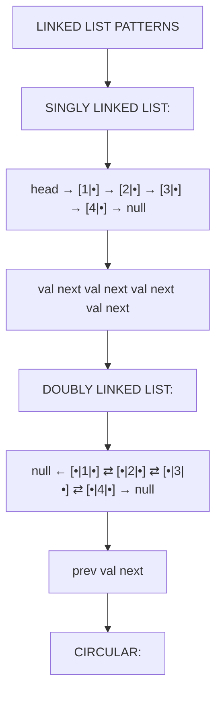

---

## PART 0: WHY Linked List — MIT/KTH Style Deep Understanding

> 🔬 **Section Challenge — PART 0: WHY Linked List — MIT/KTH Style Deep Understanding**

## Why These Problems Matter

LinkedList is a FUNDAMENTAL exam topic — tests pointer manipulation,
in-place algorithms, and O(1) space thinking. Unlike arrays, you cannot
randomly access elements; every algorithm must work via sequential
traversal and pointer rewiring. This forces you to think about INVARIANTS
at every step.

**Why Interviewers Love It**:
- Pointer bugs are EASY to introduce, HARD to debug → tests carefulness
- Edge cases everywhere: empty list, single node, head changes
- O(1) space constraints force elegant in-place solutions
- Reveals whether you truly understand references vs values
REAL-WORLD LINKED LISTS:
- LRU Cache (HashMap + Doubly Linked List)
- Blockchain (each block links to previous hash)
- File systems (FAT table — each cluster points to next)
- Undo/Redo stacks in editors (doubly linked command list)
- Memory allocators (free list of available memory blocks)

## The Three Mental Models

MODEL 1: "RUNNER TECHNIQUE" (slow/fast pointers)
Two pointers traverse the list at DIFFERENT SPEEDS.
Fast moves 2 steps, slow moves 1 step per iteration.
Applications:
- Detect cycle: if fast meets slow → cycle exists
- Find middle: when fast reaches end, slow is at middle
- Find kth from end: start fast k steps ahead, then move both
WHY IT WORKS (formal):
Let n = list length. After t steps: slow at position t, fast at 2t.
When fast reaches position n: t = n/2, so slow is at n/2 (middle).
For cycle of length c: relative speed is 1 node/step,
so fast catches slow in at most c steps after both enter cycle.
MODEL 2: "DUMMY HEAD" (sentinel node)
Create a fake node before the real head:
dummy → [real head] → [node2] → ...

**Why**: Eliminates ALL special cases where head might change.
Without dummy: if you delete head, you need if-else logic.
With dummy: just process uniformly, return dummy.next.
Use dummy when:
- Merging two lists (new head unknown until comparison)
- Removing nodes (head itself might be removed)
- Partitioning (building two sub-lists, heads unknown)
MODEL 3: "REVERSE AS YOU GO" (in-place reversal)
Reverse pointers one-by-one during a single traversal.
Uses three pointers: prev, curr, next.
Before: prev → null, curr → [1] → [2] → [3] → null
After:  null ← [1] ← [2] ← [3] ← prev, curr → null
Loop invariant: After iteration i, the first i nodes are reversed
and prev points to the new head of the reversed portion.

## Formal Definition (Mit / Kth Style)

A singly linked list L = (v₁, v₂, ..., vₙ) is a sequence of nodes
where each node vᵢ contains:
- vᵢ.val  — the stored datum
- vᵢ.next — a pointer to vᵢ₊₁ (for i < n), with vₙ.next = null
The list is accessed via a reference head = v₁ (or head = null if empty).

**Time Complexity Invariant**:
Accessing the i-th element requires O(i) time since there is
NO random access. Every operation that depends on position i
has a lower bound of Ω(i) comparisons/pointer traversals.
┬──────────┬
| Operation                | Array    | LinkedList |
┼──────────┼
| Access i-th element      | O(1)     | O(i) |
| Insert at head           | O(n)     | O(1) |
| Insert at position i     | O(n)     | O(i) |
| Delete at head           | O(n)     | O(1) |
| Delete at position i     | O(n)     | O(i) |
| Search                   | O(n)     | O(n) |
| Merge sort               | O(n lgn) | O(n lgn) | ← LL uses O(1) space! |
┴──────────┴

> 🔬 **Section Challenge — Formal Definition (Mit / Kth Style)**

## Decision Flowchart: Which Linked List Technique

DECISION FLOWCHART
"Find middle / cycle / kth from end?"  → Runner (slow/fast)
"Reverse the list or a sublist?"       → Three-pointer reversal
"Merge two sorted lists?"              → Dummy head + compare
"Head might change (delete/insert)?"   → Dummy head sentinel
"Copy list with random pointers?"      → Interleave technique
"Merge K sorted lists?"                → Min-heap of heads
"Sort a linked list?"                  → Merge sort (natural)
"Palindrome check?"                    → Find mid + reverse half
"Partition around value?"              → Two dummy heads

> 🔬 **Section Challenge — Decision Flowchart: Which Linked List Technique**

## Java Code Templates

TEMPLATE 1: REVERSE LINKED LIST (iterative, O(1) space)
ListNode prev = null, curr = head;
while (curr != null) {
ListNode next = curr.next;   // save next
curr.next = prev;            // reverse pointer
prev = curr;                 // advance prev
curr = next;                 // advance curr
}
return prev;  // new head
TEMPLATE 2: FIND MIDDLE (slow/fast runner)
ListNode slow = head, fast = head;
while (fast != null && fast.next != null) {
slow = slow.next;
fast = fast.next.next;
}
return slow;  // middle node (2nd middle if even length)
TEMPLATE 3: MERGE TWO SORTED LISTS (dummy head)
ListNode dummy = new ListNode(0), tail = dummy;
while (l1 != null && l2 != null) {
if (l1.val <= l2.val) { tail.next = l1; l1 = l1.next; }
else                  { tail.next = l2; l2 = l2.next; }
tail = tail.next;
}
tail.next = (l1 != null) ? l1 : l2;
return dummy.next;

**Node Definition**:
class ListNode {
int val;
ListNode next;
ListNode(int val) { this.val = val; }
}

## Difficulties & Common Mistakes

MISTAKE 1: Losing reference to head
You traverse with head directly → now you can't return it.

**Fix**: Always use a separate pointer: ListNode curr = head;
MISTAKE 2: Not handling null / empty list
if (head == null) or if (head.next == null) — check FIRST.
Forgetting this → NullPointerException on single-node or empty input.
MISTAKE 3: Forgetting to update .next (dangling pointer)
After moving a node, its old .next still points to the old location.

**Fix**: Explicitly set node.next = null or to the correct new target.
MISTAKE 4: Creating a cycle when relinking nodes
Swapping pointers without breaking old links → infinite loop.

**Fix**: Save next BEFORE rewiring. Draw the pointer diagram.
MISTAKE 5: Off-by-one in kth from end
"kth from end" — do you count from 1 or 0? Move fast k or k+1 times?

**Fix**: Clarify with interviewer. Typically k=1 means last node.
Move fast exactly k steps, then move both until fast == null.
MISTAKE 6: Not using dummy head when head might change
Deleting the head node, or merging where the new head is unknown.
Writing special-case if-else instead of using a sentinel.

**Fix**: ListNode dummy = new ListNode(0); dummy.next = head;
Process uniformly. Return dummy.next.

## Expected Outcomes

- ✅ See "reverse" → three-pointer template in 1 minute (iterative + recur.)
- ✅ See "cycle" → Floyd's slow/fast immediately, prove convergence
- ✅ See "merge sorted" → dummy head + tail pointer without thinking
- ✅ See "kth from end" → two-pointer gap technique instantly
- ✅ See "head might change" → always reach for dummy sentinel
- ✅ See "palindrome" → find middle + reverse second half + compare

**The Transformation**:

**From**: "I keep getting null pointer errors and infinite loops"

**To**: "I draw the pointer diagram, identify which pointers change,
save references before rewiring, and use dummy heads when the
head might change. Every step maintains my loop invariant."

## Complexity Quick Reference

┬──────────┬──────────┬
| Problem                  | Time     | Space    | Technique |
┼──────────┼──────────┼
| Reverse List             | O(n)     | O(1)     | Three pointers |
| Find Middle              | O(n)     | O(1)     | Slow/fast |
| Detect Cycle             | O(n)     | O(1)     | Floyd's |
| Merge Two Sorted         | O(n+m)   | O(1)     | Dummy head |
| Remove Nth from End      | O(n)     | O(1)     | Two-pointer gap |
| Add Two Numbers          | O(max)   | O(max)   | Stack / reverse |
| Copy Random Pointer      | O(n)     | O(1)*| Interleave 3-pass |
| Merge K Sorted           | O(N lgk) | O(k)     | Min-heap |
| Reverse K-Group          | O(n)     | O(1)     | Iterative K-rev |
| Sort Linked List         | O(n lgn) | O(1)*    | Bottom-up merge |
┴──────────┴──────────┴
* O(1) extra space (excluding recursion stack or output)

---

## 13.1 Basic Operations (Easy)

> **Pattern:** Fundamental pointer manipulation — reverse, find middle, merge, cycle detection.
> **Key insight:** Master the three templates above — they compose to solve 80% of LL problems.

---

### Problem 216: Reverse Linked List ⭐ FULL SOLUTION

**LeetCode 206** 🔗 <https://leetcode.com/problems/reverse-linked-list/>

```
PROBLEM (formal):
  Given a singly linked list L = (v₁, v₂, ..., vₙ), produce the
  reversed list L' = (vₙ, vₙ₋₁, ..., v₁) using O(1) extra space.

INPUT:  head of a singly linked list (0 ≤ n ≤ 5000, -5000 ≤ val ≤ 5000)
OUTPUT: head of the reversed list

EXAMPLES:
  [1] → [2] → [3] → [4] → [5] → null
  becomes:
  [5] → [4] → [3] → [2] → [1] → null

  Input: head = [1,2,3,4,5]  →  Output: [5,4,3,2,1]
  Input: head = [1,2]        →  Output: [2,1]
  Input: head = []           →  Output: []
```

**Flow:**
1. Input list: `[1] -> [2] -> [3] -> [4] -> [5] -> null`.
2. Reverse pointers in-place from left to right.
3. Output list: `[5] -> [4] -> [3] -> [2] -> [1] -> null`.
4. Example map: `[1,2,3,4,5] -> [5,4,3,2,1]`.
5. Example map: `[1,2] -> [2,1]`.
6. Example map: `[] -> []`.

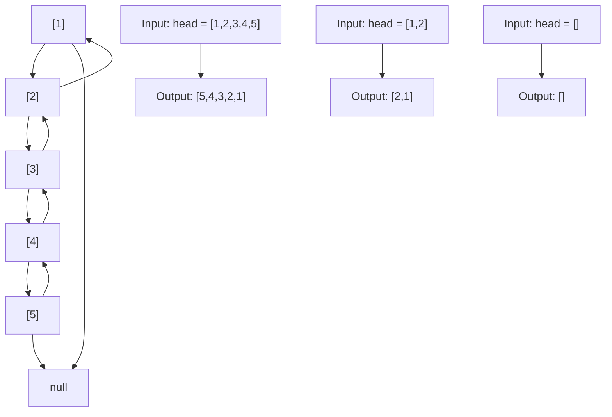

**OBSERVATION 1:** We need to reverse each pointer: instead of vᵢ.next = vᵢ₊₁, set vᵢ.next = vᵢ₋₁. This can be done in a single pass left-to-right, maintaining `prev` and `curr`.

**OBSERVATION 2:** Before setting curr.next = prev, we must save curr.next (otherwise we lose access to the rest of the list).

**ALGORITHM (Iterative):**
```
Step 1: Initialize prev = null, curr = head
Step 2: While curr ≠ null:
          a) next = curr.next        // save next node
          b) curr.next = prev        // reverse the pointer
          c) prev = curr             // advance prev
          d) curr = next             // advance curr
Step 3: Return prev (new head)
```

**PROOF OF CORRECTNESS (Loop Invariant):**
```
Invariant: After iteration i, the first i nodes have their pointers reversed
           and prev points to node vᵢ (head of the reversed prefix).

Initialization (i=0): prev = null, no nodes processed. Trivially true.

Maintenance: At iteration i, curr = vᵢ₊₁.
  We set vᵢ₊₁.next = prev = vᵢ, making the first i+1 nodes reversed.
  We update prev = vᵢ₊₁ (new head of reversed prefix).

Termination: When curr = null, all n nodes have been processed.
  prev = vₙ = new head of the fully reversed list. ∎
```

**JAVA CODE:**

```java
// Approach 1: Iterative — O(n) time, O(1) space
public ListNode reverseList(ListNode head) {
    ListNode prev = null, curr = head;
    while (curr != null) {
        ListNode next = curr.next;
        curr.next = prev;
        prev = curr;
        curr = next;
    }
    return prev;
}

// Approach 2: Recursive — O(n) time, O(n) space (call stack)
public ListNode reverseListRecursive(ListNode head) {
    if (head == null || head.next == null) return head;
    ListNode newHead = reverseListRecursive(head.next);
    head.next.next = head;  // reverse the pointer
    head.next = null;       // break old forward link
    return newHead;
}

// Approach 3: Stack-based — O(n) time, O(n) space
public ListNode reverseListStack(ListNode head) {
    if (head == null) return null;
    Deque<ListNode> stack = new ArrayDeque<>();
    ListNode curr = head;
    while (curr != null) {
        stack.push(curr);
        curr = curr.next;
    }
    ListNode newHead = stack.pop();
    curr = newHead;
    while (!stack.isEmpty()) {
        curr.next = stack.pop();
        curr = curr.next;
    }
    curr.next = null;  // terminate the list
    return newHead;
}
```

**COMPLEXITY:**
```
Approach 1 (Iterative):
  Time:  O(n) — single pass through all n nodes
  Space: O(1) — only 3 pointer variables (prev, curr, next)

Approach 2 (Recursive):
  Time:  O(n) — n recursive calls
  Space: O(n) — recursion depth = n (one frame per node)

Approach 3 (Stack):
  Time:  O(n) — push all, pop all
  Space: O(n) — stack holds all n nodes

⟹ Approach 1 is optimal. ALWAYS use iterative in interviews.
```

**VARIANTS:**
- Reverse a sublist (LC 92) — Problem #226
- Reverse in K-groups (LC 25) — Problem #235
- Reverse alternating K-group — variation of #235

---

### Problem 217: Middle of Linked List ⭐ FULL SOLUTION

**LeetCode 876** 🔗 <https://leetcode.com/problems/middle-of-the-linked-list/>

```
PROBLEM (formal):
  Given a singly linked list L = (v₁, ..., vₙ), return v⌈n/2⌉₊₁
  (the second middle node when n is even).

INPUT:  head (1 ≤ n ≤ 100)
OUTPUT: middle node of the linked list

EXAMPLES:
  Input: [1,2,3,4,5]   → Output: node 3
  Input: [1,2,3,4,5,6] → Output: node 4 (second middle)
```

**Flow:**
1. Input: [1,2,3,4,5]
2. Output: node 3
3. Input: [1,2,3,4,5,6]
4. Output: node 4 (second middle)

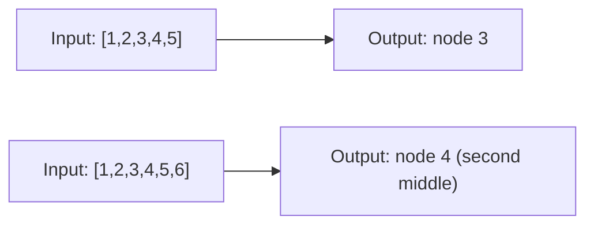

**OBSERVATION 1:** Slow/fast runner. If fast moves 2 steps per iteration and slow moves 1 step, when fast reaches the end, slow is at the midpoint.

**OBSERVATION 2 (formal):** Let n = |L|. After t iterations, slow is at position t, fast at 2t. Fast stops when 2t ≥ n, i.e., t = ⌊n/2⌋. So slow is at position ⌊n/2⌋, which is the (second) middle.

**ALGORITHM:**
```
Step 1: slow = head, fast = head
Step 2: While fast ≠ null AND fast.next ≠ null:
          slow = slow.next
          fast = fast.next.next
Step 3: Return slow
```

**PROOF OF CORRECTNESS:**
```
Let n = length of list, positions indexed from 0.

Invariant: After t iterations, slow is at position t, fast is at position 2t.

Termination cases:
  • n odd (n = 2k+1): fast stops at position 2k (fast.next = null).
    slow at position k = ⌊n/2⌋. Correct middle.
  • n even (n = 2k): fast stops at position 2k (fast = null).
    slow at position k = n/2. Second middle per problem spec. ∎
```

**JAVA CODE:**

```java
public ListNode middleNode(ListNode head) {
    ListNode slow = head, fast = head;
    while (fast != null && fast.next != null) {
        slow = slow.next;
        fast = fast.next.next;
    }
    return slow;
}
```

**COMPLEXITY:**
```
Time:  O(n) — fast pointer traverses at most n nodes
Space: O(1) — two pointers only

To get FIRST middle when n is even:
  Use while (fast.next != null && fast.next.next != null)
  This stops fast one step earlier.
```

**VARIANTS:**
- Delete middle node (LC 2095)
- Split list into two halves (prerequisite for LL merge sort)

---

### Problem 218: Merge Two Sorted Lists ⭐ FULL SOLUTION

**LeetCode 21** 🔗 <https://leetcode.com/problems/merge-two-sorted-lists/>

```
PROBLEM (formal):
  Given two sorted singly linked lists L₁ and L₂, produce a single
  sorted list L containing all elements from both lists.

INPUT:  heads of two sorted lists (0 ≤ n, m ≤ 50, -100 ≤ val ≤ 100)
OUTPUT: head of merged sorted list

EXAMPLES:
  L₁: [1] → [2] → [4] → null
  L₂: [1] → [3] → [4] → null
  Out: [1] → [1] → [2] → [3] → [4] → [4] → null
```

**Flow:**
1. Input list L₁: `[1] -> [2] -> [4] -> null`.
2. Input list L₂: `[1] -> [3] -> [4] -> null`.
3. Compare current heads and append the smaller node each step.
4. Continue until one list is exhausted.
5. Append the remaining tail.
6. Output: `[1] -> [1] -> [2] -> [3] -> [4] -> [4] -> null`.

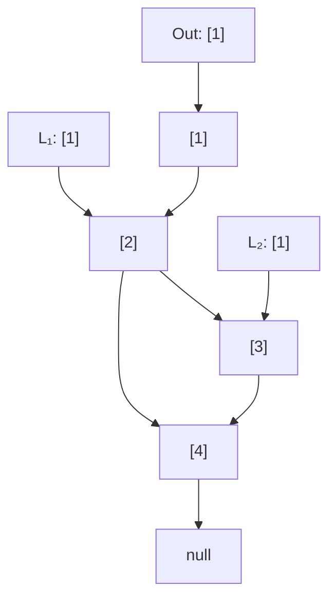

**OBSERVATION 1:** Use a dummy head to avoid special-casing which list provides the first node.

**OBSERVATION 2:** At each step, compare the heads of both lists and append the smaller one to the result. This is the merge step of merge sort.

**ALGORITHM:**
```
Step 1: Create dummy node, tail = dummy
Step 2: While l1 ≠ null AND l2 ≠ null:
          If l1.val ≤ l2.val: tail.next = l1, l1 = l1.next
          Else:                tail.next = l2, l2 = l2.next
          tail = tail.next
Step 3: tail.next = whichever list is non-null (l1 or l2)
Step 4: Return dummy.next
```

**PROOF OF CORRECTNESS (by induction on total elements processed):**
```
Claim: After processing i elements, the merged list contains the i
smallest elements from L₁ ∪ L₂ in sorted order.

Base case (i=0): Merged list is empty. Trivially sorted.

Inductive step: Assume after i elements, merged list is sorted with
  the i smallest elements. At step i+1, we compare heads of remaining
  L₁ and L₂. Both remaining lists are sorted, so their heads are the
  smallest remaining elements. We pick the smaller head, which is
  ≥ all previously appended elements (since it wasn't picked before,
  and the lists are sorted). Appending it preserves sorted order.

Termination: When one list is exhausted, the other is already sorted.
  Appending the remainder preserves the sorted invariant. ∎
```

**JAVA CODE:**

```java
public ListNode mergeTwoLists(ListNode l1, ListNode l2) {
    ListNode dummy = new ListNode(0);
    ListNode tail = dummy;

    while (l1 != null && l2 != null) {
        if (l1.val <= l2.val) {
            tail.next = l1;
            l1 = l1.next;
        } else {
            tail.next = l2;
            l2 = l2.next;
        }
        tail = tail.next;
    }

    tail.next = (l1 != null) ? l1 : l2;
    return dummy.next;
}
```

**COMPLEXITY:**
```
Time:  O(n + m) — each node visited exactly once
Space: O(1) — only pointer rewiring, no new nodes created
       (dummy node is O(1) extra)

Note: The "≤" in (l1.val <= l2.val) ensures STABILITY —
equal elements from L₁ appear before those from L₂.
```

**VARIANTS:**
- Merge K sorted lists (LC 23) — Problem #234
- Merge sorted arrays (LC 88) — different technique (in-place from end)

---

### Problem 219: Linked List Cycle ⭐ FULL SOLUTION

**LeetCode 141** 🔗 <https://leetcode.com/problems/linked-list-cycle/>

```
PROBLEM (formal):
  Given head of a singly linked list, determine if the list contains a cycle.
  A cycle exists if some node vⱼ.next = vᵢ where i ≤ j.

INPUT:  head of a singly linked list
OUTPUT: true if cycle exists, false otherwise

EXAMPLES:
  [3] → [2] → [0] → [-4] ─┐        Input: head = [3,2,0,-4], pos = 1
       ↑                     │       Output: true
       └─────────────────────┘

  [1] → [2] → null                   Input: head = [1,2], pos = -1
                                      Output: false
```

**Flow:**
1. Example A (cycle): `[3] -> [2] -> [0] -> [-4]`, tail links back to node `[2]` (`pos = 1`).
2. Output A: `true`.
3. Example B (no cycle): `[1] -> [2] -> null` (`pos = -1`).
4. Output B: `false`.

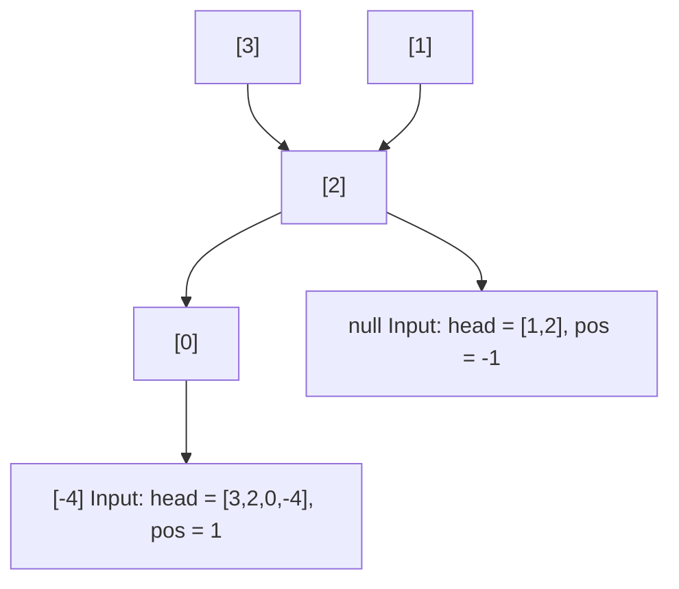

**OBSERVATION 1:** If we use two pointers at different speeds, in a cycle they MUST eventually meet (like runners on a circular track).

**OBSERVATION 2 (Floyd's Cycle Detection):** Slow moves 1 step, fast moves 2 steps. If no cycle, fast reaches null. If cycle exists, fast enters the cycle first and "laps" slow.

**ALGORITHM:**
```
Step 1: slow = head, fast = head
Step 2: While fast ≠ null AND fast.next ≠ null:
          slow = slow.next
          fast = fast.next.next
          If slow == fast: return true  (cycle detected)
Step 3: Return false  (fast reached end → no cycle)
```

**Flow:**
1. If `fast` reaches `null`, traversal ended without collision.
2. Return `false` because no cycle exists.

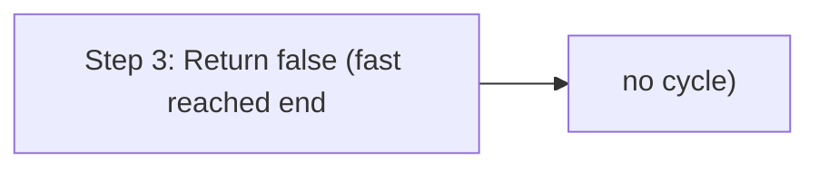

**PROOF OF CORRECTNESS (Floyd's Theorem):**
```
Setup: Let the list have a "tail" of length t (before cycle entry)
and a cycle of length c.

Phase 1: Both pointers traverse the tail. After t steps, slow enters
the cycle. Fast is already in the cycle (entered after ⌈t/2⌉ steps
if t < c, or has been looping).

Phase 2: Once both are in the cycle, consider their positions mod c.
  • After each step, the gap (fast - slow) mod c increases by 1.
  • Initially the gap is some value g (0 ≤ g < c).
  • After (c - g) steps, the gap becomes 0 mod c → they meet.

Therefore: if a cycle of length c exists, fast catches slow in at
most c steps after slow enters the cycle.

Total time: O(t + c) = O(n). ∎

BONUS — Finding cycle start (LC 142):
After detection (slow == fast), reset one pointer to head.
Move both at speed 1. They meet at the cycle entry.

Why? When they first meet:
  slow traveled: t + a  (a = distance into cycle)
  fast traveled: t + a + kc  (k full loops)
  Since fast = 2 × slow: t + a + kc = 2(t + a) → kc = t + a → t = kc - a
  So moving t steps from meeting point = kc - a steps in cycle = cycle start.
  Moving t steps from head also reaches cycle start. They meet there. ∎
```

**Flow:**
1. In the cycle, relative speed is 1 node per step.
2. After at most `(c - g)` steps, the gap becomes `0 mod c`, so they meet.
3. Meeting equation: `t + a + kc = 2(t + a)`.
4. Rearrangement gives `kc = t + a`.
5. Therefore `t = kc - a`, which aligns both pointers at cycle entry.

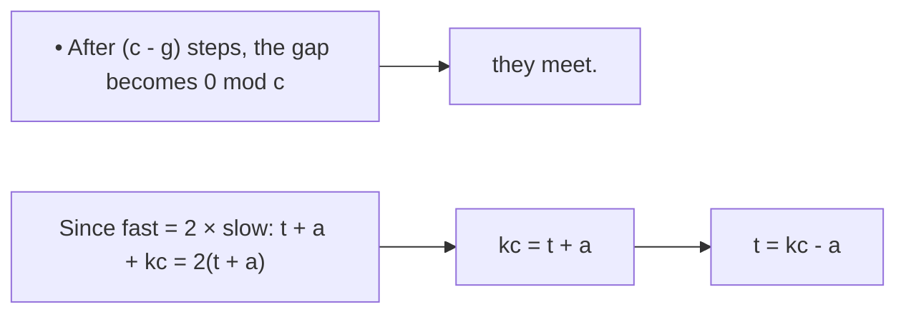

**JAVA CODE:**

```java
// Detect cycle — O(n) time, O(1) space
public boolean hasCycle(ListNode head) {
    ListNode slow = head, fast = head;
    while (fast != null && fast.next != null) {
        slow = slow.next;
        fast = fast.next.next;
        if (slow == fast) return true;
    }
    return false;
}

// Find cycle start (LC 142) — bonus
public ListNode detectCycle(ListNode head) {
    ListNode slow = head, fast = head;
    while (fast != null && fast.next != null) {
        slow = slow.next;
        fast = fast.next.next;
        if (slow == fast) {
            // Phase 2: find entry point
            ListNode entry = head;
            while (entry != slow) {
                entry = entry.next;
                slow = slow.next;
            }
            return entry;
        }
    }
    return null;  // no cycle
}
```

**COMPLEXITY:**
```
Time:  O(n) — slow traverses at most n nodes; fast catches slow within
       one cycle length after slow enters the cycle.
Space: O(1) — two pointers only.

Alternative (HashSet): O(n) time, O(n) space — store visited nodes.
Floyd's is strictly better in space.
```

**VARIANTS:**
- Find cycle start (LC 142) — shown above
- Find cycle length — after detection, count steps from meeting point back to meeting point

---

### Problem 220: Palindrome Linked List

**LeetCode 234** 🔗 <https://leetcode.com/problems/palindrome-linked-list/>

```
APPROACH:
  1. Find the middle using slow/fast runner (Template 2)
  2. Reverse the second half in-place (Template 1)
  3. Compare first half with reversed second half
  4. (Optional) Restore the list by reversing second half again

WHY THIS WORKS: A palindrome reads the same forwards and backwards.
  By reversing the second half, we can compare it element-by-element
  with the first half in O(1) space.

TEMPLATE: Runner (middle) + Reverse
```

```java
public boolean isPalindrome(ListNode head) {
    // Step 1: Find middle (first middle for even length)
    ListNode slow = head, fast = head;
    while (fast.next != null && fast.next.next != null) {
        slow = slow.next;
        fast = fast.next.next;
    }

    // Step 2: Reverse second half
    ListNode secondHalf = reverse(slow.next);

    // Step 3: Compare halves
    ListNode p1 = head, p2 = secondHalf;
    while (p2 != null) {
        if (p1.val != p2.val) return false;
        p1 = p1.next;
        p2 = p2.next;
    }
    return true;
}

private ListNode reverse(ListNode head) {
    ListNode prev = null, curr = head;
    while (curr != null) {
        ListNode next = curr.next;
        curr.next = prev;
        prev = curr;
        curr = next;
    }
    return prev;
}
```

**Complexity:** Time O(n), Space O(1).

---

### Problem 221: Remove Duplicates from Sorted List

**LeetCode 83** 🔗 <https://leetcode.com/problems/remove-duplicates-from-sorted-list/>

```
APPROACH:
  Since the list is SORTED, duplicates are adjacent.
  Traverse with pointer curr; if curr.val == curr.next.val,
  skip the next node: curr.next = curr.next.next.

TEMPLATE: Simple traversal with pointer skip.
```

```java
public ListNode deleteDuplicates(ListNode head) {
    ListNode curr = head;
    while (curr != null && curr.next != null) {
        if (curr.val == curr.next.val) {
            curr.next = curr.next.next;  // skip duplicate
        } else {
            curr = curr.next;            // advance only if no duplicate
        }
    }
    return head;
}
```

**Complexity:** Time O(n), Space O(1).

---

### Problem 222: Intersection of Two Linked Lists

**LeetCode 160** 🔗 <https://leetcode.com/problems/intersection-of-two-linked-lists/>

```
APPROACH (Length-Difference Technique):
  1. Compute lengths lenA, lenB.
  2. Advance the longer list by |lenA - lenB| steps.
  3. Move both pointers together until they meet (intersection) or reach null.

ALTERNATIVE (Elegant Two-Pass):
  Pointer a starts at headA, pointer b at headB.
  When a reaches null, redirect to headB. When b reaches null, redirect to headA.
  They will meet at the intersection after at most (lenA + lenB) steps.

  WHY: Both travel the same total distance (lenA + lenB), so any length
  difference is compensated by the redirect.

TEMPLATE: Two-pointer convergence.
```

```java
public ListNode getIntersectionNode(ListNode headA, ListNode headB) {
    ListNode a = headA, b = headB;
    while (a != b) {
        a = (a != null) ? a.next : headB;
        b = (b != null) ? b.next : headA;
    }
    return a;  // null if no intersection
}
```

**Complexity:** Time O(n + m), Space O(1).

---

### Problem 223: Delete Node (Pointer Only)

**GFG** 🔗 <https://www.geeksforgeeks.org/delete-a-given-node-in-linked-list-under-given-constraints/>

```
APPROACH:
  You are given only a pointer to the node to delete (NOT the head).
  Copy the next node's value into the current node, then delete the next node.

  node.val = node.next.val;
  node.next = node.next.next;

  Limitation: Cannot delete the LAST node this way (no next to copy from).

TEMPLATE: Value-copy trick.
```

**Complexity:** Time O(1), Space O(1).

---

### Problem 224: Convert Binary Number in Linked List to Integer

**LeetCode 1290** 🔗 <https://leetcode.com/problems/convert-binary-number-in-a-linked-list-to-integer/>

```
APPROACH:
  Traverse the list. At each node, shift the accumulated value left by 1
  and add the current bit: result = result * 2 + node.val.

  This is Horner's method for binary → decimal conversion.

TEMPLATE: Single-pass accumulation.
```

**Flow:**
1. Traverse bits from head to tail.
2. Update each step: `result = result * 2 + bit`.
3. This is Horner's method for binary-to-decimal conversion.


```java
public int getDecimalValue(ListNode head) {
    int result = 0;
    while (head != null) {
        result = result * 2 + head.val;
        head = head.next;
    }
    return result;
}
```

**Complexity:** Time O(n), Space O(1).

---

## 13.2 Pointer Manipulation (Medium)

> **Pattern:** Multi-step pointer operations — sublist reversal, two-pointer gaps, interleaving.
> **Key insight:** Draw the pointer diagram. Save references before rewiring.

---

### Problem 225: Remove Nth Node From End of List ⭐ FULL SOLUTION

**LeetCode 19** 🔗 <https://leetcode.com/problems/remove-nth-node-from-end-of-list/>

```
PROBLEM (formal):
  Given a linked list L = (v₁, ..., vₙ), remove the node at position
  (n - k + 1) from the start, where k is the given parameter (1-indexed
  from end). Return the modified list head.

INPUT:  head, n (1 ≤ n ≤ size of list)
OUTPUT: head of modified list

EXAMPLES:
  Input: [1,2,3,4,5], n = 2  →  Output: [1,2,3,5]  (removed 4)
  Input: [1], n = 1           →  Output: []           (removed head)
```

**Flow:**
1. Input: [1,2,3,4,5], n = 2
2. Output: [1,2,3,5] (removed 4)
3. Input: [1], n = 1
4. Output: [] (removed head)

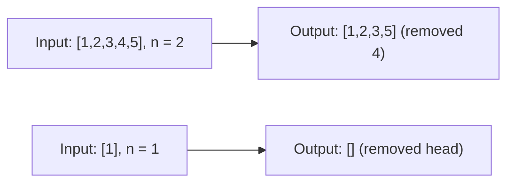

**OBSERVATION 1:** Two-pointer gap technique: if fast is n steps ahead of slow, when fast reaches null, slow is at the node BEFORE the one to delete.

**OBSERVATION 2:** Use a dummy head because the head itself might be the node to remove (e.g., single-node list with n=1).

**ALGORITHM:**
```
Step 1: Create dummy → head. Set fast = dummy, slow = dummy.
Step 2: Advance fast by (n + 1) steps.
Step 3: Move both fast and slow together until fast = null.
Step 4: slow.next = slow.next.next  (skip the target node)
Step 5: Return dummy.next
```

**Flow:**
1. Initialize sentinel list: `dummy -> head`.
2. Set both pointers at sentinel: `fast = dummy`, `slow = dummy`.
3. Move `fast` first to create an `n+1` gap.

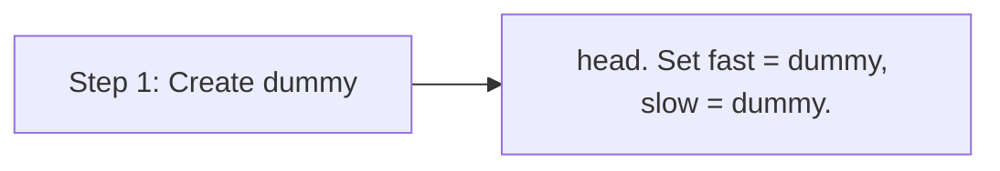

**PROOF OF CORRECTNESS:**
```
After Step 2, fast is (n+1) positions ahead of slow (both starting from dummy).
The total positions from dummy to null is (size + 1).

When fast reaches null (after size + 1 - (n + 1) = size - n more steps),
slow is at position (size - n) from dummy, i.e., position (size - n - 1)
in the original list (0-indexed).

This is exactly the node BEFORE the (n-th from end) node.
Setting slow.next = slow.next.next removes the target. ∎
```

**JAVA CODE:**

```java
public ListNode removeNthFromEnd(ListNode head, int n) {
    ListNode dummy = new ListNode(0);
    dummy.next = head;
    ListNode fast = dummy, slow = dummy;

    // Move fast n+1 steps ahead
    for (int i = 0; i <= n; i++) {
        fast = fast.next;
    }

    // Move both until fast reaches null
    while (fast != null) {
        fast = fast.next;
        slow = slow.next;
    }

    // Remove the nth node from end
    slow.next = slow.next.next;
    return dummy.next;
}
```

**COMPLEXITY:**
```
Time:  O(L) where L = length of list — single pass
Space: O(1) — three pointers + dummy node
```

**VARIANTS:**
- Remove nth from end of doubly linked list
- Return removed node's value

---

### Problem 226: Reverse Linked List II ⭐ FULL SOLUTION

**LeetCode 92** 🔗 <https://leetcode.com/problems/reverse-linked-list-ii/>

```
PROBLEM (formal):
  Given a linked list and positions left, right (1-indexed), reverse
  only the sublist from position left to right inclusive.

INPUT:  head, left, right (1 ≤ left ≤ right ≤ n)
OUTPUT: head of modified list

EXAMPLES:
  Input: [1,2,3,4,5], left=2, right=4
  Output: [1,4,3,2,5]
       Before: 1 → 2 → 3 → 4 → 5
       After:  1 → 4 → 3 → 2 → 5
```

**Flow:**
1. Input: linked list with boundaries `left` and `right`.
2. Goal: reverse only nodes in the inclusive range `[left, right]`.
3. Example input: `[1,2,3,4,5]`, `left=2`, `right=4`.
4. Example output: `[1,4,3,2,5]`.
5. Nodes outside the range keep their original order.

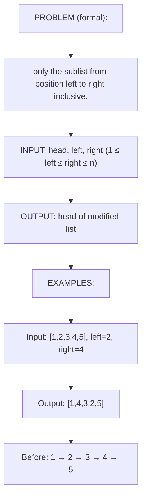

**OBSERVATION 1:** Navigate to position (left - 1) — the node just before the reversal zone. Then reverse exactly (right - left + 1) nodes.

**OBSERVATION 2:** Use dummy head since left=1 means the head changes.

**ALGORITHM:**
```
Step 1: Create dummy → head. Navigate prev to position (left - 1).
Step 2: curr = prev.next (first node in reversal zone).
Step 3: For i = 0 to (right - left - 1):
          Move curr.next to just after prev (front-insertion).
Step 4: Return dummy.next.
```

**Flow:**
1. Build sentinel list: `dummy -> head`.
2. Move `prev` to node just before position `left`.
3. Reverse only the `[left, right]` window by front-insertion.

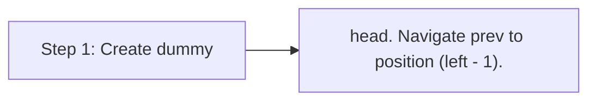

**JAVA CODE:**

```java
public ListNode reverseBetween(ListNode head, int left, int right) {
    ListNode dummy = new ListNode(0);
    dummy.next = head;
    ListNode prev = dummy;

    // Move prev to position just before 'left'
    for (int i = 1; i < left; i++) {
        prev = prev.next;
    }

    ListNode curr = prev.next;  // first node in reversal zone

    // Reverse by front-inserting nodes
    for (int i = 0; i < right - left; i++) {
        ListNode nodeToMove = curr.next;
        curr.next = nodeToMove.next;     // detach nodeToMove
        nodeToMove.next = prev.next;     // insert after prev
        prev.next = nodeToMove;          // update prev's link
    }

    return dummy.next;
}
```

**COMPLEXITY:**
```
Time:  O(n) — at most one full traversal
Space: O(1) — in-place pointer rewiring
```

**VARIANTS:**
- Reverse K-group (LC 25) — Problem #235
- Reverse alternating K nodes

---

### Problem 227: Add Two Numbers II ⭐ FULL SOLUTION

**LeetCode 445** 🔗 <https://leetcode.com/problems/add-two-numbers-ii/>

```
PROBLEM (formal):
  Two non-empty linked lists represent two non-negative integers.
  Most significant digit comes first. Add the two numbers and return
  the sum as a linked list.

INPUT:  heads of two lists (no leading zeros except the number 0)
OUTPUT: head of sum list

EXAMPLES:
  l1: [7] → [2] → [4] → [3]     (represents 7243)
  l2:      [5] → [6] → [4]      (represents 564)
  out: [7] → [8] → [0] → [7]    (7243 + 564 = 7807)
```

**Flow:**
1. Number 1 list: `[7] -> [2] -> [4] -> [3]` (7243).
2. Number 2 list: `[5] -> [6] -> [4]` (564).
3. Add from right to left using two stacks plus carry.
4. Prepend each new digit to keep MSB-first order.
5. Output list: `[7] -> [8] -> [0] -> [7]` (7807).

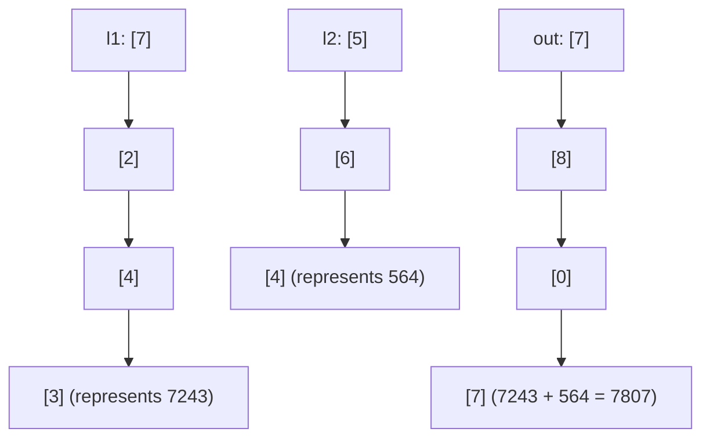

**OBSERVATION 1:** Digits are stored most-significant first, but addition starts from least-significant. Use stacks to reverse the processing order without modifying the original lists.

**OBSERVATION 2:** Process digit-by-digit with carry, building the result by prepending (to get MSB-first output).

**ALGORITHM:**
```
Step 1: Push all digits of l1 onto stack1, l2 onto stack2.
Step 2: Initialize carry = 0, head = null.
Step 3: While stack1 or stack2 non-empty or carry > 0:
          sum = carry + (pop stack1 if non-empty) + (pop stack2 if non-empty)
          carry = sum / 10
          Create node with val = sum % 10, node.next = head, head = node
Step 4: Return head.
```

**JAVA CODE:**

```java
public ListNode addTwoNumbers(ListNode l1, ListNode l2) {
    Deque<Integer> s1 = new ArrayDeque<>(), s2 = new ArrayDeque<>();

    while (l1 != null) { s1.push(l1.val); l1 = l1.next; }
    while (l2 != null) { s2.push(l2.val); l2 = l2.next; }

    int carry = 0;
    ListNode head = null;

    while (!s1.isEmpty() || !s2.isEmpty() || carry > 0) {
        int sum = carry;
        if (!s1.isEmpty()) sum += s1.pop();
        if (!s2.isEmpty()) sum += s2.pop();

        carry = sum / 10;
        ListNode node = new ListNode(sum % 10);
        node.next = head;
        head = node;  // prepend
    }

    return head;
}
```

**COMPLEXITY:**
```
Time:  O(n + m) — push all digits, then process all
Space: O(n + m) — two stacks

Alternative O(1) space: reverse both lists, add like LC 2, reverse result.
```

---

### Problem 228: Copy List with Random Pointer ⭐ FULL SOLUTION

**LeetCode 138** 🔗 <https://leetcode.com/problems/copy-list-with-random-pointer/>

```
PROBLEM (formal):
  Given a linked list where each node has a next pointer and a random
  pointer (which can point to any node or null), construct a deep copy.

INPUT:  head of list with random pointers
OUTPUT: head of deep copy (new nodes, same structure)

APPROACH: 3-pass interleaving technique (O(1) extra space, excluding output)
```

**OBSERVATION 1:** The challenge is mapping old random pointers to new nodes. HashMap works but uses O(n) space.

**OBSERVATION 2:** Interleave technique: insert clone of each node right after the original. Then random pointers can be set using clone.random = original.random.next. Finally, separate the two lists.

**ALGORITHM:**
```
Pass 1 — Interleave: For each node A, insert A' (clone) after A.
  A → B → C  becomes  A → A' → B → B' → C → C'

Pass 2 — Set random: For each original node A:
  A'.random = A.random.next  (A.random.next is the clone of A.random)

Pass 3 — Separate: Extract cloned nodes into their own list.
  Restore original list.
```

**Flow:**
1. Interleave clones: `A -> B -> C` becomes `A -> A' -> B -> B' -> C -> C'`.
2. Assign clone random pointers via `original.random.next`.
3. Detach clone list and restore original list.

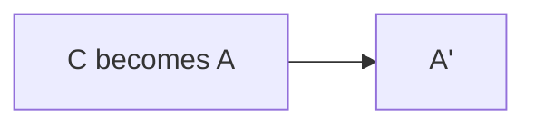

**JAVA CODE:**

```java
public Node copyRandomList(Node head) {
    if (head == null) return null;

    // Pass 1: Interleave clones
    Node curr = head;
    while (curr != null) {
        Node clone = new Node(curr.val);
        clone.next = curr.next;
        curr.next = clone;
        curr = clone.next;
    }

    // Pass 2: Set random pointers for clones
    curr = head;
    while (curr != null) {
        if (curr.random != null) {
            curr.next.random = curr.random.next;
        }
        curr = curr.next.next;
    }

    // Pass 3: Separate the two lists
    Node cloneHead = head.next;
    curr = head;
    Node cloneCurr = cloneHead;
    while (curr != null) {
        curr.next = curr.next.next;
        cloneCurr.next = (cloneCurr.next != null) ? cloneCurr.next.next : null;
        curr = curr.next;
        cloneCurr = cloneCurr.next;
    }

    return cloneHead;
}
```

**COMPLEXITY:**
```
Time:  O(n) — three passes, each O(n)
Space: O(1) extra (cloned nodes are part of the output, not extra space)

Alternative (HashMap): O(n) time, O(n) space — map original → clone
```

**Flow:**
1. HashMap alternative stores mapping `originalNode -> clonedNode`.
2. First pass creates clone nodes; second pass wires `next` and `random`.

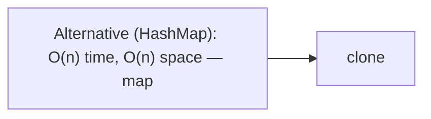

---

### Problem 229: Partition List

**LeetCode 86** 🔗 <https://leetcode.com/problems/partition-list/>

```
APPROACH:
  Create two dummy heads: "less" and "greaterOrEqual."
  Traverse original list; append each node to the appropriate sub-list.
  Connect less.tail → greaterOrEqual.head. Set greaterOrEqual.tail.next = null.

TEMPLATE: Two dummy heads + single pass.
```

**Flow:**
1. Partition nodes into two chains: `< x` and `>= x`.
2. Connect `less.tail -> greaterOrEqual.head`.
3. Set `greaterOrEqual.tail.next = null`.
4. Return `less` chain head.


```java
public ListNode partition(ListNode head, int x) {
    ListNode lessD = new ListNode(0), greatD = new ListNode(0);
    ListNode less = lessD, great = greatD;
    while (head != null) {
        if (head.val < x) { less.next = head; less = less.next; }
        else               { great.next = head; great = great.next; }
        head = head.next;
    }
    great.next = null;         // terminate greater list
    less.next = greatD.next;   // connect less → greater
    return lessD.next;
}
```

**Complexity:** Time O(n), Space O(1).

---

### Problem 230: Flatten a Multilevel Doubly Linked List

**LeetCode 430** 🔗 <https://leetcode.com/problems/flatten-a-multilevel-doubly-linked-list/>

```
APPROACH:
  When encountering a node with a child:
  1. Save node.next as "tail."
  2. Set node.next = child, child.prev = node, node.child = null.
  3. Traverse to end of child list, connect to tail.

  Use DFS (iterative with stack, or recursion).
  Stack approach: push next, then push child → DFS order.

TEMPLATE: DFS flattening.
```

**Flow:**
1. When a child appears, save current `next` as tail.
2. Splice child list immediately after current node.
3. Continue DFS (stack or recursion) through child first.
4. Reconnect flattened child tail back to saved tail.

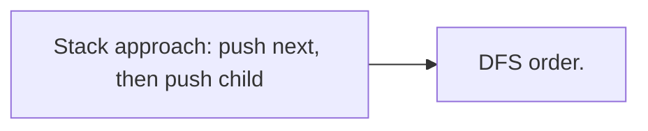

**Complexity:** Time O(n), Space O(depth) for recursion stack.

---

### Problem 231: Remove Duplicates from Sorted List II

**LeetCode 82** 🔗 <https://leetcode.com/problems/remove-duplicates-from-sorted-list-ii/>

```
APPROACH:
  Use dummy head (head might be removed).
  prev = dummy. While curr and curr.next exist:
    If curr.val == curr.next.val:
      Skip ALL nodes with that value.
      prev.next = first node with different value.
    Else:
      prev = curr, curr = curr.next.

TEMPLATE: Dummy head + skip-all-duplicates.
```

```java
public ListNode deleteDuplicates(ListNode head) {
    ListNode dummy = new ListNode(0);
    dummy.next = head;
    ListNode prev = dummy, curr = head;
    while (curr != null) {
        while (curr.next != null && curr.val == curr.next.val) {
            curr = curr.next;  // skip all duplicates
        }
        if (prev.next == curr) {
            prev = curr;       // no duplicates, advance prev
        } else {
            prev.next = curr.next;  // skip entire duplicate group
        }
        curr = curr.next;
    }
    return dummy.next;
}
```

**Complexity:** Time O(n), Space O(1).

---

### Problem 232: Segregate Even and Odd Nodes

**GFG** 🔗 <https://www.geeksforgeeks.org/segregate-even-and-odd-elements-in-a-linked-list/>

```
APPROACH:
  Same as Partition List (#229): two dummy heads for even and odd.
  Traverse and distribute, then connect even → odd.

TEMPLATE: Two dummy heads.
```

**Flow:**
1. Traverse once and split nodes into `even` and `odd` chains.
2. Connect `even.tail -> odd.head`.
3. Preserve relative order inside each chain.

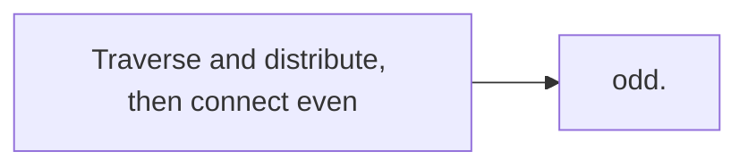

**Complexity:** Time O(n), Space O(1).

---

### Problem 233: Sort a Linked List of 0s, 1s, and 2s

**GFG** 🔗 <https://www.geeksforgeeks.org/sort-a-linked-list-of-0s-1s-and-2s/>

```
APPROACH (Dutch National Flag adaptation):
  Create three dummy heads: zeroD, oneD, twoD.
  Traverse list; append each node to the corresponding sub-list.
  Connect: zero.tail → one.head → two.head. Set two.tail.next = null.

  This is an adaptation of the Dutch National Flag algorithm for arrays,
  but adapted to linked lists with O(1) space pointer manipulation.

TEMPLATE: Three dummy heads + single pass.
```

**Flow:**
1. Distribute nodes into three chains: `0`, `1`, and `2`.
2. Connect `zero.tail -> one.head -> two.head`.
3. Set `two.tail.next = null` to terminate.
4. Return the first non-empty head in order `zero`, `one`, `two`.


**Complexity:** Time O(n), Space O(1).

---

> 🔬 **Section Challenge — 13.2 Pointer Manipulation (Medium)**

## 13.3 Advanced Operations (Hard)

> **Pattern:** Complex multi-step operations — merge K lists, K-group reversal, sorting.
> **Key insight:** Decompose into subproblems using the basic templates from 13.1.

---

### Problem 234: Merge K Sorted Lists ⭐ FULL SOLUTION

**LeetCode 23** 🔗 <https://leetcode.com/problems/merge-k-sorted-lists/>

```
PROBLEM (formal):
  Given k sorted linked lists L₁, L₂, ..., Lₖ with total N nodes,
  merge them into a single sorted linked list.

INPUT:  array of k list heads
OUTPUT: head of merged sorted list

EXAMPLES:
  Input: [[1,4,5],[1,3,4],[2,6]]
  Output: [1,1,2,3,4,4,5,6]
```

**OBSERVATION 1:** At each step, we need the minimum among k candidates (one from each list). A min-heap of size k gives us this in O(log k) time.

**OBSERVATION 2:** Alternative — divide and conquer: recursively merge pairs, halving the number of lists each round. log k rounds, each round processes all N nodes.

**ALGORITHM (Min-Heap):**
```
Step 1: Insert head of each non-empty list into a min-heap.
Step 2: Create dummy, tail = dummy.
Step 3: While heap is non-empty:
          node = extractMin from heap
          tail.next = node
          tail = tail.next
          if node.next ≠ null: insert node.next into heap
Step 4: Return dummy.next.
```

**PROOF OF O(N log k) COMPLEXITY:**
```
The heap contains at most k elements at any time.
Each of the N total nodes is inserted and extracted exactly once.
Each insert/extract costs O(log k).
Total: N × O(log k) = O(N log k).

Space: O(k) for the heap.
```

**JAVA CODE:**

```java
// Approach 1: Min-Heap — O(N log k) time, O(k) space
public ListNode mergeKLists(ListNode[] lists) {
    PriorityQueue<ListNode> heap = new PriorityQueue<>(
        (a, b) -> a.val - b.val
    );

    for (ListNode head : lists) {
        if (head != null) heap.offer(head);
    }

    ListNode dummy = new ListNode(0);
    ListNode tail = dummy;

    while (!heap.isEmpty()) {
        ListNode node = heap.poll();
        tail.next = node;
        tail = tail.next;
        if (node.next != null) {
            heap.offer(node.next);
        }
    }

    return dummy.next;
}

// Approach 2: Divide and Conquer — O(N log k) time, O(log k) space
public ListNode mergeKListsDC(ListNode[] lists) {
    if (lists == null || lists.length == 0) return null;
    return mergeRange(lists, 0, lists.length - 1);
}

private ListNode mergeRange(ListNode[] lists, int lo, int hi) {
    if (lo == hi) return lists[lo];
    int mid = lo + (hi - lo) / 2;
    ListNode left = mergeRange(lists, lo, mid);
    ListNode right = mergeRange(lists, mid + 1, hi);
    return mergeTwoLists(left, right);  // reuse Problem #218
}
```

**COMPLEXITY COMPARISON:**
```
Approach 1 (Heap):   Time O(N log k), Space O(k)
Approach 2 (D&C):    Time O(N log k), Space O(log k) recursion stack
Brute force (merge one by one): Time O(Nk) — much worse

Both optimal approaches achieve O(N log k). Heap is simpler to implement.
```

**VARIANTS:**
- Merge K sorted arrays
- Smallest range covering elements from K lists (LC 632)

---

### Problem 235: Reverse Nodes in K-Group ⭐ FULL SOLUTION

**LeetCode 25** 🔗 <https://leetcode.com/problems/reverse-nodes-in-k-group/>

```
PROBLEM (formal):
  Given a linked list and integer k, reverse every consecutive group
  of k nodes. If remaining nodes < k, leave them as-is.

INPUT:  head, k (1 ≤ k ≤ n)
OUTPUT: head of modified list

EXAMPLES:
  Input: [1,2,3,4,5], k=2  →  Output: [2,1,4,3,5]
  Input: [1,2,3,4,5], k=3  →  Output: [3,2,1,4,5]
```

**Flow:**
1. Input: [1,2,3,4,5], k=2
2. Output: [2,1,4,3,5]
3. Input: [1,2,3,4,5], k=3
4. Output: [3,2,1,4,5]

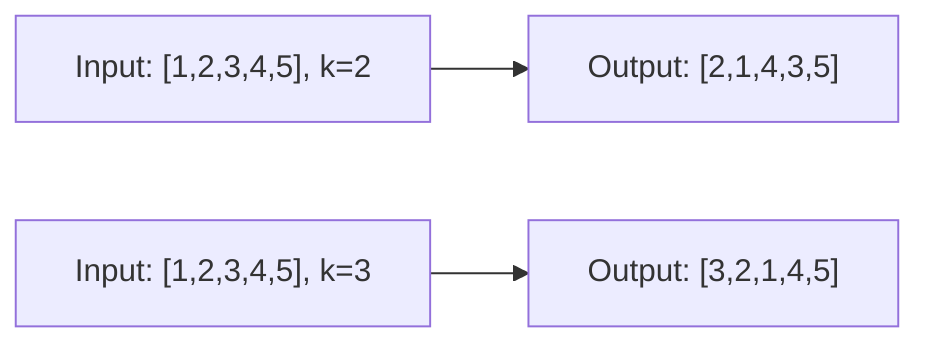

**OBSERVATION:** Process the list in chunks of k. For each chunk: check if k nodes remain, reverse them, connect to the previous group.

**ALGORITHM:**
```
Step 1: Create dummy → head, groupPrev = dummy.
Step 2: Count if at least k nodes remain from groupPrev.next.
Step 3: If yes, reverse the next k nodes.
        Connect: groupPrev → reversed group → rest.
        Update groupPrev = tail of reversed group.
Step 4: Repeat from Step 2.
```

**Flow:**
1. Initialize `dummy -> head` and set `groupPrev = dummy`.
2. Check whether the next `k` nodes exist.
3. Reverse exactly those `k` nodes in place.
4. Connect `groupPrev -> reversedGroup -> remainingList`.
5. Move `groupPrev` to the new group tail and repeat.

```mermaid
flowchart LR
    N1["Step 1: Create dummy"]
    N2["head, groupPrev = dummy."]
    N3["Connect: groupPrev"]
    N4["reversed group"]
    N5["rest."]
    N1 --> N2
    N3 --> N4
    N4 --> N5
```

**JAVA CODE:**

```java
public ListNode reverseKGroup(ListNode head, int k) {
    ListNode dummy = new ListNode(0);
    dummy.next = head;
    ListNode groupPrev = dummy;

    while (true) {
        // Check if k nodes remain
        ListNode kth = groupPrev;
        for (int i = 0; i < k; i++) {
            kth = kth.next;
            if (kth == null) return dummy.next;  // fewer than k remain
        }

        ListNode groupNext = kth.next;  // node after the group

        // Reverse k nodes: groupPrev.next ... kth
        ListNode prev = groupNext, curr = groupPrev.next;
        for (int i = 0; i < k; i++) {
            ListNode next = curr.next;
            curr.next = prev;
            prev = curr;
            curr = next;
        }

        // Connect: groupPrev → reversed group head (prev = kth)
        ListNode groupFirst = groupPrev.next;  // this was first, now last
        groupPrev.next = prev;                  // prev is new group head
        groupPrev = groupFirst;                 // advance for next group
    }
}
```

**COMPLEXITY:**
```
Time:  O(n) — each node visited at most twice (once for counting, once for reversing)
Space: O(1) — in-place pointer manipulation
```

---

### Problem 236: Merge Sort for Linked List ⭐ FULL SOLUTION

**GFG** 🔗 <https://www.geeksforgeeks.org/merge-sort-for-linked-list/>

```
PROBLEM (formal):
  Sort a singly linked list in O(n log n) time using O(1) extra space.

OBSERVATION: Merge sort is NATURAL for linked lists because:
  1. Finding the middle is O(n) via slow/fast — no index needed.
  2. Merging two sorted lists is O(n) with O(1) extra space.
  3. Unlike arrays, no O(n) auxiliary array needed for merging.

  Array merge sort: O(n log n) time, O(n) space.
  LL merge sort:    O(n log n) time, O(log n) space (recursion).
  LL bottom-up:     O(n log n) time, O(1) space.
```

**ALGORITHM:**
```
Step 1: Base case — if list is empty or has one node, return it.
Step 2: Find middle using slow/fast. Split into two halves.
Step 3: Recursively sort both halves.
Step 4: Merge two sorted halves using Problem #218's merge.
```

**PROOF THAT LL MERGE SORT USES O(1) EXTRA SPACE (bottom-up):**
```
Top-down uses O(log n) stack space for recursion.
Bottom-up avoids recursion entirely:
  • Merge sublists of size 1, then 2, then 4, ..., up to n/2.
  • Each pass merges pairs of sublists in a single scan.
  • O(log n) passes, O(n) per pass = O(n log n) total.
  • Only O(1) pointers used (no recursion stack). ∎
```

**JAVA CODE:**

```java
public ListNode sortList(ListNode head) {
    if (head == null || head.next == null) return head;

    // Step 1: Find middle and split
    ListNode slow = head, fast = head.next;
    while (fast != null && fast.next != null) {
        slow = slow.next;
        fast = fast.next.next;
    }
    ListNode mid = slow.next;
    slow.next = null;  // split into two halves

    // Step 2: Recursively sort both halves
    ListNode left = sortList(head);
    ListNode right = sortList(mid);

    // Step 3: Merge sorted halves
    return mergeTwoLists(left, right);
}

private ListNode mergeTwoLists(ListNode l1, ListNode l2) {
    ListNode dummy = new ListNode(0), tail = dummy;
    while (l1 != null && l2 != null) {
        if (l1.val <= l2.val) { tail.next = l1; l1 = l1.next; }
        else                   { tail.next = l2; l2 = l2.next; }
        tail = tail.next;
    }
    tail.next = (l1 != null) ? l1 : l2;
    return dummy.next;
}
```

**COMPLEXITY:**
```
Time:  O(n log n) — log n levels, O(n) work per level (split + merge)
Space: O(log n) — recursion depth (top-down). O(1) for bottom-up variant.

WHY NOT QUICKSORT?
  Quicksort on LL is O(n²) worst case and partition is awkward.
  Merge sort is the standard for sorting linked lists.
```

---

### Problem 237: Flatten a Linked List

**GFG** 🔗 <https://www.geeksforgeeks.org/flattening-a-linked-list/>

```
APPROACH:
  Each node has "next" (right) and "down" pointers. The down lists are sorted.
  Merge all down-lists using the merge-two-sorted-lists technique.

  Start from the rightmost list, merge with the second-rightmost, and so on.
  This is a fold-right using merge.

TEMPLATE: Recursive merge from right to left.
```

**Complexity:** Time O(N) where N = total nodes, Space O(1) extra (excluding stack).

---

### Problem 238: First Non-Repeating Character in a Stream

**GFG** 🔗 <https://www.geeksforgeeks.org/find-first-non-repeating-character-from-a-stream-of-characters/>

```
APPROACH (DLL + HashMap):
  Maintain a Doubly Linked List of characters that have appeared exactly once.
  HashMap maps each character to its node in the DLL (or a "repeated" marker).

  For each new character c in the stream:
    If c not seen: create node, add to DLL tail, put in map.
    If c seen once: remove its node from DLL, mark as repeated in map.
    If c repeated: ignore.

  First non-repeating = DLL head. Answer each query in O(1).

TEMPLATE: DLL as ordered unique-set + HashMap for O(1) lookup.
```

**Complexity:** Time O(1) per character, Space O(alphabet size) = O(26) = O(1).

---

## 13.4 Hidden Gems — Advanced Linked List

> **Pattern:** Uncommon but highly testable problems — circular lists, reservoir sampling, DLL tricks.

---

### Problem 239: Josephus Circle

```
APPROACH (Circular Linked List):
  N people in a circle, eliminate every k-th person.
  Build a circular linked list of N nodes.
  Traverse k-1 steps from current, delete the k-th node.
  Repeat until one person remains.

  Mathematical solution: J(n,k) = (J(n-1,k) + k) mod n, with J(1,k) = 0.

TEMPLATE: Circular LL traversal + deletion.
```

**Complexity:** Time O(nk) for simulation, O(n) for mathematical recurrence, Space O(n) for list / O(1) for math.

---

### Problem 240: Triplet from Three Linked Lists with Given Sum

```
APPROACH:
  Three sorted linked lists. Find a triplet (a, b, c) with a + b + c = target.
  Fix a from list1, then use two-pointer on list2 (forward) and list3 (backward).
  Since list3 is singly linked, sort it in reverse or use a stack for backward traversal.

  Alternative: Use hash set for list3 values. For each pair (a, b), check if
  (target - a - b) exists in the set.

TEMPLATE: Three-pointer / hash set.
```

**Complexity:** Time O(n₁ × n₂) with hash set, Space O(n₃).

---

### Problem 241: Linked List Random Node (Reservoir Sampling)

**LeetCode 382** 🔗 <https://leetcode.com/problems/linked-list-random-node/>

```
APPROACH (Reservoir Sampling):
  Without knowing the list length, select a uniformly random node:
  1. Start with result = head.val, i = 1.
  2. For each subsequent node, generate random int in [0, i).
     If rand == 0, update result = current.val.
  3. Increment i, advance to next.

  Proof: At step i, P(selecting node i) = 1/i.
  P(node i still selected at end) = (1/i) × ∏ⱼ₌ᵢ₊₁ⁿ (1 - 1/j) = 1/n.

TEMPLATE: Reservoir sampling (k=1).
```

```java
class Solution {
    ListNode head;
    Random rand;

    public Solution(ListNode head) {
        this.head = head;
        this.rand = new Random();
    }

    public int getRandom() {
        ListNode curr = head;
        int result = curr.val;
        int i = 1;
        while (curr != null) {
            if (rand.nextInt(i) == 0) {
                result = curr.val;
            }
            i++;
            curr = curr.next;
        }
        return result;
    }
}
```

**Complexity:** Time O(n) per call, Space O(1).

---

### Problem 242: Pair with Given Sum in Sorted Doubly Linked List

```
APPROACH:
  Since the DLL is sorted, use two pointers:
  left = head (smallest), right = tail (largest).

  While left != right and they haven't crossed:
    sum = left.val + right.val
    If sum == target:  found! move both (or collect and continue).
    If sum < target:   left = left.next (increase sum).
    If sum > target:   right = right.prev (decrease sum).

  This is the two-pointer technique, but using DLL's prev pointer
  instead of array indexing. Works because the DLL is sorted.

TEMPLATE: Two-pointer on sorted DLL.
```

**Complexity:** Time O(n), Space O(1).

---

> 🔬 **Section Challenge — 13.4 Hidden Gems — Advanced Linked List**

## 🏆 MASTERY CHECKLIST

```
┌──────────────────────────────────────────────────────────────────────────────┐
│ ✅ LINKED LIST MASTERY — TRACK YOUR PROGRESS                                  │
├──────────────────────────────────────────────────────────────────────────────┤
│                                                                              │
│ FUNDAMENTALS:                                                                │
│ - [ ] Can reverse a linked list in your sleep (iterative + recursive)        │
│ - [ ] Can detect and find cycle start (prove Floyd's theorem)                │
│ - [ ] Can find the middle using slow/fast runner                             │
│ - [ ] Can merge two sorted lists with dummy head                             │
│ - [ ] Can remove nth from end using two-pointer gap                          │
│                                                                              │
│ INTERMEDIATE:                                                                │
│ - [ ] Can reverse a sublist (positions left to right)                        │
│ - [ ] Can copy a list with random pointers (3-pass interleave)               │
│ - [ ] Can partition a list around a value (two dummy heads)                  │
│ - [ ] Can add two numbers represented as linked lists                        │
│                                                                              │
│ ADVANCED:                                                                    │
│ - [ ] Can merge K sorted lists using min-heap                                │
│ - [ ] Can handle K-group reversal operations                                 │
│ - [ ] Understand when LL merge sort beats array merge sort                   │
│ - [ ] Can explain reservoir sampling for random node selection               │
│                                                                              │
│ PROOF & THEORY:                                                              │
│ - [ ] Can state and prove the loop invariant for iterative reversal          │
│ - [ ] Can prove Floyd's cycle detection theorem                              │
│ - [ ] Can derive O(N log k) for merge-K-sorted-lists                         │
│ - [ ] Can explain why merge sort is natural for linked lists                 │
│                                                                              │
│ SPEED TARGETS:                                                               │
│ ┌───────────────────────────┬────────────┐                                   │
│ │ Problem                   │ Target     │                                   │
│ ├───────────────────────────┼────────────┤                                   │
│ │ Reverse LL (iterative)    │ < 2 min    │                                   │
│ │ Detect Cycle (Floyd's)    │ < 3 min    │                                   │
│ │ Merge Two Sorted          │ < 3 min    │                                   │
│ │ Remove Nth from End       │ < 4 min    │                                   │
│ │ Reverse K-Group           │ < 8 min    │                                   │
│ │ Merge K Sorted            │ < 8 min    │                                   │
│ └───────────────────────────┴────────────┘                                   │
└──────────────────────────────────────────────────────────────────────────────┘
```

**Flow:**
1. Linked List Mastery checklist overview.
2. Fundamentals: reversal, cycle, middle, merge, remove-nth.
3. Intermediate: sublist reverse, random-copy, partition, add-two-numbers.
4. Advanced: merge-K, k-group reverse, merge sort, reservoir sampling.
5. Theory: invariants, Floyd proof, and `O(N log k)` reasoning.
6. Speed targets: timed benchmarks for core interview problems.

```mermaid
flowchart TD
    N1["✅ LINKED LIST MASTERY — TRACK YOUR PROGRESS"]
    N2["FUNDAMENTALS:"]
    N3["- [ ] Can find the middle using slow/fast runner"]
    N4["- [ ] Can merge two sorted lists with dummy head"]
    N5["- [ ] Can remove nth from end using two-pointer gap"]
    N6["INTERMEDIATE:"]
    N7["- [ ] Can reverse a sublist (positions left to right)"]
    N8["- [ ] Can partition a list around a value (two dummy heads)"]
    N1 --> N2
    N2 --> N3
    N3 --> N4
    N4 --> N5
    N5 --> N6
    N6 --> N7
    N7 --> N8
```

---

> **Problems 15/22** | [Prev](14_Mixed_Competitive.md) | [Index](../00_MASTER_INDEX.md) | [Next](16_Heap.md)

---

---

## 🏆 Competitive Programming — Codeforces Problems

| Problem | Link | Technique | Difficulty |
|---|---|---|---|
| Linked List & Two Pointers | [CF 817C](https://codeforces.com/problemset/problem/817/C) | Fast & Slow on data stream | ⭐⭐ Medium |
| IQ Test | [CF 25A](https://codeforces.com/problemset/problem/25/A) | Linked list traversal | ⭐ Easy |
| Coloring Trees | [CF 711C](https://codeforces.com/problemset/problem/711/C) | DP on linked sequence | ⭐⭐ Medium |
| K-th Symbol | [CF 1201C](https://codeforces.com/problemset/problem/1201/C) | Recursive + pointer logic | ⭐⭐ Medium |

---

> 🔬 **Section Challenge — 🏆 Competitive Programming — Codeforces Problems**

## 🌍 Real-World Applications of Linked Lists

| Technique | Real-World System | How It's Used |
|---|---|---|
| **Doubly Linked List** | Browser history (Chrome/Firefox) | Back/Forward = prev/next pointers, eviction of old entries |
| **HashMap + DLL (LRU Cache)** | Redis, OS Page Cache, CPU Cache | Get O(1) + evict LRU entry O(1) simultaneously |
| **Circular Linked List** | CPU Round-Robin Scheduling | Each process node points to next; cycle never ends |
| **Skip List** | Redis Sorted Sets | Multi-level linked list gives O(log n) search without tree rebalancing |
| **Singly Linked List** | Memory allocator free list | OS/JVM free heap blocks chained as linked list |

```
🔥 LRU CACHE = most common system design interview:
   HashMap + Doubly Linked List
   → get() in O(1): use HashMap to find node, move to head
   → evict() in O(1): remove tail node, delete from HashMap
   "This is what Redis does for all key eviction policies."
```

---

---

> 🔬 **Section Challenge — 🌍 Real-World Applications of Linked Lists**

## 🏋️ Practice & Interview Questions — Linked Lists

### Predict / Trace

**Q1.** Trace: reverse a linked list `1→2→3→null` manually. Show prev/curr at each step.
<details><summary>Answer</summary>

Step 1: prev=null, curr=1 → 1.next=null, prev=1, curr=2
Step 2: prev=1, curr=2 → 2.next=1, prev=2, curr=3
Step 3: prev=2, curr=3 → 3.next=2, prev=3, curr=null
Result: 3→2→1→null
</details>

**Q2.** Floyd's cycle detection — if fast and slow both start at head, and list has no cycle, when does fast reach null?
<details><summary>Answer</summary>

Fast moves 2 steps per iteration. For odd length N: fast reaches null at step (N+1)/2. For even N: fast reaches null at step N/2.
</details>

### LeetCode / Coding

**Q3.** ⭐ Reverse a Linked List (iterative + recursive).
<details><summary>Solution</summary>

```java
// Iterative
ListNode prev=null, curr=head;
while(curr!=null){ ListNode next=curr.next; curr.next=prev; prev=curr; curr=next; }
return prev;

// Recursive
ListNode reverseList(ListNode head){
    if(head==null||head.next==null) return head;
    ListNode rest = reverseList(head.next);
    head.next.next = head; head.next = null;
    return rest;
}
```
</details>

**Q4.** ⭐ Detect cycle in LinkedList (Floyd's Algorithm).
<details><summary>Solution</summary>

```java
ListNode slow=head, fast=head;
while(fast!=null && fast.next!=null){
    slow=slow.next; fast=fast.next.next;
    if(slow==fast) return true;
}
return false;
```
</details>

**Q5.** ⭐ Find middle of LinkedList.
<details><summary>Solution</summary>

```java
ListNode slow=head, fast=head;
while(fast!=null && fast.next!=null){ slow=slow.next; fast=fast.next.next; }
return slow; // slow is at middle
```
</details>

**Q6.** ⭐ Merge two sorted linked lists.
<details><summary>Solution</summary>

```java
ListNode dummy=new ListNode(0), curr=dummy;
while(l1!=null && l2!=null){
    if(l1.val<=l2.val){ curr.next=l1; l1=l1.next; }
    else { curr.next=l2; l2=l2.next; }
    curr=curr.next;
}
curr.next = (l1!=null)?l1:l2;
return dummy.next;
```
</details>

**Q7.** ⭐⭐ Remove Nth node from end of list.
<details><summary>Solution</summary>

```java
ListNode dummy=new ListNode(0); dummy.next=head;
ListNode fast=dummy, slow=dummy;
for(int i=0;i<=n;i++) fast=fast.next;
while(fast!=null){ fast=fast.next; slow=slow.next; }
slow.next=slow.next.next;
return dummy.next;
```
</details>

**Q8.** ⭐⭐ Find the start of a cycle (Floyd's phase 2).
<details><summary>Solution</summary>

```java
// After meeting point found, reset slow to head
slow=head;
while(slow!=fast){ slow=slow.next; fast=fast.next; }
return slow; // start of cycle
```
</details>

**Q9.** ⭐⭐ LRU Cache — implement with O(1) get and put.
<details><summary>Solution</summary>

```java
// HashMap<key, Node> + Doubly Linked List
// Most recently used at tail, least recently used at head
// put: add to tail, if capacity exceeded remove head
// get: move accessed node to tail
class LRUCache {
    Map<Integer,Node> map = new HashMap<>();
    Node head, tail;
    int cap;
    // ... (standard doubly-linked list implementation)
}
```
</details>

**Q10.** ⭐⭐ Palindrome LinkedList — O(N) time, O(1) space.
<details><summary>Solution</summary>

```java
// 1. Find middle (slow/fast)
// 2. Reverse second half
// 3. Compare first and reversed second half
// 4. Restore list (optional)
```
</details>

**Q11.** ⭐⭐⭐ Merge K sorted lists — O(N log K) with PriorityQueue.
<details><summary>Solution</summary>

```java
PriorityQueue<ListNode> pq = new PriorityQueue<>((a,b)->a.val-b.val);
for(ListNode l:lists) if(l!=null) pq.offer(l);
ListNode dummy=new ListNode(0), curr=dummy;
while(!pq.isEmpty()){
    ListNode node=pq.poll(); curr.next=node; curr=curr.next;
    if(node.next!=null) pq.offer(node.next);
}
return dummy.next;
```
</details>

### Interview Questions

**Q12.** Why is deleting from the middle of a LinkedList O(1) if you have the node reference, but finding it is O(N)?
<details><summary>Answer</summary>

LinkedList nodes store next/prev pointers. Given a node reference: `prev.next = node.next` is O(1). But traversal from head to find the node is O(N) since there's no index-based access.
</details>

**Q13.** `ArrayList` vs `LinkedList` — when is LinkedList NEVER the right choice?
<details><summary>Answer</summary>

For random access (get by index), sorting, or bulk iteration — ArrayList wins due to cache locality. LinkedList's O(N) random access kills performance. In practice, ArrayList + ArrayDeque cover almost all use cases.
</details>

### MCQ Rapid Fire

| # | Question | Answer |
|---|---|---|
| 1 | Singly linked list deletion from tail | O(N) — must find second-to-last |
| 2 | Doubly linked list deletion from tail | O(1) — use tail.prev |
| 3 | Java LinkedList implements | List + Deque |
| 4 | addFirst() vs addLast() time complexity | O(1) both |
| 5 | Floyd's algorithm space complexity | O(1) |
| 6 | Reversing a linked list space complexity | O(1) iterative, O(N) recursive |
| 7 | Sentinel/dummy node purpose | Simplifies edge cases (empty list, single node) |
| 8 | Skip List uses linked lists for | O(log N) average search |

---

## 🧠 Deep Conceptual Questions — Linked Lists

**C1. Why does Java's `LinkedList` implement both `List` AND `Deque`?**
<details><summary>Deep Answer</summary>

A doubly-linked list naturally supports O(1) operations at BOTH ends: `addFirst`, `addLast`, `removeFirst`, `removeLast`. This makes it a perfect Deque (double-ended queue). Java's designers unified the implementations: one data structure, two contracts. `ArrayDeque` is usually faster for queue/stack operations due to cache locality, but LinkedList covers cases needing both List index access and queue behavior (theoretically — in practice, ArrayDeque + ArrayList cover all needs better).
</details>

**C2. Why is Floyd's cycle detection called "tortoise and hare"?**
<details><summary>Deep Answer</summary>

The slow pointer (tortoise) moves 1 step; fast pointer (hare) moves 2. If a cycle exists, the hare enters it first. The tortoise then enters. Since hare moves faster, it gradually gains on the tortoise inside the cycle. The "distance gap" between them decreases by 1 per step inside the cycle. They MUST meet within at most cycle_length steps after the tortoise enters. The meeting point is always WITHIN the cycle. Phase 2 (finding start): reset slow to head, both move 1 step → they meet at cycle start. This works due to modular arithmetic: the distance math works out to exactly the cycle start.
</details>

**C3. Why is `dummy.next = head` pattern so useful in linked list problems?**
<details><summary>Deep Answer</summary>

It eliminates the special case of modifying the head node. Without dummy: "what if I need to delete the head?" needs separate code. With dummy: the real head is just `dummy.next`. You can delete `dummy.next` using the same code as any other node (`prev.next = prev.next.next`). Same logic applies to insertion, merging. Dummy node costs O(1) extra space and saves significant code complexity and potential null-pointer bugs.
</details>

**C4. Reverse a linked list: what's the fundamental insight?**
<details><summary>Deep Answer</summary>

You need to change every `next` pointer from pointing forward to pointing backward. The problem: if you change `curr.next` to `prev`, you lose your reference to `curr.next` (the next node to process). Solution: always save `next` BEFORE changing the pointer. The 3-variable dance: `next = curr.next; curr.next = prev; prev = curr; curr = next`. The recursion version reverses from the tail backward — simpler to reason about (`head.next.next = head; head.next = null`) but uses O(N) stack space.
</details>

**C5. LRU Cache: why is a HashMap + Doubly Linked List the optimal data structure?**
<details><summary>Deep Answer</summary>

Requirements: O(1) get (by key) AND O(1) update order (move to "most recent"). HashMap alone: O(1) get but can't track recency order. LinkedList alone: O(N) get by key. Combined: HashMap maps key → node pointer in the doubly-linked list. Get: HashMap lookup = O(1) to find node, then O(1) pointer manipulation to move to tail. Evict: remove head (LRU) = O(1). Insert: add to tail = O(1). The doubly-linked nature is critical: moving a node requires updating BOTH its predecessor and successor, which requires O(1) access to both — only possible with `prev` pointer.
</details>

**C6. Why does the "find middle" technique use slow/fast instead of counting length then dividing?**
<details><summary>Deep Answer</summary>

Two reasons: (1) **Single pass**: length counting needs one full traversal, then half traversal = 1.5N operations. Slow/fast finds middle in N/2 steps — one pass. (2) **Cleaner integration**: in `palindrome check`, `sort linked list`, `split into halves` problems, you need the middle during traversal anyway. The slow/fast approach composes naturally into these algorithms without a separate counting phase.
</details>

**C7. Merge two sorted lists: why is the dummy node + two-pointer approach textbook?**
<details><summary>Deep Answer</summary>

It reduces the problem to: at each step, pick the smaller head from two lists and advance that pointer. The dummy node holds the result list start. This mirrors merge-sort's merge step exactly. The invariant: `curr` always points to the last node of the merged list, ready to accept the next smallest. Time O(M+N), space O(1) (just pointer manipulation, no new nodes). The final `curr.next = l1 != null ? l1 : l2` handles the remaining tail in O(1) — no loop needed since one list is already sorted.
</details>

> **Navigation**: [< Previous](14_Mixed_Competitive.md) | [Back to Index](../00_MASTER_INDEX.md) | [Next >](16_Heap.md)
