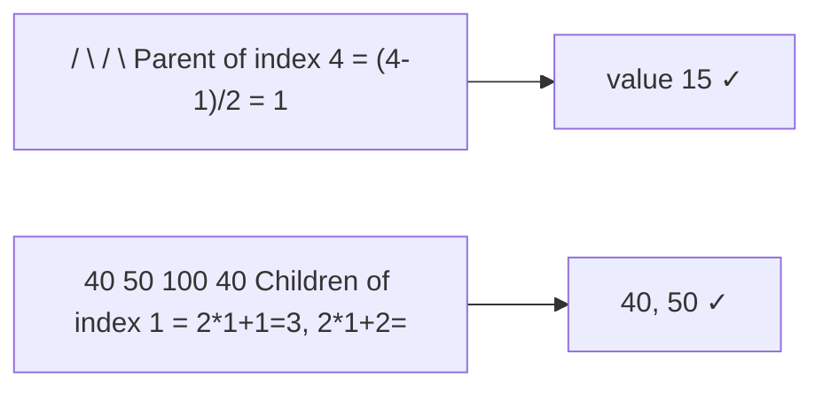
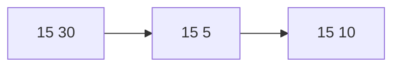
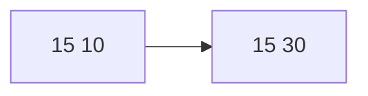
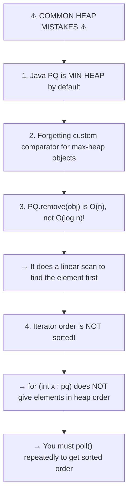
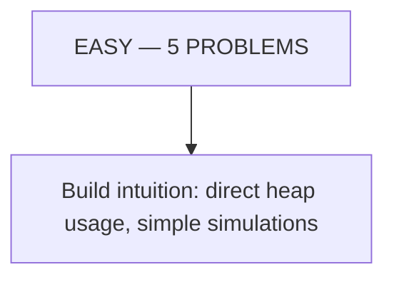
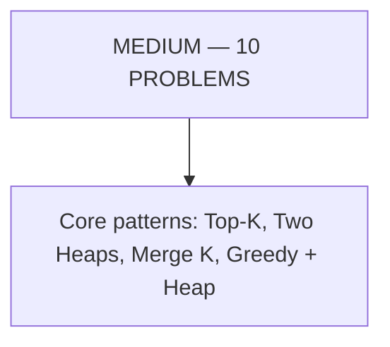
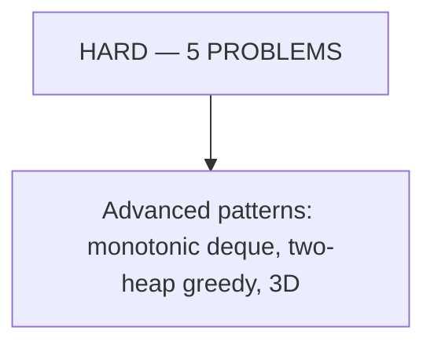
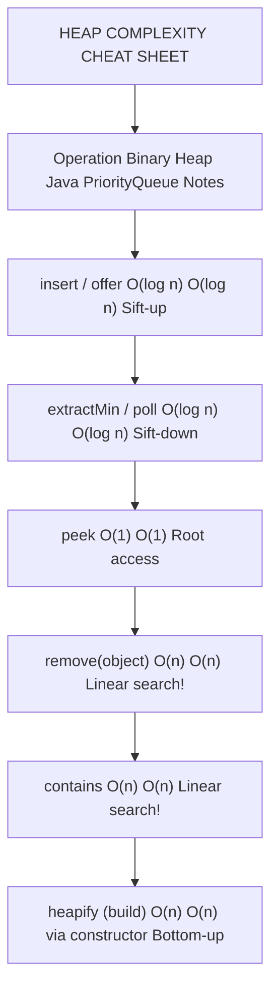
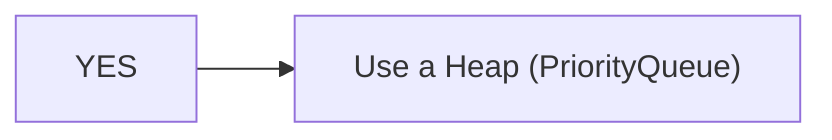
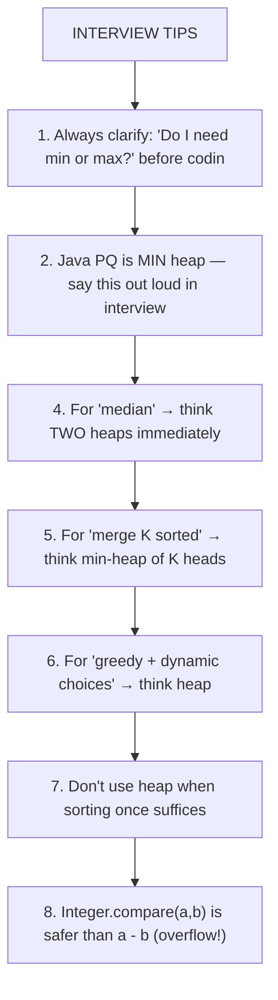

> **Navigation**: [< Previous](15_LinkedList.md) | [Back to Index](../00_MASTER_INDEX.md) | [Next >](17_HashMap_Hashing.md)

---

## 🗺️ Pattern Recognition Header — Heap / Priority Queue

> **When do I need a Heap?** Ask: *"Do I need repeated access to the min or max of a dynamic set?"*
>

| Problem Signature | Heap Pattern | Implementation |
|---|---|---|
| `kth largest / smallest in stream` | **Min-Heap of size K** | Push all; if size > K, poll (evicts smallest) |
| `top K frequent elements` | **Min-Heap of size K** sorted by freq | Pair (freq, val); poll evicts least frequent |
| `K closest to origin / sorted list` | **Max-Heap of size K** | Push all; if size > K, poll (evicts farthest) |
| `median of data stream` | **Two Heaps** (max + min) | maxHeap (lower half) + minHeap (upper half) |
| `merge K sorted lists` | **Min-Heap of heads** | Push all list heads; poll and re-add next node |
| `task scheduler / reorganize string` | **Max-Heap (greedy)** | Always pick most frequent; cool-down cycle |
| `sliding window min/max` | **Monotonic Deque** O(n) | Better than heap for fixed window |

>
> **Heap vs Alternatives:**
> ```
> "Need TOP-K repeatedly?"     → Min-Heap of size K  → O(n log k)
> "Need TOP-K once?"           → Sort  → O(n log n)   OR  Quickselect → O(n)
> "Need sliding window max?"   → Monotonic Deque      → O(n)  ← FASTER!
> "Need median continuously?"  → Two Heaps            → O(log n) per insert
> ```
>
> 📖 **Mental Model:** [09_Complexity_Intuition.md](../14_Mental_Models/09_Complexity_Intuition.md)
> 📖 **Theory:** [01f_Trees_Heaps.md](../02_Data_Structures/01f_Trees_Heaps.md)
> 📖 **Full Pattern Guide:** [00_PATTERN_MASTER_GUIDE.md](../04_Patterns_Templates/00_PATTERN_MASTER_GUIDE.md)

---

# 16. Heap / Priority Queue — Complete Problem Guide


> HEAP / PRIORITY QUEUE MASTERY GUIDE
> From Theory to Hard Problems — MIT/KTH Academic Style
> Part 0: Theory & Internals          │  Part 1: Easy (5 problems)
> Part 2: Medium (10 problems)        │  Part 3: Hard (5 problems)
> Part 4: Cheat Sheet & Decision Tree │


---

## PART 0: THEORY — Heap Internals (MIT/KTH Style)


> WHY HEAPS EXIST
> Fundamental question: How do we efficiently track the min or max of a
> dynamic collection where elements are inserted and removed?
>
> Sorted array?  Insert is O(n).
> Unsorted array? Extract-min is O(n).
> BST?           O(log n) but can degrade to O(n).
> Heap?          O(log n) insert, O(log n) extract, O(1) peek. WINNER.


### Why a Complete Binary Tree Stored in an Array?

A **heap** is a **complete binary tree** satisfying the **heap property**:
- **Min-Heap**: every parent ≤ its children → root is the minimum
- **Max-Heap**: every parent ≥ its children → root is the maximum

**Why complete binary tree?** A complete binary tree has no "holes" — every level is fully filled except possibly the last, which is filled left-to-right. This gives us a critical property: **we can store it in a contiguous array with zero wasted space and zero pointer overhead**.

**Why array storage?** Because for a node at index `i`:
- **Parent** = `(i - 1) / 2`  (integer division)
- **Left child** = `2 * i + 1`
- **Right child** = `2 * i + 2`

This is pure arithmetic — no pointers, no `node.left`/`node.right`. Cache-friendly, memory-efficient.

```
           10                Array: [10, 15, 30, 40, 50, 100, 40]
          /  \               Index:  [0]  [1] [2] [3] [4]  [5] [6]
        15    30
       / \   /  \            Parent of index 4 = (4-1)/2 = 1 → value 15 ✓
      40  50 100  40         Children of index 1 = 2*1+1=3, 2*1+2=4 → 40, 50 ✓
```

**Flow:**
- / \ / \ Parent of index 4 = (4-1)/2 = 1
- ↓
- value 15 ✓
- ↓
- 40 50 100 40 Children of index 1 = 2*1+1=3, 2*1+2=
- ↓
- 40, 50 ✓



### How Heapify Works (Sift-Up and Sift-Down)

**Sift-Up (used in insert):**
```
Insert 5 into min-heap [10, 15, 30, 40, 50]:

Step 1: Place at end          Step 2: 5 < 30? Swap        Step 3: 5 < 10? Swap
     10                            10                            5
    /  \                          /  \                          / \
  15    30          →           15    5            →          15   10
 / \   /                      / \   /                       / \   /
40  50 5                     40  50 30                     40  50 30

Array: [10,15,30,40,50,5]   [10,15,5,40,50,30]          [5,15,10,40,50,30]
```

**Flow:**
- 15 30
- ↓
- 15 5
- ↓
- 15 10



**Sift-Down (used in extract-min):**
```
Extract min from [5, 15, 10, 40, 50, 30]:

Step 1: Replace root with last    Step 2: 30 > min(15,10)? Swap with 10
        30                                 10
       /  \                               /  \
     15    10                →          15    30
    / \                                / \
   40  50                             40  50

Array: [30,15,10,40,50]            [10,15,30,40,50]    ✓ Heap restored!
```

**Flow:**
- 15 10
- ↓
- 15 30



### Time Complexities

| Operation          | Time      | Why                                      |
|--------------------|-----------|------------------------------------------|
| `peek()`           | O(1)      | Root is always min/max                   |
| `insert()`         | O(log n)  | Sift-up at most tree height = log n      |
| `extractMin/Max()` | O(log n)  | Sift-down at most tree height = log n    |
| `heapify(array)`   | **O(n)**  | NOT O(n log n)! Bottom-up construction   |
| `remove(obj)`      | **O(n)**  | Must linear-scan to find, then sift      |
| `contains(obj)`    | **O(n)**  | No ordering guarantee beyond parent-child|

**Why heapify is O(n), not O(n log n):**
Bottom-up construction: most nodes are leaves (n/2 nodes), which need 0 sifts. Only 1 node (root) needs log n sifts. Sum of work = O(n) by geometric series argument.

### Java PriorityQueue Internals

```java
// ⚠️ CRITICAL: Java PriorityQueue is a MIN-HEAP by default!
PriorityQueue<Integer> minHeap = new PriorityQueue<>();          // Min-heap
PriorityQueue<Integer> maxHeap = new PriorityQueue<>(Comparator.reverseOrder()); // Max-heap
// OR: new PriorityQueue<>((a, b) -> b - a)  // Max-heap via lambda

// Key methods:
minHeap.offer(x);       // Insert — O(log n)
minHeap.poll();          // Extract min — O(log n)
minHeap.peek();          // See min — O(1)
minHeap.remove(obj);     // Remove specific — O(n) ← TRAP!
minHeap.size();          // O(1)
minHeap.contains(obj);   // O(n)

// Iterator does NOT return elements in sorted order!
// PQ only guarantees heap property, not full sort.
```

### Common Mistakes (MUST KNOW)

```
╔══════════════════════════════════════════════════════════════════════════════╗
║                     ⚠️  COMMON HEAP MISTAKES  ⚠️                             ║
╠══════════════════════════════════════════════════════════════════════════════╣
║ 1. Java PQ is MIN-HEAP by default                                            ║
║    → If you need max, use Comparator.reverseOrder() or (a,b) -> b - a        ║
║                                                                              ║
║ 2. Forgetting custom comparator for max-heap objects                         ║
║    → new PriorityQueue<int[]>((a,b) -> b[0] - a[0]) for max on first elem    ║
║                                                                              ║
║ 3. PQ.remove(obj) is O(n), not O(log n)!                                     ║
║    → It does a linear scan to find the element first                         ║
║    → If you need fast removal, consider TreeMap or lazy deletion             ║
║                                                                              ║
║ 4. Iterator order is NOT sorted!                                             ║
║    → for (int x : pq) does NOT give elements in heap order                   ║
║    → You must poll() repeatedly to get sorted order                          ║
║                                                                              ║
║ 5. Integer overflow in comparators: (a, b) -> a - b can overflow!            ║
║    → Use Integer.compare(a, b) instead for safety                            ║
║                                                                              ║
║ 6. Using heap when a simpler approach works                                  ║
║    → "Top K" with fixed small K? Sorting may be simpler and same O(n lg n)   ║
║    → "Sliding window max"? Monotonic deque is O(n) vs heap O(n log n)        ║
║                                                                              ║
║ 7. Not recognizing the two-heap pattern for median problems                  ║
║    → maxHeap for lower half + minHeap for upper half = O(log n) median       ║
╚══════════════════════════════════════════════════════════════════════════════╝
```

**Flow:**
- ⚠️ COMMON HEAP MISTAKES ⚠️
- ↓
- 1. Java PQ is MIN-HEAP by default
- ↓
- 2. Forgetting custom comparator for max-heap objects
- ↓
- 3. PQ.remove(obj) is O(n), not O(log n)!
- ↓
- It does a linear scan to find the element first
- ↓
- 4. Iterator order is NOT sorted!
- ↓
- for (int x : pq) does NOT give elements in heap order



---

> 🔬 **Section Challenge — Heap Theory & Internals**
>
> **Challenge 1 (Reasoning):** A min-heap stores `[2, 5, 3, 8, 7, 6]` in array form. Trace the heapify process on index 1 (value 5) manually.
> <details><summary>Answer</summary>
>
> Index 1 (value 5): left child = index 3 (value 8), right child = index 4 (value 7). Min of children = index 4 (value 7). 5 < 7, so no swap needed. Heap property satisfied at index 1. If value was 9 instead: 9 > 7 → swap(index1=9, index4=7) → recurse at index 4.
> </details>
>
> **Challenge 2 (Reasoning):** `new PriorityQueue<>()` in Java is a min-heap. You need a max-heap. Write the exact declaration AND explain why `Collections.reverseOrder()` works.
> <details><summary>Answer</summary>
>
> `PriorityQueue<Integer> maxHeap = new PriorityQueue<>(Collections.reverseOrder());` or `new PriorityQueue<>((a,b) -> b - a)`. Why reverseOrder works: the heap's internal comparisons use the comparator. Reversing the order makes what was "smaller" (min-heap sink) behave as "larger" — the root becomes the maximum element. The underlying array storage and sift operations are unchanged; only the comparison direction flips.
> </details>
>
> **Challenge 3 (Design):** Why is building a heap from N elements O(N) but inserting N elements one by one O(N log N)? Where's the mathematical difference?
> <details><summary>Answer</summary>
>
> **Bottom-up heapify**: work per node = height of that node. Nodes at height 0 (leaves, N/2 nodes): 0 work. Nodes at height 1 (N/4 nodes): 1 comparison. Height h: N/2^(h+1) nodes × h work. Total = Σ h×N/2^(h+1) = N (geometric series converges to 2). **N insertions**: each insertion sifts UP from a leaf to root = O(log N) worst case. N × log N total. The bottom-up builds from the middle of the array downward — most nodes are near the bottom where sift-down work is minimal.
> </details>

## 🧩 Part 1: Easy Problems

```
╔══════════════════════════════════════════════════════════════════════════════╗
║                         EASY — 5 PROBLEMS                                    ║
║  Build intuition: direct heap usage, simple simulations                      ║
╚══════════════════════════════════════════════════════════════════════════════╝
```

**Flow:**
- EASY — 5 PROBLEMS
- ↓
- Build intuition: direct heap usage, simple simulations



### 1. [Kth Largest Element in a Stream](https://leetcode.com/problems/kth-largest-element-in-a-stream/) (LC 703) ⭐ Easy
**Companies**: Amazon, Facebook, Google  
**Pattern**: Min-heap of size K

**Problem**: Design a class that finds the kth largest element in a stream. Implement `KthLargest(int k, int[] nums)` and `int add(int val)`.

**Key Insight**: A min-heap of size k always has the kth largest at its root. Anything smaller gets discarded — we only keep the k largest seen so far.

**Approach**:
1. Maintain a min-heap of capacity k
2. On `add(val)`: push val, if size > k then poll (removes smallest)
3. The root of the heap IS the kth largest — peek() returns the answer
4. WHY: By keeping only k elements and removing the smallest, we guarantee the heap contains the top-k elements, and the min of those is the kth largest.

**Solution**:
```java
class KthLargest {
    private PriorityQueue<Integer> minHeap;
    private int k;

    public KthLargest(int k, int[] nums) {
        this.k = k;
        this.minHeap = new PriorityQueue<>();
        for (int num : nums) {
            add(num);
        }
    }

    public int add(int val) {
        minHeap.offer(val);
        if (minHeap.size() > k) {
            minHeap.poll(); // Remove smallest — not in top k
        }
        return minHeap.peek(); // Kth largest is the min of top-k
    }
}
```

**Complexity**: Time O(n log k) for constructor, O(log k) per add. Space O(k).  
**Why This Works**: The min-heap of size k acts as a "filter" — only the k largest survive. The smallest survivor (root) is by definition the kth largest.

---

### 2. [Last Stone Weight](https://leetcode.com/problems/last-stone-weight/) (LC 1046) ⭐ Easy
**Companies**: Amazon, Google  
**Pattern**: Max-heap simulation

**Problem**: Smash the two heaviest stones together. If equal, both destroyed. If not, remaining = difference. Return the weight of the last stone (or 0).

**Key Insight**: We always need the two largest — a max-heap gives us both in O(log n) per extraction.

**Approach**:
1. Put all stones in a max-heap
2. While heap has 2+ stones: poll two largest, if different push difference back
3. Return remaining stone or 0

**Solution**:
```java
class Solution {
    public int lastStoneWeight(int[] stones) {
        PriorityQueue<Integer> maxHeap = new PriorityQueue<>(Comparator.reverseOrder());
        for (int s : stones) maxHeap.offer(s);

        while (maxHeap.size() > 1) {
            int first = maxHeap.poll();   // Heaviest
            int second = maxHeap.poll();  // Second heaviest
            if (first != second) {
                maxHeap.offer(first - second);
            }
        }
        return maxHeap.isEmpty() ? 0 : maxHeap.peek();
    }
}
```

**Complexity**: Time O(n log n), Space O(n).  
**Why This Works**: Max-heap invariant ensures we always smash the two heaviest. Each operation reduces stone count by at least 1, so we do at most n iterations.

---

### 3. [Sort Array by Increasing Frequency](https://leetcode.com/problems/sort-array-by-increasing-frequency/) (LC 1636) ⭐ Easy
**Companies**: Amazon, Bloomberg  
**Pattern**: Frequency count + custom sort / heap

**Problem**: Sort array by frequency (ascending). For same frequency, sort by value descending.

**Key Insight**: Count frequencies, then use a custom comparator: primary key = frequency ascending, secondary key = value descending.

**Approach**:
1. Count frequencies with a HashMap
2. Use a PriorityQueue with custom comparator: if freq differs → lower freq first; if same freq → larger value first
3. Poll all elements into result

**Solution**:
```java
class Solution {
    public int[] frequencySort(int[] nums) {
        Map<Integer, Integer> freq = new HashMap<>();
        for (int n : nums) freq.merge(n, 1, Integer::sum);

        // Min-heap by freq; if tie, max value first
        PriorityQueue<int[]> pq = new PriorityQueue<>((a, b) -> {
            if (a[1] != b[1]) return a[1] - b[1]; // Lower freq first
            return b[0] - a[0];                     // Higher value first
        });

        for (var entry : freq.entrySet()) {
            pq.offer(new int[]{entry.getKey(), entry.getValue()});
        }

        int[] result = new int[nums.length];
        int idx = 0;
        while (!pq.isEmpty()) {
            int[] pair = pq.poll();
            for (int i = 0; i < pair[1]; i++) {
                result[idx++] = pair[0];
            }
        }
        return result;
    }
}
```

**Complexity**: Time O(n log n), Space O(n).  
**Why This Works**: The heap enforces the two-level ordering, and we expand each (value, count) pair into the output array.

---

### 4. [Relative Ranks](https://leetcode.com/problems/relative-ranks/) (LC 506) ⭐ Easy
**Companies**: Google, Amazon  
**Pattern**: Max-heap for ranking

**Problem**: Given scores of athletes, return their ranks as ["Gold Medal", "Silver Medal", "Bronze Medal", "4", "5", ...].

**Key Insight**: We need to assign ranks by descending score. A max-heap gives us scores in order; we pair each score with its original index.

**Approach**:
1. Push (score, index) into a max-heap
2. Poll in order; assign rank labels for top 3, then "4", "5", etc.
3. Place each label at the original index

**Solution**:
```java
class Solution {
    public String[] findRelativeRanks(int[] score) {
        int n = score.length;
        PriorityQueue<int[]> maxHeap = new PriorityQueue<>((a, b) -> b[0] - a[0]);
        for (int i = 0; i < n; i++) {
            maxHeap.offer(new int[]{score[i], i});
        }

        String[] result = new String[n];
        int rank = 1;
        while (!maxHeap.isEmpty()) {
            int[] top = maxHeap.poll();
            int idx = top[1];
            switch (rank) {
                case 1: result[idx] = "Gold Medal"; break;
                case 2: result[idx] = "Silver Medal"; break;
                case 3: result[idx] = "Bronze Medal"; break;
                default: result[idx] = String.valueOf(rank);
            }
            rank++;
        }
        return result;
    }
}
```

**Complexity**: Time O(n log n), Space O(n).  
**Why This Works**: Max-heap naturally gives us the ranking order. We track original indices to place ranks correctly.

---

### 5. [Minimum Cost to Connect Sticks](https://leetcode.com/problems/minimum-cost-to-connect-sticks/) (LC 1167) ⭐ Easy
**Companies**: Amazon  
**Pattern**: Min-heap greedy (Huffman-like)

**Problem**: Given sticks of various lengths, connect any two sticks at cost = sum of their lengths. Find minimum total cost to connect all sticks into one.

**Key Insight**: This is the Huffman coding problem! Always merge the two smallest to minimize cost. A min-heap efficiently gives us the two smallest.

**Approach**:
1. Put all stick lengths in a min-heap
2. While heap has 2+ sticks: poll two smallest, add their sum as cost, push sum back
3. Return total cost
4. WHY greedy works: merging small sticks early means they get "counted" in fewer subsequent merges, minimizing total cost.

**Solution**:
```java
class Solution {
    public int connectSticks(int[] sticks) {
        PriorityQueue<Integer> minHeap = new PriorityQueue<>();
        for (int s : sticks) minHeap.offer(s);

        int totalCost = 0;
        while (minHeap.size() > 1) {
            int first = minHeap.poll();
            int second = minHeap.poll();
            int cost = first + second;
            totalCost += cost;
            minHeap.offer(cost);
        }
        return totalCost;
    }
}
```

**Complexity**: Time O(n log n), Space O(n).  
**Why This Works**: Greedy choice: always combining the two cheapest sticks is provably optimal (same argument as Huffman coding). Each stick's length is added to the total once per merge it participates in; merging small ones first minimizes this.

---

> 🔬 **Section Challenge — After Easy Problems**
>
> **Challenge 1 (Reasoning):** Kth Largest: why use a SIZE-K min-heap instead of a max-heap or full sort?
> <details><summary>Answer</summary>
>
> Goal: find the Kth largest. Maintain a min-heap of size K. When heap size exceeds K, poll the minimum (too small to be top-K). At the end, the heap root IS the Kth largest. Time: O(N log K) — better than O(N log N) sort when K << N. Max-heap approach: push all, pop K times = O(N + K log N). Min-heap of K is faster for large N, small K. Key insight: by keeping only the K largest seen so far, the minimum of those K is the answer.
> </details>
>
> **Challenge 2 (Reasoning):** `lastStoneWeight` uses a max-heap. Why would a min-heap give wrong answers?
> <details><summary>Answer</summary>
>
> The problem requires always smashing the TWO HEAVIEST stones. Max-heap gives O(1) access to the maximum. Min-heap gives the minimum — the opposite of what's needed. The greedy correctness relies on always taking the current global maximum pair; taking minimums would leave heavy stones at the end and give incorrect results.
> </details>

## 🧩 Part 2: Medium Problems

```
╔══════════════════════════════════════════════════════════════════════════════╗
║                        MEDIUM — 10 PROBLEMS                                  ║
║  Core patterns: Top-K, Two Heaps, Merge K, Greedy + Heap                     ║
╚══════════════════════════════════════════════════════════════════════════════╝
```

**Flow:**
- MEDIUM — 10 PROBLEMS
- ↓
- Core patterns: Top-K, Two Heaps, Merge K, Greedy + Heap



### 1. [Kth Largest Element in an Array](https://leetcode.com/problems/kth-largest-element-in-an-array/) (LC 215) ⭐ Medium
**Companies**: Facebook, Amazon, Google, Microsoft, Apple  
**Pattern**: Min-heap of size K (or Quickselect)

**Problem**: Find the kth largest element in an unsorted array.

**Key Insight**: Maintain a min-heap of size k. After processing all elements, the root is the kth largest. Alternative: Quickselect achieves O(n) average.

**Approach (Heap)**:
1. Iterate through all elements
2. Push each into a min-heap
3. If heap size exceeds k, poll the minimum (it's not in the top-k)
4. After all elements, peek() is the answer

**Solution**:
```java
class Solution {
    // Approach 1: Min-heap — O(n log k) time, O(k) space
    public int findKthLargest(int[] nums, int k) {
        PriorityQueue<Integer> minHeap = new PriorityQueue<>();
        for (int num : nums) {
            minHeap.offer(num);
            if (minHeap.size() > k) {
                minHeap.poll();
            }
        }
        return minHeap.peek();
    }

    // Approach 2: Quickselect — O(n) average, O(n²) worst
    public int findKthLargestQuickSelect(int[] nums, int k) {
        int target = nums.length - k; // kth largest = (n-k)th smallest
        return quickSelect(nums, 0, nums.length - 1, target);
    }

    private int quickSelect(int[] nums, int lo, int hi, int target) {
        int pivot = nums[hi];
        int i = lo;
        for (int j = lo; j < hi; j++) {
            if (nums[j] <= pivot) {
                swap(nums, i, j);
                i++;
            }
        }
        swap(nums, i, hi);

        if (i == target) return nums[i];
        else if (i < target) return quickSelect(nums, i + 1, hi, target);
        else return quickSelect(nums, lo, i - 1, target);
    }

    private void swap(int[] nums, int a, int b) {
        int tmp = nums[a]; nums[a] = nums[b]; nums[b] = tmp;
    }
}
```

**Complexity**: Heap: Time O(n log k), Space O(k). Quickselect: Time O(n) avg, Space O(1).  
**Why This Works**: The min-heap approach is the same "top-k filter" as LC 703. Quickselect partitions around a pivot and only recurses into the half containing the target index.

---

### 2. [Top K Frequent Elements](https://leetcode.com/problems/top-k-frequent-elements/) (LC 347) ⭐ Medium
**Companies**: Amazon, Facebook, Google, Microsoft, Uber  
**Pattern**: Frequency count + Min-heap of size K (or Bucket sort)

**Problem**: Given an integer array and k, return the k most frequent elements.

**Key Insight**: Count frequencies, then use a min-heap of size k keyed by frequency. The k elements remaining are the top-k frequent.

**Approach**:
1. Count frequencies with HashMap
2. Push each (element, freq) into a min-heap sorted by frequency
3. If heap size > k, poll (removes least frequent among candidates)
4. Remaining k elements are the answer

**Solution**:
```java
class Solution {
    // Approach 1: Min-heap — O(n log k)
    public int[] topKFrequent(int[] nums, int k) {
        Map<Integer, Integer> freq = new HashMap<>();
        for (int n : nums) freq.merge(n, 1, Integer::sum);

        // Min-heap by frequency
        PriorityQueue<Map.Entry<Integer, Integer>> pq =
            new PriorityQueue<>((a, b) -> a.getValue() - b.getValue());

        for (var entry : freq.entrySet()) {
            pq.offer(entry);
            if (pq.size() > k) pq.poll();
        }

        int[] result = new int[k];
        for (int i = 0; i < k; i++) {
            result[i] = pq.poll().getKey();
        }
        return result;
    }

    // Approach 2: Bucket sort — O(n) time
    public int[] topKFrequentBucket(int[] nums, int k) {
        Map<Integer, Integer> freq = new HashMap<>();
        for (int n : nums) freq.merge(n, 1, Integer::sum);

        @SuppressWarnings("unchecked")
        List<Integer>[] buckets = new ArrayList[nums.length + 1];
        for (var entry : freq.entrySet()) {
            int f = entry.getValue();
            if (buckets[f] == null) buckets[f] = new ArrayList<>();
            buckets[f].add(entry.getKey());
        }

        int[] result = new int[k];
        int idx = 0;
        for (int i = buckets.length - 1; i >= 0 && idx < k; i--) {
            if (buckets[i] != null) {
                for (int val : buckets[i]) {
                    result[idx++] = val;
                    if (idx == k) break;
                }
            }
        }
        return result;
    }
}
```

**Complexity**: Heap: O(n log k), Space O(n). Bucket: O(n), Space O(n).  
**Why This Works**: Min-heap of size k keeps only the k most frequent. Bucket sort exploits that frequencies are bounded by n, giving O(n) time.

---

### 3. [K Closest Points to Origin](https://leetcode.com/problems/k-closest-points-to-origin/) (LC 973) ⭐ Medium
**Companies**: Facebook, Amazon, Google  
**Pattern**: Max-heap of size K

**Problem**: Given an array of points, return the k closest to the origin.

**Key Insight**: Use a max-heap of size k sorted by distance. If a new point is closer than the farthest in our heap, swap it in.

**Approach**:
1. Use a max-heap keyed by squared distance (avoid sqrt for efficiency)
2. For each point, push it; if size > k, poll the farthest
3. Remaining k points are the closest

**Solution**:
```java
class Solution {
    public int[][] kClosest(int[][] points, int k) {
        // Max-heap by distance (so we can evict the farthest)
        PriorityQueue<int[]> maxHeap = new PriorityQueue<>(
            (a, b) -> (b[0]*b[0] + b[1]*b[1]) - (a[0]*a[0] + a[1]*a[1])
        );

        for (int[] p : points) {
            maxHeap.offer(p);
            if (maxHeap.size() > k) {
                maxHeap.poll(); // Remove the farthest point
            }
        }

        int[][] result = new int[k][2];
        for (int i = 0; i < k; i++) {
            result[i] = maxHeap.poll();
        }
        return result;
    }
}
```

**Complexity**: Time O(n log k), Space O(k).  
**Why This Works**: The max-heap keeps the k closest by always evicting the farthest among the current k+1 candidates. After scanning all points, only the k closest remain.

---

### 4. [Find Median from Data Stream](https://leetcode.com/problems/find-median-from-data-stream/) (LC 295) ⭐ Medium/Hard
**Companies**: Amazon, Google, Facebook, Microsoft, Apple  
**Pattern**: Two Heaps (maxHeap for lower half, minHeap for upper half)

**Problem**: Design a data structure that supports `addNum(int num)` and `findMedian()` in O(log n) and O(1) respectively.

**Key Insight**: Split numbers into two halves. A max-heap holds the smaller half (so its root = max of smaller half). A min-heap holds the larger half (so its root = min of larger half). The median is at the boundary between these two heaps.

**Approach**:
1. Keep `maxHeap` (lower half) and `minHeap` (upper half)
2. Balance rule: `maxHeap.size()` = `minHeap.size()` or `maxHeap.size()` = `minHeap.size() + 1`
3. On `addNum`: always add to maxHeap first, then rebalance by moving maxHeap's top to minHeap if needed
4. On `findMedian`: if sizes equal, average of both roots; if maxHeap larger, its root

**Solution**:
```java
class MedianFinder {
    private PriorityQueue<Integer> maxHeap; // Lower half (max at top)
    private PriorityQueue<Integer> minHeap; // Upper half (min at top)

    public MedianFinder() {
        maxHeap = new PriorityQueue<>(Comparator.reverseOrder());
        minHeap = new PriorityQueue<>();
    }

    public void addNum(int num) {
        maxHeap.offer(num);
        // Ensure maxHeap's max <= minHeap's min
        minHeap.offer(maxHeap.poll());
        // Rebalance: maxHeap can be larger by at most 1
        if (minHeap.size() > maxHeap.size()) {
            maxHeap.offer(minHeap.poll());
        }
    }

    public double findMedian() {
        if (maxHeap.size() > minHeap.size()) {
            return maxHeap.peek();
        }
        return (maxHeap.peek() + minHeap.peek()) / 2.0;
    }
}
```

**Complexity**: Time O(log n) per add, O(1) per findMedian. Space O(n).  
**Why This Works**: The two heaps maintain a sorted partition. The max of the lower half and min of the upper half are always accessible in O(1), giving us the median directly.

---

### 5. [Reorganize String](https://leetcode.com/problems/reorganize-string/) (LC 767) ⭐ Medium
**Companies**: Amazon, Google, Facebook  
**Pattern**: Greedy + Max-Heap

**Problem**: Rearrange string so no two adjacent characters are the same. Return "" if impossible.

**Key Insight**: Greedily place the most frequent character, then the next most frequent. Use a max-heap to always pick the highest-frequency char available. After placing a char, hold it aside until the next placement.

**Approach**:
1. Count character frequencies
2. Push all (freq, char) into a max-heap
3. Each step: poll top char, append it, hold it aside
4. Before next step: push the previously held-aside char back (if freq > 0)
5. If heap is empty but we still have a held-aside char with freq > 0, return ""

**Solution**:
```java
class Solution {
    public String reorganizeString(String s) {
        int[] freq = new int[26];
        for (char c : s.toCharArray()) freq[c - 'a']++;

        // Max-heap: [frequency, character]
        PriorityQueue<int[]> maxHeap = new PriorityQueue<>((a, b) -> b[0] - a[0]);
        for (int i = 0; i < 26; i++) {
            if (freq[i] > 0) {
                maxHeap.offer(new int[]{freq[i], i});
            }
        }

        StringBuilder sb = new StringBuilder();
        int[] prev = null; // Previously placed char (cooling down)

        while (!maxHeap.isEmpty()) {
            int[] curr = maxHeap.poll();
            // Push back the previous char if it still has remaining count
            if (prev != null && prev[0] > 0) {
                maxHeap.offer(prev);
            }
            sb.append((char)(curr[1] + 'a'));
            curr[0]--;
            prev = curr;
        }

        return sb.length() == s.length() ? sb.toString() : "";
    }
}
```

**Complexity**: Time O(n log 26) = O(n), Space O(26) = O(1).  
**Why This Works**: By always placing the most frequent available character and cooling down the last-placed character for one turn, we guarantee no adjacent duplicates (if a solution exists).

---

### 6. [Task Scheduler](https://leetcode.com/problems/task-scheduler/) (LC 621) ⭐ Medium
**Companies**: Facebook, Amazon, Google, Microsoft  
**Pattern**: Greedy + Heap (or math)

**Problem**: Given tasks with cooldown interval `n`, find the minimum time to execute all tasks. Same tasks need at least `n` intervals apart.

**Key Insight**: The most frequent task dictates the schedule. In each "round" of n+1 slots, greedily pick the most frequent available tasks. Idle slots fill the gaps.

**Approach**:
1. Count task frequencies, push into max-heap
2. Process in rounds of (n + 1) time units
3. Each round: poll up to n+1 tasks from heap, decrement their counts
4. Push back tasks that still have remaining count
5. Time for each round = max(n + 1, tasks executed) unless it's the last round

**Solution**:
```java
class Solution {
    public int leastInterval(char[] tasks, int n) {
        int[] freq = new int[26];
        for (char t : tasks) freq[t - 'A']++;

        PriorityQueue<Integer> maxHeap = new PriorityQueue<>(Comparator.reverseOrder());
        for (int f : freq) {
            if (f > 0) maxHeap.offer(f);
        }

        int time = 0;
        while (!maxHeap.isEmpty()) {
            List<Integer> temp = new ArrayList<>();
            int cycle = n + 1; // Each cycle is n+1 slots

            for (int i = 0; i < cycle && !maxHeap.isEmpty(); i++) {
                int count = maxHeap.poll();
                if (count > 1) temp.add(count - 1);
            }

            for (int t : temp) maxHeap.offer(t);

            // If heap is empty, this was the last cycle — only count actual tasks
            time += maxHeap.isEmpty() ? (cycle - (cycle - temp.size() - (n + 1 - cycle + temp.size()))) : cycle;
        }
        return time;
    }

    // Cleaner math approach:
    public int leastIntervalMath(char[] tasks, int n) {
        int[] freq = new int[26];
        for (char t : tasks) freq[t - 'A']++;
        Arrays.sort(freq);

        int maxFreq = freq[25];
        int maxCount = 0; // How many tasks have the max frequency
        for (int f : freq) {
            if (f == maxFreq) maxCount++;
        }

        // (maxFreq - 1) full rounds of (n + 1) slots, plus final partial round
        int result = (maxFreq - 1) * (n + 1) + maxCount;
        return Math.max(result, tasks.length); // At minimum, we need tasks.length time
    }
}
```

**Complexity**: Time O(n * total_tasks), Space O(26) = O(1).  
**Why This Works**: The math approach: the most frequent task creates (maxFreq - 1) gaps of size n. Other tasks fill these gaps. If all gaps are filled, total time = number of tasks.

---

### 7. [Merge K Sorted Lists](https://leetcode.com/problems/merge-k-sorted-lists/) (LC 23) ⭐ Medium/Hard
**Companies**: Amazon, Facebook, Google, Microsoft, Apple  
**Pattern**: Min-heap of K heads

**Problem**: Merge k sorted linked lists into one sorted linked list.

**Key Insight**: At any point, the next smallest element must be the head of one of the k lists. A min-heap of size k gives us this in O(log k).

**Approach**:
1. Push the head of each non-null list into a min-heap
2. Poll the smallest node, add it to our result list
3. If that node has a next, push next into the heap
4. Repeat until heap is empty

**Solution**:
```java
class Solution {
    public ListNode mergeKLists(ListNode[] lists) {
        PriorityQueue<ListNode> minHeap = new PriorityQueue<>(
            (a, b) -> a.val - b.val
        );

        // Initialize: add all non-null heads
        for (ListNode head : lists) {
            if (head != null) minHeap.offer(head);
        }

        ListNode dummy = new ListNode(0);
        ListNode curr = dummy;

        while (!minHeap.isEmpty()) {
            ListNode smallest = minHeap.poll();
            curr.next = smallest;
            curr = curr.next;
            if (smallest.next != null) {
                minHeap.offer(smallest.next);
            }
        }

        return dummy.next;
    }
}
```

**Complexity**: Time O(N log k) where N = total nodes across all lists. Space O(k).  
**Why This Works**: The heap always contains at most k items (one from each list). Each of the N nodes is pushed and polled exactly once, each operation costing O(log k).

---

### 8. [Sort Characters By Frequency](https://leetcode.com/problems/sort-characters-by-frequency/) (LC 451) ⭐ Medium
**Companies**: Amazon, Google, Bloomberg  
**Pattern**: Frequency count + Max-Heap

**Problem**: Sort a string by character frequency in descending order.

**Key Insight**: Count frequencies, then use a max-heap to pull characters from most to least frequent.

**Approach**:
1. Count character frequencies
2. Push (freq, char) pairs into a max-heap
3. Poll and append each character freq times

**Solution**:
```java
class Solution {
    public String frequencySort(String s) {
        Map<Character, Integer> freq = new HashMap<>();
        for (char c : s.toCharArray()) freq.merge(c, 1, Integer::sum);

        PriorityQueue<Map.Entry<Character, Integer>> maxHeap =
            new PriorityQueue<>((a, b) -> b.getValue() - a.getValue());
        maxHeap.addAll(freq.entrySet());

        StringBuilder sb = new StringBuilder();
        while (!maxHeap.isEmpty()) {
            var entry = maxHeap.poll();
            for (int i = 0; i < entry.getValue(); i++) {
                sb.append(entry.getKey());
            }
        }
        return sb.toString();
    }
}
```

**Complexity**: Time O(n log k) where k = distinct chars. Space O(n).  
**Why This Works**: The max-heap extracts characters in descending frequency order, which is exactly the desired output order.

---

### 9. [Kth Smallest Element in a Sorted Matrix](https://leetcode.com/problems/kth-smallest-element-in-a-sorted-matrix/) (LC 378) ⭐ Medium
**Companies**: Amazon, Google, Facebook  
**Pattern**: Min-heap BFS on matrix / Binary Search

**Problem**: Given an n × n matrix where each row and column is sorted, find the kth smallest element.

**Key Insight**: Treat it like merging n sorted lists (one per row). Use a min-heap initialized with the first element of each row, then expand rightward.

**Approach**:
1. Push (value, row, col) for the first element of each row into a min-heap
2. Poll k-1 times; each time, push the next element in that row (if exists)
3. The kth poll is the answer

**Solution**:
```java
class Solution {
    public int kthSmallest(int[][] matrix, int k) {
        int n = matrix.length;
        // [value, row, col]
        PriorityQueue<int[]> minHeap = new PriorityQueue<>((a, b) -> a[0] - b[0]);

        // Initialize with first column of each row
        for (int r = 0; r < Math.min(n, k); r++) {
            minHeap.offer(new int[]{matrix[r][0], r, 0});
        }

        int result = 0;
        for (int i = 0; i < k; i++) {
            int[] top = minHeap.poll();
            result = top[0];
            int row = top[1], col = top[2];
            if (col + 1 < n) {
                minHeap.offer(new int[]{matrix[row][col + 1], row, col + 1});
            }
        }
        return result;
    }
}
```

**Complexity**: Time O(k log min(n, k)), Space O(min(n, k)).  
**Why This Works**: We're doing a BFS-like expansion across sorted rows. The min-heap ensures we always process the globally smallest unseen element next, guaranteeing the kth poll is the kth smallest.

---

### 10. [Furthest Building You Can Reach](https://leetcode.com/problems/furthest-building-you-can-reach/) (LC 1642) ⭐ Medium
**Companies**: Google, Amazon  
**Pattern**: Min-heap for greedy resource allocation

**Problem**: Given buildings' heights, bricks, and ladders, find the furthest building you can reach. Use bricks or a ladder for each climb (height[i+1] > height[i]).

**Key Insight**: Ladders should be used for the largest climbs. Use a min-heap of size = ladders to track the largest climbs seen. When the heap overflows, the smallest climb in the heap gets paid with bricks instead.

**Approach**:
1. For each positive climb (diff = height[i+1] - height[i]):
   - Push diff into a min-heap (optimistically use a ladder)
   - If heap size > ladders, poll the smallest climb and use bricks instead
   - If bricks < 0, we can't proceed — return i
2. If we finish, return last index

**Solution**:
```java
class Solution {
    public int furthestBuilding(int[] heights, int bricks, int ladders) {
        PriorityQueue<Integer> minHeap = new PriorityQueue<>(); // Tracks ladder-worthy climbs

        for (int i = 0; i < heights.length - 1; i++) {
            int diff = heights[i + 1] - heights[i];
            if (diff <= 0) continue; // Descending or flat — no cost

            minHeap.offer(diff); // Optimistically assign a ladder

            if (minHeap.size() > ladders) {
                // Too many ladders used — convert smallest climb to bricks
                bricks -= minHeap.poll();
                if (bricks < 0) return i;
            }
        }
        return heights.length - 1;
    }
}
```

**Complexity**: Time O(n log L) where L = ladders, Space O(L).  
**Why This Works**: The min-heap of size L ensures ladders are always assigned to the L largest climbs seen so far. All other climbs use bricks. This is provably optimal: ladders have maximum value on the largest climbs.

---

> 🔬 **Section Challenge — After Medium Problems**
>
> **Challenge 1 (Reasoning):** Median from Data Stream: why do we need TWO heaps? Why can't one heap solve it?
> <details><summary>Answer</summary>
>
> One heap gives O(1) access to its root (max or min). But median requires BOTH the max of the lower half AND the min of the upper half. One heap can't give both simultaneously in O(1). Two heaps: `lo` = max-heap of lower half (root = largest of small numbers), `hi` = min-heap of upper half (root = smallest of large numbers). Median = `lo.peek()` or average of `lo.peek() + hi.peek()`. Maintaining balance invariant (sizes differ by at most 1) ensures this works.
> </details>
>
> **Challenge 2 (Design):** Task Scheduler (LeetCode 621) — why is it solved with a max-heap and not sorting?
> <details><summary>Answer</summary>
>
> You need to always schedule the most frequent remaining task (greedy). Max-heap gives O(log N) access to the highest-frequency task without re-sorting after each removal. After scheduling, frequency decreases by 1, re-insert if > 0. Sorting once at start doesn't work: frequencies change dynamically as tasks are scheduled. The heap maintains the most-frequent invariant dynamically. Key pattern: **greedy + dynamic ordering = heap**.
> </details>
>
> **Challenge 3 (Reasoning):** Merge K sorted lists: why PriorityQueue of size K instead of merging two at a time?
> <details><summary>Answer</summary>
>
> Merge two at a time: each merge costs O(total_elements). K iterations = O(K × N) total. PriorityQueue: maintain the current head of each list in a min-heap of size K. Extract min = O(log K), insert next element = O(log K). Total: O(N log K) where N = total elements. When K is large (say 1000 lists), O(N log K) vs O(NK) is a massive difference. Key insight: we never need to compare all K lists — just the current minimums.
> </details>

## 🧩 Part 3: Hard Problems

```
╔══════════════════════════════════════════════════════════════════════════════╗
║                         HARD — 5 PROBLEMS                                    ║
║  Advanced patterns: monotonic deque, two-heap greedy, 3D BFS                 ║
╚══════════════════════════════════════════════════════════════════════════════╝
```

**Flow:**
- HARD — 5 PROBLEMS
- ↓
- Advanced patterns: monotonic deque, two-heap greedy, 3D



### 1. [Sliding Window Maximum](https://leetcode.com/problems/sliding-window-maximum/) (LC 239) ⭐ Hard
**Companies**: Amazon, Google, Facebook, Microsoft  
**Pattern**: Monotonic Deque (preferred) vs Max-Heap

**Problem**: Given an array and window size k, return the max of each sliding window position.

**Key Insight**: A max-heap approach works but is O(n log n) due to lazy deletion. A monotonic decreasing deque achieves O(n) — it maintains candidates in decreasing order, discarding elements that can never be the max.

**Approach (Monotonic Deque — optimal)**:
1. Maintain a deque of indices in decreasing order of values
2. For each new element: remove all smaller elements from back (they'll never be max)
3. Remove front if it's outside the window
4. Front of deque is always the current window max

**Solution**:
```java
class Solution {
    // Approach 1: Monotonic Deque — O(n) ✓ Preferred
    public int[] maxSlidingWindow(int[] nums, int k) {
        int n = nums.length;
        int[] result = new int[n - k + 1];
        Deque<Integer> deque = new ArrayDeque<>(); // Stores indices

        for (int i = 0; i < n; i++) {
            // Remove elements outside window
            while (!deque.isEmpty() && deque.peekFirst() < i - k + 1) {
                deque.pollFirst();
            }
            // Remove smaller elements — they can never be the max
            while (!deque.isEmpty() && nums[deque.peekLast()] < nums[i]) {
                deque.pollLast();
            }
            deque.offerLast(i);

            if (i >= k - 1) {
                result[i - k + 1] = nums[deque.peekFirst()];
            }
        }
        return result;
    }

    // Approach 2: Max-Heap with lazy deletion — O(n log n)
    public int[] maxSlidingWindowHeap(int[] nums, int k) {
        int n = nums.length;
        int[] result = new int[n - k + 1];
        // [value, index]
        PriorityQueue<int[]> maxHeap = new PriorityQueue<>((a, b) -> b[0] - a[0]);

        for (int i = 0; i < n; i++) {
            maxHeap.offer(new int[]{nums[i], i});
            // Lazy deletion: remove elements outside window
            while (maxHeap.peek()[1] < i - k + 1) {
                maxHeap.poll();
            }
            if (i >= k - 1) {
                result[i - k + 1] = maxHeap.peek()[0];
            }
        }
        return result;
    }
}
```

**Complexity**: Deque: Time O(n), Space O(k). Heap: Time O(n log n), Space O(n).  
**Why This Works**: The deque maintains a decreasing sequence of "useful" elements. Any element smaller than a newer element is discarded because it can never be the window max while the newer, larger element exists in the window.

---

### 2. [IPO](https://leetcode.com/problems/ipo/) (LC 502) ⭐ Hard
**Companies**: Amazon, Google  
**Pattern**: Two Heaps — Greedy capital maximization

**Problem**: Given k projects with profits and minimum capital requirements, and starting capital w, maximize total capital by selecting at most k projects (each done at most once, sequential).

**Key Insight**: At each step, choose the most profitable project we can afford. Use a min-heap sorted by capital requirement to track "unlockable" projects, and a max-heap sorted by profit to pick the best affordable one.

**Approach**:
1. Create a min-heap of (capital, profit) for all projects — sorted by capital
2. For k rounds:
   - Move all projects with capital ≤ current w from min-heap to max-heap (sorted by profit)
   - Poll from max-heap — this is the most profitable affordable project
   - Add its profit to w
3. Return w

**Solution**:
```java
class Solution {
    public int findMaximizedCapital(int k, int w, int[] profits, int[] capital) {
        int n = profits.length;
        // Min-heap sorted by capital requirement
        PriorityQueue<int[]> capHeap = new PriorityQueue<>((a, b) -> a[0] - b[0]);
        for (int i = 0; i < n; i++) {
            capHeap.offer(new int[]{capital[i], profits[i]});
        }

        // Max-heap sorted by profit (for affordable projects)
        PriorityQueue<Integer> profitHeap = new PriorityQueue<>(Comparator.reverseOrder());

        for (int i = 0; i < k; i++) {
            // Unlock all affordable projects
            while (!capHeap.isEmpty() && capHeap.peek()[0] <= w) {
                profitHeap.offer(capHeap.poll()[1]);
            }
            if (profitHeap.isEmpty()) break; // No affordable project
            w += profitHeap.poll(); // Take the most profitable
        }
        return w;
    }
}
```

**Complexity**: Time O(n log n + k log n), Space O(n).  
**Why This Works**: Greedy is provably optimal here: since capital only grows and projects are independent, selecting the highest-profit affordable project at each step maximizes future buying power and thus total profit.

---

### 3. [Trapping Rain Water II](https://leetcode.com/problems/trapping-rain-water-ii/) (LC 407) ⭐ Hard
**Companies**: Google, Amazon  
**Pattern**: Min-Heap BFS on 3D heightmap (extension of 1D trapping rain water)

**Problem**: Given a 2D elevation map, compute how much water it can trap after raining.

**Key Insight**: The water level at any cell is determined by the minimum boundary height surrounding it. Start from the border (lowest potential walls) and use a min-heap to process cells in order of height, flooding inward.

**Approach**:
1. Add all border cells to a min-heap, mark visited
2. Poll the lowest cell — it represents the current "water level" boundary
3. For each unvisited neighbor: water trapped = max(0, current_level - neighbor_height)
4. Push neighbor with height = max(current_level, neighbor_height) into heap
5. The heap naturally processes the boundary from lowest to highest, ensuring correct water calculation

**Solution**:
```java
class Solution {
    public int trapRainWater(int[][] heightMap) {
        int m = heightMap.length, n = heightMap[0].length;
        if (m < 3 || n < 3) return 0;

        boolean[][] visited = new boolean[m][n];
        // Min-heap: [height, row, col]
        PriorityQueue<int[]> minHeap = new PriorityQueue<>((a, b) -> a[0] - b[0]);

        // Add all border cells
        for (int i = 0; i < m; i++) {
            for (int j = 0; j < n; j++) {
                if (i == 0 || i == m - 1 || j == 0 || j == n - 1) {
                    minHeap.offer(new int[]{heightMap[i][j], i, j});
                    visited[i][j] = true;
                }
            }
        }

        int[][] dirs = {{0,1},{0,-1},{1,0},{-1,0}};
        int water = 0;

        while (!minHeap.isEmpty()) {
            int[] cell = minHeap.poll();
            int h = cell[0], r = cell[1], c = cell[2];

            for (int[] d : dirs) {
                int nr = r + d[0], nc = c + d[1];
                if (nr >= 0 && nr < m && nc >= 0 && nc < n && !visited[nr][nc]) {
                    visited[nr][nc] = true;
                    // Water trapped at this cell
                    water += Math.max(0, h - heightMap[nr][nc]);
                    // Push with effective height (max of boundary and actual)
                    minHeap.offer(new int[]{Math.max(h, heightMap[nr][nc]), nr, nc});
                }
            }
        }
        return water;
    }
}
```

**Complexity**: Time O(m·n · log(m·n)), Space O(m·n).  
**Why This Works**: By processing border cells from lowest to highest, we simulate water flowing from outside in. The min-heap ensures we always expand the lowest part of the boundary first, correctly computing water levels by the "weakest wall" principle.

---

### 4. [Minimum Cost to Hire K Workers](https://leetcode.com/problems/minimum-cost-to-hire-k-workers/) (LC 857) ⭐ Hard
**Companies**: Google, Amazon  
**Pattern**: Sort + Max-Heap greedy

**Problem**: Given n workers with quality[i] and wage[i], hire exactly k workers. Each worker must be paid at least their minimum wage, and pay must be proportional to quality. Minimize total cost.

**Key Insight**: If we pay proportionally to quality, the cost per unit quality (ratio = wage/quality) must be ≥ each worker's own ratio. The "captain" (worker with highest ratio in the group) sets the unit price. So: sort by ratio, iterate over "captains," and use a max-heap to track the k smallest qualities.

**Approach**:
1. Compute ratio = wage[i] / quality[i] for each worker
2. Sort by ratio ascending
3. Use a max-heap to track the k smallest qualities seen so far
4. For each worker as "captain" (left to right = increasing ratio):
   - Add their quality to heap, add to quality sum
   - If heap size > k, remove the largest quality (reduces cost)
   - If heap size == k, cost = ratio * qualitySum. Track minimum.

**Solution**:
```java
class Solution {
    public double mincostToHireWorkers(int[] quality, int[] wage, int k) {
        int n = quality.length;
        // [ratio, quality]
        double[][] workers = new double[n][2];
        for (int i = 0; i < n; i++) {
            workers[i] = new double[]{(double) wage[i] / quality[i], quality[i]};
        }

        // Sort by ratio (wage/quality)
        Arrays.sort(workers, (a, b) -> Double.compare(a[0], b[0]));

        // Max-heap to track k smallest qualities
        PriorityQueue<Double> maxHeap = new PriorityQueue<>(Comparator.reverseOrder());
        double qualitySum = 0;
        double minCost = Double.MAX_VALUE;

        for (double[] w : workers) {
            double ratio = w[0], qual = w[1];
            maxHeap.offer(qual);
            qualitySum += qual;

            if (maxHeap.size() > k) {
                qualitySum -= maxHeap.poll(); // Remove highest quality to minimize sum
            }

            if (maxHeap.size() == k) {
                minCost = Math.min(minCost, ratio * qualitySum);
            }
        }
        return minCost;
    }
}
```

**Complexity**: Time O(n log n), Space O(n).  
**Why This Works**: By iterating workers in ratio order, each new worker's ratio is the binding constraint (captain's ratio). To minimize cost = ratio × totalQuality, we keep the k smallest qualities. The max-heap evicts the largest quality to maintain this invariant.

---

### 5. [Sliding Window Median](https://leetcode.com/problems/sliding-window-median/) (LC 480) ⭐ Hard
**Companies**: Google, Facebook, Amazon  
**Pattern**: Two Heaps + Lazy Deletion (extension of LC 295)

**Problem**: Return the median of each window of size k in the given array.

**Key Insight**: Extend the two-heap median approach (LC 295) with lazy deletion. When elements leave the window, we can't efficiently remove from a heap, so we track "pending removals" and clean up lazily when those elements reach the heap top.

**Approach**:
1. Use maxHeap (lower half) and minHeap (upper half) with lazy deletion
2. Track a balance counter: +1 when removing from maxHeap side, -1 from minHeap side
3. For each window slide: add new element, schedule old element for removal, rebalance
4. Lazy delete: when polling or peeking, skip elements that are marked for removal

**Solution**:
```java
class Solution {
    public double[] medianSlidingWindow(int[] nums, int k) {
        // Max-heap (lower half) and min-heap (upper half)
        PriorityQueue<Long> maxHeap = new PriorityQueue<>(Comparator.reverseOrder());
        PriorityQueue<Long> minHeap = new PriorityQueue<>();
        Map<Long, Integer> pendingRemoval = new HashMap<>();

        double[] result = new double[nums.length - k + 1];

        // Initialize first window
        long[] sorted = new long[k];
        for (int i = 0; i < k; i++) sorted[i] = nums[i];
        Arrays.sort(sorted);
        for (int i = 0; i < k; i++) {
            if (i < (k + 1) / 2) maxHeap.offer(sorted[i]);
            else minHeap.offer(sorted[i]);
        }
        result[0] = k % 2 == 1 ? maxHeap.peek() : (maxHeap.peek() + minHeap.peek()) / 2.0;

        for (int i = k; i < nums.length; i++) {
            long outgoing = nums[i - k];
            long incoming = nums[i];

            // Schedule removal of outgoing
            pendingRemoval.merge(outgoing, 1, Integer::sum);

            // Determine which heap it was in: if outgoing <= maxHeap.peek() → in maxHeap
            int balance = 0; // +1 means maxHeap lost one, -1 means minHeap lost one
            if (outgoing <= maxHeap.peek()) balance++;
            else balance--;

            // Insert incoming
            if (!maxHeap.isEmpty() && incoming <= maxHeap.peek()) {
                maxHeap.offer(incoming);
                balance--;
            } else {
                minHeap.offer(incoming);
                balance++;
            }

            // Rebalance
            if (balance > 0) { // minHeap has extra → move to maxHeap
                maxHeap.offer(minHeap.poll());
            } else if (balance < 0) { // maxHeap has extra → move to minHeap
                minHeap.offer(maxHeap.poll());
            }

            // Lazy clean tops
            while (!maxHeap.isEmpty() && pendingRemoval.getOrDefault(maxHeap.peek(), 0) > 0) {
                pendingRemoval.merge(maxHeap.poll(), -1, Integer::sum);
            }
            while (!minHeap.isEmpty() && pendingRemoval.getOrDefault(minHeap.peek(), 0) > 0) {
                pendingRemoval.merge(minHeap.poll(), -1, Integer::sum);
            }

            result[i - k + 1] = k % 2 == 1 ? maxHeap.peek() : (maxHeap.peek() + minHeap.peek()) / 2.0;
        }
        return result;
    }
}
```

**Complexity**: Time O(n log k), Space O(n).  
**Why This Works**: The two-heap structure gives O(1) median access. Lazy deletion amortizes removal cost — invalid elements are only cleaned when they surface to the top. The balance counter ensures the heaps stay properly sized even with pending removals.

---

## 📋 Part 4: Complexity Cheat Sheet & Decision Flowchart

```
                  HEAP COMPLEXITY CHEAT SHEET
──────────────────────────────────────────────────
Operation            │ Binary Heap  │ Java PriorityQueue  │ Notes
─────────────────────┼──────────────┼─────────────────────┼─────────────
insert / offer       │ O(log n)     │ O(log n)            │ Sift-up
extractMin / poll    │ O(log n)     │ O(log n)            │ Sift-down
peek                 │ O(1)         │ O(1)                │ Root access
remove(object)       │ O(n)         │ O(n)                │ Linear search!
contains             │ O(n)         │ O(n)                │ Linear search!
heapify (build)      │ O(n)         │ O(n) via constructor│ Bottom-up
size                 │ O(1)         │ O(1)                │
──────────────────────────────────────────────────

Pattern                        │ Time           │ Space
───────────────────────────────┼────────────────┼───────────────────────
Top K (min-heap size k)        │ O(n log k)     │ O(k)
K-way merge (heap size k)      │ O(N log k)     │ O(k)
Two heaps (median)             │ O(n log n)     │ O(n)
Greedy + heap                  │ O(n log n)     │ O(n)
Sort via heap (heapsort)       │ O(n log n)     │ O(1) in-place

```

**Flow:**
- HEAP COMPLEXITY CHEAT SHEET
- ↓
- Operation Binary Heap Java PriorityQueue Notes
- ↓
- insert / offer O(log n) O(log n) Sift-up
- ↓
- extractMin / poll O(log n) O(log n) Sift-down
- ↓
- peek O(1) O(1) Root access
- ↓
- remove(object) O(n) O(n) Linear search!
- ↓
- contains O(n) O(n) Linear search!



### WHEN TO USE HEAP — Decision Flowchart

```
            WHEN TO USE A HEAP — DECISION FLOWCHART
──────────────────────────────────────────────────

Need to repeatedly find min/max of a dynamic collection?
  │
  ├── YES ─→ Use a Heap (PriorityQueue)
  │    │
  │    ├── Need BOTH min and max? ─→ Two heaps or TreeMap
  │    ├── Need fast delete(obj)?  ─→ TreeMap (not heap — O(n) remove!)
  │    └── Need median?           ─→ Two heaps pattern
  │
  └── NO
       │
       ├── Need top K elements? ─────────────────────────────────────
       │    ├── K is small, N is large? ─→ Min-heap of size K: O(n log k)
       │    ├── K ≈ N?                  ─→ Just sort: O(n log n)
       │    └── Online/streaming?       ─→ Heap (can't sort unseen data)
       │
       ├── Merging K sorted sequences?  ─→ Min-heap of K heads
       │
       ├── Greedy: always pick best available?
       │    ├── Fixed priority? ─→ Sort once
       │    └── Dynamic priority / reinsertions? ─→ Heap
       │
       ├── Sliding window min/max?
       │    ├── O(n) needed?   ─→ Monotonic Deque (not heap!)
       │    └── O(n log n) OK? ─→ Heap with lazy deletion
       │
       └── Dijkstra / Prim?    ─→ Min-heap for edge relaxation

```

**Flow:**
- YES
- ↓
- Use a Heap (PriorityQueue)



### Problem Pattern Quick Reference

| Problem                      | LC  | Pattern                    | Key Data Structure       |
|------------------------------|-----|----------------------------|--------------------------|
|[Kth Largest in Stream](https://leetcode.com/problems/kth-largest-element-in-a-stream/)|703| Min-heap size K            | PQ (min)                 |
|[Last Stone Weight](https://leetcode.com/problems/last-stone-weight/)|1046| Max-heap simulation        | PQ (max)                 |
|[Sort by Frequency](https://leetcode.com/problems/sort-array-by-increasing-frequency/)|1636| Freq + custom comparator   | PQ (custom)              |
|[Relative Ranks](https://leetcode.com/problems/relative-ranks/)|506| Max-heap for ranking       | PQ (max)                 |
|[Min Cost Connect Sticks](https://leetcode.com/problems/minimum-cost-to-connect-sticks/)|1167| Huffman / greedy merge     | PQ (min)                 |
|[Kth Largest in Array](https://leetcode.com/problems/kth-largest-element-in-an-array/)|215| Min-heap size K / QuickSel | PQ (min) or partition    |
|[Top K Frequent](https://leetcode.com/problems/top-k-frequent-elements/)|347| Freq + min-heap size K     | HashMap + PQ (min)       |
|[K Closest Points](https://leetcode.com/problems/k-closest-points-to-origin/)|973| Max-heap size K            | PQ (max by distance)     |
|[Find Median (stream)](https://leetcode.com/problems/find-median-from-data-stream/)|295| Two heaps                  | PQ (max) + PQ (min)      |
|[Reorganize String](https://leetcode.com/problems/reorganize-string/)|767| Greedy + max-heap          | PQ (max by freq)         |
|[Task Scheduler](https://leetcode.com/problems/task-scheduler/)|621| Greedy rounds + heap       | PQ (max by freq)         |
|[Merge K Sorted Lists](https://leetcode.com/problems/merge-k-sorted-lists/)|23| K-way merge                | PQ (min) of size K       |
|[Sort Chars by Frequency](https://leetcode.com/problems/sort-characters-by-frequency/)|451| Freq + max-heap            | HashMap + PQ (max)       |
|[Kth Smallest Sorted Matrix](https://leetcode.com/problems/kth-smallest-element-in-a-sorted-matrix/)|378| K-way merge on matrix      | PQ (min)                 |
|[Furthest Building](https://leetcode.com/problems/furthest-building-you-can-reach/)|1642| Greedy resource allocation  | PQ (min) of size L       |
|[Sliding Window Maximum](https://leetcode.com/problems/sliding-window-maximum/)|239| Monotonic deque (optimal)  | Deque / PQ (max)         |
|[IPO](https://leetcode.com/problems/ipo/)|502| Two heaps greedy           | PQ (min cap) + PQ (max)  |
|[Trapping Rain Water II](https://leetcode.com/problems/trapping-rain-water-ii/)|407| Min-heap BFS boundary      | PQ (min)                 |
|[Min Cost Hire K Workers](https://leetcode.com/problems/minimum-cost-to-hire-k-workers/)|857| Sort + max-heap            | PQ (max quality)         |
|[Sliding Window Median](https://leetcode.com/problems/sliding-window-median/)|480| Two heaps + lazy delete    | PQ (max) + PQ (min)      |

---

### Final Tips

```
╔══════════════════════════════════════════════════════════════════════════════╗
║                         INTERVIEW TIPS                                       ║
╠══════════════════════════════════════════════════════════════════════════════╣
║  1. Always clarify: "Do I need min or max?" before coding                    ║
║  2. Java PQ is MIN heap — say this out loud in interviews                    ║
║  3. For "top K" → think min-heap of size K (counterintuitive!)               ║
║  4. For "median" → think TWO heaps immediately                               ║
║  5. For "merge K sorted" → think min-heap of K heads                         ║
║  6. For "greedy + dynamic choices" → think heap                              ║
║  7. Don't use heap when sorting once suffices                                ║
║  8. Integer.compare(a,b) is safer than a - b (overflow!)                     ║
║  9. TreeMap is a viable alternative when you need remove(obj) in O(log n)    ║
║  10. Practice drawing the heap array ↔ tree correspondence                   ║
╚══════════════════════════════════════════════════════════════════════════════╝
```

**Flow:**
- INTERVIEW TIPS
- ↓
- 1. Always clarify: 'Do I need min or max?' before codin
- ↓
- 2. Java PQ is MIN heap — say this out loud in interview
- ↓
- 4. For 'median'
- ↓
- think TWO heaps immediately
- ↓
- 4. For 'median'
- ↓
- think TWO heaps immediately
- ↓
- 5. For 'merge K sorted'
- ↓
- think min-heap of K heads
- ↓
- 5. For 'merge K sorted'
- ↓
- think min-heap of K heads
- ↓
- 6. For 'greedy + dynamic choices'
- ↓
- think heap
- ↓
- 6. For 'greedy + dynamic choices'
- ↓
- think heap
- ↓
- 7. Don't use heap when sorting once suffices



---

---

## 🏆 Competitive Programming — Codeforces Problems

| Problem | Link | Technique | Difficulty |
|---|---|---|---|
| Polycarp and Bad Segments | [CF 1530C](https://codeforces.com/problemset/problem/1530/C) | Priority Queue + sweep | ⭐⭐ Medium |
| Potions (Easy Version) | [CF 1526C](https://codeforces.com/problemset/problem/1526/C) | Greedy + min-heap | ⭐⭐ Medium |
| Hearthstone | [CF 1830D](https://codeforces.com/problemset/problem/1830/D) | Two heaps (max + ordered) | ⭐⭐⭐ Hard |
| Ants | [CF 4D](https://codeforces.com/problemset/problem/4/D) | PQ with custom comparator | ⭐⭐ Medium |

---

## 🌍 Real-World Applications of Heaps

| Technique | Real-World System | How It's Used |
|---|---|---|
| **Min-Heap (top-K)** | Media stream recommendations | Keep top-K trending items; worst item evicted when new one arrives |
| **Max-Heap (scheduling)** | OS process scheduler | Highest priority process always picked in O(log n) |
| **Dijkstra's algorithm** | Google Maps / GPS navigation | Min-heap on shortest-known-distance; reach destination fastest |
| **Two-Heap (median)** | Data stream processing | Kafka consumer tracking real-time median latency with two heaps |
| **Heap-based merge sort** | Database query execution | Merge N sorted result sets (from N partitions) using N-way heap merge |

```
🔥 HOW DIJKSTRA WORKS IN GOOGLE MAPS:
   PriorityQueue<int[]> pq = new PriorityQueue<>((a,b)->a[1]-b[1]);
   pq.offer(new int[]{start, 0});  // {node, distance}
   while (!pq.isEmpty()) {
       int[] cur = pq.poll();  // Always pick closest unvisited
       // ... expand neighbors
   }
   "This exact code runs (optimized) every time you request directions."
```

---


---

## 🏋️ Practice & Interview Questions — Trees & Heaps

### Predict / Trace
**Q1.** BST insert 5,3,7,1,4. Draw the tree. What is inorder traversal?
<details><summary>Answer</summary>

```
      5
     / \
    3   7
   / \
  1   4
```
Inorder: 1, 3, 4, 5, 7 (always sorted for BST!)
</details>

**Q2.** PriorityQueue in Java — is it a min-heap or max-heap by default?
<details><summary>Answer</summary>

**Min-heap** by default (`poll()` returns the minimum). For max-heap: `new PriorityQueue<>(Comparator.reverseOrder())`.
</details>

### LeetCode / Coding
**Q3.** ⭐ Maximum Depth of Binary Tree.
<details><summary>Solution</summary>

```java
int maxDepth(TreeNode root){
    if(root==null) return 0;
    return 1 + Math.max(maxDepth(root.left), maxDepth(root.right));
}
```
</details>

**Q4.** ⭐ Invert Binary Tree.
<details><summary>Solution</summary>

```java
TreeNode invertTree(TreeNode root){
    if(root==null) return null;
    TreeNode tmp=root.left; root.left=root.right; root.right=tmp;
    invertTree(root.left); invertTree(root.right);
    return root;
}
```
</details>

**Q5.** ⭐ Validate Binary Search Tree.
<details><summary>Solution</summary>

```java
boolean validate(TreeNode node, long min, long max){
    if(node==null) return true;
    if(node.val<=min||node.val>=max) return false;
    return validate(node.left,min,node.val)&&validate(node.right,node.val,max);
}
// call: validate(root, Long.MIN_VALUE, Long.MAX_VALUE)
```
</details>

**Q6.** ⭐ Level Order Traversal (BFS with Queue).
<details><summary>Solution</summary>

```java
Queue<TreeNode> q=new LinkedList<>(); q.offer(root);
while(!q.isEmpty()){
    int size=q.size();
    for(int i=0;i<size;i++){
        TreeNode n=q.poll(); process(n);
        if(n.left!=null) q.offer(n.left);
        if(n.right!=null) q.offer(n.right);
    }
}
```
</details>

**Q7.** ⭐ Lowest Common Ancestor of BST.
<details><summary>Solution</summary>

```java
TreeNode lca(TreeNode root, TreeNode p, TreeNode q){
    if(p.val<root.val&&q.val<root.val) return lca(root.left,p,q);
    if(p.val>root.val&&q.val>root.val) return lca(root.right,p,q);
    return root; // split point = LCA
}
```
</details>

**Q8.** ⭐⭐ Binary Tree Right Side View.
<details><summary>Solution</summary>

```java
// BFS, take last element of each level
// or DFS: track level, add to result only when level==result.size()
void dfs(TreeNode node, int level){
    if(node==null) return;
    if(level==res.size()) res.add(node.val);
    dfs(node.right,level+1); dfs(node.left,level+1);
}
```
</details>

**Q9.** ⭐⭐ Kth Smallest Element in BST.
<details><summary>Solution</summary>

```java
// Inorder traversal is sorted — take kth element
int k, result;
void inorder(TreeNode node){
    if(node==null) return;
    inorder(node.left);
    if(--k==0){ result=node.val; return; }
    inorder(node.right);
}
```
</details>

**Q10.** ⭐⭐ Serialize and Deserialize Binary Tree.
<details><summary>Key approach</summary>

BFS level-order with null markers. Serialize: `1,2,3,null,null,4,5`. Deserialize: queue-based reconstruction level by level.
</details>

**Q11.** ⭐⭐⭐ Binary Tree Maximum Path Sum.
<details><summary>Solution</summary>

```java
int maxSum = Integer.MIN_VALUE;
int dfs(TreeNode node){
    if(node==null) return 0;
    int left=Math.max(0,dfs(node.left)), right=Math.max(0,dfs(node.right));
    maxSum=Math.max(maxSum, node.val+left+right); // path through this node
    return node.val+Math.max(left,right); // return single path
}
```
</details>

### Heap / Priority Queue Problems
**Q12.** ⭐ Kth Largest Element in Array.
<details><summary>Solution</summary>

```java
PriorityQueue<Integer> minHeap=new PriorityQueue<>();
for(int n:nums){ minHeap.offer(n); if(minHeap.size()>k) minHeap.poll(); }
return minHeap.peek(); // kth largest
```
</details>

**Q13.** ⭐⭐ Median from Data Stream (two heaps).
<details><summary>Solution</summary>

```java
PriorityQueue<Integer> lo=new PriorityQueue<>(Comparator.reverseOrder()); // max-heap
PriorityQueue<Integer> hi=new PriorityQueue<>(); // min-heap
void addNum(int n){
    lo.offer(n);
    hi.offer(lo.poll());
    if(lo.size()<hi.size()) lo.offer(hi.poll());
}
double findMedian(){ return lo.size()>hi.size()?lo.peek():(lo.peek()+hi.peek())/2.0; }
```
</details>

### MCQ Rapid Fire
| # | Question | Answer |
|---|---|---|
| 1 | BST search avg/worst | O(log N) avg, O(N) worst (degenerate) |
| 2 | Complete binary tree with N nodes height | O(log N) |
| 3 | Heap insertHeapify direction | Bubble up |
| 4 | Heap extractMin direction | Bubble down (sift down) |
| 5 | Java PriorityQueue poll() time | O(log N) |
| 6 | Tree DFS pre/in/post order uses | Stack (or recursion) |
| 7 | Tree BFS uses | Queue |
| 8 | Red-Black Tree guarantee | O(log N) worst case for search/insert/delete |


---

## 🧠 Deep Conceptual Questions — Trees & Heaps

**C1. Why is the inorder traversal of a BST always sorted?**
<details><summary>Deep Answer</summary>

BST invariant: every node's left subtree contains ONLY values less than the node, right subtree ONLY values greater. Inorder traversal visits: left subtree (all smaller) → root → right subtree (all larger). Applied recursively at every node, this produces values in ascending order. This is the defining property that makes BST useful: O(log N) search because at each step, half the tree is eliminated. Broken BST (invariant violated) → inorder not sorted → BST operations return wrong results. That's why "Validate BST" is a fundamental problem.
</details>

**C2. Why does heap not support O(log N) arbitrary deletion (only min/max removal)?**
<details><summary>Deep Answer</summary>

Heap invariant: parent ≤ children (min-heap). When you remove the minimum (root): replace with last element, sift down — O(log N). But for an arbitrary element: you'd need to FIND it first (O(N) scan — heap has no lookup index), then restore the heap property. Without indexing, you can't efficiently locate an element. **d-ary heaps** exist, and indexed heaps (priority queues with decrease-key, like Fibonacci heap) support O(log N) arbitrary deletion — but Java's PriorityQueue doesn't. Dijkstra's with "lazy deletion" (add stale entries, skip when popped) works around this.
</details>

**C3. Why is tree height critical for BST operations?**
<details><summary>Deep Answer</summary>

BST search = walk from root to target, one comparison per level. Operations: O(height). **Balanced BST** (AVL, Red-Black): height = O(log N) → operations O(log N). **Degenerate BST** (insert sorted data: 1,2,3,4,5): each node has only right child → height = N → operations O(N) = linked list performance! This is why TreeMap uses Red-Black Tree (self-balancing): guarantees height ≤ 2*log(N) regardless of insertion order. Red-Black Tree balance condition is weaker than AVL (allows "approximately balanced") but cheaper to maintain: at most 3 rotations per insert (AVL: potentially O(log N)).
</details>

**C4. Why does BFS on a tree need a Queue but DFS needs a Stack (or recursion)?**
<details><summary>Deep Answer</summary>

BFS explores level by level: all children of current nodes must be processed before their children. Queue's FIFO ensures: nodes added to queue at level L are processed before level L+1 nodes (which are added during L's processing). DFS explores as deep as possible before backtracking. Stack's LIFO ensures: the most recently discovered (deepest) node is explored next. Recursive DFS implicitly uses the call stack — each recursive call IS a stack frame push. Iterative DFS when chosen over recursive: avoids stack overflow for very deep trees (N deep right-skewed tree → N recursion levels → StackOverflowError).
</details>

**C5. Lowest Common Ancestor — why does the recursive approach work in O(N)?**
<details><summary>Deep Answer</summary>

The recursive logic: `lca(node, p, q)` returns the LCA if it exists in the subtree of `node`, or p/q if one is found but not the other, or null if neither found. At each node: check left subtree and right subtree results. If BOTH return non-null: this node is the LCA (p is in one subtree, q in another — this is the split point). If only one: that subtree contains both (one is ancestor of the other). The algorithm visits each node once → O(N). For BST: we can do O(log N) by comparing values (if both < node: go left; both > node: go right; one each side: node is LCA).
</details>

**C6. Why is heap built in O(N) time but inserting N elements one-by-one takes O(N log N)?**
<details><summary>Deep Answer</summary>

**Bottom-up `heapify`**: Only nodes with children need sifting-down. Bottom half are leaves (no children) — zero work. Next level: height-1 sift-down each. Total work = Σ(height * nodes at that height) = O(N) (geometric series). **N individual inserts**: each can trigger O(log N) sift-up. Total = O(N log N). The bottom-up approach is 2x faster in practice. Java's `PriorityQueue(Collection)` constructor uses O(N) heapify. `Arrays.stream().forEach(pq::add)` is O(N log N). When converting an array to a heap, always prefer the constructor form.
</details>

**C7. Binary Tree Maximum Path Sum — why can a node contribute ONE branch to its parent but TWO internally?**
<details><summary>Deep Answer</summary>

A path cannot branch twice — if you go left and right from a node, the path "bends" at that node and can't continue upward (a path is a sequence of nodes with edges between them, no branching). So: **to a parent**: this node contributes max(left_gain, right_gain, 0) + node.val — choose the better single branch. **For the global answer**: the path could USE this node as the "bend" — include left_gain + node.val + right_gain. This might be the overall maximum even if it can't be passed upward. The DFS returns the single-branch value to parent but updates the global max with the bend value at each node.
</details>

**C8. Two-heap approach for median — why one max-heap and one min-heap?**
<details><summary>Deep Answer</summary>

Maintain two properties: (1) bottom half of numbers in a max-heap (quick access to max of lower half), (2) top half in a min-heap (quick access to min of upper half). Median = either the top of one heap (odd total) or average of both tops (even total). Invariant: max-heap size ≥ min-heap size, and max-heap.top ≤ min-heap.top. Adding a number: if > min-heap.top → it's in the top half → add to min-heap; else bottom half → add to max-heap. Then rebalance if sizes differ by 2. Both heaps stay O(log N) operations per insert. This pattern generalizes: ANY running statistic that needs the "boundary" between two halves uses this two-heap technique.
</details>


> **Navigation**: [< Previous](15_LinkedList.md) | [Back to Index](../00_MASTER_INDEX.md) | [Next >](17_HashMap_Hashing.md)
