> **Navigation**: [< Previous](18_BitManipulation.md) | [Back to Index](../00_MASTER_INDEX.md) | [Next >](20_Sorting.md)

# 19. Matrix / Grid — Complete Problem Guide


> MATRIX / GRID MASTERY GUIDE
> From Theory to Hard Problems — MIT/KTH Academic Style
> Part 0: Theory & Grid Fundamentals  │  Part 1: Easy (4 problems)
> Part 2: Medium (10 problems)        │  Part 3: Hard (4 problems)
> Part 4: Cheat Sheet & Pattern Ref   │


---

## PART 0: THEORY — Grid Fundamentals (MIT/KTH Style)


> WHY MATRICES DOMINATE INTERVIEWS
> A 2D grid is the simplest spatial data structure. It models real-world
> maps, images, game boards, spreadsheets, and adjacency matrices. Nearly
> every graph algorithm can be asked as a grid problem — BFS, DFS,
> Dijkstra, Union-Find — but with the added complexity of boundary
> management and direction handling. Mastering grids = mastering spatial
> reasoning under constraint.


### Matrix as a 2D Array: Row-Major vs Column-Major

In Java (and C, Python, etc.), a 2D array `int[][] grid = new int[m][n]` stores data in **row-major order**: all elements of row 0 are contiguous in memory, then row 1, then row 2, etc.

```
Logical view:              Memory layout (row-major):
┌───┬───┬───┬───┐
│ 1 │ 2 │ 3 │ 4 │  row 0    [1][2][3][4]  [5][6][7][8]  [9][10][11][12]
├───┼───┼───┼───┤             ← row 0 →     ← row 1 →      ← row 2 →
│ 5 │ 6 │ 7 │ 8 │  row 1
├───┼───┼───┼───┤           Accessing grid[r][c] → memory offset = r * numCols + c
│ 9 │10 │11 │12 │  row 2
└───┴───┴───┴───┘

Column-major (Fortran, MATLAB, Julia):
  Memory: [1][5][9]  [2][6][10]  [3][7][11]  [4][8][12]
           ↑ col 0     ↑ col 1      ↑ col 2     ↑ col 3
```

**Flow:**
1. Logical view: Memory layout (row-major):
2. 1 2 3 4 row 0 [1][2][3][4] [5][6][7][8] [9][10][11][12]
3. ← row 0
4. ← row 1
5. ← row 2
6. ← row 0
7. ← row 1
8. ← row 2
9. 5 6 7 8 row 1
10. Accessing grid[r][c]
11. memory offset = r * numCols + c
12. Accessing grid[r][c]
13. memory offset = r * numCols + c
14. 9 10 11 12 row 2
15. Column-major (Fortran, MATLAB, Julia):

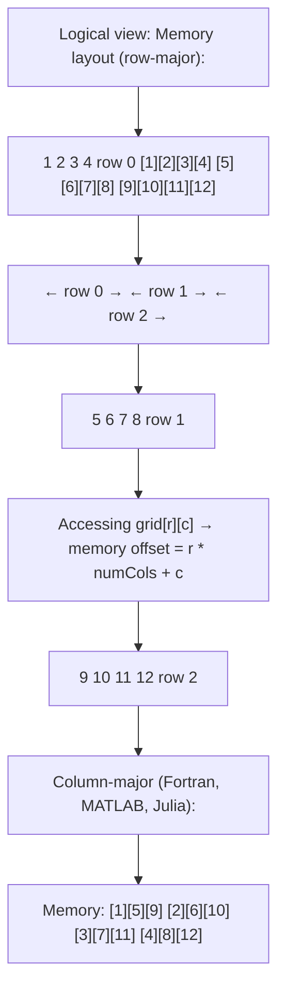

**WHY this matters**: Iterating row-by-row (`for row... for col...`) is cache-friendly in Java. Iterating column-by-column causes cache misses. For large matrices, this can be a 10x performance difference.


> RULE: In Java, always iterate [row][col] in the inner loop unless the
> algorithm specifically requires column-first traversal.


### 4-Directional vs 8-Directional Movement

Grid problems frequently require exploring neighboring cells. We encode directions as delta arrays:

```
4-DIRECTIONAL (most common):          8-DIRECTIONAL (diagonals included):

        ↑ (-1,0)                        ↖ (-1,-1)  ↑ (-1,0)  ↗ (-1,+1)
        │                                    \       │       /
  (0,-1)←─ ● ─→(0,+1)               (0,-1) ←── ● ──→ (0,+1)
        │                                    /       │       \
        ↓ (+1,0)                        ↙ (+1,-1)  ↓ (+1,0)  ↘ (+1,+1)

Java 4-dir:                            Java 8-dir:
int[] dr = {-1, 1, 0, 0};             int[] dr = {-1,-1,-1, 0, 0, 1, 1, 1};
int[] dc = {0, 0, -1, 1};             int[] dc = {-1, 0, 1,-1, 1,-1, 0, 1};

Alternative 4-dir (compact):
int[][] dirs = {{-1,0},{1,0},{0,-1},{0,1}};
```

**Flow:**
1. (0,-1)← ●
2. (0,+1) (0,-1) ← --(●)--> (0,+1)

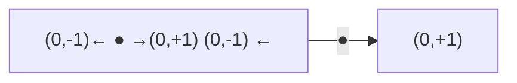

**Convention**: `(row, col)` maps to `(y, x)` in Cartesian terms. **row** increases downward (like `y` but inverted). **col** increases rightward (like `x`). This inconsistency causes countless bugs — always be explicit.

### BFS vs DFS on Grids: When to Use Each


> DECISION FRAMEWORK: BFS vs DFS on Grids
>
> USE BFS WHEN:                          USE DFS WHEN:
> ─────────────                          ────────────
> - Shortest path (unweighted)           • Connectivity / flood fill
> - Level-by-level processing            • Path exists? (yes/no)
> - Multi-source spread (rotting         • Backtracking needed (word
> oranges, fire spreading)               search, unique paths)
> - Minimum distance queries             • Counting connected components
> - Guaranteed to find shortest path     • Simpler code, less memory
> in unweighted grid                     for deep paths
>
> BFS: Queue-based, O(V+E) time/space   DFS: Stack/recursion, O(V+E) time
> Grid V = m*n, E = 4*m*n               Stack space O(m*n) worst case


### Boundary Checking Patterns

Every grid traversal needs boundary checks. The canonical pattern:

```java
// Pattern 1: Check before recursive call / enqueue
for (int d = 0; d < 4; d++) {
    int nr = row + dr[d];
    int nc = col + dc[d];
    if (nr >= 0 && nr < m && nc >= 0 && nc < n && grid[nr][nc] == target) {
        // process (nr, nc)
    }
}

// Pattern 2: Check at function entry (DFS)
void dfs(int[][] grid, int r, int c) {
    if (r < 0 || r >= grid.length || c < 0 || c >= grid[0].length) return;
    if (grid[r][c] != target) return;
    grid[r][c] = visited; // mark
    dfs(grid, r - 1, c);
    dfs(grid, r + 1, c);
    dfs(grid, r, c - 1);
    dfs(grid, r, c + 1);
}
```

### In-Place Marking (Visited) Techniques

```
╔══════════════════════════════════════════════════════════════════════════════╗
║  VISITED MARKING STRATEGIES                                                  ║
╠══════════════════════════════════════════════════════════════════════════════╣
║                                                                              ║
║  1. Separate boolean[][] visited — safest, uses O(m*n) space                 ║
║  2. Modify grid in-place — set grid[r][c] = '#' or -1 or 2                   ║
║     (destroys input, but O(1) extra space)                                   ║
║  3. State encoding — use unused bits (Game of Life trick):                   ║
║     grid[r][c] |= (newState << 1);  // encode both old and new state         ║
║  4. Coordinate hashing — visited.add(r * cols + c) in a HashSet              ║
║                                                                              ║
║  CRITICAL: In BFS, mark visited WHEN ENQUEUEING, not when dequeuing.         ║
║  Otherwise, the same cell gets enqueued multiple times → TLE.                ║
╚══════════════════════════════════════════════════════════════════════════════╝
```

**Flow:**
1. VISITED MARKING STRATEGIES
2. 1. Separate boolean[][] visited — safest, uses O(m*n) s
3. 2. Modify grid in-place — set grid[r][c] = '#' or -1 or
4. (destroys input, but O(1) extra space)
5. 3. State encoding — use unused bits (Game of Life trick

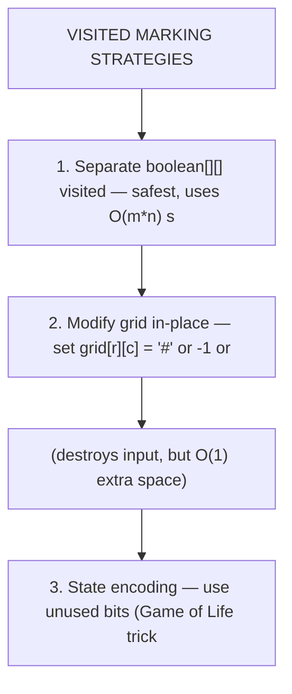

### Spiral Traversal Logic

Spiral traversal peels the matrix layer by layer, shrinking the bounding box after each pass:

```
Layer 0 (outermost):              Layer 1 (inner):
→ → → → → ↓                      Only process what remains
↑         ↓                       inside the shrunk boundaries
↑         ↓
↑         ↓
← ← ← ← ←

Boundaries: top, bottom, left, right
  After top row:    top++
  After right col:  right--
  After bottom row: bottom--
  After left col:   left++

Terminate when top > bottom or left > right.
```

**Flow:**
1. Layer 0 (outermost): Layer 1 (inner):
2. ↓ Only process what remains
3. ↑ ↓ inside the shrunk boundaries
4. Boundaries: top, bottom, left, right
5. After top row: top++
6. After right col: right--
7. After bottom row: bottom--

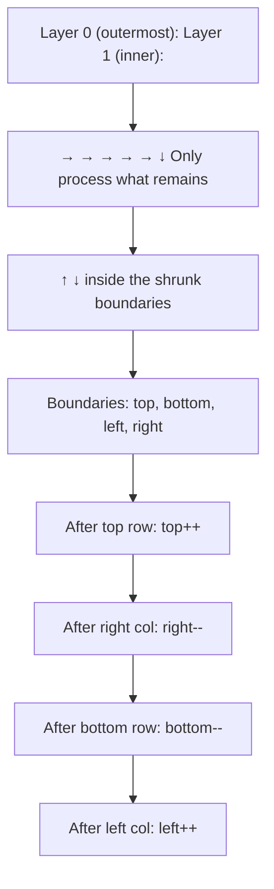

### Matrix Rotation: Transpose + Reverse = 90° Rotation

```
VISUAL PROOF: 90° Clockwise Rotation = Transpose + Reverse Each Row
──────────────────────────────────────────────────

Original:        Transpose:          Reverse rows:
┌───┬───┬───┐   ┌───┬───┬───┐      ┌───┬───┬───┐
│ 1 │ 2 │ 3 │   │ 1 │ 4 │ 7 │      │ 7 │ 4 │ 1 │
├───┼───┼───┤   ├───┼───┼───┤      ├───┼───┼───┤
│ 4 │ 5 │ 6 │ → │ 2 │ 5 │ 8 │  →  │ 8 │ 5 │ 2 │  ← 90° clockwise!
├───┼───┼───┤   ├───┼───┼───┤      ├───┼───┼───┤
│ 7 │ 8 │ 9 │   │ 3 │ 6 │ 9 │      │ 9 │ 6 │ 3 │
└───┴───┴───┘   └───┴───┴───┘      └───┴───┴───┘

WHY: Transpose swaps (i,j) → (j,i). Then reversing each row mirrors
horizontally. The composition maps (i,j) → (j, n-1-i), which is the
definition of 90° clockwise rotation.

VARIANTS:
• 90° CW:  transpose + reverse each row
• 90° CCW: transpose + reverse each column (or reverse rows + transpose)
• 180°:    reverse each row + reverse each column
```

**Flow:**
1. 1 2 3 / 4 5 6 / 7 8 9
2. 1 4 7 / 2 5 8 / 3 6 9
3. 7 4 1 / 8 5 2 / 9 6 3

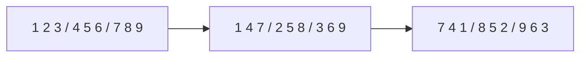

### Common Mistakes (Top 7)

```
╔══════════════════════════════════════════════════════════════════════════════╗
║  MISTAKE #1: Off-By-One in Boundaries                                        ║
║  ───────────────────────────────────                                         ║
║  WRONG: if (r >= 0 && r <= grid.length)    // should be < not <=             ║
║  RIGHT: if (r >= 0 && r < grid.length && c >= 0 && c < grid[0].length)       ║
║                                                                              ║
║  MISTAKE #2: Forgetting Diagonal Movement                                    ║
║  ──────────────────────────────────────                                      ║
║  Some problems require 8 directions (Shortest Path in Binary Matrix).        ║
║  Always read the problem statement carefully for "adjacent" definitions.     ║
║                                                                              ║
║  MISTAKE #3: Not Marking Visited BEFORE Enqueueing in BFS                    ║
║  ────────────────────────────────────────────────────────                    ║
║  WRONG: enqueue → poll → mark visited (duplicate enqueues!)                  ║
║  RIGHT: mark visited → enqueue → poll → process                              ║
║                                                                              ║
║  MISTAKE #4: Confusing row/col with x/y                                      ║
║  ──────────────────────────────────────                                      ║
║  grid[row][col] → row is the Y axis (vertical), col is X (horizontal).       ║
║  When problem gives (x, y), translate: row = y, col = x.                     ║
║                                                                              ║
║  MISTAKE #5: Modifying Grid While Iterating Over It                          ║
║  ─────────────────────────────────────────────────                           ║
║  In Game of Life style problems, changing cells during iteration affects     ║
║  neighbors. Use state encoding or a copy.                                    ║
║                                                                              ║
║  MISTAKE #6: Assuming Square Matrix                                          ║
║  ──────────────────────────────────                                          ║
║  Always use m = grid.length (rows), n = grid[0].length (cols) separately.    ║
║  Never assume m == n unless the problem guarantees it.                       ║
║                                                                              ║
║  MISTAKE #7: Stack Overflow on Large Grids with Recursive DFS                ║
║  ───────────────────────────────────────────────────────────                 ║
║  A 1000×1000 grid can have DFS depth up to 1,000,000. Convert to             ║
║  iterative DFS with an explicit stack, or use BFS instead.                   ║
╚══════════════════════════════════════════════════════════════════════════════╝
```

**Flow:**
1. MISTAKE #1: Off-By-One in Boundaries
2. MISTAKE #2: Forgetting Diagonal Movement
3. MISTAKE #3: Not Marking Visited BEFORE Enqueueing in BF
4. WRONG: enqueue
5. poll
6. mark visited (duplicate enqueue
7. WRONG: enqueue
8. poll
9. mark visited (duplicate enqueue
10. RIGHT: mark visited
11. enqueue
12. poll
13. process
14. RIGHT: mark visited
15. enqueue
16. poll
17. process
18. MISTAKE #4: Confusing row/col with x/y
19. When problem gives (x, y), translate: row = y, col = x.

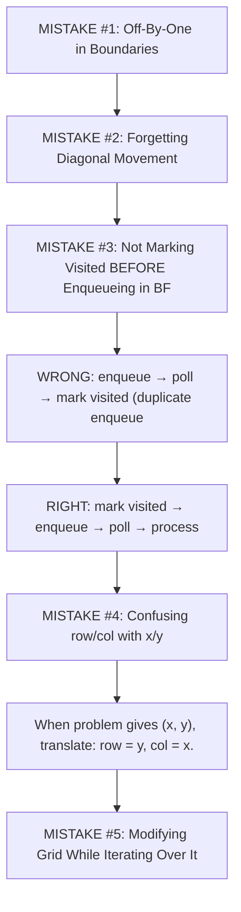

---

## 🧩 Part 1: Easy Problems

```
╔══════════════════════════════════════════════════════════════════════════════╗
║                         EASY — 4 PROBLEMS                                    ║
║  Build intuition: basic traversals, simple transformations                   ║
╚══════════════════════════════════════════════════════════════════════════════╝
```

**Flow:**
1. EASY — 4 PROBLEMS
2. Build intuition: basic traversals, simple transformatio

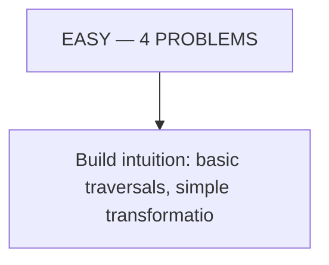

### 1. [Flood Fill](https://leetcode.com/problems/flood-fill/) (LC 733) ⭐ Easy
**Companies**: Amazon, Google, Microsoft, Facebook  
**Pattern**: DFS / BFS flood fill

**Problem**: Given an image (2D array of pixel values), a starting pixel `(sr, sc)`, and a `color`, perform a flood fill: change the starting pixel and all 4-directionally connected pixels of the same original color to the new color.

```
Input:  image = [[1,1,1],    sr=1, sc=1, color=2
                 [1,1,0],
                 [1,0,1]]

Output: [[2,2,2],
         [2,2,0],
         [2,0,1]]

Starting at (1,1)=1, all connected 1's become 2.
The 1 at (2,2) is NOT connected (blocked by 0s diagonally — 4-dir only).
```

**Key Insight**: This is the most basic grid DFS/BFS. Start at the source, spread to all 4-directional neighbors that match the original color. The visited mechanism is built-in: once a cell is recolored, it no longer matches the original color.

**Approach**:
1. Record `originalColor = image[sr][sc]`
2. If `originalColor == color`, return immediately (no work needed — avoids infinite loop!)
3. DFS/BFS from `(sr, sc)`: change color, recurse on 4 neighbors with matching original color
4. WHY the base case matters: if original == new color, recoloring doesn't "mark" the cell, so DFS would revisit forever

**Solution**:
```java
class Solution {
    public int[][] floodFill(int[][] image, int sr, int sc, int color) {
        int originalColor = image[sr][sc];
        if (originalColor == color) return image; // Critical: avoid infinite loop
        dfs(image, sr, sc, originalColor, color);
        return image;
    }

    private void dfs(int[][] image, int r, int c, int orig, int newColor) {
        if (r < 0 || r >= image.length || c < 0 || c >= image[0].length) return;
        if (image[r][c] != orig) return;

        image[r][c] = newColor; // Color change acts as "visited" marker
        dfs(image, r - 1, c, orig, newColor);
        dfs(image, r + 1, c, orig, newColor);
        dfs(image, r, c - 1, orig, newColor);
        dfs(image, r, c + 1, orig, newColor);
    }
}
```

**Complexity**: Time O(m × n) — each cell visited at most once. Space O(m × n) — recursion stack in worst case (all same color).  
**Why This Works**: The recoloring itself prevents revisits. Each cell transitions from `orig` → `newColor` exactly once, and only cells with `orig` are candidates.

---

### 2. Island Perimeter (LC 463) ⭐ Easy
**Companies**: Google, Facebook, Bloomberg  
**Pattern**: Grid iteration with neighbor counting

**Problem**: Given a 2D grid where `1` = land, `0` = water, find the perimeter of the island. There is exactly one island (no lakes).

```
┌───┬───┬───┬───┐
│ 0 │ 1 │ 0 │ 0 │    Land cells: 7
├───┼───┼───┼───┤    Each land cell contributes 4 edges
│ 1 │ 1 │ 1 │ 0 │    Subtract 2 for each internal adjacency (shared edge)
├───┼───┼───┼───┤
│ 0 │ 1 │ 0 │ 0 │    Perimeter = 4 * landCells - 2 * internalEdges
├───┼───┼───┼───┤                = 4 * 7 - 2 * 6 = 28 - 12 = 16 ✓
│ 1 │ 1 │ 0 │ 0 │
└───┴───┴───┴───┘
```

**Flow:**
1. 0 1 0 0 Land cells: 7
2. Each land cell contributes 4 edges
3. 0 1 0 0 Perimeter = 4 * landCells - 2 * internalEdges

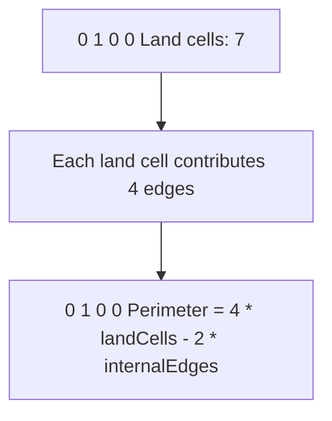

**Key Insight**: No DFS/BFS needed! Every land cell starts with 4 edges. Each shared edge between two adjacent land cells removes 2 from the perimeter (one for each cell). Count land cells and right/down adjacencies.

**Approach**:
1. Iterate over every cell
2. If land: increment `islands` count
3. Check right neighbor: if also land, increment `neighbors`
4. Check bottom neighbor: if also land, increment `neighbors`
5. Result = `4 * islands - 2 * neighbors`
6. WHY only right and down? Each adjacency is counted once. Checking all 4 directions would double-count.

**Solution**:
```java
class Solution {
    public int islandPerimeter(int[][] grid) {
        int islands = 0, neighbors = 0;
        int m = grid.length, n = grid[0].length;

        for (int r = 0; r < m; r++) {
            for (int c = 0; c < n; c++) {
                if (grid[r][c] == 1) {
                    islands++;
                    if (r + 1 < m && grid[r + 1][c] == 1) neighbors++; // down
                    if (c + 1 < n && grid[r][c + 1] == 1) neighbors++; // right
                }
            }
        }
        return 4 * islands - 2 * neighbors;
    }
}
```

**Complexity**: Time O(m × n), Space O(1).  
**Why This Works**: The formula `4L − 2N` is an Euler-style counting argument. Each land cell exposes 4 sides. Each internal edge (shared between two land cells) subtracts 1 from each cell's exposed sides, hence −2 per adjacency.

---

### 3. Reshape the Matrix (LC 566) ⭐ Easy
**Companies**: Amazon, Microsoft  
**Pattern**: Index mapping (1D ↔ 2D)

**Problem**: Reshape a matrix from `m × n` to `r × c` (if valid). Fill new matrix row by row from original matrix read row by row.

```
Original (2×4):        Reshaped (4×2):
┌───┬───┬───┬───┐     ┌───┬───┐
│ 1 │ 2 │ 3 │ 4 │     │ 1 │ 2 │
├───┼───┼───┼───┤     ├───┼───┤
│ 5 │ 6 │ 7 │ 8 │     │ 3 │ 4 │
└───┴───┴───┴───┘     ├───┼───┤
                       │ 5 │ 6 │
1D view: [1,2,3,4, ├───┼───┤
          5,6,7,8]     │ 7 │ 8 │
                       └───┴───┘
Map 1D index i → 2D: (i / numCols, i % numCols)
```

**Flow:**
1. 1 2 3 4 / 5 6 7 8
2. 1 2 / 3 4 / 5 6 / 7 8

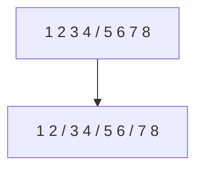

**Key Insight**: Think of the matrix as a 1D array of `m*n` elements. Element at 1D index `i` maps to `(i / cols, i % cols)` in any reshaping. If `m*n != r*c`, reshape is impossible.

**Approach**:
1. Check if `m * n == r * c` — if not, return original
2. Use a single counter from 0 to `m*n - 1`
3. Map each counter to source and destination coordinates using `/` and `%`

**Solution**:
```java
class Solution {
    public int[][] matrixReshape(int[][] mat, int r, int c) {
        int m = mat.length, n = mat[0].length;
        if (m * n != r * c) return mat;

        int[][] result = new int[r][c];
        for (int i = 0; i < m * n; i++) {
            result[i / c][i % c] = mat[i / n][i % n];
        }
        return result;
    }
}
```

**Complexity**: Time O(m × n), Space O(r × c) for the result.  
**Why This Works**: The 1D↔2D bijection `i ↔ (i/cols, i%cols)` is the fundamental reshape operation. It's the same principle behind `numpy.reshape()`.

---

### 4. Transpose Matrix (LC 867) ⭐ Easy
**Companies**: Google, Amazon  
**Pattern**: Matrix transformation

**Problem**: Given a matrix, return its transpose. The transpose of a matrix swaps rows and columns: `result[j][i] = matrix[i][j]`.

```
Original (2×3):        Transposed (3×2):
┌───┬───┬───┐          ┌───┬───┐
│ 1 │ 2 │ 3 │          │ 1 │ 4 │
├───┼───┼───┤   →     ├───┼────┤
│ 4 │ 5 │ 6 │          │ 2 │ 5 │
└───┴───┴───┘          ├───┼───┤
                        │ 3 │ 6 │
                        └───┴───┘

(i,j) in original → (j,i) in transpose
```

**Flow:**
1. 1 2 3 / 4 5 6
2. 1 4 / 2 5 / 3 6

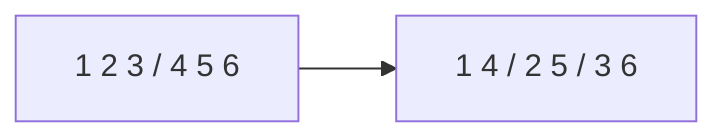

**Key Insight**: The transpose of an `m × n` matrix is an `n × m` matrix. For non-square matrices, this cannot be done in-place.

**Approach**:
1. Create a new `n × m` matrix
2. For each `(i, j)` in the original, set `result[j][i] = matrix[i][j]`

**Solution**:
```java
class Solution {
    public int[][] transpose(int[][] matrix) {
        int m = matrix.length, n = matrix[0].length;
        int[][] result = new int[n][m];

        for (int i = 0; i < m; i++) {
            for (int j = 0; j < n; j++) {
                result[j][i] = matrix[i][j];
            }
        }
        return result;
    }
}
```

**Complexity**: Time O(m × n), Space O(m × n).  
**Why This Works**: The transpose is a linear algebra operation that reflects the matrix over its main diagonal. The mapping `(i,j) → (j,i)` is its definition.

---

## 🧩 Part 2: Medium Problems

```
╔══════════════════════════════════════════════════════════════════════════════╗
║                        MEDIUM — 10 PROBLEMS                                  ║
║  Core grid patterns: BFS, DFS, simulation, backtracking, state encoding      ║
╚══════════════════════════════════════════════════════════════════════════════╝
```

### 1. [Number of Islands](https://leetcode.com/problems/number-of-islands/) (LC 200) ⭐⭐ Medium
**Companies**: Amazon, Google, Microsoft, Facebook, Bloomberg, Apple, Uber  
**Pattern**: DFS flood fill to count connected components

**Problem**: Given a 2D grid of `'1'` (land) and `'0'` (water), count the number of islands. An island is surrounded by water and formed by connecting adjacent (4-directional) lands.

```
Grid:                          Islands = 3
┌───┬───┬───┬───┬───┐
│ 1 │ 1 │ 0 │ 0 │ 0 │        Island 1: top-left 1,1
├───┼───┼───┼───┼───┤        Island 2: top-right 1
│ 1 │ 1 │ 0 │ 0 │ 0 │        Island 3: bottom-right 1
├───┼───┼───┼───┼───┤
│ 0 │ 0 │ 1 │ 0 │ 0 │
├───┼───┼───┼───┼───┤
│ 0 │ 0 │ 0 │ 1 │ 1 │
└───┴───┴───┴───┴───┘
```

**Flow:**
1. Grid: Islands = 3
2. 1 1 0 0 0 Island 1: top-left 1,1
3. Island 2: top-right 1
4. 1 1 0 0 0 Island 3: bottom-right 1

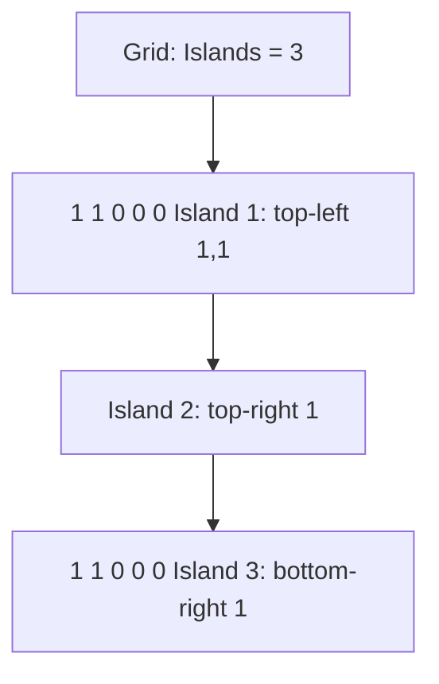

**Key Insight**: Each island is a connected component. When we find an unvisited land cell, that's a new island. DFS/BFS marks the entire component as visited, so it won't be counted again.

**Approach**:
1. Scan grid left-to-right, top-to-bottom
2. When we find `'1'`: increment island count, then DFS to "sink" the entire island (change all connected `'1'` to `'0'`)
3. WHY sinking works: by modifying the grid, we get O(1) extra space and don't need a visited array
4. Each cell is visited exactly once across all DFS calls combined

**Solution**:
```java
class Solution {
    public int numIslands(char[][] grid) {
        int count = 0;
        int m = grid.length, n = grid[0].length;

        for (int r = 0; r < m; r++) {
            for (int c = 0; c < n; c++) {
                if (grid[r][c] == '1') {
                    count++;
                    sink(grid, r, c); // DFS: sink entire island
                }
            }
        }
        return count;
    }

    private void sink(char[][] grid, int r, int c) {
        if (r < 0 || r >= grid.length || c < 0 || c >= grid[0].length) return;
        if (grid[r][c] != '1') return;

        grid[r][c] = '0'; // Sink this cell
        sink(grid, r - 1, c);
        sink(grid, r + 1, c);
        sink(grid, r, c - 1);
        sink(grid, r, c + 1);
    }
}
```

**Complexity**: Time O(m × n), Space O(m × n) worst case for recursion stack.  
**Why This Works**: This is a direct application of connected-component counting. Each DFS marks exactly one component. Total work across all DFS calls = O(m × n) because each cell flips from `'1'` to `'0'` at most once.

---

### 2. [Rotting Oranges](https://leetcode.com/problems/rotting-oranges/) (LC 994) ⭐⭐ Medium
**Companies**: Amazon, Google, Microsoft, Facebook, Uber  
**Pattern**: Multi-source BFS (simultaneous spread)

**Problem**: In a grid, `0` = empty, `1` = fresh orange, `2` = rotten orange. Every minute, fresh oranges adjacent (4-dir) to rotten ones become rotten. Return the minimum minutes until no fresh orange remains, or -1 if impossible.

```
Minute 0:         Minute 1:         Minute 2:         Minute 3:         Minute 4:
┌───┬───┬───┐    ┌───┬───┬───┐    ┌───┬───┬───┐    ┌───┬───┬───┐    ┌───┬───┬───┐
│ 2 │ 1 │ 1 │    │ 2 │ 2 │ 1 │    │ 2 │ 2 │ 2 │    │ 2 │ 2 │ 2 │    │ 2 │ 2 │ 2 │
├───┼───┼───┤    ├───┼───┼───┤    ├───┼───┼───┤    ├───┼───┼───┤    ├───┼───┼───┤
│ 1 │ 1 │ 0 │ →  │ 2 │ 1 │ 0 │ →  │ 2 │ 2 │ 0 │ →  │ 2 │ 2 │ 0 │ →  │ 2 │ 2 │ 0 │
├───┼───┼───┤    ├───┼───┼───┤    ├───┼───┼───┤    ├───┼───┼───┤    ├───┼───┼───┤
│ 0 │ 1 │ 1 │    │ 0 │ 1 │ 1 │    │ 0 │ 1 │ 1 │    │ 0 │ 2 │ 1 │    │ 0 │ 2 │ 2 │
└───┴───┴───┘    └───┴───┴───┘    └───┴───┴───┘    └───┴───┴───┘    └───┴───┴───┘
                                                                       Answer = 4
```

**Flow:**
1. 2 1 1 / 1 1 0 / 0 1 1
2. 2 2 1 / 2 1 0 / 0 1 1
3. 2 2 2 / 2 2 0 / 0 1 1
4. 2 2 2 / 2 2 0 / 0 2 1
5. 2 2 2 / 2 2 0 / 0 2 2

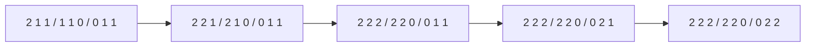

**Key Insight**: This is multi-source BFS. All rotten oranges at time 0 spread simultaneously — exactly like BFS level-by-level, where each level = one minute. We start BFS from ALL rotten oranges at once.

**Approach**:
1. Scan grid: enqueue all rotten oranges, count fresh oranges
2. BFS level-by-level: for each rotten orange, rot its fresh neighbors
3. Each level processes = one minute
4. After BFS: if `fresh == 0`, return minutes; else return -1
5. WHY multi-source BFS: each BFS level corresponds to exactly one tick of the clock

**Solution**:
```java
class Solution {
    public int orangesRotting(int[][] grid) {
        int m = grid.length, n = grid[0].length;
        Queue<int[]> queue = new LinkedList<>();
        int fresh = 0;

        // Step 1: Find all rotten oranges and count fresh ones
        for (int r = 0; r < m; r++) {
            for (int c = 0; c < n; c++) {
                if (grid[r][c] == 2) queue.offer(new int[]{r, c});
                else if (grid[r][c] == 1) fresh++;
            }
        }

        if (fresh == 0) return 0; // No fresh oranges — already done

        int[] dr = {-1, 1, 0, 0};
        int[] dc = {0, 0, -1, 1};
        int minutes = 0;

        // Step 2: Multi-source BFS
        while (!queue.isEmpty() && fresh > 0) {
            int size = queue.size();
            minutes++;
            for (int i = 0; i < size; i++) {
                int[] cell = queue.poll();
                for (int d = 0; d < 4; d++) {
                    int nr = cell[0] + dr[d];
                    int nc = cell[1] + dc[d];
                    if (nr >= 0 && nr < m && nc >= 0 && nc < n && grid[nr][nc] == 1) {
                        grid[nr][nc] = 2; // Mark rotten BEFORE enqueueing
                        fresh--;
                        queue.offer(new int[]{nr, nc});
                    }
                }
            }
        }

        return fresh == 0 ? minutes : -1;
    }
}
```

**Complexity**: Time O(m × n), Space O(m × n).  
**Why This Works**: Multi-source BFS processes all sources simultaneously. Each level corresponds to one unit of time. The BFS guarantee: every cell is reached in the minimum possible time from any source.

---

### 3. [01 Matrix](https://leetcode.com/problems/zero-one-matrix/) (LC 542) ⭐⭐ Medium
**Companies**: Google, Amazon, Microsoft, Facebook  
**Pattern**: Multi-source BFS from all 0s

**Problem**: Given a binary matrix, find the distance of the nearest 0 for each cell. Distance = 4-directional steps.

```
Input:           Output:
┌───┬───┬───┐   ┌───┬───┬───┐
│ 0 │ 0 │ 0 │   │ 0 │ 0 │ 0 │
├───┼───┼───┤   ├───┼───┼───┤
│ 0 │ 1 │ 0 │   │ 0 │ 1 │ 0 │
├───┼───┼───┤   ├───┼───┼───┤
│ 1 │ 1 │ 1 │   │ 1 │ 2 │ 1 │
└───┴───┴───┘   └───┴───┴───┘
```

**Flow:**
1. 0 0 0 / 0 1 0 / 1 1 1
2. 0 0 0 / 0 1 0 / 1 2 1

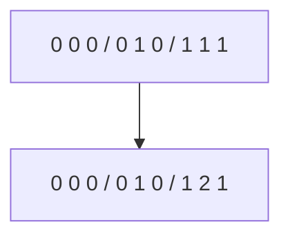

**Key Insight**: Instead of BFS from each 1 to find the nearest 0 (O(m²n²)), reverse the problem: BFS from ALL 0s simultaneously. Each BFS level marks cells at distance 1, then 2, then 3, etc.

**Approach**:
1. Initialize result matrix: 0 for 0-cells, `Integer.MAX_VALUE` for 1-cells
2. Enqueue all 0-cells into BFS queue
3. BFS: for each cell, check 4 neighbors. If neighbor's current distance > current + 1, update and enqueue
4. WHY: BFS guarantees first-visit = shortest distance. Starting from all 0s ensures every cell's nearest 0 is found optimally.

**Solution**:
```java
class Solution {
    public int[][] updateMatrix(int[][] mat) {
        int m = mat.length, n = mat[0].length;
        int[][] dist = new int[m][n];
        Queue<int[]> queue = new LinkedList<>();

        // Initialize: 0-cells have distance 0, others MAX
        for (int r = 0; r < m; r++) {
            for (int c = 0; c < n; c++) {
                if (mat[r][c] == 0) {
                    queue.offer(new int[]{r, c});
                } else {
                    dist[r][c] = Integer.MAX_VALUE;
                }
            }
        }

        int[] dr = {-1, 1, 0, 0};
        int[] dc = {0, 0, -1, 1};

        while (!queue.isEmpty()) {
            int[] cell = queue.poll();
            for (int d = 0; d < 4; d++) {
                int nr = cell[0] + dr[d];
                int nc = cell[1] + dc[d];
                if (nr >= 0 && nr < m && nc >= 0 && nc < n
                    && dist[nr][nc] > dist[cell[0]][cell[1]] + 1) {
                    dist[nr][nc] = dist[cell[0]][cell[1]] + 1;
                    queue.offer(new int[]{nr, nc});
                }
            }
        }
        return dist;
    }
}
```

**Complexity**: Time O(m × n), Space O(m × n).  
**Why This Works**: This is the textbook multi-source BFS for shortest distance. By starting from all 0s, BFS radiates outward in concentric layers, and the first time any cell is reached, it's guaranteed to be at minimum distance.

---

### 4. [Spiral Matrix](https://leetcode.com/problems/spiral-matrix/) (LC 54) ⭐⭐ Medium
**Companies**: Amazon, Google, Microsoft, Apple, Facebook, Uber  
**Pattern**: Boundary simulation (layer peeling)

**Problem**: Given an `m × n` matrix, return all elements in spiral order.

```
┌───┬───┬───┬───┐
│ 1 │ 2 │ 3 │ 4 │  →  Output: [1,2,3,4,8,12,11,10,9,5,6,7]
├───┼───┼───┼───┤
│ 5 │ 6 │ 7 │ 8 │      → → → ↓
├───┼───┼───┼───┤      ↑ → → ↓
│ 9 │10 │11 │12 │      ↑ ← ← ←
└───┴───┴───┴───┘
```

**Key Insight**: Maintain four boundaries: `top`, `bottom`, `left`, `right`. Traverse top row → right column → bottom row → left column, shrinking boundaries after each pass. Stop when boundaries cross.

**Approach**:
1. Initialize `top = 0, bottom = m-1, left = 0, right = n-1`
2. Loop while `top <= bottom && left <= right`:
   - Traverse right: `col` from `left` to `right` at row `top`, then `top++`
   - Traverse down: `row` from `top` to `bottom` at col `right`, then `right--`
   - Traverse left: if `top <= bottom`, `col` from `right` to `left` at row `bottom`, then `bottom--`
   - Traverse up: if `left <= right`, `row` from `bottom` to `top` at col `left`, then `left++`
3. WHY the extra checks for left and up: single-row or single-column matrices can cause double-traversal

**Solution**:
```java
class Solution {
    public List<Integer> spiralOrder(int[][] matrix) {
        List<Integer> result = new ArrayList<>();
        if (matrix.length == 0) return result;

        int top = 0, bottom = matrix.length - 1;
        int left = 0, right = matrix[0].length - 1;

        while (top <= bottom && left <= right) {
            // Traverse right along top row
            for (int c = left; c <= right; c++)
                result.add(matrix[top][c]);
            top++;

            // Traverse down along right column
            for (int r = top; r <= bottom; r++)
                result.add(matrix[r][right]);
            right--;

            // Traverse left along bottom row (if rows remain)
            if (top <= bottom) {
                for (int c = right; c >= left; c--)
                    result.add(matrix[bottom][c]);
                bottom--;
            }

            // Traverse up along left column (if cols remain)
            if (left <= right) {
                for (int r = bottom; r >= top; r--)
                    result.add(matrix[r][left]);
                left++;
            }
        }
        return result;
    }
}
```

**Complexity**: Time O(m × n), Space O(1) extra (output doesn't count).  
**Why This Works**: Each boundary shrinks exactly once per direction traversal. The `top <= bottom` and `left <= right` guards prevent re-traversal in degenerate (single-row/col) cases. Total elements visited = m × n exactly.

---

### 5. [Rotate Image](https://leetcode.com/problems/rotate-image/) (LC 48) ⭐⭐ Medium
**Companies**: Amazon, Google, Microsoft, Apple, Facebook  
**Pattern**: Transpose + Reverse (in-place rotation)

**Problem**: Rotate an `n × n` matrix 90 degrees clockwise **in-place**.

```
Original:        Step 1 - Transpose:   Step 2 - Reverse rows:
┌───┬───┬───┐   ┌───┬───┬───┐        ┌───┬───┬───┐
│ 1 │ 2 │ 3 │   │ 1 │ 4 │ 7 │        │ 7 │ 4 │ 1 │
├───┼───┼───┤ → ├───┼───┼───┤   →   ├───┼───┼────┤
│ 4 │ 5 │ 6 │   │ 2 │ 5 │ 8 │        │ 8 │ 5 │ 2 │
├───┼───┼───┤   ├───┼───┼───┤        ├───┼───┼───┤
│ 7 │ 8 │ 9 │   │ 3 │ 6 │ 9 │        │ 9 │ 6 │ 3 │
└───┴───┴───┘   └───┴───┴───┘        └───┴───┴───┘
                                       90° CW ✓
```

**Flow:**
1. 1 2 3 / 4 5 6 / 7 8 9
2. 1 4 7 / 2 5 8 / 3 6 9
3. 7 4 1 / 8 5 2 / 9 6 3


**Key Insight**: 90° clockwise = transpose (swap `(i,j)` ↔ `(j,i)`) + reverse each row. Both operations are in-place with O(1) extra space.

**Approach**:
1. **Transpose**: iterate upper triangle, swap `matrix[i][j]` with `matrix[j][i]`
2. **Reverse each row**: two-pointer swap from ends toward center
3. WHY: Transpose maps (i,j)→(j,i). Reversing row j maps column index c→(n-1-c). Composition: (i,j)→(j,i)→(j,n-1-i), which is 90° CW.

**Solution**:
```java
class Solution {
    public void rotate(int[][] matrix) {
        int n = matrix.length;

        // Step 1: Transpose — swap across main diagonal
        for (int i = 0; i < n; i++) {
            for (int j = i + 1; j < n; j++) { // j starts at i+1 (upper triangle only)
                int temp = matrix[i][j];
                matrix[i][j] = matrix[j][i];
                matrix[j][i] = temp;
            }
        }

        // Step 2: Reverse each row
        for (int i = 0; i < n; i++) {
            int lo = 0, hi = n - 1;
            while (lo < hi) {
                int temp = matrix[i][lo];
                matrix[i][lo] = matrix[i][hi];
                matrix[i][hi] = temp;
                lo++;
                hi--;
            }
        }
    }
}
```

**Complexity**: Time O(n²), Space O(1).  
**Why This Works**: The mathematical proof: for any element at position `(r, c)` in the original, after 90° CW rotation it should be at `(c, n-1-r)`. Transpose sends `(r,c)→(c,r)`. Row reversal sends `(c,r)→(c,n-1-r)`. Composed: `(r,c)→(c,n-1-r)`. QED.

---

### 6. [Set Matrix Zeroes](https://leetcode.com/problems/set-matrix-zeroes/) (LC 73) ⭐⭐ Medium
**Companies**: Amazon, Microsoft, Facebook, Apple, Bloomberg  
**Pattern**: Space optimization with first row/col as markers

**Problem**: Given an `m × n` matrix, if any element is 0, set its entire row and column to 0. Do it **in-place**.

```
Input:           Output:
┌───┬───┬───┐   ┌───┬───┬───┐
│ 1 │ 1 │ 1 │   │ 1 │ 0 │ 1 │   The 0 at (1,1) zeroes all of row 1
├───┼───┼───┤   ├───┼───┼───┤   and all of column 1.
│ 1 │ 0 │ 1 │   │ 0 │ 0 │ 0 │
├───┼───┼───┤   ├───┼───┼───┤
│ 1 │ 1 │ 1 │   │ 1 │ 0 │ 1 │
└───┴───┴───┘   └───┴───┴───┘
```

**Flow:**
1. 1 1 1 / 1 0 1 / 1 1 1
2. 1 0 1 / 0 0 0 / 1 0 1

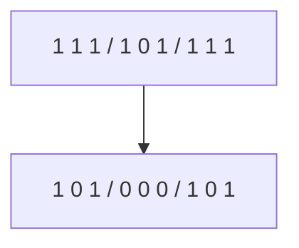

**Key Insight**: O(m+n) approach: use separate arrays to track which rows/cols to zero. O(1) approach: use the **first row and first column** of the matrix itself as markers! A special flag tracks whether the first row/col themselves need zeroing.

**Approach (O(1) space)**:
1. Check if first row has any 0 → `rowFlag`. Check if first col has any 0 → `colFlag`
2. For all cells `(i,j)` where `i>0, j>0`: if `matrix[i][j] == 0`, set `matrix[i][0] = 0` and `matrix[0][j] = 0`
3. Use these markers to zero the inner cells
4. Finally, zero first row if `rowFlag`, first col if `colFlag`
5. WHY order matters: we zero inner cells first, then first row/col, so markers aren't corrupted prematurely

**Solution**:
```java
class Solution {
    public void setZeroes(int[][] matrix) {
        int m = matrix.length, n = matrix[0].length;
        boolean firstRowZero = false, firstColZero = false;

        // Step 1: Check if first row/col have zeros
        for (int c = 0; c < n; c++)
            if (matrix[0][c] == 0) firstRowZero = true;
        for (int r = 0; r < m; r++)
            if (matrix[r][0] == 0) firstColZero = true;

        // Step 2: Use first row/col as markers for inner matrix
        for (int r = 1; r < m; r++) {
            for (int c = 1; c < n; c++) {
                if (matrix[r][c] == 0) {
                    matrix[r][0] = 0; // Mark row
                    matrix[0][c] = 0; // Mark col
                }
            }
        }

        // Step 3: Zero inner cells based on markers
        for (int r = 1; r < m; r++) {
            for (int c = 1; c < n; c++) {
                if (matrix[r][0] == 0 || matrix[0][c] == 0) {
                    matrix[r][c] = 0;
                }
            }
        }

        // Step 4: Zero first row and column if needed
        if (firstRowZero)
            for (int c = 0; c < n; c++) matrix[0][c] = 0;
        if (firstColZero)
            for (int r = 0; r < m; r++) matrix[r][0] = 0;
    }
}
```

**Complexity**: Time O(m × n), Space O(1).  
**Why This Works**: By storing "this row/col should be zeroed" in the matrix's own border, we avoid extra space. The careful ordering (inner first, borders last) ensures we don't corrupt our markers before using them.

---

### 7. [Word Search](https://leetcode.com/problems/word-search/) (LC 79) ⭐⭐ Medium
**Companies**: Amazon, Google, Microsoft, Facebook, Bloomberg, Apple  
**Pattern**: Backtracking DFS on grid

**Problem**: Given an `m × n` board of characters and a `word`, return `true` if the word exists in the grid. The word can be constructed from 4-directionally adjacent cells. Each cell may be used at most once per word.

```
Board:                  word = "ABCCED" → true
┌───┬───┬───┬───┐      A → B → C
│ A │ B │ C │ E │            │
├───┼───┼───┼───┤            C ← E → D (nope, "ABCCED"):
│ S │ F │ C │ S │            actually: A→B→C→C→E→D
├───┼───┼───┼───┤                          ↓
│ A │ D │ E │ E │            path: (0,0)→(0,1)→(0,2)→(1,2)→(1,3)... wait
└───┴───┴───┴───┘            (0,0)A→(0,1)B→(0,2)C→(1,2)C→(2,2)E→(2,1)D ✓
```

**Flow:**
1. Board: word = 'ABCCED'
2. true
3. C ← E
4. D (nope, 'ABCCED'):
5. C ← E
6. D (nope, 'ABCCED'):
7. S F C S actually: A
8. B
9. C
10. E
11. D

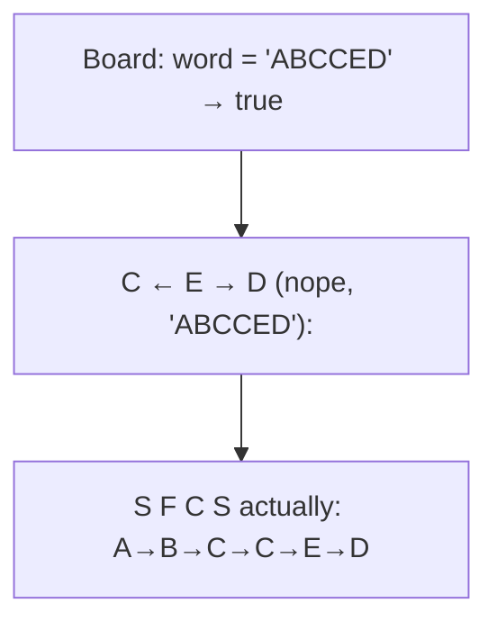

**Key Insight**: This is a constrained DFS with backtracking. For each starting cell that matches `word[0]`, attempt to extend the path. Mark cells as visited along the path, but **unmark on backtrack** (this is the backtracking part).

**Approach**:
1. For each cell matching `word[0]`, start DFS
2. DFS(r, c, index): if `index == word.length`, return true (found!)
3. Check bounds, check `board[r][c] == word[index]`
4. Mark cell (e.g., `board[r][c] = '#'`), recurse on 4 neighbors with `index + 1`
5. **Unmark cell** after recursion (backtrack)
6. WHY backtrack: the same cell might be needed for a different path starting from a different position

**Solution**:
```java
class Solution {
    public boolean exist(char[][] board, String word) {
        int m = board.length, n = board[0].length;

        for (int r = 0; r < m; r++) {
            for (int c = 0; c < n; c++) {
                if (dfs(board, word, r, c, 0)) return true;
            }
        }
        return false;
    }

    private boolean dfs(char[][] board, String word, int r, int c, int idx) {
        if (idx == word.length()) return true; // All characters matched
        if (r < 0 || r >= board.length || c < 0 || c >= board[0].length) return false;
        if (board[r][c] != word.charAt(idx)) return false;

        char saved = board[r][c];
        board[r][c] = '#'; // Mark visited

        boolean found = dfs(board, word, r - 1, c, idx + 1)
                      || dfs(board, word, r + 1, c, idx + 1)
                      || dfs(board, word, r, c - 1, idx + 1)
                      || dfs(board, word, r, c + 1, idx + 1);

        board[r][c] = saved; // Backtrack: unmark
        return found;
    }
}
```

**Complexity**: Time O(m × n × 3^L) where L = word length (3 branches because we don't go back). Space O(L) recursion depth.  
**Why This Works**: Backtracking explores all possible paths. The short-circuit `||` stops as soon as one path matches. The 3^L factor (not 4^L) comes from the fact that we never revisit the cell we just came from.

---

### 8. [Surrounded Regions](https://leetcode.com/problems/surrounded-regions/) (LC 130) ⭐⭐ Medium
**Companies**: Amazon, Google, Microsoft, Facebook  
**Pattern**: Border-connected DFS (reverse thinking)

**Problem**: Given a board with `'X'` and `'O'`, capture all regions of `'O'` that are **completely surrounded** by `'X'`. A region is NOT captured if any of its `'O'` cells is on the border.

```
Input:                   Output:
┌───┬───┬───┬───┐      ┌───┬───┬───┬───┐
│ X │ X │ X │ X │      │ X │ X │ X │ X │
├───┼───┼───┼───┤      ├───┼───┼───┼───┤
│ X │ O │ O │ X │  →   │ X │ X │ X │ X │  ← Inner O's captured
├───┼───┼───┼───┤      ├───┼───┼───┼───┤
│ X │ X │ O │ X │      │ X │ X │ X │ X │
├───┼───┼───┼───┤      ├───┼───┼───┼───┤
│ X │ O │ X │ X │      │ X │ O │ X │ X │  ← Border O survives
└───┴───┴───┴───┘      └───┴───┴───┴───┘
```

**Flow:**
1. X X X X / X O O X / X X O X / X O X X
2. X X X X / X X X X / X X X X / X O X X

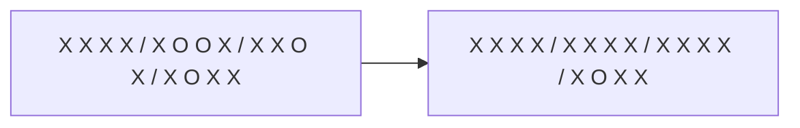

**Key Insight**: Instead of finding surrounded regions (hard), find **unsurrounded** regions (connected to border). Mark them safe. Everything else gets captured. This is the "reverse thinking" pattern.

**Approach**:
1. DFS/BFS from every `'O'` on the border → mark these as `'S'` (safe)
2. Scan the entire board:
   - `'O'` → `'X'` (was surrounded, capture it)
   - `'S'` → `'O'` (was safe, restore it)
3. WHY: border-connected O's cannot be surrounded (they touch the edge). Any O NOT reachable from the border IS fully surrounded.

**Solution**:
```java
class Solution {
    public void solve(char[][] board) {
        int m = board.length, n = board[0].length;

        // Step 1: Mark border-connected O's as safe ('S')
        for (int r = 0; r < m; r++) {
            if (board[r][0] == 'O') markSafe(board, r, 0);
            if (board[r][n - 1] == 'O') markSafe(board, r, n - 1);
        }
        for (int c = 0; c < n; c++) {
            if (board[0][c] == 'O') markSafe(board, 0, c);
            if (board[m - 1][c] == 'O') markSafe(board, m - 1, c);
        }

        // Step 2: Capture surrounded O's, restore safe ones
        for (int r = 0; r < m; r++) {
            for (int c = 0; c < n; c++) {
                if (board[r][c] == 'O') board[r][c] = 'X';      // Captured
                else if (board[r][c] == 'S') board[r][c] = 'O';  // Restored
            }
        }
    }

    private void markSafe(char[][] board, int r, int c) {
        if (r < 0 || r >= board.length || c < 0 || c >= board[0].length) return;
        if (board[r][c] != 'O') return;

        board[r][c] = 'S'; // Mark safe
        markSafe(board, r - 1, c);
        markSafe(board, r + 1, c);
        markSafe(board, r, c - 1);
        markSafe(board, r, c + 1);
    }
}
```

**Complexity**: Time O(m × n), Space O(m × n) recursion stack worst case.  
**Why This Works**: We solve the complement problem. "Which O's are NOT surrounded?" = "Which O's can reach the border?" DFS from borders finds exactly these. Everything else is surrounded and gets captured.

---

### 9. [Pacific Atlantic Water Flow](https://leetcode.com/problems/pacific-atlantic-water-flow/) (LC 417) ⭐⭐ Medium
**Companies**: Google, Amazon, Microsoft, Facebook  
**Pattern**: Reverse BFS/DFS from oceans

**Problem**: Given a height map grid, water can flow from a cell to 4-directional neighbors with height ≤ current. The Pacific ocean touches the top and left edges. The Atlantic touches the bottom and right edges. Find all cells from which water can reach **both** oceans.

```
Heights:                     Pacific ocean (~)
  ~ ~ ~ ~ ~ ~
~ 1  2  2  3  5 ~           Can reach both:
~ 3  2  3  4  4 ~           (0,4), (1,3), (1,4),
~ 2  4  5  3  1 ~           (2,2), (3,0), (3,1), (4,0)
~ 6  7  1  4  5 ~
~ 5  1  1  2  4 ~
  * * * * * *
              Atlantic ocean (*)
```

**Key Insight**: Forward approach (which cells can reach both oceans?) requires DFS from every cell — expensive. Reverse approach: start from each ocean and flow **uphill** (to cells with height ≥ current). Cells reachable from both Pacific and Atlantic sets are the answer.

**Approach**:
1. Create two boolean matrices: `pacific[m][n]` and `atlantic[m][n]`
2. DFS/BFS from all Pacific border cells (top row + left col) - mark reachable
3. DFS/BFS from all Atlantic border cells (bottom row + right col) - mark reachable
4. Return cells where both are true
5. WHY reverse: instead of forward flow (go to lower neighbors), reverse flow (go to higher neighbors from ocean edge). This is equivalent but far more efficient.

**Solution**:
```java
class Solution {
    private int m, n;
    private int[] dr = {-1, 1, 0, 0};
    private int[] dc = {0, 0, -1, 1};

    public List<List<Integer>> pacificAtlantic(int[][] heights) {
        m = heights.length;
        n = heights[0].length;
        boolean[][] pacific = new boolean[m][n];
        boolean[][] atlantic = new boolean[m][n];

        // DFS from Pacific borders (top row, left col)
        for (int c = 0; c < n; c++) dfs(heights, pacific, 0, c);
        for (int r = 0; r < m; r++) dfs(heights, pacific, r, 0);

        // DFS from Atlantic borders (bottom row, right col)
        for (int c = 0; c < n; c++) dfs(heights, atlantic, m - 1, c);
        for (int r = 0; r < m; r++) dfs(heights, atlantic, r, n - 1);

        // Intersection
        List<List<Integer>> result = new ArrayList<>();
        for (int r = 0; r < m; r++) {
            for (int c = 0; c < n; c++) {
                if (pacific[r][c] && atlantic[r][c]) {
                    result.add(Arrays.asList(r, c));
                }
            }
        }
        return result;
    }

    private void dfs(int[][] heights, boolean[][] reachable, int r, int c) {
        reachable[r][c] = true;
        for (int d = 0; d < 4; d++) {
            int nr = r + dr[d], nc = c + dc[d];
            if (nr >= 0 && nr < m && nc >= 0 && nc < n
                && !reachable[nr][nc]
                && heights[nr][nc] >= heights[r][c]) { // Flow UPHILL (reverse)
                dfs(heights, reachable, nr, nc);
            }
        }
    }
}
```

**Complexity**: Time O(m × n), Space O(m × n).  
**Why This Works**: Reversing the flow direction converts "can this cell reach the ocean?" into "can the ocean reach this cell going uphill?" Both are equivalent, but the reverse direction lets us do two BFS/DFS passes instead of m×n independent searches.

---

### 10. Game of Life (LC 289) ⭐⭐ Medium
**Companies**: Google, Amazon, Microsoft, Dropbox  
**Pattern**: In-place state encoding

**Problem**: Implement Conway's Game of Life in-place. Rules:
- Live cell with 2 or 3 live neighbors → lives
- Live cell with <2 or >3 live neighbors → dies
- Dead cell with exactly 3 live neighbors → becomes alive

All updates happen **simultaneously**.

```
Input:           Output:
┌───┬───┬───┐   ┌───┬───┬───┐
│ 0 │ 1 │ 0 │   │ 0 │ 0 │ 0 │
├───┼───┼───┤   ├───┼───┼───┤
│ 0 │ 0 │ 1 │   │ 1 │ 0 │ 1 │
├───┼───┼───┤   ├───┼───┼───┤
│ 1 │ 1 │ 1 │   │ 0 │ 1 │ 1 │
├───┼───┼───┤   ├───┼───┼───┤
│ 0 │ 0 │ 0 │   │ 0 │ 1 │ 0 │
└───┴───┴───┘   └───┴───┴───┘
```

**Flow:**
1. 0 1 0 / 0 0 1 / 1 1 1 / 0 0 0
2. 0 0 0 / 1 0 1 / 0 1 1 / 0 1 0

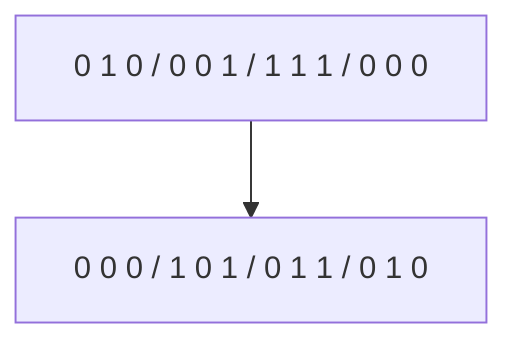

**Key Insight**: We need simultaneous update but want O(1) space. Solution: encode BOTH old and new state in the same cell using intermediate states:
- `0` → dead, stays dead
- `1` → alive (original)
- `2` → was alive, now dead
- `3` → was dead, now alive

The original state = `value % 2` (both 1 and 2 have `%2 = 1` and `0` for original alive). After computing, map 2→0, 3→1.

**Approach**:
1. First pass: for each cell, count live neighbors using `board[r][c] % 2` (considers original state even if cell was already updated)
   - Wait — since we encode: 0=dead→dead, 1=alive(unchanged yet), 2=alive→dead, 3=dead→alive.
   - Original alive state: `value == 1 || value == 2` (was alive)
2. Apply rules: if alive and survives → stays 1. If alive and dies → set to 2. If dead and born → set to 3.
3. Second pass: `board[r][c] %= 2` to finalize (2→0, 3→1)

**Solution**:
```java
class Solution {
    public void gameOfLife(int[][] board) {
        int m = board.length, n = board[0].length;
        int[] dr = {-1, -1, -1, 0, 0, 1, 1, 1};
        int[] dc = {-1, 0, 1, -1, 1, -1, 0, 1};

        // First pass: encode transitions
        for (int r = 0; r < m; r++) {
            for (int c = 0; c < n; c++) {
                int liveNeighbors = 0;
                for (int d = 0; d < 8; d++) {
                    int nr = r + dr[d], nc = c + dc[d];
                    if (nr >= 0 && nr < m && nc >= 0 && nc < n) {
                        // Original state: alive if cell is 1 or 2 (was alive)
                        if (board[nr][nc] == 1 || board[nr][nc] == 2) {
                            liveNeighbors++;
                        }
                    }
                }

                // Apply rules
                if (board[r][c] == 1) { // Currently alive
                    if (liveNeighbors < 2 || liveNeighbors > 3) {
                        board[r][c] = 2; // Alive → Dead
                    }
                    // else stays 1 (alive → alive)
                } else { // Currently dead
                    if (liveNeighbors == 3) {
                        board[r][c] = 3; // Dead → Alive
                    }
                    // else stays 0 (dead → dead)
                }
            }
        }

        // Second pass: finalize states
        for (int r = 0; r < m; r++) {
            for (int c = 0; c < n; c++) {
                board[r][c] %= 2; // 0→0, 1→1, 2→0, 3→1
            }
        }
    }
}
```

**Complexity**: Time O(m × n), Space O(1).  
**Why This Works**: The state encoding trick stores both the old and new state in a single integer. `value % 2` recovers the original state during computation, and `value % 2` at the end gives the new state. States 2 and 3 are temporary markers that carry full information.

---

## 🧩 Part 3: Hard Problems

```
╔══════════════════════════════════════════════════════════════════════════════╗
║                          HARD — 4 PROBLEMS                                   ║
║  Advanced BFS, Dijkstra on grid, Union-Find, 3D heap BFS                     ║
╚══════════════════════════════════════════════════════════════════════════════╝
```

**Flow:**
1. HARD — 4 PROBLEMS
2. Advanced BFS, Dijkstra on grid, Union-Find, 3D heap BFS

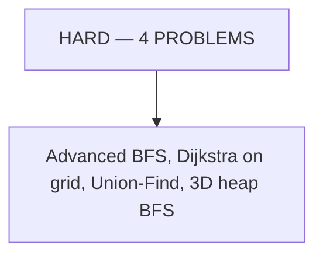

### 1. [Shortest Path in Binary Matrix](https://leetcode.com/problems/shortest-path-in-binary-matrix/) (LC 1091) ⭐⭐⭐ Hard
**Companies**: Google, Amazon, Facebook, Microsoft  
**Pattern**: BFS with 8-directional movement

**Problem**: Given an `n × n` binary grid, return the length of the shortest clear path from top-left `(0,0)` to bottom-right `(n-1,n-1)`. A clear path only uses cells with value 0 and moves 8-directionally (including diagonals). Return -1 if no path exists. Path length = number of cells visited.

```
┌───┬───┬───┐
│ 0 │ 0 │ 0 │   Shortest path: (0,0) → (1,1) → (2,2)
├───┼───┼───┤   Length = 3 (count cells, not edges)
│ 1 │ 1 │ 0 │
├───┼───┼───┤   The diagonal shortcut through center
│ 1 │ 1 │ 0 │   is faster than going around.
└───┴───┴───┘
```

**Flow:**
1. 0 0 0 Shortest path: (0,0)
2. (1,1)
3. (2,2)
4. Length = 3 (count cells, not edges)
5. The diagonal shortcut through center
6. 1 1 0 is faster than going around.

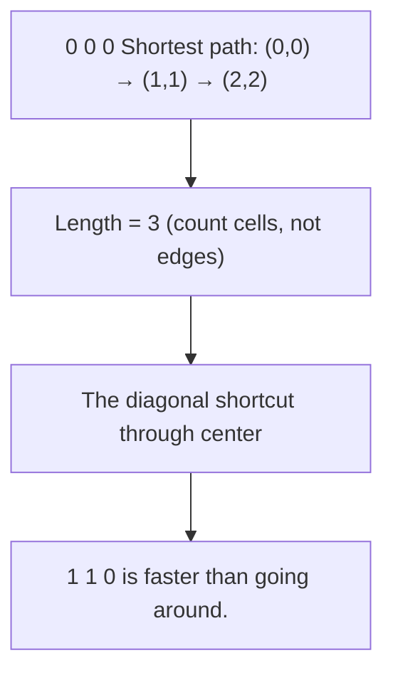

**Key Insight**: Shortest path in an unweighted graph = BFS. The twist: 8 directions instead of 4. BFS guarantees the first time we reach `(n-1, n-1)` is via the shortest path.

**Approach**:
1. If `grid[0][0] != 0` or `grid[n-1][n-1] != 0`, return -1
2. BFS from `(0,0)` with path length tracking
3. Use 8-directional delta arrays
4. Mark visited immediately when enqueueing (not when dequeuing!)
5. When we reach `(n-1, n-1)`, return current path length

**Solution**:
```java
class Solution {
    public int shortestPathBinaryMatrix(int[][] grid) {
        int n = grid.length;
        if (grid[0][0] != 0 || grid[n - 1][n - 1] != 0) return -1;
        if (n == 1) return 1; // Single cell

        int[] dr = {-1, -1, -1, 0, 0, 1, 1, 1};
        int[] dc = {-1, 0, 1, -1, 1, -1, 0, 1};

        Queue<int[]> queue = new LinkedList<>();
        queue.offer(new int[]{0, 0});
        grid[0][0] = 1; // Mark visited (use grid itself: 1 = visited/blocked)
        int pathLen = 1;

        while (!queue.isEmpty()) {
            int size = queue.size();
            pathLen++;

            for (int i = 0; i < size; i++) {
                int[] cell = queue.poll();

                for (int d = 0; d < 8; d++) {
                    int nr = cell[0] + dr[d];
                    int nc = cell[1] + dc[d];

                    if (nr < 0 || nr >= n || nc < 0 || nc >= n) continue;
                    if (grid[nr][nc] != 0) continue;

                    if (nr == n - 1 && nc == n - 1) return pathLen;

                    grid[nr][nc] = 1; // Mark visited BEFORE enqueueing
                    queue.offer(new int[]{nr, nc});
                }
            }
        }
        return -1;
    }
}
```

**Complexity**: Time O(n²), Space O(n²).  
**Why This Works**: BFS explores cells in order of increasing distance. The first time we reach the target, we've found the shortest path. 8 directions are handled identically to 4 — just more neighbors per cell. Marking visited on enqueue prevents duplicate processing.

---

### 2. Making A Large Island (LC 827) ⭐⭐⭐ Hard
**Companies**: Google, Amazon, Facebook  
**Pattern**: DFS component labeling + neighbor merging

**Problem**: Given an `n × n` binary grid, you may change at most one `0` to `1`. Return the size of the largest island.

```
┌───┬───┬───┐
│ 1 │ 0 │ 1 │   Islands: top-left (size 1, id=2), top-right (size 1, id=3),
├───┼───┼───┤             bottom (size 3, id=4)
│ 0 │ 0 │ 1 │
├───┼───┼───┤   Flip (0,1) to 1: connects id=2 (size 1) + id=3 (size 1)
│ 1 │ 1 │ 1 │              + 1 (the flipped cell) = 3
└───┴───┴───┘   Flip (1,0) to 1: connects id=2 (1) + id=4 (3) + 1 = 5 ← answer
```

**Flow:**
1. bottom (size 3, id=4)
2. Flip (0,1) to 1: connects id=2 (size 1) + id=3 (size 1)
3. 1 1 1 + 1 (the flipped cell) = 3

```mermaid
flowchart TD
    N1["bottom (size 3, id=4)"]
    N2["Flip (0,1) to 1: connects id=2 (size 1) + id=3 (size 1)"]
    N3["1 1 1 + 1 (the flipped cell) = 3"]
    N1 --> N2
    N2 --> N3
```

**Key Insight**: Two-pass approach:
1. **Label pass**: DFS to identify each island with a unique ID and record its size
2. **Merge pass**: For each 0-cell, check its 4 neighbors. Sum sizes of distinct neighboring islands + 1 (the flipped cell). Track the maximum.

**Approach**:
1. DFS from each unvisited 1-cell, assign island ID (starting from 2 to avoid confusion with 0/1), record size in a map
2. For each 0-cell, collect neighboring island IDs (use a Set to avoid double-counting if two neighbors belong to the same island)
3. Sum sizes of distinct neighboring islands + 1
4. Edge case: if grid is all 1s, answer = n²

**Solution**:
```java
class Solution {
    private int[] dr = {-1, 1, 0, 0};
    private int[] dc = {0, 0, -1, 1};

    public int largestIsland(int[][] grid) {
        int n = grid.length;
        Map<Integer, Integer> islandSize = new HashMap<>();
        int islandId = 2; // Start from 2 (0 and 1 are used)

        // Step 1: Label each island with unique ID and record size
        for (int r = 0; r < n; r++) {
            for (int c = 0; c < n; c++) {
                if (grid[r][c] == 1) {
                    int size = dfs(grid, r, c, islandId, n);
                    islandSize.put(islandId, size);
                    islandId++;
                }
            }
        }

        // Step 2: Try flipping each 0, merge adjacent distinct islands
        int maxSize = islandSize.values().stream()
                        .mapToInt(Integer::intValue).max().orElse(0);

        for (int r = 0; r < n; r++) {
            for (int c = 0; c < n; c++) {
                if (grid[r][c] == 0) {
                    Set<Integer> neighborIslands = new HashSet<>();
                    for (int d = 0; d < 4; d++) {
                        int nr = r + dr[d], nc = c + dc[d];
                        if (nr >= 0 && nr < n && nc >= 0 && nc < n
                            && grid[nr][nc] > 1) {
                            neighborIslands.add(grid[nr][nc]);
                        }
                    }
                    int merged = 1; // The flipped cell itself
                    for (int id : neighborIslands) {
                        merged += islandSize.get(id);
                    }
                    maxSize = Math.max(maxSize, merged);
                }
            }
        }
        return maxSize;
    }

    private int dfs(int[][] grid, int r, int c, int id, int n) {
        if (r < 0 || r >= n || c < 0 || c >= n || grid[r][c] != 1) return 0;
        grid[r][c] = id;
        int size = 1;
        for (int d = 0; d < 4; d++) {
            size += dfs(grid, r + dr[d], c + dc[d], id, n);
        }
        return size;
    }
}
```

**Complexity**: Time O(n²), Space O(n²).  
**Why This Works**: The labeling pass converts the problem from "which cells are connected?" to simple ID lookups. When we flip a 0, we just check which distinct island IDs border it (O(1) per cell) and sum their precomputed sizes. The Set prevents double-counting when a single island borders the 0-cell from multiple directions.

---

### 3. Swim in Rising Water (LC 778) ⭐⭐⭐ Hard
**Companies**: Google, Amazon  
**Pattern**: Min-heap BFS (modified Dijkstra) or Binary Search + BFS

**Problem**: An `n × n` grid where `grid[i][j]` = elevation. At time `t`, you can visit any cell with elevation ≤ `t`. You can move 4-directionally between adjacent cells if both have elevation ≤ `t`. Find the minimum `t` such that you can travel from `(0,0)` to `(n-1,n-1)`.

```
┌───┬───┬───┐
│ 0 │ 1 │ 2 │   At t=0: only (0,0) accessible
├───┼───┼───┤   At t=3: path (0,0)→(1,0)→(2,0)→(2,1)→(2,2)
│ 3 │ 8 │ 4 │        max elevation on path = 3+... wait
├───┼───┼───┤   Answer = max elevation on the path we choose,
│ 5 │ 6 │ 7 │   minimized over all possible paths.
└───┴───┴───┘   = minimax path problem!
```

**Flow:**
1. 0 1 2 At t=0: only (0,0) accessible
2. 3 8 4 max elevation on path = 3+... wait
3. Answer = max elevation on the path we choose,
4. 5 6 7 minimized over all possible paths.
5. = minimax path problem!

```mermaid
flowchart TD
    N1["0 1 2 At t=0: only (0,0) accessible"]
    N2["3 8 4 max elevation on path = 3+... wait"]
    N3["Answer = max elevation on the path we choose,"]
    N4["5 6 7 minimized over all possible paths."]
    N5["= minimax path problem!"]
    N1 --> N2
    N2 --> N3
    N3 --> N4
    N4 --> N5
```

**Key Insight**: We need the path from `(0,0)` to `(n-1,n-1)` that minimizes the maximum elevation along the path. This is a **minimax path problem**, solvable with a min-heap BFS (essentially Dijkstra where "distance" = max elevation so far).

**Approach (Min-Heap / Dijkstra-like)**:
1. Priority queue ordered by elevation (min-heap)
2. Start at `(0,0)` with cost = `grid[0][0]`
3. Greedily expand the cell with lowest elevation
4. For each neighbor, the new cost = `max(currentCost, grid[nr][nc])`
5. When we reach `(n-1,n-1)`, return the cost
6. WHY: this is Dijkstra with `distance = max(path elevations)` instead of sum. The heap ensures we always expand the lowest-cost frontier.

**Solution**:
```java
class Solution {
    public int swimInWater(int[][] grid) {
        int n = grid.length;
        // {cost, row, col}, min-heap by cost
        PriorityQueue<int[]> pq = new PriorityQueue<>((a, b) -> a[0] - b[0]);
        boolean[][] visited = new boolean[n][n];

        pq.offer(new int[]{grid[0][0], 0, 0});
        visited[0][0] = true;

        int[] dr = {-1, 1, 0, 0};
        int[] dc = {0, 0, -1, 1};

        while (!pq.isEmpty()) {
            int[] curr = pq.poll();
            int cost = curr[0], r = curr[1], c = curr[2];

            if (r == n - 1 && c == n - 1) return cost;

            for (int d = 0; d < 4; d++) {
                int nr = r + dr[d], nc = c + dc[d];
                if (nr >= 0 && nr < n && nc >= 0 && nc < n && !visited[nr][nc]) {
                    visited[nr][nc] = true;
                    // Cost to reach neighbor = max of path so far and neighbor's elevation
                    pq.offer(new int[]{Math.max(cost, grid[nr][nc]), nr, nc});
                }
            }
        }
        return -1; // Should never reach here for valid input
    }
}
```

**Alternative (Binary Search + BFS)**:
```java
class Solution {
    public int swimInWater(int[][] grid) {
        int n = grid.length;
        int lo = grid[0][0], hi = n * n - 1;

        while (lo < hi) {
            int mid = lo + (hi - lo) / 2;
            if (canReach(grid, mid, n)) {
                hi = mid;
            } else {
                lo = mid + 1;
            }
        }
        return lo;
    }

    private boolean canReach(int[][] grid, int t, int n) {
        if (grid[0][0] > t) return false;
        boolean[][] visited = new boolean[n][n];
        Queue<int[]> queue = new LinkedList<>();
        queue.offer(new int[]{0, 0});
        visited[0][0] = true;
        int[] dr = {-1, 1, 0, 0};
        int[] dc = {0, 0, -1, 1};

        while (!queue.isEmpty()) {
            int[] cell = queue.poll();
            if (cell[0] == n - 1 && cell[1] == n - 1) return true;
            for (int d = 0; d < 4; d++) {
                int nr = cell[0] + dr[d], nc = cell[1] + dc[d];
                if (nr >= 0 && nr < n && nc >= 0 && nc < n
                    && !visited[nr][nc] && grid[nr][nc] <= t) {
                    visited[nr][nc] = true;
                    queue.offer(new int[]{nr, nc});
                }
            }
        }
        return false;
    }
}
```

**Complexity**: Dijkstra: Time O(n² log n), Space O(n²). Binary Search+BFS: Time O(n² log n), Space O(n²).  
**Why This Works**: The Dijkstra approach works because expanding in order of minimum max-elevation guarantees optimal substructure — similar to shortest path, but with `max` instead of `sum`. The binary search approach: "can we reach the target at time t?" is monotonic (if yes at t, then yes at t+1), so binary search applies.

---

### 4. [Trapping Rain Water II](https://leetcode.com/problems/trapping-rain-water-ii/) (LC 407) ⭐⭐⭐ Hard
**Companies**: Google, Amazon, Microsoft  
**Pattern**: Min-heap BFS from borders (3D water filling)

**Problem**: Given a 2D elevation map, compute the volume of water it can trap after raining. Water can flow 4-directionally.

```
Elevation map:               Water trapped:
┌───┬───┬───┬───┬───┐      The border forms a "wall".
│ 1 │ 4 │ 3 │ 1 │ 3 │      Water fills up to the minimum
├───┼───┼───┼───┼───┤      border height, then overflows.
│ 3 │ 2 │ 1 │ 3 │ 2 │      Total water = 4
├───┼───┼───┼───┼───┤
│ 2 │ 3 │ 3 │ 2 │ 3 │      Cell (1,1)h=2: water to level 3, traps 1
└───┴───┴───┴───┴───┘      Cell (1,2)h=1: water to level 3, traps 2
                             Cell (2,1)h=3: no trapping (already at 3)
                             ...
```

**Flow:**
1. Elevation map: Water trapped:
2. The border forms a 'wall'.
3. 1 4 3 1 3 Water fills up to the minimum
4. border height, then overflows.
5. 3 2 1 3 2 Total water = 4
6. 2 3 3 2 3 Cell (1,1)h=2: water to level 3, traps 1
7. Cell (1,2)h=1: water to level 3, traps 2

```mermaid
flowchart TD
    N1["Elevation map: Water trapped:"]
    N2["The border forms a 'wall'."]
    N3["1 4 3 1 3 Water fills up to the minimum"]
    N4["border height, then overflows."]
    N5["3 2 1 3 2 Total water = 4"]
    N6["2 3 3 2 3 Cell (1,1)h=2: water to level 3, traps 1"]
    N7["Cell (1,2)h=1: water to level 3, traps 2"]
    N8["Cell (2,1)h=3: no trapping (already at 3)"]
    N1 --> N2
    N2 --> N3
    N3 --> N4
    N4 --> N5
    N5 --> N6
    N6 --> N7
    N7 --> N8
```

**Key Insight**: This is the 2D generalization of "Trapping Rain Water I" (which uses two-pointer on 1D). The key principle: **water at any cell is determined by the minimum height of the "wall" surrounding it.** We process from the borders inward using a min-heap, always processing the lowest wall first. This ensures we never overestimate water level.

**Approach**:
1. Add all border cells to a min-heap (sorted by height)
2. Mark border cells as visited
3. Process heap: poll the lowest cell (this is the current "wall" height)
4. For each unvisited neighbor:
   - If neighbor is lower than current wall: water = wall - neighbor height
   - Update max wall height: `max(current wall, neighbor height)`
   - Add neighbor to heap with the updated wall height
5. WHY min-heap: we process the lowest parts of the border first, which determines the bottleneck for water flow. Higher borders can hold water, lower borders let it escape.

**Solution**:
```java
class Solution {
    public int trapRainWater(int[][] heightMap) {
        int m = heightMap.length, n = heightMap[0].length;
        if (m < 3 || n < 3) return 0; // Can't trap water in tiny grid

        // Min-heap: {height, row, col}
        PriorityQueue<int[]> pq = new PriorityQueue<>((a, b) -> a[0] - b[0]);
        boolean[][] visited = new boolean[m][n];

        // Step 1: Add all border cells to heap
        for (int r = 0; r < m; r++) {
            pq.offer(new int[]{heightMap[r][0], r, 0});
            pq.offer(new int[]{heightMap[r][n - 1], r, n - 1});
            visited[r][0] = true;
            visited[r][n - 1] = true;
        }
        for (int c = 1; c < n - 1; c++) {
            pq.offer(new int[]{heightMap[0][c], 0, c});
            pq.offer(new int[]{heightMap[m - 1][c], m - 1, c});
            visited[0][c] = true;
            visited[m - 1][c] = true;
        }

        int[] dr = {-1, 1, 0, 0};
        int[] dc = {0, 0, -1, 1};
        int water = 0;

        // Step 2: Process from lowest border inward
        while (!pq.isEmpty()) {
            int[] curr = pq.poll();
            int wallHeight = curr[0], r = curr[1], c = curr[2];

            for (int d = 0; d < 4; d++) {
                int nr = r + dr[d], nc = c + dc[d];
                if (nr >= 0 && nr < m && nc >= 0 && nc < n && !visited[nr][nc]) {
                    visited[nr][nc] = true;

                    // Water trapped = difference between wall and ground (if wall is higher)
                    water += Math.max(0, wallHeight - heightMap[nr][nc]);

                    // New wall height = max of current wall and neighbor's ground
                    pq.offer(new int[]{Math.max(wallHeight, heightMap[nr][nc]), nr, nc});
                }
            }
        }
        return water;
    }
}
```

**Complexity**: Time O(m × n × log(m × n)), Space O(m × n).  
**Why This Works**: The min-heap processes border cells from lowest to highest. Each cell we process represents the "wall" for its interior neighbors. If a neighbor is lower than the wall, water fills the gap. If the neighbor is higher, it becomes the new wall. This greedy process correctly computes the water level at every cell because:
- Water escapes through the lowest point of the surrounding "wall"
- Processing the lowest wall first ensures we accurately model overflow
- The min-heap guarantees we never process a cell before its constraining wall is established

---

## 📖 Part 4: Cheat Sheets and Reference

```
╔══════════════════════════════════════════════════════════════════════════════╗
║                   GRID TRAVERSAL PATTERNS — CHEAT SHEET                      ║
╠══════════════════════════════════════════════════════════════════════════════╣
║                                                                              ║
║  PATTERN              │ WHEN TO USE              │ KEY TEMPLATE              ║
║  ─────────────────────┼──────────────────────────┼────────────────────       ║
║  DFS Flood Fill       │ Connected components,    │ Recursive DFS with        ║
║                       │ island counting          │ in-place marking          ║
║                       │                          │                           ║
║  Multi-source BFS     │ Simultaneous spread,     │ Enqueue ALL sources,      ║
║                       │ shortest from any source │ BFS level-by-level        ║
║                       │                          │                           ║
║  Backtracking DFS     │ Path finding with        │ Mark → recurse →          ║
║                       │ constraints (word search)│ unmark (restore)          ║
║                       │                          │                           ║
║  Border DFS/BFS       │ Surrounded regions,      │ Start from edges,         ║
║                       │ ocean flow               │ work inward               ║
║                       │                          │                           ║
║  Spiral Traversal     │ Matrix output ordering   │ 4 boundaries:             ║
║                       │                          │ top/bot/left/right        ║
║                       │                          │                           ║
║  Layer Rotation       │ Rotate 90°/180°/270°    │ Transpose + reverse        ║
║                       │                          │                           ║
║  State Encoding       │ In-place simultaneous    │ Encode old+new in         ║
║                       │ updates (Game of Life)   │ same cell, finalize       ║
║                       │                          │                           ║
║  Min-Heap BFS         │ Minimax paths, 3D water  │ Priority queue,           ║
║  (Dijkstra on Grid)   │ trapping, weighted grid  │ process lowest first      ║
║                       │                          │                           ║
║  Binary Search + BFS  │ "Minimum t such that     │ BS on answer,             ║
║                       │  path exists at time t"  │ BFS to validate           ║
║                       │                          │                           ║
║  Union-Find on Grid   │ Dynamic connectivity,    │ Flatten 2D → 1D,          ║
║                       │ merging islands          │ union adjacent cells      ║
╚══════════════════════════════════════════════════════════════════════════════╝
```

**Flow:**
1. GRID TRAVERSAL PATTERNS — CHEAT SHEET
2. PATTERN WHEN TO USE KEY TEMPLATE
3. DFS Flood Fill Connected components, Recursive DFS with
4. island counting in-place marking
5. Multi-source BFS Simultaneous spread, Enqueue ALL sourc
6. shortest from any source BFS level-by-level
7. Backtracking DFS Path finding with Mark
8. recurse

```mermaid
flowchart TD
    N1["GRID TRAVERSAL PATTERNS — CHEAT SHEET"]
    N2["PATTERN WHEN TO USE KEY TEMPLATE"]
    N3["DFS Flood Fill Connected components, Recursive DFS with"]
    N4["island counting in-place marking"]
    N5["Multi-source BFS Simultaneous spread, Enqueue ALL sourc"]
    N6["shortest from any source BFS level-by-level"]
    N7["Backtracking DFS Path finding with Mark → recurse →"]
    N8["constraints (word search) unmark (restore)"]
    N1 --> N2
    N2 --> N3
    N3 --> N4
    N4 --> N5
    N5 --> N6
    N6 --> N7
    N7 --> N8
```

```
╔══════════════════════════════════════════════════════════════════════════════╗
║                    DIRECTION ARRAYS — QUICK REFERENCE                        ║
╠══════════════════════════════════════════════════════════════════════════════╣
║                                                                              ║
║  4-DIRECTIONAL (Up, Down, Left, Right):                                      ║
║  ───────────────────────────────────────                                     ║
║  int[] dr = {-1, 1, 0, 0};                                                   ║
║  int[] dc = {0, 0, -1, 1};                                                   ║
║                                                                              ║
║  Alternative (array of pairs):                                               ║
║  int[][] dirs = {{-1,0},{1,0},{0,-1},{0,1}};                                 ║
║                                                                              ║
║  ──────────────────────────────────────────────────────────────────────      ║
║                                                                              ║
║  8-DIRECTIONAL (Including diagonals):                                        ║
║  ─────────────────────────────────────                                       ║
║  int[] dr = {-1, -1, -1, 0, 0, 1, 1, 1};                                     ║
║  int[] dc = {-1,  0,  1,-1, 1,-1, 0, 1};                                     ║
║                                                                              ║
║  Alternative (nested loop, generates all 8):                                 ║
║  for (int di = -1; di <= 1; di++)                                            ║
║      for (int dj = -1; dj <= 1; dj++)                                        ║
║          if (di != 0 || dj != 0)  // skip (0,0) = self                       ║
║              process(r + di, c + dj);                                        ║
║                                                                              ║
║  ──────────────────────────────────────────────────────────────────────      ║
║                                                                              ║
║  KNIGHT MOVES (chess):                                                       ║
║  ─────────────────────                                                       ║
║  int[] dr = {-2,-2,-1,-1, 1, 1, 2, 2};                                       ║
║  int[] dc = {-1, 1,-2, 2,-2, 2,-1, 1};                                       ║
║                                                                              ║
║  ──────────────────────────────────────────────────────────────────────      ║
║                                                                              ║
║  BOUNDARY CHECK (always use before accessing grid[nr][nc]):                  ║
║  ──────────────────────────────────────────────────────────                  ║
║  boolean inBounds(int r, int c, int m, int n) {                              ║
║      return r >= 0 && r < m && c >= 0 && c < n;                              ║
║  }                                                                           ║
║                                                                              ║
║  ──────────────────────────────────────────────────────────────────────      ║
║                                                                              ║
║  2D → 1D INDEX MAPPING (for Union-Find, visited sets):                       ║
║  ──────────────────────────────────────────────────────                      ║
║  int flatIndex = row * numCols + col;                                        ║
║  int row = flatIndex / numCols;                                              ║
║  int col = flatIndex % numCols;                                              ║
╚══════════════════════════════════════════════════════════════════════════════╝
```

**Flow:**
1. DIRECTION ARRAYS — QUICK REFERENCE
2. 4-DIRECTIONAL (Up, Down, Left, Right):
3. int[] dr = {-1, 1, 0, 0};
4. int[] dc = {0, 0, -1, 1};
5. Alternative (array of pairs):
6. int[][] dirs = {{-1,0},{1,0},{0,-1},{0,1}};
7. 8-DIRECTIONAL (Including diagonals):

```mermaid
flowchart TD
    N1["DIRECTION ARRAYS — QUICK REFERENCE"]
    N2["4-DIRECTIONAL (Up, Down, Left, Right):"]
    N3["int[] dr = {-1, 1, 0, 0};"]
    N4["int[] dc = {0, 0, -1, 1};"]
    N5["Alternative (array of pairs):"]
    N6["int[][] dirs = {{-1,0},{1,0},{0,-1},{0,1}};"]
    N7["8-DIRECTIONAL (Including diagonals):"]
    N8["int[] dr = {-1, -1, -1, 0, 0, 1, 1, 1};"]
    N1 --> N2
    N2 --> N3
    N3 --> N4
    N4 --> N5
    N5 --> N6
    N6 --> N7
    N7 --> N8
```

```
╔══════════════════════════════════════════════════════════════════════════════╗
║                    PROBLEM → PATTERN DECISION TREE                           ║
╠══════════════════════════════════════════════════════════════════════════════╣
║                                                                              ║
║  "Count connected components"          → DFS/BFS flood fill (LC 200)         ║
║  "Shortest path, unweighted grid"      → BFS (LC 1091, LC 542)               ║
║  "Simultaneous spread / minimum time"  → Multi-source BFS (LC 994)           ║
║  "Path exists with constraint?"        → Backtracking DFS (LC 79)            ║
║  "Border vs interior classification"   → Border DFS, reverse (LC 130)        ║
║  "Flow from multiple sources"          → Reverse BFS from edges (LC 417)     ║
║  "Output in spiral order"              → Boundary simulation (LC 54)         ║
║  "Rotate matrix"                       → Transpose + Reverse (LC 48)         ║
║  "Simultaneous state update"           → State encoding (LC 289)             ║
║  "Set row/col to zero"                 → First row/col markers (LC 73)       ║
║  "Minimax path / weighted shortest"    → Dijkstra min-heap (LC 778)          ║
║  "3D water trapping"                   → Min-heap from borders (LC 407)      ║
║  "Flip one cell, largest component"    → Label + merge (LC 827)              ║
║  "Reshape/transpose matrix"            → Index mapping (LC 566, 867)         ║
║  "Compute perimeter"                   → Neighbor counting (LC 463)          ║
║  "Color connected region"              → Flood fill DFS (LC 733)             ║
╚══════════════════════════════════════════════════════════════════════════════╝
```

**Flow:**
1. PROBLEM
2. PATTERN DECISION TREE
3. 'Count connected components'
4. DFS/BFS flood fill (LC 2
5. 'Count connected components'
6. DFS/BFS flood fill (LC 2
7. 'Shortest path, unweighted grid'
8. BFS (LC 1091, LC 542
9. 'Shortest path, unweighted grid'
10. BFS (LC 1091, LC 542
11. 'Path exists with constraint?'
12. Backtracking DFS (LC 7
13. 'Path exists with constraint?'
14. Backtracking DFS (LC 7
15. 'Output in spiral order'
16. Boundary simulation (LC 54)
17. 'Output in spiral order'
18. Boundary simulation (LC 54)
19. 'Rotate matrix'
20. Transpose + Reverse (LC 48)
21. 'Rotate matrix'
22. Transpose + Reverse (LC 48)
23. 'Simultaneous state update'
24. State encoding (LC 289)

```mermaid
flowchart TD
    N1["PROBLEM → PATTERN DECISION TREE"]
    N2["'Count connected components' → DFS/BFS flood fill (LC 2"]
    N3["'Shortest path, unweighted grid' → BFS (LC 1091, LC 542"]
    N4["'Path exists with constraint?' → Backtracking DFS (LC 7"]
    N5["'Output in spiral order' → Boundary simulation (LC 54)"]
    N6["'Rotate matrix' → Transpose + Reverse (LC 48)"]
    N7["'Simultaneous state update' → State encoding (LC 289)"]
    N8["'Set row/col to zero' → First row/col markers (LC 73)"]
    N1 --> N2
    N2 --> N3
    N3 --> N4
    N4 --> N5
    N5 --> N6
    N6 --> N7
    N7 --> N8
```

```
╔══════════════════════════════════════════════════════════════════════════════╗
║                         BFS TEMPLATE FOR GRIDS                               ║
╠══════════════════════════════════════════════════════════════════════════════╣
║                                                                              ║
║  int bfs(int[][] grid, int startR, int startC) {                             ║
║      int m = grid.length, n = grid[0].length;                                ║
║      boolean[][] visited = new boolean[m][n];                                ║
║      Queue<int[]> queue = new LinkedList<>();                                ║
║                                                                              ║
║      queue.offer(new int[]{startR, startC});                                 ║
║      visited[startR][startC] = true;  // ← MARK BEFORE ENQUEUE               ║
║      int steps = 0;                                                          ║
║                                                                              ║
║      int[] dr = {-1, 1, 0, 0};                                               ║
║      int[] dc = {0, 0, -1, 1};                                               ║
║                                                                              ║
║      while (!queue.isEmpty()) {                                              ║
║          int size = queue.size();      // Level-by-level                     ║
║          for (int i = 0; i < size; i++) {                                    ║
║              int[] cell = queue.poll();                                      ║
║              int r = cell[0], c = cell[1];                                   ║
║                                                                              ║
║              // Process cell (check if target, etc.)                         ║
║                                                                              ║
║              for (int d = 0; d < 4; d++) {                                   ║
║                  int nr = r + dr[d], nc = c + dc[d];                         ║
║                  if (nr >= 0 && nr < m && nc >= 0 && nc < n                  ║
║                      && !visited[nr][nc] && grid[nr][nc] == valid) {         ║
║                      visited[nr][nc] = true;  // MARK HERE                   ║
║                      queue.offer(new int[]{nr, nc});                         ║
║                  }                                                           ║
║              }                                                               ║
║          }                                                                   ║
║          steps++;                                                            ║
║      }                                                                       ║
║      return steps;                                                           ║
║  }                                                                           ║
╚══════════════════════════════════════════════════════════════════════════════╝
```

**Flow:**
1. BFS TEMPLATE FOR GRIDS
2. int bfs(int[][] grid, int startR, int startC) {
3. int m = grid.length, n = grid[0].length;
4. boolean[][] visited = new boolean[m][n];
5. Queue<int[]> queue = new LinkedList<>();
6. queue.offer(new int[]{startR, startC});
7. visited[startR][startC] = true; // ← MARK BEFORE ENQUEU

```mermaid
flowchart TD
    N1["BFS TEMPLATE FOR GRIDS"]
    N2["int bfs(int[][] grid, int startR, int startC) {"]
    N3["int m = grid.length, n = grid[0].length;"]
    N4["boolean[][] visited = new boolean[m][n];"]
    N5["Queue&lt;int[]&gt; queue = new LinkedList&lt;&gt;();"]
    N6["queue.offer(new int[]{startR, startC});"]
    N7["visited[startR][startC] = true; // ← MARK BEFORE ENQUEU"]
    N8["int steps = 0;"]
    N1 --> N2
    N2 --> N3
    N3 --> N4
    N4 --> N5
    N5 --> N6
    N6 --> N7
    N7 --> N8
```

```
╔══════════════════════════════════════════════════════════════════════════════╗
║                         DFS TEMPLATE FOR GRIDS                               ║
╠══════════════════════════════════════════════════════════════════════════════╣
║                                                                              ║
║  // Recursive DFS (flood fill style)                                         ║
║  void dfs(int[][] grid, int r, int c) {                                      ║
║      if (r < 0 || r >= grid.length ||                                        ║
║          c < 0 || c >= grid[0].length) return;  // Out of bounds             ║
║      if (grid[r][c] != TARGET) return;           // Not valid cell           ║
║                                                                              ║
║      grid[r][c] = VISITED;  // Mark (in-place)                               ║
║                                                                              ║
║      dfs(grid, r - 1, c);  // Up                                             ║
║      dfs(grid, r + 1, c);  // Down                                           ║
║      dfs(grid, r, c - 1);  // Left                                           ║
║      dfs(grid, r, c + 1);  // Right                                          ║
║  }                                                                           ║
║                                                                              ║
║  // Iterative DFS (avoids stack overflow on large grids)                     ║
║  void dfsIterative(int[][] grid, int startR, int startC) {                   ║
║      Deque<int[]> stack = new ArrayDeque<>();                                ║
║      stack.push(new int[]{startR, startC});                                  ║
║      grid[startR][startC] = VISITED;                                         ║
║                                                                              ║
║      int[] dr = {-1, 1, 0, 0};                                               ║
║      int[] dc = {0, 0, -1, 1};                                               ║
║                                                                              ║
║      while (!stack.isEmpty()) {                                              ║
║          int[] cell = stack.pop();                                           ║
║          for (int d = 0; d < 4; d++) {                                       ║
║              int nr = cell[0] + dr[d], nc = cell[1] + dc[d];                 ║
║              if (nr >= 0 && nr < grid.length &&                              ║
║                  nc >= 0 && nc < grid[0].length &&                           ║
║                  grid[nr][nc] == TARGET) {                                   ║
║                  grid[nr][nc] = VISITED;                                     ║
║                  stack.push(new int[]{nr, nc});                              ║
║              }                                                               ║
║          }                                                                   ║
║      }                                                                       ║
║  }                                                                           ║
╚══════════════════════════════════════════════════════════════════════════════╝
```

**Flow:**
1. DFS TEMPLATE FOR GRIDS
2. void dfs(int[][] grid, int r, int c) {
3. c < 0
4. c >= grid[0].length) return; // Out of b
5. c < 0
6. c >= grid[0].length) return; // Out of b
7. grid[r][c] = VISITED; // Mark (in-place)
8. dfs(grid, r - 1, c); // Up
9. dfs(grid, r + 1, c); // Down
10. dfs(grid, r, c - 1); // Left

```mermaid
flowchart TD
    N1["DFS TEMPLATE FOR GRIDS"]
    N2["void dfs(int[][] grid, int r, int c) {"]
    N3["c &lt; 0 || c &gt;= grid[0].length) return; // Out of b"]
    N4["grid[r][c] = VISITED; // Mark (in-place)"]
    N5["dfs(grid, r - 1, c); // Up"]
    N6["dfs(grid, r + 1, c); // Down"]
    N7["dfs(grid, r, c - 1); // Left"]
    N8["dfs(grid, r, c + 1); // Right"]
    N1 --> N2
    N2 --> N3
    N3 --> N4
    N4 --> N5
    N5 --> N6
    N6 --> N7
    N7 --> N8
```

```
╔══════════════════════════════════════════════════════════════════════════════╗
║                COMPLEXITY SUMMARY — ALL 18 PROBLEMS                          ║
╠══════════════════════════════════════════════════════════════════════════════╣
║                                                                              ║
║  #  │ Problem                     │ Time        │ Space   │ Pattern          ║
║  ───┼─────────────────────────────┼─────────────┼─────────┼──────────────    ║
║  E1 │ Flood Fill (733)            │ O(m·n)      │ O(m·n)  │ DFS fill         ║
║  E2 │ Island Perimeter (463)      │ O(m·n)      │ O(1)    │ Count            ║
║  E3 │ Reshape Matrix (566)        │ O(m·n)      │ O(m·n)  │ Index map        ║
║  E4 │ Transpose Matrix (867)      │ O(m·n)      │ O(m·n)  │ Transform        ║
║  M1 │ Number of Islands (200)     │ O(m·n)      │ O(m·n)  │ DFS flood        ║
║  M2 │ Rotting Oranges (994)       │ O(m·n)      │ O(m·n)  │ Multi-BFS        ║
║  M3 │ 01 Matrix (542)             │ O(m·n)      │ O(m·n)  │ Multi-BFS        ║
║  M4 │ Spiral Matrix (54)          │ O(m·n)      │ O(1)    │ Boundary         ║
║  M5 │ Rotate Image (48)           │ O(n²)       │ O(1)    │ Transpose+Rev    ║
║  M6 │ Set Matrix Zeroes (73)      │ O(m·n)      │ O(1)    │ Marker trick     ║
║  M7 │ Word Search (79)            │ O(m·n·3^L)  │ O(L)    │ Backtrack        ║
║  M8 │ Surrounded Regions (130)    │ O(m·n)      │ O(m·n)  │ Border DFS       ║
║  M9 │ Pacific Atlantic (417)      │ O(m·n)      │ O(m·n)  │ Reverse BFS      ║
║  M10│ Game of Life (289)          │ O(m·n)      │ O(1)    │ State encode     ║
║  H1 │ Shortest Path Binary (1091) │ O(n²)       │ O(n²)   │ BFS 8-dir        ║
║  H2 │ Large Island (827)          │ O(n²)       │ O(n²)   │ Label+merge      ║
║  H3 │ Swim Rising Water (778)     │ O(n²·log n) │ O(n²)   │ Dijkstra         ║
║  H4 │ Trapping Rain II (407)      │ O(mn·log mn)│ O(m·n)  │ Heap border      ║
╚══════════════════════════════════════════════════════════════════════════════╝
```

**Flow:**
1. COMPLEXITY SUMMARY — ALL 18 PROBLEMS
2. # Problem Time Space Pattern
3. E1 Flood Fill (733) O(m·n) O(m·n) DFS fill
4. E2 Island Perimeter (463) O(m·n) O(1) Count
5. E3 Reshape Matrix (566) O(m·n) O(m·n) Index map
6. E4 Transpose Matrix (867) O(m·n) O(m·n) Transform
7. M1 Number of Islands (200) O(m·n) O(m·n) DFS flood

```mermaid
flowchart TD
    N1["COMPLEXITY SUMMARY — ALL 18 PROBLEMS"]
    N2["# Problem Time Space Pattern"]
    N3["E1 Flood Fill (733) O(m·n) O(m·n) DFS fill"]
    N4["E2 Island Perimeter (463) O(m·n) O(1) Count"]
    N5["E3 Reshape Matrix (566) O(m·n) O(m·n) Index map"]
    N6["E4 Transpose Matrix (867) O(m·n) O(m·n) Transform"]
    N7["M1 Number of Islands (200) O(m·n) O(m·n) DFS flood"]
    N8["M2 Rotting Oranges (994) O(m·n) O(m·n) Multi-BFS"]
    N1 --> N2
    N2 --> N3
    N3 --> N4
    N4 --> N5
    N5 --> N6
    N6 --> N7
    N7 --> N8
```

