**Navigation**: [< Previous](19_Matrix.md) | [Back to Index](../00_MASTER_INDEX.md) | [Next >](21_Design.md)

**Problems 20** | [Prev](19_Matrix.md) | [Index](../00_MASTER_INDEX.md) | [Next](21_Design.md)

---

# 📚 SECTION: SORTING ALGORITHM PROBLEMS

```
┌─────────────────────────────────────────────────────────────────┐
│               SORTING PROBLEMS FUNDAMENTALS                     │
├─────────────────────────────────────────────────────────────────┤
│                                                                 │
│  WHY SORTING MATTERS:                                           │
│  - Foundation for Binary Search, Two Pointers, Merge patterns   │
│  - ~30% of interview problems need sorting as a preprocessing   │
│  - Understanding sort internals = understanding divide & conquer│
│                                                                 │
│  THE 4 SORTING FAMILIES:                                        │
│  ┌──────────────┬───────────────┬────────────┬────────────────┐ │
│  │ Comparison   │ D&C           │ Non-Compare│ Hybrid         │ │
│  ├──────────────┼───────────────┼────────────┼────────────────┤ │
│  │ Bubble O(n²) │ Merge O(nlogn)│ Counting   │ TimSort        │ │
│  │ Selection    │ Quick O(nlogn)│ Radix      │ IntroSort      │ │
│  │ Insertion    │ Heap  O(nlogn)│ Bucket     │ BlockSort       ││
│  └──────────────┴───────────────┴────────────┴────────────────┘ │
│                                                                 │
│  DECISION FRAMEWORK:                                            │
│  • Nearly sorted? → Insertion Sort O(n)                         │
│  • Need stable? → Merge Sort                                    │
│  • Need in-place? → Quick Sort / Heap Sort                      │
│  • Small range integers? → Counting Sort O(n+k)                 │
│  • Linked list? → Merge Sort (no random access needed)          │
│                                                                 │
└─────────────────────────────────────────────────────────────────┘
```

**Flow:**
1. SORTING PROBLEMS FUNDAMENTALS
2. WHY SORTING MATTERS:
3. THE 4 SORTING FAMILIES:
4. Comparison D&C Non-Compare Hybrid
5. Bubble O(n²) Merge O(nlogn) Counting TimSort
6. Selection Quick O(nlogn) Radix IntroSort
7. Insertion Heap O(nlogn) Bucket BlockSort

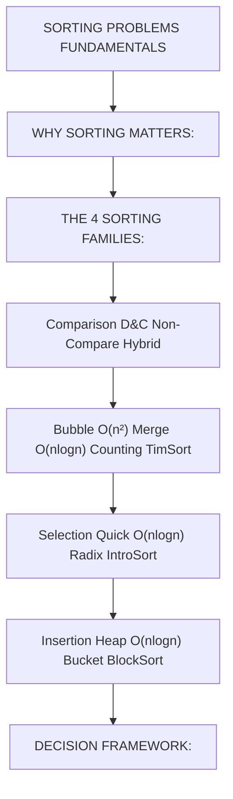

---

## PART 0: WHY Sorting — The Foundation Every Algorithm Stands On

```
╔══════════════════════════════════════════════════════════════════════════════╗
║        SORTING PROBLEMS — COMPLETE UNDERSTANDING & GROWTH MINDSET            ║
╚══════════════════════════════════════════════════════════════════════════════╝

┌──────────────────────────────────────────────────────────────────────────────┐
│ THE REAL-WORLD ORIGIN                                                        │
├──────────────────────────────────────────────────────────────────────────────┤
│                                                                              │
│ 📖 1945: John von Neumann invented Merge Sort for the EDVAC computer.         │
│     It was the FIRST algorithm designed specifically for computers.          │
│                                                                              │
│ 📖 1960: Tony Hoare invented QuickSort while working on machine               │
│     translation at Moscow State University. He needed to sort words in a     │
│     Russian-English dictionary. Still the fastest practical sort today.      │
│                                                                              │
│ 📖 1964: J.W.J. Williams invented HeapSort — the first O(n log n)             │
│     in-place sort that's also worst-case guaranteed.                         │
│                                                                              │
│ 📖 2002: Tim Peters created TimSort for Python — a hybrid that                │
│     exploits "runs" of pre-sorted data. Now used in Java, Android, Swift.    │
│                                                                              │
│ FUNDAMENTAL THEOREM:                                                         │
│ Any comparison-based sort requires Ω(n log n) comparisons in the worst case. │
│ Proof: n! possible orderings → decision tree has height ≥ log₂(n!) = Ω(nlogn)│
│                                                                              │
│ This means: Merge Sort, QuickSort, HeapSort are OPTIMAL for general data.    │
│ Counting/Radix/Bucket beat this ONLY because they don't compare elements.    │
│                                                                              │
└──────────────────────────────────────────────────────────────────────────────┘

┌──────────────────────────────────────────────────────────────────────────────┐
│ THE MENTAL MODEL: "What property do I need after sorting?"                   │
├──────────────────────────────────────────────────────────────────────────────┤
│                                                                              │
│  SORT + BINARY SEARCH  → "Find something fast"                               │
│  SORT + TWO POINTERS   → "Find pairs/triplets"                               │
│  SORT + GREEDY         → "Process in optimal order"                          │
│  SORT + MERGE          → "Combine sorted sequences"                          │
│  CUSTOM COMPARATOR     → "Define YOUR ordering"                              │
│                                                                              │
│  BEFORE YOU SORT, ASK:                                                       │
│  1. Does sorting destroy information I need? (original indices!)             │
│  2. Is there a way to solve WITHOUT sorting? (HashMap, counting)             │
│  3. Do I need full sort or just partial? (QuickSelect for kth element)       │
│                                                                              │
└──────────────────────────────────────────────────────────────────────────────┘

┌──────────────────────────────────────────────────────────────────────────────┐
│ COMPLEXITY COMPARISON TABLE                                                  │
├────────────────────┬──────────┬──────────┬──────────┬────────┬───────────────┤
│ Algorithm          │ Best     │ Average  │ Worst    │ Space  │ Stable?       │
├────────────────────┼──────────┼──────────┼──────────┼────────┼───────────────┤
│ Bubble Sort        │ O(n)     │ O(n²)    │ O(n²)    │ O(1)   │ Yes           │
│ Selection Sort     │ O(n²)    │ O(n²)    │ O(n²)    │ O(1)   │ No            │
│ Insertion Sort     │ O(n)     │ O(n²)    │ O(n²)    │ O(1)   │ Yes           │
│ Merge Sort         │ O(nlogn) │ O(nlogn) │ O(nlogn) │ O(n)   │ Yes           │
│ Quick Sort         │ O(nlogn) │ O(nlogn) │ O(n²)    │ O(logn)│ No            │
│ Heap Sort          │ O(nlogn) │ O(nlogn) │ O(nlogn) │ O(1)   │ No            │
│ Counting Sort      │ O(n+k)   │ O(n+k)   │ O(n+k)   │ O(k)   │ Yes           │
│ Radix Sort         │ O(d·n)   │ O(d·n)   │ O(d·n)   │ O(n+k) │ Yes           │
│ Bucket Sort        │ O(n+k)   │ O(n+k)   │ O(n²)    │ O(n)   │ Yes           │
│ Tim Sort           │ O(n)     │ O(nlogn) │ O(nlogn) │ O(n)   │ Yes           │
└────────────────────┴──────────┴──────────┴──────────┴────────┴───────────────┘

┌──────────────────────────────────────────────────────────────────────────────┐
│ COMMON MISTAKES                                                              │
├──────────────────────────────────────────────────────────────────────────────┤
│ 1. Using Arrays.sort() on primitives thinking it's stable (it's Dual-Pivot   │
│    QuickSort = NOT stable). Use Integer[] + Arrays.sort() for stability.     │
│ 2. Forgetting that QuickSort worst case is O(n²) on already-sorted input     │
│    → Use randomized pivot or median-of-three.                                │
│ 3. Custom comparator returning a-b can INTEGER OVERFLOW.                     │
│    → Use Integer.compare(a, b) instead.                                      │
│ 4. Sorting when HashMap would be O(n) — don't sort just to find duplicates!  │
│ 5. Not considering stability when equal elements' relative order matters     │
│    (e.g., sorting employees by salary, keeping alphabetical within same).    │
└──────────────────────────────────────────────────────────────────────────────┘

┌──────────────────────────────────────────────────────────────────────────────┐
│ EXPECTED OUTPUTS                                                             │
├──────────────────────────────────────────────────────────────────────────────┤
│ After mastering this section, you should be able to:                         │
│ ✓ Implement Merge Sort, Quick Sort, Heap Sort from scratch                   │
│ ✓ Choose the right sort algorithm for any scenario                           │
│ ✓ Write custom comparators for complex sorting                               │
│ ✓ Use QuickSelect for kth element problems                                   │
│ ✓ Recognize when sorting is a preprocessing step                             │
│ ✓ Apply Counting/Radix sort for special cases                                │
│ ✓ Sort linked lists efficiently with Merge Sort                              │
└──────────────────────────────────────────────────────────────────────────────┘
```

---


🔬 **Section Challenge — PART 0: WHY Sorting — The Foundation Every Algorithm Stands On**

**Challenge 1 (Reasoning):** QuickSort average O(N log N) but worst case O(N²). When exactly does the worst case happen and how do you prevent it?
<details><summary>Answer</summary>

Worst case: pivot always ends up at position 0 or N-1 (completely unbalanced partition). This happens when: (1) always picking first/last element as pivot on already-sorted or reverse-sorted data. (2) Pivot happens to be the minimum or maximum. Prevention: random pivot (randomized quicksort — expected O(N log N) even on adversarial input), or median-of-three (pick median of first/middle/last element as pivot). Java's dual-pivot quicksort uses careful pivot selection to avoid this.
</details>


## PROBLEM 1: Sort an Array (LC 912) — Implement Merge Sort

```
DIFFICULTY: Medium
COMPANIES: Google, Facebook, Amazon
PATTERN: Divide and Conquer

PROBLEM: Given an array of integers, sort it in ascending order.
         Implement from scratch (not Arrays.sort).

EXAMPLE:
  Input:  [5, 2, 3, 1]
  Output: [1, 2, 3, 5]

WHY MERGE SORT? (MIT 6.006 Reasoning)
━━━━━━━━━━━━━━━━━━━━━━━━━━━━━━━━━━━━━
  The key insight: TWO sorted arrays can be merged in O(n).
  If we keep splitting until single elements (trivially sorted),
  then merge back up → entire array sorted in O(n log n).

  Recurrence: T(n) = 2T(n/2) + O(n)
  By Master Theorem: T(n) = O(n log n)

  SPLIT:  [5, 2, 3, 1]
          /            \
      [5, 2]        [3, 1]
      /    \         /    \
    [5]   [2]      [3]    [1]

  MERGE:
    [5]   [2]      [3]    [1]
      \    /         \    /
      [2, 5]        [1, 3]
          \            /
        [1, 2, 3, 5]

SOLUTION:
```

**Flow:**
1. then merge back up
2. entire array sorted in O(n log n).

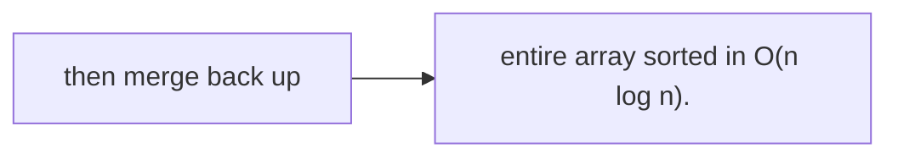

```java
public int[] sortArray(int[] nums) {
    if (nums.length <= 1) return nums;
    mergeSort(nums, 0, nums.length - 1);
    return nums;
}

private void mergeSort(int[] nums, int left, int right) {
    if (left >= right) return;
    
    int mid = left + (right - left) / 2;
    mergeSort(nums, left, mid);
    mergeSort(nums, mid + 1, right);
    merge(nums, left, mid, right);
}

private void merge(int[] nums, int left, int mid, int right) {
    int[] temp = new int[right - left + 1];
    int i = left, j = mid + 1, k = 0;
    
    while (i <= mid && j <= right) {
        if (nums[i] <= nums[j]) {  // <= for stability
            temp[k++] = nums[i++];
        } else {
            temp[k++] = nums[j++];
        }
    }
    while (i <= mid) temp[k++] = nums[i++];
    while (j <= right) temp[k++] = nums[j++];
    
    System.arraycopy(temp, 0, nums, left, temp.length);
}
```

```
COMPLEXITY: Time O(n log n) always | Space O(n) for temp array
KEY INSIGHT: The <= in comparison makes it STABLE.
```

---

## PROBLEM 2: Sort an Array — Quick Sort with Random Pivot

```
DIFFICULTY: Medium
PATTERN: Divide and Conquer, Randomization

WHY QUICK SORT?
━━━━━━━━━━━━━━
  In practice, QuickSort is 2-3x faster than MergeSort because:
  1. Better cache locality (in-place, sequential access)
  2. No extra O(n) memory allocation
  3. Inner loop is simpler (fewer comparisons per element)

  BUT: Worst case O(n²) if pivot is always min/max.
  FIX: Random pivot makes worst case astronomically unlikely.

ALGORITHM (Lomuto Partition):
  1. Pick random pivot, swap to end
  2. Partition: elements < pivot go left, >= go right
  3. Recurse on both halves

  Example: [3, 6, 8, 10, 1, 2, 1], pivot=6
  After partition: [3, 1, 2, 1, 6, 8, 10]
                    < pivot    pivot  > pivot

SOLUTION:
```

**Flow:**
1. DIFFICULTY: Medium
2. PATTERN: Divide and Conquer, Randomization
3. WHY QUICK SORT?
4. 1. Better cache locality (in-place, sequential access)
5. 2. No extra O(n) memory allocation
6. 3. Inner loop is simpler (fewer comparisons per element
7. BUT: Worst case O(n²) if pivot is always min/max.

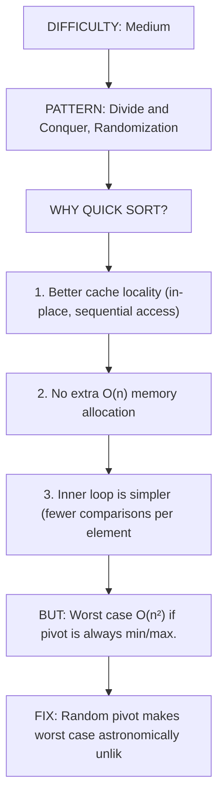

```java
private Random rand = new Random();

public int[] sortArray(int[] nums) {
    quickSort(nums, 0, nums.length - 1);
    return nums;
}

private void quickSort(int[] nums, int lo, int hi) {
    if (lo >= hi) return;
    
    // 3-way partition for handling duplicates (Dutch National Flag)
    int pivot = nums[lo + rand.nextInt(hi - lo + 1)];
    int lt = lo, gt = hi, i = lo;
    
    while (i <= gt) {
        if (nums[i] < pivot) {
            swap(nums, lt++, i++);
        } else if (nums[i] > pivot) {
            swap(nums, i, gt--);
        } else {
            i++;
        }
    }
    // Now: [lo..lt-1] < pivot, [lt..gt] == pivot, [gt+1..hi] > pivot
    quickSort(nums, lo, lt - 1);
    quickSort(nums, gt + 1, hi);
}

private void swap(int[] nums, int i, int j) {
    int temp = nums[i];
    nums[i] = nums[j];
    nums[j] = temp;
}
```

```
COMPLEXITY: Time O(n log n) avg, O(n²) worst | Space O(log n) stack
WHY 3-WAY? Handles duplicates in O(n) — critical for arrays with repeats.
```

---

## PROBLEM 3: Kth Largest Element in Array (LC 215)

```
DIFFICULTY: Medium
COMPANIES: Facebook, Amazon, Google, Microsoft, LinkedIn
PATTERN: QuickSelect (Partial Sort)

PROBLEM: Find the kth largest element in an unsorted array.
  Input:  nums = [3,2,1,5,6,4], k = 2
  Output: 5

THREE APPROACHES:
━━━━━━━━━━━━━━━━
  1. Sort → O(n log n)        — works but overkill
  2. Min-Heap of size k → O(n log k) — good
  3. QuickSelect → O(n) average    — OPTIMAL ✓

WHY QUICKSELECT? (KTH Royal Institute Style)
  You don't need the array fully sorted!
  After partition, pivot is in its final position.
  If pivot index == target, DONE.
  Otherwise recurse on ONE side only.

  T(n) = T(n/2) + O(n) = O(n)  [by Master Theorem]

SOLUTION (QuickSelect):
```

**Flow:**
1. 1. Sort
2. O(n log n) — works but overkill
3. 2. Min-Heap of size k
4. O(n log k) — good
5. 3. QuickSelect
6. O(n) average — OPTIMAL ✓

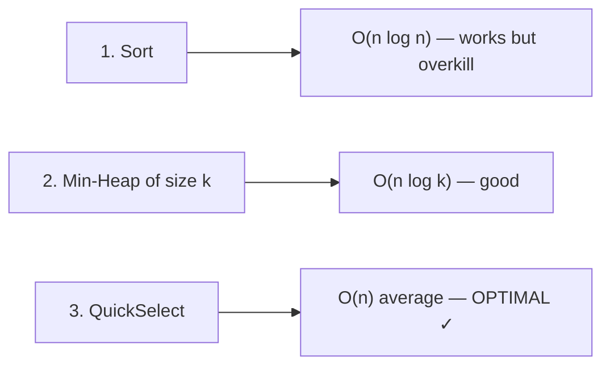

```java
public int findKthLargest(int[] nums, int k) {
    int target = nums.length - k;  // Convert to kth smallest
    return quickSelect(nums, 0, nums.length - 1, target);
}

private int quickSelect(int[] nums, int lo, int hi, int target) {
    int pivotIdx = lo + new Random().nextInt(hi - lo + 1);
    int pivot = nums[pivotIdx];
    swap(nums, pivotIdx, hi);  // Move pivot to end
    
    int store = lo;
    for (int i = lo; i < hi; i++) {
        if (nums[i] < pivot) {
            swap(nums, store++, i);
        }
    }
    swap(nums, store, hi);  // Pivot to final position
    
    if (store == target) return nums[store];
    else if (store < target) return quickSelect(nums, store + 1, hi, target);
    else return quickSelect(nums, lo, store - 1, target);
}

private void swap(int[] a, int i, int j) {
    int t = a[i]; a[i] = a[j]; a[j] = t;
}
```

```
COMPLEXITY: Time O(n) average, O(n²) worst | Space O(1)
INTERVIEW TIP: Always mention that worst case is O(n²) but random pivot
makes probability negligible. For guaranteed O(n), mention median-of-medians.
```

---


## PROBLEM 4: Merge Intervals (LC 56)

```
DIFFICULTY: Medium
COMPANIES: Google, Facebook, Amazon, Microsoft, Bloomberg
PATTERN: Sort + Greedy Merge

PROBLEM: Given collection of intervals, merge overlapping ones.
  Input:  [[1,3],[2,6],[8,10],[15,18]]
  Output: [[1,6],[8,10],[15,18]]

APPROACH (MIT 6.006 Style):
━━━━━━━━━━━━━━━━━━━━━━━━━━
  KEY INSIGHT: After sorting by start time, overlapping intervals
  are ADJACENT. One pass merges them all.

  Step 1: Sort by start → [1,3] [2,6] [8,10] [15,18]
  Step 2: Compare current end with next start:
          [1,3] + [2,6] → 3 >= 2 → merge → [1,6]
          [1,6] + [8,10] → 6 < 8 → no merge
          [8,10] + [15,18] → 10 < 15 → no merge
  Result: [1,6] [8,10] [15,18]

SOLUTION:
```

**Flow:**
1. Step 1: Sort by start
2. [1,3] [2,6] [8,10] [15,18]
3. [1,3] + [2,6]
4. 3 >= 2
5. merge
6. [1,6]
7. [1,6] + [8,10]
8. 6 < 8
9. no merge

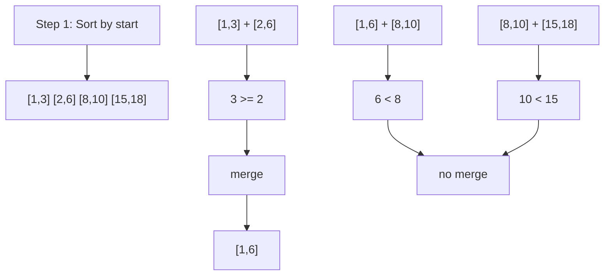

```java
public int[][] merge(int[][] intervals) {
    Arrays.sort(intervals, (a, b) -> Integer.compare(a[0], b[0]));
    
    List<int[]> merged = new ArrayList<>();
    merged.add(intervals[0]);
    
    for (int i = 1; i < intervals.length; i++) {
        int[] last = merged.get(merged.size() - 1);
        if (intervals[i][0] <= last[1]) {
            last[1] = Math.max(last[1], intervals[i][1]);  // Extend end
        } else {
            merged.add(intervals[i]);
        }
    }
    return merged.toArray(new int[merged.size()][]);
}
```

```
COMPLEXITY: Time O(n log n) for sort | Space O(n) for result
EDGE CASE: Single interval → return as-is
EDGE CASE: All overlapping → returns single interval
VARIANT: Insert Interval (LC 57) — same idea, but insert first then merge
```

**Flow:**
1. EDGE CASE: Single interval
2. return as-is
3. EDGE CASE: All overlapping
4. returns single interval

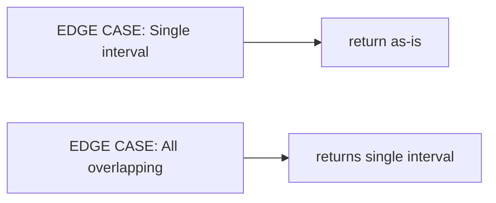

---


## PROBLEM 5: Sort Colors — Dutch National Flag (LC 75)

```
DIFFICULTY: Medium
COMPANIES: Microsoft, Amazon, Facebook (VERY common)
PATTERN: Three-Way Partition

PROBLEM: Sort array containing only 0, 1, 2 in one pass.
  Input:  [2,0,2,1,1,0]
  Output: [0,0,1,1,2,2]

WHY THIS MATTERS:
━━━━━━━━━━━━━━━━
  Edsger Dijkstra proposed this problem in 1976.
  It's the three-way partition used inside QuickSort!
  One pass, in-place, O(n) time.

  THREE POINTERS:
  low  = boundary for 0s (everything before low is 0)
  mid  = current scanner
  high = boundary for 2s (everything after high is 2)

  INVARIANT:
  [0..low-1] = all 0s
  [low..mid-1] = all 1s
  [mid..high] = unprocessed
  [high+1..n-1] = all 2s

TRACE for [2, 0, 2, 1, 1, 0]:
  lo=0 mid=0 hi=5: nums[0]=2 → swap(0,5)→[0,0,2,1,1,2] hi=4
  lo=0 mid=0 hi=4: nums[0]=0 → lo=1 mid=1
  lo=1 mid=1 hi=4: nums[1]=0 → lo=2 mid=2
  lo=2 mid=2 hi=4: nums[2]=2 → swap(2,4)→[0,0,1,1,2,2] hi=3
  lo=2 mid=2 hi=3: nums[2]=1 → mid=3
  lo=2 mid=3 hi=3: nums[3]=1 → mid=4
  mid > hi → DONE! Result: [0,0,1,1,2,2]

SOLUTION:
```

**Flow:**
1. lo=0 mid=0 hi=5: nums[0]=2
2. swap(0,5)
3. [0,0,2,1,1,2] hi=4
4. lo=0 mid=0 hi=4: nums[0]=0
5. lo=1 mid=1
6. lo=1 mid=1 hi=4: nums[1]=0
7. lo=2 mid=2
8. lo=2 mid=2 hi=4: nums[2]=2
9. swap(2,4)
10. [0,0,1,1,2,2] hi=3

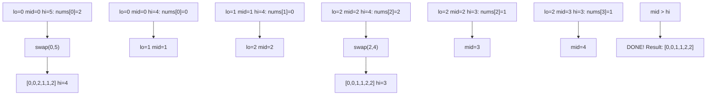

```java
public void sortColors(int[] nums) {
    int lo = 0, mid = 0, hi = nums.length - 1;
    
    while (mid <= hi) {
        if (nums[mid] == 0) {
            swap(nums, lo++, mid++);
        } else if (nums[mid] == 2) {
            swap(nums, mid, hi--);
            // Don't advance mid! New element at mid needs checking.
        } else {
            mid++;
        }
    }
}
```

```
COMPLEXITY: Time O(n) single pass | Space O(1)
CRITICAL: Don't increment mid after swapping with hi!
          The element swapped from hi hasn't been examined yet.
```

---

## PROBLEM 6: Largest Number (LC 179)

```
DIFFICULTY: Medium
COMPANIES: Amazon, Microsoft, Adobe
PATTERN: Custom Comparator

PROBLEM: Arrange numbers to form the largest possible number.
  Input:  [10, 2]
  Output: "210"
  Input:  [3, 30, 34, 5, 9]
  Output: "9534330"

INSIGHT:
━━━━━━━━
  Compare by concatenation: is "ab" > "ba"?
  For 3 vs 30: "330" > "303" → 3 comes first
  For 3 vs 34: "334" < "343" → 34 comes first

SOLUTION:
```

**Flow:**
1. For 3 vs 30: '330' > '303'
2. 3 comes first
3. For 3 vs 34: '334' < '343'
4. 34 comes first

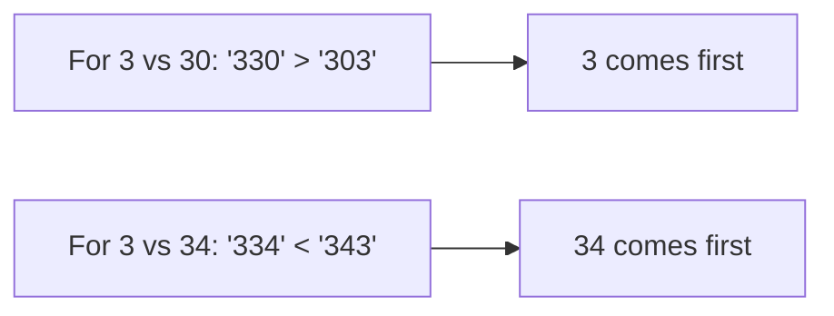

```java
public String largestNumber(int[] nums) {
    String[] strs = new String[nums.length];
    for (int i = 0; i < nums.length; i++) strs[i] = String.valueOf(nums[i]);
    
    // Custom comparator: which concatenation is larger?
    Arrays.sort(strs, (a, b) -> (b + a).compareTo(a + b));
    
    if (strs[0].equals("0")) return "0";  // Edge: all zeros
    
    StringBuilder sb = new StringBuilder();
    for (String s : strs) sb.append(s);
    return sb.toString();
}
```

```
COMPLEXITY: Time O(n log n · k) where k = avg digit length | Space O(n)
PROOF OF CORRECTNESS: The comparator defines a total order.
  If a○b > b○a and b○c > c○b, then a○c > c○a (transitivity).
```

**Flow:**
1. PROOF OF CORRECTNESS: The comparator defines a total or
2. If a○b > b○a and b○c > c○b, then a○c > c○a (tr

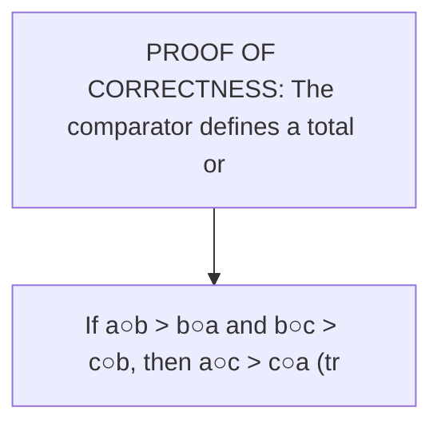

---

## PROBLEM 7: Sort List — Merge Sort on Linked List (LC 148)

```
DIFFICULTY: Medium
COMPANIES: Amazon, Microsoft, Adobe
PATTERN: Merge Sort on Linked List

PROBLEM: Sort a linked list in O(n log n) time and O(1) space.

WHY MERGE SORT FOR LINKED LISTS?
━━━━━━━━━━━━━━━━━━━━━━━━━━━━━━━━
  - QuickSort needs random access (bad for linked lists)
  - Merge Sort only needs sequential access ✓
  - Splitting: use slow/fast pointer to find middle
  - Merging: pointer manipulation, no extra array

SOLUTION:
```

**Flow:**
1. DIFFICULTY: Medium
2. COMPANIES: Amazon, Microsoft, Adobe
3. PATTERN: Merge Sort on Linked List
4. WHY MERGE SORT FOR LINKED LISTS?
5. - QuickSort needs random access (bad for linked lists)
6. - Merge Sort only needs sequential access ✓
7. - Splitting: use slow/fast pointer to find middle

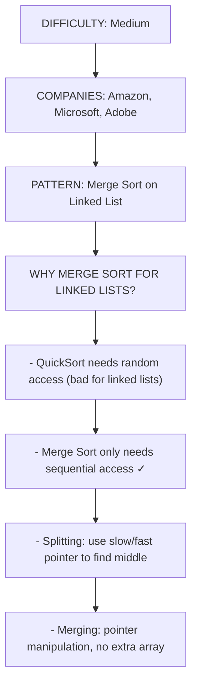

```java
public ListNode sortList(ListNode head) {
    if (head == null || head.next == null) return head;
    
    // Split in half using slow/fast pointers
    ListNode slow = head, fast = head.next;
    while (fast != null && fast.next != null) {
        slow = slow.next;
        fast = fast.next.next;
    }
    ListNode mid = slow.next;
    slow.next = null;  // Cut the list
    
    // Recursively sort both halves
    ListNode left = sortList(head);
    ListNode right = sortList(mid);
    
    // Merge sorted halves
    return mergeTwoLists(left, right);
}

private ListNode mergeTwoLists(ListNode l1, ListNode l2) {
    ListNode dummy = new ListNode(0), curr = dummy;
    while (l1 != null && l2 != null) {
        if (l1.val <= l2.val) {
            curr.next = l1;
            l1 = l1.next;
        } else {
            curr.next = l2;
            l2 = l2.next;
        }
        curr = curr.next;
    }
    curr.next = (l1 != null) ? l1 : l2;
    return dummy.next;
}
```

```
COMPLEXITY: Time O(n log n) | Space O(log n) recursion stack
BOTTOM-UP VARIANT: Can do iteratively for true O(1) space
  — Merge sublists of size 1, then 2, then 4, etc.
```

---


## PROBLEM 8: Top K Frequent Elements (LC 347)

```
DIFFICULTY: Medium
COMPANIES: Amazon, Facebook, Google, Uber, Yelp
PATTERN: Bucket Sort / Heap / QuickSelect

PROBLEM: Given integer array, return k most frequent elements.
  Input:  nums = [1,1,1,2,2,3], k = 2
  Output: [1, 2]

THREE APPROACHES:
━━━━━━━━━━━━━━━━
  1. HashMap + Sort     → O(n log n)
  2. HashMap + MinHeap  → O(n log k)
  3. HashMap + BucketSort → O(n) ✓ OPTIMAL

  BUCKET SORT IDEA:
  - Count frequencies with HashMap
  - Create buckets where index = frequency
  - Walk buckets from high to low, pick k elements

  nums = [1,1,1,2,2,3], k = 2
  freq: {1:3, 2:2, 3:1}
  buckets:
    index: 0  1    2    3
    value: [] [3]  [2]  [1]
  Walk from right: bucket[3]=[1], bucket[2]=[2] → result = [1, 2]

SOLUTION:
```

**Flow:**
1. 1. HashMap + Sort
2. O(n log n)
3. 2. HashMap + MinHeap
4. O(n log k)
5. 3. HashMap + BucketSort
6. O(n) ✓ OPTIMAL
7. Walk from right: bucket[3]=[1], bucket[2]=[2]
8. result = [1, 2]

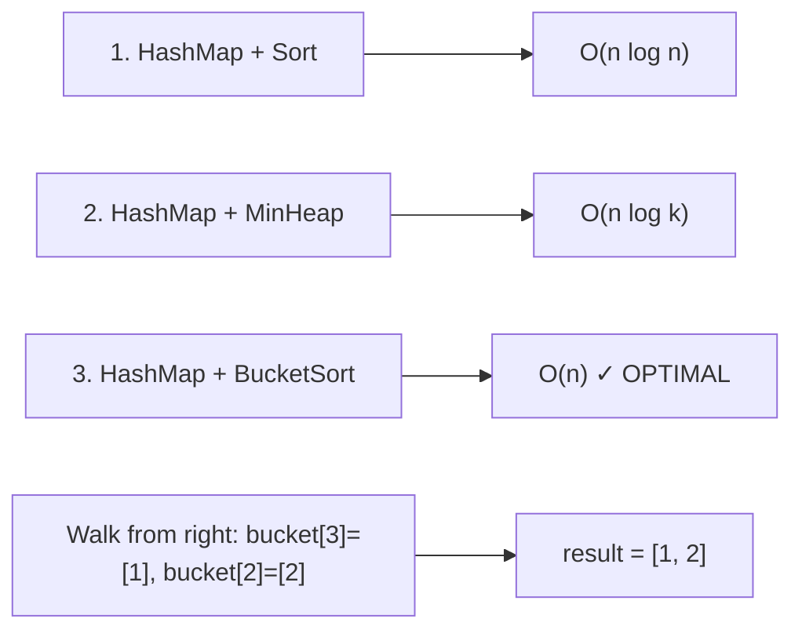

```java
public int[] topKFrequent(int[] nums, int k) {
    // Count frequencies
    Map<Integer, Integer> freq = new HashMap<>();
    for (int n : nums) freq.merge(n, 1, Integer::sum);
    
    // Bucket sort: index = frequency
    List<Integer>[] buckets = new List[nums.length + 1];
    for (var entry : freq.entrySet()) {
        int f = entry.getValue();
        if (buckets[f] == null) buckets[f] = new ArrayList<>();
        buckets[f].add(entry.getKey());
    }
    
    // Collect top k from highest frequency
    int[] result = new int[k];
    int idx = 0;
    for (int i = buckets.length - 1; i >= 0 && idx < k; i--) {
        if (buckets[i] != null) {
            for (int num : buckets[i]) {
                if (idx < k) result[idx++] = num;
            }
        }
    }
    return result;
}
```

```
COMPLEXITY: Time O(n) | Space O(n)
WHY BUCKET SORT WORKS: Max frequency = n, so bucket array has O(n) slots.
```

---

## PROBLEM 9: Valid Anagram (LC 242)

```
DIFFICULTY: Easy
COMPANIES: Amazon, Google, Microsoft
PATTERN: Counting Sort / Frequency Array

PROBLEM: Given two strings, determine if one is an anagram of another.
  Input:  s = "anagram", t = "nagaram"
  Output: true

TWO APPROACHES:
  1. Sort both strings, compare → O(n log n)
  2. Frequency count → O(n) ✓

SOLUTION:
```

**Flow:**
1. 1. Sort both strings, compare
2. O(n log n)
3. 2. Frequency count
4. O(n) ✓

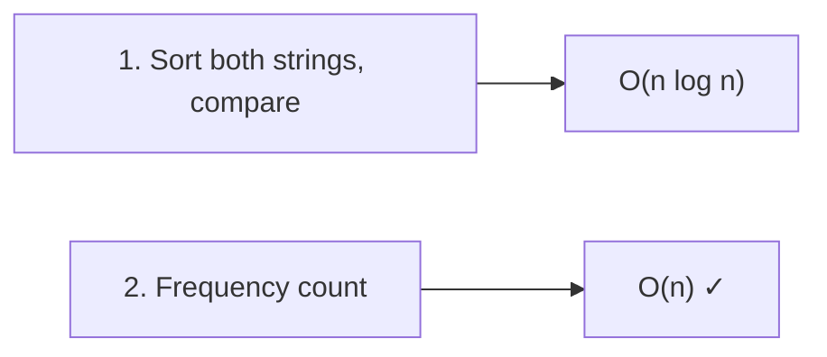

```java
public boolean isAnagram(String s, String t) {
    if (s.length() != t.length()) return false;
    
    int[] count = new int[26];
    for (int i = 0; i < s.length(); i++) {
        count[s.charAt(i) - 'a']++;
        count[t.charAt(i) - 'a']--;
    }
    for (int c : count) {
        if (c != 0) return false;
    }
    return true;
}
```

```
COMPLEXITY: Time O(n) | Space O(1) — fixed 26 chars
FOLLOW-UP: What if input has Unicode? Use HashMap instead of int[26].
```

---

## PROBLEM 10: Sort Characters By Frequency (LC 451)

```
DIFFICULTY: Medium
COMPANIES: Amazon, Google, Bloomberg
PATTERN: Bucket Sort by Frequency

PROBLEM: Sort string by character frequency (highest first).
  Input:  "tree"
  Output: "eert" or "eetr"

SOLUTION (Bucket Sort):
```

```java
public String frequencySort(String s) {
    int[] freq = new int[128];
    for (char c : s.toCharArray()) freq[c]++;
    
    // Bucket sort: index = frequency
    List<Character>[] buckets = new List[s.length() + 1];
    for (int i = 0; i < 128; i++) {
        if (freq[i] > 0) {
            if (buckets[freq[i]] == null) buckets[freq[i]] = new ArrayList<>();
            buckets[freq[i]].add((char) i);
        }
    }
    
    StringBuilder sb = new StringBuilder();
    for (int i = buckets.length - 1; i >= 0; i--) {
        if (buckets[i] != null) {
            for (char c : buckets[i]) {
                for (int j = 0; j < i; j++) sb.append(c);
            }
        }
    }
    return sb.toString();
}
```

```
COMPLEXITY: Time O(n) | Space O(n)
```

---

## PROBLEM 11: H-Index (LC 274)

```
DIFFICULTY: Medium
PATTERN: Counting Sort

PROBLEM: Given citations array, compute researcher's h-index.
  h-index = largest h such that h papers have >= h citations.
  Input:  [3,0,6,1,5]  Output: 3

INSIGHT: Use counting sort since we only care about values 0..n.

SOLUTION:
```

```java
public int hIndex(int[] citations) {
    int n = citations.length;
    int[] count = new int[n + 1];
    
    for (int c : citations) {
        count[Math.min(c, n)]++;  // Cap at n (anything >= n counts same)
    }
    
    int papers = 0;
    for (int h = n; h >= 0; h--) {
        papers += count[h];
        if (papers >= h) return h;
    }
    return 0;
}
```

```
COMPLEXITY: Time O(n) | Space O(n)
KEY TRICK: Citations > n can be treated as n (h-index can't exceed n).
```

---

## PROBLEM 12: Wiggle Sort II (LC 324)

```
DIFFICULTY: Medium
COMPANIES: Google, Amazon
PATTERN: QuickSelect + 3-way partition + Index mapping

PROBLEM: Reorder array so nums[0] < nums[1] > nums[2] < nums[3]...
  Input:  [1,5,1,1,6,4]
  Output: [1,6,1,5,1,4]

APPROACH:
  1. Find median using QuickSelect → O(n)
  2. 3-way partition around median with virtual indexing

SOLUTION:
```

**Flow:**
1. 1. Find median using QuickSelect
2. O(n)

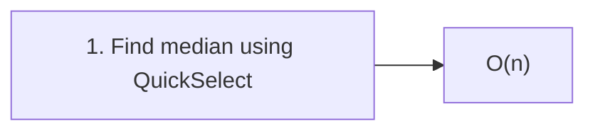

```java
public void wiggleSort(int[] nums) {
    int n = nums.length;
    int median = findKthLargest(nums, (n + 1) / 2);
    
    // Virtual index mapping: maps 0,1,2,3,4,5 → 1,3,5,0,2,4
    // Odd positions first, then even — spreads medians apart
    int left = 0, right = n - 1, i = 0;
    while (i <= right) {
        int vi = virtualIdx(i, n);
        if (nums[vi] > median) {
            swap(nums, virtualIdx(left++, n), vi);
            i++;
        } else if (nums[vi] < median) {
            swap(nums, vi, virtualIdx(right--, n));
        } else {
            i++;
        }
    }
}

private int virtualIdx(int i, int n) {
    return (1 + 2 * i) % (n | 1);
}
```

```
COMPLEXITY: Time O(n) | Space O(1)
THIS IS A HARD PROBLEM despite Medium tag. The virtual indexing trick
is the crux — it ensures equal elements (medians) end up in positions
where they don't violate the wiggle property.
```

---

## PROBLEM 13: Maximum Gap (LC 164)

```
DIFFICULTY: Medium (really Hard)
PATTERN: Bucket Sort / Pigeonhole Principle

PROBLEM: Find max difference between successive elements in sorted form.
         Must be O(n) time and O(n) space.
  Input:  [3,6,9,1]  Output: 3 (sorted: [1,3,6,9], gaps: 2,3,3)

INSIGHT (Pigeonhole):
  n numbers in range [min, max]
  Average gap = (max - min) / (n - 1)
  Answer must be >= average gap  
  Create n-1 buckets of size = average gap
  Track min/max in each bucket
  Answer = max(next_bucket_min - prev_bucket_max)

SOLUTION:
```

```java
public int maximumGap(int[] nums) {
    int n = nums.length;
    if (n < 2) return 0;
    
    int min = Integer.MAX_VALUE, max = Integer.MIN_VALUE;
    for (int num : nums) { min = Math.min(min, num); max = Math.max(max, num); }
    if (min == max) return 0;
    
    int bucketSize = Math.max(1, (max - min) / (n - 1));
    int bucketCount = (max - min) / bucketSize + 1;
    int[] bucketMin = new int[bucketCount];
    int[] bucketMax = new int[bucketCount];
    Arrays.fill(bucketMin, Integer.MAX_VALUE);
    Arrays.fill(bucketMax, Integer.MIN_VALUE);
    
    for (int num : nums) {
        int idx = (num - min) / bucketSize;
        bucketMin[idx] = Math.min(bucketMin[idx], num);
        bucketMax[idx] = Math.max(bucketMax[idx], num);
    }
    
    int maxGap = 0, prevMax = bucketMax[0];
    for (int i = 1; i < bucketCount; i++) {
        if (bucketMin[i] == Integer.MAX_VALUE) continue;  // Empty bucket
        maxGap = Math.max(maxGap, bucketMin[i] - prevMax);
        prevMax = bucketMax[i];
    }
    return maxGap;
}
```

```
COMPLEXITY: Time O(n) | Space O(n)
KEY INSIGHT: Max gap is BETWEEN buckets, never within a bucket.
```

---

## 📋 CURATED PRACTICE PROBLEMS

### Easy

| # | Problem | LC# | Pattern | Company |
|---|---------|-----|---------|---------|
| 1 | [Valid Anagram](https://leetcode.com/problems/valid-anagram/) | 242 | Counting | Amazon, Google |
| 2 | [Merge Sorted Array](https://leetcode.com/problems/merge-sorted-array/) | 88 | Two Pointers Merge | Facebook |
| 3 | [Intersection of Two Arrays II](https://leetcode.com/problems/intersection-of-two-arrays-ii/) | 350 | Sort + Two Pointers | Facebook |
| 4 | [Contains Duplicate](https://leetcode.com/problems/contains-duplicate/) | 217 | Sort / HashSet | Amazon |
| 5 | [Majority Element](https://leetcode.com/problems/majority-element/) | 169 | Boyer-Moore / Sort | Amazon, Google |
| 6 | [Missing Number](https://leetcode.com/problems/missing-number/) | 268 | Sort / XOR / Math | Microsoft |
| 7 | [Squares of a Sorted Array](https://leetcode.com/problems/squares-of-a-sorted-array/) | 977 | Two Pointer Merge | Facebook |

### Medium

| # | Problem | LC# | Pattern | Company |
|---|---------|-----|---------|---------|
| 1 | [Sort Colors](https://leetcode.com/problems/sort-colors/) | 75 | Dutch Flag 3-Way | Microsoft, Amazon |
| 2 | [Kth Largest Element](https://leetcode.com/problems/kth-largest-element-in-an-array/) | 215 | QuickSelect | Facebook, Google |
| 3 | [Top K Frequent Elements](https://leetcode.com/problems/top-k-frequent-elements/) | 347 | Bucket Sort | Amazon, Facebook |
| 4 | [Merge Intervals](https://leetcode.com/problems/merge-intervals/) | 56 | Sort + Merge | Google, Facebook |
| 5 | [Sort List](https://leetcode.com/problems/sort-list/) | 148 | Merge Sort LL | Amazon |
| 6 | [Largest Number](https://leetcode.com/problems/largest-number/) | 179 | Custom Comparator | Amazon |
| 7 | [Sort Characters By Frequency](https://leetcode.com/problems/sort-characters-by-frequency/) | 451 | Bucket Sort | Amazon |
| 8 | [H-Index](https://leetcode.com/problems/h-index/) | 274 | Counting Sort | Google |
| 9 | [Wiggle Sort II](https://leetcode.com/problems/wiggle-sort-ii/) | 324 | QuickSelect + Virtual | Google |
| 10 | [Queue Reconstruction by Height](https://leetcode.com/problems/queue-reconstruction-by-height/) | 406 | Custom Sort + Insert | Google |
| 11 | [Custom Sort String](https://leetcode.com/problems/custom-sort-string/) | 791 | Custom Comparator | Facebook |
| 12 | [Pancake Sorting](https://leetcode.com/problems/pancake-sorting/) | 969 | Selection Sort | Microsoft |

### Hard

| # | Problem | LC# | Pattern | Company |
|---|---------|-----|---------|---------|
| 1 | [Maximum Gap](https://leetcode.com/problems/maximum-gap/) | 164 | Bucket Sort | Google |
| 2 | [Count of Smaller Numbers After Self](https://leetcode.com/problems/count-of-smaller-numbers-after-self/) | 315 | Merge Sort + Count | Google |
| 3 | [Reverse Pairs](https://leetcode.com/problems/reverse-pairs/) | 493 | Merge Sort + Count | Google |
| 4 | [Count of Range Sum](https://leetcode.com/problems/count-of-range-sum/) | 327 | Merge Sort | Google |
| 5 | [Median of Two Sorted Arrays](https://leetcode.com/problems/median-of-two-sorted-arrays/) | 4 | Binary Search | Google, Amazon |

---


---

## 🏋️ Practice & Interview Questions — Algorithms

### Sorting
**Q1.** Which sorting algorithm does Java use for `Arrays.sort(int[])`? Why not MergeSort?
<details><summary>Answer</summary>

**Dual-Pivot QuickSort** — for primitives. MergeSort requires O(N) extra space. QuickSort is in-place and cache-friendly. Stability doesn't matter for primitives (equal ints are indistinguishable). For objects (`Arrays.sort(Object[])`), Java uses **TimSort** (stable, O(N log N) worst).
</details>

**Q2.** Trace Merge Sort on `[4,2,7,1]`.
<details><summary>Answer</summary>

Split: `[4,2]` `[7,1]` → Split: `[4]` `[2]` `[7]` `[1]` → Merge: `[2,4]` `[1,7]` → Merge: `[1,2,4,7]`
</details>

**Q3.** ⭐⭐ Sort Colors (Dutch National Flag — 3-way partition).
<details><summary>Solution</summary>

```java
int lo=0, mid=0, hi=n-1;
while(mid<=hi){
    if(nums[mid]==0) swap(nums,lo++,mid++);
    else if(nums[mid]==1) mid++;
    else swap(nums,mid,hi--);
}
```
</details>

### Binary Search
**Q4.** ⭐ Search in Rotated Sorted Array.
<details><summary>Solution</summary>

```java
int lo=0, hi=n-1;
while(lo<=hi){
    int mid=(lo+hi)/2;
    if(nums[mid]==target) return mid;
    if(nums[lo]<=nums[mid]){ // left half sorted
        if(nums[lo]<=target&&target<nums[mid]) hi=mid-1; else lo=mid+1;
    } else { // right half sorted
        if(nums[mid]<target&&target<=nums[hi]) lo=mid+1; else hi=mid-1;
    }
}
return -1;
```
</details>

**Q5.** ⭐ Find First and Last Position (binary search twice).
<details><summary>Solution</summary>

```java
// First: find leftmost with while(lo<hi){ if arr[mid]>=target hi=mid else lo=mid+1 }
// Last: find rightmost with while(lo<hi){ if arr[mid]<=target lo=mid+1 else hi=mid } return lo-1
```
</details>

**Q6.** ⭐⭐ Koko Eating Bananas — binary search on answer.
<details><summary>Key insight</summary>

Binary search the eating speed k in range [1, max(piles)]. For each k, calculate hours needed. Find minimum k where hours ≤ H.
</details>

### Dynamic Programming
**Q7.** ⭐ Climbing Stairs — n steps, 1 or 2 at a time. How many ways?
<details><summary>Solution</summary>

```java
// Fibonacci sequence! dp[i] = dp[i-1] + dp[i-2]
int a=1, b=1;
for(int i=2;i<=n;i++){ int c=a+b; a=b; b=c; }
return b;
```
</details>

**Q8.** ⭐ Coin Change — minimum coins for amount.
<details><summary>Solution</summary>

```java
int[] dp = new int[amount+1]; Arrays.fill(dp, amount+1);
dp[0]=0;
for(int i=1;i<=amount;i++)
    for(int c:coins) if(c<=i) dp[i]=Math.min(dp[i],dp[i-c]+1);
return dp[amount]>amount?-1:dp[amount];
```
</details>

**Q9.** ⭐⭐ Longest Common Subsequence.
<details><summary>Solution</summary>

```java
int[][] dp=new int[m+1][n+1];
for(int i=1;i<=m;i++) for(int j=1;j<=n;j++){
    if(text1.charAt(i-1)==text2.charAt(j-1)) dp[i][j]=dp[i-1][j-1]+1;
    else dp[i][j]=Math.max(dp[i-1][j],dp[i][j-1]);
}
return dp[m][n];
```
</details>

**Q10.** ⭐⭐ Word Break — can string be segmented using dictionary words?
<details><summary>Solution</summary>

```java
boolean[] dp=new boolean[n+1]; dp[0]=true;
for(int i=1;i<=n;i++) for(String w:wordDict)
    if(i>=w.length()&&dp[i-w.length()]&&s.substring(i-w.length(),i).equals(w)) dp[i]=true;
return dp[n];
```
</details>

**Q11.** ⭐⭐⭐ Edit Distance (Levenshtein).
<details><summary>Solution</summary>

```java
int[][] dp=new int[m+1][n+1];
for(int i=0;i<=m;i++) dp[i][0]=i;
for(int j=0;j<=n;j++) dp[0][j]=j;
for(int i=1;i<=m;i++) for(int j=1;j<=n;j++){
    if(word1.charAt(i-1)==word2.charAt(j-1)) dp[i][j]=dp[i-1][j-1];
    else dp[i][j]=1+Math.min(dp[i-1][j-1],Math.min(dp[i-1][j],dp[i][j-1]));
}
```
</details>

### Graph Algorithms
**Q12.** ⭐ Number of Islands (BFS/DFS grid traversal).
<details><summary>Solution</summary>

```java
for each cell (i,j) if grid[i][j]=='1': count++; BFS/DFS to mark all connected land as visited
```
</details>

**Q13.** ⭐⭐ Course Schedule — detect cycle in directed graph (Topological sort).
<details><summary>Solution</summary>

```java
// Kahn's algorithm: indegree array + BFS queue
// If result size == numCourses → no cycle → can finish
```
</details>

**Q14.** ⭐⭐ Dijkstra's Shortest Path.
<details><summary>Solution</summary>

```java
PriorityQueue<int[]> pq=new PriorityQueue<>((a,b)->a[1]-b[1]); // [node, dist]
pq.offer(new int[]{src,0}); dist[src]=0;
while(!pq.isEmpty()){
    int[] curr=pq.poll(); int u=curr[0],d=curr[1];
    if(d>dist[u]) continue; // stale
    for(int[] neighbor:graph[u]) if(dist[u]+neighbor[1]<dist[neighbor[0]]){
        dist[neighbor[0]]=dist[u]+neighbor[1]; pq.offer(new int[]{neighbor[0],dist[neighbor[0]]});
    }
}
```
</details>

### MCQ Rapid Fire
| # | Question | Answer |
|---|---|---|
| 1 | QuickSort avg/worst | O(N log N) avg, O(N²) worst |
| 2 | MergeSort space complexity | O(N) |
| 3 | HeapSort space complexity | O(1) (in-place) |
| 4 | Binary search precondition | Sorted array |
| 5 | BFS time complexity on graph | O(V+E) |
| 6 | DFS space complexity | O(V) (recursion stack) |
| 7 | Dijkstra fails on | Negative weight edges |
| 8 | Bellman-Ford handles | Negative weights, detects negative cycles |
| 9 | Floyd-Warshall use case | All-pairs shortest path, O(V³) |
| 10 | Topological sort requires | Directed Acyclic Graph (DAG) |


---

## 🧠 Deep Conceptual Questions — Algorithm Design & Analysis

**C1. What does O(N log N) "feel like" and why is it the complexity barrier for comparison-based sorting?**
<details><summary>Deep Answer</summary>

O(N log N) for N=1M ≈ 20M operations. O(N²) ≈ 1 trillion. The difference is 50,000x. **Comparison sort lower bound**: any comparison-based sort must distinguish between N! possible orderings. Each comparison has 2 outcomes. A decision tree with N! leaves needs ≥ log₂(N!) height ≈ N log N (Stirling's approximation). Therefore NO comparison sort can beat O(N log N) in the worst case. Non-comparison sorts (counting sort, radix sort, bucket sort) break this bound by using non-comparison operations — but require constraints on input (e.g., integer range bounded by N).
</details>

**C2. Greedy algorithms: when do they work and what must be proven?**
<details><summary>Deep Answer</summary>

A greedy algorithm makes the locally optimal choice at each step. Works when problem has: (1) **Greedy choice property**: local optimal leads to global optimal — the choice never needs to be revised. (2) **Optimal substructure**: optimal solution to the problem contains optimal solutions to subproblems. To PROVE greedy is correct: use "exchange argument" — assume optimal solution differs from greedy, show you can swap greedy's choice in without making it worse, contradiction. Greedy FAILS when: future choices depend on current choice in complex ways (use DP instead). Classic works: interval scheduling, Huffman coding, Dijkstra. Classic fails: 0-1 knapsack (use DP).
</details>

**C3. Dynamic Programming: what is "overlapping subproblems" and why does it matter?**
<details><summary>Deep Answer</summary>

Overlapping subproblems: the same sub-computation appears multiple times. Fibonacci: `fib(5)` calls `fib(4)` and `fib(3)`. `fib(4)` also calls `fib(3)`. Without memoization: `fib(3)` computed exponentially many times → O(2^N). With memoization: each sub-result computed once and stored → O(N). DP is valuable SPECIFICALLY when: (1) problem has optimal substructure AND (2) subproblems overlap. If no overlap: just use divide-and-conquer (merge sort's subproblems don't overlap → no DP needed). DP = "smart recursion" = avoid recomputing.
</details>

**C4. Top-down (memoization) vs Bottom-up (tabulation) DP — when to choose each?**
<details><summary>Deep Answer</summary>

**Top-down (memoization)**: Write natural recursion + cache results. Easy to implement, only computes needed subproblems (sparse computation). Cons: recursion overhead and stack depth risk. Use when: problem is naturally recursive, only a fraction of subproblems needed. **Bottom-up (tabulation)**: Fill DP table iteratively from base cases. No recursion overhead, better cache performance, easier space optimization. Use when: need all subproblems (or most of them), want to optimize space (can often reduce to 1D from 2D). Rule: start with top-down for correctness verification, optimize to bottom-up for performance.
</details>

**C5. Dijkstra's Algorithm: why does it fail on negative weights?**
<details><summary>Deep Answer</summary>

Dijkstra assumes: once a node is "settled" (extracted from the priority queue with its final shortest distance), that distance is optimal. With negative weights: settling node A at distance 5 might not be final — a path through B (distance 7) → C (edge -10) → A gives distance -3. But A was already settled! Dijkstra doesn't revisit settled nodes. Bellman-Ford handles negatives by relaxing ALL edges N-1 times — no "settled" assumption. For graphs with negative cycles: Bellman-Ford detects them (if distances still decrease after N-1 rounds, there's a negative cycle).
</details>

**C6. Union-Find: why is path compression + union by rank/size nearly O(1)?**
<details><summary>Deep Answer</summary>

**Path compression**: when finding the root of element x, make every node on the path point directly to the root. Flattens the tree. Future finds on those paths: O(1). **Union by rank**: always attach the smaller tree under the larger → limits tree height to O(log N). Combined: inverse Ackermann function α(N) amortized — so slow-growing it's practically constant (α(10^80) = 4). Neither alone is optimal: path compression without union by rank → O(log N) amortized. Union by rank without path compression → O(log N). Together → α(N) ≈ O(1) amortized. Used in: Kruskal's MST, cycle detection, connected components.
</details>

**C7. Binary Search on the Answer — what types of problems does it apply to?**
<details><summary>Deep Answer</summary>

When the answer space is **monotone**: "if X is achievable, then all values less extreme than X are also achievable." Problems: minimize the maximum (aggressive cows, split array), find minimum valid threshold (Koko bananas, minimum days to bloom), divide-and-conquer feasibility. Template: binary search on the answer range [lo, hi], for each mid check `isFeasible(mid)` in O(N) or O(N log N). Total: O(N log(answer_range)). Key insight: reframe "find optimal value" as "find smallest X where condition holds" → enables binary search on a non-array space.
</details>

**C8. Why does merge sort guarantee stability while quicksort doesn't?**
<details><summary>Deep Answer</summary>

**Merge sort stability**: during merge, when two elements are equal, we always take from the LEFT array first → preserves original relative order. **QuickSort instability**: the partition step swaps elements across the pivot without regard to original order. Two equal elements may be placed on opposite sides of the pivot, reversing their order. QuickSort CAN be made stable (Lomuto partition with careful implementation) but loses performance. Java uses TimSort for objects (stable), dual-pivot quicksort for primitives (stability irrelevant since primitives without fields).
</details>

**C9. Backtracking: what's the difference from plain DFS and when to use vs DP?**
<details><summary>Deep Answer</summary>

**Backtracking vs DFS**: DFS visits every path. Backtracking prunes paths early when a constraint is violated — avoids exploring infeasible branches. Same asymptotic but drastically different practical performance with good pruning. **Backtracking vs DP**: backtracking for **combinatorial/enumeration** problems (find all solutions, permutations, subsets). DP for **optimization** problems (find optimal single solution). Backtracking produces exponential solutions in worst case but is necessary when you need ALL solutions. DP finds the optimal in polynomial time when overlapping subproblems exist.
</details>

**C10. What is amortized analysis and how does it differ from average-case analysis?**
<details><summary>Deep Answer</summary>

**Amortized**: analyzes the average cost per operation over a SEQUENCE of operations — in the worst case. No probability involved. Guarantees: N operations ALWAYS take O(N·T) total, even if some individual operations are O(N·T). Example: ArrayList append is O(N) when resizing, but amortized O(1) because resizing is rare. **Average-case**: analyzes expected cost of a SINGLE operation assuming random input. QuickSort is O(N log N) average-case (random pivot). Amortized is a stronger guarantee — it holds even for adversarial input sequences.
</details>


**Navigation**: [< Previous](19_Matrix.md) | [Back to Index](../00_MASTER_INDEX.md) | [Next >](21_Design.md)
