**Navigation**: [< Previous](20_Sorting.md) | [Back to Index](../00_MASTER_INDEX.md) | [Next >](22_Recursion_Subsets.md)

**Problems 21** | [Prev](20_Sorting.md) | [Index](../00_MASTER_INDEX.md) | [Next](22_Recursion_Subsets.md)

---

# 📚 SECTION: DESIGN PROBLEMS

```
┌─────────────────────────────────────────────────────────────────┐
│                DESIGN PROBLEMS FUNDAMENTALS                     │
├─────────────────────────────────────────────────────────────────┤
│                                                                 │
│  WHAT "DESIGN" MEANS IN INTERVIEWS:                             │
│  Not system design (that's a separate round).                   │
│  These are DATA STRUCTURE DESIGN problems:                      │
│  "Implement class X with operations A, B, C in O(?) time"       │
│                                                                 │
│  THE 5 CATEGORIES:                                              │
│  ┌──────────────┬─────────────────────────────────────────────┐ │
│  │ Cache Design  │ LRU, LFU, TTL Cache                       │  │
│  │ Stack/Queue   │ Min Stack, Max Queue, Stack using Queues   │ │
│  │ Iterator      │ Flatten 2D, Peeking Iterator, Zigzag       │ │
│  │ Trie/Search   │ Autocomplete, Word Dictionary, File System │ │
│  │ Composite     │ Twitter Feed, Browser History, Spreadsheet │ │
│  └──────────────┴─────────────────────────────────────────────┘ │
│                                                                 │
│  DECISION FRAMEWORK:                                            │
│  • Need O(1) get + O(1) put?     → HashMap + LinkedList         │
│  • Need O(1) min/max?            → Two stacks / Monotonic       │
│  • Need prefix search?           → Trie                         │
│  • Need ordered iteration?       → TreeMap / BST                │
│  • Need O(1) random access + insert? → HashMap + ArrayList      │
│                                                                 │
└─────────────────────────────────────────────────────────────────┘
```

**Flow:**
1. DESIGN PROBLEMS FUNDAMENTALS
2. WHAT 'DESIGN' MEANS IN INTERVIEWS:
3. Not system design (that's a separate round).
4. These are DATA STRUCTURE DESIGN problems:
5. 'Implement class X with operations A, B, C in O(?) time
6. THE 5 CATEGORIES:
7. Cache Design LRU, LFU, TTL Cache

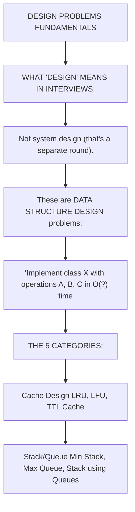

---

## PART 0: WHY Design Problems — Thinking Like an Architect

```
╔══════════════════════════════════════════════════════════════════════════════╗
║          DESIGN PROBLEMS — COMPLETE UNDERSTANDING & GROWTH MINDSET           ║
╚══════════════════════════════════════════════════════════════════════════════╝

┌──────────────────────────────────────────────────────────────────────────────┐
│ THE REAL-WORLD ORIGIN                                                        │
├──────────────────────────────────────────────────────────────────────────────┤
│                                                                              │
│ 📖 LRU Cache: Every CPU has an LRU cache. When L1 cache is full, the          │
│    Least Recently Used line gets evicted. Your browser uses LRU for its      │
│    tab memory management. CDNs use LRU for content caching.                  │
│                                                                              │
│ 📖 Min Stack: Trading systems need to track the minimum stock price seen      │
│    so far in O(1). Each new price is "pushed" and we need instant access     │
│    to the running minimum for stop-loss calculations.                        │
│                                                                              │
│ 📖 Trie: Every search engine autocomplete (Google, VSCode Ctrl+P) uses a      │
│    Trie. When you type "mer", it instantly finds "merge", "mercury",         │
│    "merchant" by walking the prefix tree — O(L) instead of O(N·L).           │
│                                                                              │
│ 📖 Iterator: Java's Iterator pattern (hasNext/next) powers every for-each     │
│    loop. Database cursors, file line readers, paginated APIs — all iterators.│
│                                                                              │
│ FUNDAMENTAL PRINCIPLE:                                                       │
│ Design problems test your ability to COMBINE basic data structures           │
│ to achieve better time complexity than any single structure offers.          │
│                                                                              │
│ LRU Cache = HashMap (O(1) lookup) + Doubly Linked List (O(1) removal)        │
│ Neither alone gives O(1) get AND O(1) eviction. Together they do.            │
│                                                                              │
└──────────────────────────────────────────────────────────────────────────────┘

┌──────────────────────────────────────────────────────────────────────────────┐
│ THE MENTAL MODEL: "What operations do I need and at what cost?"              │
├──────────────────────────────────────────────────────────────────────────────┤
│                                                                              │
│  STEP 1: List all required operations                                        │
│  STEP 2: For each, what's the target time complexity?                        │
│  STEP 3: What single DS gives that? If none, COMBINE.                        │
│                                                                              │
│  THE COMBINATION RECIPES:                                                    │
│  ┌─────────────────────────┬────────────────────────────────────────────┐    │
│  │ Need                    │ Combine                                    │    │
│  ├─────────────────────────┼────────────────────────────────────────────┤    │
│  │ O(1) access + O(1) order│ HashMap + Doubly Linked List              │     │
│  │ O(1) access + O(1) rand │ HashMap + ArrayList                       │     │
│  │ O(1) min + O(1) push/pop│ Two stacks (main + min tracker)           │     │
│  │ O(L) prefix + O(1) check│ Trie (array of children)                  │     │
│  │ O(log n) rank queries   │ TreeMap + augmented BST                    │    │
│  └─────────────────────────┴────────────────────────────────────────────┘    │
│                                                                              │
└──────────────────────────────────────────────────────────────────────────────┘

┌──────────────────────────────────────────────────────────────────────────────┐
│ COMMON MISTAKES                                                              │
├──────────────────────────────────────────────────────────────────────────────┤
│ 1. Starting to code before listing ALL operations and their target complexity│
│ 2. Using a single HashMap when you need both key→value AND order management  │
│ 3. Forgetting edge cases: empty structure, single element, capacity=0        │
│ 4. Not separating the "what" (interface) from "how" (implementation)         │
│ 5. Using LinkedHashMap in interviews — shows framework knowledge but not     │
│    understanding. Implement from scratch first, mention LinkedHashMap as     │
│    "production shortcut".                                                    │
│ 6. Thread-safety: interviewers sometimes ask "what if concurrent?" Know      │
│    ConcurrentHashMap, ReadWriteLock, lock striping.                          │
└──────────────────────────────────────────────────────────────────────────────┘
```

**Flow:**
1. Need Combine / O(1) access + O(1) order HashMap + Doubl
2. COMMON MISTAKES / 1. Starting to code before listing AL

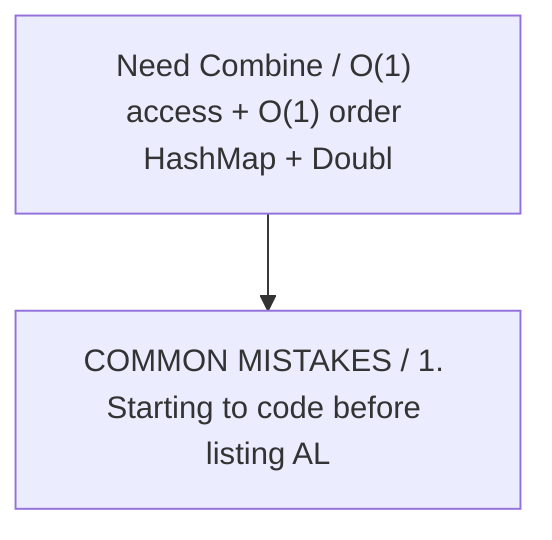

---


## PROBLEM 1: LRU Cache (LC 146) — The #1 Design Problem

```
DIFFICULTY: Medium (but Hard to get right in interview)
COMPANIES: Amazon, Facebook, Google, Microsoft, Apple, Netflix
PATTERN: HashMap + Doubly Linked List

PROBLEM: Design LRU cache with:
  get(key)       → return value if exists, else -1. Mark as used.
  put(key, value)→ insert/update. If at capacity, evict LRU item.
  Both operations must be O(1).

WHY THIS IS #1 INTERVIEW PROBLEM:
━━━━━━━━━━━━━━━━━━━━━━━━━━━━━━━━━
  Tests: HashMap, Linked List, pointer manipulation, edge cases.
  Asked at nearly EVERY top company. 120+ million submissions on LC.

THE KEY INSIGHT:
  HashMap alone → O(1) get, but can't track access order
  LinkedList alone → tracks order, but O(n) search
  COMBINE: Map<Key, Node> + Doubly Linked List

  ┌─────────────────────────────────────────────────┐
  │                   HashMap                       │
  │ key1 → Node1, key2 → Node2, key3 → Node3        │
  └────────┬──────────┬──────────┬──────────────────┘
           ↓          ↓          ↓
  HEAD ←→ Node1 ←→ Node2 ←→ Node3 ←→ TAIL
  (most recent)              (least recent = evict)

  GET: HashMap O(1) → find node → move to front O(1)
  PUT: create node → add to front → HashMap put O(1)
       if over capacity: remove TAIL.prev → HashMap remove O(1)

SOLUTION:
```

**Flow:**
1. DIFFICULTY: Medium (but Hard to get right in interview)
2. PATTERN: HashMap + Doubly Linked List
3. PROBLEM: Design LRU cache with:
4. get(key)
5. return value if exists, else -1. Mark as use
6. get(key)
7. return value if exists, else -1. Mark as use
8. Both operations must be O(1).
9. WHY THIS IS #1 INTERVIEW PROBLEM:
10. THE KEY INSIGHT:

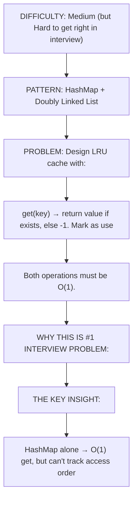

```java
class LRUCache {
    class Node {
        int key, val;
        Node prev, next;
        Node(int k, int v) { key = k; val = v; }
    }
    
    private int capacity;
    private Map<Integer, Node> map = new HashMap<>();
    private Node head = new Node(0, 0);  // Sentinel
    private Node tail = new Node(0, 0);  // Sentinel
    
    public LRUCache(int capacity) {
        this.capacity = capacity;
        head.next = tail;
        tail.prev = head;
    }
    
    public int get(int key) {
        if (!map.containsKey(key)) return -1;
        Node node = map.get(key);
        remove(node);
        addToFront(node);
        return node.val;
    }
    
    public void put(int key, int value) {
        if (map.containsKey(key)) {
            Node node = map.get(key);
            node.val = value;
            remove(node);
            addToFront(node);
        } else {
            if (map.size() == capacity) {
                Node lru = tail.prev;
                remove(lru);
                map.remove(lru.key);
            }
            Node node = new Node(key, value);
            addToFront(node);
            map.put(key, node);
        }
    }
    
    private void remove(Node node) {
        node.prev.next = node.next;
        node.next.prev = node.prev;
    }
    
    private void addToFront(Node node) {
        node.next = head.next;
        node.prev = head;
        head.next.prev = node;
        head.next = node;
    }
}
```

```
COMPLEXITY: O(1) for both get and put | Space O(capacity)
SENTINEL TRICK: Head and Tail dummies avoid null checks — cleaner code.
FOLLOW-UP: "Make it thread-safe" → Use ReentrantReadWriteLock.
```

**Flow:**
1. FOLLOW-UP: 'Make it thread-safe'
2. Use ReentrantReadWriteLock.

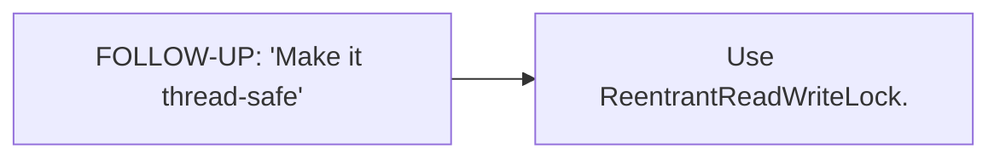

---


## PROBLEM 2: Min Stack (LC 155)

```
DIFFICULTY: Medium
COMPANIES: Amazon, Google, Bloomberg, Microsoft
PATTERN: Auxiliary Stack

PROBLEM: Design stack supporting push, pop, top, getMin — all in O(1).

KEY INSIGHT:
━━━━━━━━━━━
  Keep a parallel stack that tracks the minimum at each level.
  When you push 5, 3, 7:
    Main:   [5, 3, 7]     ← top = 7
    MinSt:  [5, 3, 3]     ← top = 3 (current min)
  Pop 7:
    Main:   [5, 3]
    MinSt:  [5, 3]        ← min is still 3 ✓

SOLUTION:
```

**Flow:**
1. DIFFICULTY: Medium
2. COMPANIES: Amazon, Google, Bloomberg, Microsoft
3. PATTERN: Auxiliary Stack
4. KEY INSIGHT:
5. When you push 5, 3, 7:
6. Main: [5, 3, 7] ← top = 7
7. MinSt: [5, 3, 3] ← top = 3 (current min)

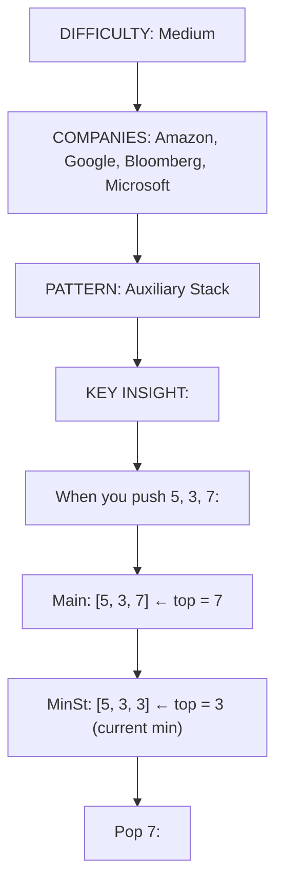

```java
class MinStack {
    private Deque<Integer> stack = new ArrayDeque<>();
    private Deque<Integer> minStack = new ArrayDeque<>();
    
    public void push(int val) {
        stack.push(val);
        int min = minStack.isEmpty() ? val : Math.min(val, minStack.peek());
        minStack.push(min);
    }
    
    public void pop() {
        stack.pop();
        minStack.pop();
    }
    
    public int top() {
        return stack.peek();
    }
    
    public int getMin() {
        return minStack.peek();
    }
}
```

```
COMPLEXITY: All operations O(1) | Space O(n) for min stack
SPACE OPTIMIZATION: Only push to minStack when new value <= current min.
  Pop from minStack only when popped value == minStack.peek().
```

---


## PROBLEM 3: Implement Trie / Prefix Tree (LC 208)

```
DIFFICULTY: Medium
COMPANIES: Google, Amazon, Facebook, Microsoft
PATTERN: Trie

PROBLEM: Implement Trie with insert, search, startsWith.

WHY TRIE?
━━━━━━━━━
  Searching "apple" in a HashSet: O(L) hash computation
  Searching "app*" prefix in HashSet: O(N·L) check every word
  Searching "app*" in Trie: O(L) just walk 3 nodes

  THE STRUCTURE:
         root
        / | \
       a  b  c
      /
     p
    /
   p
  / \
 l    s      ← "apple" and "apps" share prefix "app"
 |
 e (end)

  Each node has: children[26] + isEnd boolean

SOLUTION:
```

**Flow:**
1. DIFFICULTY: Medium
2. COMPANIES: Google, Amazon, Facebook, Microsoft
3. PATTERN: Trie
4. PROBLEM: Implement Trie with insert, search, startsWith
5. WHY TRIE?
6. Searching 'apple' in a HashSet: O(L) hash computation
7. Searching 'app*' prefix in HashSet: O(N·L) check every

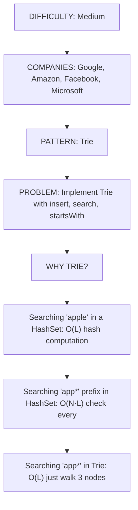

```java
class Trie {
    private Trie[] children = new Trie[26];
    private boolean isEnd = false;
    
    public void insert(String word) {
        Trie node = this;
        for (char c : word.toCharArray()) {
            int idx = c - 'a';
            if (node.children[idx] == null) {
                node.children[idx] = new Trie();
            }
            node = node.children[idx];
        }
        node.isEnd = true;
    }
    
    public boolean search(String word) {
        Trie node = findNode(word);
        return node != null && node.isEnd;
    }
    
    public boolean startsWith(String prefix) {
        return findNode(prefix) != null;
    }
    
    private Trie findNode(String s) {
        Trie node = this;
        for (char c : s.toCharArray()) {
            int idx = c - 'a';
            if (node.children[idx] == null) return null;
            node = node.children[idx];
        }
        return node;
    }
}
```

```
COMPLEXITY: Insert/Search/StartsWith O(L) | Space O(ALPHABET · N · L) worst case
VARIANT: Use HashMap<Character, Trie> instead of array for Unicode support.
```

---


🔬 **Section Challenge — PROBLEM 3: Implement Trie / Prefix Tree (LC 208)**
>

## PROBLEM 4: Design Add and Search Words (LC 211)

```
DIFFICULTY: Medium
COMPANIES: Facebook, Google, Amazon
PATTERN: Trie + DFS for wildcard

PROBLEM: Design word dictionary supporting addWord and search.
  search can contain '.' which matches any letter.
  addWord("bad"); search("b.d") → true; search("b..") → true

INSIGHT: Regular Trie for addWord. DFS with branching for '.'.

SOLUTION:
```

**Flow:**
1. addWord('bad'); search('b.d')
2. true; search('b..')
3. true

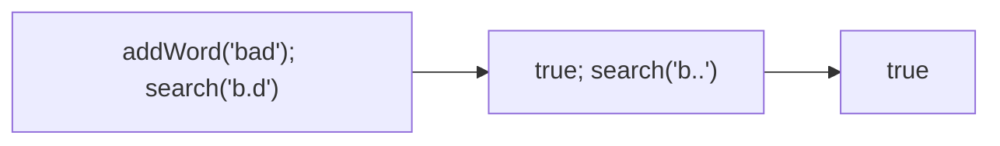

```java
class WordDictionary {
    private WordDictionary[] children = new WordDictionary[26];
    private boolean isEnd = false;
    
    public void addWord(String word) {
        WordDictionary node = this;
        for (char c : word.toCharArray()) {
            int idx = c - 'a';
            if (node.children[idx] == null) node.children[idx] = new WordDictionary();
            node = node.children[idx];
        }
        node.isEnd = true;
    }
    
    public boolean search(String word) {
        return dfs(word, 0, this);
    }
    
    private boolean dfs(String word, int i, WordDictionary node) {
        if (node == null) return false;
        if (i == word.length()) return node.isEnd;
        
        char c = word.charAt(i);
        if (c == '.') {
            // Try ALL children
            for (WordDictionary child : node.children) {
                if (dfs(word, i + 1, child)) return true;
            }
            return false;
        } else {
            return dfs(word, i + 1, node.children[c - 'a']);
        }
    }
}
```

```
COMPLEXITY: addWord O(L) | search O(26^L) worst case (all dots) | typically O(L)
```

---


## PROBLEM 5: LFU Cache (LC 460)

```
DIFFICULTY: Hard
COMPANIES: Amazon, Google, Microsoft
PATTERN: HashMap + HashMap of Doubly Linked Lists

PROBLEM: Design Least Frequently Used cache.
  get(key)       → return value, increase frequency
  put(key, value)→ insert/update. At capacity, evict LEAST frequent.
                   Ties broken by LEAST recently used.
  Both O(1).

THE ARCHITECTURE:
━━━━━━━━━━━━━━━━
  keyMap:  key → Node(key, val, freq)
  freqMap: freq → DoublyLinkedList of nodes with that frequency
  minFreq: tracks current minimum frequency

  GET key:
    1. Find node in keyMap
    2. Remove from freqMap[node.freq]
    3. node.freq++
    4. Add to freqMap[node.freq]
    5. Update minFreq if needed

  PUT key:
    If exists → update value + same as GET
    If capacity full → evict tail of freqMap[minFreq]
    Create node with freq=1, add to freqMap[1]
    minFreq = 1

SOLUTION:
```

**Flow:**
1. get(key)
2. return value, increase frequency
3. put(key, value)
4. insert/update. At capacity, evict LEAST frequent.
5. keyMap: key
6. Node(key, val, freq)
7. freqMap: freq
8. DoublyLinkedList of nodes with that frequency
9. If exists
10. update value + same as GET
11. If capacity full
12. evict tail of freqMap[minFreq]

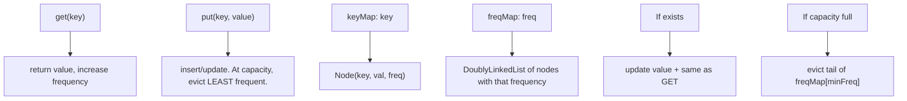

```java
class LFUCache {
    class Node {
        int key, val, freq;
        Node prev, next;
        Node(int k, int v) { key = k; val = v; freq = 1; }
    }
    
    class DLList {
        Node head = new Node(0, 0), tail = new Node(0, 0);
        int size = 0;
        DLList() { head.next = tail; tail.prev = head; }
        
        void addFirst(Node node) {
            node.next = head.next; node.prev = head;
            head.next.prev = node; head.next = node;
            size++;
        }
        void remove(Node node) {
            node.prev.next = node.next;
            node.next.prev = node.prev;
            size--;
        }
        Node removeLast() {
            Node lru = tail.prev;
            remove(lru);
            return lru;
        }
    }
    
    int capacity, minFreq;
    Map<Integer, Node> keyMap = new HashMap<>();
    Map<Integer, DLList> freqMap = new HashMap<>();
    
    public LFUCache(int capacity) { this.capacity = capacity; }
    
    public int get(int key) {
        if (!keyMap.containsKey(key)) return -1;
        Node node = keyMap.get(key);
        updateFreq(node);
        return node.val;
    }
    
    public void put(int key, int value) {
        if (capacity == 0) return;
        if (keyMap.containsKey(key)) {
            Node node = keyMap.get(key);
            node.val = value;
            updateFreq(node);
        } else {
            if (keyMap.size() == capacity) {
                DLList minList = freqMap.get(minFreq);
                Node evict = minList.removeLast();
                keyMap.remove(evict.key);
            }
            Node node = new Node(key, value);
            keyMap.put(key, node);
            freqMap.computeIfAbsent(1, k -> new DLList()).addFirst(node);
            minFreq = 1;
        }
    }
    
    private void updateFreq(Node node) {
        DLList oldList = freqMap.get(node.freq);
        oldList.remove(node);
        if (node.freq == minFreq && oldList.size == 0) minFreq++;
        node.freq++;
        freqMap.computeIfAbsent(node.freq, k -> new DLList()).addFirst(node);
    }
}
```

```
COMPLEXITY: O(1) for both get and put | Space O(capacity)
THIS IS THE HARDEST DESIGN PROBLEM. Master LRU first, then LFU.
```

---

## PROBLEM 6: Design HashMap (LC 706)

```
DIFFICULTY: Easy
COMPANIES: Amazon, Google, Apple
PATTERN: Array + Chaining (LinkedList)

PROBLEM: Implement HashMap without using built-in hash libraries.

INSIGHT: Hash function + bucket array + collision handling.

SOLUTION:
```

```java
class MyHashMap {
    private static final int SIZE = 1001;
    private List<int[]>[] buckets;
    
    public MyHashMap() {
        buckets = new List[SIZE];
    }
    
    private int hash(int key) { return key % SIZE; }
    
    public void put(int key, int value) {
        int h = hash(key);
        if (buckets[h] == null) buckets[h] = new ArrayList<>();
        for (int[] pair : buckets[h]) {
            if (pair[0] == key) { pair[1] = value; return; }
        }
        buckets[h].add(new int[]{key, value});
    }
    
    public int get(int key) {
        int h = hash(key);
        if (buckets[h] == null) return -1;
        for (int[] pair : buckets[h]) {
            if (pair[0] == key) return pair[1];
        }
        return -1;
    }
    
    public void remove(int key) {
        int h = hash(key);
        if (buckets[h] == null) return;
        buckets[h].removeIf(pair -> pair[0] == key);
    }
}
```

```
COMPLEXITY: O(n/k) average per operation | Space O(n + k)
FOLLOW-UP: Real HashMap uses power-of-2 sizing, tree-ify at 8 collisions,
           load factor 0.75, rehash at threshold.
```

---


🔬 **Section Challenge — PROBLEM 6: Design HashMap (LC 706)**

**Challenge 1 (Reasoning):** You insert 1000 entries into a HashMap with default capacity 16. How many resize operations happen?
<details><summary>Answer</summary>

Resize threshold = capacity × 0.75. Resizes at: 12 (16→32), 24 (32→64), 48 (64→128), 96 (128→256), 192 (256→512), 384 (512→1024). Total: 6 resizes. Each resize copies all entries to new bucket array. Pre-sizing: `new HashMap<>(1334)` (1000/0.75 ≈ 1334 → next power of 2 = 2048) avoids all resizes.
</details>

**Challenge 2 (Bug Hunt):** Two `Person` objects with same name and age. You override `equals()` to return true but not `hashCode()`. What happens when used as `HashMap` keys?
<details><summary>Answer</summary>

Both objects land in DIFFERENT buckets (different hashCodes → different bucket index). The HashMap doesn't check `equals()` across buckets — it goes straight to one bucket. So `map.get(person2)` returns NULL even though `person1.equals(person2)`. Overriding `equals` without `hashCode` violates the contract and breaks all hash-based collections. Always override both together.
</details>


## PROBLEM 7: Insert Delete GetRandom O(1) (LC 380)

```
DIFFICULTY: Medium
COMPANIES: Facebook, Amazon, Google, Uber
PATTERN: HashMap + ArrayList

PROBLEM: Design structure with insert, remove, getRandom — all O(1).

KEY INSIGHT:
━━━━━━━━━━━
  ArrayList → O(1) random access by index
  But O(n) remove from middle...UNLESS:
  Swap target with LAST element, then remove last → O(1)!
  HashMap: val → index in ArrayList

  Insert 1,2,3:
    list: [1, 2, 3]
    map:  {1:0, 2:1, 3:2}

  Remove 2:
    Swap list[1] and list[2]: [1, 3, 2]
    Remove last: [1, 3]
    Update map: {1:0, 3:1}

SOLUTION:
```

**Flow:**
1. ArrayList
2. O(1) random access by index
3. Swap target with LAST element, then remove last
4. O(1)!
5. HashMap: val
6. index in ArrayList

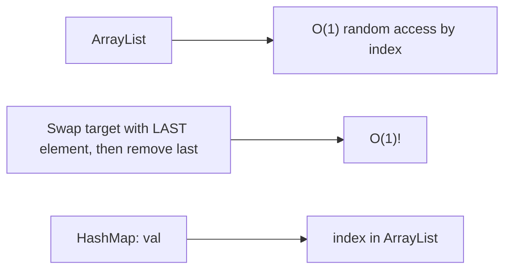

```java
class RandomizedSet {
    private List<Integer> list = new ArrayList<>();
    private Map<Integer, Integer> map = new HashMap<>();
    private Random rand = new Random();
    
    public boolean insert(int val) {
        if (map.containsKey(val)) return false;
        map.put(val, list.size());
        list.add(val);
        return true;
    }
    
    public boolean remove(int val) {
        if (!map.containsKey(val)) return false;
        int idx = map.get(val);
        int last = list.get(list.size() - 1);
        
        list.set(idx, last);       // Overwrite with last
        map.put(last, idx);        // Update last's index
        
        list.remove(list.size() - 1);
        map.remove(val);
        return true;
    }
    
    public int getRandom() {
        return list.get(rand.nextInt(list.size()));
    }
}
```

```
COMPLEXITY: All operations O(1) | Space O(n)
VARIANT: LC 381 — allow duplicates. Use Map<Integer, Set<Integer>> for indices.
```

---


## PROBLEM 8: Design Browser History (LC 1472)

```
DIFFICULTY: Medium
COMPANIES: Amazon, Microsoft
PATTERN: Doubly Linked List / Two Stacks / ArrayList

PROBLEM: Implement browser with visit(url), back(steps), forward(steps).

SOLUTION (ArrayList approach — simplest):
```

```java
class BrowserHistory {
    private List<String> history = new ArrayList<>();
    private int current = 0;
    
    public BrowserHistory(String homepage) {
        history.add(homepage);
    }
    
    public void visit(String url) {
        // Clear forward history
        while (history.size() > current + 1) {
            history.remove(history.size() - 1);
        }
        history.add(url);
        current++;
    }
    
    public String back(int steps) {
        current = Math.max(0, current - steps);
        return history.get(current);
    }
    
    public String forward(int steps) {
        current = Math.min(history.size() - 1, current + steps);
        return history.get(current);
    }
}
```

```
COMPLEXITY: visit O(1) amortized | back/forward O(1) | Space O(n)
```

---


## PROBLEM 9: Design Twitter (LC 355)

```
DIFFICULTY: Medium
COMPANIES: Amazon, Twitter
PATTERN: HashMap + Merge K Sorted Lists (Heap)

PROBLEM: Design simplified Twitter:
  postTweet(userId, tweetId)
  getNewsFeed(userId) → 10 most recent tweets from user + followees
  follow(followerId, followeeId)
  unfollow(followerId, followeeId)

INSIGHT: getNewsFeed = Merge K sorted lists (each user's tweets sorted by time)

SOLUTION:
```

**Flow:**
1. getNewsFeed(userId)
2. 10 most recent tweets from user + followees

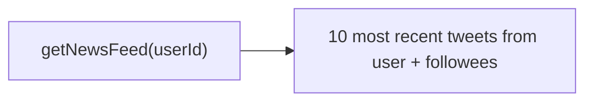

```java
class Twitter {
    private int timestamp = 0;
    private Map<Integer, List<int[]>> tweets = new HashMap<>();  // userId → [(time, tweetId)]
    private Map<Integer, Set<Integer>> following = new HashMap<>();
    
    public void postTweet(int userId, int tweetId) {
        tweets.computeIfAbsent(userId, k -> new ArrayList<>())
              .add(new int[]{timestamp++, tweetId});
    }
    
    public List<Integer> getNewsFeed(int userId) {
        // Max-heap by timestamp
        PriorityQueue<int[]> pq = new PriorityQueue<>((a, b) -> b[0] - a[0]);
        
        Set<Integer> users = new HashSet<>();
        users.add(userId);
        if (following.containsKey(userId)) users.addAll(following.get(userId));
        
        for (int uid : users) {
            List<int[]> userTweets = tweets.getOrDefault(uid, List.of());
            for (int[] t : userTweets) pq.offer(t);
        }
        
        List<Integer> feed = new ArrayList<>();
        while (!pq.isEmpty() && feed.size() < 10) {
            feed.add(pq.poll()[1]);
        }
        return feed;
    }
    
    public void follow(int followerId, int followeeId) {
        following.computeIfAbsent(followerId, k -> new HashSet<>()).add(followeeId);
    }
    
    public void unfollow(int followerId, int followeeId) {
        if (following.containsKey(followerId)) 
            following.get(followerId).remove(followeeId);
    }
}
```

```
COMPLEXITY: getNewsFeed O(T log T) where T = total tweets of followed users
OPTIMIZATION: Only put last tweet from each user in heap, track index.
```

---


## PROBLEM 10: Serialize and Deserialize Binary Tree (LC 297)

```
DIFFICULTY: Hard
COMPANIES: Amazon, Facebook, Google, Microsoft
PATTERN: BFS/DFS + String encoding

PROBLEM: Encode a binary tree to string and decode back.

SOLUTION (Preorder DFS):
```

```java
public class Codec {
    public String serialize(TreeNode root) {
        StringBuilder sb = new StringBuilder();
        serializeDFS(root, sb);
        return sb.toString();
    }
    
    private void serializeDFS(TreeNode node, StringBuilder sb) {
        if (node == null) { sb.append("null,"); return; }
        sb.append(node.val).append(",");
        serializeDFS(node.left, sb);
        serializeDFS(node.right, sb);
    }
    
    public TreeNode deserialize(String data) {
        Queue<String> queue = new LinkedList<>(Arrays.asList(data.split(",")));
        return deserializeDFS(queue);
    }
    
    private TreeNode deserializeDFS(Queue<String> queue) {
        String val = queue.poll();
        if ("null".equals(val)) return null;
        TreeNode node = new TreeNode(Integer.parseInt(val));
        node.left = deserializeDFS(queue);
        node.right = deserializeDFS(queue);
        return node;
    }
}
```

```
COMPLEXITY: O(n) for both serialize and deserialize | Space O(n)
KEY: Using "null" markers preserves the tree structure uniquely.
```

---

### Problem 11: Flatten Nested List Iterator

**LeetCode 341** | **Difficulty:** Medium

```
╔═══════════════════════════════════════════════════════════════════════════╗
║  FLATTEN NESTED LIST ITERATOR (LeetCode 341 - Medium)                     ║
╠═══════════════════════════════════════════════════════════════════════════╣
║                                                                           ║
║  Given nested list of integers, implement iterator to flatten it.         ║
║  Example: [[1,1],2,[1,1]] → 1, 1, 2, 1, 1                                 ║
║                                                                           ║
║  KEY: Use stack. Push elements in reverse. Flatten on hasNext().          ║
║  TIME: O(1) amortized next/hasNext | SPACE: O(D) depth of nesting         ║
╚═══════════════════════════════════════════════════════════════════════════╝
```

**Flow:**
1. FLATTEN NESTED LIST ITERATOR (LeetCode 341 - Medium)
2. Example: [[1,1],2,[1,1]]
3. 1, 1, 2, 1, 1

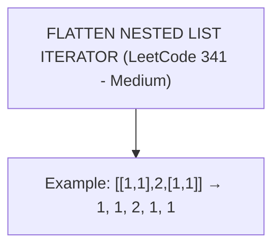

```java
public class NestedIterator implements Iterator<Integer> {
    private Deque<NestedInteger> stack;

    public NestedIterator(List<NestedInteger> nestedList) {
        stack = new ArrayDeque<>();
        for (int i = nestedList.size() - 1; i >= 0; i--)
            stack.push(nestedList.get(i));
    }

    public Integer next() {
        return stack.pop().getInteger();
    }

    public boolean hasNext() {
        while (!stack.isEmpty() && !stack.peek().isInteger()) {
            List<NestedInteger> list = stack.pop().getList();
            for (int i = list.size() - 1; i >= 0; i--)
                stack.push(list.get(i));
        }
        return !stack.isEmpty();
    }
}
```

---

### Problem 12: Design Circular Queue

**LeetCode 622** | **Difficulty:** Medium

```
╔═══════════════════════════════════════════════════════════════════════════╗
║  DESIGN CIRCULAR QUEUE (LeetCode 622 - Medium)                            ║
╠═══════════════════════════════════════════════════════════════════════════╣
║                                                                           ║
║  Implement circular queue with: enQueue, deQueue, Front, Rear,            ║
║  isEmpty, isFull.                                                         ║
║                                                                           ║
║  KEY: Array with head/tail pointers, modular arithmetic.                  ║
║  All operations O(1)                                                      ║
╚═══════════════════════════════════════════════════════════════════════════╝
```

**Flow:**
1. DESIGN CIRCULAR QUEUE (LeetCode 622 - Medium)
2. isEmpty, isFull.
3. KEY: Array with head/tail pointers, modular arithmetic.
4. All operations O(1)

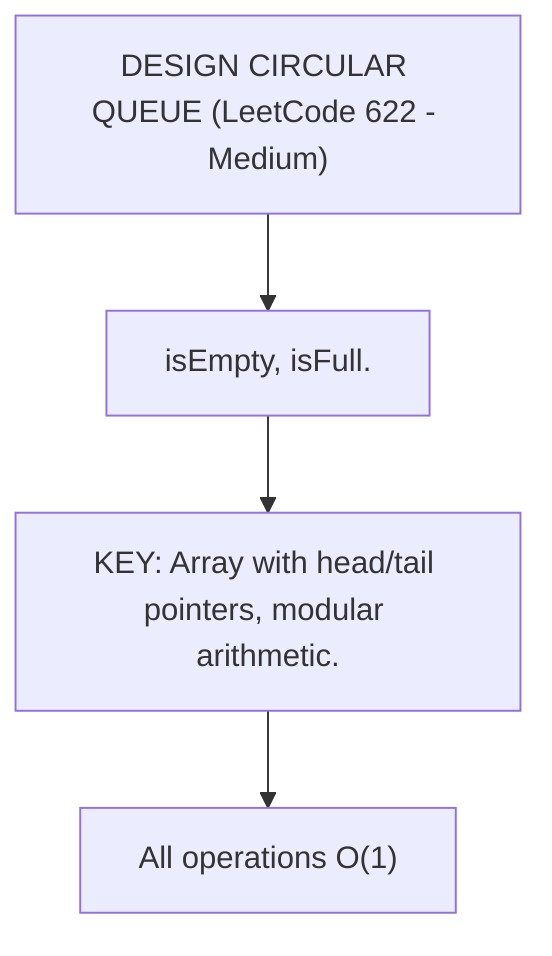

```java
class MyCircularQueue {
    private int[] data;
    private int head, tail, size, capacity;

    public MyCircularQueue(int k) {
        data = new int[k];
        capacity = k;
        head = 0; tail = -1; size = 0;
    }

    public boolean enQueue(int value) {
        if (isFull()) return false;
        tail = (tail + 1) % capacity;
        data[tail] = value;
        size++;
        return true;
    }

    public boolean deQueue() {
        if (isEmpty()) return false;
        head = (head + 1) % capacity;
        size--;
        return true;
    }

    public int Front() { return isEmpty() ? -1 : data[head]; }
    public int Rear()  { return isEmpty() ? -1 : data[tail]; }
    public boolean isEmpty() { return size == 0; }
    public boolean isFull()  { return size == capacity; }
}
```

---

### Problem 13: Snapshot Array

**LeetCode 1146** | **Difficulty:** Medium

```
╔═══════════════════════════════════════════════════════════════════════════╗
║  SNAPSHOT ARRAY (LeetCode 1146 - Medium)                                  ║
╠═══════════════════════════════════════════════════════════════════════════╣
║                                                                           ║
║  Implement: set(index, val), snap() → snapId, get(index, snapId)          ║
║                                                                           ║
║  Example:                                                                 ║
║  set(0,5) → snap()=0 → set(0,6) → get(0,0) → 5                            ║
║                                                                           ║
║  KEY: Store list of (snapId, value) per index. Binary search on get.      ║
║  set/snap O(1), get O(log S) where S = number of snaps                    ║
╚═══════════════════════════════════════════════════════════════════════════╝
```

**Flow:**
1. SNAPSHOT ARRAY (LeetCode 1146 - Medium)
2. Example:
3. set/snap O(1), get O(log S) where S = number of snaps

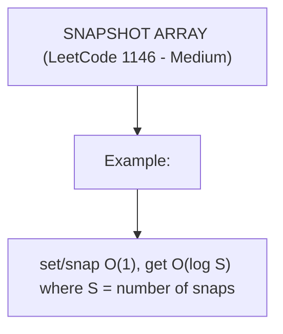

```java
class SnapshotArray {
    private List<int[]>[] history; // history[index] = list of [snapId, value]
    private int snapId;

    public SnapshotArray(int length) {
        history = new List[length];
        for (int i = 0; i < length; i++) {
            history[i] = new ArrayList<>();
            history[i].add(new int[]{0, 0});
        }
        snapId = 0;
    }

    public void set(int index, int val) {
        List<int[]> list = history[index];
        if (list.get(list.size() - 1)[0] == snapId)
            list.get(list.size() - 1)[1] = val;
        else
            list.add(new int[]{snapId, val});
    }

    public int snap() { return snapId++; }

    public int get(int index, int snap_id) {
        List<int[]> list = history[index];
        int lo = 0, hi = list.size() - 1, result = 0;
        while (lo <= hi) {
            int mid = lo + (hi - lo) / 2;
            if (list.get(mid)[0] <= snap_id) {
                result = list.get(mid)[1];
                lo = mid + 1;
            } else {
                hi = mid - 1;
            }
        }
        return result;
    }
}
```

---

### Problem 14: Stock Price Fluctuation

**LeetCode 2034** | **Difficulty:** Medium

```
╔═══════════════════════════════════════════════════════════════════════════╗
║  STOCK PRICE FLUCTUATION (LeetCode 2034 - Medium)                         ║
╠═══════════════════════════════════════════════════════════════════════════╣
║                                                                           ║
║  Implement: update(timestamp, price), current(), maximum(), minimum()     ║
║  update can CORRECT previous timestamp's price.                           ║
║                                                                           ║
║  KEY: HashMap for timestamp→price + TreeMap for price frequencies.        ║
║  update O(log n), current/max/min O(1)                                    ║
╚═══════════════════════════════════════════════════════════════════════════╝
```

**Flow:**
1. STOCK PRICE FLUCTUATION (LeetCode 2034 - Medium)
2. update can CORRECT previous timestamp's price.
3. update O(log n), current/max/min O(1)

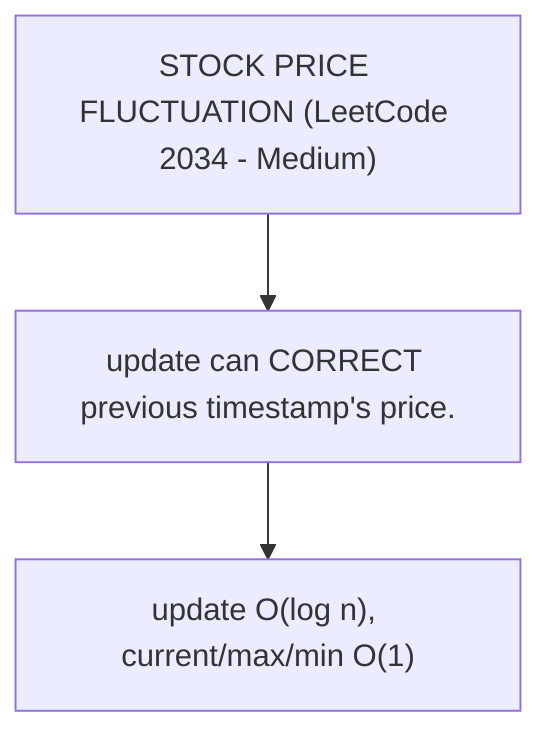

```java
class StockPrice {
    private Map<Integer, Integer> timestampPrice;
    private TreeMap<Integer, Integer> priceCount;
    private int latestTimestamp;

    public StockPrice() {
        timestampPrice = new HashMap<>();
        priceCount = new TreeMap<>();
        latestTimestamp = 0;
    }

    public void update(int timestamp, int price) {
        latestTimestamp = Math.max(latestTimestamp, timestamp);
        if (timestampPrice.containsKey(timestamp)) {
            int oldPrice = timestampPrice.get(timestamp);
            priceCount.merge(oldPrice, -1, Integer::sum);
            if (priceCount.get(oldPrice) == 0)
                priceCount.remove(oldPrice);
        }
        timestampPrice.put(timestamp, price);
        priceCount.merge(price, 1, Integer::sum);
    }

    public int current() { return timestampPrice.get(latestTimestamp); }
    public int maximum() { return priceCount.lastKey(); }
    public int minimum() { return priceCount.firstKey(); }
}
```

---

### Problem 15: Find Median from Data Stream

**LeetCode 295** | **Difficulty:** Hard

```
╔═══════════════════════════════════════════════════════════════════════════╗
║  FIND MEDIAN FROM DATA STREAM (LeetCode 295 - Hard)                       ║
╠═══════════════════════════════════════════════════════════════════════════╣
║                                                                           ║
║  addNum(int num) — add integer from data stream                           ║
║  findMedian() — return median of all elements so far                      ║
║                                                                           ║
║  Example:                                                                 ║
║  add(1), add(2) → median=1.5, add(3) → median=2.0                         ║
║                                                                           ║
║  KEY: Two heaps — maxHeap for lower half, minHeap for upper half.         ║
║  Keep balanced: |maxHeap.size - minHeap.size| <= 1                        ║
║  addNum O(log n), findMedian O(1)                                         ║
╚═══════════════════════════════════════════════════════════════════════════╝
```

**Flow:**
1. FIND MEDIAN FROM DATA STREAM (LeetCode 295 - Hard)
2. addNum(int num) — add integer from data stream
3. findMedian() — return median of all elements so far
4. Example:
5. add(1), add(2)
6. median=1.5, add(3)
7. median=2.0
8. add(1), add(2)
9. median=1.5, add(3)
10. median=2.0
11. Keep balanced:
12. maxHeap.size - minHeap.size
13. <= 1
14. Keep balanced:
15. maxHeap.size - minHeap.size
16. <= 1
17. addNum O(log n), findMedian O(1)

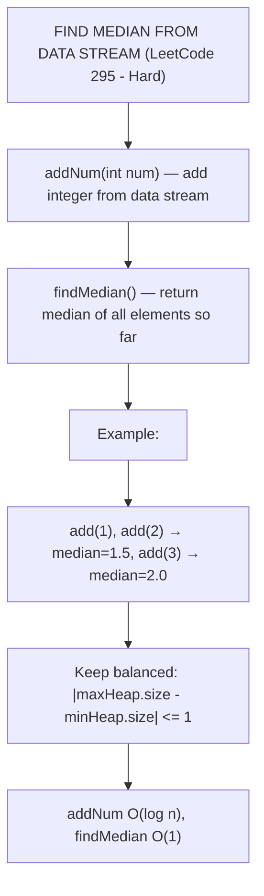

```java
class MedianFinder {
    private PriorityQueue<Integer> maxHeap; // lower half
    private PriorityQueue<Integer> minHeap; // upper half

    public MedianFinder() {
        maxHeap = new PriorityQueue<>(Collections.reverseOrder());
        minHeap = new PriorityQueue<>();
    }

    public void addNum(int num) {
        maxHeap.offer(num);
        minHeap.offer(maxHeap.poll()); // balance: largest of lower → upper
        if (minHeap.size() > maxHeap.size())
            maxHeap.offer(minHeap.poll()); // keep maxHeap >= minHeap
    }

    public double findMedian() {
        if (maxHeap.size() > minHeap.size())
            return maxHeap.peek();
        return (maxHeap.peek() + minHeap.peek()) / 2.0;
    }
}
```

---


## 📋 CURATED PRACTICE PROBLEMS

### Easy

| # | Problem | LC# | Pattern | Company |
|---|---------|-----|---------|---------|
| 1 | [Design HashMap](https://leetcode.com/problems/design-hashmap/) | 706 | Array + Chaining | Amazon |
| 2 | [Design HashSet](https://leetcode.com/problems/design-hashset/) | 705 | Array + Chaining | Amazon |
| 3 | [Min Stack](https://leetcode.com/problems/min-stack/) | 155 | Auxiliary Stack | Amazon, Google |
| 4 | [Implement Queue using Stacks](https://leetcode.com/problems/implement-queue-using-stacks/) | 232 | Two Stacks | Microsoft |
| 5 | [Implement Stack using Queues](https://leetcode.com/problems/implement-stack-using-queues/) | 225 | Queue rotation | Amazon |
| 6 | [Design Parking System](https://leetcode.com/problems/design-parking-system/) | 1603 | Counter | Amazon |

### Medium

| # | Problem | LC# | Pattern | Company |
|---|---------|-----|---------|---------|
| 1 | [LRU Cache](https://leetcode.com/problems/lru-cache/) | 146 | HashMap + DLL | Amazon, Facebook |
| 2 | [Implement Trie](https://leetcode.com/problems/implement-trie-prefix-tree/) | 208 | Trie | Google, Amazon |
| 3 | [Design Add and Search Words](https://leetcode.com/problems/design-add-and-search-words-data-structure/) | 211 | Trie + DFS | Facebook |
| 4 | [Insert Delete GetRandom O(1)](https://leetcode.com/problems/insert-delete-getrandom-o1/) | 380 | HashMap + ArrayList | Facebook |
| 5 | [Design Browser History](https://leetcode.com/problems/design-browser-history/) | 1472 | DLL / ArrayList | Amazon |
| 6 | [Design Twitter](https://leetcode.com/problems/design-twitter/) | 355 | Heap + HashMap | Amazon, Twitter |
| 7 | [Design Circular Queue](https://leetcode.com/problems/design-circular-queue/) | 622 | Array modular | Amazon |
| 8 | [Design Circular Deque](https://leetcode.com/problems/design-circular-deque/) | 641 | Array modular | Google |
| 9 | [Snapshot Array](https://leetcode.com/problems/snapshot-array/) | 1146 | Binary Search | Google |
| 10 | [Time Based Key-Value Store](https://leetcode.com/problems/time-based-key-value-store/) | 981 | HashMap + Binary Search | Google |
| 11 | [Design Underground System](https://leetcode.com/problems/design-underground-system/) | 1396 | HashMap | Amazon |
| 12 | [Online Stock Span](https://leetcode.com/problems/online-stock-span/) | 901 | Monotonic Stack | Amazon |

### Hard

| # | Problem | LC# | Pattern | Company |
|---|---------|-----|---------|---------|
| 1 | [LFU Cache](https://leetcode.com/problems/lfu-cache/) | 460 | HashMap + Freq DLL | Amazon, Google |
| 2 | [Serialize and Deserialize Binary Tree](https://leetcode.com/problems/serialize-and-deserialize-binary-tree/) | 297 | DFS/BFS encoding | Amazon, Facebook |
| 3 | [Find Median from Data Stream](https://leetcode.com/problems/find-median-from-data-stream/) | 295 | Two Heaps | Amazon, Google |
| 4 | [Design Search Autocomplete](https://leetcode.com/problems/design-search-autocomplete-system/) | 642 | Trie + Priority | Google |
| 5 | [All O(1) Data Structure](https://leetcode.com/problems/all-oone-data-structure/) | 432 | HashMap + DLL | Amazon |
| 6 | [Design Skiplist](https://leetcode.com/problems/design-skiplist/) | 1206 | Probabilistic | — |

---


---

## 🏋️ Practice & Interview Questions — OOP & Design Patterns

### Predict / Trace
**Q1.** What design pattern does this code follow?
```java
Logger logger = Logger.getInstance();
```
<details><summary>Answer</summary>

**Singleton** — ensures only one Logger instance exists globally.
</details>

**Q2.** What SOLID principle is violated?
```java
class User {
    void login() { ... }
    void logout() { ... }
    void sendEmail() { ... }  // ← ?
    void generateReport() { ... }  // ← ?
}
```
<details><summary>Answer</summary>

**SRP (Single Responsibility)** — User class has 4 responsibilities: authentication, email, reporting. Should be split into: `AuthService`, `EmailService`, `ReportService`.
</details>

### Design Pattern Problems
**Q3.** ⭐ Implement Strategy pattern for payment processing.
<details><summary>Solution</summary>

```java
interface PaymentStrategy { void pay(int amount); }
class CreditCard implements PaymentStrategy { public void pay(int amount){ /*...*/ } }
class PayPal implements PaymentStrategy { public void pay(int amount){ /*...*/ } }
class UPI implements PaymentStrategy { public void pay(int amount){ /*...*/ } }

class PaymentContext {
    private PaymentStrategy strategy;
    void setStrategy(PaymentStrategy s){ this.strategy=s; }
    void processPayment(int amount){ strategy.pay(amount); }
}
// Switch strategy at runtime — open/closed principle!
```
</details>

**Q4.** ⭐⭐ Implement Observer pattern for event notification.
<details><summary>Solution</summary>

```java
interface Observer { void update(String event); }
interface Observable {
    void subscribe(Observer o); void unsubscribe(Observer o); void notify(String event);
}
class EventBus implements Observable {
    List<Observer> observers = new ArrayList<>();
    public void subscribe(Observer o){ observers.add(o); }
    public void unsubscribe(Observer o){ observers.remove(o); }
    public void notify(String event){ observers.forEach(o -> o.update(event)); }
}
```
</details>

**Q5.** ⭐⭐ Builder pattern for a complex configuration object.
<details><summary>Solution</summary>

```java
class ServerConfig {
    private final String host; private final int port; private final int timeout;
    private ServerConfig(Builder b){ host=b.host; port=b.port; timeout=b.timeout; }

    static class Builder {
        String host="localhost"; int port=8080; int timeout=30;
        Builder host(String h){ host=h; return this; }
        Builder port(int p){ port=p; return this; }
        Builder timeout(int t){ timeout=t; return this; }
        ServerConfig build(){ return new ServerConfig(this); }
    }
}
// ServerConfig config = new ServerConfig.Builder().host("prod.com").port(443).build();
```
</details>

### MCQ Rapid Fire
| # | Question | Answer |
|---|---|---|
| 1 | SOLID: O stands for | Open/Closed Principle |
| 2 | Factory vs Abstract Factory | Factory: one product; Abstract Factory: family of products |
| 3 | Composition over inheritance means | Prefer has-a (field) over is-a (extends) for flexibility |
| 4 | Decorator pattern purpose | Add behavior dynamically without subclassing |
| 5 | Facade pattern purpose | Simplified interface to complex subsystem |
| 6 | Proxy pattern types | Virtual, protective, remote, caching |
| 7 | Command pattern encapsulates | Request as an object (supports undo/redo) |
| 8 | Template Method pattern | Defines algorithm skeleton, subclasses fill in steps |


---

## 🧠 Deep Conceptual Questions — OOP, SOLID & Design Patterns

**C1. What is the difference between an interface and an abstract class — when to use each?**
<details><summary>Deep Answer</summary>

**Abstract class**: can have fields, constructors, concrete method implementations. Models IS-A with shared state and behavior. Use when: you have partial implementation to share (template method pattern). Single inheritance: if you extend an abstract class, you can't extend another. **Interface**: pure contract, no state (Java 8+: default methods allowed). Models CAN-DO / role capability. A class can implement unlimited interfaces. Use when: defining a capability across unrelated classes (`Comparable`, `Serializable`, `Runnable`). Rule: prefer interfaces for type definitions. Use abstract class when you need to share implementation code AND all subtypes share the same "IS-A" relationship. In practice: interfaces + composition > abstract class + inheritance.
</details>

**C2. Liskov Substitution Principle: what does it actually mean and how do you violate it?**
<details><summary>Deep Answer</summary>

LSP: if `S extends P`, anywhere you use `P`, you should be able to use `S` without breaking correctness. Violation example: `Square extends Rectangle`. Rectangle behavior: setWidth and setHeight are independent. Square invariant: width must equal height. `Square s = new Square(5); s.setWidth(10);` — now `s.getHeight() == 10` (Square enforced equality) but Rectangle contract says height should still be 5. Code using Rectangle is surprised. Better: Square and Rectangle as siblings under a Shape hierarchy. Another classic: override a method and throw exception for a case the parent method handled → violates LSP. Test: can you run the parent's test suite against the child and pass?
</details>

**C3. Strategy pattern vs. if-else chains: the OCP argument.**
<details><summary>Deep Answer</summary>

```java
// BAD: add new payment type = modify this method = Open for modification (violates OCP)
if(type == "credit") { } else if(type == "paypal") { } else if(type == "crypto") { }

// GOOD: add new payment = new class, zero modification of existing code
interface PaymentStrategy { void pay(int amount); }
// Add Crypto: new CryptoPayment implements PaymentStrategy — no other file touched
```
Open/Closed Principle: open for extension, closed for modification. Each `else if` = a modification to an existing method = risk of breaking existing behavior, requires re-testing the entire method. Strategy = extension by new class = old code untouched = zero regression risk. When if-else is fine: 2-3 fixed cases that never change. When strategy shines: extensible behaviors that vary at runtime.
</details>

**C4. What is the Dependency Inversion Principle and how does it enable testability?**
<details><summary>Deep Answer</summary>

DIP: high-level modules should not depend on low-level modules — both should depend on abstractions. Without DIP: `OrderService` directly creates `MySQLOrderRepository`. To test OrderService: must have MySQL running. With DIP: `OrderService` depends on `OrderRepository` interface. In production: inject `MySQLOrderRepository`. In tests: inject `MockOrderRepository`. The high-level business logic (OrderService) has zero knowledge of the database layer. This makes: unit testing trivial (mock the interface), swapping implementations easy (SQLite, PostgreSQL, in-memory), layer boundaries clear. Dependency INJECTION (DI framework like Spring) is the mechanism that enables DIP at runtime.
</details>

**C5. Observer pattern vs. Event Bus: when does one become the other?**
<details><summary>Deep Answer</summary>

**Observer**: subject holds direct references to observer objects. Subject explicitly notifies each one. Tightly coupled (subject knows about observers). Fine for: small systems, known observers at compile time. Breaks when: observers span different modules, dynamic subscription needed, observers need to be remote. **Event Bus / Message Queue**: publishers and subscribers decoupled. Publisher sends event with a TYPE to the bus. Subscribers register for event types — publisher doesn't know who's listening. De-facto standard in large systems: Spring ApplicationEventPublisher, Kafka, RabbitMQ are all event buses. Rule: Observer for in-process tightly-coupled notification. Event bus for loose coupling, cross-module, or distributed communication.
</details>


**Navigation**: [< Previous](20_Sorting.md) | [Back to Index](../00_MASTER_INDEX.md) | [Next >](22_Recursion_Subsets.md)
