> **Navigation**: [< Previous](21_Design.md) | [Back to Index](../00_MASTER_INDEX.md)

> **Problems 22** | [Prev](21_Design.md) | [Index](../00_MASTER_INDEX.md) | [Next](../06_OOP_Design/01_OOPS_Principles.md)

---

# 📚 SECTION: RECURSION & SUBSETS PROBLEMS

```
┌─────────────────────────────────────────────────────────────────┐
│          RECURSION & SUBSETS FUNDAMENTALS                       │
├─────────────────────────────────────────────────────────────────┤
│                                                                 │
│  WHY COMBINED? Subsets are THE classic recursion application.   │
│  Every subset problem is a recursion tree of include/exclude.   │
│                                                                 │
│  THE SUBSET UNIVERSE:                                           │
│  ┌─────────────┬────────────────────────────────────────────┐   │
│  │ Generate    │ Power Set, Combinations, Permutations      │   │
│  │ Count       │ Count subsets with sum K, Target Sum        │  │
│  │ Optimize    │ Partition Equal Subset, Min Diff Partition  │  │
│  │ Constrain   │ Subsets without duplicates, K-size subsets  │  │
│  └─────────────┴────────────────────────────────────────────┘   │
│                                                                 │
│  RECURSION → MEMOIZATION → DP PIPELINE:                         │
│  Every subset counting/optimization problem follows:            │
│  1. Write recursive solution (exponential)                      │
│  2. Identify overlapping subproblems                            │
│  3. Add memoization (top-down DP)                               │
│  4. Convert to iterative DP (bottom-up)                         │
│  5. Optimize space if possible                                  │
│                                                                 │
│  KEY FORMULA:                                                   │
│  n elements → 2^n subsets (each element: include or exclude)    │
│  Think of it as n-bit binary number: 000...0 to 111...1         │
│                                                                 │
└─────────────────────────────────────────────────────────────────┘
```

> **Flow**: RECURSION & SUBSETS FUNDAMENTALS → THE SUBSET UNIVERSE: | THE SUBSET UNIVERSE: → Generate Power Set, Combinations, Permutations | Generate Power Set, Combinations, Permutations → Count Count subsets with sum K, Target Sum | Count Count subsets with sum K, Target Sum → Optimize Partition Equal Subset, Min Diff Partition | Optimize Partition Equal Subset, Min Diff Partition → Constrain Subsets without duplicates, K-size subsets | Constrain Subsets without duplicates, K-size subsets → RECURSION → MEMOIZATION → DP PIPELINE: | ...+1 more

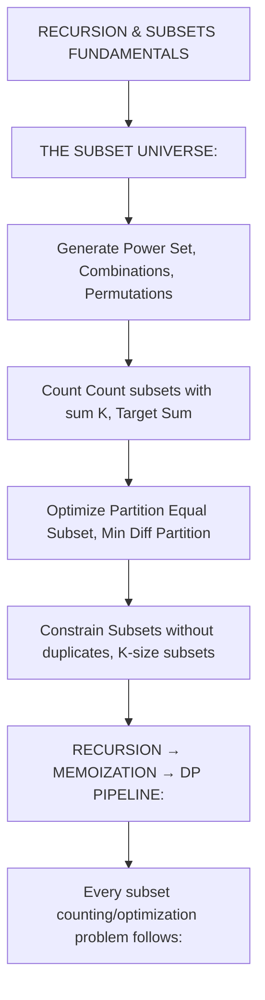

---

## PART 0: WHY Recursion & Subsets — The Heart of Combinatorial Thinking

## The Real-World Origin

📖 SUBSETS IN NATURE: The power set of DNA base pairs determines all
possible gene combinations. With 20,000 genes, your body expresses
different subsets in different cells — that's why skin ≠ brain.
📖 FEATURE FLAGS: Netflix has ~150 feature flags. Each flag is on/off.
That's 2^150 possible configurations — more than atoms in the universe.
They test SUBSETS of flags for A/B testing.
📖 PORTFOLIO OPTIMIZATION: Given n stocks, find the subset that
maximizes return for a given risk budget. This IS the Subset Sum
problem in finance.
📖 KNAPSACK PROBLEM: Amazon's warehouse packing = Knapsack.
"Which subset of items fits in this box with maximum value?"

**Fundamental Insight**:
Subset problems are fundamentally about CHOICES.
At each element, you make a binary choice: INCLUDE or EXCLUDE.
This creates a recursion tree of depth n with 2^n leaves.
THE RECURSION TREE for {1, 2, 3}:
{}
/         \
{1}            {}                  ← include/exclude 1
/    \        /    \
{1,2}  {1}    {2}    {}                ← include/exclude 2
/ \   / \    / \    / \
{1,2,3}{1,2}{1,3}{1}{2,3}{2}{3}{}         ← include/exclude 3
Leaves = all 2^3 = 8 subsets of {1,2,3}
## The Mental Model: "Include Or Exclude — That'S All Recursion Is"


**Template For All Subset Problems**:
void solve(int index, int[] nums, <state>) {
if (index == nums.length) {
// BASE: process current subset
return;
}
// CHOICE 1: Include nums[index]
<add nums[index] to state>
solve(index + 1, nums, <state>);
<remove nums[index] from state>    // BACKTRACK
// CHOICE 2: Exclude nums[index]
solve(index + 1, nums, <state>);
}

**When To Use Each Variant**:
- Generate all subsets → Backtracking template above
- Count subsets with property → Recursion + Memoization → DP
- Optimize over subsets → DP (Knapsack family)
- Enumerate with constraints → Backtracking + Pruning
## The Recursion → Dp Pipeline (Mit 6.006 Framework)

STEP 1: PURE RECURSION (Brute Force)
int count(int[] nums, int i, int target) {
if (i == nums.length) return target == 0 ? 1 : 0;
return count(nums, i+1, target - nums[i])   // include
+ count(nums, i+1, target);              // exclude
}
Time: O(2^n) — explores every subset
STEP 2: IDENTIFY OVERLAPPING SUBPROBLEMS
State = (index, remaining target)
Same (i, target) can be reached via different paths!
Example: {1,2,3}, target=3
Path 1: include 1, exclude 2 → (i=2, target=2)
Path 2: exclude 1, include 2 → (i=2, target=1) ← different!
But with larger arrays, overlaps multiply.
STEP 3: ADD MEMOIZATION (Top-Down DP)
Map<String, Integer> memo = new HashMap<>();
int count(int[] nums, int i, int target) {
if (i == nums.length) return target == 0 ? 1 : 0;
String key = i + "," + target;
if (memo.containsKey(key)) return memo.get(key);
int result = count(nums, i+1, target-nums[i])
+ count(nums, i+1, target);
memo.put(key, result);
return result;
}
Time: O(n × target)
STEP 4: BOTTOM-UP DP
dp[i][t] = number of subsets from first i elements summing to t
dp[0][0] = 1
dp[i][t] = dp[i-1][t] + dp[i-1][t - nums[i-1]]
Time: O(n × target), Space: O(n × target)
STEP 5: SPACE OPTIMIZATION (1D DP)
Process target RIGHT TO LEFT (so we don't overwrite needed values)
for each num: for t = target to num: dp[t] += dp[t - num]
Time: O(n × target), Space: O(target)
## Difficulties & Common Mistakes

1. Forgetting to BACKTRACK: after recursing with include, remove the element
2. Not handling DUPLICATES: [1,2,2] generates duplicate subsets if naive.
Fix: sort + skip nums[i] == nums[i-1] at same recursion level.
3. Confusing SUBSETS vs SUBSEQUENCES vs SUBARRAYS:
Subset: any elements, order doesn't matter → {1,3} from {1,2,3}
Subsequence: maintain relative order → {1,3} from {1,2,3}
Subarray: contiguous → {1,2} from {1,2,3}, NOT {1,3}
4. Integer overflow in counting: use long or modular arithmetic.
5. Off-by-one in DP: dp[i] means "using first i items" not "item at i".
6. In 1D DP for 0/1 knapsack, iterating target LEFT-TO-RIGHT instead of
RIGHT-TO-LEFT (causes items to be used multiple times = unbounded!)

---

## PROBLEM 1: Subsets — Generate All Subsets (LC 78)

```
DIFFICULTY: Medium
COMPANIES: Amazon, Facebook, Google, Bloomberg
PATTERN: Backtracking — Include/Exclude

PROBLEM: Given integer array of unique elements, return all possible subsets.
  Input:  [1, 2, 3]
  Output: [[], [1], [2], [3], [1,2], [1,3], [2,3], [1,2,3]]

RECURSION TREE:
━━━━━━━━━━━━━━
  Start: []
  Index 0 (1): Include → [1]    |  Exclude → []
  Index 1 (2): [1,2], [1]       |  [2], []
  Index 2 (3): [1,2,3],[1,2],[1,3],[1],[2,3],[2],[3],[]

  Each leaf = one subset. 2^3 = 8 subsets total.

SOLUTION:
```

> **Flow**: Index 0 (1): Include → [1] | Exclude | [1] | Exclude → []

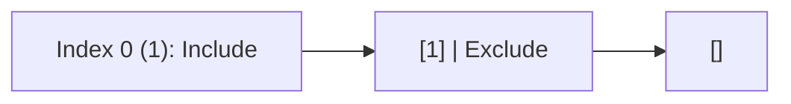

```java
public List<List<Integer>> subsets(int[] nums) {
    List<List<Integer>> result = new ArrayList<>();
    backtrack(nums, 0, new ArrayList<>(), result);
    return result;
}

private void backtrack(int[] nums, int start, List<Integer> current, 
                       List<List<Integer>> result) {
    result.add(new ArrayList<>(current));  // Add copy of current subset
    
    for (int i = start; i < nums.length; i++) {
        current.add(nums[i]);                // Include
        backtrack(nums, i + 1, current, result);
        current.remove(current.size() - 1);  // Backtrack (exclude)
    }
}
```

```
COMPLEXITY: Time O(n × 2^n) | Space O(n) recursion depth
WHY n × 2^n? 2^n subsets, each takes O(n) to copy.

ALTERNATIVE — Bit Manipulation:
for (int mask = 0; mask < (1 << n); mask++) {
    List<Integer> subset = new ArrayList<>();
    for (int i = 0; i < n; i++) {
        if ((mask & (1 << i)) != 0) subset.add(nums[i]);
    }
    result.add(subset);
}
```

---

## PROBLEM 2: Subsets II — With Duplicates (LC 90)

```
DIFFICULTY: Medium
COMPANIES: Amazon, Facebook, Bloomberg
PATTERN: Backtracking + Skip Duplicates

PROBLEM: Array may contain duplicates. Return all unique subsets.
  Input:  [1, 2, 2]
  Output: [[], [1], [1,2], [1,2,2], [2], [2,2]]

THE DUPLICATE HANDLING TRICK:
━━━━━━━━━━━━━━━━━━━━━━━━━━━━
  1. SORT the array first
  2. At each level, skip nums[i] if nums[i] == nums[i-1] AND
     i > start (not the first element at this level)

  Why? If [1, 2a, 2b]: 
  "Include 2a, exclude 2b" and "exclude 2a, include 2b" give same subset.
  By forcing 2b to only appear AFTER 2a in subsets, we avoid duplicates.

SOLUTION:
```

> **Flow**: DIFFICULTY: Medium → COMPANIES: Amazon, Facebook, Bloomberg | COMPANIES: Amazon, Facebook, Bloomberg → PATTERN: Backtracking + Skip Duplicates | PATTERN: Backtracking + Skip Duplicates → Input: [1, 2, 2] | Input: [1, 2, 2] → Output: [[], [1], [1,2], [1,2,2], [2], [2,2]] | Output: [[], [1], [1,2], [1,2,2], [2], [2,2]] → THE DUPLICATE HANDLING TRICK: | THE DUPLICATE HANDLING TRICK: → 1. SORT the array first | ...+1 more

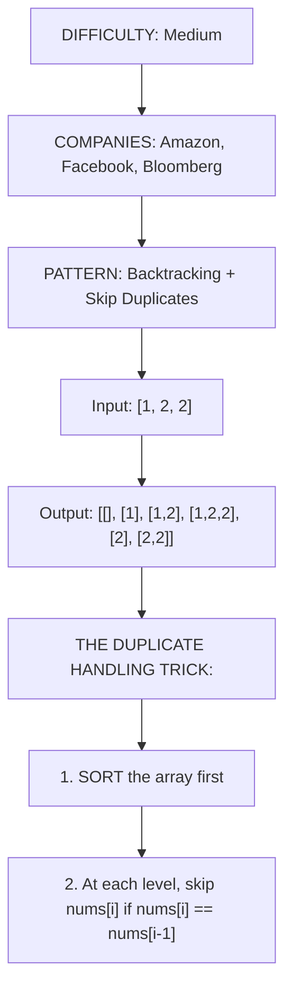

```java
public List<List<Integer>> subsetsWithDup(int[] nums) {
    Arrays.sort(nums);  // CRITICAL: sort to group duplicates
    List<List<Integer>> result = new ArrayList<>();
    backtrack(nums, 0, new ArrayList<>(), result);
    return result;
}

private void backtrack(int[] nums, int start, List<Integer> current, 
                       List<List<Integer>> result) {
    result.add(new ArrayList<>(current));
    
    for (int i = start; i < nums.length; i++) {
        // Skip duplicate at same recursion level
        if (i > start && nums[i] == nums[i - 1]) continue;
        
        current.add(nums[i]);
        backtrack(nums, i + 1, current, result);
        current.remove(current.size() - 1);
    }
}
```

```
COMPLEXITY: Time O(n × 2^n) worst case | Space O(n)
THE KEY LINE: i > start (not i > 0!). We CAN include duplicate 
              AFTER previous same element, just not at same branch level.
```

---

## PROBLEM 3: Combination Sum — Unlimited Use (LC 39)

```
DIFFICULTY: Medium
COMPANIES: Amazon, Facebook, Microsoft, Airbnb
PATTERN: Backtracking — Unbounded Pick

PROBLEM: Given candidates and target, find all unique combinations summing to target.
  Each number can be used UNLIMITED times.
  Input:  candidates = [2,3,6,7], target = 7
  Output: [[2,2,3], [7]]

KEY DIFFERENCE FROM SUBSETS:
  Subsets: move to i+1 (each element used once)
  Combination Sum: stay at i (can reuse same element)

RECURSION TREE for target=7, candidates=[2,3,6,7]:
  Start: sum=0
  Pick 2: sum=2 → Pick 2: sum=4 → Pick 2: sum=6 → Pick 2: sum=8 ✗ (over)
                                                   → Pick 3: sum=9 ✗
                                 → Pick 3: sum=7 ✓ → found [2,2,3]
  ...
  Pick 7: sum=7 ✓ → found [7]

SOLUTION:
```

> **Flow**: Pick 2: sum=2 → Pick 2: sum=4 | Pick 2: sum=4 → Pick 2: sum=6 | Pick 2: sum=6 → Pick 2: sum=8 ✗ (over) | Pick 3: sum=7 ✓ → found [2,2,3] | Pick 7: sum=7 ✓ → found [7]

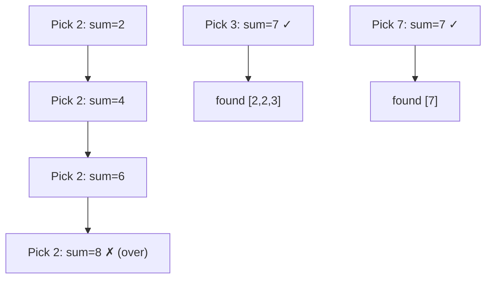

```java
public List<List<Integer>> combinationSum(int[] candidates, int target) {
    List<List<Integer>> result = new ArrayList<>();
    Arrays.sort(candidates);  // Optional but helps with pruning
    backtrack(candidates, target, 0, new ArrayList<>(), result);
    return result;
}

private void backtrack(int[] cands, int remaining, int start, 
                       List<Integer> current, List<List<Integer>> result) {
    if (remaining == 0) { result.add(new ArrayList<>(current)); return; }
    
    for (int i = start; i < cands.length; i++) {
        if (cands[i] > remaining) break;  // Pruning (requires sorted)
        current.add(cands[i]);
        backtrack(cands, remaining - cands[i], i, current, result);  // i, not i+1!
        current.remove(current.size() - 1);
    }
}
```

```
COMPLEXITY: Time O(n^(T/M)) where T=target, M=min candidate | Space O(T/M)
```

---

## PROBLEM 4: Combination Sum II — Each Number Once (LC 40)

```
DIFFICULTY: Medium
COMPANIES: Amazon, Facebook
PATTERN: Backtracking + Skip Duplicates (like Subsets II)

PROBLEM: Each number used at most once. Find unique combinations summing to target.
  Input:  candidates = [10,1,2,7,6,1,5], target = 8
  Output: [[1,1,6],[1,2,5],[1,7],[2,6]]

COMBINING TWO TRICKS:
  1. Use element once → recurse with i+1
  2. Skip duplicates → if (i > start && nums[i] == nums[i-1]) continue

SOLUTION:
```

> **Flow**: 1. Use element once → recurse with i+1 | 2. Skip duplicates → if (i &gt; start && nums[i] == nums[i-1]) continue

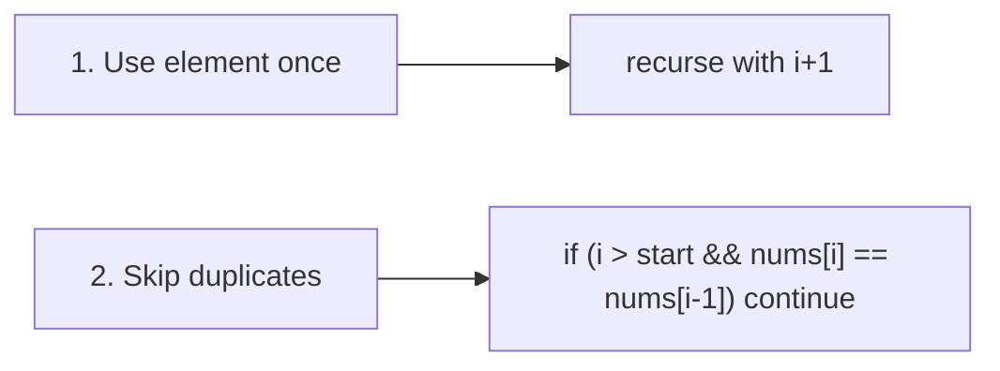

```java
public List<List<Integer>> combinationSum2(int[] candidates, int target) {
    Arrays.sort(candidates);
    List<List<Integer>> result = new ArrayList<>();
    backtrack(candidates, target, 0, new ArrayList<>(), result);
    return result;
}

private void backtrack(int[] cands, int remaining, int start, 
                       List<Integer> current, List<List<Integer>> result) {
    if (remaining == 0) { result.add(new ArrayList<>(current)); return; }
    
    for (int i = start; i < cands.length; i++) {
        if (cands[i] > remaining) break;
        if (i > start && cands[i] == cands[i - 1]) continue;  // Skip dups
        
        current.add(cands[i]);
        backtrack(cands, remaining - cands[i], i + 1, current, result);  // i+1!
        current.remove(current.size() - 1);
    }
}
```

```
COMPARISON TABLE:
┌───────────────────┬──────────────┬──────────────────┬─────────────┐
│ Problem           │ Reuse?       │ Recurse at       │ Skip dups?  │
├───────────────────┼──────────────┼──────────────────┼─────────────┤
│ Combination Sum   │ Unlimited    │ i (same index)   │ No          │
│ Combination Sum II│ Once each    │ i+1              │ Yes (sort!) │
│ Subsets           │ Once each    │ i+1              │ No          │
│ Subsets II        │ Once each    │ i+1              │ Yes (sort!) │
│ Permutations      │ Once each    │ 0 (use visited[])│ No          │
│ Permutations II   │ Once each    │ 0 (use visited[])│ Yes (sort!) │
└───────────────────┴──────────────┴──────────────────┴─────────────┘
```

> **Flow**: COMPARISON TABLE: → Problem Reuse? Recurse at Skip dups? | Problem Reuse? Recurse at Skip dups? → Combination Sum Unlimited i (same index) No | Combination Sum Unlimited i (same index) No → Combination Sum II Once each i+1 Yes (sort!) | Combination Sum II Once each i+1 Yes (sort!) → Subsets Once each i+1 No | Subsets Once each i+1 No → Subsets II Once each i+1 Yes (sort!) | Subsets II Once each i+1 Yes (sort!) → Permutations Once each 0 (use visited[]) No | ...+1 more

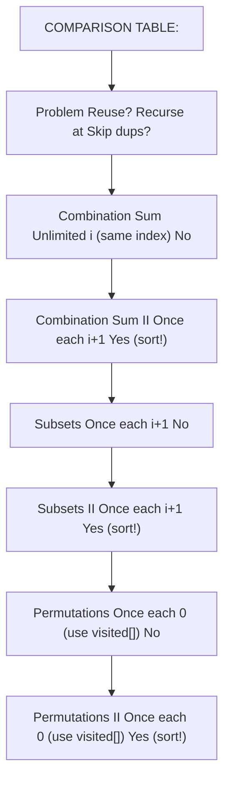

---

## PROBLEM 5: Subset Sum — Count Subsets with Given Sum

```
DIFFICULTY: Medium (Classic DP — NOT on LeetCode but appears in interviews)
COMPANIES: Amazon, Goldman Sachs, Morgan Stanley
PATTERN: Recursion → Memoization → DP

PROBLEM: Given array of positive integers and target sum, COUNT the number
         of subsets that sum to exactly target.
  Input:  nums = [1, 2, 3, 3], target = 6
  Output: 3 (subsets: {3,3}, {1,2,3}, {1,2,3})

THE FULL PIPELINE:
━━━━━━━━━━━━━━━━━

STEP 1 — PURE RECURSION:
```

> **Flow**: PATTERN: Recursion → Memoization | Memoization → DP


```java
// O(2^n) — explores all subsets
int countSubsets(int[] nums, int i, int target) {
    if (target == 0) return 1;         // Found a valid subset
    if (i == nums.length) return 0;    // Exhausted elements
    if (target < 0) return 0;          // Over the target
    
    // Include nums[i] OR exclude nums[i]
    return countSubsets(nums, i + 1, target - nums[i])
         + countSubsets(nums, i + 1, target);
}
```

```
STEP 2 — MEMOIZATION (Top-Down DP):
```

```java
// O(n × target) with memoization
int countSubsets(int[] nums, int i, int target, Integer[][] memo) {
    if (target == 0) return 1;
    if (i == nums.length || target < 0) return 0;
    if (memo[i][target] != null) return memo[i][target];
    
    memo[i][target] = countSubsets(nums, i + 1, target - nums[i], memo)
                    + countSubsets(nums, i + 1, target, memo);
    return memo[i][target];
}
```

```
STEP 3 — BOTTOM-UP DP (2D):
```

```java
int countSubsets(int[] nums, int target) {
    int n = nums.length;
    int[][] dp = new int[n + 1][target + 1];
    
    // Base: empty subset sums to 0
    for (int i = 0; i <= n; i++) dp[i][0] = 1;
    
    for (int i = 1; i <= n; i++) {
        for (int t = 0; t <= target; t++) {
            dp[i][t] = dp[i - 1][t];  // Exclude nums[i-1]
            if (t >= nums[i - 1]) {
                dp[i][t] += dp[i - 1][t - nums[i - 1]];  // Include
            }
        }
    }
    return dp[n][target];
}
```

```
STEP 4 — SPACE-OPTIMIZED (1D DP):
```

```java
int countSubsets(int[] nums, int target) {
    int[] dp = new int[target + 1];
    dp[0] = 1;
    
    for (int num : nums) {
        // RIGHT TO LEFT — crucial for 0/1 knapsack!
        for (int t = target; t >= num; t--) {
            dp[t] += dp[t - num];
        }
    }
    return dp[target];
}
```

```
COMPLEXITY: Time O(n × target) | Space O(target)
WHY RIGHT TO LEFT? If left-to-right, dp[t-num] already includes current
num, causing it to be counted multiple times (unbounded knapsack behavior).
```

---

## PROBLEM 6: Partition Equal Subset Sum (LC 416)

```
DIFFICULTY: Medium
COMPANIES: Amazon, Facebook, Google
PATTERN: 0/1 Knapsack (Subset Sum variant)

PROBLEM: Can array be partitioned into two subsets with equal sum?
  Input:  [1, 5, 11, 5]
  Output: true → {1, 5, 5} and {11}

KEY INSIGHT:
━━━━━━━━━━━
  Total sum = 22. We need subset summing to 22/2 = 11.
  If total is odd → immediately false.
  This reduces to: "Does a subset with sum = totalSum/2 exist?"
  = Classic Subset Sum problem!

SOLUTION:
```

> **Flow**: Output: true → {1, 5, 5} and {11} | If total is odd → immediately false.

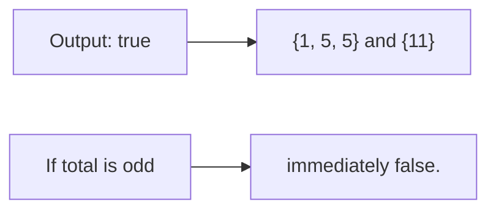

```java
public boolean canPartition(int[] nums) {
    int sum = 0;
    for (int n : nums) sum += n;
    if (sum % 2 != 0) return false;
    
    int target = sum / 2;
    boolean[] dp = new boolean[target + 1];
    dp[0] = true;
    
    for (int num : nums) {
        for (int t = target; t >= num; t--) {  // Right to left!
            dp[t] = dp[t] || dp[t - num];
        }
    }
    return dp[target];
}
```

```
COMPLEXITY: Time O(n × sum/2) | Space O(sum/2)
EDGE CASES: 
  - Single element → false
  - All same elements, even count → true
  - Sum is odd → false immediately
```

> **Flow**: - Single element → false | - All same elements, even count → true | - Sum is odd → false immediately

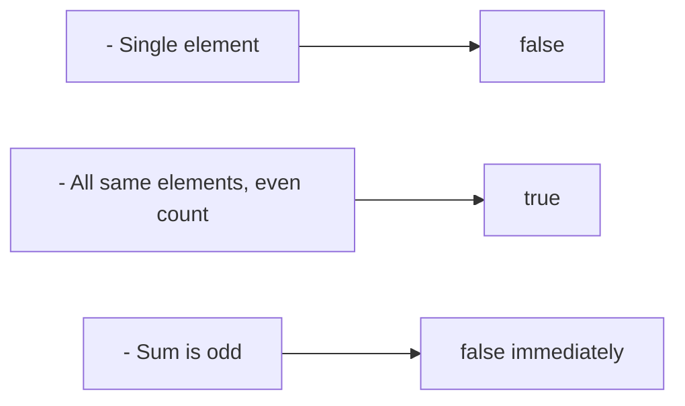

---

## PROBLEM 7: Target Sum (LC 494)

```
DIFFICULTY: Medium
COMPANIES: Facebook, Google, Amazon
PATTERN: Subset Sum variant / Count partitions

PROBLEM: Assign + or - to each number to reach target sum.
  Input:  nums = [1, 1, 1, 1, 1], target = 3
  Output: 5 (five ways: -1+1+1+1+1, +1-1+1+1+1, +1+1-1+1+1, +1+1+1-1+1, +1+1+1+1-1)

MATHEMATICAL TRANSFORMATION:
━━━━━━━━━━━━━━━━━━━━━━━━━━━
  Let P = set of positive numbers, N = set of negative numbers
  sum(P) - sum(N) = target
  sum(P) + sum(N) = totalSum
  Adding: 2·sum(P) = target + totalSum
  sum(P) = (target + totalSum) / 2

  So: COUNT subsets with sum = (target + totalSum) / 2
  This is EXACTLY the Count Subsets with Sum problem!

SOLUTION:
```

> **Flow**: DIFFICULTY: Medium → COMPANIES: Facebook, Google, Amazon | COMPANIES: Facebook, Google, Amazon → PATTERN: Subset Sum variant / Count partitions | PATTERN: Subset Sum variant / Count partitions → PROBLEM: Assign + or - to each number to reach target s | PROBLEM: Assign + or - to each number to reach target s → Input: nums = [1, 1, 1, 1, 1], target = 3 | Input: nums = [1, 1, 1, 1, 1], target = 3 → MATHEMATICAL TRANSFORMATION: | MATHEMATICAL TRANSFORMATION: → sum(P) - sum(N) = target | ...+1 more

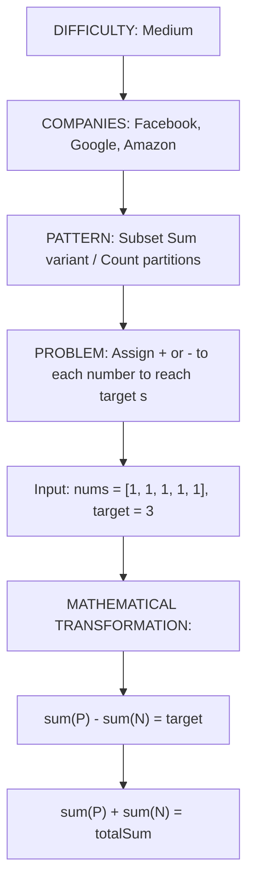

```java
public int findTargetSumWays(int[] nums, int target) {
    int sum = 0;
    for (int n : nums) sum += n;
    
    // Edge cases
    if ((sum + target) % 2 != 0) return 0;
    if (Math.abs(target) > sum) return 0;
    
    int subsetSum = (sum + target) / 2;
    int[] dp = new int[subsetSum + 1];
    dp[0] = 1;
    
    for (int num : nums) {
        for (int t = subsetSum; t >= num; t--) {
            dp[t] += dp[t - num];
        }
    }
    return dp[subsetSum];
}
```

```
COMPLEXITY: Time O(n × subsetSum) | Space O(subsetSum)
BRILLIANT REDUCTION: +/- assignment → subset partition → subset sum count!
```

---

## PROBLEM 8: Letter Combinations of Phone Number (LC 17)

```
DIFFICULTY: Medium
COMPANIES: Amazon, Facebook, Google, Microsoft
PATTERN: Backtracking — generate all combinations

PROBLEM: Given digit string, return all letter combinations.
  Input:  "23"
  Output: ["ad","ae","af","bd","be","bf","cd","ce","cf"]

2→abc, 3→def, 4→ghi, 5→jkl, 6→mno, 7→pqrs, 8→tuv, 9→wxyz

SOLUTION:
```

> **Flow**: abc, 3 → def, 4 | def, 4 → ghi, 5 | ghi, 5 → jkl, 6 | jkl, 6 → mno, 7 | mno, 7 → pqrs, 8 | pqrs, 8 → tuv, 9 | ...+1 more

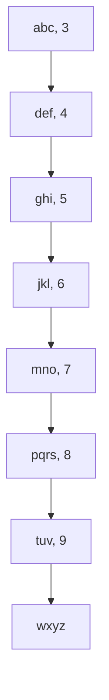

```java
private String[] mapping = {"", "", "abc", "def", "ghi", "jkl", 
                             "mno", "pqrs", "tuv", "wxyz"};

public List<String> letterCombinations(String digits) {
    List<String> result = new ArrayList<>();
    if (digits.isEmpty()) return result;
    backtrack(digits, 0, new StringBuilder(), result);
    return result;
}

private void backtrack(String digits, int idx, StringBuilder sb, List<String> result) {
    if (idx == digits.length()) {
        result.add(sb.toString());
        return;
    }
    String letters = mapping[digits.charAt(idx) - '0'];
    for (char c : letters.toCharArray()) {
        sb.append(c);
        backtrack(digits, idx + 1, sb, result);
        sb.deleteCharAt(sb.length() - 1);
    }
}
```

```
COMPLEXITY: Time O(4^n × n) | Space O(n) where n = digits length
WHY 4^n? Some digits map to 4 letters (7→pqrs, 9→wxyz).
```

---

## PROBLEM 9: Permutations (LC 46)

```
DIFFICULTY: Medium
COMPANIES: Amazon, Facebook, Google, Microsoft
PATTERN: Backtracking with visited array

PROBLEM: Return all permutations of distinct integers.
  Input:  [1, 2, 3]
  Output: [[1,2,3],[1,3,2],[2,1,3],[2,3,1],[3,1,2],[3,2,1]]

KEY DIFFERENCE FROM SUBSETS:
  Subsets: order doesn't matter, start from i+1
  Permutations: order matters, always start from 0, use visited[]

SOLUTION:
```

```java
public List<List<Integer>> permute(int[] nums) {
    List<List<Integer>> result = new ArrayList<>();
    backtrack(nums, new boolean[nums.length], new ArrayList<>(), result);
    return result;
}

private void backtrack(int[] nums, boolean[] used, List<Integer> current, 
                       List<List<Integer>> result) {
    if (current.size() == nums.length) {
        result.add(new ArrayList<>(current));
        return;
    }
    for (int i = 0; i < nums.length; i++) {
        if (used[i]) continue;
        used[i] = true;
        current.add(nums[i]);
        backtrack(nums, used, current, result);
        current.remove(current.size() - 1);
        used[i] = false;
    }
}
```

```
COMPLEXITY: Time O(n! × n) | Space O(n)
n! permutations, each O(n) to copy.
```

---

## PROBLEM 10: Permutations II — With Duplicates (LC 47)

```
DIFFICULTY: Medium
COMPANIES: Amazon, Facebook
PATTERN: Backtracking + Sort + Skip Duplicates

PROBLEM: Array may have duplicates. Return unique permutations.
  Input:  [1, 1, 2]
  Output: [[1,1,2],[1,2,1],[2,1,1]]

THE DUPLICATE SKIP RULE FOR PERMUTATIONS:
  Sort first. Skip nums[i] if:
  1. nums[i] == nums[i-1] AND
  2. !used[i-1] (previous duplicate NOT used at upper level)
  
  This ensures duplicates are used in ORDER: first 1a, then 1b.

SOLUTION:
```

```java
public List<List<Integer>> permuteUnique(int[] nums) {
    Arrays.sort(nums);
    List<List<Integer>> result = new ArrayList<>();
    backtrack(nums, new boolean[nums.length], new ArrayList<>(), result);
    return result;
}

private void backtrack(int[] nums, boolean[] used, List<Integer> current, 
                       List<List<Integer>> result) {
    if (current.size() == nums.length) {
        result.add(new ArrayList<>(current));
        return;
    }
    for (int i = 0; i < nums.length; i++) {
        if (used[i]) continue;
        if (i > 0 && nums[i] == nums[i - 1] && !used[i - 1]) continue;
        
        used[i] = true;
        current.add(nums[i]);
        backtrack(nums, used, current, result);
        current.remove(current.size() - 1);
        used[i] = false;
    }
}
```

```
COMPLEXITY: Time O(n! × n) worst | Space O(n)
```

---

## PROBLEM 11: Word Search (LC 79)

```
DIFFICULTY: Medium
COMPANIES: Amazon, Facebook, Microsoft, Bloomberg
PATTERN: Backtracking on Grid

PROBLEM: Given m×n board and word, check if word exists in grid.
  Move up/down/left/right, each cell used once.

SOLUTION:
```

```java
public boolean exist(char[][] board, String word) {
    int m = board.length, n = board[0].length;
    for (int i = 0; i < m; i++) {
        for (int j = 0; j < n; j++) {
            if (dfs(board, word, i, j, 0)) return true;
        }
    }
    return false;
}

private boolean dfs(char[][] board, String word, int i, int j, int k) {
    if (k == word.length()) return true;
    if (i < 0 || i >= board.length || j < 0 || j >= board[0].length) return false;
    if (board[i][j] != word.charAt(k)) return false;
    
    char temp = board[i][j];
    board[i][j] = '#';  // Mark visited
    
    boolean found = dfs(board, word, i + 1, j, k + 1) ||
                    dfs(board, word, i - 1, j, k + 1) ||
                    dfs(board, word, i, j + 1, k + 1) ||
                    dfs(board, word, i, j - 1, k + 1);
    
    board[i][j] = temp;  // Backtrack
    return found;
}
```

```
COMPLEXITY: Time O(m × n × 4^L) | Space O(L) where L = word length
TRICK: Modify board in-place to mark visited (avoid boolean[][] array).
```

---

## PROBLEM 12: Generate Parentheses (LC 22)

```
DIFFICULTY: Medium
COMPANIES: Amazon, Google, Facebook, Microsoft
PATTERN: Backtracking with Constraints

PROBLEM: Generate all valid combinations of n pairs of parentheses.
  Input:  n = 3
  Output: ["((()))","(()())","(())()","()(())","()()()"]

CONSTRAINTS:
  1. Can add '(' if open < n
  2. Can add ')' if close < open

SOLUTION:
```

```java
public List<String> generateParenthesis(int n) {
    List<String> result = new ArrayList<>();
    backtrack(n, 0, 0, new StringBuilder(), result);
    return result;
}

private void backtrack(int n, int open, int close, StringBuilder sb, List<String> result) {
    if (sb.length() == 2 * n) {
        result.add(sb.toString());
        return;
    }
    if (open < n) {
        sb.append('(');
        backtrack(n, open + 1, close, sb, result);
        sb.deleteCharAt(sb.length() - 1);
    }
    if (close < open) {
        sb.append(')');
        backtrack(n, open, close + 1, sb, result);
        sb.deleteCharAt(sb.length() - 1);
    }
}
```

```
COMPLEXITY: Time O(4^n / √n) — Catalan number | Space O(n)
The nth Catalan number C(n) = (2n)! / ((n+1)! × n!)
```

---

### Problem 13: Palindrome Partitioning

**LeetCode 131** | **Difficulty:** Medium

```
╔═══════════════════════════════════════════════════════════════════════════╗
║  PALINDROME PARTITIONING (LeetCode 131 - Medium)                          ║
╠═══════════════════════════════════════════════════════════════════════════╣
║                                                                           ║
║  Partition string s so every substring is a palindrome.                   ║
║  Return all possible partitions.                                          ║
║                                                                           ║
║  Example: s = "aab"                                                       ║
║  Output: [["a","a","b"], ["aa","b"]]                                      ║
║                                                                           ║
║  KEY: Backtrack trying each prefix. If prefix is palindrome, recurse      ║
║  on remaining suffix.                                                     ║
║  TIME: O(n × 2^n) | SPACE: O(n) recursion depth                           ║
╚═══════════════════════════════════════════════════════════════════════════╝
```

> **Flow**: PALINDROME PARTITIONING (LeetCode 131 - Medium) → Partition string s so every substring is a palindrome. | Partition string s so every substring is a palindrome. → Return all possible partitions. | Return all possible partitions. → Example: s = 'aab' | Example: s = 'aab' → Output: [['a','a','b'], ['aa','b']] | Output: [['a','a','b'], ['aa','b']] → on remaining suffix. | on remaining suffix. → TIME: O(n × 2^n) | SPACE: O(n) recursion depth

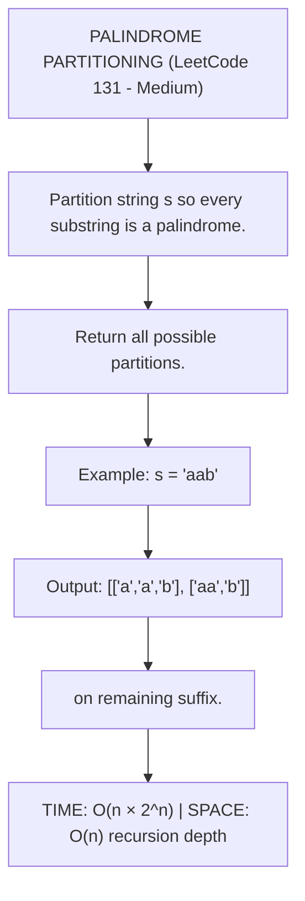

```java
public List<List<String>> partition(String s) {
    List<List<String>> result = new ArrayList<>();
    backtrack(s, 0, new ArrayList<>(), result);
    return result;
}

private void backtrack(String s, int start, List<String> path,
                       List<List<String>> result) {
    if (start == s.length()) {
        result.add(new ArrayList<>(path));
        return;
    }
    for (int end = start + 1; end <= s.length(); end++) {
        String sub = s.substring(start, end);
        if (isPalindrome(sub)) {
            path.add(sub);
            backtrack(s, end, path, result);
            path.remove(path.size() - 1);
        }
    }
}

private boolean isPalindrome(String s) {
    int l = 0, r = s.length() - 1;
    while (l < r) {
        if (s.charAt(l++) != s.charAt(r--)) return false;
    }
    return true;
}
```

---

### Problem 14: Combinations

**LeetCode 77** | **Difficulty:** Medium

```
╔═══════════════════════════════════════════════════════════════════════════╗
║  COMBINATIONS (LeetCode 77 - Medium)                                      ║
╠═══════════════════════════════════════════════════════════════════════════╣
║                                                                           ║
║  Given n and k, return all possible combinations of k numbers             ║
║  chosen from range [1, n].                                                ║
║                                                                           ║
║  Example: n = 4, k = 2                                                    ║
║  Output: [[1,2],[1,3],[1,4],[2,3],[2,4],[3,4]]                            ║
║                                                                           ║
║  KEY: Standard backtracking. Prune when remaining < needed.               ║
║  TIME: O(C(n,k) × k) | SPACE: O(k)                                        ║
╚═══════════════════════════════════════════════════════════════════════════╝
```

> **Flow**: COMBINATIONS (LeetCode 77 - Medium) → chosen from range [1, n]. | chosen from range [1, n]. → Example: n = 4, k = 2 | Example: n = 4, k = 2 → Output: [[1,2],[1,3],[1,4],[2,3],[2,4],[3,4]] | Output: [[1,2],[1,3],[1,4],[2,3],[2,4],[3,4]] → KEY: Standard backtracking. Prune when remaining &lt; n | KEY: Standard backtracking. Prune when remaining &lt; n → TIME: O(C(n,k) × k) | SPACE: O(k)

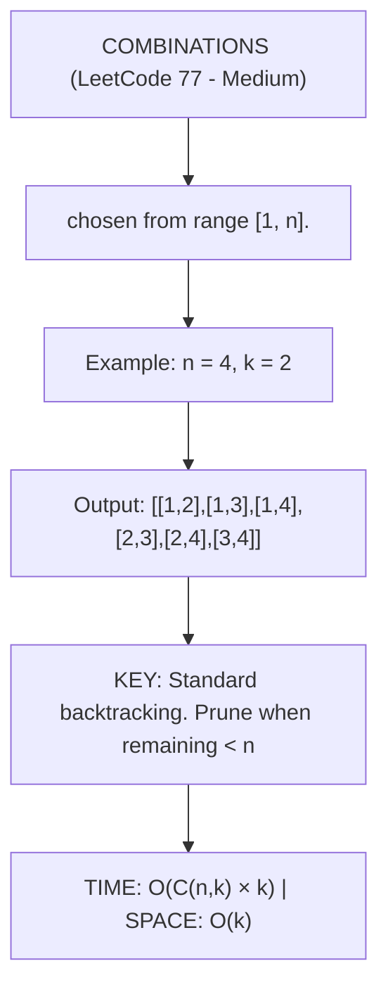

```java
public List<List<Integer>> combine(int n, int k) {
    List<List<Integer>> result = new ArrayList<>();
    backtrack(n, k, 1, new ArrayList<>(), result);
    return result;
}

private void backtrack(int n, int k, int start, List<Integer> path,
                       List<List<Integer>> result) {
    if (path.size() == k) {
        result.add(new ArrayList<>(path));
        return;
    }
    // Pruning: need (k - path.size()) more, so stop early
    for (int i = start; i <= n - (k - path.size()) + 1; i++) {
        path.add(i);
        backtrack(n, k, i + 1, path, result);
        path.remove(path.size() - 1);
    }
}
```

---

### Problem 15: N-Queens

**LeetCode 51** | **Difficulty:** Hard

```
╔═══════════════════════════════════════════════════════════════════════════╗
║  N-QUEENS (LeetCode 51 - Hard)                                            ║
╠═══════════════════════════════════════════════════════════════════════════╣
║                                                                           ║
║  Place n queens on n×n chessboard so no two attack each other.            ║
║  Return all distinct solutions.                                           ║
║                                                                           ║
║  Example: n = 4                                                           ║
║  Output: [[".Q..","...Q","Q...","..Q."],                                  ║
║           ["..Q.","Q...","...Q",".Q.."]]                                  ║
║                                                                           ║
║  KEY: Place row by row. Track cols, diags, anti-diags with sets.          ║
║  TIME: O(n!) | SPACE: O(n²)                                               ║
╚═══════════════════════════════════════════════════════════════════════════╝
```

> **Flow**: N-QUEENS (LeetCode 51 - Hard) → Return all distinct solutions. | Return all distinct solutions. → Example: n = 4 | Example: n = 4 → Output: [['.Q..','...Q','Q...','..Q.'], | Output: [['.Q..','...Q','Q...','..Q.'], → TIME: O(n!) | SPACE: O(n²)

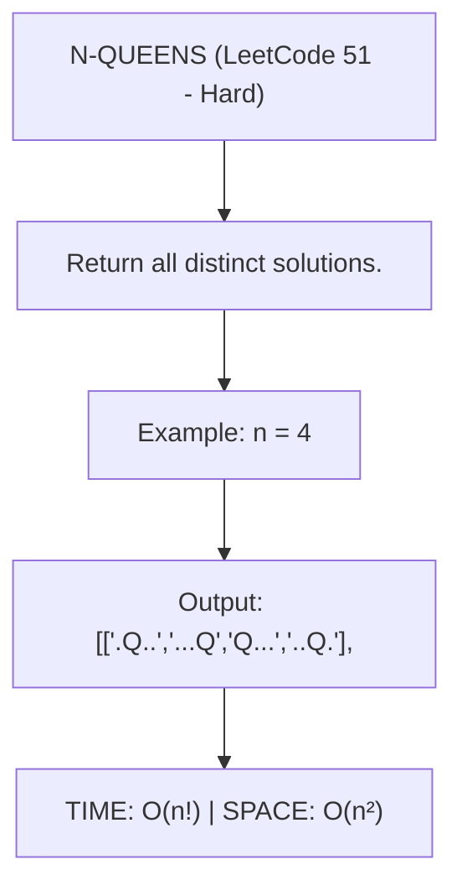

```java
public List<List<String>> solveNQueens(int n) {
    List<List<String>> result = new ArrayList<>();
    char[][] board = new char[n][n];
    for (char[] row : board) Arrays.fill(row, '.');
    Set<Integer> cols = new HashSet<>();
    Set<Integer> diags = new HashSet<>();     // row - col
    Set<Integer> antiDiags = new HashSet<>(); // row + col
    backtrack(board, 0, cols, diags, antiDiags, result);
    return result;
}

private void backtrack(char[][] board, int row,
        Set<Integer> cols, Set<Integer> diags, Set<Integer> antiDiags,
        List<List<String>> result) {
    if (row == board.length) {
        List<String> solution = new ArrayList<>();
        for (char[] r : board) solution.add(new String(r));
        result.add(solution);
        return;
    }
    for (int col = 0; col < board.length; col++) {
        if (cols.contains(col) || diags.contains(row - col)
                || antiDiags.contains(row + col)) continue;

        board[row][col] = 'Q';
        cols.add(col); diags.add(row - col); antiDiags.add(row + col);

        backtrack(board, row + 1, cols, diags, antiDiags, result);

        board[row][col] = '.';
        cols.remove(col); diags.remove(row - col); antiDiags.remove(row + col);
    }
}
```

---

## 📋 CURATED PRACTICE PROBLEMS

### Easy

| # | Problem | LC# | Pattern | Company |
|---|---------|-----|---------|---------|
| 1 | [Power of Two](https://leetcode.com/problems/power-of-two/) | 231 | Recursion / Bit | Google |
| 2 | [Fibonacci Number](https://leetcode.com/problems/fibonacci-number/) | 509 | Recursion → DP | Amazon |
| 3 | [Climbing Stairs](https://leetcode.com/problems/climbing-stairs/) | 70 | Recursion → DP | Amazon |

### Medium

| # | Problem | LC# | Pattern | Company |
|---|---------|-----|---------|---------|
| 1 | [Subsets](https://leetcode.com/problems/subsets/) | 78 | Backtracking | Amazon, Facebook |
| 2 | [Subsets II](https://leetcode.com/problems/subsets-ii/) | 90 | Backtracking + Dedup | Facebook |
| 3 | [Combination Sum](https://leetcode.com/problems/combination-sum/) | 39 | Backtracking Unbounded | Amazon |
| 4 | [Combination Sum II](https://leetcode.com/problems/combination-sum-ii/) | 40 | Backtracking Once | Facebook |
| 5 | [Combinations](https://leetcode.com/problems/combinations/) | 77 | Backtracking | Microsoft |
| 6 | [Permutations](https://leetcode.com/problems/permutations/) | 46 | Backtracking + visited | Amazon |
| 7 | [Permutations II](https://leetcode.com/problems/permutations-ii/) | 47 | Backtracking + Dedup | Amazon |
| 8 | [Letter Combinations of Phone](https://leetcode.com/problems/letter-combinations-of-a-phone-number/) | 17 | Backtracking | Amazon, Google |
| 9 | [Generate Parentheses](https://leetcode.com/problems/generate-parentheses/) | 22 | Constrained Backtrack | Amazon, Google |
| 10 | [Partition Equal Subset Sum](https://leetcode.com/problems/partition-equal-subset-sum/) | 416 | 0/1 Knapsack | Facebook |
| 11 | [Target Sum](https://leetcode.com/problems/target-sum/) | 494 | Subset Sum Count | Facebook |
| 12 | [Word Search](https://leetcode.com/problems/word-search/) | 79 | Grid Backtracking | Amazon |
| 13 | [Palindrome Partitioning](https://leetcode.com/problems/palindrome-partitioning/) | 131 | Backtracking | Amazon |
| 14 | [Beautiful Arrangement](https://leetcode.com/problems/beautiful-arrangement/) | 526 | Permutation Backtrack | Google |
| 15 | [Count Number of Nice Subarrays](https://leetcode.com/problems/count-number-of-nice-subarrays/) | 1248 | Sliding Window Count | Amazon |

### Hard

| # | Problem | LC# | Pattern | Company |
|---|---------|-----|---------|---------|
| 1 | [N-Queens](https://leetcode.com/problems/n-queens/) | 51 | Constraint Backtrack | Amazon, Google |
| 2 | [Sudoku Solver](https://leetcode.com/problems/sudoku-solver/) | 37 | Constraint Backtrack | Google |
| 3 | [Stickers to Spell Word](https://leetcode.com/problems/stickers-to-spell-word/) | 691 | Bitmask DP | — |
| 4 | [Partition to K Equal Sum](https://leetcode.com/problems/partition-to-k-equal-sum-subsets/) | 698 | Backtrack + Prune | LinkedIn |
| 5 | [Word Search II](https://leetcode.com/problems/word-search-ii/) | 212 | Trie + Backtrack | Amazon, Google |

---

> **Navigation**: [< Previous](21_Design.md) | [Back to Index](../00_MASTER_INDEX.md) | [Next >](../06_OOP_Design/01_OOPS_Principles.md)
