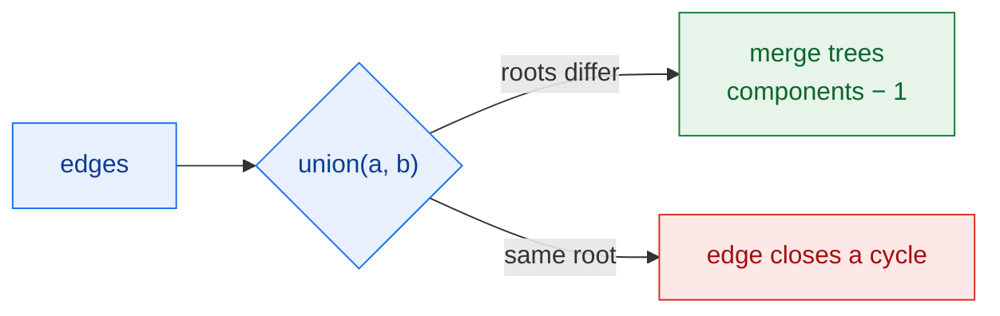

# Union-Find Problems

> **Navigation**: [← Graphs](10_Graphs.md) | [Chapter index](00_INDEX.md) | [Topological Sort Problems →](29_Topological_Sort_Problems.md)

---

## 🔗 Bridge — Where This Chapter Fits

| Dimension | This chapter |
| --- | --- |
| **Builds on** | [Union-Find pattern](../04_Patterns_Templates/27_Union_Find_Pattern.md), [Graphs](10_Graphs.md) |
| **You will learn** | Counting components, detecting redundant edges, merging by equality, longest consecutive runs and minimum spanning trees (Kruskal) |
| **Leads to** | [Topological Sort problems](29_Topological_Sort_Problems.md), [Shortest Path problems](31_Shortest_Path_Problems.md) |
| **Abstraction level** | Repeated graph searches → **a forest of parent pointers** |

> [!NOTE]
> The full gap-free reading order and dependency graph are in the [Learning Path](00_LEARNING_PATH.md).

---

## 💬 Explain It Like a Study Partner — Union-Find Problems

### 1. The bottom line

When groups only merge and you keep asking "are these together?", union-find answers each question in almost constant time.

### 2. The textbook core

- `find` follows parents to the root with path compression; `union` links the smaller tree under the larger.
- `union` returns `false` when both nodes already share a root — that edge closes a cycle.
- Equality constraints are unions; inequality constraints are checks after all unions.
- Kruskal: sort edges by weight and add an edge whenever `union` succeeds.
- Map strings to integer ids first when nodes are not numbers.

### 3. The real-world analogy

**Friend groups at a party** that merge when two people are introduced.

### 4. Walkthrough

1. Five nodes; `union(0,1)`, `union(1,2)`, `union(3,4)`.
2. Components: `{0,1,2}` and `{3,4}` → 2.
3. `union(0,2)` returns `false`: already connected.
4. So the edge `(0,2)` would be redundant.

> [!NOTE]
> **Quick check:** What does a failing `union` tell you in a graph problem? *The two endpoints were already connected, so the edge forms a cycle.*


### 5. Check yourself

**Q1.** Provinces in the identity matrix of size 3?

<details><summary>Answer</summary>

**3**: no city is connected to another.

</details>

**Q2.** Are the equations `a==b`, `b!=c`, `c==a` satisfiable?

<details><summary>Answer</summary>

No: `a==b` and `c==a` put `a`, `b`, `c` in one set, contradicting `b!=c`.

</details>

---

## 🗺️ Pattern Recognition Header

| Signal in the problem | Technique |
| --- | --- |
| "number of connected components / provinces" | Union all edges, count roots |
| "which edge creates a cycle" | First failing `union` |
| "x == y / x != y constraints" | Union equalities, check inequalities |
| "merge accounts sharing an email" | Union by shared key |
| "minimum cost to connect all points" | Kruskal |
| "longest run of consecutive numbers" | Union `x` with `x+1` |

> [!TIP]
> Union-find only merges. If the problem deletes edges, process the operations backwards (so deletions become additions) or use a different technique.

---



**How to read this diagram.** Every edge is passed to `union`; a successful merge reduces the component count, a failed one reveals a cycle.

## The Shared Tool

```java
static class DSU {
    int[] p, sz;
    int comps;
    DSU(int n) {
        p = new int[n];
        sz = new int[n];
        comps = n;
        for (int i = 0; i < n; i++) {
            p[i] = i;
            sz[i] = 1;
        }
    }
    int find(int x) {
        while (p[x] != x) {
            p[x] = p[p[x]];
            x = p[x];
        }
        return x;
    }
    boolean union(int a, int b) {
        a = find(a);
        b = find(b);
        if (a == b) return false;
        if (sz[a] < sz[b]) {
            int t = a;
            a = b;
            b = t;
        }
        p[b] = a;
        sz[a] += sz[b];
        comps--;
        return true;
    }
}
```

## Problem 1 — Number of Provinces

**Task.** An `n×n` matrix says which cities are directly connected; count the groups of connected cities.

**Brute force.** DFS from every unvisited city: `O(n²)` — also fine, union-find is an alternative.

**Better idea.** Union every connected pair; the answer is the remaining number of roots.

```java
static int provinces(int[][] isConnected) {
    int n = isConnected.length;
    DSU d = new DSU(n);
    for (int i = 0; i < n; i++) for (int j = i + 1; j < n; j++) if (isConnected[i][j] == 1) d.union(i, j);
    return d.comps;
}
```

**Example.** `[[1,1,0],[1,1,0],[0,0,1]]` → `2`.

**Complexity.** `O(n² α(n))`.


## Problem 2 — Redundant Connection

**Task.** A tree with one extra edge is given as edges in order; return the extra edge that can be removed.

**Brute force.** For each edge, remove it and test whether the rest is a tree: `O(n²)`.

**Better idea.** Add edges one by one; the first `union` that fails is the redundant edge.

```java
static int[] redundant(int[][] edges) {
    DSU d = new DSU(edges.length + 1);
    for (int[] e : edges) if (!d.union(e[0], e[1])) return e;
    return null;
}
```

**Example.** `[[1,2],[1,3],[2,3]]` → `[2,3]`.

**Complexity.** `O(n α(n))`.


## Problem 3 — Satisfiability of Equality Equations

**Task.** Given constraints like `a==b` and `b!=a`, decide whether variable values exist that satisfy all of them.

**Brute force.** Try all assignments: exponential.

**Better idea.** Union all `==` pairs; the system is impossible iff some `!=` pair ends up in the same set.

```java
static boolean equationsPossible(String[] eq) {
// "a==b" or "a!=b"
    DSU d = new DSU(26);
    for (String s : eq) if (s.charAt(1) == '=') d.union(s.charAt(0) - 'a', s.charAt(3) - 'a');
    for (String s : eq) if (s.charAt(1) == '!' && d.find(s.charAt(0) - 'a') == d.find(s.charAt(3) - 'a')) return false;
    return true;
}
```

**Example.** `["a==b","b!=a"]` → `false`; `["a==b","b==c","a==c"]` → `true`.

**Complexity.** `O(m α(26))`.


## Problem 4 — Longest Consecutive Sequence

**Task.** Find the length of the longest run of consecutive integers in an unsorted array.

**Brute force.** Sort and scan: `O(n log n)`.

**Better idea.** Give each distinct value an id, union `x` with `x + 1`, and report the largest component.

```java
static int longestConsecutive(int[] nums) {
    Map<Integer, Integer> id = new HashMap<>();
    int[] vals = new int[nums.length];
    int m = 0;
    for (int x : nums) if (!id.containsKey(x)) {
        id.put(x, m);
        vals[m++] = x;
    }
    DSU d = new DSU(m);
    for (int i = 0; i < m; i++) {
        Integer j = id.get(vals[i] + 1);
        if (j != null) d.union(i, j);
    }
    int best = 0;
    for (int i = 0; i < m; i++) if (d.find(i) == i) best = Math.max(best, d.sz[i]);
    return best;
}
```

**Example.** `[100,4,200,1,3,2]` → `4` (1,2,3,4).

**Complexity.** `O(n α(n))` expected.


## Problem 5 — Minimum Cost to Connect All Points

**Task.** Points on a plane; connecting two points costs their Manhattan distance. Find the cheapest way to connect all of them.

**Brute force.** Try all spanning trees: exponential.

**Better idea.** Kruskal: sort all pairs by distance and add a pair whenever `union` succeeds.

```java
static int minCostConnect(int[][] pts) {
    int n = pts.length;
    List<int[]> es = new ArrayList<>();
    for (int i = 0; i < n; i++) for (int j = i + 1; j < n; j++) es.add(new int[]{i, j, Math.abs(pts[i][0] - pts[j][0]) + Math.abs(pts[i][1] - pts[j][1])});
    es.sort((a, b) -> Integer.compare(a[2], b[2]));
    DSU d = new DSU(n);
    int cost = 0;
    for (int[] e : es) if (d.union(e[0], e[1])) cost += e[2];
    return cost;
}
```

**Example.** `[[0,0],[2,2],[3,10],[5,2],[7,0]]` → `20`.

**Complexity.** `O(n² log n)` for the dense edge list.


## Problem 6 — Accounts Merge

**Task.** Each account has a name and emails. Accounts that share an email belong to the same person; merge them.

**Brute force.** Repeatedly compare account pairs: `O(a² · e)`.

**Better idea.** Union account indices when an email repeats, then group emails by root.

```java
static List<List<String>> accountsMerge(List<List<String>> acc) {
// each: name, emails...
    Map<String, Integer> owner = new HashMap<>();
    DSU d = new DSU(acc.size());
    for (int i = 0; i < acc.size(); i++) for (int k = 1; k < acc.get(i).size(); k++) {
        String e = acc.get(i).get(k);
        if (owner.containsKey(e)) d.union(i, owner.get(e));
        else owner.put(e, i);
    }
    Map<Integer, TreeSet<String>> groups = new TreeMap<>();
    for (var en : owner.entrySet()) groups.computeIfAbsent(d.find(en.getValue()), x -> new TreeSet<>()).add(en.getKey());
    List<List<String>> out = new ArrayList<>();
    for (var g : groups.entrySet()) {
        List<String> row = new ArrayList<>();
        row.add(acc.get(g.getKey()).get(0));
        row.addAll(g.getValue());
        out.add(row);
    }
    out.sort(Comparator.comparing(r -> r.get(1)));
    return out;
}
```

**Example.** John's two accounts sharing `b@x` merge into `[John, a@x, b@x, c@x]`; the unrelated `j@x` account stays separate.

**Complexity.** `O(E α + E log E)` with sorting.

---

## 🏢 Enterprise Lens — Union-Find Problems

| Area | What top-tier engineering looks like |
| ---- | ------------------------------------ |
| **Where it runs in production** | Network connectivity, clustering, image segmentation, deduplication of user accounts, minimum spanning trees |
| **Failure modes** | Comparing `parent` entries instead of calling `find`; forgetting to merge equal emails across accounts; recursion depth in `find` |
| **Testing and verification** | Compare component counts with a DFS and MST weights with Prim on random inputs (1 500 cases here) |

---

## Reality Check

> [!CAUTION]
> "Union-find solves every connectivity problem." It solves **growing** connectivity; for shortest paths or deletions use graph search.

---

[← Interval Problems](26_Interval_Problems.md) | [Index](00_INDEX.md) | [Prefix Sum Problems →](28_Prefix_Sum_Problems.md)
