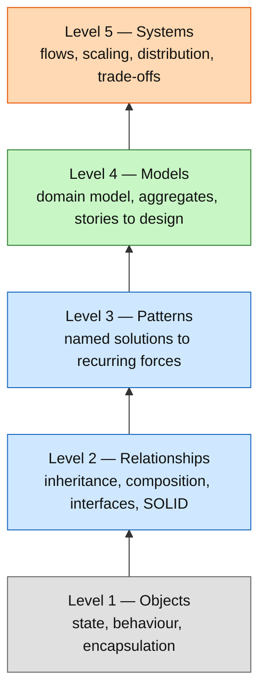

# Learning Path — OOP & Design

> **Navigation**: [Chapter index](00_INDEX.md) | [Book Companion](00_BOOK_COMPANION.md) | [Modern Java](../07_Modern_Java/00_INDEX.md) | [Problem Solving](../05_Problem_Solving/00_INDEX.md)

This page explains how the chapters in this folder fit together, what each assumes, and where the gaps between them are bridged.

---

## 1. The Abstraction Ladder

**How to read this diagram.** Read bottom to top. Each level reuses the one below: patterns are named uses of interfaces and composition, a domain model is objects with explicit boundaries, and a system is those boundaries running on separate machines.

## 2. Dependency Graph

**How to read this diagram.** Arrows mean "read before". Green pages were added after the audit against the books in the repository: they fill the gaps between patterns and systems (design judgement, domain modelling and requirements).

## 3. Recommended Reading Order with Bridges

| # | Page | Carry in | New problem it solves | Hands off to |
| - | ---- | -------- | --------------------- | ------------ |
| 1 | [OOP Principles](01_OOPS_Principles.md) | Java basics | Objects that protect their own rules; SOLID | Patterns |
| 2 | [Design Patterns](02_Design_Patterns.md) | Interfaces, composition | Named answers to recurring forces | Java idioms |
| 3 | [Design Patterns in Java](08_Design_Patterns_Java.md) | Pattern catalogue | Which patterns Java already absorbed | Remaining patterns |
| 4 | [Remaining GoF Patterns](12_Remaining_GoF_Patterns.md) 🆕 | Pattern catalogue | The ten patterns with no earlier section | Heuristics |
| 5 | [Design Heuristics](11_Design_Heuristics.md) 🆕 | Patterns | Deciding where behaviour belongs | Domain modelling |
| 6 | [Domain-Driven Design](09_Domain_Driven_Design_Essentials.md) 🆕 | Encapsulation, invariants | Aggregates, boundaries, translation | LLD problems |
| 7 | [LLD Solved Problems](07_LLD_Solved_Problems.md) | Patterns, DDD | Whole class designs under constraints | Problem sets |
| 8 | [LLD Reference Implementations](13_LLD_Reference_Implementations.md) 🆕 | LLD outlines | Compiled, tested versions with concurrency tests | Problem sets |
| 9 | [Problem Sets](06b_PROBLEM_SETS.md) | LLD | Practising SOLID, patterns, LLD alone | Requirements |
| 10 | [Stories to Design](10_Stories_To_Design.md) 🆕 | LLD, tests | Requirements → acceptance tests → seams | System design |
| 11 | [System Design](03_System_Design.md) | Components, flows | Requirements, numbers, components | Flows |
| 12 | [User & System Flows](04_User_System_Flows.md) | System design | Flows with failures and branches | Fundamentals |
| 13 | [System Design Fundamentals](05b_System_Design_Fundamentals.md) | Flows, mocks | Walking skeleton, scaling, failure drills | Distribution |
| 14 | [Distributed Systems](06_Distributed_Systems_Fundamentals.md) | Scaling primitives | CAP, consistency, consensus | Interview problems |
| 15 | [SD Interview Problems](05_SD_Interview_Problems.md) | Everything above | Applying the framework end to end | [Interview Mastery](../20_Interview_Mastery/00_INDEX.md) |

> [!NOTE]
> [System Design](03_System_Design.md) introduces user flows briefly and [User & System Flows](04_User_System_Flows.md) goes deep. The overlap is intentional: read the short version first, then return for the detail.

## 4. Coverage Matrix — Question → Page

| If the question is… | Page |
| --- | --- |
| "Why is this class hard to change?" | [OOP Principles](01_OOPS_Principles.md), [Design Heuristics](11_Design_Heuristics.md) |
| "Which pattern fits?" | [Design Patterns](02_Design_Patterns.md), [Patterns in Java](08_Design_Patterns_Java.md), [Remaining GoF Patterns](12_Remaining_GoF_Patterns.md) |
| "How do I model a business rule safely?" | [Domain-Driven Design](09_Domain_Driven_Design_Essentials.md) |
| "How do I turn a requirement into classes?" | [Stories to Design](10_Stories_To_Design.md), [LLD Problems](07_LLD_Solved_Problems.md) |
| "How many servers do we need?" | [System Design](03_System_Design.md) |
| "What happens when step 3 fails?" | [User & System Flows](04_User_System_Flows.md) |
| "How do we know it works end to end?" | [System Design Fundamentals](05b_System_Design_Fundamentals.md) |
| "What if the network splits?" | [Distributed Systems](06_Distributed_Systems_Fundamentals.md) |
| "Design a URL shortener / feed / chat" | [SD Interview Problems](05_SD_Interview_Problems.md) |

## 5. Source Books

The repository includes five books that shaped this folder; the [Book Companion](00_BOOK_COMPANION.md) maps each chapter of the book to the page that teaches it.

## 6. Bridges to Neighbouring Folders

| From here | To | Why |
| --- | --- | --- |
| [OOP Principles](01_OOPS_Principles.md) | [Memory Foundations](../02_Data_Structures/01a_Memory_Foundations.md) | Object layout and references explain aliasing and equality bugs |
| [LLD Problems](07_LLD_Solved_Problems.md) | [Design problems](../05_Problem_Solving/21_Design.md) | LRU cache and similar designs reuse the same seams |
| [Patterns in Java](08_Design_Patterns_Java.md) | [Modern Java](../07_Modern_Java/00_INDEX.md) | Lambdas, records and sealed types change which patterns you need |
| [Distributed Systems](06_Distributed_Systems_Fundamentals.md) | [Distributed Patterns](../10_Enterprise_Systems/09_Distributed_Patterns.md) | Messaging, transactions and resilience in practice |
| [Domain-Driven Design](09_Domain_Driven_Design_Essentials.md) | [DDD Tactical Patterns](../10_Enterprise_Systems/01b_DDD_Tactical_Patterns.md) | The same building blocks applied to ERP domains |
