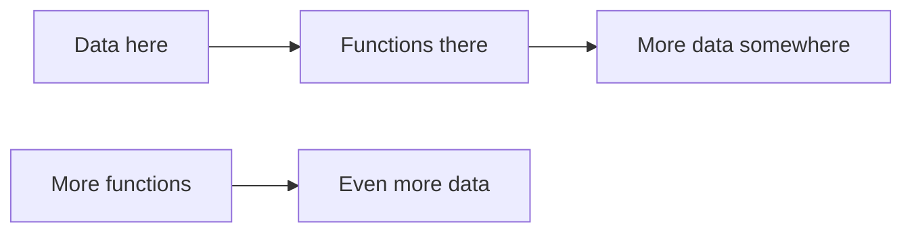
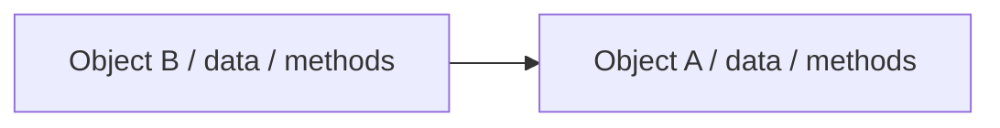

> **Navigation**: [Back to Index](../00_MASTER_INDEX.md) | [Next >](02_Design_Patterns.md)

# 🏗️ OOPS & Design Principles: Complete Guide

## Building Software That Lasts

---


# 📚 PART 0: The 5W+H Framework

> **Mental Model:** Think of Procedural Programming as a factory floor with tools scattered everywhere. Anyone can pick up any tool and mess with any machine. Object-Oriented Programming (OOP) is like organized workstations where each worker has their own specific tools and materials, and you must ask the worker to perform a task instead of grabbing their tools yourself.

| Question | Object-Oriented Programming Context |
| :--- | :--- |
| **WHAT** | A programming paradigm where software is organized around **objects** — bundles of related *data* (attributes) and *behavior* (methods) that represent real-world entities or concepts. |
| **WHY** | To manage exponential complexity in software. It prevents "spaghetti code" by keeping data and functions tightly coupled (Encapsulation), allowing safe code reuse (Inheritance/Composition), and hiding complex implementation details (Abstraction). |
| **WHEN** | Used for medium-to-large applications, GUIs, simulations, and enterprise software where business logic models complex real-world relationships. |
| **WHERE** | At the structural core of modern applications written in Java, C#, Python, C++, and TypeScript. |
| **WHO** | Conceptualized in the 1960s with Simula and popularized in the 1970s/80s with Smalltalk and C++. |
| **HOW** | By defining blueprints (`classes`) to instantiate concrete entities (`objects`) that interact with each other by sending messages (calling methods) rather than modifying each other's state directly. |

### Where It's Used in Real World
*   **Video Games**: Modeling entities like `Player`, `Enemy`, and `Weapon` where each object manages its own health, position, and damage logic.
*   **Banking Systems**: A `BankAccount` object encapsulating `balance` data, ensuring it can only be modified via controlled `deposit()` and `withdraw()` methods to prevent illegal states (like a negative balance).
*   **GUI Libraries**: Creating reusable, hierarchical UI components like `Button` inheriting from a base `UIComponent` class.
*   **E-Commerce**: Modeling the entire shopping flow with `Customer`, `ShoppingCart`, `Order`, and `Payment` objects interacting seamlessly.

> 💡 **Key Insight**: OOP isn't about "classes and objects" — it's about **managing complexity** through organization and abstraction.

### Historical Evolution

| Era | Language | Contribution |
|-----|----------|-------------|
| 1960s | Simula (Norway) | First OOP language — built for simulations |
| 1970s | Smalltalk (Xerox PARC) | Pure OOP, introduced the GUI |
| 1980s | C++ (Bjarne Stroustrup) | Added OOP to C |
| 1995 | Java (Sun Microsystems) | "Write once, run anywhere" — OOP goes mainstream |
| Today | Python, JS, Kotlin | All support OOP natively |

**Paradigm Evolution**: Machine Code → Assembly → Procedural → OOP → Functional → **Hybrid**

---

## The Core Problem OOP Solves

As software grows, complexity grows **exponentially**. Procedural programming scatters data and functions everywhere; OOP bundles them together.

**Procedural Programming** — the problem:

```
  Data here ──────► Functions there ──────► More data somewhere
                       ↓                        ↓
                  More functions ◄──────► Even more data
```

**Flow:**
- Data here
- ↓
- Functions there
- ↓
- More data somewhere
- ↓
- More functions
- ↓
- Even more data



- Anyone can modify any data from anywhere
- Change one function, break 10 others
- Hard to understand which functions use which data
- Code reuse requires copy-paste
- Testing is a nightmare (everything connected to everything)

**OOP Solution** — organized workstations:

```
     ┌─────────────┐       ┌─────────────┐
     │   Object A   │       │   Object B   │
     │ ┌─────────┐ │       │ ┌─────────┐ │
     │ │  data   │ │       │ │  data   │ │
     │ │ methods │ │◄─────►│ │ methods │ │
     │ └─────────┘ │       │ └─────────┘ │
     └─────────────┘       └─────────────┘
```

**Flow:**
- Object B / data / methods
- ↓
- Object A / data / methods



- Data + related functions **bundled together**
- Clear boundaries — change inside without breaking outside
- Reuse through inheritance and composition
- Model real-world entities naturally

> **Real-World Analogy**: Procedural = factory floor with tools scattered everywhere. OOP = organized workstations where each worker has their own tools.

---

## Why Use OOP?

1. **Modularity** — Break complex systems into manageable pieces
   *"Can understand one class without understanding the entire system"*
2. **Maintainability** — Change implementation without affecting users
   *"Internal engine change doesn't require changing how you drive"*
3. **Reusability** — Inherit and extend existing code
   *"Don't reinvent the wheel — extend it to make a car"*
4. **Modeling** — Code structure matches your real-world mental model
   *"Customer object has orders, Order has items — intuitive!"*
5. **Team Collaboration** — Clear interfaces between modules
   *"You build PaymentService, I build OrderService — they just connect"*

### OOP vs Procedural vs Functional

| Paradigm | Best For |
|----------|----------|
| Procedural | Simple scripts, system utilities, quick tasks |
| OOP | Large applications, GUIs, simulations, enterprise |
| Functional | Data transformations, parallel processing, math-heavy |
| **Hybrid** ⭐ | Modern apps use **all paradigms** based on context! |

---

## When to Use Each OOP Principle

**Encapsulation** — use when:
- Data has rules/constraints (balance can't be negative)
- Implementation might change (database → API)
- You need to control access (read-only, write-only)

**Abstraction** — use when:
- Implementation details shouldn't concern the user
- Multiple implementations are possible (different databases)
- You want to hide complexity from users of your code

**Inheritance** — use when:
- There's a TRUE "is-a" relationship (`Dog` is-a `Animal`)
- Shared behavior exists across related classes
- ⚠️ *Prefer composition when in doubt!*

**Polymorphism** — use when:
- Same operation applies to different types (calculate area of any shape)
- You want extensibility (add new types without changing existing code)
- Plugin architecture (add features without modifying core)

---


## How to Think in OOP

| Step | Identify | Becomes | Example |
|------|----------|---------|---------|
| 1 | **Nouns** | Classes | "Customer places order for products" → `Customer`, `Order`, `Product`, `Store` |
| 2 | **Verbs** | Methods | "places order" → `customer.placeOrder()` |
| 3 | **Adjectives** | Attributes | "premium customer" → `customer.membershipLevel` |
| 4 | **Relationships** | Composition / Inheritance | Customer HAS-A Cart, PremiumCustomer IS-A Customer |

> 🧠 **The Mental Shift**:
> - **Procedural**: *"What steps do I need to do?"*
> - **OOP**: *"What things exist and what can they do?"*

---


## Difficulties & Common Mistakes

| # | Mistake | Description | Solution |
|---|---------|-------------|----------|
| 1 | **Over-Engineering** | Creating classes for everything, too many layers | Start simple, refactor when needed (YAGNI) |
| 2 | **Misusing Inheritance** | Inheritance for code reuse instead of true "is-a" (e.g., Square extends Rectangle — WRONG, violates LSP) | Use composition for code reuse |
| 3 | **God Classes** | One class doing everything (1000+ lines) | Single Responsibility — one class, one job |
| 4 | **Anemic Domain Model** | Classes with only getters/setters, no behavior | Put behavior WITH the data it operates on |
| 5 | **Tight Coupling** | Depending on concrete implementations | Depend on abstractions (interfaces) |
| 6 | **Exposing Internal State** | Returning mutable internal collections | Return copies or unmodifiable views |

---

## Signs of Good OOP Design

- ✅ **Readable**: New team member understands the system in hours, not weeks
- ✅ **Testable**: Can unit-test each class independently
- ✅ **Extensible**: Add new features without modifying existing code
- ✅ **Maintainable**: A bug in one place doesn't cascade everywhere
- ✅ **Reusable**: Classes work in different contexts

**Quality Metrics**:
- **High Cohesion** — class does ONE thing well
- **Low Coupling** — classes don't depend heavily on each other
- **Small class sizes** — typically < 200 lines
- **Shallow inheritance** — max 3 levels usually
- **Interface segregation** — many small interfaces > one big one


---


> 🔬 **Section Challenge — Signs of Good OOP Design**
>
> **Challenge 1 (Design):** Factory Method vs Abstract Factory — give a concrete example showing when each is appropriate.
> <details><summary>Answer</summary>
>
> Factory Method: `DocumentParser.createParser(fileType)` returns a `PdfParser` or `DocxParser`. One product family, one creator. Abstract Factory: `UIFactory` with `createButton()` + `createTextField()` + `createDialog()`. A `WindowsUIFactory` and `MacUIFactory` each create a FAMILY of related components. Use Abstract Factory when multiple interdependent products must be created together from the same family.
> </details>
>
> **Challenge 2 (Reasoning):** Singleton is often called an anti-pattern. Why?
> <details><summary>Answer</summary>
>
> 1) Hidden global state — any code can access/modify the singleton, making dependencies implicit and testing hard. 2) Tight coupling — hard to swap implementation (no interface). 3) Concurrency: lazy init needs double-checked locking. 4) Violates SRP often. Better: use dependency injection — pass the single instance as a constructor argument. The DI container manages lifecycle. You get the same 'one instance' behavior with testability and explicit dependencies.
> </details>
>

# 🏛️ Part 1: OOP From First Principles

## What is OOP Really About?

OOP isn't about "classes and objects" — it's about **managing complexity**. As software grows, complexity grows exponentially. OOP gives us tools to *organize* and *contain* that complexity.

**Procedural Programming**: Data here, functions there, connections everywhere. Change one thing, break 10 things. Hard to reason about.

**OOP**: Related data + behavior **bundled together**. Clear boundaries between parts. Change one thing, only affect that thing.

## The Four Pillars (Why They Exist)

### 1. ENCAPSULATION - "Hide the Mess"

#### 5W1H: Why Encapsulation?

```
WHAT: Bundling data (fields) + behavior (methods) into one unit,
      and restricting direct access to the data.

WHY:  Without encapsulation, ANY code can modify ANY data.
      In a 100K-line application with 500 engineers:
      • Who set balance to -1000? Could be anywhere.
      • Who changed the password without hashing? Unknown.
      • Who put null in the required field? Good luck.

      Encapsulation = data can ONLY be modified through controlled methods.
      Methods enforce RULES (validation, logging, events).

ANALOGY — ATM vs OPEN VAULT:
  No encapsulation = customers walk into the bank vault directly.
  They grab cash, leave IOUs, rearrange bills. Chaos.
  Encapsulation = customers use the ATM (public interface).
  ATM enforces: PIN check, balance check, withdrawal limits.
  Vault (data) is hidden; ATM (methods) controls access.

HOW JVM ENFORCES ACCESS MODIFIERS:
  Java's access modifiers (private, protected, public, default) are
  enforced at TWO levels:

  1. COMPILE TIME: javac checks access rules in source code.
     Trying to access a private field from outside? Compilation error.

  2. RUNTIME: JVM's class verifier checks bytecode on class loading.
     Even if you hand-write bytecode that accesses a private field,
     the verifier rejects it with IllegalAccessError.

  EXCEPTION: Reflection can bypass access modifiers:
  field.setAccessible(true);  // Breaks encapsulation!
  This is why frameworks (Spring, Hibernate) can inject private fields.
  But production code should NEVER do this.

ACCESS MODIFIER SCOPE:
┌──────────────┬───────┬─────────┬────────────┬─────────┐
│ Modifier     │ Class │ Package │ Subclass   │ World   │
├──────────────┼───────┼─────────┼────────────┼─────────┤
│ private      │ ✔     │ ✘      │ ✘          │ ✘      │
│ default      │ ✔     │ ✔      │ ✘          │ ✘      │
│ protected    │ ✔     │ ✔      │ ✔         │ ✘      │
│ public       │ ✔     │ ✔      │ ✔          │ ✔      │
└──────────────┴───────┴─────────┴────────────┴─────────┘
```
// WITHOUT ENCAPSULATION:
class BankAccountBad {
    public double balance;  // Anyone can mess with this!
}

BankAccountBad account = new BankAccountBad();
account.balance = -1000;  // Negative balance? Sure, why not!

// WITH ENCAPSULATION:
class BankAccountGood {
    private double balance;  // Hidden!

    public void deposit(double amount) {
        if (amount > 0) {  // VALIDATION
            balance += amount;
        }
    }

    public boolean withdraw(double amount) {
        if (amount > 0 && amount <= balance) {  // RULES ENFORCED
            balance -= amount;
            return true;
        }
        return false;
    }

    public double getBalance() {
        return balance;  // READ-ONLY access
    }
}

// WHY? Because the OBJECT controls its own rules.
// You can't create invalid state from outside.
```

### 2. ABSTRACTION - "Show Only What Matters"

#### 5W1H: Why Abstraction?

```
WHAT: Hiding IMPLEMENTATION details and showing only the INTERFACE.
      The user knows WHAT an object does, not HOW it does it.

WHY:  Complexity is the enemy of understanding.
      A car driver doesn't need to understand combustion engines.
      A Java developer calling list.sort() doesn't need to know
      if it uses merge sort or TimSort internally.

ABSTRACTION vs ENCAPSULATION (they're different!):
  Encapsulation = hiding DATA (private fields, getters/setters)
  Abstraction = hiding IMPLEMENTATION (interfaces, abstract classes)

  Encapsulation: "You can't see my balance field directly"
  Abstraction: "You can pay with processPayment(), I handle the rest"

HOW JVM IMPLEMENTS ABSTRACTION:
  1. abstract methods: JVM stores them in the class with ACC_ABSTRACT flag.
     They have NO bytecode body. Subclass MUST provide implementation.
  2. interface methods: JVM uses an itable (interface method table)
     separate from the vtable. invokevirtual vs invokeinterface bytecodes.
  3. At runtime, JVM resolves which CONCRETE method to call based on
     the actual object type (dynamic dispatch).

REAL-WORLD:
  • JDBC: Connection/Statement/ResultSet are abstractions.
    MySQL, PostgreSQL, Oracle each provide concrete implementations.
    Your code works with ANY database through the same abstraction.
  • Spring: @Service is an abstraction marker. The code calling it
    doesn't know or care about the implementation class.
```

```java
// When you drive a car:
// - You use steering wheel, pedals, gear shift (INTERFACE)
// - You don't see engine mechanics, fuel injection (IMPLEMENTATION)

interface PaymentProcessor {
    boolean processPayment(double amount);
    // User only sees: "I can pay with this"
}

class CreditCardProcessor implements PaymentProcessor {
    // All the complex stuff hidden:
    // - Connect to bank API
    // - Encrypt data
    // - Handle timeout/retry
    // - Log transaction

    public boolean processPayment(double amount) {
        // Complex implementation hidden
        return connectAndProcess(amount);
    }

    private boolean connectAndProcess(double amount) {
        // 100 lines of code hidden from user
        return true;
    }
}

// WHY? User of PaymentProcessor doesn't need to know HOW it works.
// They just need to know WHAT it does.
```

### 3. INHERITANCE - "Reuse and Extend" (Use Carefully!)

```java
// GOOD USE: True "is-a" relationship
class Animal {
    protected String name;
    public void eat() { System.out.println(name + " is eating"); }
}

class Dog extends Animal {
    public void bark() { System.out.println("Woof!"); }
}

// Dog IS-A Animal. Makes sense.
// Dog can eat (inherited) and bark (own method).

// BAD USE: Using inheritance for code reuse
class Rectangle {
    protected double width, height;
    public double area() { return width * height; }
}

class Square extends Rectangle {
    // Problem! Square doesn't need width AND height
    // Setting width should also set height
    // This violates "Liskov Substitution Principle"
}

// Square is-a Rectangle mathematically,
// but NOT in terms of behavior!
```

### 4. POLYMORPHISM - "Many Forms, One Interface"

```java
// The POWER of OOP!

interface Shape {
    double area();
}

class Circle implements Shape {
    private double radius;
    public Circle(double r) { radius = r; }
    public double area() { return Math.PI * radius * radius; }
}

class Square implements Shape {
    private double side;
    public Square(double s) { side = s; }
    public double area() { return side * side; }
}

// THE MAGIC:
public double totalArea(Shape[] shapes) {
    double total = 0;
    for (Shape s : shapes) {
        total += s.area();  // Don't know if Circle or Square - DON'T CARE!
    }
    return total;
}

// WHY? Add new shapes (Triangle, Hexagon) WITHOUT changing totalArea!
// This is the "Open-Closed Principle" - open for extension, closed for modification.
```

---

# 📌 Part 2: Composition vs Inheritance

## The "Has-A" vs "Is-A" Debate

```
INHERITANCE (Is-A):
- Dog IS-A Animal
- ArrayList IS-A List
- Creates TIGHT coupling
- Hard to change later

COMPOSITION (Has-A):
- Car HAS-A Engine
- Person HAS-A Address
- Creates LOOSE coupling
- Easy to change later

RULE: "Favor composition over inheritance"
```

## The Superman Example (From Your Conversation!)

```java
// ❌ INHERITANCE APPROACH:
class Man {
    public void walk() { System.out.println("Walking"); }
    public void talk() { System.out.println("Talking"); }
}

class SuperMan extends Man {
    // Superman IS-A Man? Kind of...
    // But Superman isn't born as man, he's from Krypton!
    // What if we want FlashMan, SpiderMan?
    // They have different origins but similar powers.

    public void fly() { System.out.println("Flying"); }
    public void shootLasers() { System.out.println("Pew pew"); }
}

// PROBLEM: Can't mix and match powers easily!
// What if SpiderMan wants to fly but not shoot lasers?
// Multiple inheritance? Java doesn't allow it.
```

```java
// ✅ COMPOSITION APPROACH:

// Basic human capabilities
class Man {
    private String name;

    public Man(String name) {
        this.name = name;
    }

    public void walk() { System.out.println(name + " is walking"); }
    public void talk() { System.out.println(name + " is talking"); }
}

// Superpowers as separate components - PLUG AND PLAY!
interface SuperPower {
    void usePower();
}

class Flight implements SuperPower {
    public void usePower() { System.out.println("Flying through the sky!"); }
}

class LaserEyes implements SuperPower {
    public void usePower() { System.out.println("Shooting laser beams!"); }
}

class SuperStrength implements SuperPower {
    public void usePower() { System.out.println("Lifting heavy objects!"); }
}

class WebSlinging implements SuperPower {
    public void usePower() { System.out.println("Swinging on webs!"); }
}

// SuperMan HAS-A Man (delegate human behaviors)
// SuperMan HAS-A list of powers (composable!)
class SuperMan {
    private Man humanSide;  // Delegation
    private List<SuperPower> powers;

    public SuperMan(String name) {
        this.humanSide = new Man(name);  // HAS-A Man
        this.powers = new ArrayList<>();
    }

    // Delegation - forward human behaviors
    public void walk() { humanSide.walk(); }
    public void talk() { humanSide.talk(); }

    // Add powers dynamically!
    public void addPower(SuperPower power) {
        powers.add(power);
    }

    public void useAllPowers() {
        for (SuperPower power : powers) {
            power.usePower();
        }
    }
}

// USAGE:
public static void main(String[] args) {
    SuperMan clark = new SuperMan("Clark Kent");
    clark.addPower(new Flight());
    clark.addPower(new LaserEyes());
    clark.addPower(new SuperStrength());

    clark.walk();  // Human behavior
    clark.useAllPowers();  // Super powers!

    // SpiderMan? Easy!
    SuperMan peter = new SuperMan("Peter Parker");
    peter.addPower(new WebSlinging());
    peter.addPower(new SuperStrength());
    // No laser eyes, no flight - different power combo!
}
```

## The Interior Decorator Analogy

```
YOUR ANALOGY:
"Composition is like having an interior decorator do your work"

TRANSLATION TO CODE:
- The decorator (composed object) does the actual work
- Your class (the client) just DELEGATES to them
- You can swap decorators anytime!

class Room {
    private InteriorDecorator decorator;  // "Hire" a decorator

    public void decorateRoom() {
        decorator.decorate();  // Let them do the work
    }

    public void changeDecorator(InteriorDecorator newOne) {
        this.decorator = newOne;  // Change decorator anytime!
    }
}

THIS IS DEPENDENCY INJECTION!
- Room doesn't CREATE the decorator
- Room RECEIVES the decorator from outside
- Room can work with ANY decorator implementation
```

---


> 🔬 **Section Challenge — The Interior Decorator Analogy**
>
> **Challenge 1 (Reasoning):** Why does a decorator without `@functools.wraps` break Flask/FastAPI route registration?
> <details><summary>Answer</summary>
>
> Flask uses function name (`func.__name__`) to register routes. Without `@functools.wraps`, the decorator replaces the original function with a `wrapper` function. All decorated routes have `__name__ = 'wrapper'` → duplicate view function name error. `@functools.wraps(fn)` copies `__name__`, `__doc__`, `__annotations__`  from the wrapped function. Same issue with pytest markers, Celery tasks, and any framework that inspects function attributes.
> </details>
>

# 📐 Part 3: SOLID Principles

## S - Single Responsibility Principle

```java
// ❌ BAD: UserManager does EVERYTHING
class UserManager {
    public void createUser(User user) { /* ... */ }
    public void saveToDatabase(User user) { /* ... */ }
    public void sendEmail(User user) { /* ... */ }
    public void validateUser(User user) { /* ... */ }
    public void generateReport() { /* ... */ }
}

// ✅ GOOD: Each class has ONE job
class UserService {
    public void createUser(User user) { /* ... */ }
}

class UserRepository {
    public void save(User user) { /* ... */ }
}

class EmailService {
    public void sendEmail(User user) { /* ... */ }
}

class UserValidator {
    public boolean isValid(User user) { /* ... */ }
}

// WHY? When email logic changes, you only change EmailService.
// UserService doesn't need to be retested.
```


## O - Open/Closed Principle

```java
// ❌ BAD: Have to modify code to add new shapes
class AreaCalculator {
    public double calculateArea(Object shape) {
        if (shape instanceof Circle) {
            Circle c = (Circle) shape;
            return Math.PI * c.radius * c.radius;
        } else if (shape instanceof Square) {
            Square s = (Square) shape;
            return s.side * s.side;
        }
        // Add Triangle? Have to modify this class!
        return 0;
    }
}

// ✅ GOOD: Open for extension, closed for modification
interface Shape {
    double area();
}

class Circle implements Shape {
    double radius;
    public double area() { return Math.PI * radius * radius; }
}

class Square implements Shape {
    double side;
    public double area() { return side * side; }
}

// Add Triangle without modifying existing code!
class Triangle implements Shape {
    double base, height;
    public double area() { return 0.5 * base * height; }
}

class AreaCalculator {
    public double calculateArea(Shape shape) {
        return shape.area();  // Works for ANY shape!
    }
}
```


## L - Liskov Substitution Principle

```java
// "Subclass should be substitutable for base class"

// ❌ BAD: Square breaks Rectangle's contract
class Rectangle {
    protected int width, height;

    public void setWidth(int w) { width = w; }
    public void setHeight(int h) { height = h; }
    public int area() { return width * height; }
}

class Square extends Rectangle {
    @Override
    public void setWidth(int w) {
        width = w;
        height = w;  // Side effect! Unexpected behavior.
    }

    @Override
    public void setHeight(int h) {
        width = h;
        height = h;
    }
}

// This code breaks with Square:
void resize(Rectangle r) {
    r.setWidth(5);
    r.setHeight(10);
    assert r.area() == 50;  // FAILS for Square! Area is 100.
}

// ✅ BETTER: Don't use inheritance here
interface Shape {
    int area();
}

class Rectangle implements Shape { /* ... */ }
class Square implements Shape { /* ... */ }  // Separate class, no inheritance
```


## I - Interface Segregation Principle

```java
// "Don't force classes to implement methods they don't need"

// ❌ BAD: Fat interface
interface Worker {
    void work();
    void eat();
    void sleep();
}

class Robot implements Worker {
    public void work() { /* OK */ }
    public void eat() { /* Robots don't eat! */ }  // Forced to implement
    public void sleep() { /* Robots don't sleep! */ }
}

// ✅ GOOD: Segregated interfaces
interface Workable {
    void work();
}

interface Eatable {
    void eat();
}

interface Sleepable {
    void sleep();
}

class Human implements Workable, Eatable, Sleepable {
    // Implements all - makes sense for humans
}

class Robot implements Workable {
    // Only implements what it needs
}
```


## D - Dependency Inversion Principle

```java
// "Depend on abstractions, not concretions"

// ❌ BAD: High-level module depends on low-level module
class EmailNotificationService {
    public void sendEmail(String message) { /* ... */ }
}

class UserService {
    private EmailNotificationService notifier = new EmailNotificationService();

    public void createUser(User user) {
        // ...
        notifier.sendEmail("User created");  // Tightly coupled!
    }
}

// ✅ GOOD: Both depend on abstraction
interface NotificationService {
    void notify(String message);
}

class EmailNotificationService implements NotificationService {
    public void notify(String message) { /* send email */ }
}

class SMSNotificationService implements NotificationService {
    public void notify(String message) { /* send SMS */ }
}

class UserService {
    private NotificationService notifier;  // Depends on interface!

    // Dependency Injection
    public UserService(NotificationService notifier) {
        this.notifier = notifier;
    }

    public void createUser(User user) {
        // ...
        notifier.notify("User created");  // Works with any notifier!
    }
}

// Usage: Easily swap implementations!
UserService userService = new UserService(new EmailNotificationService());
// or
UserService userService = new UserService(new SMSNotificationService());
```

---


# 🎨 Part 4: Common Design Patterns

## Creational Patterns

### Singleton - "One Instance Only"

```java
// When you need exactly ONE instance globally
// Examples: Logger, Configuration, Database Connection Pool

public class DatabaseConnection {
    private static DatabaseConnection instance;

    private DatabaseConnection() {
        // Private constructor - can't create from outside
    }

    public static synchronized DatabaseConnection getInstance() {
        if (instance == null) {
            instance = new DatabaseConnection();
        }
        return instance;
    }

    public void connect() { /* ... */ }
}

// Usage:
DatabaseConnection.getInstance().connect();
```

### Factory - "Create Without Knowing Exact Type"

```java
// When you need to create objects but don't know exact type upfront

interface Animal {
    void speak();
}

class Dog implements Animal {
    public void speak() { System.out.println("Woof!"); }
}

class Cat implements Animal {
    public void speak() { System.out.println("Meow!"); }
}

class AnimalFactory {
    public static Animal createAnimal(String type) {
        switch (type.toLowerCase()) {
            case "dog": return new Dog();
            case "cat": return new Cat();
            default: throw new IllegalArgumentException("Unknown animal");
        }
    }
}

// Usage - don't need to know Dog/Cat classes
Animal pet = AnimalFactory.createAnimal("dog");
pet.speak();
```

### Builder - "Complex Object Construction"

```java
// When object has many parameters, some optional

class User {
    private String name;       // required
    private String email;      // required
    private int age;           // optional
    private String address;    // optional
    private String phone;      // optional

    private User(Builder builder) {
        this.name = builder.name;
        this.email = builder.email;
        this.age = builder.age;
        this.address = builder.address;
        this.phone = builder.phone;
    }

    public static class Builder {
        private String name;
        private String email;
        private int age;
        private String address;
        private String phone;

        public Builder(String name, String email) {
            this.name = name;
            this.email = email;
        }

        public Builder age(int age) {
            this.age = age;
            return this;
        }

        public Builder address(String address) {
            this.address = address;
            return this;
        }

        public Builder phone(String phone) {
            this.phone = phone;
            return this;
        }

        public User build() {
            return new User(this);
        }
    }
}

// Usage - readable and flexible!
User user = new User.Builder("John", "john@email.com")
    .age(25)
    .address("123 Main St")
    .build();
```


> 🔬 **Section Challenge — Creational Patterns**
>
> **Challenge 1 (Design):** Factory Method vs Abstract Factory — give a concrete example showing when each is appropriate.
> <details><summary>Answer</summary>
>
> Factory Method: `DocumentParser.createParser(fileType)` returns a `PdfParser` or `DocxParser`. One product family, one creator. Abstract Factory: `UIFactory` with `createButton()` + `createTextField()` + `createDialog()`. A `WindowsUIFactory` and `MacUIFactory` each create a FAMILY of related components. Use Abstract Factory when multiple interdependent products must be created together from the same family.
> </details>
>
> **Challenge 2 (Reasoning):** Singleton is often called an anti-pattern. Why?
> <details><summary>Answer</summary>
>
> 1) Hidden global state — any code can access/modify the singleton, making dependencies implicit and testing hard. 2) Tight coupling — hard to swap implementation (no interface). 3) Concurrency: lazy init needs double-checked locking. 4) Violates SRP often. Better: use dependency injection — pass the single instance as a constructor argument. The DI container manages lifecycle. You get the same 'one instance' behavior with testability and explicit dependencies.
> </details>
>

## Structural Patterns

### Adapter - "Make Incompatible Compatible"

```java
// Old code uses OldPrinter
interface OldPrinter {
    void printOld(String text);
}

// New code uses NewPrinter
interface NewPrinter {
    void print(String text);
}

class ModernPrinter implements NewPrinter {
    public void print(String text) {
        System.out.println("Modern: " + text);
    }
}

// Adapter makes NewPrinter work where OldPrinter is expected
class PrinterAdapter implements OldPrinter {
    private NewPrinter modernPrinter;

    public PrinterAdapter(NewPrinter printer) {
        this.modernPrinter = printer;
    }

    public void printOld(String text) {
        modernPrinter.print(text);  // Delegate to new printer
    }
}

// Usage:
OldPrinter printer = new PrinterAdapter(new ModernPrinter());
printer.printOld("Hello");  // Works!
```

### Decorator - "Add Behavior Dynamically"

```java
// Add features without modifying original class

interface Coffee {
    double getCost();
    String getDescription();
}

class SimpleCoffee implements Coffee {
    public double getCost() { return 1.0; }
    public String getDescription() { return "Simple coffee"; }
}

// Decorator base
abstract class CoffeeDecorator implements Coffee {
    protected Coffee decoratedCoffee;

    public CoffeeDecorator(Coffee coffee) {
        this.decoratedCoffee = coffee;
    }
}

class MilkDecorator extends CoffeeDecorator {
    public MilkDecorator(Coffee coffee) { super(coffee); }

    public double getCost() { return decoratedCoffee.getCost() + 0.5; }
    public String getDescription() { return decoratedCoffee.getDescription() + ", milk"; }
}

class SugarDecorator extends CoffeeDecorator {
    public SugarDecorator(Coffee coffee) { super(coffee); }

    public double getCost() { return decoratedCoffee.getCost() + 0.2; }
    public String getDescription() { return decoratedCoffee.getDescription() + ", sugar"; }
}

// Usage - combine decorators!
Coffee myCoffee = new SimpleCoffee();
myCoffee = new MilkDecorator(myCoffee);
myCoffee = new SugarDecorator(myCoffee);
System.out.println(myCoffee.getDescription());  // "Simple coffee, milk, sugar"
System.out.println(myCoffee.getCost());         // 1.7
```


> 🔬 **Section Challenge — Structural Patterns**
>
> **Challenge 1 (Design):** Factory Method vs Abstract Factory — give a concrete example showing when each is appropriate.
> <details><summary>Answer</summary>
>
> Factory Method: `DocumentParser.createParser(fileType)` returns a `PdfParser` or `DocxParser`. One product family, one creator. Abstract Factory: `UIFactory` with `createButton()` + `createTextField()` + `createDialog()`. A `WindowsUIFactory` and `MacUIFactory` each create a FAMILY of related components. Use Abstract Factory when multiple interdependent products must be created together from the same family.
> </details>
>
> **Challenge 2 (Reasoning):** Singleton is often called an anti-pattern. Why?
> <details><summary>Answer</summary>
>
> 1) Hidden global state — any code can access/modify the singleton, making dependencies implicit and testing hard. 2) Tight coupling — hard to swap implementation (no interface). 3) Concurrency: lazy init needs double-checked locking. 4) Violates SRP often. Better: use dependency injection — pass the single instance as a constructor argument. The DI container manages lifecycle. You get the same 'one instance' behavior with testability and explicit dependencies.
> </details>
>

## Behavioral Patterns

### Strategy - "Swappable Algorithms"

```java
// Change algorithm at runtime

interface PaymentStrategy {
    void pay(double amount);
}

class CreditCardPayment implements PaymentStrategy {
    public void pay(double amount) {
        System.out.println("Paid " + amount + " via Credit Card");
    }
}

class PayPalPayment implements PaymentStrategy {
    public void pay(double amount) {
        System.out.println("Paid " + amount + " via PayPal");
    }
}

class ShoppingCart {
    private PaymentStrategy paymentStrategy;

    public void setPaymentStrategy(PaymentStrategy strategy) {
        this.paymentStrategy = strategy;
    }

    public void checkout(double amount) {
        paymentStrategy.pay(amount);
    }
}

// Usage - change payment method easily!
ShoppingCart cart = new ShoppingCart();
cart.setPaymentStrategy(new CreditCardPayment());
cart.checkout(100.0);  // Pays via Credit Card

cart.setPaymentStrategy(new PayPalPayment());
cart.checkout(50.0);   // Pays via PayPal
```

### Observer - "Notify When Something Changes"

```java
// When many objects need to know about state changes

interface Observer {
    void update(String message);
}

interface Subject {
    void attach(Observer observer);
    void detach(Observer observer);
    void notifyObservers();
}

class NewsAgency implements Subject {
    private List<Observer> observers = new ArrayList<>();
    private String news;

    public void attach(Observer observer) {
        observers.add(observer);
    }

    public void detach(Observer observer) {
        observers.remove(observer);
    }

    public void notifyObservers() {
        for (Observer observer : observers) {
            observer.update(news);
        }
    }

    public void publishNews(String news) {
        this.news = news;
        notifyObservers();  // All subscribers get notified!
    }
}

class Subscriber implements Observer {
    private String name;

    public Subscriber(String name) { this.name = name; }

    public void update(String message) {
        System.out.println(name + " received: " + message);
    }
}

// Usage:
NewsAgency agency = new NewsAgency();
agency.attach(new Subscriber("Alice"));
agency.attach(new Subscriber("Bob"));
agency.publishNews("Breaking: Java 21 released!");
// Alice received: Breaking: Java 21 released!
// Bob received: Breaking: Java 21 released!
```

---


> 🔬 **Section Challenge — Behavioral Patterns**
>
> **Challenge 1 (Design):** Factory Method vs Abstract Factory — give a concrete example showing when each is appropriate.
> <details><summary>Answer</summary>
>
> Factory Method: `DocumentParser.createParser(fileType)` returns a `PdfParser` or `DocxParser`. One product family, one creator. Abstract Factory: `UIFactory` with `createButton()` + `createTextField()` + `createDialog()`. A `WindowsUIFactory` and `MacUIFactory` each create a FAMILY of related components. Use Abstract Factory when multiple interdependent products must be created together from the same family.
> </details>
>
> **Challenge 2 (Reasoning):** Singleton is often called an anti-pattern. Why?
> <details><summary>Answer</summary>
>
> 1) Hidden global state — any code can access/modify the singleton, making dependencies implicit and testing hard. 2) Tight coupling — hard to swap implementation (no interface). 3) Concurrency: lazy init needs double-checked locking. 4) Violates SRP often. Better: use dependency injection — pass the single instance as a constructor argument. The DI container manages lifecycle. You get the same 'one instance' behavior with testability and explicit dependencies.
> </details>
>

# 📌 Part 5: When to Use What

| Need | Use |
|------|-----|
| Share code between classes | Composition (HAS-A) |
| True "is-a" relationship | Inheritance (sparingly) |
| Multiple variations of algorithm | Strategy Pattern |
| Add behavior dynamically | Decorator Pattern |
| One global instance | Singleton |
| Create objects without knowing type | Factory |
| Complex object construction | Builder |
| Make incompatible things work together | Adapter |
| React to state changes | Observer |
| Undo operations | Command Pattern |

---

# 💪 Part 6: Practice Questions

1. Design a parking lot system
2. Design a library management system
3. Design a vending machine
4. Design a chess game
5. Design an elevator system

For each, think about:

- What are the main entities (classes)?
- What relationships exist (is-a vs has-a)?
- What behaviors can change (strategy pattern)?
- What needs to be notified of changes (observer)?

---

# 💪 Curated Practice Problems — OOP Principles

> **HOW TO USE**: These are conceptual + coding problems that test your grasp of OOP pillars.

---

## OOP Coding Challenges

| # | Problem | Platform | Difficulty | OOP Concept Tested |
|---|---------|----------|------------|--------------------|
| 1 | Design Parking System (LC 1603) | LeetCode | Easy | Encapsulation, simple class design |
| 2 | Design HashMap (LC 706) | LeetCode | Easy | Encapsulation + array of linked lists |
| 3 | Design Browser History (LC 1472) | LeetCode | Medium | Stack/List with encapsulated state |
| 4 | Implement Queue using Stacks (LC 232) | LeetCode | Easy | Abstraction: queue interface, stack impl |
| 5 | Design Twitter (LC 355) | LeetCode | Medium | Composition: User has Tweets, follows Set |
| 6 | LRU Cache (LC 146) | LeetCode | Medium | Encapsulation: internal doubly-linked list |
| 7 | Serialize/Deserialize Binary Tree (LC 297) | LeetCode | Hard | Abstraction: encode/decode interface |
| 8 | Design Snake Game (LC 353) | LeetCode | Medium | State management, queue for body |

---

## OOP Design Exercises (Think + Sketch)

| # | Exercise | Focus |
|---|----------|-------|
| 1 | Design a Library Management System | Inheritance (Book/EBook/AudioBook), Polymorphism |
| 2 | Design a Vending Machine | State pattern, Encapsulation |
| 3 | Design a Chess Game | Inheritance (Piece hierarchy), Polymorphism (move()) |
| 4 | Design a Deck of Cards | Abstraction, Factory pattern |
| 5 | Design an Elevator System | Observer pattern, State pattern |

---

_OOP is about managing complexity through smart organization!_


---


---


## 🏋️ Practice & Interview Questions — OOP & Design Patterns

### Predict / Trace
**Q1.** What design pattern does this code follow?
```java
Logger logger = Logger.getInstance();
```
<details><summary>Answer</summary>

**Singleton** — ensures only one Logger instance exists globally.
</details>

**Q2.** What SOLID principle is violated?
```java
class User {
    void login() { ... }
    void logout() { ... }
    void sendEmail() { ... }  // ← ?
    void generateReport() { ... }  // ← ?
}
```
<details><summary>Answer</summary>

**SRP (Single Responsibility)** — User class has 4 responsibilities: authentication, email, reporting. Should be split into: `AuthService`, `EmailService`, `ReportService`.
</details>

### Design Pattern Problems
**Q3.** ⭐ Implement Strategy pattern for payment processing.
<details><summary>Solution</summary>

```java
interface PaymentStrategy { void pay(int amount); }
class CreditCard implements PaymentStrategy { public void pay(int amount){ /*...*/ } }
class PayPal implements PaymentStrategy { public void pay(int amount){ /*...*/ } }
class UPI implements PaymentStrategy { public void pay(int amount){ /*...*/ } }

class PaymentContext {
    private PaymentStrategy strategy;
    void setStrategy(PaymentStrategy s){ this.strategy=s; }
    void processPayment(int amount){ strategy.pay(amount); }
}
// Switch strategy at runtime — open/closed principle!
```
</details>

**Q4.** ⭐⭐ Implement Observer pattern for event notification.
<details><summary>Solution</summary>

```java
interface Observer { void update(String event); }
interface Observable {
    void subscribe(Observer o); void unsubscribe(Observer o); void notify(String event);
}
class EventBus implements Observable {
    List<Observer> observers = new ArrayList<>();
    public void subscribe(Observer o){ observers.add(o); }
    public void unsubscribe(Observer o){ observers.remove(o); }
    public void notify(String event){ observers.forEach(o -> o.update(event)); }
}
```
</details>

**Q5.** ⭐⭐ Builder pattern for a complex configuration object.
<details><summary>Solution</summary>

```java
class ServerConfig {
    private final String host; private final int port; private final int timeout;
    private ServerConfig(Builder b){ host=b.host; port=b.port; timeout=b.timeout; }

    static class Builder {
        String host="localhost"; int port=8080; int timeout=30;
        Builder host(String h){ host=h; return this; }
        Builder port(int p){ port=p; return this; }
        Builder timeout(int t){ timeout=t; return this; }
        ServerConfig build(){ return new ServerConfig(this); }
    }
}
// ServerConfig config = new ServerConfig.Builder().host("prod.com").port(443).build();
```
</details>

### MCQ Rapid Fire
| # | Question | Answer |
|---|---|---|
| 1 | SOLID: O stands for | Open/Closed Principle |
| 2 | Factory vs Abstract Factory | Factory: one product; Abstract Factory: family of products |
| 3 | Composition over inheritance means | Prefer has-a (field) over is-a (extends) for flexibility |
| 4 | Decorator pattern purpose | Add behavior dynamically without subclassing |
| 5 | Facade pattern purpose | Simplified interface to complex subsystem |
| 6 | Proxy pattern types | Virtual, protective, remote, caching |
| 7 | Command pattern encapsulates | Request as an object (supports undo/redo) |
| 8 | Template Method pattern | Defines algorithm skeleton, subclasses fill in steps |


---

## 🧠 Deep Conceptual Questions — OOP, SOLID & Design Patterns

**C1. What is the difference between an interface and an abstract class — when to use each?**
<details><summary>Deep Answer</summary>

**Abstract class**: can have fields, constructors, concrete method implementations. Models IS-A with shared state and behavior. Use when: you have partial implementation to share (template method pattern). Single inheritance: if you extend an abstract class, you can't extend another. **Interface**: pure contract, no state (Java 8+: default methods allowed). Models CAN-DO / role capability. A class can implement unlimited interfaces. Use when: defining a capability across unrelated classes (`Comparable`, `Serializable`, `Runnable`). Rule: prefer interfaces for type definitions. Use abstract class when you need to share implementation code AND all subtypes share the same "IS-A" relationship. In practice: interfaces + composition > abstract class + inheritance.
</details>

**C2. Liskov Substitution Principle: what does it actually mean and how do you violate it?**
<details><summary>Deep Answer</summary>

LSP: if `S extends P`, anywhere you use `P`, you should be able to use `S` without breaking correctness. Violation example: `Square extends Rectangle`. Rectangle behavior: setWidth and setHeight are independent. Square invariant: width must equal height. `Square s = new Square(5); s.setWidth(10);` — now `s.getHeight() == 10` (Square enforced equality) but Rectangle contract says height should still be 5. Code using Rectangle is surprised. Better: Square and Rectangle as siblings under a Shape hierarchy. Another classic: override a method and throw exception for a case the parent method handled → violates LSP. Test: can you run the parent's test suite against the child and pass?
</details>

**C3. Strategy pattern vs. if-else chains: the OCP argument.**
<details><summary>Deep Answer</summary>

```java
// BAD: add new payment type = modify this method = Open for modification (violates OCP)
if(type == "credit") { } else if(type == "paypal") { } else if(type == "crypto") { }

// GOOD: add new payment = new class, zero modification of existing code
interface PaymentStrategy { void pay(int amount); }
// Add Crypto: new CryptoPayment implements PaymentStrategy — no other file touched
```
Open/Closed Principle: open for extension, closed for modification. Each `else if` = a modification to an existing method = risk of breaking existing behavior, requires re-testing the entire method. Strategy = extension by new class = old code untouched = zero regression risk. When if-else is fine: 2-3 fixed cases that never change. When strategy shines: extensible behaviors that vary at runtime.
</details>

**C4. What is the Dependency Inversion Principle and how does it enable testability?**
<details><summary>Deep Answer</summary>

DIP: high-level modules should not depend on low-level modules — both should depend on abstractions. Without DIP: `OrderService` directly creates `MySQLOrderRepository`. To test OrderService: must have MySQL running. With DIP: `OrderService` depends on `OrderRepository` interface. In production: inject `MySQLOrderRepository`. In tests: inject `MockOrderRepository`. The high-level business logic (OrderService) has zero knowledge of the database layer. This makes: unit testing trivial (mock the interface), swapping implementations easy (SQLite, PostgreSQL, in-memory), layer boundaries clear. Dependency INJECTION (DI framework like Spring) is the mechanism that enables DIP at runtime.
</details>

**C5. Observer pattern vs. Event Bus: when does one become the other?**
<details><summary>Deep Answer</summary>

**Observer**: subject holds direct references to observer objects. Subject explicitly notifies each one. Tightly coupled (subject knows about observers). Fine for: small systems, known observers at compile time. Breaks when: observers span different modules, dynamic subscription needed, observers need to be remote. **Event Bus / Message Queue**: publishers and subscribers decoupled. Publisher sends event with a TYPE to the bus. Subscribers register for event types — publisher doesn't know who's listening. De-facto standard in large systems: Spring ApplicationEventPublisher, Kafka, RabbitMQ are all event buses. Rule: Observer for in-process tightly-coupled notification. Event bus for loose coupling, cross-module, or distributed communication.
</details>


> **Navigation**: [Back to Index](../00_MASTER_INDEX.md) | [Next >](02_Design_Patterns.md)