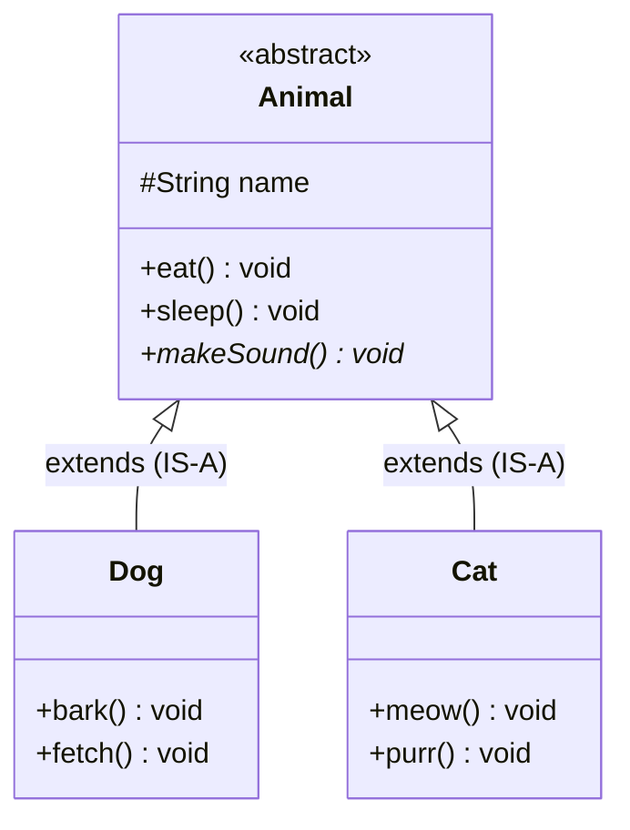
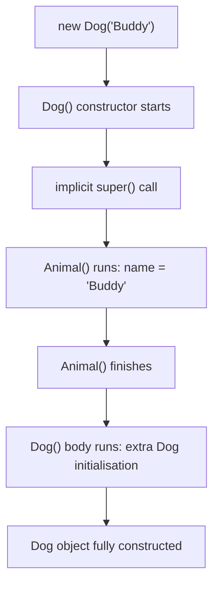
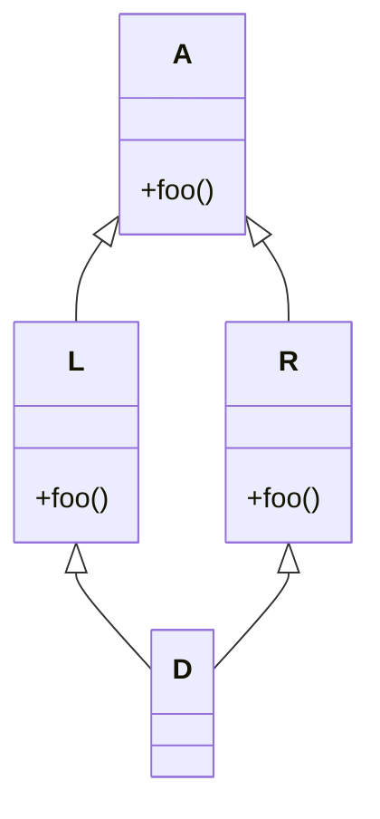
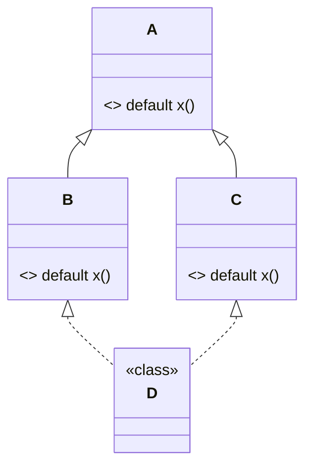
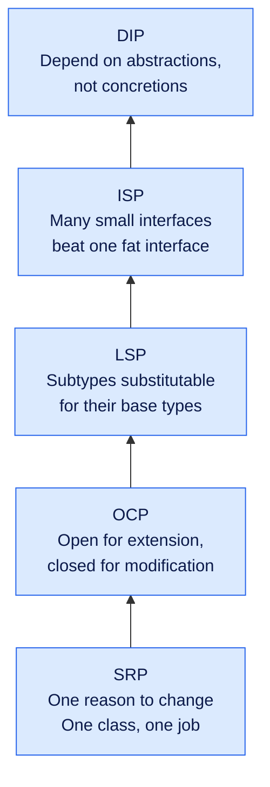
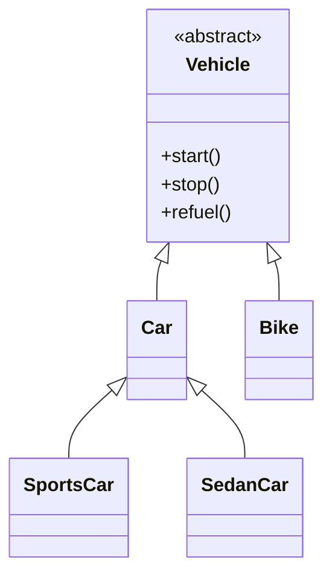
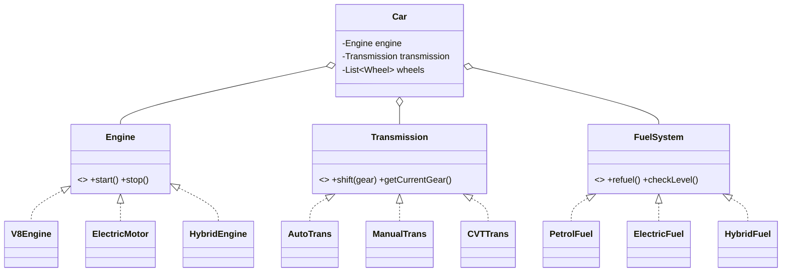

# 🏗️ OOPS & Design Principles: Complete Guide

> **Navigation**: [Chapter index](00_INDEX.md) | [Design Patterns: Complete Guide… →](02_Design_Patterns.md)

## Building Software That Lasts

---

## 🔗 Bridge — Where This Chapter Fits

| Dimension | This chapter |
| --- | --- |
| **Builds on** | [Java language basics](../07_Modern_Java/00_INDEX.md), [Memory foundations](../02_Data_Structures/01a_Memory_Foundations.md) |
| **You will learn** | Encapsulation, inheritance, polymorphism, abstraction, composition vs inheritance, SOLID, and how to choose among them |
| **Leads to** | [Design Patterns](02_Design_Patterns.md), [Design Heuristics](11_Design_Heuristics.md) |
| **Abstraction level** | Procedures and data → **objects that guard invariants** → **design rules (SOLID) that keep objects changeable** |

> [!NOTE]
> The full gap-free reading order and dependency graph are in the [Learning Path](00_LEARNING_PATH.md).

---

## 💬 Explain It Like a Study Partner — OOP Principles

### 1. The bottom line

Group data with the rules that protect it, hide the details, depend on abstractions, and prefer composition to inheritance.

### 2. The textbook core

- **Encapsulation** keeps state private so invariants cannot be bypassed.
- **Abstraction** exposes what an object does, not how.
- **Inheritance** models "is-a" and reuses code; **polymorphism** lets callers use the supertype.
- **Composition** ("has-a") is more flexible than inheritance because it can change at run time.
- **SOLID**: single responsibility, open/closed, Liskov substitution, interface segregation, dependency inversion.

### 3. The real-world analogy

A **car**: you use the pedals and wheel (the interface) and never touch the engine (the encapsulated state); any car with the same controls can be driven the same way (polymorphism).

### 4. Walkthrough

1. Start with a class whose fields are public and used everywhere.
2. Make the fields private and add methods that enforce the rules (encapsulation).
3. Notice two subclasses that only differ in one behaviour; extract that behaviour behind an interface.
4. Inject the interface instead of subclassing (composition).
5. Check the result against SOLID: each class has one reason to change.

> [!NOTE]
> **Quick check:** Why is "prefer composition over inheritance" a preference and not a ban? *Inheritance is right for true is-a relationships with a stable base type; it is wrong when used only to reuse code.*

### 5. Check yourself

**Q1.** A `Square` extends `Rectangle` and overrides `setWidth` to also set the height. Which principle breaks, and why?

<details><summary>Answer</summary>

**Liskov substitution.** Code written against `Rectangle` assumes width and height change independently; the subtype breaks that contract. Model both as implementations of a `Shape` interface instead.

</details>

**Q2.** Which SOLID letter does constructor injection of an interface support most directly?

<details><summary>Answer</summary>

**D** (dependency inversion): high-level code depends on an abstraction supplied from outside, not on a concrete class it creates itself.

</details>

---


## 📚 Topic Pages in This Chapter

This chapter is split into focused pages so each topic can be read on its own. Read them in order the first time; use the table to jump back later.

| # | Page | What is inside | Lines |
| --- | --- | --- | --- |
| 1 | [Section 0 — When OOP Principles Break in Production](01_OOPS_Principles/01_section_0_when_oop_principles_break.md) | Section 0 — When OOP Principles Break in… · The 5W+H Framework | 303 |
| 2 | [OOP From First Principles](01_OOPS_Principles/02_oop_from_first_principles.md) | OOP From First Principles | 235 |
| 3 | [Composition vs Inheritance](01_OOPS_Principles/03_composition_vs_inheritance.md) | Composition vs Inheritance | 166 |
| 4 | [SOLID Principles](01_OOPS_Principles/04_solid_principles.md) | SOLID Principles | 219 |
| 5 | [Common Design Patterns](01_OOPS_Principles/05_common_design_patterns.md) | Common Design Patterns · When to Use What · Practice Questions | 376 |

## 💪 Curated Practice Problems — OOP Principles

**HOW TO USE**: These are conceptual + coding problems that test your grasp of OOP pillars.

---

### OOP Coding Challenges

| #   | Problem                                    | Platform | Difficulty | OOP Concept Tested                         |
| --- | ------------------------------------------ | -------- | ---------- | ------------------------------------------ |
| 1   | Design Parking System (LC 1603)            | LeetCode | Easy       | Encapsulation, simple class design         |
| 2   | Design HashMap (LC 706)                    | LeetCode | Easy       | Encapsulation + array of linked lists      |
| 3   | Design Browser History (LC 1472)           | LeetCode | Medium     | Stack/List with encapsulated state         |
| 4   | Implement Queue using Stacks (LC 232)      | LeetCode | Easy       | Abstraction: queue interface, stack impl   |
| 5   | Design Twitter (LC 355)                    | LeetCode | Medium     | Composition: User has Tweets, follows Set  |
| 6   | LRU Cache (LC 146)                         | LeetCode | Medium     | Encapsulation: internal doubly-linked list |
| 7   | Serialize/Deserialize Binary Tree (LC 297) | LeetCode | Hard       | Abstraction: encode/decode interface       |
| 8   | Design Snake Game (LC 353)                 | LeetCode | Medium     | State management, queue for body           |

---

### OOP Design Exercises (Think + Sketch)

| #   | Exercise                           | Focus                                                |
| --- | ---------------------------------- | ---------------------------------------------------- |
| 1   | Design a Library Management System | Inheritance (Book/EBook/AudioBook), Polymorphism     |
| 2   | Design a Vending Machine           | State pattern, Encapsulation                         |
| 3   | Design a Chess Game                | Inheritance (Piece hierarchy), Polymorphism (move()) |
| 4   | Design a Deck of Cards             | Abstraction, Factory pattern                         |
| 5   | Design an Elevator System          | Observer pattern, State pattern                      |

---

_OOP is about managing complexity through smart organization!_

---

### PLUS Enhancements

#### Diagram 1: Inheritance Hierarchy — Animal / Dog / Cat

**Inheritance hierarchy — the Animal family**



**How to read this diagram.** Arrows point from the subclass to the parent it extends. `Animal` is abstract: it supplies `eat()` and `sleep()` and leaves `makeSound()` for each subclass to define.

**Method resolution at run time (dynamic dispatch).** When you call `dog.makeSound()`, the JVM looks up the method in the vtable of `Dog`:

| Vtable entry | Resolves to | Why |
| --- | --- | --- |
| 0 | `Animal.eat()` | Inherited, not overridden |
| 1 | `Dog.bark()` | Dog's own method |
| 2 | `Dog.makeSound()` | Overrides the abstract method in `Animal` |

**Constructor chain for `new Dog("Buddy")`:**



**How to read this diagram.** The superclass constructor always completes before the subclass constructor body runs.

> [!WARNING]
> **Failure mode: a deep inheritance chain.**
> In `Animal → Mammal → Dog → ServiceDog → PoliceDog`, a change to `Animal.eat()` ripples through five classes, adding a method to `Dog` can force changes in `PoliceDog`, and the "is-a" relationship weakens (is a `PoliceDog` really just an `Animal`?).
> **Solution:** composition, for example `ServiceDog` *has a* `TrainingCertificate`.

#### Diagram 2: Diamond Inheritance — C++ vs Java 8 Default Methods

**The diamond problem: C++ versus Java default methods**

**C++ (multiple inheritance of classes)**



**How to read this diagram.** `D` inherits from both `L` and `R`, and each of them inherits `A`. With ordinary (non-virtual) inheritance, `D` contains two `A` sub-objects, so `d.foo()` is **ambiguous** and the compiler rejects it. Qualify the call (`d.L::foo()`), or use **virtual inheritance** (`class L : virtual public A`) so there is a single shared `A`.

**Java (interfaces with default methods)**



**How to read this diagram.** Java forbids extending several classes, but a class may implement several interfaces. Since Java 8 interfaces can carry default methods, so a diamond can appear.

**Resolution rules:**

1. A method declared in the class (or a superclass) wins over any interface default.
2. Otherwise the **most specific** interface wins. If only `A` declares `x()` and neither `B` nor `C` overrides it, `D` inherits the single `A.x()`, with no conflict.
3. If `B` and `C` both override `x()`, the compiler reports an error and `D` must override it and choose explicitly.

```java
interface A { default void x() { System.out.println("A"); } }
interface B extends A { @Override default void x() { System.out.println("B"); } }
interface C extends A { @Override default void x() { System.out.println("C"); } }
class D implements B, C {
    // B.x() and C.x() both override A.x(): ambiguous, so D must pick one.
    @Override public void x() { B.super.x(); }
}
```

| Language | Two copies of the base? | How the ambiguity is resolved | Fix required? |
| --- | --- | --- | --- |
| C++ (plain inheritance) | Yes, one `A` per path | Qualify the call, or use virtual inheritance | Yes, when you call the ambiguous member |
| Java 7 and earlier | Not applicable: interfaces had no method bodies | Nothing to resolve | No |
| Java 8+ | No, interface defaults have no state | Class wins, then most specific interface | Only if two unrelated interfaces both supply a default |

#### Diagram 3: SOLID Principles Pyramid

**SOLID principles, layered by dependency**



**How to read this diagram.** Read from the bottom: single responsibility is the foundation, and each later principle builds on the ones below it. This ordering is a teaching aid, not part of the original formulation.

**Failure modes by principle**

| Principle | Failure mode (symptom) |
| --- | --- |
| SRP | God class: 50 reasons to change, 3000 lines; a change in email logic breaks payment processing |
| OCP | `if (type == DOG) ... else if (type == CAT) ...`; adding Cat means modifying existing code |
| LSP | `Square extends Rectangle` and `resize()` breaks; subtypes violate the preconditions callers rely on |
| ISP | `interface Worker { eat(); sleep(); work(); }` forces a `Robot` to implement `eat()` and `sleep()` |
| DIP | `new EmailService()` inside `UserService`; you cannot swap in `SMSService` without editing `UserService` |

#### Deep-Dive 1: Mechanism — Polymorphism at the JVM Bytecode Level

### Polymorphism: virtual method dispatch at bytecode level

**Three JVM invoke opcodes**

| Opcode | Behaviour |
| --- | --- |
| `invokestatic` | No dispatch: resolved at compile time (static) |
| `invokevirtual` | Virtual dispatch through the vtable (dynamic) |
| `invokeinterface` | Interface dispatch through an itable-style lookup (dynamic) |

**Vtable (virtual method table):** one per class, shared by all instances.

| Slot | `Animal` | `Dog extends Animal` |
| --- | --- | --- |
| 0 | `Object.hashCode()` (inherited) | `Object.hashCode()` (inherited, unchanged) |
| 1 | `Object.equals()` (inherited) | `Object.equals()` (inherited, unchanged) |
| 2 | `Animal.eat()` (overridable) | `Dog.eat()` (**overridden**: new entry) |
| 3 | `Animal.makeSound()` (abstract: slot filled by the subclass) | `Dog.makeSound()` (**implemented**: new entry) |

**Memory layout of a `Dog` object on the heap**

| Part | Size / content |
| --- | --- |
| Object header (mark word + class pointer) | About 12 bytes on a 64-bit JVM with compressed class pointers |
| `Animal` fields (`name`) | Reference (4 or 8 bytes) |
| `Dog` fields (`breed`) | Reference (4 or 8 bytes) |

The vtable lives in the class metadata (`Dog.class`), not in each instance. Each instance holds a pointer to its class, and the class holds the vtable.

**Method call:** `animal.makeSound()` where `animal` is actually a `Dog`.

Bytecode: `invokevirtual #12` (a constant-pool entry that resolves to `Animal.makeSound()`).

At run time (conceptually, and in the JIT's generated code):

1. Load `animal` from the local variable.
2. Read the class pointer from the object header.
3. Look up the method at `vtable[slot 3]`.
4. Jump to `Dog.makeSound()`.

> [!IMPORTANT]
> This is why Java is polymorphic by default: the actual class decides the method address at run time, not the type of the reference variable. (The JIT often removes the lookup when profiling shows only one receiver type.)

`invokeinterface` is similar but must find the method in the receiver class's table for that interface, because a class can implement several interfaces. In practice the JIT's inline caches make the difference from `invokevirtual` small.

```java
interface I1 { void m1(); }
interface I2 { void m2(); }
class C implements I1, I2 {
    public void m1() {}
    public void m2() {}
}
// invokeinterface I1.m1() -> look up m1 for interface I1 in C -> C.m1()
```

#### Deep-Dive 2: Why Composition Over Inheritance — Side-by-Side

**Composition versus inheritance — side-by-side failure analysis**

**Inheritance approach (Vehicle → Car)**



**How to read this diagram.** Every arrow is an "is-a" relationship, so each new kind of vehicle must be placed somewhere in one tree.

**Failure mode: what if a `SportsCar` must share engine behaviour with a `SedanCar`?**

1. Add `ElectricCar`: must it be a `Car` or a `Vehicle`?
2. Add `HybridCar`: is it a `SportsCar` or a `SedanCar`? Neither fits.
3. Add `FlyingCar`: the hierarchy collapses, because it must mix flying and driving.
4. Result: about seven classes to model four vehicles with shared features.

**Composition approach (a `Car` has an `Engine`, a `Transmission`, and so on)**



**How to read this diagram.** The diamond arrows mean "has a". The car is assembled from interchangeable parts, each behind an interface.

- **`FlyingCar`?** Add a `flyingMechanism: FlyingMechanism` field. No class hierarchy changes; you compose a new capability.
- **`ElectricCar`?** `engine = ElectricMotor`, `fuelSystem = ElectricFuel`, `transmission = AutoTrans`. No inheritance, and everything is plug-and-play.

> [!WARNING]
> **Production failure mode: the deep inheritance chain** (an illustrative composite, not a report of one codebase).
> ```text
> Entity (base)
>   └── PersistentObject   (adds save/load)
>         └── UserObject   (adds userId)
>               └── AdminUserObject      (adds admin flags)
>                     └── SuperAdminUserObject   (adds super flags)
> ```
> Problems at scale: changing `Entity.toString()` means retesting five classes; `PersistentObject.getId()` returning null in a unit test produces a four-level stack trace; a developer adds a method to `AdminUserObject` and forgets `SuperAdminUserObject`; and the question "is a super admin really an entity?" shows the chain is fragile.
> **Fix:** replace the chain with composition, for example small records such as `Auditable(id, createdAt, updatedAt)` and `Adminable(roles, permissions)` held as fields of `User`.

#### Breadth Comparison 1: OOP vs Other Paradigms

| Paradigm       | Core Idea                        | Strengths                                                                                       | Weaknesses                                                                                   | Best Use Cases                                                           |
| -------------- | -------------------------------- | ----------------------------------------------------------------------------------------------- | -------------------------------------------------------------------------------------------- | ------------------------------------------------------------------------ |
| **OOP**        | Objects bundle data + behavior   | Natural model for real-world entities; polymorphism for extensibility; encapsulation for safety | Can lead to deep inheritance; mutable state can cause bugs; over-engineering risk            | GUI apps, enterprise systems, simulations, domain modeling               |
| **Procedural** | Functions act on data structures | Simple, fast, low overhead; predictable; great for scripts                                      | No reuse mechanism; data/function separation causes coupling; hard to scale                  | System scripts, shell pipelines, simple file processing                  |
| **Functional** | Pure functions, no side effects  | Thread-safe by design; composable; easier to reason about; great for parallelism                | Not natural for stateful domains; steeper learning curve; performance overhead in some cases | Data transformation pipelines, compilers, concurrent/parallel processing |
| **Reactive**   | Data streams + propagation       | Handles async/event-driven naturally; backpressure support; declarative                         | Debugging is harder; learning curve; can over-engineer simple sync problems                  | UI event streams, real-time data feeds, IoT, microservices               |
| **Hybrid** ⭐  | Mix based on context             | Best of all worlds; pragmatic                                                                   | Requires team discipline; harder to maintain style guide                                     | Modern applications — all production systems use this                    |

#### Breadth Comparison 2: Inheritance Strategies Compared

| Strategy                         | Language Support               | Coupling                      | Reuse Mechanism          | When to Use                               | Failure Mode                                                |
| -------------------------------- | ------------------------------ | ----------------------------- | ------------------------ | ----------------------------------------- | ----------------------------------------------------------- |
| **Single Inheritance (extends)** | Java, C#                       | Tight to parent               | Inherited methods        | True "is-a" + one parent only             | Diamond problem impossible, but limited reuse               |
| **Multiple Interfaces**          | Java, C# (interface)           | Loose — contract only         | Method signatures        | "Can-do" relationships                    | Fat interfaces (ISP violation)                              |
| **Multiple via Mixins/Traits**   | Scala, PHP traits, Ruby mixins | Medium                        | Injected into class body | Cross-cutting behavior (logging, caching) | Conflict resolution complexity                              |
| **Composition (HAS-A)**          | All languages                  | Loose                         | Delegation               | Reuse without "is-a"; swappable behavior  | Boilerplate delegation code (solved by @Delegate in Lombok) |
| **C++ Multiple Inheritance**     | C++ only                       | Very tight (multiple parents) | Full method inheritance  | True multiple parents needed              | Diamond ambiguity, order dependency                         |


---

## 🏢 Enterprise Lens — OOP Principles

| Area | What top-tier engineering looks like |
| ---- | ------------------------------------ |
| **Where it runs in production** | Frameworks (Spring beans are composed, not subclassed), SDK design, plugin systems |
| **Failure modes** | Deep inheritance trees; classes with many reasons to change; Liskov violations that surface as `instanceof` checks |
| **Testing and verification** | Substitute each subtype in the supertype tests; review class responsibilities in code review |

---

## Reality Check

**"Encapsulation means making fields private"** — Private fields with public getters AND setters for everything is encapsulation theater — the state is exactly as exposed, just with more syntax. Real encapsulation is hiding DECISIONS: a class that exposes deposit/withdraw but not setBalance encapsulates the invariant balance-changes-are-audited; one that returns defensive copies of its internal list encapsulates its storage choice. The test: can you change the internal representation without touching callers? If not, the getters leaked the design.

**"Inheritance models is-a relationships"** — Inheritance models is-SUBSTITUTABLE-for, which is stricter than everyday is-a: a Square IS-A Rectangle in geometry but violates substitutability the moment setWidth breaks the square invariant (the canonical LSP failure). The working test is behavioral: every property callers rely on for the parent must hold for the child — preconditions no stronger, postconditions no weaker. Taxonomy intuition creates hierarchies; substitutability analysis validates them.

**"Polymorphism is method overriding"** — Overriding is one mechanism; the DESIGN payoff is that conditionals disappear into dispatch: a switch on type scattered across five files becomes five classes each owning its branch. The reverse lesson matters equally — when variants are closed and data-like, a sealed hierarchy plus pattern matching (or a plain enum-switch) beats forcing behavior into classes. Polymorphism is the tool for OPEN variant sets; switches are legitimate for closed ones. Modern Java (sealed interfaces plus records plus switch patterns) made both directions first-class.

**"Composition versus inheritance is a preference debate"** — They differ mechanically in FLEXIBILITY and FRAGILITY: inheritance binds at compile time, exposes the child to every parent implementation change (the fragile-base-class problem — a parent method calling an overridable sibling breaks children silently), and spends your single extends slot. Composition binds at runtime, exposes only interfaces, and stacks (a class can wrap several collaborators). The heuristic with teeth: inherit only when you need polymorphic SUBSTITUTION into APIs expecting the parent; for mere code reuse, always compose — reuse-by-inheritance is where the horror stories originate.

**"Java is a pure OOP language, so these principles are automatic"** — The language enforces none of them: public mutable fields compile fine, 3000-line God classes compile fine, downcast-and-instanceof chains compile fine. Static methods, primitives, and now records and lambdas make Java deliberately multi-paradigm — and idiomatic modern Java freely mixes functional cores (streams, immutable records) inside object shells. The principles are DISCIPLINE applied through review; believing the compiler applies them is how enterprise codebases rot while remaining perfectly compilable.
