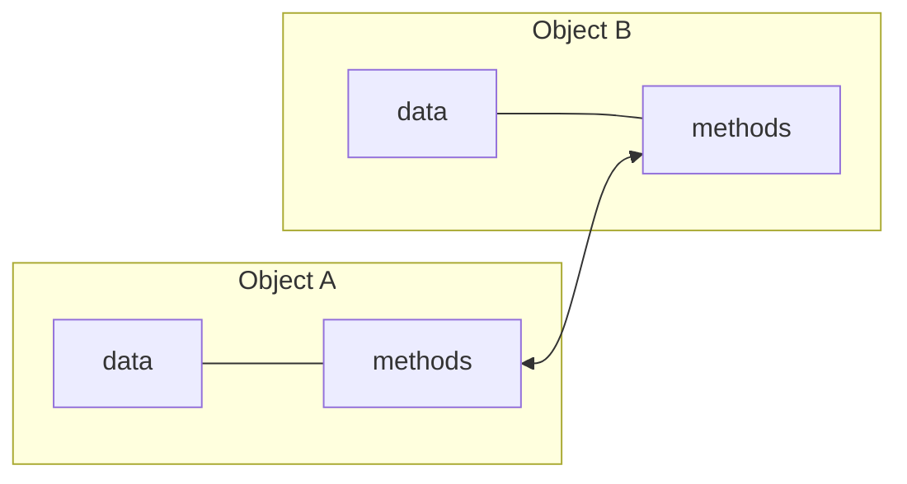

# Section 0 — When OOP Principles Break in Production

> **Navigation**: [Chapter overview](../01_OOPS_Principles.md) | [OOP From First Principles →](02_oop_from_first_principles.md)
> Page 1 of 5 in **OOPS & Design Principles: Complete Guide**


> Inheritance and encapsulation sound clean until someone adds one exception. The three stories below are **illustrative composite scenarios** (not reports of specific companies) showing how SOLID violations slip through code review.

---

## Story 1 — The Inheritance Trap That Corrupted Premium User Billing (Liskov Substitution Violation)

An e-commerce platform had a `User` class with `getDiscount()` returning a standard 0%. A `PremiumUser` extended it and returned 15%. Six months later, a `TrialUser` class was added, also extending `User`. The billing service accepted any `User` reference and called `getDiscount()` — that was fine. But `TrialUser` overrode `canPurchase()` to throw an `IllegalStateException` ("must upgrade first") while `User.canPurchase()` simply returned `false`. The billing service caught `false` and stopped — but `IllegalStateException` was uncaught and crashed the billing job, skipping all TrialUser orders silently for 3 weeks.

Root cause: `TrialUser` **strengthened the precondition** — it changed the method contract from "returns false if blocked" to "throws exception if blocked." That's a Liskov Substitution Principle violation.

```java
// ❌ LSP violation — TrialUser changes the contract
class User {
    boolean canPurchase() { return true; }
}
class TrialUser extends User {
    @Override
    boolean canPurchase() {
        throw new IllegalStateException("upgrade required"); // changed contract!
    }
}

// ✅ Fix — use composition over inheritance; return a Result object
class PurchaseResult {
    final boolean allowed;
    final String reason;
    PurchaseResult(boolean allowed, String reason) { ... }
}
class TrialUser {
    PurchaseResult canPurchase() {
        return new PurchaseResult(false, "upgrade required");
    }
}
// Caller handles both success and failure — no surprise exceptions
```

**What to learn from this**: Any time a subclass overrides a method to throw an exception that the parent never threw, you've broken the LSP. The caller was written for the parent contract — it can't know the child changed the rules.

---

## Story 2 — The God Class Refactor That Took 4 Months (Single Responsibility Violation)

A startup's core `OrderService` class started with 300 lines. Two years later it had 4,200 lines, 47 public methods, and 12 direct dependencies injected (email, SMS, inventory, payment, fraud, analytics, shipping, PDF, auth, webhooks, audit log, A/B flags). Unit tests took 40 minutes because every test had to mock 12 dependencies. Adding a feature required reading 4,200 lines to understand side effects. A new engineer accidentally broke PDF generation while fixing a shipping bug — they were in the same method because "they both run at order completion."

The team spent 4 months extracting the God Class into 8 focused services — work that could have been avoided by applying Single Responsibility from the start.

```java
// ❌ God class — one class, too many reasons to change
class OrderService {
    void placeOrder(Order order) {
        validatePayment(order);    // payment concern
        checkInventory(order);     // inventory concern
        sendEmail(order);          // notification concern
        generatePDF(order);        // document concern
        logAudit(order);           // audit concern
        updateAnalytics(order);    // analytics concern
        // ... 41 more methods
    }
}

// ✅ Single Responsibility — each class has one reason to change
class PaymentService   { boolean validate(Order o) { ... } }
class InventoryService { boolean check(Order o) { ... } }
class NotificationService { void sendConfirmation(Order o) { ... } }
class AuditLogger      { void log(Order o, String action) { ... } }

class OrderOrchestrator {
    // orchestrates the above; easy to test each piece independently
    void placeOrder(Order order) {
        payment.validate(order);
        inventory.check(order);
        notifications.sendConfirmation(order);
        audit.log(order, "placed");
    }
}
```

**What to learn from this**: When your class has more than ~5 injected dependencies, it's doing too many things. Each dependency is a "reason to change" — the SRP says a class should have exactly one.

---

## Story 3 — The Interface Pollution That Forced Every Implementation to Lie (Interface Segregation Violation)

A media platform had a single `MediaPlayer` interface: `play()`, `pause()`, `stop()`, `record()`, `stream()`, `export()`. Audio-only players had to implement `record()` by doing nothing (returning `null` or throwing `UnsupportedOperationException`). When the team added a "record to cloud" feature that called `record()` on every player, audio players silently discarded the call — the method was there but did nothing. 3 months of cloud recordings were lost from audio sessions.

Root cause: forcing implementations to declare methods they can't fulfill (ISP violation).

```java
// ❌ Fat interface — all implementations must lie about unsupported methods
interface MediaPlayer {
    void play();
    void pause();
    void record();  // AudioPlayer can't record — must lie
    void stream();  // OfflinePlayer can't stream — must lie
}

// ✅ Segregated interfaces — each implementation only declares what it does
interface Playable { void play(); void pause(); }
interface Recordable { void record(); }
interface Streamable { void stream(); }

class AudioPlayer implements Playable {}              // only what it supports
class ProfessionalCamera implements Playable, Recordable {}
class StreamingDevice implements Playable, Streamable {}

// Call site can now check at compile time:
void recordIfPossible(Object player) {
    if (player instanceof Recordable r) {
        r.record(); // only runs for things that can actually record
    }
}
```

**What to learn from this**: If a class implements an interface method by throwing `UnsupportedOperationException` or returning `null`, that's a sign the interface needs to be split. Every interface method is a contract — empty implementations break it.

---

## 📚 PART 0: The 5W+H Framework

**Mental Model:** Think of Procedural Programming as a factory floor with tools scattered everywhere. Anyone can pick up any tool and mess with any machine. Object-Oriented Programming (OOP) is like organized workstations where each worker has their own specific tools and materials, and you must ask the worker to perform a task instead of grabbing their tools yourself.

| Question  | Object-Oriented Programming Context                                                                                                                                                                                                                    |
| :-------- | :----------------------------------------------------------------------------------------------------------------------------------------------------------------------------------------------------------------------------------------------------- |
| **WHAT**  | A programming paradigm where software is organized around **objects** — bundles of related _data_ (attributes) and _behavior_ (methods) that represent real-world entities or concepts.                                                                |
| **WHY**   | To manage exponential complexity in software. It prevents "spaghetti code" by keeping data and functions tightly coupled (Encapsulation), allowing safe code reuse (Inheritance/Composition), and hiding complex implementation details (Abstraction). |
| **WHEN**  | Used for medium-to-large applications, GUIs, simulations, and enterprise software where business logic models complex real-world relationships.                                                                                                        |
| **WHERE** | At the structural core of modern applications written in Java, C#, Python, C++, and TypeScript.                                                                                                                                                        |
| **WHO**   | Conceptualized in the 1960s with Simula and popularized in the 1970s/80s with Smalltalk and C++.                                                                                                                                                       |
| **HOW**   | By defining blueprints (`classes`) to instantiate concrete entities (`objects`) that interact with each other by sending messages (calling methods) rather than modifying each other's state directly.                                                 |

### Where It's Used in Real World

- **Video Games**: Modeling entities like `Player`, `Enemy`, and `Weapon` where each object manages its own health, position, and damage logic.
- **Banking Systems**: A `BankAccount` object encapsulating `balance` data, ensuring it can only be modified via controlled `deposit()` and `withdraw()` methods to prevent illegal states (like a negative balance).
- **GUI Libraries**: Creating reusable, hierarchical UI components like `Button` inheriting from a base `UIComponent` class.
- **E-Commerce**: Modeling the entire shopping flow with `Customer`, `ShoppingCart`, `Order`, and `Payment` objects interacting seamlessly.

💡 **Key Insight**: OOP isn't about "classes and objects" — it's about **managing complexity** through organization and abstraction.

### Historical Evolution

| Era        | Language / milestone                        | Contribution                                                                        |
| ---------- | ------------------------------------------- | ----------------------------------------------------------------------------------- |
| 1962–1967  | Simula I / Simula 67 (Dahl & Nygaard, Oslo) | Classes, objects, inheritance and virtual methods — built for simulations           |
| 1970s      | Smalltalk (Alan Kay's group, Xerox PARC)    | "Everything is an object" and message passing; shaped later GUIs and IDEs           |
| 1979–1985  | C++ (Bjarne Stroustrup, Bell Labs)          | "C with Classes" (1979), named C++ in 1983, first commercial release 1985           |
| 1995       | Java (Sun Microsystems, James Gosling)      | Public release 1995 (JDK 1.0 in 1996): "write once, run anywhere" took OOP mainstream |
| 2000s–2020s | C#, Python, JavaScript, Kotlin, Rust, Go   | Mainstream languages mix classes with functions, interfaces, traits or composition  |

**Paradigm Evolution**: Machine Code → Assembly → Procedural → OOP → Functional → **Hybrid**

---

### The Core Problem OOP Solves

As software grows, complexity grows **exponentially**. Procedural programming scatters data and functions everywhere; OOP bundles them together.

**Procedural Programming** — the problem:

```
  Data here ──────► Functions there ──────► More data somewhere
                       ↓                        ↓
                  More functions ◄──────► Even more data
```

- Anyone can modify any data from anywhere
- Change one function, break 10 others
- Hard to understand which functions use which data
- Code reuse requires copy-paste
- Testing is a nightmare (everything connected to everything)

**OOP Solution** — organized workstations:



**How to read this diagram.** Each object keeps its data private behind its methods; the two objects talk only through those methods.

- Data + related functions **bundled together**
- Clear boundaries — change inside without breaking outside
- Reuse through inheritance and composition
- Model real-world entities naturally

**Real-World Analogy**: Procedural = factory floor with tools scattered everywhere. OOP = organized workstations where each worker has their own tools.

---

### Why Use OOP?

1. **Modularity** — Break complex systems into manageable pieces
   _"Can understand one class without understanding the entire system"_
2. **Maintainability** — Change implementation without affecting users
   _"Internal engine change doesn't require changing how you drive"_
3. **Reusability** — Inherit and extend existing code
   _"Don't reinvent the wheel — extend it to make a car"_
4. **Modeling** — Code structure matches your real-world mental model
   _"Customer object has orders, Order has items — intuitive!"_
5. **Team Collaboration** — Clear interfaces between modules
   _"You build PaymentService, I build OrderService — they just connect"_

#### OOP vs Procedural vs Functional

| Paradigm      | Best For                                              |
| ------------- | ----------------------------------------------------- |
| Procedural    | Simple scripts, system utilities, quick tasks         |
| OOP           | Large applications, GUIs, simulations, enterprise     |
| Functional    | Data transformations, parallel processing, math-heavy |
| **Hybrid** ⭐ | Modern apps use **all paradigms** based on context!   |

---

### When to Use Each OOP Principle

**Encapsulation** — use when:

- Data has rules/constraints (balance can't be negative)
- Implementation might change (database → API)
- You need to control access (read-only, write-only)

**Abstraction** — use when:

- Implementation details shouldn't concern the user
- Multiple implementations are possible (different databases)
- You want to hide complexity from users of your code

**Inheritance** — use when:

- There's a TRUE "is-a" relationship (`Dog` is-a `Animal`)
- Shared behavior exists across related classes
- ⚠️ _Prefer composition when in doubt!_

**Polymorphism** — use when:

- Same operation applies to different types (calculate area of any shape)
- You want extensibility (add new types without changing existing code)
- Plugin architecture (add features without modifying core)

---

### How to Think in OOP

| Step | Identify          | Becomes                   | Example                                                                        |
| ---- | ----------------- | ------------------------- | ------------------------------------------------------------------------------ |
| 1    | **Nouns**         | Classes                   | "Customer places order for products" → `Customer`, `Order`, `Product`, `Store` |
| 2    | **Verbs**         | Methods                   | "places order" → `customer.placeOrder()`                                       |
| 3    | **Adjectives**    | Attributes                | "premium customer" → `customer.membershipLevel`                                |
| 4    | **Relationships** | Composition / Inheritance | Customer HAS-A Cart, PremiumCustomer IS-A Customer                             |

🧠 **The Mental Shift**:

- **Procedural**: _"What steps do I need to do?"_
- **OOP**: _"What things exist and what can they do?"_

---

### Difficulties & Common Mistakes

| #   | Mistake                     | Description                                                                                              | Solution                                   |
| --- | --------------------------- | -------------------------------------------------------------------------------------------------------- | ------------------------------------------ |
| 1   | **Over-Engineering**        | Creating classes for everything, too many layers                                                         | Start simple, refactor when needed (YAGNI) |
| 2   | **Misusing Inheritance**    | Inheritance for code reuse instead of true "is-a" (e.g., Square extends Rectangle — WRONG, violates LSP) | Use composition for code reuse             |
| 3   | **God Classes**             | One class doing everything (1000+ lines)                                                                 | Single Responsibility — one class, one job |
| 4   | **Anemic Domain Model**     | Classes with only getters/setters, no behavior                                                           | Put behavior WITH the data it operates on  |
| 5   | **Tight Coupling**          | Depending on concrete implementations                                                                    | Depend on abstractions (interfaces)        |
| 6   | **Exposing Internal State** | Returning mutable internal collections                                                                   | Return copies or unmodifiable views        |

---

### Signs of Good OOP Design

- ✅ **Readable**: New team member understands the system in hours, not weeks
- ✅ **Testable**: Can unit-test each class independently
- ✅ **Extensible**: Add new features without modifying existing code
- ✅ **Maintainable**: A bug in one place doesn't cascade everywhere
- ✅ **Reusable**: Classes work in different contexts

**Quality Metrics**:

- **High Cohesion** — class does ONE thing well
- **Low Coupling** — classes don't depend heavily on each other
- **Small class sizes** — typically < 200 lines
- **Shallow inheritance** — max 3 levels usually
- **Interface segregation** — many small interfaces > one big one

---

🔬 **Section Challenge — Signs of Good OOP Design**

**Challenge 1 (Reasoning — Who/When/What):** A `UserService` creates users, sends welcome emails, AND generates PDF reports. **Who** has too many responsibilities? **What** metric is violated? **When** does this become a problem?

<details><summary>Answer</summary>

**Who?** `UserService` — it's a God Class. **What metric?** Low Cohesion. Email sending, PDF generation, and user CRUD are unrelated — they use different dependencies, change for different reasons. **When?** When the email template changes → you retest entire UserService. A PDF library upgrade breaks user creation tests. Two developers editing UserService create merge conflicts. Fix: split into `UserService`, `EmailService`, `ReportService` — each with high cohesion and low coupling.

</details>

---

[Chapter overview](../01_OOPS_Principles.md) | [OOP From First Principles →](02_oop_from_first_principles.md)
