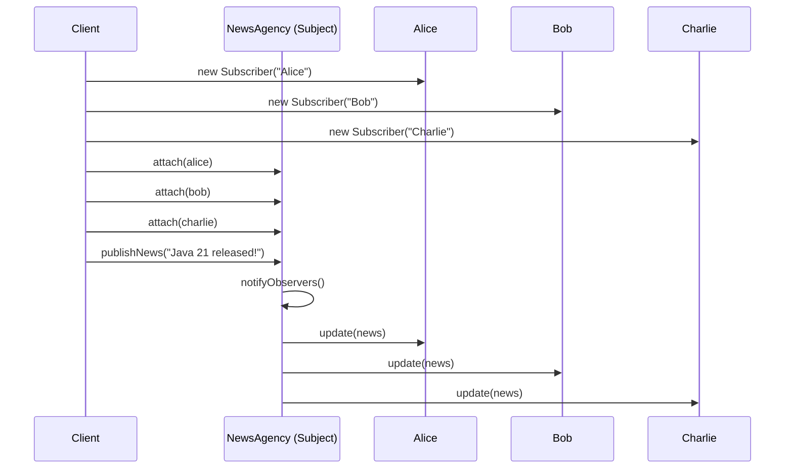
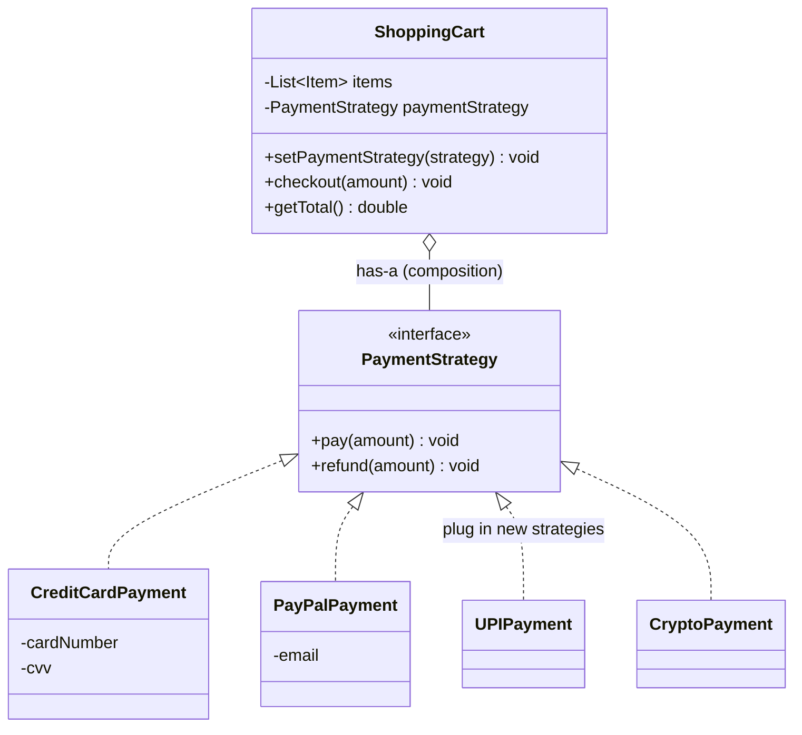

# 🎨 Design Patterns: Complete Guide from Scratch

> **Navigation**: [← OOPS & Design Principles](01_OOPS_Principles.md) | [Chapter index](00_INDEX.md) | [Design Patterns in Java — Gang of… →](08_Design_Patterns_Java.md)

## Building Reusable, Maintainable Software

---

## 🔗 Bridge — Where This Chapter Fits

| Dimension | This chapter |
| --- | --- |
| **Builds on** | [OOP Principles](01_OOPS_Principles.md) (interfaces, composition), [Pattern Recognition](../04_Patterns_Templates/04_Pattern_Recognition.md) |
| **You will learn** | The creational, structural and behavioural categories, when each pattern earns its place, and how patterns combine |
| **Leads to** | [Design Patterns in Java](08_Design_Patterns_Java.md), [LLD Solved Problems](07_LLD_Solved_Problems.md) |
| **Abstraction level** | Isolated principles → **named solutions to recurring forces** → **combinations of patterns in one design** |

> [!NOTE]
> The full gap-free reading order and dependency graph are in the [Learning Path](00_LEARNING_PATH.md).

---

## 💬 Explain It Like a Study Partner — Design Patterns

### 1. The bottom line

A pattern is a named answer to a recurring design force; learn the force first, then the shape of the answer.

### 2. The textbook core

- **Creational** patterns control how objects are made (Factory, Builder, Singleton).
- **Structural** patterns control how objects are composed (Adapter, Decorator, Facade, Proxy, Composite).
- **Behavioural** patterns control how objects communicate (Strategy, Observer, Command, State, Template Method).
- The GoF catalogue (1994) lists 23 patterns: 5 creational, 7 structural, 11 behavioural.
- Many patterns are absorbed by modern language features (lambdas replace simple Strategy and Command).

### 3. The real-world analogy

A **recipe book**: each recipe names a dish, when to cook it and what to watch for, but you still choose ingredients for your own kitchen.

### 4. Walkthrough

1. State the force: "I need to swap the discount rule at run time".
2. Candidate: Strategy (an interface plus implementations).
3. Check cost: a lambda may be enough for one-line rules.
4. Implement, then test each strategy in isolation.
5. Name the pattern in the code or PR so teammates share the vocabulary.

> [!NOTE]
> **Quick check:** What is the first question to ask before reaching for a pattern? *What force (change, variation, coupling) is hurting right now?*

### 5. Check yourself

**Q1.** Observer or Strategy: a UI should refresh when a model changes — which fits?

<details><summary>Answer</summary>

**Observer.** Many dependents must be told when one subject changes. Strategy swaps an algorithm behind a single caller.

</details>

**Q2.** Why can `Comparator.comparing(...)` be called a Strategy without any class hierarchy?

<details><summary>Answer</summary>

A functional interface is an interface; a lambda is an implementation. The role is the same, the ceremony is gone.

</details>

---


## 📚 Topic Pages in This Chapter

This chapter is split into focused pages so each topic can be read on its own. Read them in order the first time; use the table to jump back later.

| # | Page | What is inside | Lines |
| --- | --- | --- | --- |
| 1 | [The 5W+H Framework](02_Design_Patterns/01_the_5w_h_framework.md) | The 5W+H Framework | 212 |
| 2 | [Creational Patterns](02_Design_Patterns/02_creational_patterns.md) | Creational Patterns | 151 |
| 3 | [Structural Patterns](02_Design_Patterns/03_structural_patterns.md) | Structural Patterns | 141 |
| 4 | [Behavioral Patterns](02_Design_Patterns/04_behavioral_patterns.md) | Behavioral Patterns · Pattern Combinations · Quick Reference Table | 301 |

## 💪 Curated Practice Problems — OOP & Design Patterns

**HOW TO USE**: These are system design / OOP implementation problems.
Section 1 = implement data structures using OOP. Section 2 = apply design patterns.
Section 3 = LeetCode design class problems.

---

### Section 1: OOP Implementation — Build From Scratch

| #   | Problem                               | Platform | Difficulty | Key Technique                        |
| --- | ------------------------------------- | -------- | ---------- | ------------------------------------ |
| 1   | Design HashMap (LC 706)               | LeetCode | Easy       | Array of buckets + chaining          |
| 2   | Design HashSet (LC 705)               | LeetCode | Easy       | Boolean bucket or linked list        |
| 3   | Min Stack (LC 155)                    | LeetCode | Medium     | Two stacks or store (val, min) pairs |
| 4   | Implement Queue using Stacks (LC 232) | LeetCode | Easy       | Two stacks: push/pop inversion       |
| 5   | Implement Stack using Queues (LC 225) | LeetCode | Easy       | Push costly or pop costly            |
| 6   | Design Linked List (LC 707)           | LeetCode | Medium     | Sentinel nodes, doubly linked        |
| 7   | Design Circular Queue (LC 622)        | LeetCode | Medium     | Array with front/rear pointers       |
| 8   | Design Circular Deque (LC 641)        | LeetCode | Medium     | Extend circular queue both ends      |

---

### Section 2: Design Class Problems (Strategy/Observer/Iterator)

| #   | Problem                               | Platform | Difficulty | Key Technique                        |
| --- | ------------------------------------- | -------- | ---------- | ------------------------------------ |
| 1   | LRU Cache (LC 146)                    | LeetCode | Medium     | HashMap + Doubly Linked List         |
| 2   | LFU Cache (LC 460)                    | LeetCode | Hard       | HashMap + frequency buckets          |
| 3   | Iterator for Combination (LC 1286)    | LeetCode | Medium     | Iterator pattern, precompute or lazy |
| 4   | Flatten Nested List Iterator (LC 341) | LeetCode | Medium     | Stack + recursive flatten            |
| 5   | Peeking Iterator (LC 284)             | LeetCode | Medium     | Decorator pattern on iterator        |
| 6   | Design Twitter (LC 355)               | LeetCode | Medium     | OOP: User, Tweet, Feed (merge k)     |
| 7   | Design Browser History (LC 1472)      | LeetCode | Medium     | Command pattern / doubly linked      |
| 8   | Design Underground System (LC 1396)   | LeetCode | Medium     | HashMap tracking check-in/out        |

---

🔬 **Section Challenge — Section 2: Design Class Problems**

**Challenge 1 (Design — Who/When/What):** LRU Cache (LC 146) uses HashMap + Doubly Linked List. **Why** can't you use HashMap alone? **What** operation becomes O(n) without the linked list? **Who** maintains the eviction order?

<details><summary>Answer</summary>

**HashMap alone:** `get()` and `put()` are O(1), but **eviction** (finding the LEAST recently used key) requires scanning ALL entries to find the oldest access time → O(n). **What operation?** `evict()`. **The linked list** maintains access order: most recently accessed node moves to HEAD, least recently used stays at TAIL. Eviction = remove TAIL → O(1). **Who maintains order?** Every `get()` and `put()` call moves the accessed node to HEAD. The HashMap provides O(1) lookup; the linked list provides O(1) ordering. Together: O(1) for all operations.

</details>

### Section 3: Advanced Design

| #   | Problem                                        | Platform | Difficulty | Key Technique                  |
| --- | ---------------------------------------------- | -------- | ---------- | ------------------------------ |
| 1   | Serialize and Deserialize Binary Tree (LC 297) | LeetCode | Hard       | Preorder + null markers        |
| 2   | Design Add and Search Words (LC 211)           | LeetCode | Medium     | Trie + DFS for wildcard        |
| 3   | Implement Trie (LC 208)                        | LeetCode | Medium     | Array[26] children nodes       |
| 4   | Design File System (LC 1166)                   | LeetCode | Medium     | Trie or HashMap of paths       |
| 5   | Design Hit Counter (LC 362)                    | LeetCode | Medium     | Queue or circular buffer       |
| 6   | Insert Delete GetRandom O(1) (LC 380)          | LeetCode | Medium     | ArrayList + HashMap swap trick |
| 7   | Find Median from Data Stream (LC 295)          | LeetCode | Hard       | Two heaps (maxHeap + minHeap)  |

---

🔬 **Section Challenge — Section 3: Advanced Design**

**Challenge 1 (Reasoning — Who/When/What):** Trie (LC 208) vs HashMap for word lookup. Both give O(L) lookup for a word of length L. **When** does Trie win? **What** operation is impossible with HashMap alone?

<details><summary>Answer</summary>

**When Trie wins:** Prefix search. `startsWith("app")` in a Trie traverses 3 nodes → O(3). With HashMap, you'd scan ALL keys checking `key.startsWith("app")` → O(n×L). **Impossible operation:** Efficient prefix enumeration. Finding all words starting with "pre" requires visiting the "pre" subtree. HashMap has no notion of shared prefixes. **Trade-off:** Trie uses more memory (26 pointers per node) but enables prefix operations. HashMap is more space-efficient for exact lookups.

</details>

### HIDDEN GEMS — Design Problems

| #   | Problem                             | Platform | Why It's Valuable                      |
| --- | ----------------------------------- | -------- | -------------------------------------- |
| 1   | Design Parking System (LC 1603)     | LeetCode | Simplest OOP design — good warm-up     |
| 2   | Design an Ordered Stream (LC 1656)  | LeetCode | Pointer advancement pattern            |
| 3   | Snapshot Array (LC 1146)            | LeetCode | Binary search on version history       |
| 4   | Time Based Key-Value Store (LC 981) | LeetCode | TreeMap or binary search on timestamps |
| 5   | Online Stock Span (LC 901)          | LeetCode | Monotonic stack as internal state      |

---

---

🔬 **Section Challenge — HIDDEN GEMS — Design Problems**

**Challenge 1 (Debug — Who/When/What):** Snapshot Array (LC 1146) stores version history. If you call `snap()` after every `set()`, **what** is the space complexity? **When** does this become a problem? **What** optimization reduces space?

<details><summary>Answer</summary>

**Space:** O(n × snapshots) — storing full array copy per snapshot. With 10K elements and 10K snapshots = 100M entries. **When problematic?** Frequent snapshots with sparse modifications. If you change 1 element but snap the entire array, 9,999 unchanged values are duplicated. **Optimization:** Store only CHANGES per snapshot: `TreeMap<snapId, value>` at each index. `get(index, snapId)` uses `floorEntry(snapId)` to find the most recent value ≤ snapId. Space: O(total set operations) instead of O(n × snaps).

</details>

---

### PLUS Enhancements

#### Diagram 1: Pattern Categories — Full Map

**GoF design patterns — category map**

```mermaid
flowchart TB
  ROOT["23 GoF patterns"] --> CR["Creational<br/>how to create objects"]
  ROOT --> ST["Structural<br/>how to compose"]
  ROOT --> BE["Behavioural<br/>how to communicate"]
  CR --> c1["Singleton: one instance only"]
  CR --> c2["Factory: create by type"]
  CR --> c3["Builder: step-by-step construction"]
  CR --> c4["Abstract Factory: family of related products"]
  CR --> c5["Prototype: clone to create"]
  ST --> s1["Adapter: convert an interface"]
  ST --> s2["Decorator: add behaviour dynamically"]
  ST --> s3["Proxy: control access, lazy or caching"]
  ST --> s4["Facade: simple entry point to a subsystem"]
  ST --> s5["Composite: tree of parts"]
  BE --> b1["Observer: notify many"]
  BE --> b2["Strategy: swap an algorithm"]
  BE --> b3["Command: encapsulate a request, undo/redo"]
  BE --> b4["State: behaviour by internal state"]
  BE --> b5["Template Method: algorithm skeleton"]
  classDef r fill:#e5e7eb,stroke:#6b7280,color:#111;
  classDef c fill:#dbeafe,stroke:#2563eb,color:#0c1a4a;
  classDef s fill:#dcfce7,stroke:#16a34a,color:#052e16;
  classDef b fill:#fef3c7,stroke:#d97706,color:#451a03;
  class ROOT r;
  class CR,c1,c2,c3,c4,c5 c;
  class ST,s1,s2,s3,s4,s5 s;
  class BE,b1,b2,b3,b4,b5 b;
```



**How to read this diagram.** Only 15 of the 23 patterns are shown (the most common ones); the rest are in [The Remaining GoF Patterns](12_Remaining_GoF_Patterns.md).

**Pattern selection guide**

| You need to… | Situation | Pattern |
| --- | --- | --- |
| **Create** | A single instance | Singleton |
| | By type family | Factory |
| | Complex step-by-step construction | Builder |
| | Clone an existing object | Prototype |
| **Compose** | Interface mismatch | Adapter |
| | Add features dynamically | Decorator |
| | Simplify a subsystem | Facade |
| | Control access | Proxy |
| | Tree structure | Composite |
| **Communicate** | Notify dependents | Observer |
| | Swap an algorithm | Strategy |
| | Undo/redo | Command |
| | Behaviour depends on internal state | State |
| | Fixed algorithm steps | Template Method |

#### Diagram 2: Observer Pattern — Sequence Diagram

**Observer pattern — sequence diagram**



**How to read this diagram.** Time runs downward. The client wires up the subscribers first; a single `publishNews` call then makes the subject loop over its observer list and call `update` on each one.

**Internal state of the subject**

| Field | Value |
| --- | --- |
| `List<Observer> observers` | `[Alice, Bob, Charlie]` |
| `String news` | `"Java 21 released!"` |

**Flow:** `publishNews()` sets the `news` field, then `notifyObservers()` iterates the list and calls `update(news)` on each subscriber.

> [!WARNING]
> **Memory-leak danger.** If a subscriber never calls `detach()`, the subject keeps a strong reference to it and the subscriber cannot be garbage collected. Fix: detach explicitly when the subscriber's lifecycle ends, or hold observers through weak references.

#### Diagram 3: Strategy Pattern — Class Structure

**Strategy pattern — class diagram**



**How to read this diagram.** `ShoppingCart` (the context) holds a `PaymentStrategy` and delegates `checkout` to `paymentStrategy.pay(amount)`. Each payment method is a separate class behind the interface.

The client chooses the strategy:

```java
ShoppingCart cart = new ShoppingCart();
cart.setPaymentStrategy(new CreditCardPayment());  // selected here
cart.checkout(100);
```

> [!IMPORTANT]
> **Key insight:** the strategy is set at **run time**, not compile time, and the cart does not know which strategy it has. This is the Open/Closed Principle in action: adding UPI payment means creating a new class with **zero changes** to `ShoppingCart`.

**Lambda variant (Java 8+).** Because `PaymentStrategy` has a single method, a lambda can be the strategy, with no implementing class:

```java
cart.setPaymentStrategy(amount ->
    System.out.println("Paid " + amount + " via Credit Card"));
```

(This works as written only if the interface declares one abstract method; the two-method interface above would need `refund` as a `default` method.)

#### Deep-Dive 1: Singleton's volatile Keyword — JVM Memory Model

### Double-checked locking: why `volatile` is mandatory in Java

**The naive (broken) implementation**

```java
public class DatabaseConnection {
    private static DatabaseConnection instance;   // NOT volatile

    public static DatabaseConnection getInstance() {
        if (instance == null) {                    // check 1: fast path
            synchronized (DatabaseConnection.class) {
                if (instance == null) {
                    instance = new DatabaseConnection();   // problem here!
                }
            }
        }
        return instance;
    }
}
```

**Why it fails without `volatile`.** `instance = new DatabaseConnection()` is **not atomic**. It decomposes into these bytecode steps:

| Step | Bytecode | Effect |
| --- | --- | --- |
| 1 | `new DatabaseConnection` | Allocate memory (the object exists in the heap, fields are defaults) |
| 2 | `dup` | Duplicate the reference on the stack |
| 3 | `invokespecial <init>` | Run the constructor (set fields to real values) |
| 4 | `astore instance` | Store the reference (make `instance` point to the object) |

The JIT compiler and the CPU may **reorder** the constructor call and the store. The effective order can become: allocate → store reference (now non-null!) → run constructor.

Thread A has stored the reference but not finished the constructor. Thread B sees `instance != null`, skips the lock and returns an object with **half-initialised fields**.

**What the Java Memory Model says.** Thread 1's writes are visible to Thread 2 only if a *happens-before* relationship exists.

- **Without `volatile`:** the constructor's writes may be reordered past the store, so Thread 2 can read uninitialised fields.
- **With `volatile`:** a volatile write happens-before every later volatile read of the same variable, so everything written before the store (including the constructor) is visible to a thread that reads the reference.

**Correct implementation**

```java
public class DatabaseConnection {
    private static volatile DatabaseConnection instance;   // volatile is mandatory

    public static DatabaseConnection getInstance() {
        if (instance == null) {                    // check 1: fast path
            synchronized (DatabaseConnection.class) {
                if (instance == null) {            // check 2: under the lock
                    instance = new DatabaseConnection();
                }
            }
        }
        return instance;
    }
}
```

**Why two checks?**

- The first check avoids taking the lock on every call after initialisation (performance).
- The second check ensures only one thread creates the instance (correctness).

**Even better: the holder idiom** (the JVM handles synchronisation)

```java
private static class Holder {
    private static final DatabaseConnection INSTANCE = new DatabaseConnection();
}

public static DatabaseConnection getInstance() { return Holder.INSTANCE; }
// INSTANCE is created lazily, only when getInstance() first touches Holder.
// The JVM guarantees thread-safe class initialisation with no explicit synchronisation.
```

#### Deep-Dive 2: Factory vs Builder — When to Use Which

### Factory versus Builder: decision framework

**Factory:** "Give me one of N similar things by specifying a type or name."

Use it when:

- You need to create **one** object from a set of known alternatives.
- The client should not know the concrete class names.
- Creation logic involves branching (`if/else` or `switch`).
- The objects are the same kind of thing with different implementations.

Examples:

```java
AnimalFactory.createAnimal("dog");      // Dog or Cat: same kind
NotificationFactory.create("email");    // email or SMS notification
DocumentFactory.open("pdf");            // PDF or Word document
```

**Builder:** "Construct **one** complex object step by step, some parts optional."

Use it when:

- The object has many fields (5 or more) with validation.
- Some fields are required and some are optional.
- The order of setting fields should not matter.
- You want a fluent (chainable) API.
- The object should be immutable after construction.

Examples:

```java
User.builder("John", "john@email.com").age(25).phone("123").build();
HttpRequest.newBuilder().uri(url).timeout(Duration.ofSeconds(5)).header(k, v).build();
// StringBuilder is a builder for String
```

**Comparison**

| Dimension | Factory | Builder |
| --- | --- | --- |
| Purpose | Choose **which** class | **How** to construct one class |
| Number of parameters | 1 (type or name) | Many (all object fields) |
| Object count | Creates one object | Creates one complex object |
| Optionality | Not applicable | Required plus optional fields |
| Return type | Interface or superclass | The specific class being built |
| Mutability | Returns whatever the class is | Typically produces an immutable object |
| Real-world Java | `BeanFactory` | `StringBuilder`, `HttpClient.newBuilder()` |

**Using both together.** A payment system with many types *and* many optional fields:

```java
PaymentFactory.create("credit_card")     // Factory: which type
    .cardNumber("...")                   // Builder: how to configure it
    .expiry("...")
    .build();
```

Or a nested builder for a complex product:

```java
Order.builder()
    .customer(customerBuilder.build())   // a builder used as a field
    .items(itemBuilder.buildList())      // of another builder
    .shipping(addressBuilder.build())
    .build();
```

#### Breadth Comparison 1: Pattern Selection by Problem Type

| Need / Problem                                  | Root Cause                                  | Best Pattern(s)                | Why It Fits                    |
| ----------------------------------------------- | ------------------------------------------- | ------------------------------ | ------------------------------ |
| Need to create ONE object globally              | Multiple instances cause resource conflicts | **Singleton**                  | One instance, global access    |
| Need to create objects by type                  | Client shouldn't know concrete classes      | **Factory / Abstract Factory** | Decouples creation from client |
| Need complex object with many fields            | Telescoping constructor anti-pattern        | **Builder**                    | Fluent, readable construction  |
| Need to clone existing objects                  | Copy constructor / clone() scattered        | **Prototype**                  | Deep copy via interface        |
| Need to adapt one interface to another          | Third-party code has incompatible API       | **Adapter**                    | Translates interfaces          |
| Need to add behavior dynamically                | Subclass explosion                          | **Decorator**                  | Stackable behaviors at runtime |
| Need to simplify a complex subsystem            | Client drowning in complexity               | **Facade**                     | Single entry point             |
| Need to control access to an object             | Lazy loading / access control / caching     | **Proxy**                      | Surrogate controls access      |
| Need to notify multiple objects                 | Polling is inefficient                      | **Observer**                   | Push-based one-to-many         |
| Need to swap algorithms at runtime              | if-else chain grows                         | **Strategy**                   | Interchangeable algorithms     |
| Need undo/redo / queue / log operations         | Operation is just a method call             | **Command**                    | Operations become objects      |
| Need behavior based on internal state           | Big if-else on state variable               | **State**                      | State → behavior mapping       |
| Need algorithm skeleton with customizable steps | Repeated structure, different steps         | **Template Method**            | Inheritance for steps          |
| Need tree / hierarchical structure              | Recursive composition                       | **Composite**                  | Part-whole hierarchy           |

#### Breadth Comparison 2: GoF Patterns vs Modern Language Alternatives

| GoF Pattern   | Classic Implementation             | Modern Alternative                                                                                | When GoF Still Wins                                                                      |
| ------------- | ---------------------------------- | ------------------------------------------------------------------------------------------------- | ---------------------------------------------------------------------------------------- |
| **Observer**  | Subject + List + interface         | RxJava/Reactor, EventEmitter (Node.js), Pub/Sub (Kafka)                                           | Simple notification without broker infrastructure                                        |
| **Iterator**  | Iterator interface + hasNext/next  | `for (Type item : collection)` (Java), `for x in items` (Python/JS)                               | When you need external iteration with state management                                   |
| **Strategy**  | Interface + concrete classes       | Lambdas: `list.sort((a,b) -> a-b)`, `Comparator.comparing(User::getName)`                         | When strategy needs state and multiple methods                                           |
| **Command**   | Command interface + execute/undo   | Lambda: `Runnable`, `Supplier<T>`, `Consumer<T>` for one-shot ops                                 | When you need to serialize commands, queue them, or support complex undo trees           |
| **Factory**   | Factory class + switch/if          | `Map<String, Supplier<T>>` registry; Spring `@Component` auto-registration                        | When creation logic involves more than just instantiation (validation, logging, caching) |
| **Decorator** | Decorator class wrapping interface | `BufferedInputStream(InputStream)` (still used in Java I/O!), function composition `f.andThen(g)` | When you need runtime stacking of multiple behaviors                                     |
| **Singleton** | static instance + getInstance()    | Spring bean (default scope), `enum Singleton { INSTANCE }` (simplest)                             | When you need eager init with zero framework dependency                                  |
| **Facade**    | Interface + implementation         | Spring Boot `@SpringBootApplication`, SLF4J Logger, JDBC                                          | When you need to wrap a complex subsystem with a simple API                              |
| **Builder**   | Static inner Builder class         | Lombok `@Builder`, DSL in Kotlin, named parameters in Python                                      | When you need immutable objects and Java pre-Lombok                                      |

**Bottom line**: Modern languages have absorbed the SIMPLEST cases of most patterns (Strategy → lambdas, Iterator → for-each). However, the CONCEPTS remain essential: you still need Observer semantics even if the implementation is RxJava; you still need Factory decoupling even if the implementation uses a Map registry.


---

## 🏢 Enterprise Lens — Design Patterns

| Area | What top-tier engineering looks like |
| ---- | ------------------------------------ |
| **Where it runs in production** | JDK (`Comparator` as Strategy, `java.io` as Decorator), Spring (proxies, templates, events) |
| **Failure modes** | Pattern-first design, Singleton as hidden global state, over-engineered hierarchies |
| **Testing and verification** | Test the varying part through its interface; check that adding a variant touches one place |

---

## Reality Check

**"Knowing all 23 GoF patterns is the goal"** — The 1994 catalog is a HISTORICAL inventory, not a checklist: several patterns solved C++-specific problems (Prototype for expensive construction without reflection), others were absorbed into languages (Iterator is foreach; Strategy is a lambda; Observer is events/streams), and modern practice draws from maybe eight regularly. The durable skill is recognizing the FORCES a pattern balances — when someone says "we need different behavior per payment provider, chosen at runtime, testable in isolation," hearing Strategy — not reciting intent sections.

**"Singleton is the easy pattern"** — Singleton is the pattern most likely to be an ANTI-pattern in context: it is global mutable state with a design-pattern alibi — untestable (cannot substitute), concurrency-delicate (double-checked locking history), and hostile to anything needing two instances (multi-tenancy, tests in parallel). The modern verdicts: for true single services, let the DI container manage scope (Spring singletons are container-scoped, not class-enforced); for stateless utility, use static methods; for the rare genuine case, an enum singleton. Interview-wise, critiquing Singleton fluently scores higher than implementing it.

**"Factory Method and Abstract Factory are the same idea at different sizes"** — They answer different questions: Factory Method defers WHICH subclass to instantiate (one product, decided by subclasses or parameters); Abstract Factory guarantees FAMILIES stay consistent (all-Windows widgets or all-Mac widgets, never mixed). The consistency guarantee is the entire point of the second — flattening them into "factories make objects" loses the one sentence that makes Abstract Factory worth its weight, and interviewers probe exactly that sentence.

**"Decorator is how you add features to classes"** — Decorator adds features to INSTANCES at runtime, stacking transparently behind the same interface — java.io streams being the canonical live specimen (BufferedInputStream wrapping FileInputStream). Its costs are real: deep wrapper chains obscure debugging (which layer ate the exception?), identity breaks (equals across wrappers), and Java's sealed-type future limits it. Contrast-and-choose is the skill: subclassing for compile-time fixed variants, Decorator for runtime composition, AOP/proxies for cross-cutting concerns — three tools where the naive answer sees one.

**"Patterns make code better"** — Patterns make TRADE-OFFS explicit; applied without their forces present, they make code worse — the FactoryFactoryStrategyManager enterprise parody exists because pattern-count became a proxy for design skill. The discipline that survives review: name the force (variation point, family consistency, runtime stacking), THEN reach for the matching pattern, and prefer the language feature when one absorbed the pattern (lambda over Strategy class, enum over State machine for closed sets). Pattern fluency is knowing when NOT to, stated in the same breath.
