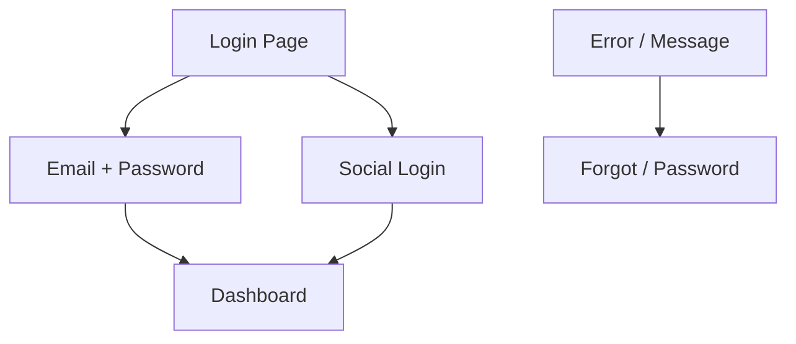
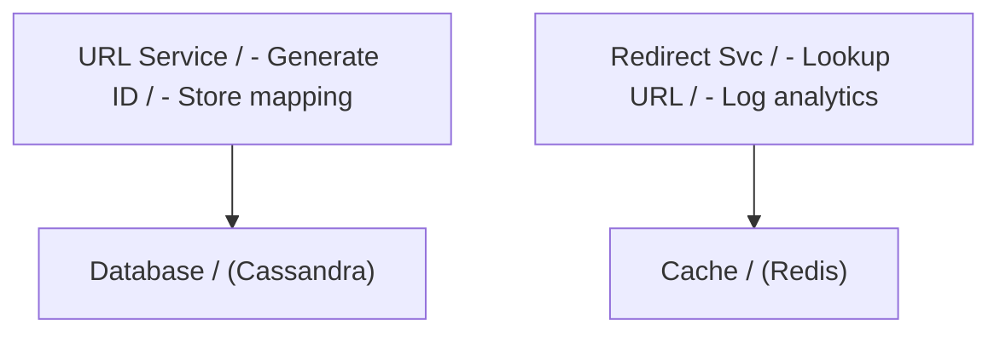
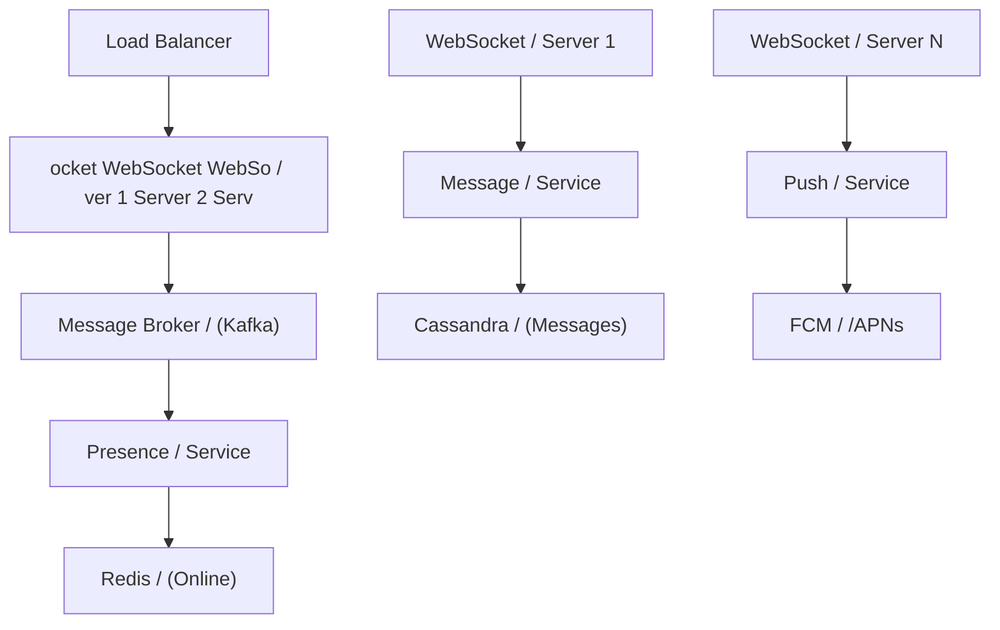

> **Navigation**: [< Previous](02_Design_Patterns.md) | [Back to Index](../00_MASTER_INDEX.md) | [Next >](04_User_System_Flows.md)

# 🏗️ System Design & Feature Creation Guide

## From User Needs to Working Systems

---

# 🏗️ Part 0: Complete Understanding of System Design

## What Is System Design?

System Design is the process of defining the ARCHITECTURE, COMPONENTS,
MODULES, INTERFACES, and DATA for a system to satisfy specified
requirements.

> 💡 **KEY INSIGHT: It's about making DECISIONS that balance trade-offs!**
- Performance vs Cost
- Consistency vs Availability
- Simplicity vs Flexibility
- Speed of development vs Scalability

> 💡 **ANALOGY:**
- Architect designing a building:
- Understands user needs (families, offices, shops)
- Plans structure (foundation, floors, rooms)
- Chooses materials (concrete, steel, glass)
- Considers constraints (budget, land, regulations)
- Software System Designer:
- Understands user needs (features, performance)
- Plans structure (services, databases, APIs)
- Chooses technologies (languages, frameworks, cloud)
- Considers constraints (budget, team size, deadlines)

**Historical Evolution**:
- 1960s: Monolithic systems - everything in one place
- 1970s: Modular programming - break into modules
- 1980s: Client-Server - separate presentation from logic
- 1990s: 3-Tier Architecture - presentation, logic, data
- 2000s: SOA (Service-Oriented Architecture)
- 2010s: Microservices - small, independent services
- 2020s: Serverless, Edge Computing, AI-integrated systems
## What Problem Does System Design Solve

PROBLEM 1: COMPLEXITY
- Modern apps have millions of lines of code
- Without structure, it becomes unmaintainable
- System design breaks complexity into manageable pieces
PROBLEM 2: SCALE
- What works for 100 users fails for 1 million
- System design plans for growth
PROBLEM 3: RELIABILITY
- Systems must work 24/7
- Single points of failure cause outages
- System design builds redundancy
PROBLEM 4: TEAM COORDINATION
- Multiple teams work on same product
- Need clear boundaries and interfaces
- System design enables parallel development
REAL-WORLD FAILURES WITHOUT GOOD DESIGN:
- 2017: Amazon S3 outage took down half the internet
- 2019: Facebook outage - 14 hours, $90 million lost
- 2021: Fastly CDN outage - major sites down globally
## Why Learn System Design

1. CAREER GROWTH:
- Junior: Write code given specifications
- Mid-level: Design features
- Senior: Design systems
- Architect: Design organizations of systems
2. INTERVIEW ESSENTIAL:
- Every senior interview has system design round
- Tests thinking ability, not memorization
3. BETTER CODE:
- Understanding the big picture improves your components
- Know how your code fits in the system
4. BUSINESS IMPACT:
- Good design saves millions in infrastructure
- Bad design costs companies everything (see failures above)
5. PROBLEM-SOLVING:
- System design is ultimate problem-solving
- Balancing constraints with creative solutions
## When To Apply System Design Thinking

ALWAYS! Even for small projects, think about:
- What components do I need?
- How do they communicate?
- What happens when something fails?
- How will this scale?

**Specific Scenarios**:
1. STARTING A NEW PROJECT:
→ Define architecture before coding
2. ADDING A MAJOR FEATURE:
→ Plan how it fits in existing system
3. PERFORMANCE PROBLEMS:
→ Analyze system bottlenecks
4. SCALING NEEDS:
→ Redesign for higher load
5. INTEGRATION:
→ Connect with external systems
## How To Approach System Design (Step-By-Step)

STEP 1: UNDERSTAND REQUIREMENTS (5-10 min)
Functional Requirements:
- What should the system DO?
- What are the core features?
- Who are the users?
Non-Functional Requirements:
- How many users? (Scale)
- How fast? (Latency)
- How reliable? (Availability)
- How consistent? (Data integrity)
STEP 2: ESTIMATE SCALE (5 min)
- Daily Active Users (DAU)
- Requests per second (RPS)
- Data storage needs
- Read vs Write ratio
STEP 3: HIGH-LEVEL DESIGN (10-15 min)
- Draw main components
- Show data flow
- Identify databases needed
- Plan API structure
STEP 4: DEEP DIVE (15-20 min)
- Design specific components
- Database schema
- API endpoints
- Caching strategy
- Handle edge cases
STEP 5: IDENTIFY BOTTLENECKS (5 min)
- What could fail?
- What could be slow?
- How to add redundancy?
- How to scale each component?
## Difficulties & Common Mistakes

1. "WHERE DO I START?":
Solution: Always start with REQUIREMENTS
Ask clarifying questions before designing
2. "TOO MANY OPTIONS":
Solution: There's no perfect answer! Explain trade-offs
Pick one approach and justify it
3. "DON'T KNOW ALL TECHNOLOGIES":
Solution: Focus on CONCEPTS, not specific tools
"We need a cache" is better than "We need Redis"
4. "CAN'T ESTIMATE SCALE":
Solution: Use approximations with reasoning
"If 1 million users, and each makes 10 requests/day..."
5. "GOING TOO DEEP TOO EARLY":
Solution: Start broad, then drill down
Don't design database schema before knowing components
## Expected Outcomes

- ✅ STRUCTURED THINKING: Break any problem into components
- ✅ TRADE-OFF ANALYSIS: Understand costs of decisions
- ✅ SCALABILITY MINDSET: Design for growth from the start
- ✅ INTERVIEW SUCCESS: Ace system design rounds
- ✅ CAREER ADVANCEMENT: Move to senior/architect roles
- ✅ BETTER COMMUNICATION: Explain technical decisions clearly

**The Transformation**:

**From**: "I can write code for features"

**To**: "I can design systems that teams build"

---

# 📌 Part 1: Understanding User Flows

## What is a User Flow?

```
╔══════════════════════════════════════════════════════════════════════════════╗
║                         USER FLOWS - COMPLETE GUIDE                          ║
╚══════════════════════════════════════════════════════════════════════════════╝

┌──────────────────────────────────────────────────────────────────────────────┐
│ WHAT IS A USER FLOW?                                                         │
├──────────────────────────────────────────────────────────────────────────────┤
│ A USER FLOW is the PATH a user takes through your application to complete    │
│ a specific task or goal.                                                     │
│                                                                              │
│ EXAMPLE - E-commerce Purchase Flow:                                          │
│                                                                              │
│ ┌─────────┐   ┌─────────┐   ┌─────────┐   ┌─────────┐   ┌─────────┐          │
│ │ Browse  │──▶│ View    │──▶│ Add to  │──▶│Checkout │──▶│ Payment │          │
│ │Products │   │ Product │   │  Cart   │   │  Page   │   │ Success │          │
│ └─────────┘   └─────────┘   └─────────┘   └─────────┘   └─────────┘          │
│      │              │             │             │                            │
│      ▼              ▼             ▼             ▼                            │
│   [Search]    [Reviews]    [Update Qty]   [Apply Coupon]                     │
│   [Filter]    [Similar]    [Remove]       [Change Address]                   │
│                                                                              │
│ KEY INSIGHT:                                                                 │
│ Every screen, button, and action is part of a FLOW!                          │
│ Good design makes flows INTUITIVE and EFFICIENT.                             │
└──────────────────────────────────────────────────────────────────────────────┘

┌──────────────────────────────────────────────────────────────────────────────┐
│ WHAT PROBLEM DO USER FLOWS SOLVE?                                            │
├──────────────────────────────────────────────────────────────────────────────┤
│                                                                              │
│ PROBLEM 1: CONFUSION                                                         │
│ • "Where do I click next?"                                                   │
│ • Solution: Map every step clearly                                           │
│                                                                              │
│ PROBLEM 2: DROP-OFF                                                          │
│ • Users abandon halfway through a process                                    │
│ • Solution: Minimize steps, reduce friction                                  │
│                                                                              │
│ PROBLEM 3: ERRORS                                                            │
│ • Users get stuck in error states                                            │
│ • Solution: Plan error paths and recovery                                    │
│                                                                              │
│ PROBLEM 4: DEVELOPMENT CHAOS                                                 │
│ • Developers don't know what to build                                        │
│ • Solution: User flows serve as specifications                               │
│                                                                              │
│ REAL IMPACT:                                                                 │
│ • Amazon: Removing one click increased revenue by $300M/year                 │
│ • Airbnb: Simplifying booking flow increased conversions 30%                 │
└──────────────────────────────────────────────────────────────────────────────┘

┌──────────────────────────────────────────────────────────────────────────────┐
│ HOW TO CREATE USER FLOWS                                                     │
├──────────────────────────────────────────────────────────────────────────────┤
│                                                                              │
│ STEP 1: IDENTIFY THE GOAL                                                    │
│ • What does the user want to accomplish?                                     │
│ • Example: "User wants to purchase a product"                                │
│                                                                              │
│ STEP 2: IDENTIFY ENTRY POINTS                                                │
│ • How does the user start this flow?                                         │
│ • Example: Homepage, search results, email link, ad click                    │
│                                                                              │
│ STEP 3: MAP THE HAPPY PATH                                                   │
│ • The ideal path with no errors                                              │
│ • Minimum steps to achieve goal                                              │
│                                                                              │
│ STEP 4: MAP ALTERNATIVE PATHS                                                │
│ • What if user wants to change something?                                    │
│ • What if user wants to go back?                                             │
│                                                                              │
│ STEP 5: MAP ERROR PATHS                                                      │
│ • What if payment fails?                                                     │
│ • What if item is out of stock?                                              │
│ • How does user recover?                                                     │
│                                                                              │
│ STEP 6: IDENTIFY DATA NEEDED                                                 │
│ • What data do we need at each step?                                         │
│ • What data do we collect from user?                                         │
│ • What data do we show to user?                                              │
└──────────────────────────────────────────────────────────────────────────────┘

## User Flow Notation

USER FLOW SYMBOLS:
┌─────────┐
│  PAGE   │  Rectangle = Screen/Page
└─────────┘

◇ Decision ◇  Diamond = Decision Point

○ Start/End ○  Circle = Start or End

───────▶  Arrow = Flow Direction

┌─────────┐
│ Action  │  Rounded = User Action
└─────────┘
```

## Example: Login Flow

```
                    ○ Start
                        │
                        ▼
                ┌───────────────┐
                │  Login Page   │
                └───────┬───────┘
                        │
            ┌───────────┴───────────┐
            ▼                       ▼
    ┌───────────────┐      ┌───────────────┐
    │Email + Password│     │  Social Login │
    └───────┬───────┘      └───────┬───────┘
            │                       │
            ▼                       ▼
        ◇ Valid? ◇            ◇ Authorized? ◇
       /        \             /            \
     Yes         No         Yes             No
      │           │          │               │
      ▼           ▼          ▼               ▼
 ┌─────────┐ ┌─────────┐ ┌─────────┐  ┌─────────┐
 │Dashboard│ │  Error  │ │Dashboard│  │  Error  │
 └─────────┘ │ Message │ └─────────┘  │ Message │
             └────┬────┘              └────┬────┘
                  │                        │
                  ▼                        ▼
            ◇ Retry? ◇              ◇ Retry? ◇
           /        \              /        \
         Yes        No           Yes        No
          │          │            │          │
          ▼          ▼            ▼          ▼
     [Back to   ┌─────────┐  [Back to   ○ End
      Login]    │ Forgot  │   Login]
                │Password │
                └─────────┘
```

**Flow:**
- Login Page
- ↓
- Email + Password
- ↓
- Login Page
- ↓
- Social Login
- ↓
- Email + Password
- ↓
- Dashboard
- ↓
- Social Login
- ↓
- Dashboard
- ↓
- Error / Message
- ↓
- Forgot / Password



---

# 📌 Part 2: Feature Creation Framework

## What Is Feature Creation?

The complete process of taking a user need or business requirement and
turning it into working software.

**Stages**:
1. IDEATION: "Users need X"
2. SPECIFICATION: "X means exactly this behavior"
3. DESIGN: "X will be built using these components"
4. IMPLEMENTATION: "Here's the code for X"
5. TESTING: "X works as expected"
6. DEPLOYMENT: "X is live for users"
7. MONITORING: "X is performing well"
## The Feature Creation Checklist

□ UNDERSTANDING PHASE:
□ What problem does this feature solve?
□ Who are the users?
□ What's the success metric?
□ What are the constraints (time, tech, resources)?
□ DESIGN PHASE:
□ User flow mapped?
□ UI/UX designs ready?
□ API contracts defined?
□ Database schema designed?
□ Edge cases identified?
□ IMPLEMENTATION PHASE:
□ Code follows design patterns?
□ Unit tests written?
□ Integration tests written?
□ Error handling complete?
□ Logging added?
□ DEPLOYMENT PHASE:
□ Feature flag ready?
□ Rollback plan exists?
□ Monitoring dashboards set up?
□ Alerts configured?

## Example: Creating a "Like" Feature

## Like_Id  │ User_Id  │  Post_Id  │ Created_At

| PK       | FK→users | FK→posts  | timestamp |

---

# ⚙️ Part 3: Data Flows in Systems

```
╔══════════════════════════════════════════════════════════════════════════════╗
║                    DATA FLOWS - COMPLETE UNDERSTANDING                       ║
╚══════════════════════════════════════════════════════════════════════════════╝

┌──────────────────────────────────────────────────────────────────────────────┐
│ WHAT IS A DATA FLOW?                                                         │
├──────────────────────────────────────────────────────────────────────────────┤
│ A DATA FLOW shows how data moves through a system - from input to storage    │
│ to output, including all transformations along the way.                      │
│                                                                              │
│ KEY INSIGHT: Follow the DATA to understand any system!                       │
│                                                                              │
│ EXAMPLE - Order Processing Data Flow:                                        │
│                                                                              │
│ User Input     API Gateway     Order Service    Database      Notification   │
│ ──────────     ───────────     ─────────────    ────────      ────────────   │
│                                                                              │
│ {               {               {               INSERT         Email/SMS     │
│  items: [...],   validated      order_id: 123,  INTO orders    "Order        │
│  address: ...    sanitized      status: NEW,    VALUES (...)   confirmed!"   │
│  payment: ...    authenticated  total: $99                                   │
│ }             }              }                                               │
│                                                                              │
│ ────▶ Transforms at each step! ────▶                                         │
└──────────────────────────────────────────────────────────────────────────────┘

## Types of Data Flows

┌──────────────────────────────────────────────────────────────────────────────┐
│ 1. SYNCHRONOUS DATA FLOW                                                     │
├──────────────────────────────────────────────────────────────────────────────┤
│ User ───▶ API ───▶ Service ───▶ Database                                     │
│   │                                   │                                      │
│   └───────────────◀───────────────────┘                                      │
│                Response                                                      │
│                                                                              │
│ CHARACTERISTICS:                                                             │
│ • Request waits for response                                                 │
│ • Simple to understand                                                       │
│ • Limited scalability                                                        │
│                                                                              │
│ USE WHEN:                                                                    │
│ • User needs immediate response                                              │
│ • Operation is fast (<100ms)                                                 │
│ • Data consistency is critical                                               │
└──────────────────────────────────────────────────────────────────────────────┘

┌──────────────────────────────────────────────────────────────────────────────┐
│ 2. ASYNCHRONOUS DATA FLOW                                                    │
├──────────────────────────────────────────────────────────────────────────────┤
│ User ───▶ API ───▶ Message Queue ───▶ Worker ───▶ Database                   │
│   │          │                                                               │
│   └◀─────────┘                                                               │
│   "Accepted"                                                                 │
│                                                                              │
│ CHARACTERISTICS:                                                             │
│ • Request returns immediately                                                │
│ • Processing happens in background                                           │
│ • Highly scalable                                                            │
│                                                                              │
│ USE WHEN:                                                                    │
│ • Operation is slow (sending email, generating report)                       │
│ • High throughput needed                                                     │
│ • Can tolerate eventual consistency                                          │
└──────────────────────────────────────────────────────────────────────────────┘

┌──────────────────────────────────────────────────────────────────────────────┐
│ 3. EVENT-DRIVEN DATA FLOW                                                    │
├──────────────────────────────────────────────────────────────────────────────┤
│                        Event Bus                                             │
│                           │                                                  │
│    ┌──────────────────────┼──────────────────────┐                           │
│    │                      │                      │                           │
│    ▼                      ▼                      ▼                           │
│ ┌──────┐             ┌──────┐              ┌──────┐                          │
│ │Notif.│             │Analyt│              │Invent│                          │
│ │Service│            │Service│             │Service│                         │
│ └──────┘             └──────┘              └──────┘                          │
│                                                                              │
│ CHARACTERISTICS:                                                             │
│ • Services react to events                                                   │
│ • Loose coupling                                                             │
│ • Multiple consumers per event                                               │
│                                                                              │
│ USE WHEN:                                                                    │
│ • Multiple services need same data                                           │
│ • Services should be independent                                             │
│ • Need to add new consumers easily                                           │
└──────────────────────────────────────────────────────────────────────────────┘
```

---

# PART 4: OOP vs FUNCTIONAL DESIGN

## When To Use Oop Design


**Best For**:
- Systems with many ENTITIES (User, Order, Product)
- Complex BEHAVIOR associated with data
- Need for INHERITANCE and polymorphism
- Long-lived STATEFUL objects
EXAMPLE - E-commerce Order System (OOP):
Order
───────────────────────────────────────────────────────────────────────
- orderId: Long
- items: List<OrderItem>
- status: OrderStatus
- customer: Customer
───────────────────────────────────────────────────────────────────────
+ addItem(item): void
+ removeItem(itemId): void
+ calculateTotal(): Money
+ submit(): void
+ cancel(): void
// OOP - Behavior lives with data
public class Order {
private List<OrderItem> items;
private OrderStatus status;
public Money calculateTotal() {
return items.stream()
.map(OrderItem::getSubtotal)
.reduce(Money.ZERO, Money::add);
}
public void submit() {
validateItems();
validatePayment();
this.status = OrderStatus.SUBMITTED;
}
}
## When To Use Functional Design


**Best For**:
- Data TRANSFORMATIONS (ETL, pipelines)
- STATELESS operations
- CONCURRENT processing
- Mathematical/logical computations
EXAMPLE - Data Processing Pipeline (Functional):
// Functional - Data flows through transformations
public class OrderProcessor {
// Pure function - no side effects
public static Money calculateTotal(List<OrderItem> items) {
return items.stream()
.map(item -> item.price().multiply(item.quantity()))
.reduce(Money.ZERO, Money::add);
}
// Pipeline of transformations
public static OrderSummary processOrder(OrderRequest request) {
return validateRequest(request)
.map(OrderProcessor::enrichWithInventory)
.map(OrderProcessor::calculatePricing)
.map(OrderProcessor::applyDiscounts)
.map(OrderProcessor::createSummary)
.orElseThrow(InvalidOrderException::new);
}
}

**Benefits**:
- Easy to test (pure functions)
- Easy to parallelize
- Easy to reason about (no hidden state)
## Hybrid Approach (Most Real Systems)

REAL SYSTEMS USE BOTH!
- OOP for DOMAIN ENTITIES:
User, Order, Product, Payment
- Functional for DATA PROCESSING:
Validation, Transformation, Calculation

**Example**:
// Domain entity (OOP)
public class Order {
private List<OrderItem> items;
// Uses functional internally!
public Money getTotal() {
return items.stream()
.map(OrderItem::getSubtotal)
.reduce(Money.ZERO, Money::add);
}
}
// Service (Functional processing with OOP entities)
public class OrderService {
public List<Order> getHighValueOrders(List<Order> orders) {
return orders.stream()
.filter(o -> o.getTotal().isGreaterThan(Money.of(1000)))
.sorted(comparing(Order::getTotal).reversed())
.collect(toList());
}
}

---

# 🎨 Part 5: System Design Patterns

```
╔══════════════════════════════════════════════════════════════════════════════╗
║                COMMON SYSTEM ARCHITECTURE PATTERNS                           ║
╚══════════════════════════════════════════════════════════════════════════════╝

┌──────────────────────────────────────────────────────────────────────────────┐
│ 1. MONOLITHIC ARCHITECTURE                                                   │
├──────────────────────────────────────────────────────────────────────────────┤
│                                                                              │
│ ┌─────────────────────────────────────────────────────────────────────────┐  │
│ │                         SINGLE APPLICATION                              │  │
│ │ ┌───────────┐ ┌───────────┐ ┌───────────┐ ┌───────────┐                │   │
│ │ │   UI      │ │  Users    │ │  Orders   │ │ Payments  │                │   │
│ │ │  Layer    │ │  Module   │ │  Module   │ │  Module   │                │   │
│ │ └───────────┘ └───────────┘ └───────────┘ └───────────┘                │   │
│ │                         │                                               │  │
│ │                   ┌─────┴─────┐                                         │  │
│ │                   │  Database │                                         │  │
│ │                   └───────────┘                                         │  │
│ └─────────────────────────────────────────────────────────────────────────┘  │
│                                                                              │
│ PROS: Simple, easy to develop, easy to deploy                                │
│ CONS: Hard to scale, hard to maintain as it grows                            │
│ USE WHEN: Small team, MVP, simple domain                                     │
└──────────────────────────────────────────────────────────────────────────────┘

┌──────────────────────────────────────────────────────────────────────────────┐
│ 2. MICROSERVICES ARCHITECTURE                                                │
├──────────────────────────────────────────────────────────────────────────────┤
│                                                                              │
│ ┌──────────┐    ┌──────────┐    ┌──────────┐    ┌──────────┐                 │
│ │  User    │    │  Order   │    │ Payment  │    │ Notific. │                 │
│ │ Service  │    │ Service  │    │ Service  │    │ Service  │                 │
│ └────┬─────┘    └────┬─────┘    └────┬─────┘    └────┬─────┘                 │
│      │               │               │               │                       │
│   ┌──┴──┐         ┌──┴──┐         ┌──┴──┐         ┌──┴──┐                    │
│   │ DB1 │         │ DB2 │         │ DB3 │         │ DB4 │                    │
│   └─────┘         └─────┘         └─────┘         └─────┘                    │
│                                                                              │
│ PROS: Scalable, independent deployment, tech diversity                       │
│ CONS: Complex, distributed system challenges, operational overhead           │
│ USE WHEN: Large team, complex domain, need to scale independently            │
└──────────────────────────────────────────────────────────────────────────────┘

┌──────────────────────────────────────────────────────────────────────────────┐
│ 3. EVENT-DRIVEN ARCHITECTURE                                                 │
├──────────────────────────────────────────────────────────────────────────────┤
│                                                                              │
│                    ┌─────────────────────────┐                               │
│                    │      Event Bus          │                               │
│                    │  (Kafka/RabbitMQ/SQS)   │                               │
│                    └───────────┬─────────────┘                               │
│              ┌─────────────────┼─────────────────┐                           │
│              │                 │                 │                           │
│         ┌────┴────┐       ┌────┴────┐       ┌────┴────┐                      │
│         │Producer │       │Consumer │       │Consumer │                      │
│         │(Orders) │       │(Inventory)│     │(Analytics)│                    │
│         └─────────┘       └─────────┘       └─────────┘                      │
│                                                                              │
│ PROS: Loose coupling, real-time, scalable                                    │
│ CONS: Eventual consistency, debugging harder                                 │
│ USE WHEN: Real-time processing, many consumers, async workflows              │
└──────────────────────────────────────────────────────────────────────────────┘

┌──────────────────────────────────────────────────────────────────────────────┐
│ 4. CQRS (Command Query Responsibility Segregation)                           │
├──────────────────────────────────────────────────────────────────────────────┤
│                                                                              │
│     WRITES                              READS                                │
│   ┌─────────┐                        ┌─────────┐                             │
│   │ Command │                        │  Query  │                             │
│   │ Service │                        │ Service │                             │
│   └────┬────┘                        └────┬────┘                             │
│        │                                  │                                  │
│        ▼                                  ▼                                  │
│   ┌─────────┐      sync/async       ┌─────────┐                              │
│   │  Write  │ ─────────────────────▶│  Read   │                              │
│   │   DB    │                       │   DB    │                              │
│   └─────────┘                       └─────────┘                              │
│   (normalized)                      (denormalized)                           │
│                                                                              │
│ PROS: Optimized reads AND writes, scalable                                   │
│ CONS: Complexity, eventual consistency                                       │
│ USE WHEN: Read-heavy systems, complex queries, different read/write needs    │
└──────────────────────────────────────────────────────────────────────────────┘
```

---

# 🏗️ Part 6: Real — World System Design Examples

## Example 1: URL Shortener (Like bit.ly)

```
REQUIREMENTS:
• Shorten long URLs
• Redirect short URLs to original
• Track click analytics
• 100 million URLs/month

HIGH-LEVEL DESIGN:

    User                API Gateway              Services
    ─────              ───────────              ────────
      │                     │
      │ POST /shorten       │
      │ {url: "long..."}    │
      ├────────────────────▶│
      │                     │
      │                     │        ┌─────────────────┐
      │                     ├───────▶│  URL Service    │
      │                     │        │  - Generate ID  │
      │                     │        │  - Store mapping│
      │                     │        └────────┬────────┘
      │                     │                 │
      │                     │                 ▼
      │                     │           ┌──────────┐
      │                     │           │ Database │
      │                     │           │(Cassandra)│
      │                     │           └──────────┘
      │                     │
      │ {"short": "abc123"} │
      │◀────────────────────┤
      │                     │
      │ GET /abc123         │
      ├────────────────────▶│
      │                     │
      │                     │        ┌─────────────────┐
      │                     ├───────▶│  Redirect Svc   │
      │                     │        │  - Lookup URL   │
      │                     │        │  - Log analytics│
      │                     │        └────────┬────────┘
      │                     │                 │
      │ 302 Redirect        │                 ▼
      │◀────────────────────┤           ┌──────────┐
      │                     │           │  Cache   │
                                        │ (Redis)  │
                                        └──────────┘

KEY DECISIONS:
1. Base62 encoding for short IDs (a-z, A-Z, 0-9)
2. Cassandra for distributed storage
3. Redis cache for hot URLs
4. Async analytics logging
```

**Flow:**
- URL Service / - Generate ID / - Store mapping
- ↓
- Database / (Cassandra)
- ↓
- Redirect Svc / - Lookup URL / - Log analytics
- ↓
- Cache / (Redis)



## Example 2: Chat System (Like WhatsApp)

```
REQUIREMENTS:
• 1-to-1 and group messaging
• Delivered/Read receipts
• Offline message delivery
• 1 billion messages/day

HIGH-LEVEL DESIGN:

                    ┌─────────────────────────────────────┐
                    │           Load Balancer              │
                    └─────────────────┬───────────────────┘
                                      │
         ┌────────────────────────────┼────────────────────────────┐
         │                            │                            │
    ┌────┴────┐                  ┌────┴────┐                  ┌────┴────┐
    │WebSocket│                  │WebSocket│                  │WebSocket│
    │ Server 1│                  │ Server 2│                  │ Server N│
    └────┬────┘                  └────┬────┘                  └────┬────┘
         │                            │                            │
         └────────────────────────────┼────────────────────────────┘
                                      │
                              ┌───────┴───────┐
                              │ Message Broker │
                              │   (Kafka)      │
                              └───────┬───────┘
                                      │
              ┌───────────────────────┼───────────────────────┐
              │                       │                       │
         ┌────┴────┐            ┌────┴────┐            ┌────┴────┐
         │ Message │            │Presence │            │  Push   │
         │ Service │            │ Service │            │ Service │
         └────┬────┘            └────┬────┘            └────┬────┘
              │                      │                      │
              ▼                      ▼                      ▼
         ┌─────────┐            ┌─────────┐            ┌─────────┐
         │Cassandra│            │  Redis  │            │   FCM   │
         │(Messages)│           │(Online) │            │  /APNs  │
         └─────────┘            └─────────┘            └─────────┘

MESSAGE FLOW:
1. User A connects to WebSocket server
2. Server registers user in Presence Service (Redis)
3. User A sends message to User B
4. Message goes to Kafka
5. Message Service stores in Cassandra
6. If B online: Route to B's WebSocket server
7. If B offline: Push notification via FCM/APNs
8. B receives and sends ACK
9. Delivery receipt sent back to A
```

**Flow:**
- Load Balancer
- ↓
- ocket WebSocket WebSo / ver 1 Server 2 Serv
- ↓
- Message Broker / (Kafka)
- ↓
- WebSocket / Server 1
- ↓
- Message / Service
- ↓
- WebSocket / Server N
- ↓
- Push / Service
- ↓
- Message Broker / (Kafka)
- ↓
- Presence / Service
- ↓
- Message / Service
- ↓
- Cassandra / (Messages)



---

# 💪 Part 7: Practice Exercises


> SYSTEM DESIGN PRACTICE PROBLEMS


BEGINNER LEVEL:
1. Design a Parking Lot System
2. Design a Library Management System
3. Design a URL Shortener
4. Design a Rate Limiter
5. Design a Task Scheduler

INTERMEDIATE LEVEL:
6. Design Twitter Feed
7. Design Instagram
8. Design Uber/Ola
9. Design Netflix
10. Design WhatsApp

ADVANCED LEVEL:
11. Design Google Search
12. Design YouTube
13. Design Distributed Cache
14. Design Payment System
15. Design Stock Trading Platform

FOR EACH PROBLEM:
1. Clarify requirements (5 min)
2. Estimate scale (5 min)
3. Draw high-level design (10 min)
4. Deep dive into components (15 min)
5. Discuss trade-offs (5 min)


---

> **Navigation**: [< Previous](02_Design_Patterns.md) | [Back to Index](../00_MASTER_INDEX.md) | [Next >](04_User_System_Flows.md)