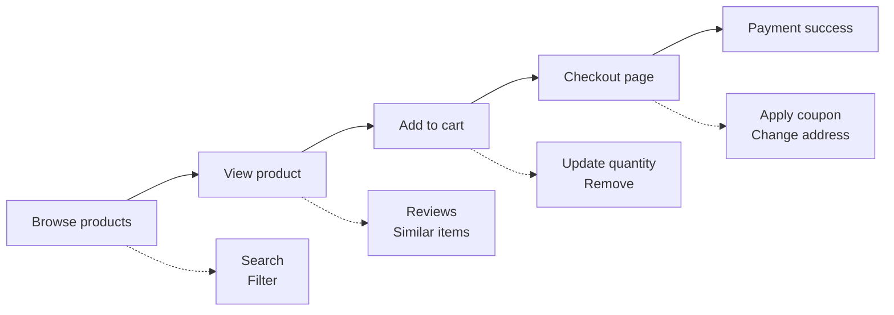
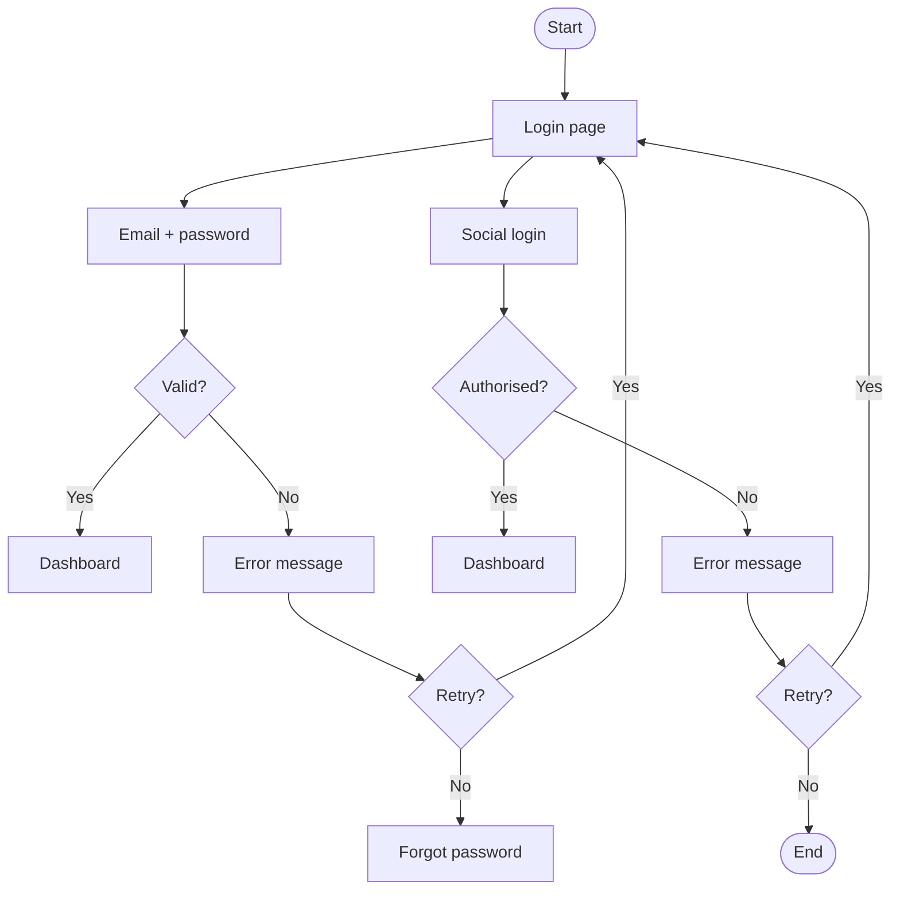

# 📌 Part 1: Understanding User Flows

> **Navigation**: [← Complete Understanding of System Design](01_complete_understanding_of_system_design.md) | [Chapter overview](../03_System_Design.md) | [Data Flows in Systems →](03_data_flows_in_systems.md)
> Page 2 of 5 in **System Design & Feature Creation Guide**

## What is a User Flow?

### What is a user flow?

A **user flow** is the **path a user takes through your application to complete a specific task or goal**.

**Example: e-commerce purchase flow**

**How to read this diagram.** The solid arrows are the happy path; each dotted branch is something the user may do on that screen.

> [!IMPORTANT]
> **Key insight:** every screen, button and action is part of a flow. Good design makes flows intuitive and efficient.

### What problem do user flows solve?

| Problem | Symptom | Solution |
| --- | --- | --- |
| 1. Confusion | "Where do I click next?" | Map every step clearly |
| 2. Drop-off | Users abandon a process halfway | Minimise steps, reduce friction |
| 3. Errors | Users get stuck in error states | Plan error paths and recovery |
| 4. Development chaos | Developers do not know what to build | Use user flows as specifications |

**Real impact.** Fewer steps usually raise completion. Measure your own conversion rate before and after each flow change (A/B test).

### How to create user flows

1. **Identify the goal.** What does the user want to accomplish? Example: "User wants to purchase a product".
2. **Identify entry points.** How does the user start this flow? Example: homepage, search results, email link, ad click.
3. **Map the happy path.** The ideal path with no errors and the minimum number of steps.
4. **Map alternative paths.** What if the user wants to change something, or go back?
5. **Map error paths.** What if payment fails or the item is out of stock? How does the user recover?
6. **Identify the data needed.** What data do we need at each step, what do we collect from the user, and what do we show?

## User Flow Notation

| Symbol | Shape | Meaning |
| --- | --- | --- |
| Rectangle | Screen or page | A place the user is |
| Rounded rectangle | User action | Something the user does |
| Diamond | Decision point | A yes/no branch |
| Circle (stadium) | Start or end | Entry or exit of the flow |
| Arrow | Flow direction | Where the user goes next |

## Example: Login Flow

**How to read this diagram.** Two sign-in routes share one login page. Each failure shows an error and offers a retry; after giving up on the email route the user is offered password recovery.

---

## 📌 Part 2: Feature Creation Framework

### What Is Feature Creation?

The complete process of taking a user need or business requirement and
turning it into working software.

**Stages**:

1. IDEATION: "Users need X"
2. SPECIFICATION: "X means exactly this behavior"
3. DESIGN: "X will be built using these components"
4. IMPLEMENTATION: "Here's the code for X"
5. TESTING: "X works as expected"
6. DEPLOYMENT: "X is live for users"
7. MONITORING: "X is performing well"

### The Feature Creation Checklist

□ UNDERSTANDING PHASE:
□ What problem does this feature solve?
□ Who are the users?
□ What's the success metric?
□ What are the constraints (time, tech, resources)?
□ DESIGN PHASE:
□ User flow mapped?
□ UI/UX designs ready?
□ API contracts defined?
□ Database schema designed?
□ Edge cases identified?
□ IMPLEMENTATION PHASE:
□ Code follows design patterns?
□ Unit tests written?
□ Integration tests written?
□ Error handling complete?
□ Logging added?
□ DEPLOYMENT PHASE:
□ Feature flag ready?
□ Rollback plan exists?
□ Monitoring dashboards set up?
□ Alerts configured?

### Example: Creating a "Like" Feature

**Likes table**

| Column | Like_Id | User_Id | Post_Id | Created_At |
| --- | --- | --- | --- | --- |
| Key | PK | FK → users | FK → posts | timestamp |

---

[← Complete Understanding of System Design](01_complete_understanding_of_system_design.md) | [Chapter overview](../03_System_Design.md) | [Data Flows in Systems →](03_data_flows_in_systems.md)
