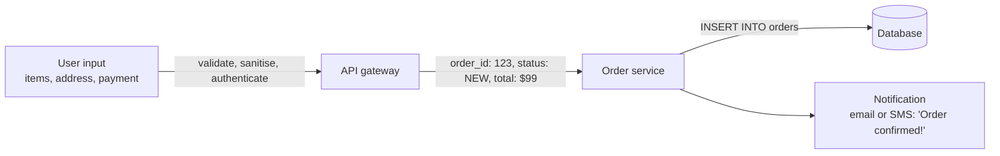
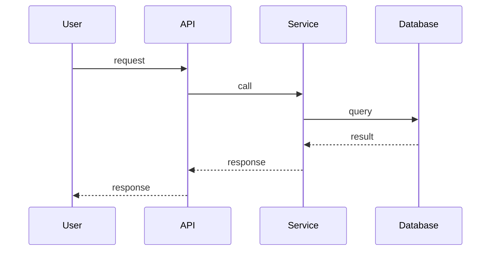
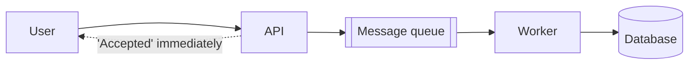
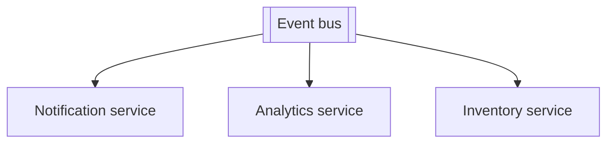

# ⚙️ Part 3: Data Flows in Systems

> **Navigation**: [← Understanding User Flows](02_understanding_user_flows.md) | [Chapter overview](../03_System_Design.md) | [OOP vs FUNCTIONAL DESIGN →](04_oop_vs_functional_design.md)
> Page 3 of 5 in **System Design & Feature Creation Guide**

### What is a data flow?

A **data flow** shows how data moves through a system, from input to storage to output, including every transformation along the way.

> [!IMPORTANT]
> **Key insight:** follow the data to understand any system.

**Example: order-processing data flow**

**How to read this diagram.** The data changes shape at each step: raw user input becomes a validated request, then an order record, then a stored row and a notification.

## Types of Data Flows

### 1. Synchronous data flow

**How to read this diagram.** The caller waits at every hop until the answer travels back.

| Characteristics | Use when |
| --- | --- |
| The request waits for the response | The user needs an immediate response |
| Simple to understand | The operation is fast (well under 100 ms) |
| Limited scalability | Data consistency is critical |

### 2. Asynchronous data flow

**How to read this diagram.** The API answers "accepted" at once and the worker finishes the job in the background.

| Characteristics | Use when |
| --- | --- |
| The request returns immediately | The operation is slow (sending email, generating a report) |
| Processing happens in the background | High throughput is needed |
| Highly scalable | Eventual consistency is acceptable |

### 3. Event-driven data flow

**How to read this diagram.** A producer publishes an event once; every interested service consumes it independently.

| Characteristics | Use when |
| --- | --- |
| Services react to events | Several services need the same data |
| Loose coupling | Services should be independent |
| Multiple consumers per event | New consumers must be easy to add |

---

🔬 **Section Challenge — Types of Data Flows**

**Challenge 1 (Reasoning — Who/When/What):** A user places an order. The system must: (1) save the order to the database, (2) send a confirmation email, (3) update inventory, (4) log analytics. Which of these should be synchronous and which asynchronous? For each, answer Who executes it, When, and What must already exist.

Answer

**Synchronous (user waits):** Save order to DB — **Who?** Order Service. **When?** Immediately, before responding to the user. **What must exist?** An open DB connection. This is synchronous because: (1) the user needs an order confirmation ID, and (2) data consistency is critical — if the save fails, the user must know immediately.

**Asynchronous (background):**

- Email: **Who?** Email Worker. **When?** After the order event is enqueued. **What exists?** The order record in DB (already saved). Sending email is slow (~100ms-1s) and non-critical-path.
- Inventory update: **Who?** Inventory Worker. **When?** Async after order event. **What exists?** The committed order. Can tolerate eventual consistency (brief over-sell window is acceptable for most systems).
- Analytics log: **Who?** Analytics Worker. **When?** Async. Purely for reporting — zero user impact if delayed.

**Pattern:** Synchronous = critical path + user-visible + consistency-required. Asynchronous = slow operations + eventual consistency acceptable + multiple consumers.

**Challenge 2 (Design):** In Event-Driven architecture, the Order Service publishes `ORDER_PLACED` event. Both Inventory Service and Email Service subscribe. The Inventory Service crashes. What happens to the Email Service? What happens to the Inventory update? Answer using the Who/When/What framework.

Answer

**Email Service:** **Who?** A completely independent consumer. **When?** Immediately upon seeing the `ORDER_PLACED` event in the bus. **What already exists?** The event in the bus is independent of Inventory's state. **Result:** Email sends successfully. This is the KEY benefit of loose coupling — Inventory crash does NOT cascade.

**Inventory update:** **Who?** Inventory Service (crashed). **When?** It CANNOT process now. **What already exists?** The event remains in the Message Queue (Kafka retains it). When Inventory Service restarts, it replays from its last committed offset — the event is NOT lost. This is exactly why Kafka (persistent log) is used over simple pub/sub (which loses events if consumer is down). Eventual consistency guarantees the update WILL happen.

---

[← Understanding User Flows](02_understanding_user_flows.md) | [Chapter overview](../03_System_Design.md) | [OOP vs FUNCTIONAL DESIGN →](04_oop_vs_functional_design.md)
