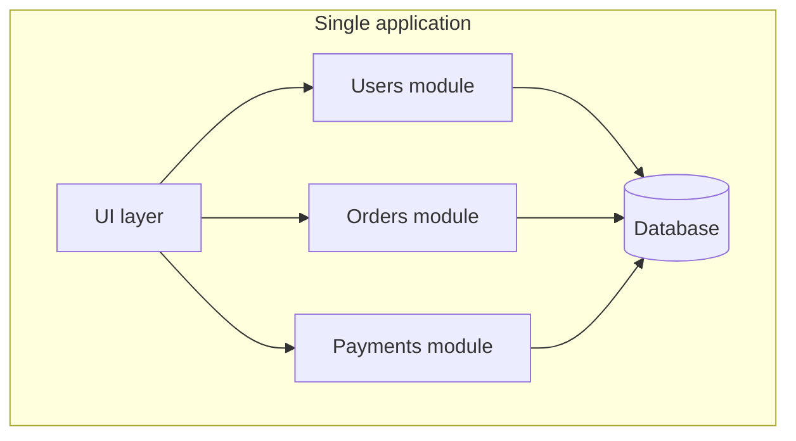
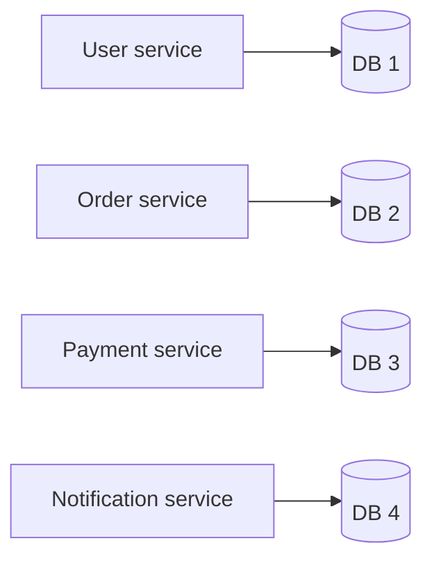
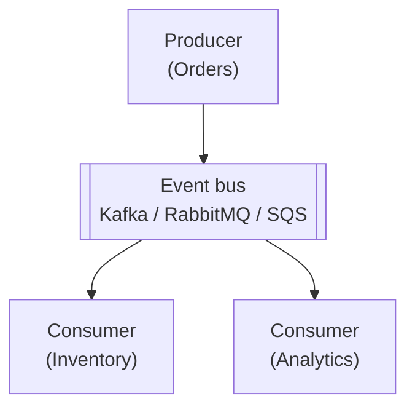
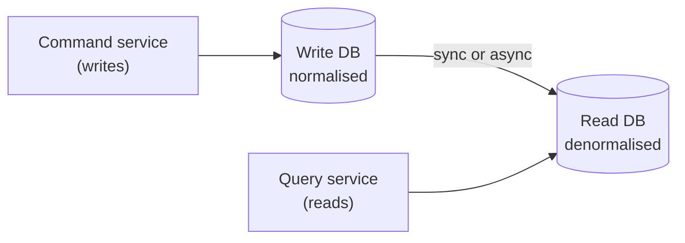
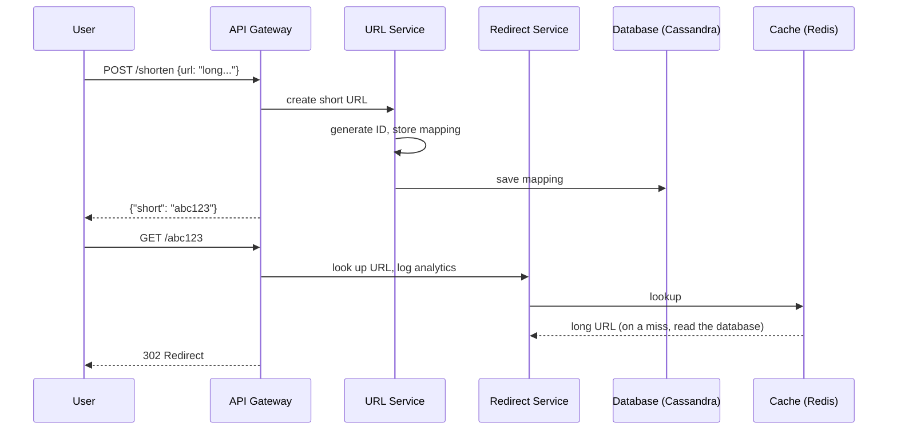
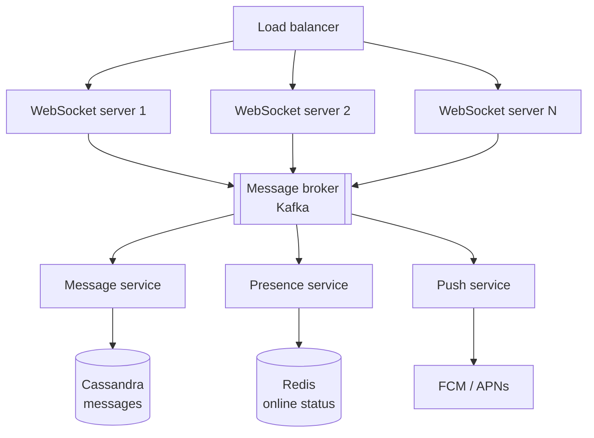

# PART 4: OOP vs FUNCTIONAL DESIGN

> **Navigation**: [← Data Flows in Systems](03_data_flows_in_systems.md) | [Chapter overview](../03_System_Design.md) | [Practice Exercises →](05_practice_exercises.md)
> Page 4 of 5 in **System Design & Feature Creation Guide**


## When To Use Oop Design

**Best For**:

- Systems with many ENTITIES (User, Order, Product)
- Complex BEHAVIOR associated with data
- Need for INHERITANCE and polymorphism
- Long-lived STATEFUL objects

**Example: e-commerce order system (OOP)**

| Order | |
| --- | --- |
| **State** | `orderId: Long`, `items: List<OrderItem>`, `status: OrderStatus`, `customer: Customer` |
| **Behaviour** | `addItem(item)`, `removeItem(itemId)`, `calculateTotal(): Money`, `submit()`, `cancel()` |

```java
// OOP: behaviour lives with the data
public class Order {
    private List<OrderItem> items;
    private OrderStatus status;

    public Money calculateTotal() {
        return items.stream()
                    .map(OrderItem::getSubtotal)
                    .reduce(Money.ZERO, Money::add);
    }

    public void submit() {
        validateItems();
        validatePayment();
        this.status = OrderStatus.SUBMITTED;
    }
}
```

🔬 **Section Challenge — When To Use Oop Design**

**Challenge 1 (Reasoning — Who/When/What):** In the Order class, `submit()` calls `validateItems()` and `validatePayment()` before setting status to `SUBMITTED`. Why do these live inside the `Order` class instead of in an external `OrderValidator` service? What OOP principle justifies this?

<details><summary>Answer</summary>

**Who validates?** The `Order` object itself. **When?** At the moment of state transition (`submit()`). **What already exists?** The Order has direct access to `items` and payment info — it's the ONLY object that knows its own invariants. This is **encapsulation**: behavior lives with the data it operates on. An external `OrderValidator` would need to extract private fields (breaking encapsulation) and could be bypassed (someone calls `setStatus(SUBMITTED)` directly). By keeping validation inside `submit()`, the Order **enforces its own invariants** — it's impossible to submit an invalid order. This is the Tell Don't Ask principle: don't ask Order for its data and validate externally; tell Order to submit and let it validate itself.

</details>

## When To Use Functional Design

**Best For**:

- Data TRANSFORMATIONS (ETL, pipelines)
- STATELESS operations
- CONCURRENT processing
- Mathematical/logical computations

**Example: data-processing pipeline (functional)**

```java
// Functional: data flows through transformations
public class OrderProcessor {
    // Pure function: no side effects
    public static Money calculateTotal(List<OrderItem> items) {
        return items.stream()
                    .map(item -> item.price().multiply(item.quantity()))
                    .reduce(Money.ZERO, Money::add);
    }

    // Pipeline of transformations
    public static OrderSummary processOrder(OrderRequest request) {
        return validateRequest(request)
            .map(OrderProcessor::enrichWithInventory)
            .map(OrderProcessor::calculatePricing)
            .map(OrderProcessor::applyDiscounts)
            .map(OrderProcessor::createSummary)
            .orElseThrow(InvalidOrderException::new);
    }
}
```

**Benefits**:

- Easy to test (pure functions)
- Easy to parallelize
- Easy to reason about (no hidden state)

🔬 **Section Challenge — When To Use Functional Design**

**Challenge 1 (Reasoning — Who/When/What):** In the `processOrder` pipeline, each `.map()` transforms the data. **Who** owns the state at each stage? **What** happens if `applyDiscounts` throws an exception — does `calculatePricing` need to roll back? Why or why not?

<details><summary>Answer</summary>

**Who owns state?** Nobody — that's the point. Each function receives an immutable input and produces a new output. There is no shared mutable state. **What happens on exception?** `calculatePricing` does NOT need to roll back because it never mutated anything. The original `OrderRequest` is untouched. The `Optional` chain short-circuits via `.orElseThrow()`. This is the key advantage of functional pipelines: no side effects means no rollback complexity. In OOP with mutable state, a failure in step 4 of 5 might leave the object in a half-modified state requiring compensating transactions. In functional: fail anywhere, original data is intact. This is why functional is preferred for data transformation pipelines.

</details>

## Hybrid Approach (Most Real Systems)

Real systems use both:

- **OOP for domain entities:** User, Order, Product, Payment
- **Functional for data processing:** validation, transformation, calculation

**Example**

```java
// Domain entity (OOP)
public class Order {
    private List<OrderItem> items;

    // Uses functional style internally
    public Money getTotal() {
        return items.stream()
                    .map(OrderItem::getSubtotal)
                    .reduce(Money.ZERO, Money::add);
    }
}

// Service (functional processing with OOP entities)
public class OrderService {
    public List<Order> getHighValueOrders(List<Order> orders) {
        return orders.stream()
                     .filter(o -> o.getTotal().isGreaterThan(Money.of(1000)))
                     .sorted(comparing(Order::getTotal).reversed())
                     .collect(toList());
    }
}
```

---

## 🎨 Part 5: System Design Patterns

### Common system architecture patterns

**1. Monolithic architecture**



**How to read this diagram.** Arrows show the direction of flow from one step or component to the next.

| Pros | Cons | Use when |
| --- | --- | --- |
| Simple, easy to develop, easy to deploy | Hard to scale and to maintain as it grows | Small team, MVP, simple domain |

**2. Microservices architecture**



**How to read this diagram.** Arrows show the direction of flow from one step or component to the next.

| Pros | Cons | Use when |
| --- | --- | --- |
| Scalable, independent deployment, technology diversity | Complex; distributed-system challenges; operational overhead | Large team, complex domain, need to scale parts independently |

**3. Event-driven architecture**



**How to read this diagram.** Arrows show the direction of flow from one step or component to the next.

| Pros | Cons | Use when |
| --- | --- | --- |
| Loose coupling, real-time, scalable | Eventual consistency; harder debugging | Real-time processing, many consumers, async workflows |

**4. CQRS (Command Query Responsibility Segregation)**



**How to read this diagram.** Arrows show the direction of flow from one step or component to the next.

| Pros | Cons | Use when |
| --- | --- | --- |
| Reads and writes optimised separately; scalable | Complexity; eventual consistency | Read-heavy systems, complex queries, different read and write needs |

---

## 🏗️ Part 6: Real — World System Design Examples

### Example 1: URL Shortener (Like bit.ly)

**Requirements**

- Shorten long URLs
- Redirect short URLs to the original
- Track click analytics
- 100 million URLs per month

**High-level design**



**How to read this diagram.** Two flows share one gateway: creating a short URL (top) writes the mapping, and following one (bottom) reads it through the cache.

**Key decisions**

1. Base62 encoding for short IDs (a-z, A-Z, 0-9)
2. Cassandra for distributed storage
3. Redis cache for hot URLs
4. Asynchronous analytics logging

### Example 2: Chat System (Like WhatsApp)

**Requirements**

- 1-to-1 and group messaging
- Delivered and read receipts
- Offline message delivery
- 1 billion messages per day

**High-level design**



**How to read this diagram.** Clients connect to any WebSocket server through the load balancer. All servers publish to one broker, and three services consume from it: storage, presence and push notifications.

**Message flow**

1. User A connects to a WebSocket server.
2. The server registers A in the presence service (Redis).
3. A sends a message to B.
4. The message goes to Kafka.
5. The message service stores it in Cassandra.
6. If B is online, route it to B's WebSocket server.
7. If B is offline, send a push notification through FCM or APNs.
8. B receives it and sends an acknowledgement.
9. A delivery receipt goes back to A.

---

[← Data Flows in Systems](03_data_flows_in_systems.md) | [Chapter overview](../03_System_Design.md) | [Practice Exercises →](05_practice_exercises.md)
