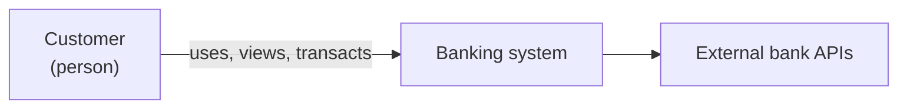
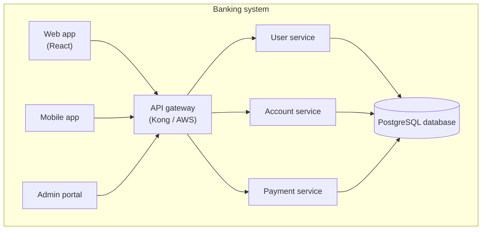
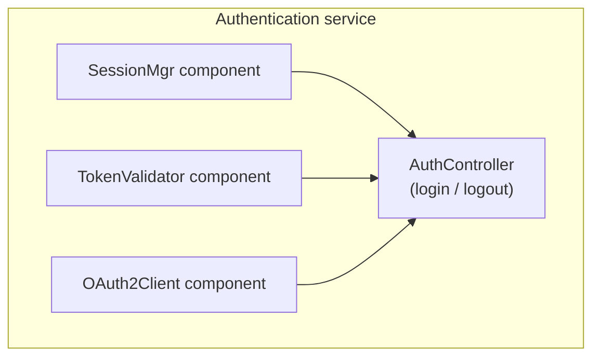
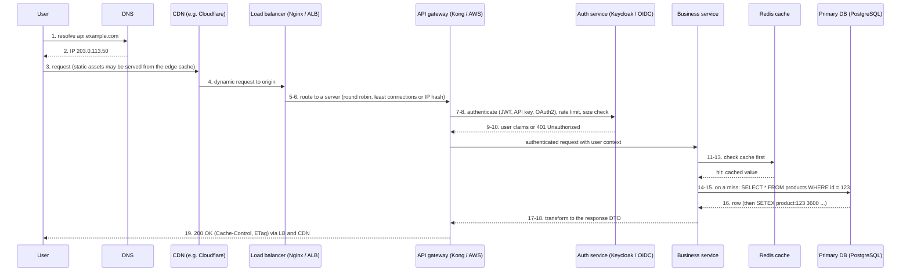
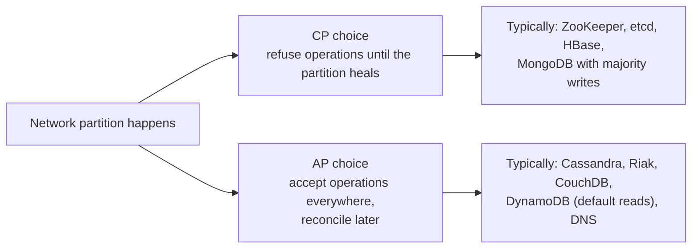
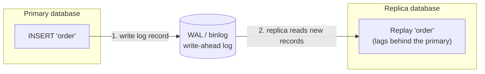
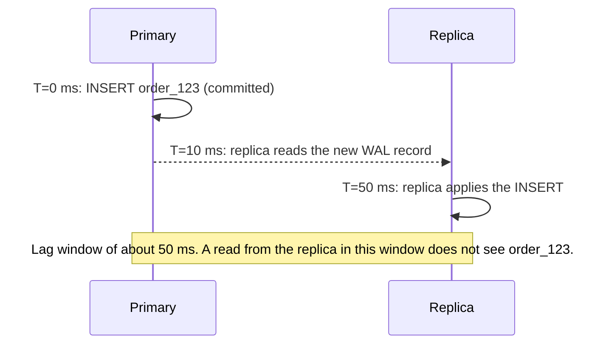
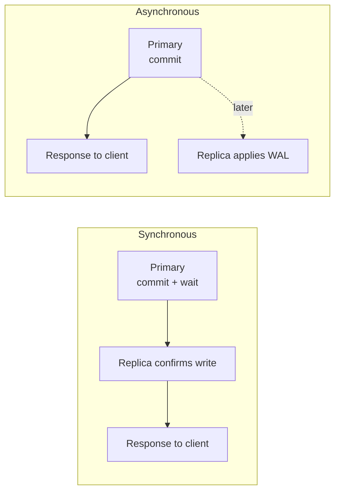
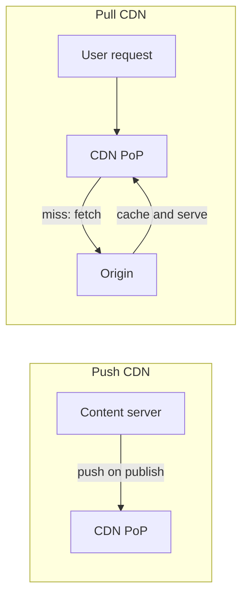

# 💪 Part 7: Practice Exercises

> **Navigation**: [← OOP vs FUNCTIONAL DESIGN](04_oop_vs_functional_design.md) | [Chapter overview](../03_System_Design.md)
> Page 5 of 5 in **System Design & Feature Creation Guide**


SYSTEM DESIGN PRACTICE PROBLEMS

BEGINNER LEVEL:

1. Design a Parking Lot System
2. Design a Library Management System
3. Design a URL Shortener
4. Design a Rate Limiter
5. Design a Task Scheduler

INTERMEDIATE LEVEL: 6. Design Twitter Feed 7. Design Instagram 8. Design Uber/Ola 9. Design Netflix 10. Design WhatsApp

ADVANCED LEVEL: 11. Design Google Search 12. Design YouTube 13. Design Distributed Cache 14. Design Payment System 15. Design Stock Trading Platform

FOR EACH PROBLEM:

1. Clarify requirements (5 min)
2. Estimate scale (5 min)
3. Draw high-level design (10 min)
4. Deep dive into components (15 min)
5. Discuss trade-offs (5 min)

---

## PLUS Enhancements

### ASCII Diagram 1: C4 Model Hierarchy

### C4 model hierarchy (Context → Container → Component → Code)

**Level 1 — System context.** *What is the system and who uses it?*



**How to read this diagram.** Arrows show the direction of flow from one step or component to the next.

**Level 2 — Container** (process or deployment unit). *What applications or deployable units does the system consist of?*



**How to read this diagram.** Arrows show the direction of flow from one step or component to the next.

**Level 3 — Component** (major code grouping). *What are the major components within a container?*



**Level 4 — Code** (classes and functions). *What is the code structure for one component?*

`SessionManager.java`

- `createSession(userId): Session`
- `validateToken(token): Boolean`
- `refreshSession(token): Session`
- `invalidateSession(token): void`

Uses Redis (tokens), JWT (claims) and BCrypt (password hashing).

**How to read these diagrams.** Each level zooms into one box of the level above: a system into containers, a container into components, a component into code.

## ASCII Diagram 2: End-to-End Request Flow

### End-to-end request flow (client → DNS → CDN → load balancer → gateway → auth → business logic → database)



**How to read this diagram.** Numbers match the steps of the request. A cache hit at the CDN returns early (typically a few to tens of milliseconds); a dynamic request passes through every layer, with the Redis cache absorbing most reads before they reach the database. The whole round trip is typically tens to a couple of hundred milliseconds.

## ASCII Diagram 3: CAP Theorem Triangle

### CAP theorem

During a network partition (which is inevitable in distributed systems) you must choose between **consistency** and **availability**.



**How to read this diagram.** The partition is the trigger; the two branches are the only choices. System labels are typical tendencies and depend on configuration (for example quorum settings).

| | CP (consistency + partition tolerance) | AP (availability + partition tolerance) |
| --- | --- | --- |
| **During a partition** | Refuse operations until the partition heals | Accept operations everywhere, reconcile differences later |
| **Example** | ZooKeeper: leader election required; writes are rejected without a quorum | Cassandra: tunable quorum reads and writes; last-writer-wins conflict resolution by default |
| **Use when** | Money and ledger systems; inventory and atomic transactions; anywhere stale data is catastrophic | Social feeds and likes; shopping carts; user-generated content; "always on" requirements |

> [!NOTE]
> "CA" (consistency and availability without partition tolerance) is not a real option for a distributed system: partitions happen, so you pick CP or AP when they do. A single-node database has no partitions to tolerate, but the moment you add a replica you are distributed.

**Real-world decisions**

- **Feed recommendations (AP):** a stale recommendation is annoying but not catastrophic, so being always available gives a better experience.
- **Bank ledgers (CP):** accepting conflicting writes during a partition can cause a double spend, so refuse writes until the partition heals.
- **Amazon Dynamo paper (2007):** chose availability for the shopping cart, because duplicate items found during reconciliation are recoverable, while refusing to add to the cart loses sales.

## CAP Refinement: PACELC and the "Choose 2" Misnomer

The simple "choose 2" framing is a pedagogical shorthand. Gilbert and Lynch's 2002 proof (of Brewer's 2000 conjecture) showed that during a partition you must sacrifice either consistency OR availability — but the trade-off is not binary in normal operation. **PACELC** (Daniel Abadi, 2010) extends CAP: if Partition (P), choose Availability or Consistency (A or C); **E**lse (no partition), choose **L**atency or **C**onsistency. A real-world CP system like ZooKeeper trades latency for consistency even when partitions are rare. The point: "during a partition" is the only time the C/A trade-off forces your hand.

---

## Deep-Dive: Database Read Replicas

**How Async Replication Works:**

### Read-replica replication flow (asynchronous, primary → replica)



**How to read this diagram.** The primary appends every change to its log before acknowledging the client; the replica reads the log and replays the changes some time later.

**Mechanism**

1. **The primary writes the transaction to its write-ahead log (WAL).** The WAL is append-only and ordered by LSN (log sequence number). The commit is durable in the WAL *before* the client is told it succeeded.
2. **The replica receives the log records.** In MySQL the replica's IO thread reads the primary's binlog; in PostgreSQL a WAL receiver streams WAL from the primary. The replica tracks its position (binlog coordinates or LSN) so it only reads what it has not seen.
3. **The replica applies the changes** (MySQL's SQL thread, PostgreSQL's startup/recovery process), replaying INSERT/UPDATE/DELETE in commit order so the replica stays transactionally consistent.
4. **Replication lag** is the time between the primary's commit and the replica's apply.
   - Often milliseconds to a few hundred milliseconds in a healthy cluster, depending on load, network and distance.
   - It can grow to seconds or minutes during heavy write bursts.
   - It can grow without bound if the replica is down or unreachable.

**The Replication Lag Problem and Stale Read Handling:**

### Replication lag windows



**How to read this diagram.** The timings are an example, not a guarantee. Any read served by the replica between the commit and the apply is stale.

### Strategies for handling stale reads

**1. Read-your-writes consistency.** After a user writes, their own next read must see that write.

- *Implementation:* read from the **primary** (not a replica) for a short window after a write, for example 30 seconds. Or remember the primary's log position after the write and only read from a replica that has replayed at least that position.

```python
def write_order(order):
    db.primary.execute("INSERT INTO orders ...", order)
    # PostgreSQL: remember the log position of this commit
    lsn = db.primary.query("SELECT pg_current_wal_lsn()")
    session.min_lsn = lsn          # reads may use a replica only once
    return order.id                # pg_last_wal_replay_lsn() >= session.min_lsn
```

**2. Monotonic reads.** If a user reads value V1 at time T1, they never see an older V0 at a later time. This prevents "going back in time".

- *Implementation:* bind a user session to one replica for its duration (sticky routing in the load balancer) instead of routing each request to a random replica.

**3. Causal consistency.** If operation A causes operation B, anyone who sees B also sees A's effects. Example: a user posts a comment and then sees it.

- *Implementation:* track causal dependencies (for example with version vectors or logical timestamps). MongoDB offers causally consistent sessions; research systems such as COPS pioneered the idea.

**4. Eventual consistency (accept and monitor).** For non-critical reads, accept staleness within an agreed SLA.

- Monitor replication lag, for example alert if it exceeds 5 seconds for 5 minutes.
- Expose a "data freshness" metric to callers.

---

## Why-This-Not-That: Synchronous vs Async Replication

### Synchronous versus asynchronous replication

When to use which, and what you trade away.



**How to read this diagram.** In the synchronous case the client waits for the replica; in the asynchronous case the client is answered first and the replica catches up later.

| | Synchronous replication | Asynchronous replication |
| --- | --- | --- |
| **Pros** | Strong consistency: the replica has the data before the client gets a response. Zero data loss: if the primary dies, the replica has every committed write. Easy failover: the replica is guaranteed up to date. | Low latency: no wait for the replica. High throughput: the primary is not blocked. Cheap geo-distribution. The primary keeps working if replicas are down. |
| **Cons** | Latency: a write costs a round trip to the replica (often several milliseconds or more). Throughput is limited by the slowest replica. Availability: if a required replica is down, writes stall (semi-synchronous mode helps). Cross-region synchronous replication is expensive. | Data-loss window: if the primary dies before the replica receives the log, that data is lost (the window is the replication lag). Stale reads: the replica may be behind by milliseconds to minutes. Failover is more complex. |
| **Use when** | Financial transactions, ledgers, inventory deductions. Data loss is catastrophic. Regulatory durability requirements. Replicas are in the same data centre (low latency). | High-throughput write workloads (logs, analytics, feeds). Stale reads are acceptable. Cross-region replication where synchronous latency is prohibitive. Reporting that does not need real-time data. |
| **Examples** | ZooKeeper acknowledges a write only after a quorum has logged it. Banks often keep a synchronously replicated standby for disaster recovery. | Many MySQL and PostgreSQL read-replica setups. Kafka lets you choose per producer (`acks=1` is leader-only, `acks=all` waits for the in-sync replicas). MongoDB lets you choose with write concern (`w:1` versus `w:"majority"`). |

**Hybrid: semi-synchronous replication.** The primary waits for **at least one** replica to acknowledge, not all of them. If the primary dies, at least one replica has every committed write. The trade-off is much lower latency than full synchronous replication while keeping recoverability. MySQL offers a semi-synchronous plugin, and PostgreSQL can wait for any one of several standbys (`synchronous_standby_names = 'ANY 1 (...)'`). It is a common middle ground, not a universal recommendation: pick the mode from your durability and latency requirements.

---

## Breadth Comparison: Load Balancer Strategies

### Load-balancer strategies compared

| Strategy | How it works | Pros | Cons | When to use |
| --- | --- | --- | --- | --- |
| **Round robin** | Cycles through servers in order: S1 → S2 → S3 → S1 … | Simple; low overhead; no session affinity needed | Ignores server load; does not account for servers of different sizes | Homogeneous servers, stateless services |
| **Least connections** | Routes to the server with the fewest active connections | Adapts to load differences; better utilisation when request times vary | More complex (must track connections); session state can cause uneven distribution | Variable request duration (long polling, WebSocket, file uploads) |
| **IP hash** | `hash(client_IP) mod N` picks the server | Session stickiness; deterministic | Hotspots if large clients share an IP; one IP always lands on one server | The same client must reach the same server (sessions) |
| **Consistent hashing** | `hash(key)` is placed on a ring; the nearest server (using virtual nodes) takes it | Only about K/n keys move when servers change; enables caching without sticky sessions; used by Dynamo-style stores, Cassandra and many Memcached clients | More complex (ring management); uneven if virtual nodes are poorly configured | Cache-heavy workloads where cache contents depend on server assignment |

**Production recommendation**

- Stateless services: round robin (simple and effective).
- Stateful long-lived connections: IP hash or least connections.
- Caches and sharded services: consistent hashing, because adding or removing a server invalidates the least data. (Redis Cluster uses a related idea, 16,384 fixed hash slots, rather than a ring.)
- Kubernetes: `kube-proxy` distributes service traffic with iptables or IPVS rules, and some CNI plugins such as Cilium can replace it with eBPF.

---

## Breadth Comparison: CDN Strategies (Push vs Pull)

### CDN deployment strategies



**How to read this diagram.** With push you decide what is on the CDN and when; with pull the CDN fetches on the first request and caches the result.

| | Push CDN | Pull CDN |
| --- | --- | --- |
| **Idea** | You control what is on the CDN (proactive) | The CDN pulls on first request (lazy, on demand) |
| **Use when** | Static assets with a known set (CSS, JS, images); predictable traffic; exact cache control; high-security content (signed URLs) | Large catalogue with unpredictable access; user-generated content; most content rarely accessed; most traffic goes to a small share of content |
| **Pros** | Instant cache invalidation; no thundering herd; predictable origin load; exact TTL control | No upload step; scales to billions of assets; little maintenance (set a TTL and forget); popular content caches itself |
| **Cons** | Must push on every deploy; may push unused content; adds complexity with a CMS | First request is slow (cache miss); thundering herd on new content; harder to invalidate precisely; origin sees more traffic until the cache warms |
| **Providers** | Storage-backed products such as Akamai NetStorage | Most CDNs work this way by default: Cloudflare, Amazon CloudFront, Fastly, Google Cloud CDN, Azure CDN |

**Hybrid pattern (most common in production)**

- Static assets: push on CI/CD deploy (CSS, JS, images), or serve them with versioned file names.
- User content: pull on first access (avatars, uploads).
- Use different TTLs, for example a year for versioned JS/CSS and about 30 days for images.

**Thundering-herd mitigation.** When a popular object expires everywhere at once, thousands of users can hit the origin instead of one. Mitigations: staggered TTLs, cache warming, request coalescing (only one request refreshes the object) and serving stale content while revalidating.

---

[← OOP vs FUNCTIONAL DESIGN](04_oop_vs_functional_design.md) | [Chapter overview](../03_System_Design.md)
