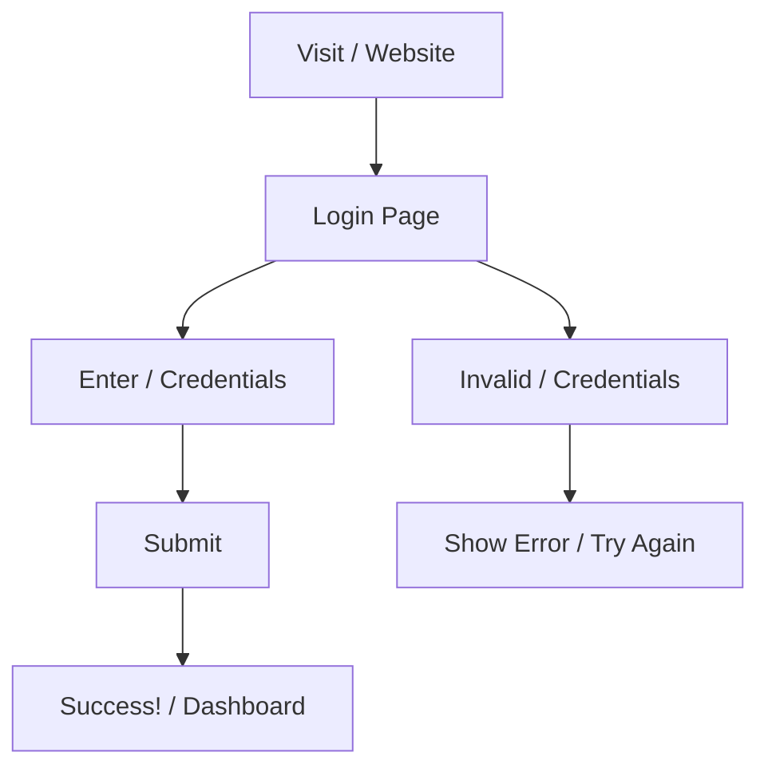
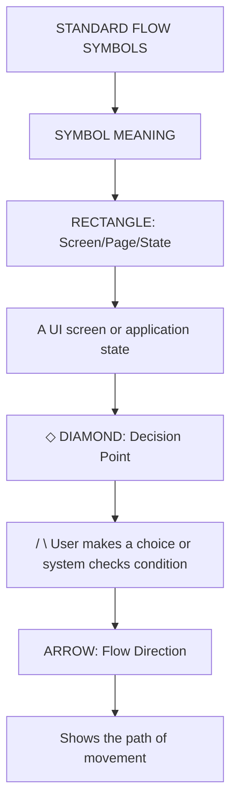
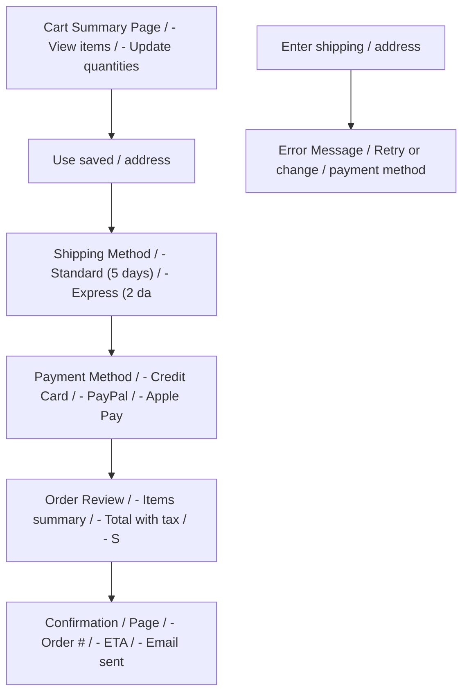
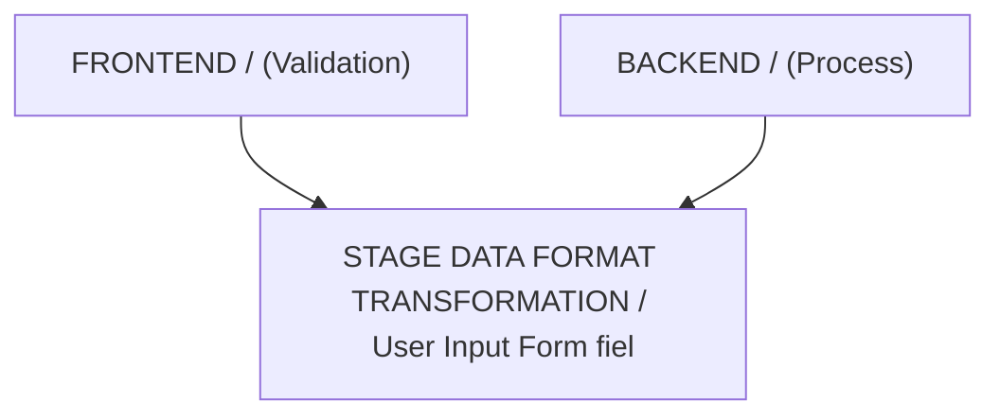
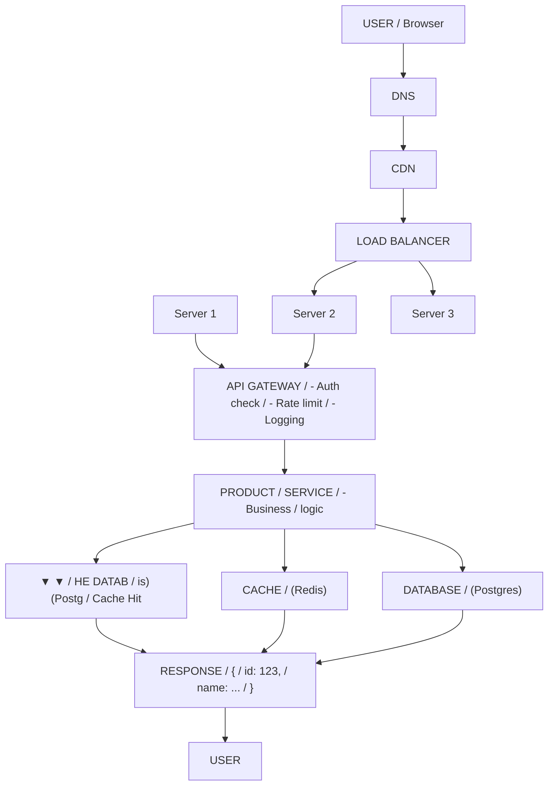
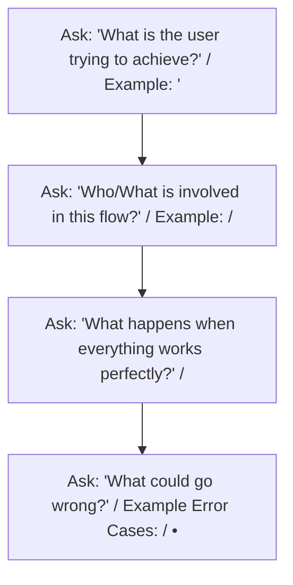
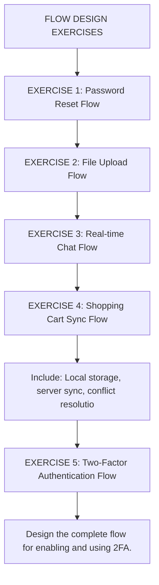
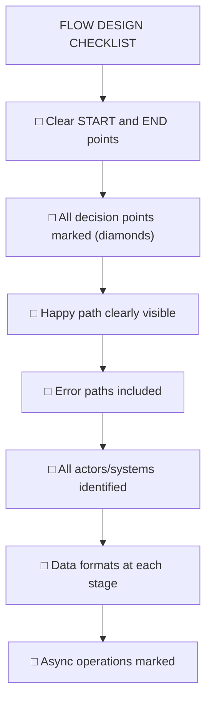

> **Navigation**: [< Previous](03_System_Design.md) | [Back to Index](../00_MASTER_INDEX.md) | [Next >](05_SD_Interview_Problems.md)

# 🔄 Understanding User Flows & System Flows

## Complete Guide: From Concept to Implementation

---

# 📚 Part 0: Complete Understanding of Flows

## What Are Flows?

Flows are the PATHS that something takes through a system.
They show HOW things move from start to finish.

**Types Of Flows**:
1. USER FLOW (UX Flow)
Path a USER takes to complete a task in your application
Example: Login → Dashboard → Profile → Edit → Save
2. DATA FLOW
Path DATA takes through your system
Example: Form → Validation → API → Database → Response
3. CONTROL FLOW
Path of EXECUTION in your code
Example: if-else, loops, function calls
4. SYSTEM FLOW
Path a REQUEST takes through multiple services
Example: Client → Load Balancer → API Gateway → Services → DB
5. BUSINESS FLOW (Process Flow)
Path a BUSINESS PROCESS takes
Example: Order → Payment → Inventory → Shipping → Delivery

> 💡 **ANALOGY: City Roads**
USER FLOW = The route a person takes (Home → Work → Gym → Home)
DATA FLOW = The route packages take (Warehouse → Truck → Store → You)
SYSTEM FLOW = The city's infrastructure (Roads, Traffic lights, Signs)
CONTROL FLOW = Traffic rules (Stop signs, One-ways, Speed limits)
## What Problem Do Flows Solve


**Without Understanding Flows**:
- "I don't know what happens when user clicks this button"
- "The data disappears somewhere in the system"
- "I fixed one thing, but broke five others"
- "The feature works in my head, but I can't explain it"

**With Understanding Flows**:
- "Click triggers X, which updates Y, which notifies Z"
- "Data goes: UI → Validation → Transform → Store → Confirm"
- "Change here affects these 3 specific places"
- "Here's the complete flow diagram of the feature"
REAL-WORLD PROBLEMS FLOWS SOLVE:
- Bug Tracking: "Where did this break?"
- Onboarding: "How does this system work?"
- Feature Planning: "What do we need to build?"
- Performance: "Where is the bottleneck?"
- Security: "Where is data exposed?"
## Why Learn Flow Design

1. CLARITY OF THOUGHT:
Before code: "I think I know what to build"
After flow design: "I know EXACTLY what to build"
2. COMMUNICATION:
- Explain complex systems to non-technical stakeholders
- Align team on implementation approach
- Document for future developers
3. BETTER ARCHITECTURE:
- See the big picture before coding
- Identify potential problems early
- Design scalable solutions
4. DEBUGGING SUPERPOWER:
- Trace issues systematically
- Understand side effects of changes
- Find root causes faster
5. INTERVIEW SUCCESS:
- System design interviews require flow thinking
- Shows architectural mindset
- Demonstrates senior-level thinking
## When To Create Flow Diagrams

- ✅ ALWAYS CREATE WHEN:
- Starting a new feature
- Onboarding to new codebase
- Debugging complex issues
- Planning system changes
- Writing technical documentation
- Conducting system design interviews
⚠️ OPTIONAL WHEN:
- Very simple CRUD operations
- Quick bug fixes (though still helpful!)
- Prototype/throwaway code

**Pro Tip**: When in doubt, draw the flow!
5 minutes drawing saves hours of confusion.
## Historical Evolution Of Flow Design

1920s: PROCESS FLOW CHARTS
- Industrial engineering for manufacturing
- Frank and Lillian Gilbreth introduced flow process charts
1960s: SOFTWARE FLOWCHARTS
- Adapted for programming
- Became standard in software documentation
1990s: UML DIAGRAMS
- Sequence diagrams, activity diagrams
- Standardized notation for software
2000s: USER EXPERIENCE FLOWS
- Rise of UX design profession
- Focus on user journey mapping
2010s: MICROSERVICES & DISTRIBUTED FLOWS
- System flows became more complex
- Tools like Mermaid, PlantUML emerged

**Today**: AI-ASSISTED FLOW GENERATION
- Tools that auto-generate flows from code
- Visual IDEs for flow-based programming
## ⭐ Growth Mindset: From Flow Reader To Flow Creator ⭐

LEVEL 1 - READER:
"I can understand flow diagrams when someone shows me"
LEVEL 2 - TRACER:
"I can trace through existing code and create flow diagrams"
LEVEL 3 - PLANNER:
"I design flows BEFORE writing code"
LEVEL 4 - OPTIMIZER:
"I can look at flows and identify improvements"
LEVEL 5 - ARCHITECT:
"I design flows for entire systems with multiple services"
THE CREATOR'S QUESTION:
"How would I design a flow for a feature that doesn't exist yet?"
Example: "Design the flow for a new 'Split Bill' feature in a payment app"
- What inputs are needed?
- What validations are required?
- What happens at each step?
- What errors can occur?
- How does it integrate with existing features?

---

# 🏗️ Part 1: User Flow Design

## What is User Flow?

```
╔══════════════════════════════════════════════════════════════════════════════╗
║                         USER FLOW FUNDAMENTALS                               ║
╚══════════════════════════════════════════════════════════════════════════════╝

DEFINITION:
User Flow = The path a user takes through your application to complete a goal

COMPONENTS:
1. ENTRY POINT: Where user starts (homepage, link, notification)
2. STEPS: Actions user takes (click, type, swipe)
3. DECISIONS: Points where user chooses (login vs register)
4. EXIT POINT: Where user ends (success page, logout)

SIMPLE USER FLOW EXAMPLE - LOGIN:

┌─────────────────────────────────────────────────────────────────────────────┐
│                                                                             │
│   ┌──────────┐     ┌───────────────┐     ┌────────────┐     ┌──────────┐    │
│   │  Visit   │────▶│  Login Page   │────▶│  Enter     │────▶│  Submit  │    │
│   │  Website │     │               │     │  Credentials│    │          │    │
│   └──────────┘     └───────────────┘     └────────────┘     └────┬─────┘    │
│                                                                   │         │
│                           ┌───────────────────────────────────────┤         │
│                           ▼                                       ▼         │
│                    ┌──────────────┐                        ┌──────────────┐ │
│                    │   Invalid    │                        │   Success!   │ │
│                    │  Credentials │                        │  Dashboard   │ │
│                    └──────┬───────┘                        └──────────────┘ │
│                           │                                                 │
│                           ▼                                                 │
│                    ┌──────────────┐                                         │
│                    │  Show Error  │──────▶ Back to Login                    │
│                    │  Try Again   │                                         │
│                    └──────────────┘                                         │
│                                                                             │
└─────────────────────────────────────────────────────────────────────────────┘
```

> **Flow**: Visit / Website → Login Page | Login Page → Enter / Credentials | Login Page → Invalid / Credentials | Enter / Credentials → Submit | Submit → Success! / Dashboard | Invalid / Credentials → Show Error / Try Again



## Flow Notation Symbols

```
╔══════════════════════════════════════════════════════════════════════════════╗
║                         STANDARD FLOW SYMBOLS                                ║
╚══════════════════════════════════════════════════════════════════════════════╝

┌─────────────────────────────────────────────────────────────────────────────┐
│ SYMBOL                    │ MEANING                                         │
├─────────────────────────────────────────────────────────────────────────────┤
│                                                                             │
│ ┌──────────────┐          RECTANGLE: Screen/Page/State                      │
│ │              │          A UI screen or application state                  │
│ └──────────────┘                                                            │
│                                                                             │
│ ◇                         DIAMOND: Decision Point                           │
│ / \                       User makes a choice or system checks condition    │
│                                                                             │
│ ────────────▶             ARROW: Flow Direction                             │
│                           Shows the path of movement                        │
│                                                                             │
│ (  )                      OVAL: Start/End Points                            │
│                           Entry or exit of the flow                         │
│                                                                             │
│ [ ]                       BRACKET: Action/Process                           │
│                           Something happens (API call, calculation)         │
│                                                                             │
│ ═══════════════           DOUBLE LINE: Parallel Process                     │
│                           Multiple things happen simultaneously             │
│                                                                             │
│ - - - - - - - ▶           DASHED ARROW: Optional/Conditional Path           │
│                           May or may not happen                             │
│                                                                             │
└─────────────────────────────────────────────────────────────────────────────┘
```

> **Flow**: STANDARD FLOW SYMBOLS → SYMBOL MEANING | SYMBOL MEANING → RECTANGLE: Screen/Page/State | RECTANGLE: Screen/Page/State → A UI screen or application state | A UI screen or application state → ◇ DIAMOND: Decision Point | ◇ DIAMOND: Decision Point → / \ User makes a choice or system checks condition | / \ User makes a choice or system checks condition → ARROW: Flow Direction | ...+1 more



## Complete User Flow Example: E-commerce Checkout

```
╔══════════════════════════════════════════════════════════════════════════════╗
║                    E-COMMERCE CHECKOUT USER FLOW                             ║
╚══════════════════════════════════════════════════════════════════════════════╝

    (Start: User has items in cart)
                │
                ▼
    ┌───────────────────────┐
    │   Cart Summary Page   │
    │   - View items        │
    │   - Update quantities │
    │   - Apply coupon      │
    └───────────┬───────────┘
                │
                ▼
         ◇─────────────────◇
        /                   \
    [Logged In?]      [Guest Checkout?]
        │                   │
        │YES                │YES
        ▼                   ▼
    ┌─────────────┐   ┌─────────────────┐
    │ Use saved   │   │ Enter shipping  │
    │ address     │   │ address         │
    └──────┬──────┘   └────────┬────────┘
           │                   │
           └────────┬──────────┘
                    │
                    ▼
    ┌───────────────────────┐
    │  Shipping Method      │
    │  - Standard (5 days)  │
    │  - Express (2 days)   │
    │  - Overnight          │
    └───────────┬───────────┘
                │
                ▼
    ┌───────────────────────┐
    │   Payment Method      │
    │   - Credit Card       │
    │   - PayPal            │
    │   - Apple Pay         │
    └───────────┬───────────┘
                │
                ▼
    ┌───────────────────────┐
    │   Order Review        │
    │   - Items summary     │
    │   - Total with tax    │
    │   - Shipping cost     │
    └───────────┬───────────┘
                │
                ▼
         ◇─────────────────────◇
        / \                   / \
    [Payment Success?]   [Payment Failed?]
        │                     │
        │YES                  │
        ▼                     ▼
    ┌─────────────┐    ┌─────────────────┐
    │ Confirmation│    │ Error Message   │
    │ Page        │    │ Retry or change │
    │ - Order #   │    │ payment method  │
    │ - ETA       │    └────────┬────────┘
    │ - Email sent│             │
    └─────────────┘             │
                                │
    (End: Order Placed)    Back to Payment
```

> **Flow**: Cart Summary Page / - View items / - Update quantities  → Use saved / address | Use saved / address → Shipping Method / - Standard (5 days) / - Express (2 da | Enter shipping / address → Error Message / Retry or change / payment method | Shipping Method / - Standard (5 days) / - Express (2 da → Payment Method / - Credit Card / - PayPal / - Apple Pay | Payment Method / - Credit Card / - PayPal / - Apple Pay → Order Review / - Items summary / - Total with tax / - S | Order Review / - Items summary / - Total with tax / - S → Confirmation / Page / - Order # / - ETA / - Email sent



---

# 🏗️ Part 2: Data Flow Design

## Understanding Data Flow


> DATA FLOW FUNDAMENTALS


DEFINITION:
Data Flow = How data moves through and transforms in your system

KEY QUESTIONS:
• Where does data come from? (Source)
• What happens to it? (Transform)
• Where does it go? (Destination)
• What form does it take? (Format)

DATA FLOW TYPES:

1. INPUT FLOW (Data entering system)
User Input → Validation → Sanitization → Processing

2. PROCESSING FLOW (Data being transformed)
Raw Data → Transform → Aggregate → Calculate → Result

3. OUTPUT FLOW (Data leaving system)
Result → Format → Response → Delivery

4. STORAGE FLOW (Data being persisted)
Data → Validate → Transform → Store → Index

## Data Flow Example: User Registration

```
╔══════════════════════════════════════════════════════════════════════════════╗
║                    USER REGISTRATION DATA FLOW                               ║
╚══════════════════════════════════════════════════════════════════════════════╝

┌─────────────────────────────────────────────────────────────────────────────┐
│                                                                             │
│  ┌───────────┐    ┌────────────────┐    ┌──────────────┐    ┌───────────┐   │
│  │   USER    │    │    FRONTEND    │    │    BACKEND   │    │  DATABASE │   │
│  │  (Input)  │    │  (Validation)  │    │  (Process)   │    │  (Store)  │   │
│  └─────┬─────┘    └────────┬───────┘    └──────┬───────┘    └─────┬─────┘   │
│        │                   │                   │                  │         │
│        │  Form Data        │                   │                  │         │
│        │  {                │                   │                  │         │
│        │   name: "John",   │                   │                  │         │
│        │   email: "j@e.c", │                   │                  │         │
│        │   password: "123" │                   │                  │         │
│        │  }                │                   │                  │         │
│        │──────────────────▶│                   │                  │         │
│        │                   │                   │                  │         │
│        │                   │  VALIDATE:        │                  │         │
│        │                   │  - Email format ✓ │                  │         │
│        │                   │  - Password 8+ ✗  │                  │         │
│        │                   │                   │                  │         │
│        │  Error: Password  │                   │                  │         │
│        │◀──too short──────│                   │                  │          │
│        │                   │                   │                  │         │
│        │  Fixed password:  │                   │                  │         │
│        │  "SecurePass123"  │                   │                  │         │
│        │──────────────────▶│                   │                  │         │
│        │                   │                   │                  │         │
│        │                   │  All valid ✓      │                  │         │
│        │                   │──────────────────▶│                  │         │
│        │                   │                   │                  │         │
│        │                   │                   │  PROCESS:        │         │
│        │                   │                   │  1. Check if     │         │
│        │                   │                   │     email exists │         │
│        │                   │                   │  2. Hash password│         │
│        │                   │                   │  3. Generate ID  │         │
│        │                   │                   │──────────────────▶         │
│        │                   │                   │                  │         │
│        │                   │                   │  INSERT user     │         │
│        │                   │                   │  {               │         │
│        │                   │                   │   id: "uuid",    │         │
│        │                   │                   │   name: "John",  │         │
│        │                   │                   │   email: "j@e.c",│         │
│        │                   │                   │   pwd_hash: "..."│         │
│        │                   │                   │  }               │         │
│        │                   │                   │◀─────────────────│         │
│        │                   │                   │  Success         │         │
│        │                   │◀──────────────────│                  │         │
│        │                   │  User created     │                  │         │
│        │◀──────────────────│  Response:        │                  │         │
│        │  Success!         │  { id, name }     │                  │         │
│        │                   │                   │                  │         │
└─────────────────────────────────────────────────────────────────────────────┘

DATA TRANSFORMATIONS:
┌────────────────────────────────────────────────────────────────────────────┐
│ STAGE           │ DATA FORMAT                  │ TRANSFORMATION            │
├────────────────────────────────────────────────────────────────────────────┤
│ User Input      │ Form fields (strings)        │ None                      │
│ Frontend Valid. │ JSON object                  │ Trim, type check          │
│ API Request     │ JSON over HTTPS              │ Serialize to JSON         │
│ Backend Valid.  │ Request DTO                  │ Deserialize, validate     │
│ Processing      │ Domain object                │ Hash password, generate ID│
│ Database        │ SQL/Document                 │ ORM mapping               │
│ Response        │ Response DTO                 │ Strip sensitive fields    │
│ Frontend        │ JSON                         │ Display formatting        │
└────────────────────────────────────────────────────────────────────────────┘
```

> **Flow**: FRONTEND / (Validation) → STAGE DATA FORMAT TRANSFORMATION / User Input Form fiel | BACKEND / (Process) → STAGE DATA FORMAT TRANSFORMATION / User Input Form fiel



---

# PART 3: SYSTEM FLOW (Request Flow)

## How a Request Flows Through a Modern System

```
╔══════════════════════════════════════════════════════════════════════════════╗
║                    COMPLETE REQUEST FLOW IN MODERN SYSTEM                    ║
╚══════════════════════════════════════════════════════════════════════════════╝

USER REQUEST: GET /api/products/123

┌─────────────────────────────────────────────────────────────────────────────┐
│                                                                             │
│                               ┌─────────┐                                   │
│                               │  USER   │                                   │
│                               │ Browser │                                   │
│                               └────┬────┘                                   │
│                                    │ 1. HTTP Request                        │
│                                    ▼                                        │
│                              ┌───────────┐                                  │
│                              │    DNS    │ 2. Resolve domain to IP          │
│                              └─────┬─────┘                                  │
│                                    │                                        │
│                                    ▼                                        │
│                              ┌───────────┐                                  │
│                              │    CDN    │ 3. Check cache (static assets)   │
│                              └─────┬─────┘                                  │
│                                    │ Cache Miss                             │
│                                    ▼                                        │
│                           ┌───────────────┐                                 │
│                           │ LOAD BALANCER │ 4. Route to available server    │
│                           └───────┬───────┘                                 │
│                                   │                                         │
│                    ┌──────────────┼──────────────┐                          │
│                    ▼              ▼              ▼                          │
│              ┌──────────┐  ┌──────────┐  ┌──────────┐                       │
│              │ Server 1 │  │ Server 2 │  │ Server 3 │                       │
│              └────┬─────┘  └──────────┘  └──────────┘                       │
│                   │                                                         │
│                   ▼ 5. Hit API Gateway                                      │
│            ┌──────────────┐                                                 │
│            │  API GATEWAY │                                                 │
│            │ - Auth check │                                                 │
│            │ - Rate limit │                                                 │
│            │ - Logging    │                                                 │
│            └──────┬───────┘                                                 │
│                   │                                                         │
│                   ▼ 6. Route to service                                     │
│            ┌───────────────┐                                                │
│            │ PRODUCT       │                                                │
│            │ SERVICE       │                                                │
│            │               │                                                │
│            │ - Business    │                                                │
│            │   logic       │                                                │
│            └───────┬───────┘                                                │
│                    │                                                        │
│          ┌────────┴────────┐                                                │
│          │                 │                                                │
│          ▼                 ▼                                                │
│    ┌──────────┐      ┌──────────┐                                           │
│    │  CACHE   │      │ DATABASE │ 7. Check cache first, then DB             │
│    │ (Redis)  │      │(Postgres)│                                           │
│    └────┬─────┘      └────┬─────┘                                           │
│         │ Cache Hit       │ Cache Miss                                      │
│         │                 │                                                 │
│         └────────┬────────┘                                                 │
│                  │                                                          │
│                  ▼                                                          │
│            ┌───────────────┐                                                │
│            │   RESPONSE    │ 8. Format and return                           │
│            │   {           │                                                │
│            │     id: 123,  │                                                │
│            │     name: ... │                                                │
│            │   }           │                                                │
│            └───────────────┘                                                │
│                  │                                                          │
│                  │ Reverse path back to user                                │
│                  ▼                                                          │
│             ┌─────────┐                                                     │
│             │  USER   │ 9. Receives JSON response                           │
│             └─────────┘                                                     │
│                                                                             │
└─────────────────────────────────────────────────────────────────────────────┘
```

> **Flow**: USER / Browser → DNS | DNS → CDN | CDN → LOAD BALANCER | LOAD BALANCER → Server 2 | LOAD BALANCER → Server 3 | Server 1 → API GATEWAY / - Auth check / - Rate limit / - Logging | ...+9 more



---

# 📌 Part 4: Creating Flows for New Features

## Step-by-Step Feature Flow Creation

```
╔══════════════════════════════════════════════════════════════════════════════╗
║                    HOW TO CREATE A FLOW FOR ANY FEATURE                      ║
╚══════════════════════════════════════════════════════════════════════════════╝

STEP 1: IDENTIFY THE GOAL
┌─────────────────────────────────────────────────────────────────────────────┐
│ Ask: "What is the user trying to achieve?"                                  │
│                                                                             │
│ Example: "User wants to share a post to multiple social media platforms"    │
│                                                                             │
│ • Primary Goal: Share content                                               │
│ • Success Criteria: Post appears on selected platforms                      │
│ • Failure Criteria: User is informed of what failed and why                 │
└─────────────────────────────────────────────────────────────────────────────┘

STEP 2: IDENTIFY ALL ACTORS
┌─────────────────────────────────────────────────────────────────────────────┐
│ Ask: "Who/What is involved in this flow?"                                   │
│                                                                             │
│ Example:                                                                    │
│ • User (starts the action)                                                  │
│ • Frontend (UI)                                                             │
│ • Backend API                                                               │
│ • External APIs (Twitter, Facebook, LinkedIn)                               │
│ • Database (logging, history)                                               │
│ • Message Queue (async processing)                                          │
└─────────────────────────────────────────────────────────────────────────────┘

STEP 3: MAP THE HAPPY PATH
┌─────────────────────────────────────────────────────────────────────────────┐
│ Ask: "What happens when everything works perfectly?"                        │
│                                                                             │
│ Example Happy Path:                                                         │
│ 1. User clicks "Share" button                                               │
│ 2. Modal opens with platform options                                        │
│ 3. User selects Twitter, LinkedIn                                           │
│ 4. User clicks "Share Now"                                                  │
│ 5. Request goes to backend                                                  │
│ 6. Backend posts to both platforms                                          │
│ 7. Both succeed                                                             │
│ 8. User sees "Shared successfully!"                                         │
└─────────────────────────────────────────────────────────────────────────────┘

STEP 4: IDENTIFY ERROR CASES
┌─────────────────────────────────────────────────────────────────────────────┐
│ Ask: "What could go wrong?"                                                 │
│                                                                             │
│ Example Error Cases:                                                        │
│ • User not connected to platform                                            │
│ • Platform API is down                                                      │
│ • Content exceeds character limit                                           │
│ • Network timeout                                                           │
│ • Rate limit exceeded                                                       │
│ • Partial failure (Twitter works, LinkedIn fails)                           │
└─────────────────────────────────────────────────────────────────────────────┘

STEP 5: DRAW THE COMPLETE FLOW
```

> **Flow**: Ask: 'What is the user trying to achieve?' / Example: ' → Ask: 'Who/What is involved in this flow?' / Example: /  | Ask: 'Who/What is involved in this flow?' / Example: /  → Ask: 'What happens when everything works perfectly?' /  | Ask: 'What happens when everything works perfectly?' /  → Ask: 'What could go wrong?' / Example Error Cases: / • 



## Complete Feature Flow Example: Social Share

```
╔══════════════════════════════════════════════════════════════════════════════╗
║                    SOCIAL SHARE FEATURE - COMPLETE FLOW                      ║
╚══════════════════════════════════════════════════════════════════════════════╝

┌─────────────────────────────────────────────────────────────────────────────┐
│                                                                             │
│    (Start: User on content page)                                            │
│                │                                                            │
│                ▼                                                            │
│    ┌───────────────────────┐                                                │
│    │   Click Share Button  │                                                │
│    └───────────┬───────────┘                                                │
│                │                                                            │
│                ▼                                                            │
│    ┌───────────────────────┐                                                │
│    │   Load Connected      │                                                │
│    │   Accounts            │──────────▶ [API: GET /user/connections]        │
│    └───────────┬───────────┘                                                │
│                │                                                            │
│         ┌──────┴──────┐                                                     │
│         ▼             ▼                                                     │
│    ◇ Has accounts?                                                          │
│    │NO              │YES                                                    │
│    ▼                ▼                                                       │
│ ┌─────────────┐ ┌─────────────────────┐                                     │
│ │ Show        │ │ Show Platform       │                                     │
│ │ "Connect    │ │ Selection Modal     │                                     │
│ │  Account"   │ │ □ Twitter (✓conn)   │                                     │
│ │  Prompt     │ │ □ LinkedIn (✓conn)  │                                     │
│ └──────┬──────┘ │ □ Facebook (✗)      │                                     │
│        │        └───────────┬─────────┘                                     │
│        │                    │                                               │
│        │                    ▼                                               │
│        │        ┌───────────────────────┐                                   │
│        │        │ User Selects          │                                   │
│        │        │ Twitter + LinkedIn    │                                   │
│        │        └───────────┬───────────┘                                   │
│        │                    │                                               │
│        │                    ▼                                               │
│        │        ┌───────────────────────┐                                   │
│        │        │ Validate Content      │                                   │
│        │        │ - Check length        │                                   │
│        │        │ - Check attachments   │                                   │
│        │        └───────────┬───────────┘                                   │
│        │                    │                                               │
│        │             ◇──────┴──────◇                                        │
│        │         Valid?         Invalid?                                    │
│        │            │               │                                       │
│        │            ▼               ▼                                       │
│        │    ┌─────────────┐  ┌─────────────┐                                │
│        │    │ Click Share │  │ Show Error  │                                │
│        │    │ Confirm     │  │ "Too long   │                                │
│        │    └──────┬──────┘  │  for Twitter│                                │
│        │           │         └──────┬──────┘                                │
│        │           │                │                                       │
│        │           │                ▼                                       │
│        │           │         ┌─────────────┐                                │
│        │           │         │ Allow Edit  │                                │
│        │           │         └──────┬──────┘                                │
│        │           │                │                                       │
│        │           ◀────────────────┘                                       │
│        │           │                                                        │
│        │           ▼                                                        │
│        │    [API: POST /share]                                              │
│        │           │                                                        │
│        │           ▼                                                        │
│        │    ┌───────────────────────┐                                       │
│        │    │   BACKEND PROCESSING  │                                       │
│        │    │                       │                                       │
│        │    │  ┌─────────────────┐  │                                       │
│        │    │  │ Queue jobs for  │  │                                       │
│        │    │  │ each platform   │  │                                       │
│        │    │  └────────┬────────┘  │                                       │
│        │    │           │           │                                       │
│        │    │     ┌─────┴─────┐     │                                       │
│        │    │     ▼           ▼     │                                       │
│        │    │  ┌───────┐  ┌───────┐ │                                       │
│        │    │  │Twitter│  │LinkedIn│ │                                      │
│        │    │  │ API   │  │  API  │ │                                       │
│        │    │  └───┬───┘  └───┬───┘ │                                       │
│        │    │      │          │     │                                       │
│        │    └──────┼──────────┼─────┘                                       │
│        │           │          │                                             │
│        │      ◇────┴────◇  ◇──┴───◇                                         │
│        │    Success  Fail  Success Fail                                     │
│        │       │       │      │      │                                      │
│        │       └───┬───┘      └──┬───┘                                      │
│        │           │             │                                          │
│        │           └──────┬──────┘                                          │
│        │                  │                                                 │
│        │                  ▼                                                 │
│        │    ┌───────────────────────┐                                       │
│        │    │   Aggregate Results   │                                       │
│        │    │   - Twitter: ✓        │                                       │
│        │    │   - LinkedIn: ✗       │                                       │
│        │    └───────────┬───────────┘                                       │
│        │                │                                                   │
│        │         ┌──────┴──────┐                                            │
│        │         ▼             ▼                                            │
│        │    ALL SUCCESS   PARTIAL/FAIL                                      │
│        │         │             │                                            │
│        │         ▼             ▼                                            │
│        │    ┌─────────┐  ┌─────────────┐                                    │
│        │    │ "Shared │  │ "Shared to  │                                    │
│        │    │  to all │  │  Twitter.   │                                    │
│        │    │  !"     │  │  LinkedIn   │                                    │
│        │    └─────────┘  │  failed:    │                                    │
│        │                 │  [Reason]"  │                                    │
│        │                 │  [Retry]    │                                    │
│        │                 └─────────────┘                                    │
│        │                                                                    │
│    (End: User informed of result)                                           │
│                                                                             │
└─────────────────────────────────────────────────────────────────────────────┘
```

---

# 🏗️ Part 5: Flow Design in Code

## Translating Flow to Code Structure

```java
// FEATURE: Social Share
// Following the flow diagram above

public class SocialShareService {

    // Step 1: Get connected accounts (from flow)
    public List<ConnectedAccount> getConnectedAccounts(String userId) {
        return accountRepository.findByUserId(userId);
    }

    // Step 2: Validate content for each platform
    public ValidationResult validateContent(ShareRequest request) {
        List<ValidationError> errors = new ArrayList<>();

        for (Platform platform : request.getPlatforms()) {
            if (platform == Platform.TWITTER && request.getContent().length() > 280) {
                errors.add(new ValidationError(platform, "Content too long for Twitter"));
            }
            // More validations...
        }

        return new ValidationResult(errors.isEmpty(), errors);
    }

    // Step 3: Execute share (following the flow)
    public ShareResult share(ShareRequest request) {
        // Validate first (as per flow)
        ValidationResult validation = validateContent(request);
        if (!validation.isValid()) {
            return ShareResult.validationFailed(validation.getErrors());
        }

        // Queue jobs for each platform (parallel processing from flow)
        Map<Platform, CompletableFuture<PlatformResult>> futures = new HashMap<>();

        for (Platform platform : request.getPlatforms()) {
            futures.put(platform,
                CompletableFuture.supplyAsync(() ->
                    shareToplatform(platform, request.getContent())
                )
            );
        }

        // Aggregate results (as per flow)
        Map<Platform, PlatformResult> results = new HashMap<>();
        for (Map.Entry<Platform, CompletableFuture<PlatformResult>> entry : futures.entrySet()) {
            try {
                results.put(entry.getKey(), entry.getValue().get());
            } catch (Exception e) {
                results.put(entry.getKey(), PlatformResult.failed(e.getMessage()));
            }
        }

        return ShareResult.completed(results);
    }

    // Platform-specific sharing
    private PlatformResult shareToPlatform(Platform platform, String content) {
        try {
            switch (platform) {
                case TWITTER:
                    return twitterClient.post(content);
                case LINKEDIN:
                    return linkedInClient.post(content);
                default:
                    return PlatformResult.failed("Unsupported platform");
            }
        } catch (ApiException e) {
            return PlatformResult.failed(e.getMessage());
        }
    }
}
```

---

# 💪 Part 6: Flow Practice Exercises

```
╔══════════════════════════════════════════════════════════════════════════════╗
║                         FLOW DESIGN EXERCISES                                ║
╚══════════════════════════════════════════════════════════════════════════════╝

EXERCISE 1: Password Reset Flow
Design the complete user flow for "Forgot Password" feature.
Include: Email input, verification, new password creation, error cases

EXERCISE 2: File Upload Flow
Design the data flow for uploading a large file with progress tracking.
Include: Chunking, progress updates, retry on failure, virus scan

EXERCISE 3: Real-time Chat Flow
Design the system flow for sending a message in a chat application.
Include: WebSocket, message delivery, read receipts, offline handling

EXERCISE 4: Shopping Cart Sync Flow
Design the data flow for syncing shopping cart across devices.
Include: Local storage, server sync, conflict resolution

EXERCISE 5: Two-Factor Authentication Flow
Design the complete flow for enabling and using 2FA.
Include: Setup, QR code, backup codes, login with 2FA

EXERCISE 6: Payment Processing Flow
Design the complete system flow for processing a payment.
Include: Validation, fraud check, payment gateway, retry, refund path

For each exercise:
1. Identify the goal
2. List all actors
3. Draw the happy path
4. Add error cases
5. Add data transformations
6. Consider edge cases
```

> **Flow**: FLOW DESIGN EXERCISES → EXERCISE 1: Password Reset Flow | EXERCISE 1: Password Reset Flow → EXERCISE 2: File Upload Flow | EXERCISE 2: File Upload Flow → EXERCISE 3: Real-time Chat Flow | EXERCISE 3: Real-time Chat Flow → EXERCISE 4: Shopping Cart Sync Flow | EXERCISE 4: Shopping Cart Sync Flow → Include: Local storage, server sync, conflict resolutio | Include: Local storage, server sync, conflict resolutio → EXERCISE 5: Two-Factor Authentication Flow | ...+1 more



---

# 🏗️ Quick Reference: Flow Design Checklist

```
╔══════════════════════════════════════════════════════════════════════════════╗
║                    FLOW DESIGN CHECKLIST                                     ║
╚══════════════════════════════════════════════════════════════════════════════╝

□ Clear START and END points
□ All decision points marked (diamonds)
□ Happy path clearly visible
□ Error paths included
□ All actors/systems identified
□ Data formats at each stage
□ Async operations marked
□ Retry/rollback paths shown
□ Edge cases considered
□ Timing/timeout handling
□ Security checkpoints
□ Logging/monitoring points
```

> **Flow**: FLOW DESIGN CHECKLIST → □ Clear START and END points | □ Clear START and END points → □ All decision points marked (diamonds) | □ All decision points marked (diamonds) → □ Happy path clearly visible | □ Happy path clearly visible → □ Error paths included | □ Error paths included → □ All actors/systems identified | □ All actors/systems identified → □ Data formats at each stage | ...+1 more




---

> **Navigation**: [< Previous](03_System_Design.md) | [Back to Index](../00_MASTER_INDEX.md) | [Next >](05_SD_Interview_Problems.md)