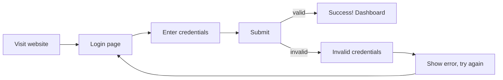
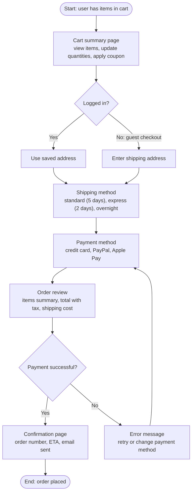
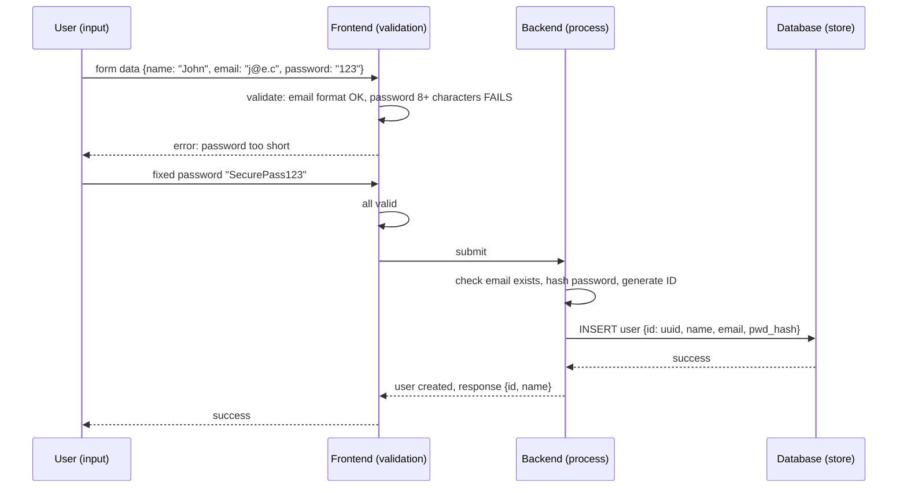
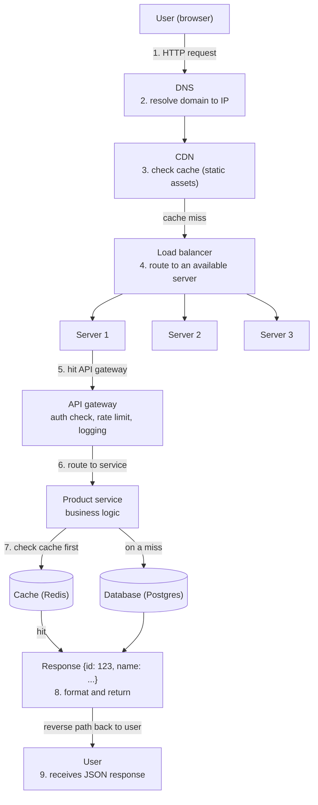

# 🏗️ Part 1: User Flow Design

> **Navigation**: [← Complete Understanding of Flows](01_complete_understanding_of_flows.md) | [Chapter overview](../04_User_System_Flows.md) | [Creating Flows for New Features →](03_creating_flows_for_new_features.md)
> Page 2 of 4 in **Understanding User Flows & System Flows**

## What is User Flow?

### User flow fundamentals

**Definition.** A user flow is the path a user takes through your application to complete a goal.

**Components**

1. **Entry point:** where the user starts (homepage, link, notification).
2. **Steps:** actions the user takes (click, type, swipe).
3. **Decisions:** points where the user chooses (log in or register).
4. **Exit point:** where the user ends (success page, logout).

**Simple example: login**

**How to read this diagram.** The happy path runs left to right; a failed submit shows an error and returns to the login page.

## Flow Notation Symbols

### Standard flow symbols

| Symbol | Meaning | Notes |
| --- | --- | --- |
| Rectangle | Screen, page or state | A UI screen or application state |
| Diamond | Decision point | The user makes a choice or the system checks a condition |
| Arrow | Flow direction | Shows the path of movement |
| Oval | Start or end | Entry or exit of the flow |
| Bracket or process box | Action or process | Something happens (API call, calculation) |
| Double line | Parallel process | Several things happen simultaneously |
| Dashed arrow | Optional or conditional path | May or may not happen |

## Complete User Flow Example: E-commerce Checkout

### E-commerce checkout user flow

**How to read this diagram.** Two branches rejoin: logged-in users reuse a saved address while guests enter one. A failed payment loops back to the payment step instead of losing the cart.

---

## 🏗️ Part 2: Data Flow Design

### Understanding Data Flow

DATA FLOW FUNDAMENTALS

DEFINITION:
Data Flow = How data moves through and transforms in your system

KEY QUESTIONS:
• Where does data come from? (Source)
• What happens to it? (Transform)
• Where does it go? (Destination)
• What form does it take? (Format)

DATA FLOW TYPES:

1. INPUT FLOW (Data entering system)
   User Input → Validation → Sanitization → Processing

2. PROCESSING FLOW (Data being transformed)
   Raw Data → Transform → Aggregate → Calculate → Result

3. OUTPUT FLOW (Data leaving system)
   Result → Format → Response → Delivery

4. STORAGE FLOW (Data being persisted)
   Data → Validate → Transform → Store → Index

### Data Flow Example: User Registration

### User registration data flow

**How to read this diagram.** Validation fails fast in the frontend. Only a valid request reaches the backend, which hashes the password and stores the record. The response contains only safe fields (`id`, `name`).

**Data transformations**

| Stage | Data format | Transformation |
| --- | --- | --- |
| User input | Form fields (strings) | None |
| Frontend validation | JSON object | Trim, type check |
| API request | JSON over HTTPS | Serialise to JSON |
| Backend validation | Request DTO | Deserialise, validate |
| Processing | Domain object | Hash password, generate ID |
| Database | SQL or document | ORM mapping |
| Response | Response DTO | Strip sensitive fields |
| Frontend | JSON | Display formatting |

---

## PART 3: SYSTEM FLOW (Request Flow)

### How a Request Flows Through a Modern System

### Complete request flow in a modern system

Request: `GET /api/products/123`

**How to read this diagram.** The numbers follow the request. The CDN answers static assets without touching the origin; dynamic requests go through the load balancer and gateway to the service, which reads from Redis first and falls back to the database.

---

[← Complete Understanding of Flows](01_complete_understanding_of_flows.md) | [Chapter overview](../04_User_System_Flows.md) | [Creating Flows for New Features →](03_creating_flows_for_new_features.md)
