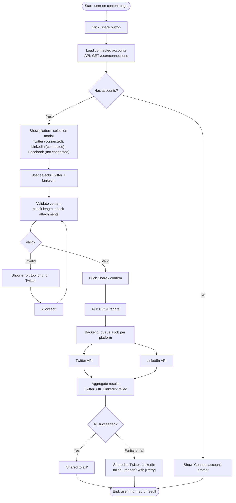

# 📌 Part 4: Creating Flows for New Features

> **Navigation**: [← User Flow Design](02_user_flow_design.md) | [Chapter overview](../04_User_System_Flows.md) | [Quick Reference: Flow Design Checklist →](04_quick_reference_flow_design_checklist.md)
> Page 3 of 4 in **Understanding User Flows & System Flows**


## Step-by-Step Feature Flow Creation

```text
HOW TO CREATE A FLOW FOR ANY FEATURE
```

**Step 1: identify the goal**

```text
Ask: "What is the user trying to achieve?"

Example: "User wants to share a post to multiple social media platforms"

• Primary Goal: Share content
• Success Criteria: Post appears on selected platforms
• Failure Criteria: User is informed of what failed and why
```

**Step 2: identify all actors**

```text
Ask: "Who/What is involved in this flow?"

Example:
• User (starts the action)
• Frontend (UI)
• Backend API
• External APIs (Twitter, Facebook, LinkedIn)
• Database (logging, history)
• Message Queue (async processing)
```

**Step 3: map the happy path**

```text
Ask: "What happens when everything works perfectly?"

Example Happy Path:
1. User clicks "Share" button
2. Modal opens with platform options
3. User selects Twitter, LinkedIn
4. User clicks "Share Now"
5. Request goes to backend
6. Backend posts to both platforms
7. Both succeed
8. User sees "Shared successfully!"
```

**Step 4: identify error cases**

```text
Ask: "What could go wrong?"

Example Error Cases:
• User not connected to platform
• Platform API is down
• Content exceeds character limit
• Network timeout
• Rate limit exceeded
• Partial failure (Twitter works, LinkedIn fails)
```

**Step 5: draw the complete flow**

## Complete Feature Flow Example: Social Share

### Social share feature: complete flow



**How to read this diagram.** The flow branches at three decisions: whether the user has connected accounts, whether the content is valid for every selected platform, and whether every platform call succeeded. The partial-failure branch is the one most often forgotten: tell the user exactly which platform failed and offer a retry.

---

## 🏗️ Part 5: Flow Design in Code

### Translating Flow to Code Structure

```java
// FEATURE: Social Share
// Following the flow diagram above

public class SocialShareService {

    // Step 1: Get connected accounts (from flow)
    public List<ConnectedAccount> getConnectedAccounts(String userId) {
        return accountRepository.findByUserId(userId);
    }

    // Step 2: Validate content for each platform
    public ValidationResult validateContent(ShareRequest request) {
        List<ValidationError> errors = new ArrayList<>();

        for (Platform platform : request.getPlatforms()) {
            if (platform == Platform.TWITTER && request.getContent().length() > 280) {
                errors.add(new ValidationError(platform, "Content too long for Twitter"));
            }
            // More validations...
        }

        return new ValidationResult(errors.isEmpty(), errors);
    }

    // Step 3: Execute share (following the flow)
    public ShareResult share(ShareRequest request) {
        // Validate first (as per flow)
        ValidationResult validation = validateContent(request);
        if (!validation.isValid()) {
            return ShareResult.validationFailed(validation.getErrors());
        }

        // Queue jobs for each platform (parallel processing from flow)
        Map<Platform, CompletableFuture<PlatformResult>> futures = new HashMap<>();

        for (Platform platform : request.getPlatforms()) {
            futures.put(platform,
                CompletableFuture.supplyAsync(() ->
                    shareToplatform(platform, request.getContent())
                )
            );
        }

        // Aggregate results (as per flow)
        Map<Platform, PlatformResult> results = new HashMap<>();
        for (Map.Entry<Platform, CompletableFuture<PlatformResult>> entry : futures.entrySet()) {
            try {
                results.put(entry.getKey(), entry.getValue().get());
            } catch (Exception e) {
                results.put(entry.getKey(), PlatformResult.failed(e.getMessage()));
            }
        }

        return ShareResult.completed(results);
    }

    // Platform-specific sharing
    private PlatformResult shareToPlatform(Platform platform, String content) {
        try {
            switch (platform) {
                case TWITTER:
                    return twitterClient.post(content);
                case LINKEDIN:
                    return linkedInClient.post(content);
                default:
                    return PlatformResult.failed("Unsupported platform");
            }
        } catch (ApiException e) {
            return PlatformResult.failed(e.getMessage());
        }
    }
}
```

---

## 💪 Part 6: Flow Practice Exercises

### Flow design exercises

1. **Password reset flow.** Design the complete user flow for "Forgot password". Include email input, verification, new-password creation and error cases.
2. **File upload flow.** Design the data flow for uploading a large file with progress tracking. Include chunking, progress updates, retry on failure and a virus scan.
3. **Real-time chat flow.** Design the system flow for sending a message in a chat application. Include WebSocket, message delivery, read receipts and offline handling.
4. **Shopping cart sync flow.** Design the data flow for syncing a shopping cart across devices. Include local storage, server sync and conflict resolution.
5. **Two-factor authentication flow.** Design the complete flow for enabling and using 2FA. Include setup, QR code, backup codes and login with 2FA.
6. **Payment processing flow.** Design the complete system flow for processing a payment. Include validation, fraud check, payment gateway, retry and a refund path.

For each exercise:

1. Identify the goal.
2. List all actors.
3. Draw the happy path.
4. Add error cases.
5. Add data transformations.
6. Consider edge cases.

---

[← User Flow Design](02_user_flow_design.md) | [Chapter overview](../04_User_System_Flows.md) | [Quick Reference: Flow Design Checklist →](04_quick_reference_flow_design_checklist.md)
