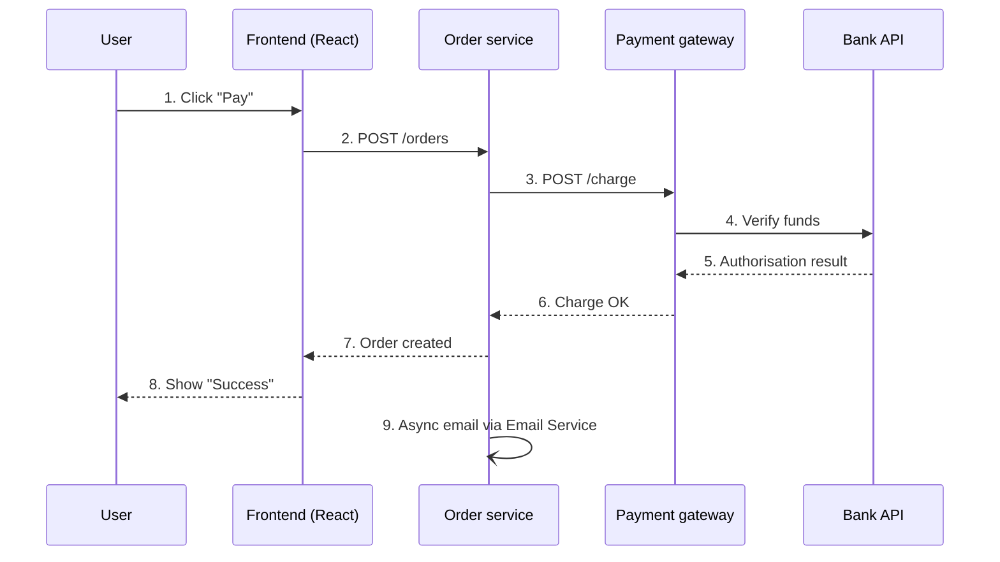
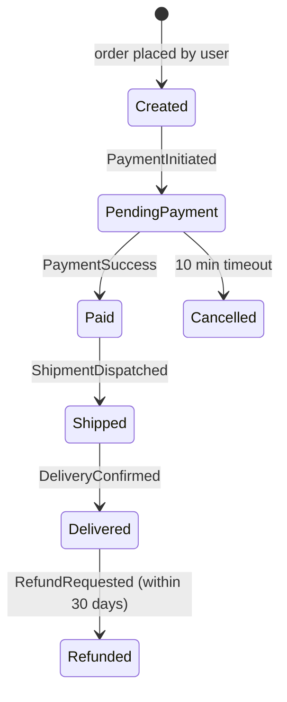
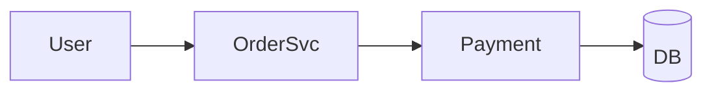
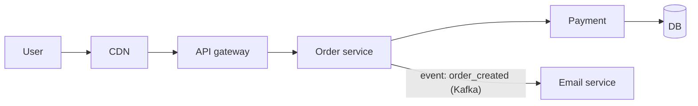

# 🏗️ Quick Reference: Flow Design Checklist

> **Navigation**: [← Creating Flows for New Features](03_creating_flows_for_new_features.md) | [Chapter overview](../04_User_System_Flows.md)
> Page 4 of 4 in **Understanding User Flows & System Flows**


### Flow design checklist

- [ ] Clear **start** and **end** points
- [ ] All decision points marked (diamonds)
- [ ] Happy path clearly visible
- [ ] Error paths included
- [ ] All actors and systems identified
- [ ] Data formats at each stage
- [ ] Async operations marked
- [ ] Retry and rollback paths shown
- [ ] Edge cases considered
- [ ] Timing and timeout handling
- [ ] Security checkpoints
- [ ] Logging and monitoring points

---

## PLUS Enhancements

### Crystal-Clear Diagrams

#### 1. End-to-End Payment Flow Sequence



**How to read this diagram.** Solid arrows are calls, dashed arrows are replies, and the final arrow is asynchronous: the email is sent after the user already has their answer.

**Failure mode at step 6**: Bank auth succeeds but Order Service crashes before updating DB → user charged, order never created. **Mitigation**: idempotency key on /charge (Stripe-style) + outbox pattern for the Order DB write.

#### 2. Order State Machine



**How to read this diagram.** Each arrow is an event that moves the order to a new state. An order that is not paid within ten minutes is cancelled. A refund requested within 30 days of delivery moves the order to a final `Refunded` state.

**Invariant**: every transition has exactly ONE trigger event. State changes are append-only in an event log (event sourcing pattern) for auditability.

#### 3. Microservices Flow vs Monolith Flow

**Monolith (in-process stack trace)**



**How to read this diagram.** Arrows show the direction of flow from one step or component to the next.

Total: one network call and one stack trace.

**Microservices (distributed trace)**



**How to read this diagram.** Arrows show the direction of flow from one step or component to the next.

Total: five or more network hops, so **distributed tracing is required** (Jaeger, Zipkin or OpenTelemetry).

**Trade-off**: monoliths give free observability (one stack trace shows everything); microservices require explicit observability infrastructure. Microservices pay this cost for team-scale and failure-isolation benefits.

### In-Depth Explanations

#### Mechanism Deep-Dive: Idempotency Keys

**The duplicate-charge problem**: User clicks "Pay", network blips, browser retries. Without idempotency, the user is charged twice.

**The solution**: An `Idempotency-Key` HTTP header (UUID generated client-side) sent with the POST request. The server:

```
1. Receive POST /charge with Idempotency-Key: "abc-123"
2. Check Redis: SETNX "idempotency:abc-123" "in_progress" EX 86400
   ├─ If key exists: return cached response from that key
   └─ If key didn't exist: continue to step 3
3. Process the charge
4. Store response in Redis under "idempotency:abc-123" with TTL 24 hours
5. Return response to client
```

**What happens on retry**: The client retries with the same `Idempotency-Key`. Step 2 sees the key exists, returns the cached response from step 4. **No duplicate charge.**

**Production failure mode**: If you DON'T use idempotency keys, you can lose money. Payment APIs such as Stripe's document an `Idempotency-Key` header for exactly this reason. Illustrative failure: a client times out, retries a charge without a key, and the customer is charged twice because the server cannot tell the retry from a new purchase.

#### Why-This-Not-That: Choreography vs Orchestration

| Aspect | Choreography | Orchestration |
|--------|--------------|---------------|
| **Coordinator** | None (each service listens for events) | Central orchestrator (e.g., Camunda, Netflix Conductor) |
| **Failure handling** | Each service handles its own retries | Orchestrator handles compensation centrally |
| **Visibility** | Distributed (need tracing tools) | Central (one dashboard) |
| **Coupling** | Loose (services don't know about each other) | Tighter (services know they're orchestrated) |
| **Scale** | Better (no single point of failure) | Worse (orchestrator can bottleneck) |
| **When to use** | Simple flows, many independent teams | Complex flows, strict visibility required |

**Rule of thumb**: < 5 services with simple handoffs → choreography. > 5 services or complex compensation → orchestration.

### Breadth Comparisons

#### Saga Compensation Strategies

| Strategy | How It Works | Trade-off | Use Case |
|----------|--------------|-----------|----------|
| **Backward recovery (compensating transactions)** | Each step has a compensating action (e.g., `compensate_payment = refund()`); on failure, run compensations in reverse order | Requires idempotent compensation; some actions cannot be compensated (sending email) | E-commerce, banking (most common) |
| **Forward recovery (pivot transaction)** | When failure detected, execute a different forward path that compensates for the failure | Requires domain knowledge of all failure modes | Limited to predictable failure modes |
| **Hybrid** | Some failures use compensation, others pivot | Most flexible, most complex | Complex business processes |

#### Flow Debugging Tools Comparison

| Tool | Strength | Weakness | Best For |
|------|----------|----------|----------|
| **Jaeger** (Uber) | Strong distributed context propagation, Thrift compact protocol | Steeper learning curve | Microservices, OpenTracing-compatible |
| **Zipkin** (Twitter) | Mature, simple deployment, OpenZipkin ecosystem | Less active development | Quick setup, OSS shops |
| **OpenTelemetry** (CNCF) | Vendor-neutral, future-proof, unified API/SDK | Newer, less ecosystem support | New projects, vendor-portability needed |
| **Datadog APM** | All-in-one with logs/metrics, commercial support | Expensive at scale | Enterprises with budget |
| **Tempo + Grafana** | Cheap, integrates with Prometheus metrics | Requires Grafana stack | Grafana-based observability |

---

**Navigation**: [< Previous](../03_System_Design.md) | [Back to Index](../../00_MASTER_INDEX.md) | [Next >](../05_SD_Interview_Problems.md)

---

[← Creating Flows for New Features](03_creating_flows_for_new_features.md) | [Chapter overview](../04_User_System_Flows.md)
