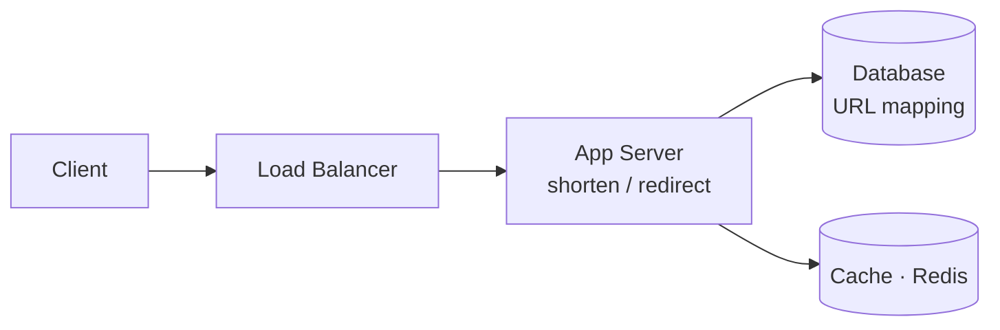
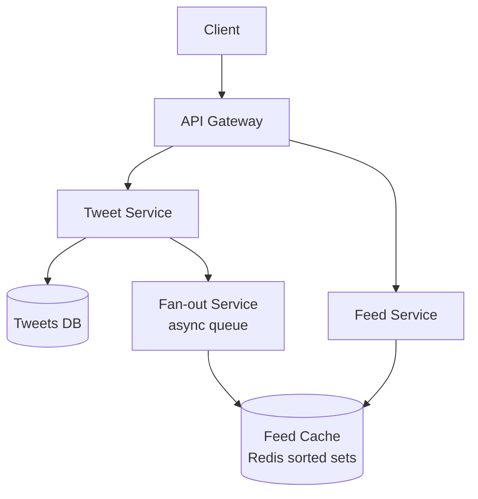
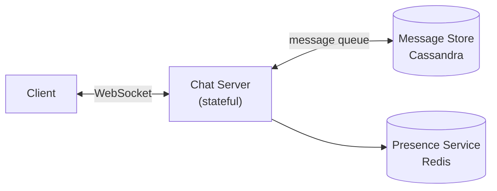
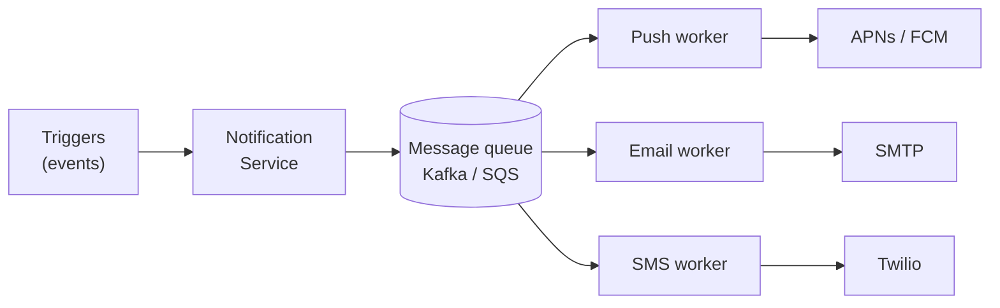
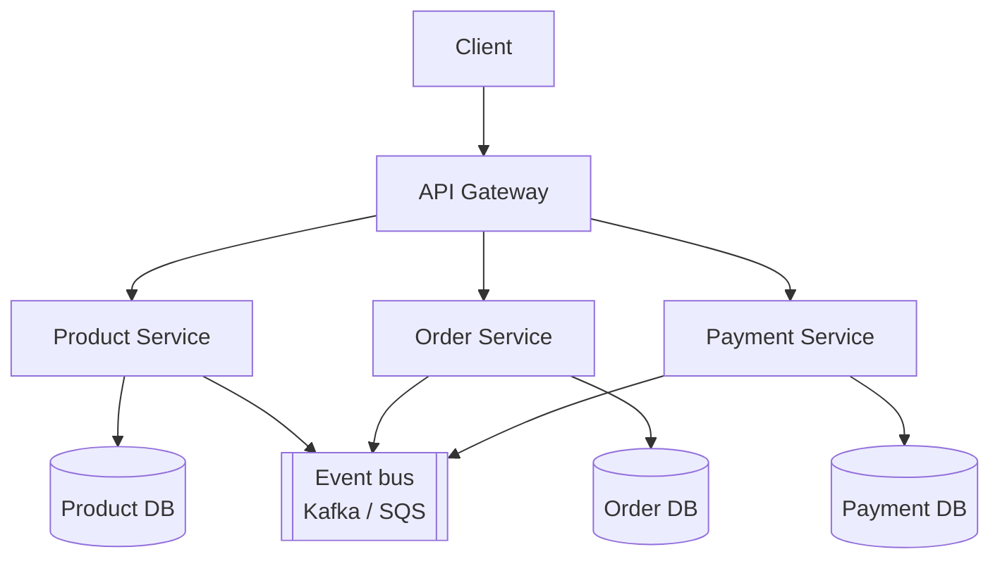
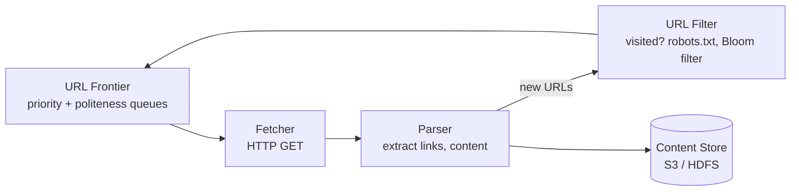
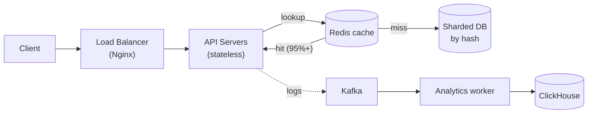
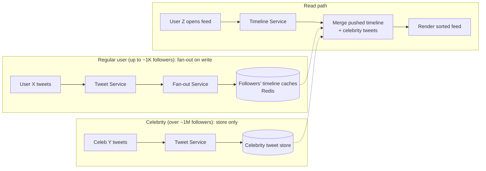
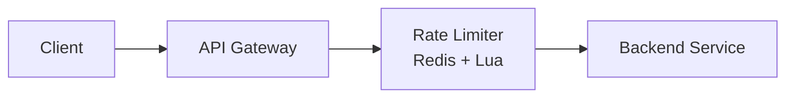

🧠 **Mental Model**: See [System Design Thinking](../14_Mental_Models/15_System_Design_Thinking.md) — structured approach to any "Design X" question

---

# 🏗️ System Design Interview Problems — Complete Walkthroughs

> **Navigation**: [← Distributed Systems Fundamentals…](06_Distributed_Systems_Fundamentals.md) | [Chapter index](00_INDEX.md)

8 classic problems solved step-by-step using the same framework interviewers expect

---

## 🔗 Bridge — Where This Chapter Fits

| Dimension | This chapter |
| --- | --- |
| **Builds on** | [System Design Basics](03_System_Design.md), [User & System Flows](04_User_System_Flows.md) |
| **You will learn** | A repeatable framework applied to URL shortener, feed, chat, rate limiter, notifications, cache, e-commerce and crawler |
| **Leads to** | [System Design Fundamentals](05b_System_Design_Fundamentals.md), [Distributed Systems](06_Distributed_Systems_Fundamentals.md) |
| **Abstraction level** | Concepts in isolation → **a framework applied end to end** → **trade-offs defended under questioning** |

> [!NOTE]
> The full gap-free reading order and dependency graph are in the [Learning Path](00_LEARNING_PATH.md).

---

## 💬 Explain It Like a Study Partner — System Design Interview Problems

### 1. The bottom line

Use the same steps every time: requirements, estimates, API, data model, core design, bottlenecks, trade-offs.

### 2. The textbook core

- Clarify scope and numbers first.
- Define the API and the data model before drawing boxes.
- Design the simplest version that works, then scale the bottleneck.
- Call out consistency, availability and failure behaviour explicitly.
- Stay open to follow-up questions.

### 3. The real-world analogy

An **architect pitching a building**: site constraints first, floor plan second, then answers to the client's "what if" questions.

### 4. Walkthrough

1. Problem: shorten URLs.
2. Estimate: writes per second, read:write ratio, storage per year.
3. API: `POST /urls`, `GET /{code}`.
4. Core: generate a unique code (counter or hash), store the mapping, cache hot reads.
5. Bottleneck: ID generation across nodes; discuss ranges or a key-generation service.

> [!NOTE]
> **Quick check:** Why start with the API and data model? *They fix the shape of the problem so the boxes you draw have a purpose.*

### 5. Check yourself

**Q1.** A 7-character base-62 code gives roughly how many distinct values?

<details><summary>Answer</summary>

62^7 ≈ **3.5 trillion**.

</details>

**Q2.** Why is rate limiting by IP alone weak?

<details><summary>Answer</summary>

An attacker can rotate IPs; combine limits on account or API key, IP or subnet, and a global ceiling.

</details>

---


## THE FRAMEWORK (Use for EVERY Problem)

SYSTEM DESIGN INTERVIEW FRAMEWORK (45 minutes)

STEP 1: Requirements (5 min)
→ Functional: What can users do?
→ Non-functional: Scale? Latency? Consistency?
→ Constraints: Users? QPS? Storage?

STEP 2: High-Level Design (10 min)
→ Draw API endpoints
→ Core components (services, databases, caches)
→ Data flow diagram

STEP 3: Detailed Design (15 min)
→ Database schema & choice (SQL vs NoSQL)
→ API design (endpoints, payloads)
→ Key algorithms (hashing, ranking, etc.)

STEP 4: Scale & Bottlenecks (10 min)
→ Identify bottlenecks
→ Caching strategy
→ Database sharding/replication
→ Load balancing

STEP 5: Trade-offs & Edge Cases (5 min)
→ What would break at 100x scale?
→ CAP theorem trade-offs
→ Failure scenarios & recovery

---

## PROBLEM 1: Design URL Shortener (like bit.ly)

### Requirements

```
Functional:
  - Given long URL → return short URL (e.g., bit.ly/abc123)
  - Given short URL → redirect to original
  - Optional: custom aliases, expiration, analytics

Non-Functional:
  - 100M URLs created/month → ~40 URLs/sec write
  - 10:1 read:write ratio → 400 redirects/sec
  - Redirect latency < 50ms
  - URLs should be as short as possible
  - High availability (users can always access their shortened URLs)

Back-of-envelope:
  - 100M URLs/month × 12 months × 5 years = 6B URLs
  - Each record ~500 bytes → 6B × 500 = 3TB storage
  - Short URL: base62 (a-z, A-Z, 0-9) → 62^7 = 3.5 trillion combinations
```

### High-Level Design



**How to read this diagram.** A request flows left to right: the load balancer spreads traffic across app servers, and each app server checks the Redis cache first and falls back to the database for the URL mapping.

🔬 **Section Challenge — High-Level Design**

**Challenge 1 (Reasoning — Who/When/What):** In the URL shortener high-level design, why is Cache placed alongside the Database and not in front of the Load Balancer? **Who** reads from cache? **When** is the cache checked? **What** determines if it's a hit or miss?

<details><summary>Answer</summary>

**Who?** The App Server, not the Load Balancer. The LB only routes TCP connections — it doesn't understand application semantics (which short URL maps to which long URL). **When?** After the App Server receives a redirect request (GET /abc123), it checks Redis FIRST. On hit: return 302 immediately (~1ms). On miss: query DB, populate cache for next time, return 302 (~10ms). **What determines hit/miss?** The short URL key's presence in Redis. The 80/20 rule applies: 20% of URLs get 80% of traffic, so caching hot URLs gives massive throughput gains with minimal memory.

</details>

### Key Design Decisions

```text
SHORT URL GENERATION — 3 Approaches

1. Hash + Truncate:
   MD5(longURL) → take first 7 chars of base62
   Problem: collisions! Need to check DB, retry with salt.

2. Auto-increment ID + Base62:  ← RECOMMENDED
   Database gives ID 12345 → convert to base62 → "dnh"
   No collisions! But IDs are predictable (sequential).

3. Pre-generated Key Service:
   Separate service pre-generates unique keys, hands them out.
   Keys stored in two tables: used_keys and unused_keys.
   App server requests batch of keys → fast, no collision.

DATABASE CHOICE:
→ NoSQL (DynamoDB/Cassandra) — simple key-value, massive scale
→ Schema: { shortUrl: "abc123", longUrl: "https://...",
            createdAt: timestamp, expiresAt: timestamp, userId: "..." }

CACHING: Redis/Memcached for hot URLs
→ 80/20 rule: 20% of URLs get 80% of traffic
→ Cache most-accessed short→long mappings
→ LRU eviction policy

REDIRECT: Use HTTP 301 (permanent) or 302 (temporary)
→ 301: Browser caches redirect → less server load, but can't track analytics
→ 302: Every request hits server → more load, but full analytics  ← BETTER
```

---

🔬 **Section Challenge — Key Design Decisions**

**Challenge 1 (Design):** Compare the 3 short URL generation approaches. If you're building for 100M URLs/month with zero collision tolerance, which approach do you pick and why? What's the trade-off you accept?

<details><summary>Answer</summary>

**Pick: Pre-generated Key Service.** Why? Zero collisions (keys are pre-generated and unique). No DB lookup needed at generation time (just grab a key from the pool). Scales horizontally (each app server caches a batch of unused keys). **Trade-off:** Operational complexity — you need a separate key-generation service, two tables (used/unused), and a batch-refill mechanism. Auto-increment ID + Base62 is simpler but predictable (competitors can guess your URL count). Hash + Truncate has collision risk requiring retry loops. For 100M/month, pre-generated keys provide the best guarantees with acceptable complexity.

</details>

**Challenge 2 (Reasoning):** Why does the design recommend HTTP 302 (temporary redirect) over 301 (permanent) for analytics, even though 301 reduces server load? Use the Who/When/What framework.

<details><summary>Answer</summary>

**Who makes the redirect decision?** With 301: the BROWSER caches the redirect permanently. On subsequent clicks, the browser goes directly to the long URL — the server never sees the request. **When is the server bypassed?** Every click after the first. **What is lost?** All click analytics: click count, geographic distribution, referrer data, device info. With 302: every click hits the server first, the server logs analytics, THEN redirects. **The trade-off:** 302 costs more server load but gives complete analytics. For a URL shortener where analytics IS the product (bit.ly's business model), 302 is essential.

</details>

## PROBLEM 2: Design Twitter / News Feed

### Requirements

```
Functional:
  - Post tweets (140 chars + media)
  - Follow/unfollow users
  - View home timeline (feed of followed users' tweets)
  - Search tweets

Scale:
  - 300M monthly active users, 150M daily active
  - Average user follows 200 people
  - Average user views feed 5x/day → 750M feed reads/day
  - 500M tweets/day → ~6000 tweets/sec
```

### The Hard Part — Feed Generation

**TWO APPROACHES TO NEWS FEED**

```text
APPROACH 1: Pull (Fan-out on Read)
────────────────────────────────────
When user opens feed:
1. Get list of followed user IDs
2. For each followed user, fetch their recent tweets
3. Merge & sort by timestamp
4. Return top N

✅ Simple, works for new tweets immediately
❌ SLOW at read time (merge 200+ users' tweets on every request!)
❌ High read latency

APPROACH 2: Push (Fan-out on Write)    ← TWITTER'S APPROACH
────────────────────────────────────
When user posts a tweet:
1. Write tweet to tweets table
2. Look up all followers
3. Insert tweet ID into each follower's pre-computed feed cache

✅ Feed reads are blazing fast (just read pre-computed list)
❌ Write is expensive (celebrity posts → fan-out to 50M followers!)
❌ Wasted work for inactive users

HYBRID (What Twitter actually does):
→ Regular users: Push model (fan-out their tweets to followers)
→ Celebrities (>1M followers): Pull model at read time
→ Merge: pre-computed feed + celebrity tweets fetched on demand
```

### Architecture



**How to read this diagram.** The write path (top) stores the tweet and hands the fan-out work to an asynchronous queue that fills each follower's feed cache; the read path (bottom) is just the feed service reading that cache.

---

## PROBLEM 3: Design Chat System (WhatsApp/Slack)

### Requirements & Architecture

Functional: 1-on-1 chat, group chat, online status, read receipts  
Scale: 50M DAU, each user sends 40 msgs/day = 2B msgs/day



**How to read this diagram.** Clients hold a WebSocket to one chat server. The server stores messages in a write-optimised store and asks a separate presence service (Redis) who is online.

```text
 KEY DECISIONS:
 1. WebSocket for real-time bidirectional communication
    (HTTP long polling as fallback)
 2. Chat servers are STATEFUL — each client connected to specific server
    → Need a session mapping: userId → chatServerId
 3. Message delivery:
    → User online: push via WebSocket
    → User offline: store in DB, push notification
 4. Message ordering: Server timestamp + sequence number per conversation
 5. Group messages: Store once, deliver to each member's connection
 6. Read receipts: Separate "last_read" pointer per user per conversation

 DATABASE SCHEMA:
 messages: {msg_id, conversation_id, sender_id, content, timestamp, type}
 conversations: {conv_id, type(1-on-1/group), participants[], created_at}

 WHY CASSANDRA?
 → Write-heavy workload (2B msgs/day)
 → Partition key: conversation_id
 → Clustering key: timestamp
 → Natural time-series data model
```

---

## PROBLEM 4: Design Rate Limiter

**Purpose:** prevent abuse, protect resources and enforce SLAs.

**Algorithm 1: token bucket**

The bucket holds up to N tokens. Each request takes one token. Tokens are added at rate R per second. If the bucket is empty, reject the request.

| Event | Bucket (capacity 8) |
| --- | --- |
| Start | 5 tokens |
| Request arrives → take a token | 4 tokens |
| Refill (every 1/R seconds) | 5 tokens |
| Bucket full | Extra tokens overflow (never exceed capacity) |
| Bucket empty | Reject with HTTP 429 Too Many Requests |

- ✅ Allows bursts (up to the bucket size)
- ✅ Simple to implement
- ✅ Memory efficient: two numbers per user (tokens, last refill time)

**Algorithm 2: sliding window log**

Store the timestamp of each request in a sorted set. On a new request, remove timestamps older than the window and count what remains. If the count is at or above the limit, reject.

- ✅ Most accurate
- ❌ Memory intensive (stores every timestamp)

**Algorithm 3: sliding window counter** (a good default)

Combine fixed-window counters with a sliding ratio: `estimate = previous_window_count × overlap% + current_window_count`.

- ✅ Low memory
- ✅ Smooths edge cases
- ✅ Reasonably accurate

**Distributed rate limiting**

- Use Redis with a Lua script (atomic increment and expire).
- Key: `rate:{userId}:{minute}` → `INCR` → compare with the limit.
- Set the TTL equal to the window size.

---

## PROBLEM 5: Design Notification System

**Types:** push notification, SMS, email. **Scale:** 10M notifications/day, multiple channels.



**How to read this diagram.** Events enter the notification service, which puts work on a queue so the main flow never blocks. One worker per channel pulls from the queue and talks to the external provider.

```text
 KEY DESIGN POINTS:
 1. Decouple with message queue (don't block main flow)
 2. Separate workers per channel (push, email, SMS)
 3. Template system: "Hi {name}, your order {orderId} shipped"
 4. Preference service: user opts out of email but keeps push
 5. Rate limiting per user per channel (no notification spam)
 6. Retry with exponential backoff for failed deliveries
 7. Analytics: delivered, opened, clicked
 8. Priority queues: password reset > marketing email
```

---

## PROBLEM 6: Design Distributed Cache (Redis-like)

```text
WHY: Reduce DB load, sub-millisecond reads

CORE DECISIONS:

1. EVICTION POLICY:
   LRU (Least Recently Used) — most common
   LFU (Least Frequently Used) — better for skewed access
   TTL (Time To Live) — expire after fixed time

2. CACHE PATTERNS:
   Cache-Aside (Lazy Loading):
     Read: Check cache → miss → read DB → write cache → return
     Write: Write DB → invalidate cache
     ✅ Only caches what's needed  ❌ Cache miss penalty

   Write-Through:
     Write: Write cache AND DB simultaneously
     ✅ Cache always fresh  ❌ Write latency (two writes)

   Write-Behind (Write-Back):
     Write: Write cache → async write DB later
     ✅ Low write latency  ❌ Risk of data loss

3. DISTRIBUTED CACHING:
   → Consistent hashing to distribute keys across cache nodes
   → When node dies, only 1/N keys need redistribution
   → Virtual nodes for better distribution

4. CACHE PROBLEMS:
   Cache stampede: Many threads miss cache simultaneously → DB crushed
   Fix: Distributed lock (only one thread fetches, others wait)

   Cache penetration: Queries for non-existent keys always miss
   Fix: Cache null results with short TTL, or use Bloom filter

   Cache avalanche: Many keys expire at same time → sudden DB load
   Fix: Add random jitter to TTL values
```

---

## PROBLEM 7: Design E-Commerce System (Amazon-like)



**How to read this diagram.** Each service owns its own database; services never read each other's tables. They communicate through the gateway for requests and through the event bus for cross-service events.

```text
 KEY CHALLENGES:

 1. INVENTORY MANAGEMENT (race condition):
    100 users buy last item simultaneously
    → Optimistic locking: UPDATE inventory SET qty=qty-1
      WHERE product_id=X AND qty > 0
    → If affected rows = 0 → out of stock

 2. ORDER SAGA (distributed transaction):
    Reserve inventory → Charge payment → Create shipment
    If payment fails → compensate (release inventory)
    → Use Saga pattern with compensation steps

 3. SEARCH: Elasticsearch for product catalog
    → Sync from Product DB via CDC (Change Data Capture)

 4. CART: Redis (fast, TTL for abandoned carts)
    → Merge guest cart with user cart on login
```

---

## PROBLEM 8: Design Web Crawler (Google-like)

**Purpose:** crawl billions of web pages and build a search index.



**How to read this diagram.** The frontier hands URLs to fetchers; the parser extracts links, which pass through a filter (already visited? allowed by robots.txt?) before re-entering the frontier, while page content goes to storage.

```text
 KEY DESIGN POINTS:
 1. URL Frontier: Priority queue (important pages first)
    + Politeness queue (one queue per domain, rate limited)
 2. Deduplication: Bloom filter for "already visited?" check
    (probabilistic, space-efficient, false positives OK)
 3. robots.txt: Respect crawl rules per domain, cache them
 4. DNS resolution: Cache DNS lookups (huge performance gain)
 5. Content dedup: SimHash/MinHash for near-duplicate pages
 6. Trap detection: Infinite URL generators, calendar pages
    → Max depth limit, URL pattern detection
 7. Consistent hashing: Distribute URLs to crawler workers
    → Same domain always goes to same worker (politeness)
```

### Production Reality

- **URL Shortener — rate-limit bypass (illustrative)**: A limiter keyed by IP only (`key = "rate:{ip}:{minute}"`) is bypassed by an attacker rotating through many IPs, each staying under the per-IP limit while the aggregate load is far above what the system intends to serve. Mitigation: layer limits on several keys (API key or account, then IP or subnet, then a global ceiling) so that no single dimension can be rotated away.
- **Twitter Feed — hybrid fan-out is a deliberate trade-off**: Twitter described its timeline design publicly (Raffi Krikorian, "Timelines at Scale", 2012): fan-out on write for most accounts, with accounts that have very large follower counts merged in at read time. Consequence worth naming in an interview: a timeline is assembled from two sources (a pre-computed list and on-demand lookups), so ordering and de-duplication must be handled explicitly at merge time.
- **Chat System — message ordering with eventual consistency (illustrative)**: With a leaderless, eventually consistent store, replicas can deliver messages to a device in a different order than they were sent. This is the expected cost of choosing availability for write-heavy chat, not a bug. Standard mitigation: a server-assigned monotonic sequence number per conversation, plus client-side gap detection that triggers a re-sync when a number is skipped. Pair it with a partition key of `conversation_id` and a clustering key that orders by that sequence number.

### Historical Evolution

These problems are classic interview staples; the dates below are the verifiable milestones behind them.

- **URL shortening** — TinyURL (2002) and bit.ly (2008) popularised short links; Twitter's 140-character limit (2006) made them mainstream. The design tension is deterministic IDs (a counter: collision-free but guessable) versus hash-based IDs (unpredictable but collision-prone).
- **News feed** — Twitter launched in 2006; its public talks on timelines (2012) describe fan-out on write for most accounts and read-time merging for very large accounts. The hybrid is now the textbook answer.
- **Chat** — mobile messaging apps (WhatsApp, 2009) moved from SMS to persistent connections; the core problems are connection management, ordering and delivery guarantees.
- **Rate limiting** — token-bucket and leaky-bucket ideas come from network traffic shaping (the leaky-bucket meter is usually credited to Jonathan Turner, 1986). In distributed systems it is typically implemented atomically in a shared store such as Redis, often with a Lua script.
- **Distributed cache** — Memcached (created at LiveJournal, 2003) popularised the cache-aside pattern for web back ends; Redis (2009) added richer data structures and optional persistence.
- **E-commerce** — Amazon's move from a monolith to many services (early 2000s) is the best-known example of splitting a system for independent deployability.
- **Web crawler** — crawlers predate Google (WebCrawler, 1994); the 1998 PageRank and Google papers described large-scale crawling and ranking together.


---

### QUICK REFERENCE — Which Concepts Each Problem Tests

| Problem           | Key Concepts Tested                                         |
| ----------------- | ----------------------------------------------------------- |
| **URL Shortener** | Hashing, base62, NoSQL, caching, HTTP redirects             |
| **Twitter Feed**  | Fan-out, message queues, Redis sorted sets, hybrid approach |
| **Chat System**   | WebSocket, presence, Cassandra, message ordering            |
| **Rate Limiter**  | Token bucket, sliding window, Redis Lua, distributed state  |
| **Notifications** | Message queues, worker pools, templates, retry/backpressure |
| **Dist. Cache**   | Consistent hashing, LRU, cache patterns, cache stampede     |
| **E-Commerce**    | Saga pattern, inventory locking, search, microservices      |
| **Web Crawler**   | BFS, Bloom filter, politeness, robots.txt, URL frontier     |

---

### PLUS Enhancements

#### Crystal-Clear Diagrams

##### 1. URL Shortener Architecture



**How to read this diagram.** The hot path is client, load balancer, stateless API servers and the cache; only misses reach the sharded database. Click analytics run off the hot path through Kafka.

**Key design points**: API stateless (any server can handle any request), Redis for hot URLs (95%+ cache hit), DB sharded by hash(short_code) for write/read scalability, Kafka + ClickHouse for analytics (separate from serving path).

##### 2. Twitter Hybrid Fan-out Architecture



**How to read this diagram.** Regular users' tweets are pushed into followers' cached timelines (write cost grows with followers). Celebrity tweets are only stored once, so the write is O(1) and readers merge them in at read time. The thresholds are illustrative.

**Trade-off**: Push (regular users) gives instant consistency but is O(followers). Pull (celebrities) is O(1) write but requires merge on read. Hybrid picks the cheaper side based on follower count.

##### 3. Rate Limiter Architecture



**How to read this diagram.** The limiter sits in front of the backend and decides allow or deny atomically in Redis.

```lua
-- Atomic check: KEYS[1] = "rl:{user_id}", ARGV[1] = limit, ARGV[2] = window seconds
local current = tonumber(redis.call('GET', KEYS[1]) or "0")
if current >= tonumber(ARGV[1]) then
  return 0  -- denied
end
local n = redis.call('INCR', KEYS[1])
if n == 1 then
  redis.call('EXPIRE', KEYS[1], ARGV[2])  -- start the window only on the first request
end
return 1  -- allowed
```

> [!WARNING]
> Setting the expiry on **every** request (as simple examples often do) keeps extending the window, so a steady client is never reset. Set it only when the counter is created. This fixed-window counter also allows a burst of up to twice the limit across a window boundary; use a sliding window or token bucket if that matters.

**Why Lua + Redis**: Lua script runs atomically in Redis (single-threaded), preventing race conditions in token-bucket check-and-increment. Distributed limiter without a distributed lock.

#### In-Depth Explanations

##### Mechanism Deep-Dive: Consistent Hashing

**Problem with naive hashing**: `shard = hash(key) % N_servers`. Adding/removing one server invalidates ALMOST ALL keys (only K/N stay on the same shard). Cache miss storm.

**Consistent hashing solution**: Hash both keys AND servers onto a ring of 0..2^32. Each key is stored on the next server clockwise from its hash.

```
   Ring (0..2^32):
                 Server B
                    ●
                ╱     ╲
           ╱             ╲
        ╱                   ╲
      ●                       ●
   Server A                 Server D
        ╲                   ╱
           ╲             ╱
                ╲     ╱
                    ●
                 Server C

Key K1 → hash(K1) lands between A and B → stored on B
Key K2 → hash(K2) lands between B and D → stored on D
```

**Adding Server E**: E is inserted somewhere on the ring. Only the keys that fall between E's position and the next-server-clockwise position move. This is approximately K/N keys. **95% cache hit preserved across server additions.**

**Virtual nodes**: Real servers are placed at multiple positions on the ring (e.g., 200 positions each). This smooths out the distribution (without virtual nodes, an unlucky hash placement gives one server 10× the keys of another).

##### Why-This-Not-That: Push vs Pull Fan-out

| Aspect | Push (write fan-out) | Pull (read fan-out) |
|--------|---------------------|---------------------|
| **Write cost** | O(followers) per tweet | O(1) per tweet |
| **Read cost** | O(1) timeline read | O(following) timeline merge |
| **Consistency** | Instant (already pushed) | Eventual (tweet visible on next read) |
| **Storage** | High (1 copy per follower) | Low (1 copy total) |
| **Best for** | Users with few followers | Celebrities with many followers |
| **Failure mode** | "Follower can't see tweet" if push fails | "Tweet missing on next reload" |

**Hybrid**: classify user by follower count, route accordingly.

#### Breadth Comparisons

##### Database Choice by Problem

| Problem | Database Choice | Reason |
|---------|----------------|--------|
| URL shortener | Cassandra / DynamoDB | Massive write scale (billions of URLs), simple key-value lookup, no complex joins |
| Twitter timeline | Cassandra / ScyllaDB | Wide-column for time-series with clustering key = timestamp, fan-out writes |
| Chat system | Cassandra with partition key = conversation_id | Same wide-column pattern, message ordering preserved within partition |
| Rate limiter | Redis (in-memory) | Microsecond read/write, atomic Lua scripts, TTL-based expiry |
| Notification | Kafka (log) + DB | Append-only event log for delivery audit |

##### Caching Strategies

| Strategy | Read Path | Write Path | Consistency | Best For |
|----------|-----------|-----------|-------------|----------|
| **Cache-aside (lazy)** | App reads cache, on miss reads DB and populates cache | App writes DB, invalidates cache | Eventual (window of stale reads) | Read-heavy, tolerate staleness |
| **Write-through** | App reads cache (always fresh) | App writes cache, cache writes DB synchronously | Strong | Read-heavy, must be fresh |
| **Write-behind** | App reads cache (always fresh) | App writes cache, cache asynchronously writes DB | Eventual (data loss risk on crash) | Write-heavy, tolerate data loss |
| **Read-through** | App reads cache, cache reads DB on miss | App writes DB, cache invalidates | Eventual | Read-heavy with lazy population |

---

**Navigation**: [< Previous](04_User_System_Flows.md) | [Back to Index](../00_MASTER_INDEX.md) | [Next >](06_Distributed_Systems_Fundamentals.md)


---

## 🏢 Enterprise Lens — System Design Interview Problems

| Area | What top-tier engineering looks like |
| ---- | ------------------------------------ |
| **Where it runs in production** | Design reviews, capacity planning, technology selection |
| **Failure modes** | Jumping to components before requirements; ignoring hot keys and abuse |
| **Testing and verification** | Back-of-envelope checks; failure-mode walkthrough |

---

## Reality Check

**"Practicing system design means reading solved designs"** — Reading builds recognition; the assessed skill is DRIVING — clarifying requirements, budgeting numbers, proposing, defending, revising under pushback. The practice that transfers is speaking a design aloud against a timer, ideally to a person, minimally to a wall: the fluency gap between read-understanding and spoken-driving is enormous and invisible until the first real interview exposes it.

**"Each classic problem has a correct final architecture"** — Each classic is a DECISION TREE whose branches hinge on requirements the interviewer deliberately leaves open: a URL shortener branches on analytics-required (write-heavy click stream) versus not; a chat design branches on group-size assumptions (fan-out strategy flips); a feed branches on celebrity users (push, pull, or hybrid). Memorizing one leaf as THE answer means the first requirement probe knocks you off your script. Practice the branch points, not the leaves.

**"The estimation step is a warm-up ritual"** — The numbers DRIVE the branches: 10M DAU writing twice a day is 230 writes/sec — one database, no sharding conversation; the same product at 500M DAU forces partitioning, and the partition key becomes the design's hardest decision. Skipping arithmetic and jumping to "we shard by user ID" reveals template recitation. Doing the arithmetic and then NOT sharding — because the numbers say so — is the strongest single signal in the interview.

**"Deep-dive rounds reward covering more components"** — The rubric rewards DEPTH ON ONE SEAM chosen well: the top-k problem inside trending topics, the conflict-resolution inside collaborative editing, the timeline-merge inside feeds. Strong candidates volunteer the hard seam ("the interesting part here is X, let me go deep") rather than touring every box at survey depth. One seam at mechanism level — data structures, failure handling, back-of-envelope for that component alone — outweighs six boxes at label level.

**"Follow-up questions mean the design was wrong"** — Follow-ups ARE the interview: "what if this region fails," "what breaks at 100x," "how would you migrate live" test whether the design lives in your head as a MODEL (queryable, revisable) or a SCRIPT (replayable only). The tell of a model: answers reference the earlier numbers and trade-offs consistently. The tell of a script: follow-ups produce new components unconnected to anything said before. Practice regime: have someone ask you three hostile what-ifs per design; revising without collapsing is the skill.
