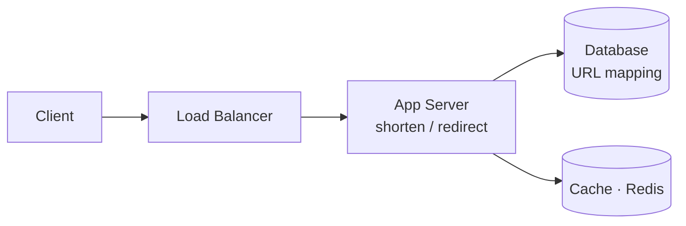
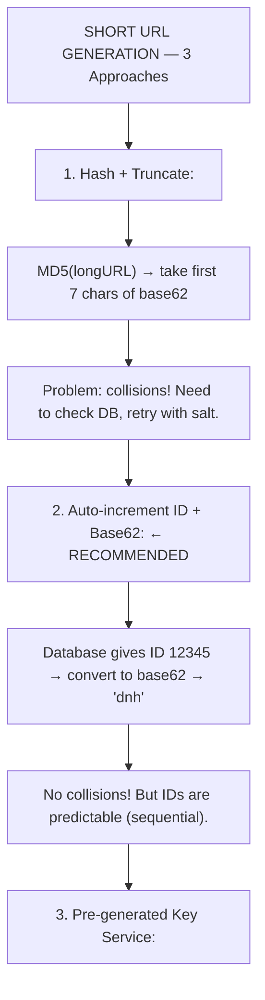
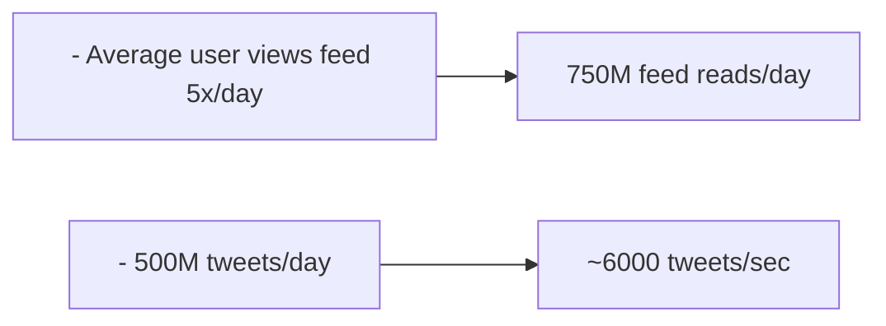
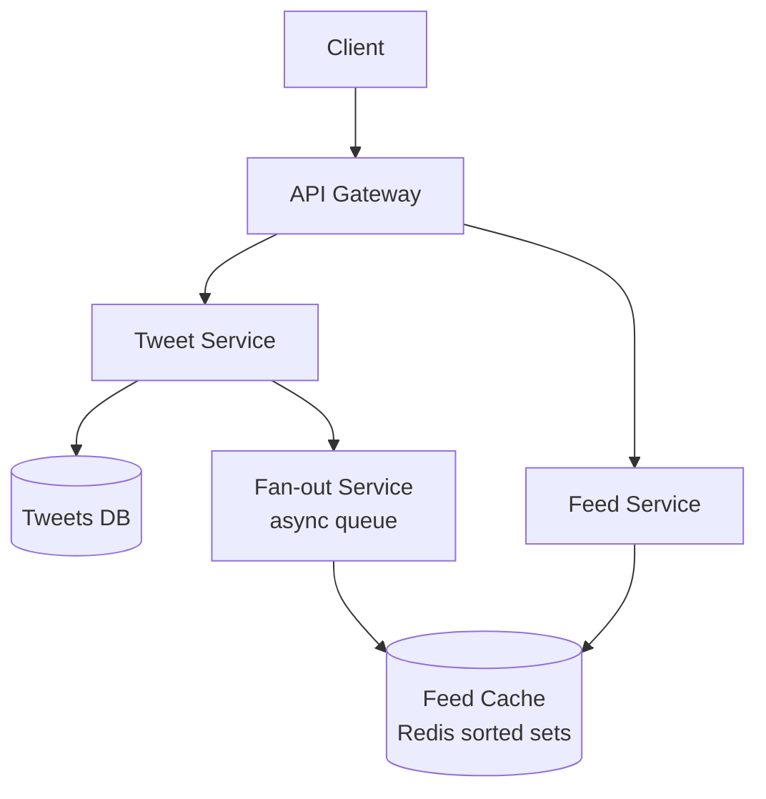
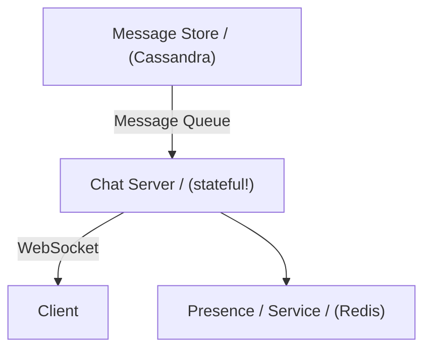
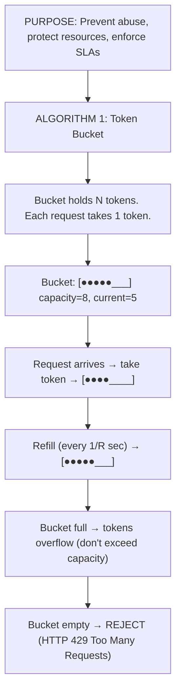
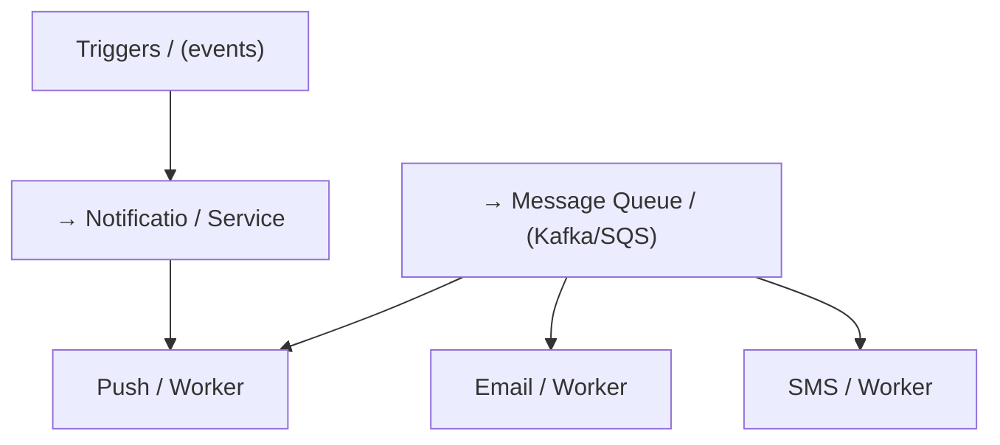
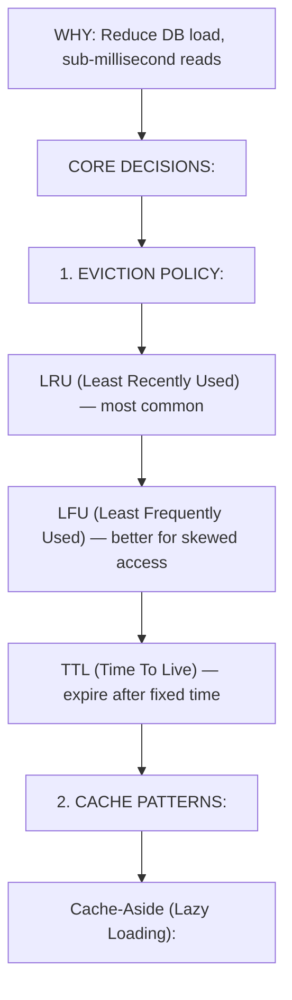
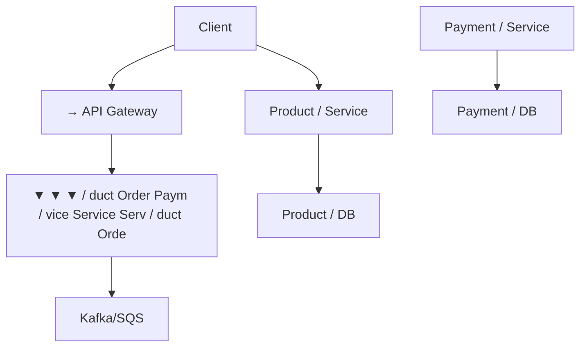
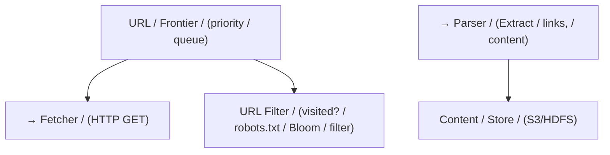

> **Navigation**: [Back to Index](../00_MASTER_INDEX.md)
> 🧠 **Mental Model**: See [System Design Thinking](../14_Mental_Models/15_System_Design_Thinking.md) — structured approach to any "Design X" question

---

# 🏗️ System Design Interview Problems — Complete Walkthroughs

> 8 classic problems solved step-by-step using the same framework interviewers expect

---

## THE FRAMEWORK (Use for EVERY Problem)


> SYSTEM DESIGN INTERVIEW FRAMEWORK (45 minutes)
>
> STEP 1: Requirements (5 min)
> → Functional: What can users do?
> → Non-functional: Scale? Latency? Consistency?
> → Constraints: Users? QPS? Storage?
>
> STEP 2: High-Level Design (10 min)
> → Draw API endpoints
> → Core components (services, databases, caches)
> → Data flow diagram
>
> STEP 3: Detailed Design (15 min)
> → Database schema & choice (SQL vs NoSQL)
> → API design (endpoints, payloads)
> → Key algorithms (hashing, ranking, etc.)
>
> STEP 4: Scale & Bottlenecks (10 min)
> → Identify bottlenecks
> → Caching strategy
> → Database sharding/replication
> → Load balancing
>
> STEP 5: Trade-offs & Edge Cases (5 min)
> → What would break at 100x scale?
> → CAP theorem trade-offs
> → Failure scenarios & recovery


---

# PROBLEM 1: Design URL Shortener (like bit.ly)

## Requirements
```
Functional:
  - Given long URL → return short URL (e.g., bit.ly/abc123)
  - Given short URL → redirect to original
  - Optional: custom aliases, expiration, analytics

Non-Functional:
  - 100M URLs created/month → ~40 URLs/sec write
  - 10:1 read:write ratio → 400 redirects/sec
  - Redirect latency < 50ms
  - URLs should be as short as possible
  - High availability (users can always access their shortened URLs)

Back-of-envelope:
  - 100M URLs/month × 12 months × 5 years = 6B URLs
  - Each record ~500 bytes → 6B × 500 = 3TB storage
  - Short URL: base62 (a-z, A-Z, 0-9) → 62^7 = 3.5 trillion combinations
```

## High-Level Design



> 🔬 **Section Challenge — High-Level Design**
>
> **Challenge 1 (Design):** Factory Method vs Abstract Factory — give a concrete example showing when each is appropriate.
> <details><summary>Answer</summary>
>
> Factory Method: `DocumentParser.createParser(fileType)` returns a `PdfParser` or `DocxParser`. One product family, one creator. Abstract Factory: `UIFactory` with `createButton()` + `createTextField()` + `createDialog()`. A `WindowsUIFactory` and `MacUIFactory` each create a FAMILY of related components. Use Abstract Factory when multiple interdependent products must be created together from the same family.
> </details>
>
> **Challenge 2 (Reasoning):** Singleton is often called an anti-pattern. Why?
> <details><summary>Answer</summary>
>
> 1) Hidden global state — any code can access/modify the singleton, making dependencies implicit and testing hard. 2) Tight coupling — hard to swap implementation (no interface). 3) Concurrency: lazy init needs double-checked locking. 4) Violates SRP often. Better: use dependency injection — pass the single instance as a constructor argument. The DI container manages lifecycle. You get the same 'one instance' behavior with testability and explicit dependencies.
> </details>
>

## Key Design Decisions

```
┌─────────────────────────────────────────────────────────────────────────────────┐
│  SHORT URL GENERATION — 3 Approaches                                            │
│                                                                                 │
│  1. Hash + Truncate:                                                            │
│     MD5(longURL) → take first 7 chars of base62                                 │
│     Problem: collisions! Need to check DB, retry with salt.                     │
│                                                                                 │
│  2. Auto-increment ID + Base62:  ← RECOMMENDED                                  │
│     Database gives ID 12345 → convert to base62 → "dnh"                         │
│     No collisions! But IDs are predictable (sequential).                        │
│                                                                                 │
│  3. Pre-generated Key Service:                                                  │
│     Separate service pre-generates unique keys, hands them out.                 │
│     Keys stored in two tables: used_keys and unused_keys.                       │
│     App server requests batch of keys → fast, no collision.                     │
│                                                                                 │
│  DATABASE CHOICE:                                                               │
│  → NoSQL (DynamoDB/Cassandra) — simple key-value, massive scale                 │
│  → Schema: { shortUrl: "abc123", longUrl: "https://...",                        │
│              createdAt: timestamp, expiresAt: timestamp, userId: "..." }        │
│                                                                                 │
│  CACHING: Redis/Memcached for hot URLs                                          │
│  → 80/20 rule: 20% of URLs get 80% of traffic                                   │
│  → Cache most-accessed short→long mappings                                      │
│  → LRU eviction policy                                                          │
│                                                                                 │
│  REDIRECT: Use HTTP 301 (permanent) or 302 (temporary)                          │
│  → 301: Browser caches redirect → less server load, but can't track analytics   │
│  → 302: Every request hits server → more load, but full analytics  ← BETTER     │
└─────────────────────────────────────────────────────────────────────────────────┘
```

**Flow:**
- SHORT URL GENERATION — 3 Approaches
- ↓
- 1. Hash + Truncate:
- ↓
- MD5(longURL)
- ↓
- take first 7 chars of base62
- ↓
- MD5(longURL)
- ↓
- take first 7 chars of base62
- ↓
- Problem: collisions! Need to check DB, retry with salt.
- ↓
- 2. Auto-increment ID + Base62: ← RECOMMENDED
- ↓
- Database gives ID 12345
- ↓
- convert to base62
- ↓
- 'dnh'
- ↓
- Database gives ID 12345
- ↓
- convert to base62
- ↓
- 'dnh'
- ↓
- No collisions! But IDs are predictable (sequential).



---


> 🔬 **Section Challenge — Key Design Decisions**
>
> **Challenge 1 (Design):** Factory Method vs Abstract Factory — give a concrete example showing when each is appropriate.
> <details><summary>Answer</summary>
>
> Factory Method: `DocumentParser.createParser(fileType)` returns a `PdfParser` or `DocxParser`. One product family, one creator. Abstract Factory: `UIFactory` with `createButton()` + `createTextField()` + `createDialog()`. A `WindowsUIFactory` and `MacUIFactory` each create a FAMILY of related components. Use Abstract Factory when multiple interdependent products must be created together from the same family.
> </details>
>
> **Challenge 2 (Reasoning):** Singleton is often called an anti-pattern. Why?
> <details><summary>Answer</summary>
>
> 1) Hidden global state — any code can access/modify the singleton, making dependencies implicit and testing hard. 2) Tight coupling — hard to swap implementation (no interface). 3) Concurrency: lazy init needs double-checked locking. 4) Violates SRP often. Better: use dependency injection — pass the single instance as a constructor argument. The DI container manages lifecycle. You get the same 'one instance' behavior with testability and explicit dependencies.
> </details>
>

# PROBLEM 2: Design Twitter / News Feed

## Requirements
```
Functional:
  - Post tweets (140 chars + media)
  - Follow/unfollow users
  - View home timeline (feed of followed users' tweets)
  - Search tweets

Scale:
  - 300M monthly active users, 150M daily active
  - Average user follows 200 people
  - Average user views feed 5x/day → 750M feed reads/day
  - 500M tweets/day → ~6000 tweets/sec
```

**Flow:**
- - Average user views feed 5x/day
- ↓
- 750M feed reads/day
- ↓
- - 500M tweets/day
- ↓
- ~6000 tweets/sec



## The Hard Part — Feed Generation

```
┌─────────────────────────────────────────────────────────────────────────────────┐
│  TWO APPROACHES TO NEWS FEED                                                    │
│                                                                                 │
│  APPROACH 1: Pull (Fan-out on Read)                                             │
│  ────────────────────────────────────                                           │
│  When user opens feed:                                                          │
│  1. Get list of followed user IDs                                               │
│  2. For each followed user, fetch their recent tweets                           │
│  3. Merge & sort by timestamp                                                   │
│  4. Return top N                                                                │
│                                                                                 │
│  ✅ Simple, works for new tweets immediately                                     │
│  ❌ SLOW at read time (merge 200+ users' tweets on every request!)               │
│  ❌ High read latency                                                            │
│                                                                                 │
│  APPROACH 2: Push (Fan-out on Write)    ← TWITTER'S APPROACH                    │
│  ────────────────────────────────────                                           │
│  When user posts a tweet:                                                       │
│  1. Write tweet to tweets table                                                 │
│  2. Look up all followers                                                       │
│  3. Insert tweet ID into each follower's pre-computed feed cache                │
│                                                                                 │
│  ✅ Feed reads are blazing fast (just read pre-computed list)                    │
│  ❌ Write is expensive (celebrity posts → fan-out to 50M followers!)             │
│  ❌ Wasted work for inactive users                                               │
│                                                                                 │
│  HYBRID (What Twitter actually does):                                           │
│  → Regular users: Push model (fan-out their tweets to followers)                │
│  → Celebrities (>1M followers): Pull model at read time                         │
│  → Merge: pre-computed feed + celebrity tweets fetched on demand                │
└─────────────────────────────────────────────────────────────────────────────────┘
```

## Architecture


---

# PROBLEM 3: Design Chat System (WhatsApp/Slack)

## Requirements & Architecture
```
Functional: 1-on-1 chat, group chat, online status, read receipts
Scale: 50M DAU, each user sends 40 msgs/day = 2B msgs/day

┌─────────────────────────────────────────────────────────────────────────────────┐
│  CHAT SERVICE ARCHITECTURE                                                      │
│                                                                                 │
│  ┌──────┐  WebSocket  ┌────────────┐  Message Queue  ┌──────────────┐           │
│  │Client│◄───────────►│ Chat Server │◄──────────────→│ Message Store│           │
│  └──────┘             │ (stateful!) │                 │ (Cassandra)  │          │
│                       └──────┬─────┘                 └──────────────┘           │
│                              │                                                  │
│                       ┌──────┴──────┐                                           │
│                       │ Presence    │                                           │
│                       │ Service     │                                           │
│                       │ (Redis)     │                                           │
│                       └─────────────┘                                           │
│                                                                                 │
│  KEY DECISIONS:                                                                 │
│  1. WebSocket for real-time bidirectional communication                         │
│     (HTTP long polling as fallback)                                             │
│  2. Chat servers are STATEFUL — each client connected to specific server        │
│     → Need a session mapping: userId → chatServerId                             │
│  3. Message delivery:                                                           │
│     → User online: push via WebSocket                                           │
│     → User offline: store in DB, push notification                              │
│  4. Message ordering: Server timestamp + sequence number per conversation       │
│  5. Group messages: Store once, deliver to each member's connection             │
│  6. Read receipts: Separate "last_read" pointer per user per conversation       │
│                                                                                 │
│  DATABASE SCHEMA:                                                               │
│  messages: {msg_id, conversation_id, sender_id, content, timestamp, type}       │
│  conversations: {conv_id, type(1-on-1/group), participants[], created_at}       │
│                                                                                 │
│  WHY CASSANDRA?                                                                 │
│  → Write-heavy workload (2B msgs/day)                                           │
│  → Partition key: conversation_id                                               │
│  → Clustering key: timestamp                                                    │
│  → Natural time-series data model                                               │
└─────────────────────────────────────────────────────────────────────────────────┘
```

**Flow:**
- Chat Server / (stateful!) --(WebSocket)--> Client
- ↓
- Message Store / (Cassandra) --(Message Queue)--> Chat Server / (stateful!)
- ↓
- Chat Server / (stateful!)
- ↓
- Presence / Service / (Redis)



---

# PROBLEM 4: Design Rate Limiter

```
┌─────────────────────────────────────────────────────────────────────────────────┐
│  PURPOSE: Prevent abuse, protect resources, enforce SLAs                        │
│                                                                                 │
│  ALGORITHM 1: Token Bucket                                                      │
│  ─────────────────────────────                                                  │
│  Bucket holds N tokens. Each request takes 1 token.                             │
│  Tokens added at rate R per second. If empty, reject request.                   │
│                                                                                 │
│  Bucket: [●●●●●___]  capacity=8, current=5                                      │
│  Request arrives → take token → [●●●●____]                                      │
│  Refill (every 1/R sec) → [●●●●●___]                                            │
│  Bucket full → tokens overflow (don't exceed capacity)                          │
│  Bucket empty → REJECT (HTTP 429 Too Many Requests)                             │
│                                                                                 │
│  ✅ Allows bursts (up to bucket size)                                            │
│  ✅ Simple to implement                                                          │
│  ✅ Memory efficient: 2 numbers per user (tokens, last_refill_time)              │
│                                                                                 │
│  ALGORITHM 2: Sliding Window Log                                                │
│  ────────────────────────────────                                               │
│  Store timestamp of each request in sorted set.                                 │
│  On new request: remove timestamps older than window, count remaining.          │
│  If count >= limit → reject.                                                    │
│                                                                                 │
│  ✅ Most accurate                                                                │
│  ❌ Memory intensive (stores every timestamp)                                    │
│                                                                                 │
│  ALGORITHM 3: Sliding Window Counter (BEST for most cases)                      │
│  ─────────────────────────────────────                                          │
│  Combine fixed window counters with sliding ratio.                              │
│  Estimate = prev_window_count × overlap% + curr_window_count                    │
│  ✅ Low memory    ✅ Smooths edge cases    ✅ Reasonably accurate                  │
│                                                                                 │
│  DISTRIBUTED RATE LIMITING:                                                     │
│  → Redis + Lua script (atomic increment + expire)                               │
│  → Key: "rate:{userId}:{minute}" → INCR → compare to limit                      │
│  → Set TTL equal to window size                                                 │
└─────────────────────────────────────────────────────────────────────────────────┘
```

**Flow:**
- PURPOSE: Prevent abuse, protect resources, enforce SLAs
- ↓
- ALGORITHM 1: Token Bucket
- ↓
- Bucket holds N tokens. Each request takes 1 token.
- ↓
- Bucket: [●●●●●___] capacity=8, current=5
- ↓
- Request arrives
- ↓
- take token
- ↓
- [●●●●____]
- ↓
- Request arrives
- ↓
- take token
- ↓
- [●●●●____]
- ↓
- Refill (every 1/R sec)
- ↓
- [●●●●●___]
- ↓
- Refill (every 1/R sec)
- ↓
- [●●●●●___]
- ↓
- Bucket full
- ↓
- tokens overflow (don't exceed capacity)



---

# PROBLEM 5: Design Notification System

```
┌─────────────────────────────────────────────────────────────────────────────────┐
│  TYPES: Push notification, SMS, Email                                           │
│  SCALE: 10M notifications/day, multiple channels                                │
│                                                                                 │
│  ┌──────────┐     ┌────────────┐     ┌───────────────┐                          │
│  │ Triggers  │────→│ Notification│────→│ Message Queue │                        │
│  │ (events)  │     │  Service    │     │ (Kafka/SQS)  │                         │
│  └──────────┘     └────────────┘     └───────┬───────┘                          │
│                                       ┌──────┼──────┐                           │
│                                       ▼      ▼      ▼                           │
│                                   ┌──────┐┌─────┐┌──────┐                       │
│                                   │ Push ││Email││ SMS  │                       │
│                                   │Worker││Worker││Worker│                      │
│                                   └──┬───┘└──┬──┘└──┬───┘                       │
│                                      ▼       ▼      ▼                           │
│                                   APNs/FCM  SMTP  Twilio                        │
│                                                                                 │
│  KEY DESIGN POINTS:                                                             │
│  1. Decouple with message queue (don't block main flow)                         │
│  2. Separate workers per channel (push, email, SMS)                             │
│  3. Template system: "Hi {name}, your order {orderId} shipped"                  │
│  4. Preference service: user opts out of email but keeps push                   │
│  5. Rate limiting per user per channel (no notification spam)                   │
│  6. Retry with exponential backoff for failed deliveries                        │
│  7. Analytics: delivered, opened, clicked                                       │
│  8. Priority queues: password reset > marketing email                           │
└─────────────────────────────────────────────────────────────────────────────────┘
```

**Flow:**
- Triggers / (events)
- ↓
- Notificatio / Service
- ↓
- Push / Worker
- ↓
- Message Queue / (Kafka/SQS)
- ↓
- Push / Worker
- ↓
- Message Queue / (Kafka/SQS)
- ↓
- Email / Worker
- ↓
- Message Queue / (Kafka/SQS)
- ↓
- SMS / Worker



---

# PROBLEM 6: Design Distributed Cache (Redis-like)

```
┌─────────────────────────────────────────────────────────────────────────────────┐
│  WHY: Reduce DB load, sub-millisecond reads                                     │
│                                                                                 │
│  CORE DECISIONS:                                                                │
│                                                                                 │
│  1. EVICTION POLICY:                                                            │
│     LRU (Least Recently Used) — most common                                     │
│     LFU (Least Frequently Used) — better for skewed access                      │
│     TTL (Time To Live) — expire after fixed time                                │
│                                                                                 │
│  2. CACHE PATTERNS:                                                             │
│     Cache-Aside (Lazy Loading):                                                 │
│       Read: Check cache → miss → read DB → write cache → return                 │
│       Write: Write DB → invalidate cache                                        │
│       ✅ Only caches what's needed  ❌ Cache miss penalty                         │
│                                                                                 │
│     Write-Through:                                                              │
│       Write: Write cache AND DB simultaneously                                  │
│       ✅ Cache always fresh  ❌ Write latency (two writes)                        │
│                                                                                 │
│     Write-Behind (Write-Back):                                                  │
│       Write: Write cache → async write DB later                                 │
│       ✅ Low write latency  ❌ Risk of data loss                                  │
│                                                                                 │
│  3. DISTRIBUTED CACHING:                                                        │
│     → Consistent hashing to distribute keys across cache nodes                  │
│     → When node dies, only 1/N keys need redistribution                         │
│     → Virtual nodes for better distribution                                     │
│                                                                                 │
│  4. CACHE PROBLEMS:                                                             │
│     Cache stampede: Many threads miss cache simultaneously → DB crushed         │
│     Fix: Distributed lock (only one thread fetches, others wait)                │
│                                                                                 │
│     Cache penetration: Queries for non-existent keys always miss                │
│     Fix: Cache null results with short TTL, or use Bloom filter                 │
│                                                                                 │
│     Cache avalanche: Many keys expire at same time → sudden DB load             │
│     Fix: Add random jitter to TTL values                                        │
└─────────────────────────────────────────────────────────────────────────────────┘
```

**Flow:**
- WHY: Reduce DB load, sub-millisecond reads
- ↓
- CORE DECISIONS:
- ↓
- 1. EVICTION POLICY:
- ↓
- LRU (Least Recently Used) — most common
- ↓
- LFU (Least Frequently Used) — better for skewed access
- ↓
- TTL (Time To Live) — expire after fixed time
- ↓
- 2. CACHE PATTERNS:



---

# PROBLEM 7: Design E-Commerce System (Amazon-like)

```
┌─────────────────────────────────────────────────────────────────────────────────┐
│  MICROSERVICES ARCHITECTURE                                                     │
│                                                                                 │
│  ┌──────────┐     ┌──────────────┐                                              │
│  │  Client   │────→│  API Gateway  │                                            │
│  └──────────┘     └──────┬───────┘                                              │
│                          │                                                      │
│        ┌─────────────────┼─────────────────┐                                    │
│        ▼                 ▼                 ▼                                    │
│  ┌───────────┐    ┌───────────┐    ┌───────────┐                                │
│  │  Product   │    │  Order     │    │  Payment   │                             │
│  │  Service   │    │  Service   │    │  Service   │                             │
│  └─────┬─────┘    └─────┬─────┘    └─────┬─────┘                                │
│        │                │                │                                      │
│  ┌─────┴─────┐    ┌─────┴─────┐    ┌─────┴─────┐                                │
│  │  Product   │    │  Order     │    │  Payment   │                             │
│  │  DB        │    │  DB        │    │  DB        │                             │
│  └───────────┘    └───────────┘    └───────────┘                                │
│        │                │                │                                      │
│        └────────────────┼────────────────┘                                      │
│                         ▼                                                       │
│                  ┌──────────────┐                                               │
│                  │  Kafka/SQS   │  (Event bus for cross-service communication)  │
│                  └──────────────┘                                               │
│                                                                                 │
│  KEY CHALLENGES:                                                                │
│                                                                                 │
│  1. INVENTORY MANAGEMENT (race condition):                                      │
│     100 users buy last item simultaneously                                      │
│     → Optimistic locking: UPDATE inventory SET qty=qty-1                        │
│       WHERE product_id=X AND qty > 0                                            │
│     → If affected rows = 0 → out of stock                                       │
│                                                                                 │
│  2. ORDER SAGA (distributed transaction):                                       │
│     Reserve inventory → Charge payment → Create shipment                        │
│     If payment fails → compensate (release inventory)                           │
│     → Use Saga pattern with compensation steps                                  │
│                                                                                 │
│  3. SEARCH: Elasticsearch for product catalog                                   │
│     → Sync from Product DB via CDC (Change Data Capture)                        │
│                                                                                 │
│  4. CART: Redis (fast, TTL for abandoned carts)                                 │
│     → Merge guest cart with user cart on login                                  │
└─────────────────────────────────────────────────────────────────────────────────┘
```

**Flow:**
- Client
- ↓
- API Gateway
- ↓
- Client
- ↓
- Product / Service
- ↓
- API Gateway
- ↓
- ▼ ▼ ▼ / duct Order Paym / vice Service Serv / duct Orde
- ↓
- Kafka/SQS
- ↓
- Product / Service
- ↓
- Product / DB
- ↓
- Payment / Service
- ↓
- Payment / DB



---

# PROBLEM 8: Design Web Crawler (Google-like)

```
┌─────────────────────────────────────────────────────────────────────────────────┐
│  PURPOSE: Crawl billions of web pages, build search index                       │
│                                                                                 │
│  ARCHITECTURE:                                                                  │
│  ┌────────────┐     ┌──────────────┐     ┌────────────┐                         │
│  │  URL        │────→│  Fetcher      │────→│  Parser     │                      │
│  │  Frontier   │     │  (HTTP GET)   │     │  (Extract   │                      │
│  │  (priority  │     └──────────────┘     │   links,    │                       │
│  │   queue)    │                          │   content)  │                       │
│  └──────┬─────┘                          └──────┬─────┘                         │
│         │                                        │                              │
│         │◄──── new URLs ────────────────────────┘                               │
│         │                                                                       │
│  ┌──────┴──────┐                          ┌────────────┐                        │
│  │  URL Filter  │                          │  Content    │                      │
│  │  (visited?   │                          │  Store      │                      │
│  │   robots.txt │                          │  (S3/HDFS)  │                      │
│  │   Bloom      │                          └────────────┘                       │
│  │   filter)    │                                                               │
│  └─────────────┘                                                                │
│                                                                                 │
│  KEY DESIGN POINTS:                                                             │
│  1. URL Frontier: Priority queue (important pages first)                        │
│     + Politeness queue (one queue per domain, rate limited)                     │
│  2. Deduplication: Bloom filter for "already visited?" check                    │
│     (probabilistic, space-efficient, false positives OK)                        │
│  3. robots.txt: Respect crawl rules per domain, cache them                      │
│  4. DNS resolution: Cache DNS lookups (huge performance gain)                   │
│  5. Content dedup: SimHash/MinHash for near-duplicate pages                     │
│  6. Trap detection: Infinite URL generators, calendar pages                     │
│     → Max depth limit, URL pattern detection                                    │
│  7. Consistent hashing: Distribute URLs to crawler workers                      │
│     → Same domain always goes to same worker (politeness)                       │
└─────────────────────────────────────────────────────────────────────────────────┘
```

**Flow:**
- URL / Frontier / (priority / queue)
- ↓
- Fetcher / (HTTP GET)
- ↓
- URL / Frontier / (priority / queue)
- ↓
- URL Filter / (visited? / robots.txt / Bloom / filter)
- ↓
- Parser / (Extract / links, / content)
- ↓
- Content / Store / (S3/HDFS)



---

## QUICK REFERENCE — Which Concepts Each Problem Tests

| Problem | Key Concepts Tested |
|---------|--------------------|
| **URL Shortener** | Hashing, base62, NoSQL, caching, HTTP redirects |
| **Twitter Feed** | Fan-out, message queues, Redis sorted sets, hybrid approach |
| **Chat System** | WebSocket, presence, Cassandra, message ordering |
| **Rate Limiter** | Token bucket, sliding window, Redis Lua, distributed state |
| **Notifications** | Message queues, worker pools, templates, retry/backpressure |
| **Dist. Cache** | Consistent hashing, LRU, cache patterns, cache stampede |
| **E-Commerce** | Saga pattern, inventory locking, search, microservices |
| **Web Crawler** | BFS, Bloom filter, politeness, robots.txt, URL frontier |

---

> **Navigation**: [< Previous](04_User_System_Flows.md) | [Back to Index](../00_MASTER_INDEX.md) | [Next >](06_Distributed_Systems_Fundamentals.md)