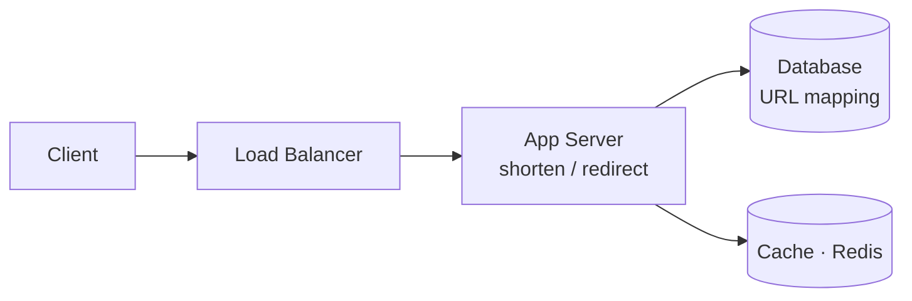
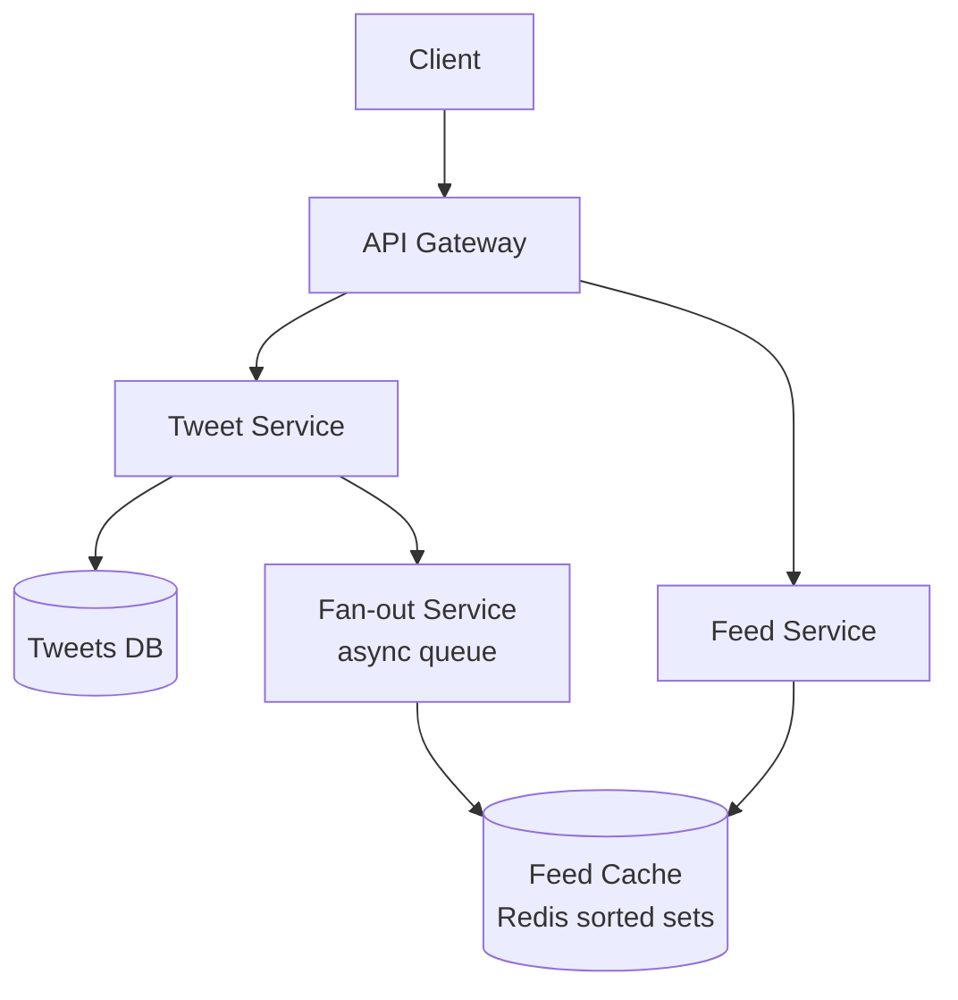

**Navigation**: [Back to Index](../00_MASTER_INDEX.md)
🧠 **Mental Model**: See [System Design Thinking](../14_Mental_Models/15_System_Design_Thinking.md) — structured approach to any "Design X" question

---

# 🏗️ System Design Interview Problems — Complete Walkthroughs

8 classic problems solved step-by-step using the same framework interviewers expect

---

## THE FRAMEWORK (Use for EVERY Problem)

SYSTEM DESIGN INTERVIEW FRAMEWORK (45 minutes)

STEP 1: Requirements (5 min)
→ Functional: What can users do?
→ Non-functional: Scale? Latency? Consistency?
→ Constraints: Users? QPS? Storage?

STEP 2: High-Level Design (10 min)
→ Draw API endpoints
→ Core components (services, databases, caches)
→ Data flow diagram

STEP 3: Detailed Design (15 min)
→ Database schema & choice (SQL vs NoSQL)
→ API design (endpoints, payloads)
→ Key algorithms (hashing, ranking, etc.)

STEP 4: Scale & Bottlenecks (10 min)
→ Identify bottlenecks
→ Caching strategy
→ Database sharding/replication
→ Load balancing

STEP 5: Trade-offs & Edge Cases (5 min)
→ What would break at 100x scale?
→ CAP theorem trade-offs
→ Failure scenarios & recovery

---

# PROBLEM 1: Design URL Shortener (like bit.ly)

## Requirements

```
Functional:
  - Given long URL → return short URL (e.g., bit.ly/abc123)
  - Given short URL → redirect to original
  - Optional: custom aliases, expiration, analytics

Non-Functional:
  - 100M URLs created/month → ~40 URLs/sec write
  - 10:1 read:write ratio → 400 redirects/sec
  - Redirect latency < 50ms
  - URLs should be as short as possible
  - High availability (users can always access their shortened URLs)

Back-of-envelope:
  - 100M URLs/month × 12 months × 5 years = 6B URLs
  - Each record ~500 bytes → 6B × 500 = 3TB storage
  - Short URL: base62 (a-z, A-Z, 0-9) → 62^7 = 3.5 trillion combinations
```

## High-Level Design



🔬 **Section Challenge — High-Level Design**

**Challenge 1 (Reasoning — Who/When/What):** In the URL shortener high-level design, why is Cache placed alongside the Database and not in front of the Load Balancer? **Who** reads from cache? **When** is the cache checked? **What** determines if it's a hit or miss?

<details><summary>Answer</summary>

**Who?** The App Server, not the Load Balancer. The LB only routes TCP connections — it doesn't understand application semantics (which short URL maps to which long URL). **When?** After the App Server receives a redirect request (GET /abc123), it checks Redis FIRST. On hit: return 302 immediately (~1ms). On miss: query DB, populate cache for next time, return 302 (~10ms). **What determines hit/miss?** The short URL key's presence in Redis. The 80/20 rule applies: 20% of URLs get 80% of traffic, so caching hot URLs gives massive throughput gains with minimal memory.

</details>

## Key Design Decisions

```
┌─────────────────────────────────────────────────────────────────────────────────┐
│  SHORT URL GENERATION — 3 Approaches                                            │
│                                                                                 │
│  1. Hash + Truncate:                                                            │
│     MD5(longURL) → take first 7 chars of base62                                 │
│     Problem: collisions! Need to check DB, retry with salt.                     │
│                                                                                 │
│  2. Auto-increment ID + Base62:  ← RECOMMENDED                                  │
│     Database gives ID 12345 → convert to base62 → "dnh"                         │
│     No collisions! But IDs are predictable (sequential).                        │
│                                                                                 │
│  3. Pre-generated Key Service:                                                  │
│     Separate service pre-generates unique keys, hands them out.                 │
│     Keys stored in two tables: used_keys and unused_keys.                       │
│     App server requests batch of keys → fast, no collision.                     │
│                                                                                 │
│  DATABASE CHOICE:                                                               │
│  → NoSQL (DynamoDB/Cassandra) — simple key-value, massive scale                 │
│  → Schema: { shortUrl: "abc123", longUrl: "https://...",                        │
│              createdAt: timestamp, expiresAt: timestamp, userId: "..." }        │
│                                                                                 │
│  CACHING: Redis/Memcached for hot URLs                                          │
│  → 80/20 rule: 20% of URLs get 80% of traffic                                   │
│  → Cache most-accessed short→long mappings                                      │
│  → LRU eviction policy                                                          │
│                                                                                 │
│  REDIRECT: Use HTTP 301 (permanent) or 302 (temporary)                          │
│  → 301: Browser caches redirect → less server load, but can't track analytics   │
│  → 302: Every request hits server → more load, but full analytics  ← BETTER     │
└─────────────────────────────────────────────────────────────────────────────────┘
```

---

🔬 **Section Challenge — Key Design Decisions**

**Challenge 1 (Design):** Compare the 3 short URL generation approaches. If you're building for 100M URLs/month with zero collision tolerance, which approach do you pick and why? What's the trade-off you accept?

<details><summary>Answer</summary>

**Pick: Pre-generated Key Service.** Why? Zero collisions (keys are pre-generated and unique). No DB lookup needed at generation time (just grab a key from the pool). Scales horizontally (each app server caches a batch of unused keys). **Trade-off:** Operational complexity — you need a separate key-generation service, two tables (used/unused), and a batch-refill mechanism. Auto-increment ID + Base62 is simpler but predictable (competitors can guess your URL count). Hash + Truncate has collision risk requiring retry loops. For 100M/month, pre-generated keys provide the best guarantees with acceptable complexity.

</details>

**Challenge 2 (Reasoning):** Why does the design recommend HTTP 302 (temporary redirect) over 301 (permanent) for analytics, even though 301 reduces server load? Use the Who/When/What framework.

<details><summary>Answer</summary>

**Who makes the redirect decision?** With 301: the BROWSER caches the redirect permanently. On subsequent clicks, the browser goes directly to the long URL — the server never sees the request. **When is the server bypassed?** Every click after the first. **What is lost?** All click analytics: click count, geographic distribution, referrer data, device info. With 302: every click hits the server first, the server logs analytics, THEN redirects. **The trade-off:** 302 costs more server load but gives complete analytics. For a URL shortener where analytics IS the product (bit.ly's business model), 302 is essential.

</details>

# PROBLEM 2: Design Twitter / News Feed

## Requirements

```
Functional:
  - Post tweets (140 chars + media)
  - Follow/unfollow users
  - View home timeline (feed of followed users' tweets)
  - Search tweets

Scale:
  - 300M monthly active users, 150M daily active
  - Average user follows 200 people
  - Average user views feed 5x/day → 750M feed reads/day
  - 500M tweets/day → ~6000 tweets/sec
```

## The Hard Part — Feed Generation

```
┌─────────────────────────────────────────────────────────────────────────────────┐
│  TWO APPROACHES TO NEWS FEED                                                    │
│                                                                                 │
│  APPROACH 1: Pull (Fan-out on Read)                                             │
│  ────────────────────────────────────                                           │
│  When user opens feed:                                                          │
│  1. Get list of followed user IDs                                               │
│  2. For each followed user, fetch their recent tweets                           │
│  3. Merge & sort by timestamp                                                   │
│  4. Return top N                                                                │
│                                                                                 │
│  ✅ Simple, works for new tweets immediately                                     │
│  ❌ SLOW at read time (merge 200+ users' tweets on every request!)               │
│  ❌ High read latency                                                            │
│                                                                                 │
│  APPROACH 2: Push (Fan-out on Write)    ← TWITTER'S APPROACH                    │
│  ────────────────────────────────────                                           │
│  When user posts a tweet:                                                       │
│  1. Write tweet to tweets table                                                 │
│  2. Look up all followers                                                       │
│  3. Insert tweet ID into each follower's pre-computed feed cache                │
│                                                                                 │
│  ✅ Feed reads are blazing fast (just read pre-computed list)                    │
│  ❌ Write is expensive (celebrity posts → fan-out to 50M followers!)             │
│  ❌ Wasted work for inactive users                                               │
│                                                                                 │
│  HYBRID (What Twitter actually does):                                           │
│  → Regular users: Push model (fan-out their tweets to followers)                │
│  → Celebrities (>1M followers): Pull model at read time                         │
│  → Merge: pre-computed feed + celebrity tweets fetched on demand                │
└─────────────────────────────────────────────────────────────────────────────────┘
```

## Architecture



---

# PROBLEM 3: Design Chat System (WhatsApp/Slack)

## Requirements & Architecture

```
Functional: 1-on-1 chat, group chat, online status, read receipts
Scale: 50M DAU, each user sends 40 msgs/day = 2B msgs/day

┌─────────────────────────────────────────────────────────────────────────────────┐
│  CHAT SERVICE ARCHITECTURE                                                      │
│                                                                                 │
│  ┌──────┐  WebSocket  ┌────────────┐  Message Queue  ┌──────────────┐           │
│  │Client│◄───────────►│ Chat Server │◄──────────────→│ Message Store│           │
│  └──────┘             │ (stateful!) │                 │ (Cassandra)  │          │
│                       └──────┬─────┘                 └──────────────┘           │
│                              │                                                  │
│                       ┌──────┴──────┐                                           │
│                       │ Presence    │                                           │
│                       │ Service     │                                           │
│                       │ (Redis)     │                                           │
│                       └─────────────┘                                           │
│                                                                                 │
│  KEY DECISIONS:                                                                 │
│  1. WebSocket for real-time bidirectional communication                         │
│     (HTTP long polling as fallback)                                             │
│  2. Chat servers are STATEFUL — each client connected to specific server        │
│     → Need a session mapping: userId → chatServerId                             │
│  3. Message delivery:                                                           │
│     → User online: push via WebSocket                                           │
│     → User offline: store in DB, push notification                              │
│  4. Message ordering: Server timestamp + sequence number per conversation       │
│  5. Group messages: Store once, deliver to each member's connection             │
│  6. Read receipts: Separate "last_read" pointer per user per conversation       │
│                                                                                 │
│  DATABASE SCHEMA:                                                               │
│  messages: {msg_id, conversation_id, sender_id, content, timestamp, type}       │
│  conversations: {conv_id, type(1-on-1/group), participants[], created_at}       │
│                                                                                 │
│  WHY CASSANDRA?                                                                 │
│  → Write-heavy workload (2B msgs/day)                                           │
│  → Partition key: conversation_id                                               │
│  → Clustering key: timestamp                                                    │
│  → Natural time-series data model                                               │
└─────────────────────────────────────────────────────────────────────────────────┘
```

---

# PROBLEM 4: Design Rate Limiter

```
┌─────────────────────────────────────────────────────────────────────────────────┐
│  PURPOSE: Prevent abuse, protect resources, enforce SLAs                        │
│                                                                                 │
│  ALGORITHM 1: Token Bucket                                                      │
│  ─────────────────────────────                                                  │
│  Bucket holds N tokens. Each request takes 1 token.                             │
│  Tokens added at rate R per second. If empty, reject request.                   │
│                                                                                 │
│  Bucket: [●●●●●___]  capacity=8, current=5                                      │
│  Request arrives → take token → [●●●●____]                                      │
│  Refill (every 1/R sec) → [●●●●●___]                                            │
│  Bucket full → tokens overflow (don't exceed capacity)                          │
│  Bucket empty → REJECT (HTTP 429 Too Many Requests)                             │
│                                                                                 │
│  ✅ Allows bursts (up to bucket size)                                            │
│  ✅ Simple to implement                                                          │
│  ✅ Memory efficient: 2 numbers per user (tokens, last_refill_time)              │
│                                                                                 │
│  ALGORITHM 2: Sliding Window Log                                                │
│  ────────────────────────────────                                               │
│  Store timestamp of each request in sorted set.                                 │
│  On new request: remove timestamps older than window, count remaining.          │
│  If count >= limit → reject.                                                    │
│                                                                                 │
│  ✅ Most accurate                                                                │
│  ❌ Memory intensive (stores every timestamp)                                    │
│                                                                                 │
│  ALGORITHM 3: Sliding Window Counter (BEST for most cases)                      │
│  ─────────────────────────────────────                                          │
│  Combine fixed window counters with sliding ratio.                              │
│  Estimate = prev_window_count × overlap% + curr_window_count                    │
│  ✅ Low memory    ✅ Smooths edge cases    ✅ Reasonably accurate                  │
│                                                                                 │
│  DISTRIBUTED RATE LIMITING:                                                     │
│  → Redis + Lua script (atomic increment + expire)                               │
│  → Key: "rate:{userId}:{minute}" → INCR → compare to limit                      │
│  → Set TTL equal to window size                                                 │
└─────────────────────────────────────────────────────────────────────────────────┘
```

---

# PROBLEM 5: Design Notification System

```
┌─────────────────────────────────────────────────────────────────────────────────┐
│  TYPES: Push notification, SMS, Email                                           │
│  SCALE: 10M notifications/day, multiple channels                                │
│                                                                                 │
│  ┌──────────┐     ┌────────────┐     ┌───────────────┐                          │
│  │ Triggers  │────→│ Notification│────→│ Message Queue │                        │
│  │ (events)  │     │  Service    │     │ (Kafka/SQS)  │                         │
│  └──────────┘     └────────────┘     └───────┬───────┘                          │
│                                       ┌──────┼──────┐                           │
│                                       ▼      ▼      ▼                           │
│                                   ┌──────┐┌─────┐┌──────┐                       │
│                                   │ Push ││Email││ SMS  │                       │
│                                   │Worker││Worker││Worker│                      │
│                                   └──┬───┘└──┬──┘└──┬───┘                       │
│                                      ▼       ▼      ▼                           │
│                                   APNs/FCM  SMTP  Twilio                        │
│                                                                                 │
│  KEY DESIGN POINTS:                                                             │
│  1. Decouple with message queue (don't block main flow)                         │
│  2. Separate workers per channel (push, email, SMS)                             │
│  3. Template system: "Hi {name}, your order {orderId} shipped"                  │
│  4. Preference service: user opts out of email but keeps push                   │
│  5. Rate limiting per user per channel (no notification spam)                   │
│  6. Retry with exponential backoff for failed deliveries                        │
│  7. Analytics: delivered, opened, clicked                                       │
│  8. Priority queues: password reset > marketing email                           │
└─────────────────────────────────────────────────────────────────────────────────┘
```

---

# PROBLEM 6: Design Distributed Cache (Redis-like)

```
┌─────────────────────────────────────────────────────────────────────────────────┐
│  WHY: Reduce DB load, sub-millisecond reads                                     │
│                                                                                 │
│  CORE DECISIONS:                                                                │
│                                                                                 │
│  1. EVICTION POLICY:                                                            │
│     LRU (Least Recently Used) — most common                                     │
│     LFU (Least Frequently Used) — better for skewed access                      │
│     TTL (Time To Live) — expire after fixed time                                │
│                                                                                 │
│  2. CACHE PATTERNS:                                                             │
│     Cache-Aside (Lazy Loading):                                                 │
│       Read: Check cache → miss → read DB → write cache → return                 │
│       Write: Write DB → invalidate cache                                        │
│       ✅ Only caches what's needed  ❌ Cache miss penalty                         │
│                                                                                 │
│     Write-Through:                                                              │
│       Write: Write cache AND DB simultaneously                                  │
│       ✅ Cache always fresh  ❌ Write latency (two writes)                        │
│                                                                                 │
│     Write-Behind (Write-Back):                                                  │
│       Write: Write cache → async write DB later                                 │
│       ✅ Low write latency  ❌ Risk of data loss                                  │
│                                                                                 │
│  3. DISTRIBUTED CACHING:                                                        │
│     → Consistent hashing to distribute keys across cache nodes                  │
│     → When node dies, only 1/N keys need redistribution                         │
│     → Virtual nodes for better distribution                                     │
│                                                                                 │
│  4. CACHE PROBLEMS:                                                             │
│     Cache stampede: Many threads miss cache simultaneously → DB crushed         │
│     Fix: Distributed lock (only one thread fetches, others wait)                │
│                                                                                 │
│     Cache penetration: Queries for non-existent keys always miss                │
│     Fix: Cache null results with short TTL, or use Bloom filter                 │
│                                                                                 │
│     Cache avalanche: Many keys expire at same time → sudden DB load             │
│     Fix: Add random jitter to TTL values                                        │
└─────────────────────────────────────────────────────────────────────────────────┘
```

---

# PROBLEM 7: Design E-Commerce System (Amazon-like)

```
┌─────────────────────────────────────────────────────────────────────────────────┐
│  MICROSERVICES ARCHITECTURE                                                     │
│                                                                                 │
│  ┌──────────┐     ┌──────────────┐                                              │
│  │  Client   │────→│  API Gateway  │                                            │
│  └──────────┘     └──────┬───────┘                                              │
│                          │                                                      │
│        ┌─────────────────┼─────────────────┐                                    │
│        ▼                 ▼                 ▼                                    │
│  ┌───────────┐    ┌───────────┐    ┌───────────┐                                │
│  │  Product   │    │  Order     │    │  Payment   │                             │
│  │  Service   │    │  Service   │    │  Service   │                             │
│  └─────┬─────┘    └─────┬─────┘    └─────┬─────┘                                │
│        │                │                │                                      │
│  ┌─────┴─────┐    ┌─────┴─────┐    ┌─────┴─────┐                                │
│  │  Product   │    │  Order     │    │  Payment   │                             │
│  │  DB        │    │  DB        │    │  DB        │                             │
│  └───────────┘    └───────────┘    └───────────┘                                │
│        │                │                │                                      │
│        └────────────────┼────────────────┘                                      │
│                         ▼                                                       │
│                  ┌──────────────┐                                               │
│                  │  Kafka/SQS   │  (Event bus for cross-service communication)  │
│                  └──────────────┘                                               │
│                                                                                 │
│  KEY CHALLENGES:                                                                │
│                                                                                 │
│  1. INVENTORY MANAGEMENT (race condition):                                      │
│     100 users buy last item simultaneously                                      │
│     → Optimistic locking: UPDATE inventory SET qty=qty-1                        │
│       WHERE product_id=X AND qty > 0                                            │
│     → If affected rows = 0 → out of stock                                       │
│                                                                                 │
│  2. ORDER SAGA (distributed transaction):                                       │
│     Reserve inventory → Charge payment → Create shipment                        │
│     If payment fails → compensate (release inventory)                           │
│     → Use Saga pattern with compensation steps                                  │
│                                                                                 │
│  3. SEARCH: Elasticsearch for product catalog                                   │
│     → Sync from Product DB via CDC (Change Data Capture)                        │
│                                                                                 │
│  4. CART: Redis (fast, TTL for abandoned carts)                                 │
│     → Merge guest cart with user cart on login                                  │
└─────────────────────────────────────────────────────────────────────────────────┘
```

---

# PROBLEM 8: Design Web Crawler (Google-like)

```
┌─────────────────────────────────────────────────────────────────────────────────┐
│  PURPOSE: Crawl billions of web pages, build search index                       │
│                                                                                 │
│  ARCHITECTURE:                                                                  │
│  ┌────────────┐     ┌──────────────┐     ┌────────────┐                         │
│  │  URL        │────→│  Fetcher      │────→│  Parser     │                      │
│  │  Frontier   │     │  (HTTP GET)   │     │  (Extract   │                      │
│  │  (priority  │     └──────────────┘     │   links,    │                       │
│  │   queue)    │                          │   content)  │                       │
│  └──────┬─────┘                          └──────┬─────┘                         │
│         │                                        │                              │
│         │◄──── new URLs ────────────────────────┘                               │
│         │                                                                       │
│  ┌──────┴──────┐                          ┌────────────┐                        │
│  │  URL Filter  │                          │  Content    │                      │
│  │  (visited?   │                          │  Store      │                      │
│  │   robots.txt │                          │  (S3/HDFS)  │                      │
│  │   Bloom      │                          └────────────┘                       │
│  │   filter)    │                                                               │
│  └─────────────┘                                                                │
│                                                                                 │
│  KEY DESIGN POINTS:                                                             │
│  1. URL Frontier: Priority queue (important pages first)                        │
│     + Politeness queue (one queue per domain, rate limited)                     │
│  2. Deduplication: Bloom filter for "already visited?" check                    │
│     (probabilistic, space-efficient, false positives OK)                        │
│  3. robots.txt: Respect crawl rules per domain, cache them                      │
│  4. DNS resolution: Cache DNS lookups (huge performance gain)                   │
│  5. Content dedup: SimHash/MinHash for near-duplicate pages                     │
│  6. Trap detection: Infinite URL generators, calendar pages                     │
│     → Max depth limit, URL pattern detection                                    │
│  7. Consistent hashing: Distribute URLs to crawler workers                      │
│     → Same domain always goes to same worker (politeness)                       │
└─────────────────────────────────────────────────────────────────────────────────┘
```

### Production Reality

- **URL Shortener — Rate-limit bypass attack**: A token-bucket rate limiter keyed by IP only (`key = "rate:{ip}:{minute}"`) is bypassed by an attacker using 999 different IPs to each send 1 request/minute, totaling 999req/min against a system limit of 1req/min per IP. Production fix: rate-limit by API key + user account tier + IP intersection, not just IP alone. Stripe's rate limiter uses a 3D composite key (user, API key, IP) and evaluates all three dimensions before rejecting — the intersection of all three dimensions prevents the distributed attack.
- **Twitter Feed — Timeline inconsistency during high-write periods**: Twitter's hybrid fan-out (push for regular users, pull for celebrities) creates a delivery ordering bug: a celebrity's replies to a regular user's post can appear in the reply-ee's pre-computed push-cache feed but out of chronological order relative to on-demand pull-cache items. In 2020, a queue-depth saturation in the fan-out message broker (1M+ messages queued) caused a timeline ordering bug where replies from popular accounts appeared hours after newer replies, breaking the sequential ordering invariant clients expected.
- **Chat System — Message ordering with eventual consistency**: Cassandra's eventual consistency means two devices of the same user can deliver messages out of order: Device A sends Message 1, then Message 2. Device B receives Message 2 first (via a different replica with lower replication lag), then Message 1. This is not a design bug — it is the expected trade-off of choosing AP (Cassandra) for write-heavy chat. Production mitigation: server-side monotonic sequence number per conversation + client-side gap detection that triggers a re-sync when sequence numbers skip. This is the Cassandra partition key = `conversation_id` + clustering key = `timestamp` design decision's explicit trade-off: fast writes with possible out-of-order reads.

### Historical Evolution

The eight interview problems trace a path from the earliest consumer internet to today's massive-scale systems. **URL shortening** was born out of the mobile era's character limits: **TinyURL launched in 2002** (Pavlos), and **bit.ly launched in 2008** during Twitter's rapid growth. The URL shortener problem encodes a fundamental tension in system design — deterministic IDs (predictable but collision-free) vs. hash-based IDs (unpredictable but collision-prone) — a trade-off that appears in every key-generation system. **Twitter launched in 2006**, pioneering the fan-out-on-write architecture for social feeds at a scale no one had attempted before; the hybrid push/pull approach (tweaked in later years) remains the state of the art for feed systems. **Chat systems** (WhatsApp, Slack) evolved from SMS-based architectures to WebSocket-driven real-time systems after 2010, driven by smartphone penetration and the need for free messaging. **Rate limiting** as a formal discipline traces back to **Leaky Bucket (1983)** and **Token Bucket** algorithms from early network QoS research; today it is implemented atomically in Redis with Lua scripts for distributed environments. The **distributed cache** problem (Redis-like) is rooted in **Memcached (2003)** at LiveJournal — the first widely-used in-memory cache — which pioneered the cache-aside pattern before Redis added persistence in 2009. **E-commerce systems** at scale (Amazon 1998, Shopify 2004) evolved from monolithic to microservices architectures after 2010, driven by the need for independent deployability. The **web crawler** problem traces to **Larry Page's PageRank (1998)** at Stanford — Google built the first large-scale distributed crawler to index the web at internet scale.

---

## QUICK REFERENCE — Which Concepts Each Problem Tests

| Problem           | Key Concepts Tested                                         |
| ----------------- | ----------------------------------------------------------- |
| **URL Shortener** | Hashing, base62, NoSQL, caching, HTTP redirects             |
| **Twitter Feed**  | Fan-out, message queues, Redis sorted sets, hybrid approach |
| **Chat System**   | WebSocket, presence, Cassandra, message ordering            |
| **Rate Limiter**  | Token bucket, sliding window, Redis Lua, distributed state  |
| **Notifications** | Message queues, worker pools, templates, retry/backpressure |
| **Dist. Cache**   | Consistent hashing, LRU, cache patterns, cache stampede     |
| **E-Commerce**    | Saga pattern, inventory locking, search, microservices      |
| **Web Crawler**   | BFS, Bloom filter, politeness, robots.txt, URL frontier     |

---

## PLUS Enhancements

### Crystal-Clear Diagrams

#### 1. URL Shortener Architecture

```
                ┌──────────────┐
   ┌────────┐   │ Load Balancer │   ┌─────────────┐   ┌─────────┐
   │ Client │──▶│   (Nginx)    │──▶│ API Servers │──▶│ Redis   │
   └────────┘   └──────────────┘   │ (stateless) │   │ (cache) │
                                   └──────┬──────┘   └────┬────┘
                                          │               │
                                          │ miss          │ hit (95%+)
                                          ▼               ▼
                                   ┌─────────────────────────┐
                                   │   Sharded DB (by hash)  │
                                   │   S1: 0-25%, S2: 25-50% │
                                   └─────────────────────────┘

   Analytics Sidecar (Kafka consumer):
   ┌──────────┐  ┌──────┐  ┌──────────────────┐  ┌────────────┐
   │ API logs │─▶│ Kafka│─▶│ Analytics Worker │─▶│ ClickHouse │
   └──────────┘  └──────┘  └──────────────────┘  └────────────┘
```

**Key design points**: API stateless (any server can handle any request), Redis for hot URLs (95%+ cache hit), DB sharded by hash(short_code) for write/read scalability, Kafka + ClickHouse for analytics (separate from serving path).

#### 2. Twitter Hybrid Fan-out Architecture

```
Tweet by Regular User (≤1K followers):
┌─────────┐    ┌─────────┐    ┌──────────┐    ┌─────────────┐
│ User X  │───▶│ Tweet   │───▶│ Fan-out  │───▶│ Push to all │ (write to each follower's
│ tweets  │    │ Service │    │ Service  │    │ followers'  │  timeline cache in Redis)
└─────────┘    └─────────┘    └──────────┘    │ timeline    │
                                              └─────────────┘ (O(followers))

Tweet by Celebrity (>1M followers):
┌─────────┐    ┌─────────┐    ┌──────────┐    ┌─────────────┐
│ Celeb Y │───▶│ Tweet   │───▶│ Just     │    │ ONLY write  │ (O(1) write)
│ tweets  │    │ Service │    │ store in │───▶│ to Celeb's  │
└─────────┘    └─────────┘    │ Celeb's  │    │ tweet store │
                              │ store    │    └─────────────┘
                              └──────────┘

Read path (regular user):
┌──────────┐  ┌─────────┐  ┌──────────────────┐  ┌─────────┐
│ User Z   │─▶│ Timeline│─▶│ Merge: pushed    │─▶│ Render  │
│ requests │  │ Service │  │ timeline + celeb │  │ sorted  │
│ feed     │  │         │  │ tweets (on read) │  │ feed    │
└──────────┘  └─────────┘  └──────────────────┘  └─────────┘
```

**Trade-off**: Push (regular users) gives instant consistency but is O(followers). Pull (celebrities) is O(1) write but requires merge on read. Hybrid picks the cheaper side based on follower count.

#### 3. Rate Limiter Architecture

```
  ┌─────────┐  ┌────────────┐  ┌──────────────────┐  ┌─────────────┐
  │ Client  │─▶│ API Gateway│─▶│ Rate Limiter     │─▶│ Backend     │
  └─────────┘  └────────────┘  │ (Redis + Lua)    │  │ Service     │
                               └──────────────────┘  └─────────────┘

Lua script atomic check:
KEYS[1] = "rl:{user_id}"
ARGV[1] = current_limit
ARGV[2] = window_seconds

local current = tonumber(redis.call('GET', KEYS[1]) or "0")
if current >= tonumber(ARGV[1]) then
  return 0  -- denied
else
  redis.call('INCR', KEYS[1])
  redis.call('EXPIRE', KEYS[1], ARGV[2])
  return 1  -- allowed
end
```

**Why Lua + Redis**: Lua script runs atomically in Redis (single-threaded), preventing race conditions in token-bucket check-and-increment. Distributed limiter without a distributed lock.

### In-Depth Explanations

#### Mechanism Deep-Dive: Consistent Hashing

**Problem with naive hashing**: `shard = hash(key) % N_servers`. Adding/removing one server invalidates ALMOST ALL keys (only K/N stay on the same shard). Cache miss storm.

**Consistent hashing solution**: Hash both keys AND servers onto a ring of 0..2^32. Each key is stored on the next server clockwise from its hash.

```
   Ring (0..2^32):
                 Server B
                    ●
                ╱     ╲
           ╱             ╲
        ╱                   ╲
      ●                       ●
   Server A                 Server D
        ╲                   ╱
           ╲             ╱
                ╲     ╱
                    ●
                 Server C

Key K1 → hash(K1) lands between A and B → stored on B
Key K2 → hash(K2) lands between B and D → stored on D
```

**Adding Server E**: E is inserted somewhere on the ring. Only the keys that fall between E's position and the next-server-clockwise position move. This is approximately K/N keys. **95% cache hit preserved across server additions.**

**Virtual nodes**: Real servers are placed at multiple positions on the ring (e.g., 200 positions each). This smooths out the distribution (without virtual nodes, an unlucky hash placement gives one server 10× the keys of another).

#### Why-This-Not-That: Push vs Pull Fan-out

| Aspect | Push (write fan-out) | Pull (read fan-out) |
|--------|---------------------|---------------------|
| **Write cost** | O(followers) per tweet | O(1) per tweet |
| **Read cost** | O(1) timeline read | O(following) timeline merge |
| **Consistency** | Instant (already pushed) | Eventual (tweet visible on next read) |
| **Storage** | High (1 copy per follower) | Low (1 copy total) |
| **Best for** | Users with few followers | Celebrities with many followers |
| **Failure mode** | "Follower can't see tweet" if push fails | "Tweet missing on next reload" |

**Hybrid**: classify user by follower count, route accordingly.

### Breadth Comparisons

#### Database Choice by Problem

| Problem | Database Choice | Reason |
|---------|----------------|--------|
| URL shortener | Cassandra / DynamoDB | Massive write scale (billions of URLs), simple key-value lookup, no complex joins |
| Twitter timeline | Cassandra / ScyllaDB | Wide-column for time-series with clustering key = timestamp, fan-out writes |
| Chat system | Cassandra with partition key = conversation_id | Same wide-column pattern, message ordering preserved within partition |
| Rate limiter | Redis (in-memory) | Microsecond read/write, atomic Lua scripts, TTL-based expiry |
| Notification | Kafka (log) + DB | Append-only event log for delivery audit |

#### Caching Strategies

| Strategy | Read Path | Write Path | Consistency | Best For |
|----------|-----------|-----------|-------------|----------|
| **Cache-aside (lazy)** | App reads cache, on miss reads DB and populates cache | App writes DB, invalidates cache | Eventual (window of stale reads) | Read-heavy, tolerate staleness |
| **Write-through** | App reads cache (always fresh) | App writes cache, cache writes DB synchronously | Strong | Read-heavy, must be fresh |
| **Write-behind** | App reads cache (always fresh) | App writes cache, cache asynchronously writes DB | Eventual (data loss risk on crash) | Write-heavy, tolerate data loss |
| **Read-through** | App reads cache, cache reads DB on miss | App writes DB, cache invalidates | Eventual | Read-heavy with lazy population |

---

**Navigation**: [< Previous](04_User_System_Flows.md) | [Back to Index](../00_MASTER_INDEX.md) | [Next >](06_Distributed_Systems_Fundamentals.md)
