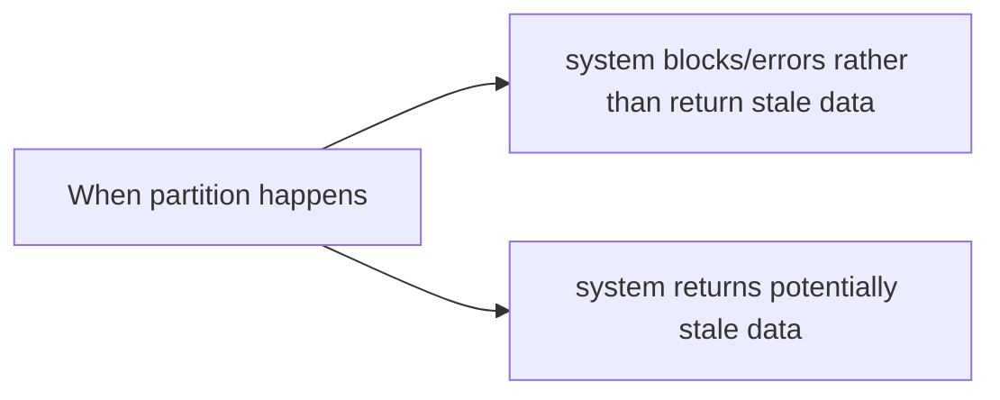
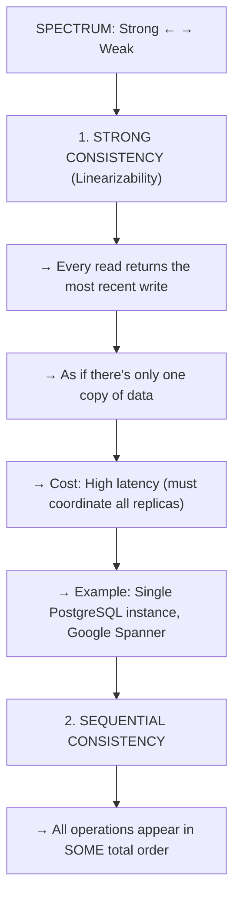
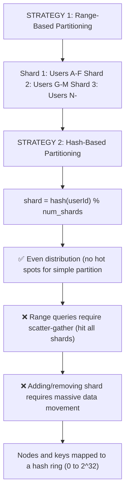
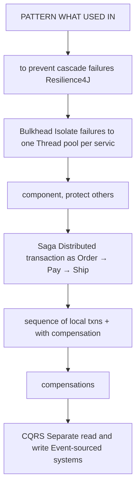
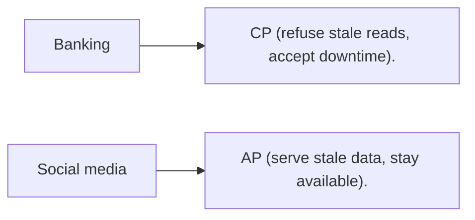

> **Navigation**: [Back to Index](../00_MASTER_INDEX.md) | [System Design Problems](05_SD_Interview_Problems.md)
> 🧠 **Mental Model**: See [Distributed Systems Thinking](../14_Mental_Models/16_Distributed_Systems_Thinking.md)

---

# 🌐 Distributed Systems Fundamentals — CAP, Consistency, Partitioning

> Everything you need to reason about systems that span multiple machines

---

## Part 1: Why Distributed Systems?


> THE FUNDAMENTAL PROBLEM
>
> Single machine:  Simple, consistent, but limited
> → CPU/Memory/Disk have hard ceilings
> → Single point of failure (SPOF)
>
> Distributed system: Multiple machines working together
> → Scale beyond single machine limits
> → Survive individual machine failures
> → BUT: introduces network as unreliable component
>
> REAL-WORLD ANALOGY: One chef vs a restaurant kitchen
> One chef: Perfect coordination, limited throughput
> Kitchen team: High throughput, but needs communication protocols
> → Miscommunication = wrong orders, duplicate dishes, lost tickets


---

## Part 2: CAP Theorem

```
                    Consistency (C)
                        /\
                       /  \
                      /    \
                     / CP   \
                    / systems \
                   /──────────\
                  /            \
                 / You can only  \
                /  pick 2 of 3    \
               /    (during a      \
              /     partition)       \
             /                        \
            /     CA        AP         \
           /   systems    systems       \
          /──────────────────────────────\
     Availability (A)               Partition Tolerance (P)

  REALITY: Network partitions WILL happen (P is not optional)
  → Real choice is: CP or AP

  CP (Consistency + Partition Tolerance):
    When partition happens → system blocks/errors rather than return stale data
    Examples: MongoDB (default), HBase, Redis Cluster, ZooKeeper
    Use when: Bank transfers, inventory counts, leader election

  AP (Availability + Partition Tolerance):
    When partition happens → system returns potentially stale data
    Examples: Cassandra, DynamoDB, CouchDB, DNS
    Use when: Social media feeds, product catalog, shopping cart
```

**Flow:**
- When partition happens
- ↓
- system blocks/errors rather than return stale data
- ↓
- When partition happens
- ↓
- system returns potentially stale data



### CAP in Plain English

> SCENARIO: You run 2 database replicas (Node A, Node B)
> A network partition splits them — they can't talk to each other
>
> [Node A]  ✂️ network partition ✂️  [Node B]
>
> A write comes to Node A: "Set balance = $100"
> A read comes to Node B: "What's the balance?"
>
> CHOICE 1 (CP): Node B says "Sorry, I can't answer — I might be stale"
> → Consistent ✅  Available ❌
>
> CHOICE 2 (AP): Node B returns old value "$80"
> → Available ✅  Consistent ❌
>
> You CANNOT have both during a partition. Period.


---

## Part 3: Consistency Models

```
┌─────────────────────────────────────────────────────────────────────────────────┐
│  SPECTRUM: Strong ←───────────────────────────────────→ Weak                    │
│                                                                                 │
│  1. STRONG CONSISTENCY (Linearizability)                                        │
│     → Every read returns the most recent write                                  │
│     → As if there's only one copy of data                                       │
│     → Cost: High latency (must coordinate all replicas)                         │
│     → Example: Single PostgreSQL instance, Google Spanner                       │
│                                                                                 │
│  2. SEQUENTIAL CONSISTENCY                                                      │
│     → All operations appear in SOME total order                                 │
│     → Same order observed by all nodes                                          │
│     → But that order might not match real-time wall clock                       │
│                                                                                 │
│  3. CAUSAL CONSISTENCY                                                          │
│     → Operations that are causally related are seen in order                    │
│     → Concurrent operations may be seen in different orders                     │
│     → Example: "I replied to your message" always appears after your message    │
│                                                                                 │
│  4. EVENTUAL CONSISTENCY                                                        │
│     → Given enough time with no new writes, all replicas converge               │
│     → Reads may return stale data temporarily                                   │
│     → Cost: Cheapest, fastest                                                   │
│     → Example: DNS, S3, DynamoDB (default)                                      │
│                                                                                 │
│  REAL-WORLD MAP:                                                                │
│  ┌────────────────────┬──────────────────────────────────────────────────────┐  │
│  │ Strong             │ Banking, inventory, leader election                  │  │
│  │ Causal             │ Social media comments, collaborative editing         │  │
│  │ Eventual           │ DNS, CDN, product catalog, analytics                │   │
│  └────────────────────┴──────────────────────────────────────────────────────┘  │
└─────────────────────────────────────────────────────────────────────────────────┘
```

**Flow:**
- SPECTRUM: Strong ←
- ↓
- Weak
- ↓
- 1. STRONG CONSISTENCY (Linearizability)
- ↓
- Every read returns the most recent write
- ↓
- As if there's only one copy of data
- ↓
- Cost: High latency (must coordinate all replicas)
- ↓
- Example: Single PostgreSQL instance, Google Spanner
- ↓
- 2. SEQUENTIAL CONSISTENCY



---

## Part 4: Replication Strategies

```
1. SINGLE LEADER (Master-Slave)

   ┌────────┐  writes   ┌────────┐
   │ Client  │──────────→│ Leader  │───replicate──→ Follower 1
   └────────┘           └────────┘───replicate──→ Follower 2
   reads from any       (one writer)

   ✅ Simple, strong consistency possible
   ❌ Leader is bottleneck, failover complexity
   Examples: PostgreSQL streaming replication, MySQL

2. MULTI-LEADER

   Leader A ◄────sync────► Leader B
     ↓                       ↓
   Followers              Followers

   ✅ Write to nearest datacenter (low latency)
   ❌ Conflict resolution is HARD (last-writer-wins, merge, custom logic)
   Examples: CouchDB, multi-region DynamoDB

3. LEADERLESS (Quorum-based)

   Client writes to N replicas simultaneously
   Read from R replicas, take most recent
   Rule: W + R > N guarantees overlap → strong consistency POSSIBLE

   N=3, W=2, R=2: Every read overlaps with at least one write replica

   ✅ No single point of failure
   ❌ Complex conflict resolution, repair mechanisms
   Examples: Cassandra, DynamoDB, Riak
```

**Flow:**
- Client --(writes)-->
- ↓
- Leader


---

## Part 5: Partitioning (Sharding)

```
┌─────────────────────────────────────────────────────────────────────────────────┐
│  WHY: Single machine can't hold all data → split across machines                │
│                                                                                 │
│  STRATEGY 1: Range-Based Partitioning                                           │
│  ─────────────────────────────────────                                          │
│  Shard 1: Users A-F    Shard 2: Users G-M    Shard 3: Users N-Z                 │
│                                                                                 │
│  ✅ Range queries are efficient (get all users A-C → only shard 1)               │
│  ❌ Hot spots! (If most users start with "S", shard 3 overloaded)                │
│                                                                                 │
│  STRATEGY 2: Hash-Based Partitioning                                            │
│  ────────────────────────────────────                                           │
│  shard = hash(userId) % num_shards                                              │
│                                                                                 │
│  ✅ Even distribution (no hot spots for simple partition key)                    │
│  ❌ Range queries require scatter-gather (hit all shards)                        │
│  ❌ Adding/removing shard requires massive data movement                         │
│                                                                                 │
│  STRATEGY 3: Consistent Hashing  ← BEST FOR DISTRIBUTED SYSTEMS                 │
│  ─────────────────────────────────                                              │
│  Nodes and keys mapped to a hash ring (0 to 2^32)                               │
│  Key assigned to nearest node clockwise                                         │
│                                                                                 │
│       0                                                                         │
│      ╱ ╲        Node A at position 100                                          │
│    ╱     ╲      Node B at position 200                                          │
│   ╱       ╲     Node C at position 300                                          │
│  ╱    ●A   ╲                                                                    │
│  │  ●B   ●C │   Key at position 150 → goes to Node B (nearest clockwise)        │
│  ╲         ╱                                                                    │
│   ╲       ╱     When Node B dies: only keys between A and B move to C           │
│    ╲     ╱      Not ALL keys — just 1/N of them!                                │
│      ╲ ╱                                                                        │
│                                                                                 │
│  Virtual nodes: Each physical node owns multiple positions on ring              │
│  → Better distribution, smoother rebalancing                                    │
└─────────────────────────────────────────────────────────────────────────────────┘
```

**Flow:**
- STRATEGY 1: Range-Based Partitioning
- ↓
- Shard 1: Users A-F Shard 2: Users G-M Shard 3: Users N-
- ↓
- STRATEGY 2: Hash-Based Partitioning
- ↓
- shard = hash(userId) % num_shards
- ↓
- ✅ Even distribution (no hot spots for simple partition
- ↓
- ❌ Range queries require scatter-gather (hit all shards)
- ↓
- ❌ Adding/removing shard requires massive data movement



---

## Part 6: Consensus Algorithms


> PROBLEM: Multiple nodes must agree on a value (leader, transaction, order)
>
> RAFT (Understandable Consensus)
> ────────────────────────────────
> 3 roles: Leader, Follower, Candidate
>
> 1. Leader Election:
> → Followers wait for heartbeat from leader
> → No heartbeat → timeout → become Candidate
> → Candidate requests votes from all nodes
> → Majority votes → become Leader
>
> 2. Log Replication:
> → Client sends write to Leader
> → Leader appends to log, sends to Followers
> → Majority acknowledge → Leader commits
> → Leader tells Followers to commit
>
> WHY MAJORITY (Quorum)?
> → 5 nodes: need 3 to agree
> → Can tolerate 2 failures
> → Any two majorities overlap by at least 1 node
> → Guarantees the committed value is never lost
>
> USED BY: etcd (Kubernetes), CockroachDB, TiKV, Consul


---

## Part 7: Common Distributed System Patterns

```
┌─────────────────────────────────────────────────────────────────────────────────┐
│  PATTERN              │ WHAT                          │ USED IN                 │
│──────────────────────┼───────────────────────────────┼────────────────────────  │
│  Circuit Breaker      │ Stop calling failing service  │ Netflix Hystrix,        │
│                       │ to prevent cascade failures   │ Resilience4J            │
│──────────────────────┼───────────────────────────────┼────────────────────────  │
│  Bulkhead             │ Isolate failures to one       │ Thread pool per service │
│                       │ component, protect others     │                         │
│──────────────────────┼───────────────────────────────┼────────────────────────  │
│  Saga                 │ Distributed transaction as    │ Order → Pay → Ship      │
│                       │ sequence of local txns +      │ with compensation       │
│                       │ compensations                 │                         │
│──────────────────────┼───────────────────────────────┼────────────────────────  │
│  CQRS                 │ Separate read and write       │ Event-sourced systems   │
│                       │ models/databases              │                         │
│──────────────────────┼───────────────────────────────┼────────────────────────  │
│  Event Sourcing       │ Store events, not state       │ Banking ledger, audit   │
│                       │ Rebuild state by replaying    │ systems                 │
│──────────────────────┼───────────────────────────────┼────────────────────────  │
│  Sidecar              │ Attach helper process to main │ Service mesh (Istio),   │
│                       │ service (logging, proxy)      │ Envoy proxy             │
│──────────────────────┼───────────────────────────────┼────────────────────────  │
│  Leader Election      │ One node coordinates work     │ ZooKeeper, etcd         │
│──────────────────────┼───────────────────────────────┼────────────────────────  │
│  Gossip Protocol      │ Nodes share state by random   │ Cassandra, Consul       │
│                       │ peer-to-peer communication    │                         │
└─────────────────────────────────────────────────────────────────────────────────┘
```

**Flow:**
- PATTERN WHAT USED IN
- ↓
- to prevent cascade failures Resilience4J
- ↓
- Bulkhead Isolate failures to one Thread pool per servic
- ↓
- component, protect others
- ↓
- Saga Distributed transaction as Order
- ↓
- Pay
- ↓
- Ship
- ↓
- Saga Distributed transaction as Order
- ↓
- Pay
- ↓
- Ship
- ↓
- sequence of local txns + with compensation
- ↓
- compensations



---

## Part 8: Interview Quick-Fire Questions

```
Q: "How do you handle a network partition?"
A: Decide CP or AP based on business requirements.
   Banking → CP (refuse stale reads, accept downtime).
   Social media → AP (serve stale data, stay available).

Q: "How does consistent hashing work?"
A: Map nodes and keys to a ring. Key goes to nearest node clockwise.
   Adding/removing node only affects neighbors, not all keys.
   Virtual nodes improve distribution.

Q: "Explain the Saga pattern."
A: Break distributed transaction into local transactions.
   Each step has a compensating action (undo).
   If step 3 fails: run compensate_3, compensate_2, compensate_1.
   Two types: Choreography (events) vs Orchestration (central coordinator).

Q: "What's the difference between horizontal and vertical scaling?"
A: Vertical: bigger machine (more CPU/RAM). Simple but has ceiling.
   Horizontal: more machines. Complex but unlimited scale.
   Horizontal needs: load balancing, data partitioning, state management.
```

**Flow:**
- Banking
- ↓
- CP (refuse stale reads, accept downtime).
- ↓
- Social media
- ↓
- AP (serve stale data, stay available).



---

> **Navigation**: [< Previous](05_SD_Interview_Problems.md) | [Back to Index](../00_MASTER_INDEX.md) | [Next >](07_LLD_Solved_Problems.md)